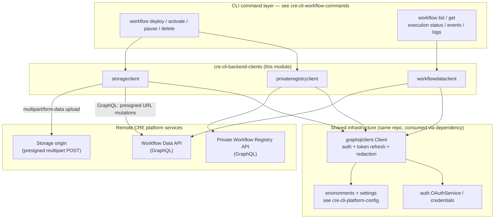
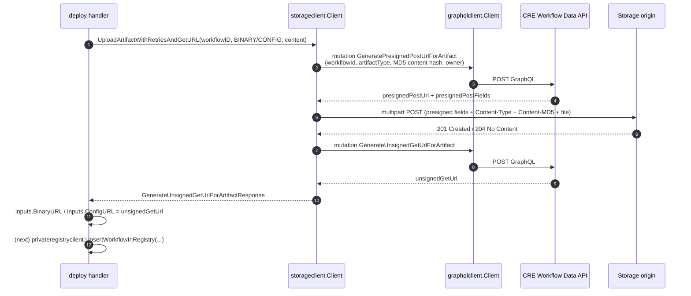
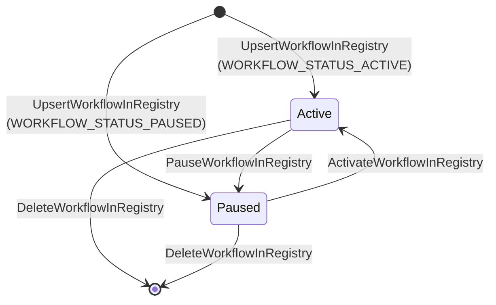
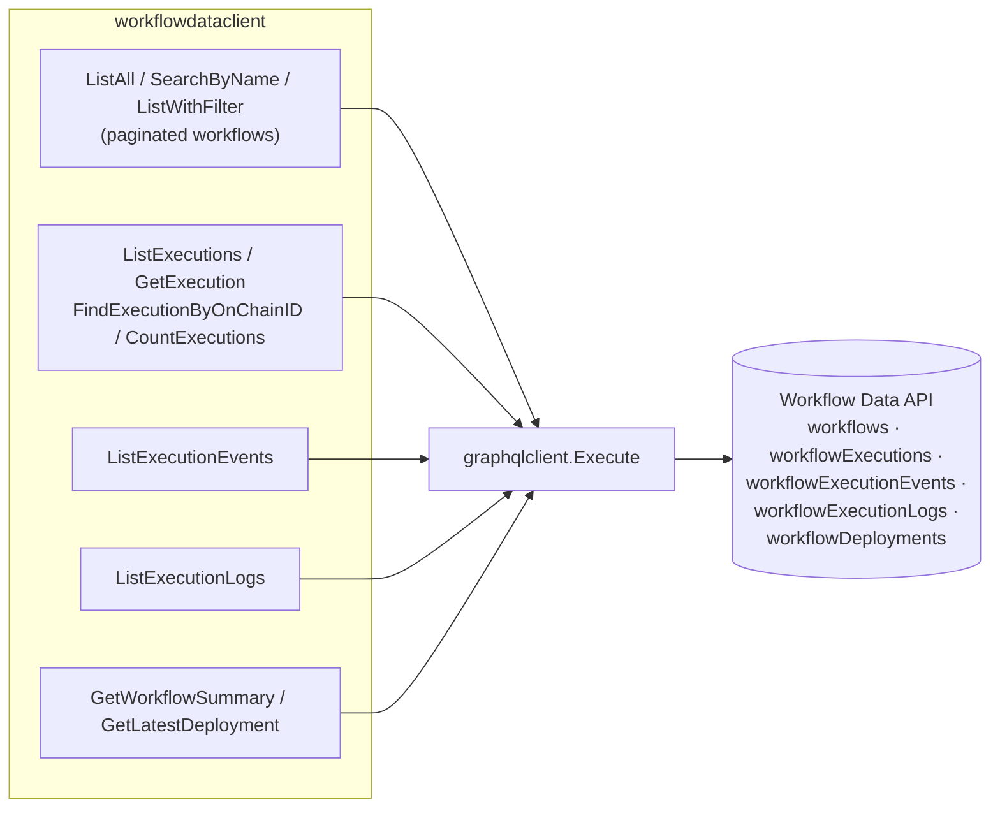

# cre-cli-backend-clients

## Overview

`cre-cli-backend-clients` is the **remote data-access layer of the CRE CLI** (`cre-cli`). It packages every call the CLI makes to backend CRE platform services into three focused Go client packages under `cre-cli/internal/client/`:

| Package | Backend Service | Transport | Responsibility |
|---|---|---|---|
| `privateregistryclient` | Private (offchain) Workflow Registry | GraphQL queries & mutations | Register, pause, activate, delete and look up offchain workflows |
| `storageclient` | CRE Storage Service (presigned object storage origin) | GraphQL mutations + multipart HTTP POST | Upload workflow binaries/config artifacts with retries and return their read URLs |
| `workflowdataclient` | CRE Workflow Data API | GraphQL queries (read-only) | List/search workflows; inspect executions, capability events, logs, summaries and deployment records |

All three clients are thin, typed wrappers around a shared [graphqlclient](#shared-client-infrastructure-graphqlclient) that handles authentication, token refresh, logging and error normalisation, so each service client only contains its GraphQL documents, request/response types and service-specific behaviour (validation, retries, timeouts).

## Role in the overall system

The module sits between the CLI command layer and the remote CRE platform:

- **Consumed by** the workflow lifecycle commands — see [cre-cli-workflow-commands](cre-cli-workflow-commands.md). For example, `cre workflow deploy` uses `storageclient` to push artifacts and `privateregistryclient` to register the workflow (`cre-cli/cmd/workflow/deploy/artifacts.go`, `cre-cli/cmd/workflow/deploy/registry_deploy_strategy_private.go`); `cre workflow list` / `execution` commands use `workflowdataclient`.
- **Configured by** the platform config layer — see [cre-cli-platform-config](cre-cli-platform-config.md). The GraphQL endpoint comes from the resolved environment set (`EnvironmentSet.GraphQLURL`), credentials from `internal/credentials`, and timeout overrides from project settings (e.g. `StorageSettings.CREStorage.ServiceTimeout` / `HTTPTimeout`).
- **Complementary to** the secrets gateway client — see [cre-cli-secrets](cre-cli-secrets.md), which talks to the Vault Gateway over its own HTTP client rather than the GraphQL data plane.

## Shared client infrastructure (graphqlclient)

Every client in this module is constructed with a `*graphqlclient.Client` (file `cre-cli/internal/client/graphqlclient/graphqlclient.go`). It is the foundational dependency of the module and provides:

- **Endpoint resolution** — built from the resolved environment set (`environments.EnvironmentSet.GraphQLURL`), so CLI targets/tenants select the platform instance.
- **Authentication** — sets `Authorization` per request as either `Apikey <key>` or `Bearer <token>`, depending on `credentials.Credentials.AuthType`.
- **Automatic token refresh** — decodes the JWT `exp` claim of the access token and refreshes via `auth.OAuthService` when within a 60-second buffer (`bufferSeconds`), persisting refreshed tokens back to disk.
- **Safe logging** — routes raw request logs through a regular expression that redacts `Authorization` header values before they reach the `zerolog` debug output.
- **Error normalisation** — rewrites transport-level `graphql: ...` errors into `cre api error: ...` so service clients and commands can match on a stable prefix (e.g. `workflowdataclient` detects `Cannot query field` messages for schema-compatibility fallbacks).
- **Guard rails** — rejects execution without credentials and stamps a `User-Agent: cre-cli` header on every request.

Service clients never talk to the network directly; they build `graphql.NewRequest(...)` documents and delegate to `Execute(ctx, req, &container)`.

## Common client patterns

All three clients follow the same conventions, which keeps them predictable and testable:

| Pattern | Implementation |
|---|---|
| **Dependency injection** | Constructors take the shared `*graphqlclient.Client` and a `*zerolog.Logger` (`New(...)`); no global state. |
| **Per-call timeouts** | Each service method creates a derived context via `CreateServiceContextWithTimeout(parent)`; the default is 1 minute, overridable per client with `SetServiceTimeout(...)` (the storage client adds a separate `SetHTTPTimeout(...)` for origin uploads). |
| **Typed GraphQL envelopes** | Queries/mutations are Go string constants; responses are unmarshalled into small JSON-tagged envelope structs (e.g. `listWorkflowsEnvelope`, `getExecutionEnvelope`, `UpsertOffchainWorkflowResponse`) and mapped to exported domain structs before being returned. |
| **Client-side validation** | Required fields, length limits and enum values are checked before any network call (e.g. `validateUpsertWorkflowInput` in the registry client; workflow-ID/content checks in the storage client). |
| **Structured debug logging** | Every remote call emits a `zerolog` debug event with relevant identifiers (workflow ID/name, URLs, counts). |
| **Schema-drift resilience** | `workflowdataclient` retries queries with reduced field sets when the platform rejects newer fields (`Cannot query field` for `detailedStatus`/`classifiedStatus`; `the requested element is null` for `executionCountByStatus`). |
| **Retries** | `storageclient` uses `avast/retry-go` (3 attempts, context-aware) around URL generation and origin upload, and treats "already exists" as an idempotent skip. |

## Sub-modules

The module is documented in three sub-module pages, one per client package:

1. **[Private Registry Client](cre-cli-backend-clients/cre-cli-backend-clients_private-registry-client.md)** — `cre-cli/internal/client/privateregistryclient`. GraphQL mutations/queries for the offchain workflow registry: `UpsertWorkflowInRegistry`, `PauseWorkflowInRegistry`, `ActivateWorkflowInRegistry`, `DeleteWorkflowInRegistry` and `GetWorkflowByName`, together with the `OffchainWorkflow` model, `WORKFLOW_STATUS_ACTIVE/PAUSED` status taxonomy, `FormatStatus` helper and strict client-side validation (required fields, length caps for name/URLs/tag/attributes). Backs the deploy/activate/pause/delete command strategies; duplicate detection and "unchanged" redeploy protection.

2. **[Storage Client](cre-cli-backend-clients/cre-cli-backend-clients_storage-client.md)** — `cre-cli/internal/client/storageclient`. Two-legged artifact pipeline: presigned-POST-URL generation via GraphQL mutation (with base64 MD5 content hash), multipart/form-data upload to the storage origin (accepts 201/204), and unsigned-GET-URL retrieval. Wraps every remote call in `avast/retry-go` (3 attempts, context-aware), treats "already exists" as an idempotent skip, and exposes separate service/HTTP timeout knobs (`SetServiceTimeout` / `SetHTTPTimeout`, wired from `StorageSettings.CREStorage.*`). Used by deploy to publish `BINARY` and `CONFIG` artifact types.

3. **[Workflow Data Client](cre-cli-backend-clients/cre-cli-backend-clients_workflow-data-client.md)** — `cre-cli/internal/client/workflowdataclient` (read-only, three files). Paginated workflow listing (`ListAll`, `SearchByName`, `ListWithFilter`), execution inspection (`ListExecutions`, `GetExecution`, `FindExecutionByOnChainID`, `CountExecutions`, `ListExecutionEvents`, `ListExecutionLogs`), and workflow health (`GetWorkflowSummary`, `GetLatestDeployment`). Includes the execution status taxonomy (`ExecutionStatus` / `DetailedStatus` / `ClassifiedStatus`) and automatic schema-drift fallbacks when the platform lacks newer fields. Powers `workflow list/get` and the `execution` observability commands.

## Key request flows

### 1. Deploy: artifact upload + registry registration

The deploy command first pushes artifacts through the storage client, then registers the workflow with their URLs through the registry client (`cre-cli/cmd/workflow/deploy/artifacts.go`, `registry_deploy_strategy_private.go`). User-supplied `--wasm URL` / `--config URL` values skip the corresponding uploads.

Retry policy: steps 2–3 and 6–8 each retry up to 3 attempts; an "already exists" response from URL generation marks the artifact as uploaded and skips step 4–5.

### 2. Offchain workflow lifecycle (private registry)

The registry client's status model maps directly onto the CLI's workflow commands:

`GetWorkflowByName` backs duplicate detection and redeploy protection in deploy: if the existing workflow's `WorkflowID` matches the artifact's, redeployment is blocked as unchanged; otherwise the stored status is carried over so an update does not silently re-activate a paused workflow.

### 3. Observability read path (workflow data)

Notable behaviours:

- **Pagination** — `ListWorkflows` pages from number 0 until the accumulated count reaches the API-reported total (`DefaultPageSize = 100`); the platform caps execution page size at 100.
- **Execution identity** — executions carry both a platform `uuid` and an on-chain hex `id` (shown in the Explorer UI). `FindExecutionByOnChainID` searches by the hex ID and then verifies an exact, case-insensitive match before fetching the full record by UUID.
- **Execution health** — `WorkflowSummary` aggregates `executionCount` plus a success/failure breakdown (`executionCountByStatus`), with a fallback query when the platform does not yet populate the breakdown; `GetLatestDeployment` orders `workflowDeployments` by `DEPLOYED_AT DESC` and returns the first row (no deployment is a valid, non-error state).
- **Status taxonomy** — `ExecutionStatus` (`TRIGGERED`, `IN_PROGRESS`, `SUCCESS`, `FAILURE`) is refined by optional `DetailedStatus` (`COMPLETED`, `COMPLETED_WITH_ERRORS`, `FAILED`, `FAILED_NO_DETAIL`) and `ClassifiedStatus` (`USER_ERROR` vs `SYSTEM_ERROR`), both nullable when the platform has not derived them.

## Configuration and timeouts

- **Endpoint** — resolved per environment/tenant; see [cre-cli-platform-config](cre-cli-platform-config.md) (`environments.EnvironmentSet.GraphQLURL`, tenant config via `internal/tenantctx`).
- **Timeouts** — all clients default to a 1-minute service timeout; the storage client additionally applies `StorageSettings.CREStorage.ServiceTimeout` / `HTTPTimeout` from project settings when set (see `cre-cli/cmd/workflow/deploy/artifacts.go`).
- **Credentials** — API key or OAuth token pair, persisted by `internal/credentials`; refresh is transparent to this module.

## Dependencies

Declared in `cre-cli/go.mod`:

- `github.com/machinebox/graphql` — minimal GraphQL request/response transport used by every client.
- `github.com/avast/retry-go/v4` — retry loops in the storage client.
- `github.com/rs/zerolog` — structured logging throughout.
- `golang.org/x/crypto`, `github.com/smartcontractkit/chainlink-common/keystore` — used by the surrounding CLI auth/credentials stack that feeds the shared GraphQL client.

## Testing

Each package ships table-driven tests against mocked GraphQL servers (`privateregistryclient_test.go`, `storage_client_test.go`, `workflowdataclient_test.go`, `execution_test.go`, `workflow_status_test.go`), plus `graphqlclient_test.go` for the shared infrastructure. Tests run via the `test` / `test-quick` targets of `cre-cli/Makefile`; linting is enforced by `cre-cli/.golangci.yml` (the source carries targeted `//nolint:gosec` annotations for the intentional MD5 content-integrity hash and context-cancel patterns).
