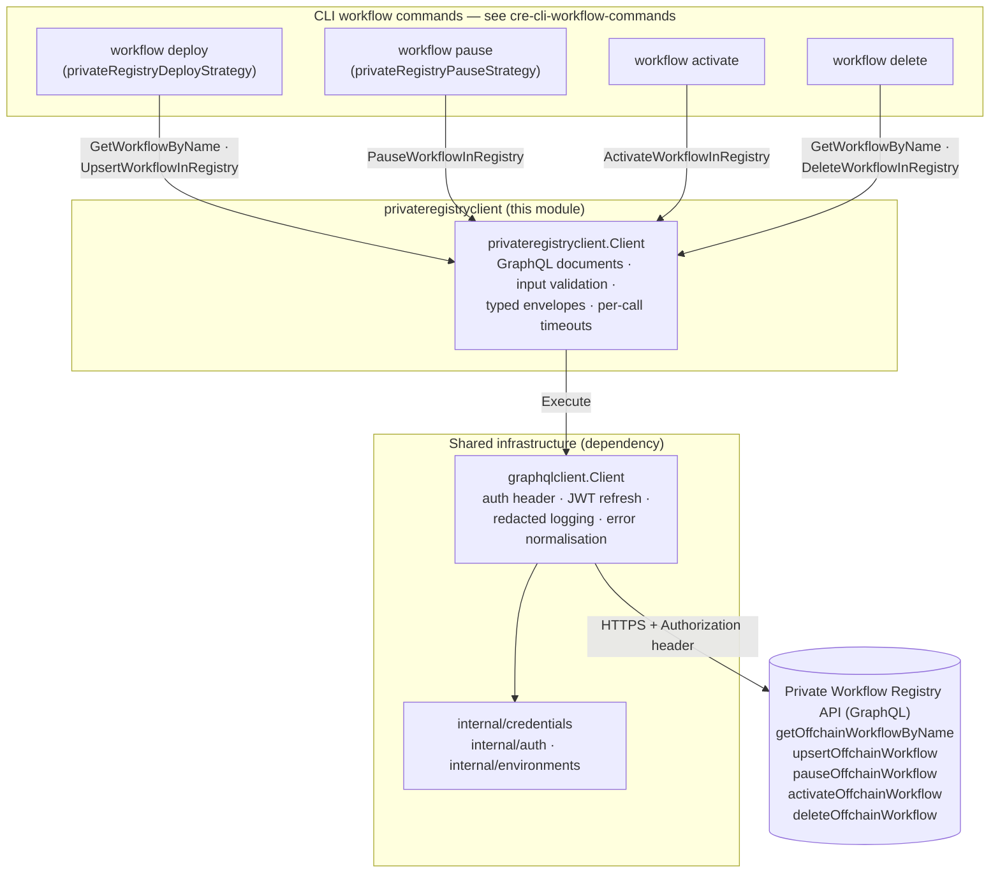
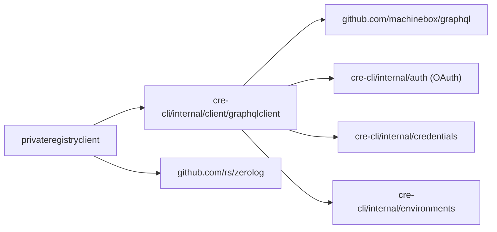
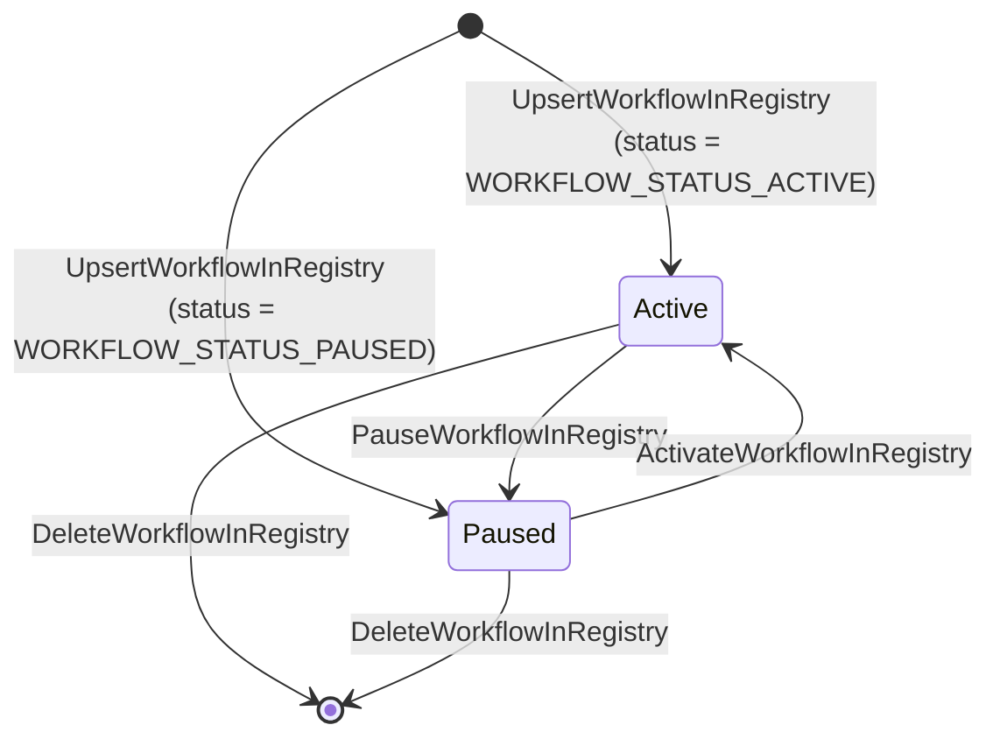
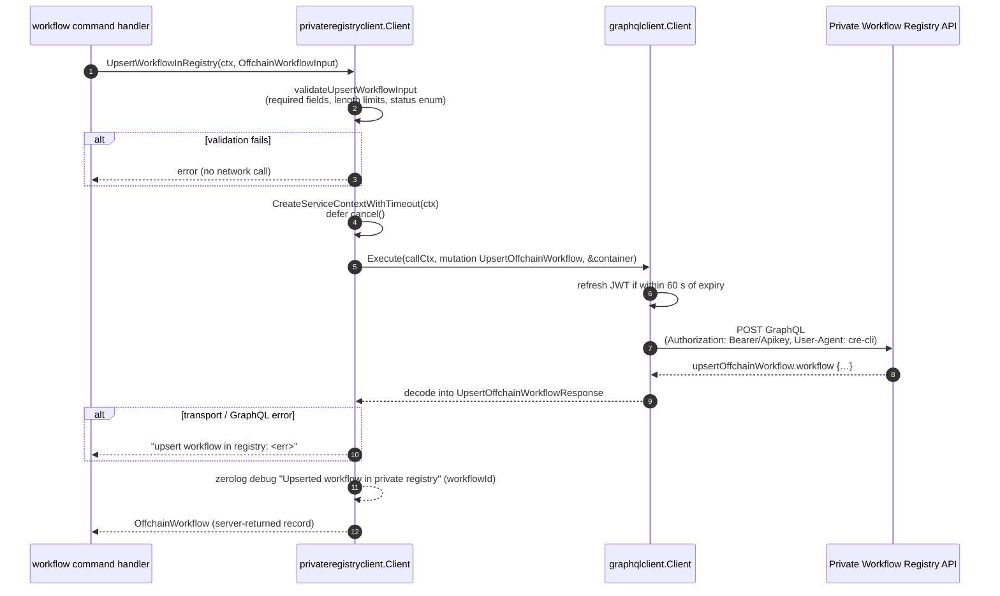
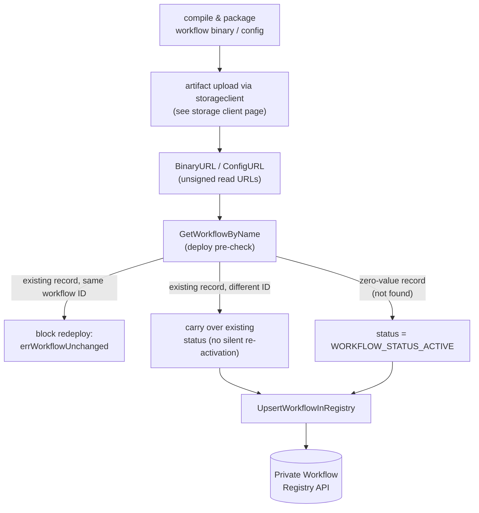

# cre-cli-backend-clients: private-registry-client

## Overview

`private-registry-client` is the Go package `cre-cli/internal/client/privateregistryclient` — the CLI's typed façade for the **Private (offchain) Workflow Registry**. It is one of the three service clients bundled by the [cre-cli-backend-clients](../cre-cli-backend-clients.md) module and is the only one of the three that is *write-oriented* for workflow state itself: it registers, pauses, activates, deletes and looks up **offchain workflow registrations** over a single GraphQL endpoint.

The package is intentionally thin. It contains no HTTP/auth/transport logic of its own; every remote call is delegated to the shared `graphqlclient.Client` (see the [Shared client infrastructure](../cre-cli-backend-clients.md#shared-client-infrastructure-graphqlclient) section of the parent page). What this module adds on top is:

- five GraphQL documents (one query, four mutations) for the registry's offchain-workflow surface;
- the `OffchainWorkflow` domain record and status enum returned by the API;
- client-side validation of the registration payload (`validateUpsertWorkflowInput`);
- per-call timeout management with a 1-minute default (`CreateServiceContextWithTimeout`);
- structured `zerolog` debug events for each remote call.

### Operations at a glance

| Method | GraphQL document | Kind | Input | Returns |
|---|---|---|---|---|
| `GetWorkflowByName(ctx, workflowName)` | `GetOffchainWorkflowByName` | query | workflow name (≤ 64 chars) | `OffchainWorkflow` |
| `UpsertWorkflowInRegistry(ctx, OffchainWorkflowInput)` | `UpsertOffchainWorkflow` | mutation | validated registration payload | `OffchainWorkflow` |
| `PauseWorkflowInRegistry(ctx, workflowID)` | `PauseOffchainWorkflow` | mutation | workflow ID | `OffchainWorkflow` (status `PAUSED`) |
| `ActivateWorkflowInRegistry(ctx, workflowID)` | `ActivateOffchainWorkflow` | mutation | workflow ID | `OffchainWorkflow` (status `ACTIVE`) |
| `DeleteWorkflowInRegistry(ctx, workflowID)` | `DeleteOffchainWorkflow` | mutation | workflow ID | deleted `workflowID` (`string`) |

Every workflow-returning operation selects the same field set from the API: `workflowId`, `owner`, `createdAt`, `status`, `workflowName`, `binaryUrl`, `configUrl`, `tag`, `attributes`, `donFamily`, `organizationId`.

## Architecture and component relationships



The `Client` struct is a plain value holder:

```go
type Client struct {
    graphql        *graphqlclient.Client
    log            *zerolog.Logger
    serviceTimeout time.Duration
}
```

There is no global state and no connection pool — construction via `New(gql, log)` only wires the shared GraphQL client, logger and default timeout (`time.Minute`). A single instance is created per CLI process and shared by the command handlers that need registry access.

### Package dependencies



`github.com/machinebox/graphql`, `github.com/rs/zerolog` and the CLI auth stack are declared in `cre-cli/go.mod`; authentication, token refresh, log redaction and `cre api error:` error normalisation all live one layer down in `graphqlclient` and are documented once in the parent module's [shared infrastructure](../cre-cli-backend-clients.md#shared-client-infrastructure-graphqlclient) section — this page does not repeat them.

## Domain model

### `OffchainWorkflow` — the server-side record

Returned by the query and by every workflow-returning mutation:

| Field | Meaning | Populated by |
|---|---|---|
| `WorkflowID` | Platform identifier of the registration | server |
| `Owner` | Owning principal | server |
| `CreatedAt` | Creation timestamp (string, as returned by the API) | server |
| `Status` | `OffchainWorkflowStatus` enum (see below) | server |
| `WorkflowName` | Human-readable unique name | client input |
| `BinaryURL` | Read URL of the workflow WASM binary | client input |
| `ConfigURL` | Read URL of the workflow config (optional) | client input |
| `Tag` | Free-form tag (optional) | client input |
| `Attributes` | Free-form attributes (optional) | client input |
| `DonFamily` | DON family the workflow targets | client input |
| `OrganizationID` | Tenant/organisation scope | server |

Note the asymmetry between input and output: `Owner`, `CreatedAt` and `OrganizationID` exist only on the record — the API assigns them server-side, so clients never submit them.

### `OffchainWorkflowStatus` — status enum

```go
WORKFLOW_STATUS_UNSPECIFIED | WORKFLOW_STATUS_ACTIVE | WORKFLOW_STATUS_PAUSED
```

The helper `FormatStatus(status)` converts the raw enum into short CLI labels — `"Active"`, `"Paused"`, `"Unspecified"`, an empty string for an empty status, or the raw value as fallback — so command output and table renderers do not leak `WORKFLOW_STATUS_*` verbosity to users.

### Status lifecycle



### `OffchainWorkflowInput` — the registration payload

```go
type OffchainWorkflowInput struct {
    WorkflowID   string
    Status       OffchainWorkflowStatus
    WorkflowName string
    BinaryURL    string
    ConfigURL    *string // optional
    Tag          *string // optional
    Attributes   *string // optional
    DonFamily    string
}
```

The three optional fields are **pointers with `json:"...,omitempty"`**: a `nil` pointer means the field is omitted entirely from the mutation payload rather than sent as an empty string, which matters when an update should *clear* vs. *leave untouched* server-side metadata.

### Request/response envelopes

Each operation has a paired request/response type with `json` tags matching the GraphQL input variable shape (e.g. `UpsertOffchainWorkflowRequest{Workflow OffchainWorkflowInput}` → `UpsertOffchainWorkflowResponse{Workflow OffchainWorkflow}`). The delete operation is the exception: `DeleteOffchainWorkflowResponse` carries only the deleted `WorkflowID`, and the method surfaces it as a plain `string`.

## Client construction and timeout management

- **`New(gql *graphqlclient.Client, log *zerolog.Logger) *Client`** — builds a client with the default 1-minute `serviceTimeout`.
- **`SetServiceTimeout(timeout time.Duration)`** — overrides the timeout for all subsequent operations (used by callers that read a timeout override from project settings; see [cre-cli-platform-config](../cre-cli-platform-config.md)).
- **`CreateServiceContextWithTimeout(parent) (context.Context, CancelFunc)`** — every operation derives its call context with this method so a hung backend cannot block the CLI beyond the configured budget. The source carries `//nolint:gosec // G118 -- cancel is deferred by callers`: returning the cancel function instead of deferring it inside the client is intentional — **callers must `defer cancel()`**, as every service method in this package does.

`serviceTimeout` is read at call time with no synchronisation, so `SetServiceTimeout` should be invoked once during command setup, before operations run concurrently.

## Operations in detail

### Canonical call pattern

All five operations follow the same template; `UpsertWorkflowInRegistry` (the most elaborate, with validation) is representative:



### `GetWorkflowByName`

Rejects an empty name or one exceeding 64 characters before any network call, then runs the `GetOffchainWorkflowByName($request: GetOffchainWorkflowByNameRequest!)` query and returns the decoded `OffchainWorkflow`.

Because the response decodes a nullable `workflow` field into a value struct, a record the API does not return surfaces as a **zero-value `OffchainWorkflow` (empty `WorkflowID`, empty `Status`), not as an error**. Consumers — most importantly the deploy pre-checks — therefore interpret lookup results by inspecting the returned fields rather than relying on an error sentinel.

### `UpsertWorkflowInRegistry`

The create-or-update primitive for offchain registrations. Before issuing the mutation, `validateUpsertWorkflowInput` enforces:

| Field | Rule | Error on violation |
|---|---|---|
| `WorkflowID` | required | `workflowId is required` |
| `Status` | required, must be `WORKFLOW_STATUS_ACTIVE` or `WORKFLOW_STATUS_PAUSED` | `status is required` / `status must be one of …` |
| `WorkflowName` | required, ≤ `maxWorkflowNameLength` = **64** | `workflowName is required` / `workflowName exceeds max length 64` |
| `BinaryURL` | required, ≤ `maxBinaryURLLength` = **200** | `binaryUrl is required` / `binaryUrl exceeds max length 200` |
| `ConfigURL` | optional, ≤ `maxConfigURLLength` = **200** | `configUrl exceeds max length 200` |
| `Tag` | optional, ≤ `maxTagLength` = **32** | `tag exceeds max length 32` |
| `Attributes` | optional, ≤ `maxAttributesLength` = **1024** | `attributes exceeds max length 1024` |
| `DonFamily` | required | `donFamily is required` |

The optional-field length checks share the `validateOptionalLength(name, value *string, maxLen)` helper. Because validation runs client-side, malformed input never consumes a network round trip or an API error budget.

### `PauseWorkflowInRegistry` / `ActivateWorkflowInRegistry`

Both take a workflow ID (empty IDs are rejected with `workflowId is required`), run their respective mutations and return the updated `OffchainWorkflow` so callers can print the resulting status. This yields the pause/activate transitions shown in the state diagram above.

### `DeleteWorkflowInRegistry`

Runs the `DeleteOffchainWorkflow` mutation and returns the deleted workflow's ID as a `string` — the only operation in the package whose success value is not an `OffchainWorkflow`.

## Error handling and logging

- **Validation errors** are plain `fmt.Errorf` messages (table above) returned before any network activity.
- **Remote errors** wrap the underlying failure with an operation-specific prefix, giving commands stable, greppable messages: `get workflow by name in registry: …`, `upsert workflow in registry: …`, `pause workflow in registry: …`, `activate workflow in registry: …`, `delete workflow in registry: …`. Server-side GraphQL errors arrive pre-normalised by `graphqlclient` as `cre api error: …`.
- **Debug logging** — each successful call emits one `zerolog` debug event (`"Fetched workflow by name from private registry"`, `"Upserted workflow in private registry"`, `"Paused …"`, `"Activated …"`, `"Deleted …"`) keyed by `workflowName` or `workflowId`, keeping CLI `--verbose` output auditable without touching auth material (the shared client redacts `Authorization` headers).

## How this module fits into the overall system

The private registry client is the **offchain half of the CLI's dual workflow-registry story**:

- **On-chain counterpart** — workflows can also be registered in the on-chain `WorkflowRegistryV2` contract, whose domain types (`WorkflowRegistration` with a `[32]byte` workflow ID, `WorkflowStatusConfig` with a `Paused` flag) live in `chainlink-common/pkg/workflows/privateregistry` — see [workflows_common_types](../../Workflow___Capability_Runtime_(CRE_Engine)/workflows/workflows_common_types.md). The CLI's workflow commands select a *strategy* per target: `privateRegistryDeployStrategy` / pause / activate / delete hold a `*privateregistryclient.Client` and delegate registry state changes to this module, while on-chain strategies drive the smart contract through a generated contract client (mocked by `mockWorkflowRegistryV2Contract` in `cre-cli/cmd/client/workflow_registry_v2_client_test.go`). The strategy interfaces themselves are documented in [cre-cli-workflow-commands_registry-operations](../cre-cli-workflow-commands/cre-cli-workflow-commands_registry-operations.md).
- **Companion clients** — artifact bytes are uploaded separately by the [storage client](cre-cli-backend-clients_storage-client.md); the URLs it produces become this client's `BinaryURL`/`ConfigURL`. Read-only inspection of runs, events and logs belongs to the [workflow data client](cre-cli-backend-clients_workflow-data-client.md), a different API.
- **Configuration** — the GraphQL endpoint and auth come from the resolved environment set and credentials stack (see [cre-cli-platform-config](../cre-cli-platform-config.md)); no registry-specific configuration exists beyond the service timeout.

### Data flow: `cre workflow deploy`

The deploy command shows how this client's two write-path operations combine with the lookup:



The lookup is what makes upsert idempotent from the user's perspective: the strategy interface's `CheckWorkflowExists` contract (see [cre-cli-workflow-commands](../cre-cli-workflow-commands.md) and the deploy page) blocks redeployment of identical artifacts via `errWorkflowUnchanged`, and reuses the stored status when updating so a paused workflow is not silently re-activated by a redeploy.

The other lifecycle commands map one-to-one onto single operations: pause → `PauseWorkflowInRegistry`, activate → `ActivateWorkflowInRegistry`, and delete → `DeleteWorkflowInRegistry` (optionally preceded by a name lookup when workflows are addressed by name).

## Dependencies

Declared in `cre-cli/go.mod`:

- `github.com/machinebox/graphql` — minimal GraphQL request/response transport (used transitively via `graphqlclient`).
- `github.com/rs/zerolog` — structured debug logging.
- `github.com/smartcontractkit/cre-cli/internal/client/graphqlclient` — shared, auth-aware GraphQL executor.

Nothing in this package performs I/O other than through `graphqlclient`, so credentials handling, token refresh and endpoint resolution are described once in the parent module's [shared infrastructure](../cre-cli-backend-clients.md#shared-client-infrastructure-graphqlclient) section.

## Testing

The package is covered by table-driven tests in `cre-cli/internal/client/privateregistryclient/privateregistryclient_test.go` against mocked GraphQL servers, exercising the validation table above and the five documents' request/response envelopes (see the parent module's [Testing](../cre-cli-backend-clients.md#testing) section). On the consumer side, the on-chain registry client is mocked via `mockWorkflowRegistryV2Contract` (`cre-cli/cmd/client/workflow_registry_v2_client_test.go`). Tests and linting run through the `test`, `test-quick` and `lint` targets of `cre-cli/Makefile`, with lint rules configured in `cre-cli/.golangci.yml` (the intentional `//nolint:gosec // G118` annotation on `CreateServiceContextWithTimeout` documents the deferred-cancel contract).
