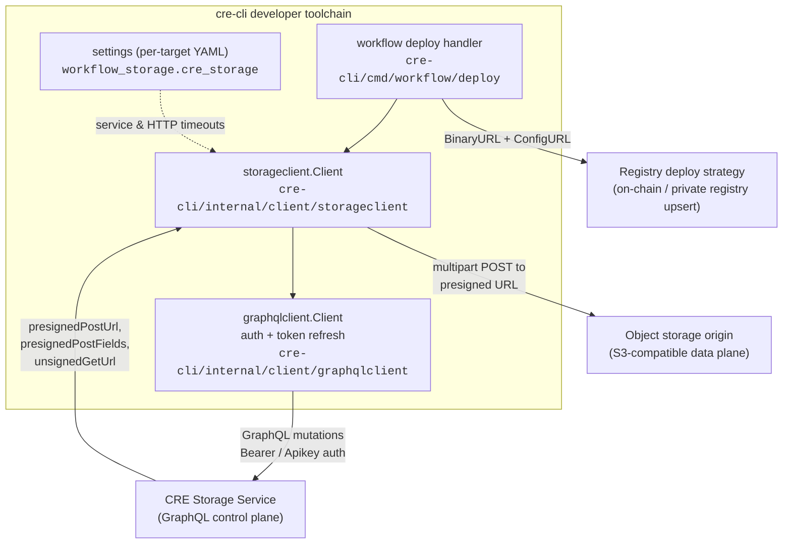
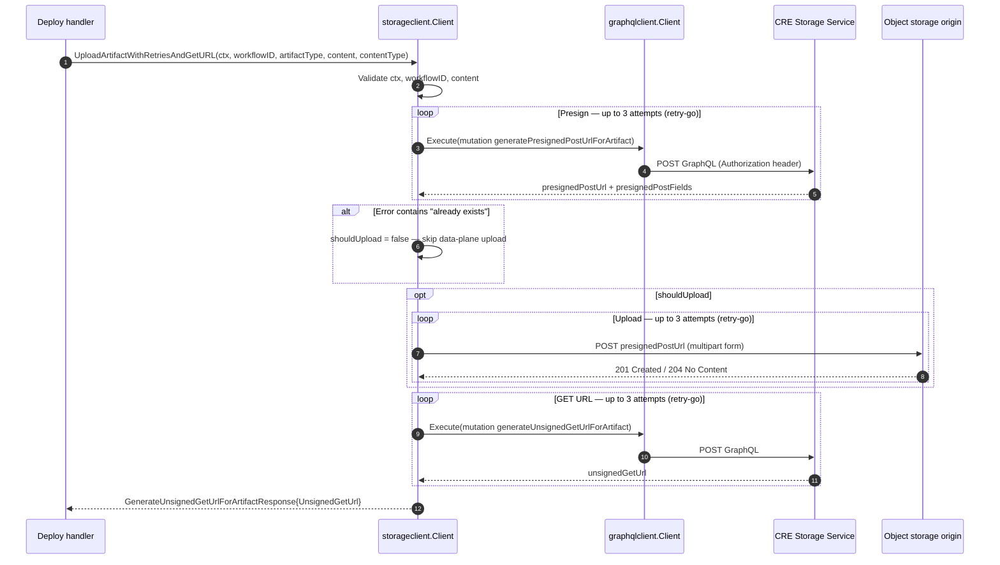
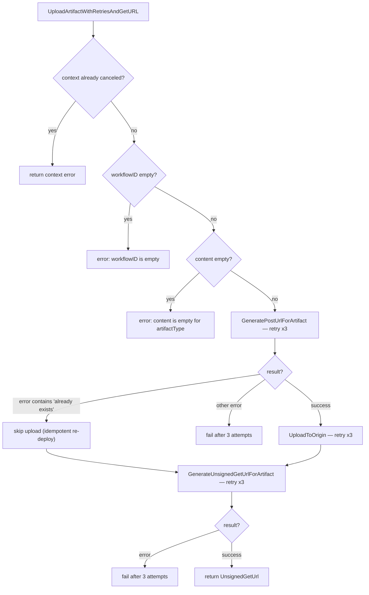
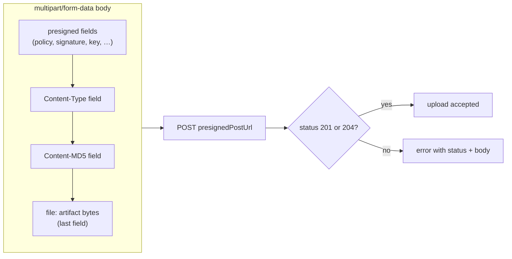
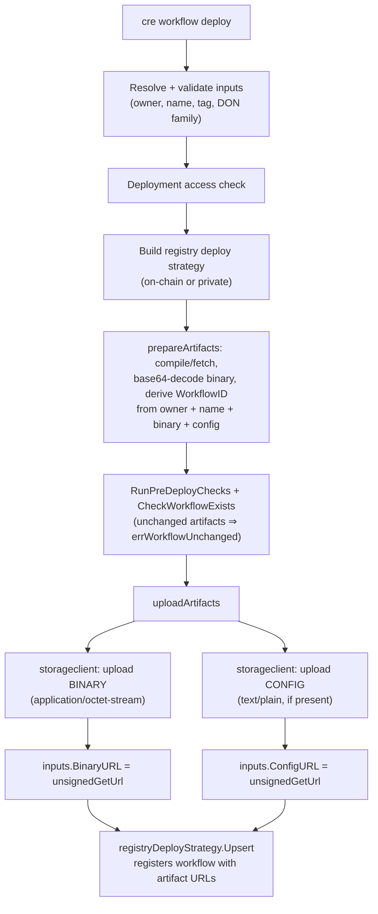

# Storage Client (`cre-cli/internal/client/storageclient`)

## Introduction

The **Storage Client** is the CRE CLI's typed client for the **CRE Storage Service**, the backend that durably stores [workflow artifacts](../../../Workflow___Capability_Runtime_(CRE_Engine)/workflows/workflows_artifacts.md) — compiled workflow binaries (WASM) and workflow configuration files. It is one of three backend clients that make up the [cre-cli backend clients](../cre-cli-backend-clients.md) layer, alongside the [Private Registry Client](cre-cli-backend-clients_private-registry-client.md) (workflow registry lifecycle) and the [Workflow Data Client](cre-cli-backend-clients_workflow-data-client.md) (workflow/execution read models).

The client implements a classic **control-plane / data-plane split**:

- **Control plane (GraphQL):** asks the CRE Storage Service for a *presigned POST URL* before an upload and for an *unsigned GET URL* after it. Both are exposed as GraphQL mutations.
- **Data plane (HTTP multipart):** uploads artifact bytes directly to an S3-compatible object storage origin using the presigned URL, without streaming the payload through the GraphQL backend.

The result of a successful upload is a stable, unsigned download URL that the CLI embeds in workflow registration requests.

---

## Position in the CRE CLI



Key relationships:

| Relationship | Detail |
|---|---|
| Consumer | `cre workflow deploy` (`cre-cli/cmd/workflow/deploy/artifacts.go`) — the only production consumer in the CLI today |
| Control-plane dependency | [`graphqlclient.Client`](../cre-cli-backend-clients.md) — injects credentials, performs OAuth token refresh, targets `environmentSet.GraphQLURL` |
| Configuration | [Platform / target settings](../cre-cli-platform-config.md) — `cre_storage` timeouts |
| Downstream consumer of its output | Registry strategies (`registryDeployStrategy.Upsert`), which register workflows referencing the returned artifact URLs |

---

## Dependencies

From `cre-cli/go.mod`:

- `github.com/machinebox/graphql` — underlying GraphQL transport (wrapped by `graphqlclient`).
- `github.com/avast/retry-go/v4` — retry orchestration for all remote calls.
- `github.com/rs/zerolog` — structured, leveled logging.
- `github.com/smartcontractkit/cre-cli/internal/client/graphqlclient` — authenticated GraphQL execution (API-key or OAuth bearer tokens with automatic refresh).

---

## Component Reference

All exported symbols live in `cre-cli/internal/client/storageclient/storageclient.go` (package `storageclient`).

### `Client`

| Field | Type | Purpose |
|---|---|---|
| `graphql` | `*graphqlclient.Client` | Authenticated GraphQL execution against the CRE Storage Service |
| `workflowOwnerAddress` | `string` | Owner address sent with presign requests so the backend can scope/dedupe artifacts |
| `log` | `*zerolog.Logger` | Debug/error logging of URLs, responses and failures |
| `serviceTimeout` | `time.Duration` | Timeout applied to GraphQL calls (default **1 minute**) |
| `httpTimeout` | `time.Duration` | Timeout applied to the origin upload HTTP call (default **1 minute**) |

### Constructors and configuration

| Symbol | Signature / Notes |
|---|---|
| `New(graphql *graphqlclient.Client, workflowOwnerAddress string, log *zerolog.Logger) *Client` | Builds a client with 1-minute default service and HTTP timeouts. |
| `SetServiceTimeout(timeout time.Duration)` | Overrides the GraphQL-call timeout. |
| `SetHTTPTimeout(timeout time.Duration)` | Overrides the origin-upload timeout. |
| `CreateServiceContextWithTimeout(parent context.Context) (context.Context, context.CancelFunc)` | Returns a child context bounded by `serviceTimeout`; callers defer the cancel. |
| `CreateHttpContextWithTimeout(parent context.Context) (context.Context, context.CancelFunc)` | Returns a child context bounded by `httpTimeout`; callers defer the cancel. |

### Artifact operations

| Method | Description |
|---|---|
| `GeneratePostUrlForArtifact(ctx, workflowId string, artifactType ArtifactType, content []byte) (GeneratePresignedPostUrlForArtifactResponse, error)` | GraphQL mutation `generatePresignedPostUrlForArtifact`. Sends `workflowId`, `artifactType`, `contentHash` (MD5, base64) and `workflowOwnerAddress`; returns a presigned POST URL plus its required form fields. |
| `UploadToOrigin(ctx, g GeneratePresignedPostUrlForArtifactResponse, content []byte, contentType string) error` | Performs the data-plane multipart POST to `g.PresignedPostURL`. Success is `201 Created` or `204 No Content`; anything else is an error containing the status and response body. |
| `GenerateUnsignedGetUrlForArtifact(ctx, workflowId string, artifactType ArtifactType) (GenerateUnsignedGetUrlForArtifactResponse, error)` | GraphQL mutation `generateUnsignedGetUrlForArtifact`; returns the stable unsigned download URL for the artifact. |
| `UploadArtifactWithRetriesAndGetURL(ctx, workflowID string, artifactType ArtifactType, content []byte, contentType string) (GenerateUnsignedGetUrlForArtifactResponse, error)` | High-level orchestrator: validates inputs, presigns (retry ×3), uploads (retry ×3, skipped if artifact already exists), requests the GET URL (retry ×3). |

### Types

| Type | Kind | Fields / Values | Notes |
|---|---|---|---|
| `ArtifactType` | `string` enum | `ArtifactTypeBinary = "BINARY"`, `ArtifactTypeConfig = "CONFIG"` | Distinguishes compiled workflow binaries from workflow configuration artifacts. |
| `GeneratePresignedPostUrlForArtifactResponse` | response | `PresignedPostURL string`, `PresignedPostFields []{Key, Value string}` | Fields must be replayed verbatim in the multipart upload. |
| `GenerateUnsignedGetUrlForArtifactResponse` | response | `UnsignedGetUrl string` | Returned to callers and embedded in registry upserts. |
| `DeleteArtifactResponse` | response | `Success bool`, `Message string` | **Core component of this module.** Wire shape for the storage service's artifact-deletion acknowledgement. The `Success` flag mirrors the boolean style of the other storage-service responses; `Message` carries a human-readable outcome for CLI display/logging. |
| `calculateContentHash(content []byte) string` *(unexported)* | helper | — | MD5 digest, base64 (standard encoding) encoded; see [Content hashing](#content-hashing). |

---

## Core Workflow: Artifact Upload

### Sequence



### Decision flow



### Retry and idempotency semantics

- All three remote phases use `retry.Do` with `retry.Attempts(3)`, `retry.LastErrorOnly(true)` and `retry.Context(ctx)` — retries stop immediately when the caller's context is canceled.
- The presign step is **idempotent**: if the storage service rejects the presign because the artifact (identified by `workflowId` + `artifactType`) already exists, the error text is matched for `"already exists"` and the upload phase is skipped instead of failing. This makes `cre workflow deploy` safe to re-run.
- Failures in the upload phase are wrapped as `upload to origin: %w`; presign and GET-URL failures are wrapped as `generate presigned post url: %w` / `generate unsigned get url: %w`.

---

## Control Plane: GraphQL Mutations

The client speaks to the CRE Storage Service through two mutations (embedded verbatim in `storageclient.go`). Transport, authentication (Bearer token with automatic refresh, or `Apikey`), header redaction in logs, and `cre api error:` error normalization are handled by [`graphqlclient.Client`](../cre-cli-backend-clients.md).

**1. `generatePresignedPostUrlForArtifact`** — request variables:

| Variable | Source |
|---|---|
| `workflowId` | Content-derived workflow identifier (see [Integration](#integration-with-cre-workflow-deploy)) |
| `artifactType` | `"BINARY"` or `"CONFIG"` |
| `contentHash` | `calculateContentHash(content)` — MD5, base64 |
| `workflowOwnerAddress` | Client's configured workflow owner |

Response: `presignedPostUrl` plus an ordered list of `presignedPostFields { key, value }`.

**2. `generateUnsignedGetUrlForArtifact`** — request variables: `workflowId`, `artifactType`. Response: `unsignedGetUrl`.

Each mutation runs under a context bounded by `serviceTimeout`.

---

## Data Plane: Multipart Upload to Origin

`UploadToOrigin` composes a `multipart/form-data` body whose **field order is significant** for presigned-POST validation:

| Order | Field | Content |
|---|---|---|
| 1…n | `g.PresignedPostFields` | Policy/signature fields returned by the backend, replayed verbatim |
| n+1 | `Content-Type` | The caller-provided MIME type (e.g. `application/octet-stream`, `text/plain`) |
| n+2 | `Content-MD5` | Base64 MD5 of the payload — must match the hash sent during presign |
| last | `file` (filename `artifact`) | The raw artifact bytes — **must be the final field** |

The request is sent with `Content-Type: multipart/form-data` (including the writer's boundary), a timeout of `httpTimeout`, and an explicit `http.Client{Timeout: c.httpTimeout}`. The response body is always drained and closed; non-2xx-expected statuses (`204`/`201`) fail with the status code and body for diagnostics.



---

## Content Hashing

`calculateContentHash` computes `base64.StdEncoding.EncodeToString(md5.Sum(content))`. Two things to know:

- **Why MD5:** it is the payload-integrity digest required by the S3 `Content-MD5` presigned-form convention — the same value is sent during presign and attached to the upload so the origin can verify byte-for-byte integrity. The `//nolint:gosec` annotations acknowledge that MD5 is unsuitable as a cryptographic hash but acceptable here because it is used strictly for transfer integrity, not security. (Workflow identity itself is computed upstream via `chainlink-common/pkg/workflows`, see [workflows artifacts](../../../Workflow___Capability_Runtime_(CRE_Engine)/workflows/workflows_artifacts.md).)
- **Consistency requirement:** the exact `content []byte` slice must be used for both the presign hash and the upload; a mismatch causes the origin to reject the upload.

---

## Timeouts and Configuration

Defaults are 1 minute for both timeouts. The `cre workflow deploy` handler overrides them from per-target project settings when non-zero (`cre-cli/cmd/workflow/deploy/artifacts.go`):

```yaml
# cre-cli settings (per target), see cre-cli/internal/settings/workflow_storage_settings.go
<target>:
  workflow_storage:
    cre_storage:
      servicetimeout: 1m   # GraphQL calls (mapstructure: "servicetimeout")
      httptimeout: 2m      # origin upload (mapstructure: "httptimeout")
```

- `LoadWorkflowStorageSettings` reads `<target>.workflow_storage` via viper; zero values mean "keep the 1-minute default".
- `serviceTimeout` bounds both GraphQL mutations; `httpTimeout` bounds the multipart POST (both via context deadlines and the `http.Client` timeout).

For how settings files are discovered, merged and overridden per target, see [cre-cli platform config](../cre-cli-platform-config.md).

---

## Integration with `cre workflow deploy`

The storage client sits in the middle of the deploy pipeline: after the artifacts are compiled and the workflow ID is derived, but before the workflow is registered.



Implementation details worth knowing (`cre-cli/cmd/workflow/deploy/artifacts.go`, `deploy.go`):

- A shared `storageclient.Client` instance uploads both artifact types; the workflow owner address comes from resolved settings.
- **URL passthrough:** if the user supplied `--wasm URL` or `--config URL`, the corresponding upload is skipped entirely and the user-provided URL is used in the registration. When both artifacts come from URLs, no storage calls are made at all.
- **Deferred upload:** uploads deliberately run *after* the existing-workflow overwrite confirmation, so a declined confirmation never writes artifacts to storage.
- The config artifact is optional; an empty `ConfigData` results in an empty `ConfigURL` pointer.
- Progress is reported to the terminal via `internal/ui` (`Loaded binary from: …`, `Uploaded binary to: <unsignedGetUrl>`), with full URLs at debug log level.

---

## Testing

- `cre-cli/internal/client/storageclient/storage_client_test.go` verifies `calculateContentHash` against an independently computed base64 MD5 digest.
- Command-level tests (`cre-cli/cmd/workflow/deploy/artifacts_test.go`, `deploy_test.go`) mock GraphQL interactions with simple `GraphQLRequest{Query, Variables}` fixtures, matching the JSON envelope the client produces through `graphqlclient`.

---

## Security Considerations

- **Credentials never touch this package.** All authentication (OAuth bearer refresh, API keys, header redaction in debug logs) is centralized in `graphqlclient`; the storage client only sets `Content-Type` headers.
- **Presigned URLs are trusted endpoints.** `UploadToOrigin` POSTs to `g.PresignedPostURL` as returned by the CRE Storage Service (the `#nosec G704` annotation records that the URL originates from trusted CLI configuration). The upload target is never derived from user input.
- **MD5 is integrity-only.** As described above, MD5 here satisfies the object-storage `Content-MD5` convention and is explicitly suppressed from `gosec` — it is not used for authentication or as a workflow identifier.
- Unsigned GET URLs are, by design, publicly fetchable download links; treat them as the disclosure boundary for workflow binaries and config.

---

## Related Documentation

- [cre-cli backend clients](../cre-cli-backend-clients.md) — parent module and shared client conventions.
- [Private Registry Client](cre-cli-backend-clients_private-registry-client.md) — off-chain workflow registry upsert/activate/pause/delete.
- [Workflow Data Client](cre-cli-backend-clients_workflow-data-client.md) — GraphQL queries for workflow status, executions, logs and events.
- [Workflow deploy command](../cre-cli-workflow-commands/cre-cli-workflow-commands_deploy.md) and [registry operations](../cre-cli-workflow-commands/cre-cli-workflow-commands_registry-operations.md) — the consumers of the URLs produced here.
- [cre-cli platform config](../cre-cli-platform-config.md) — settings loading, targets and the `workflow_storage` block.
- [Workflows artifacts (node-side)](../../../Workflow___Capability_Runtime_(CRE_Engine)/workflows/workflows_artifacts.md) — how the node fetches and verifies these artifacts.
- [Developer Toolchain](../../Developer_Toolchain_(CLI,_SDKs___API_Clients).md) — CLI, SDKs and API clients overview.
