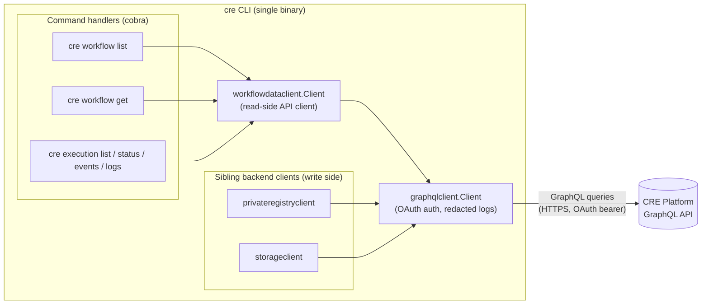
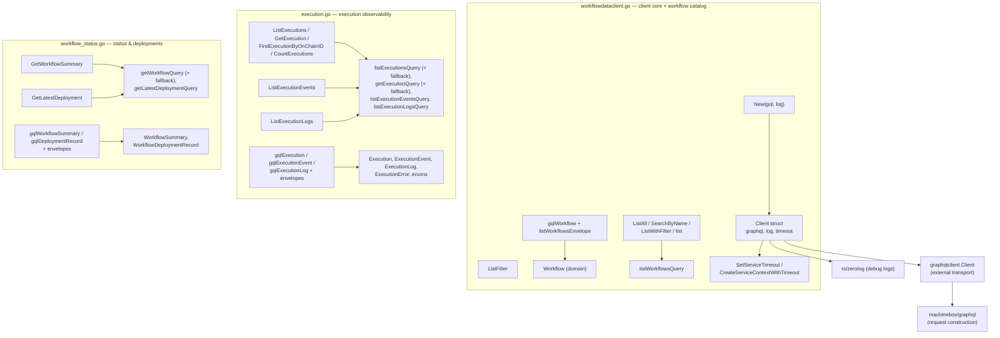
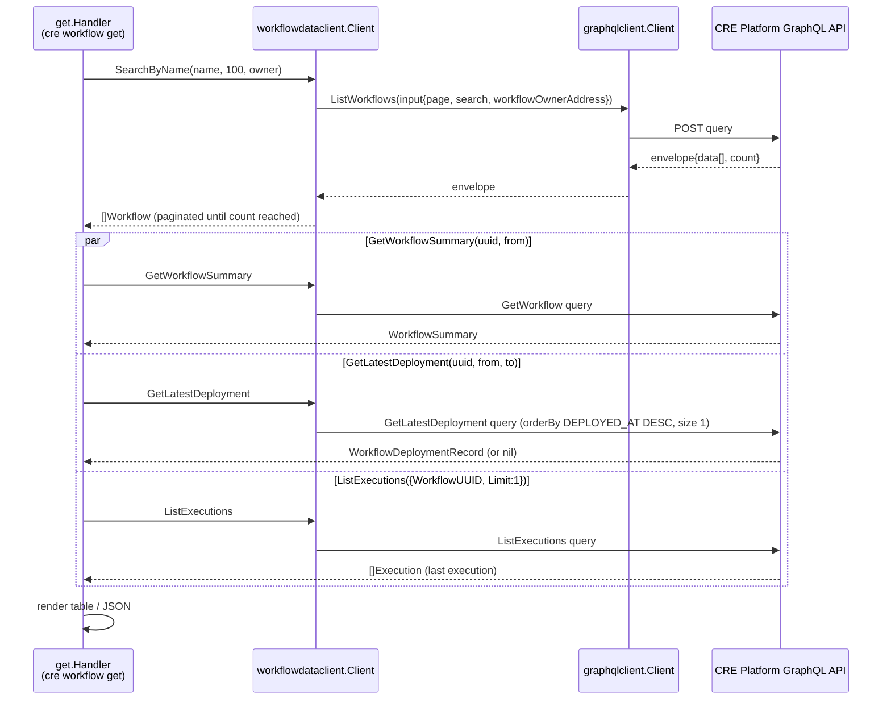
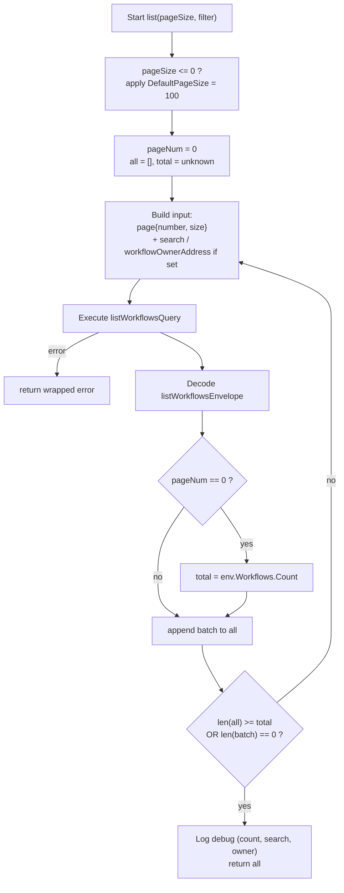
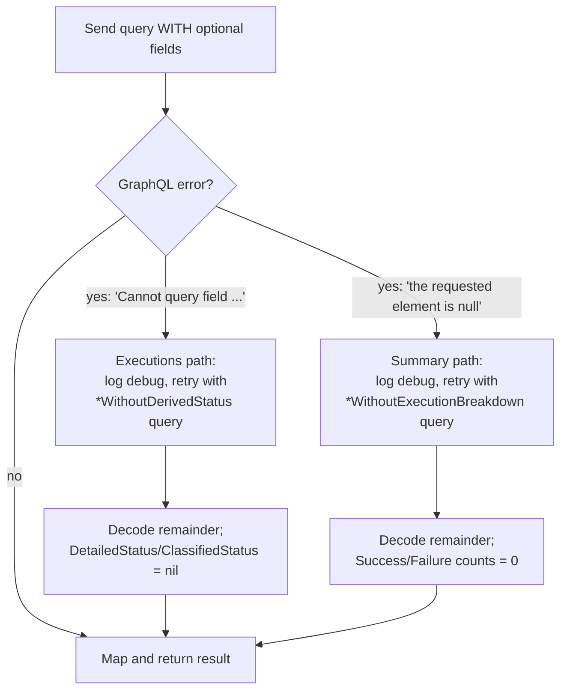

# CRE CLI — Workflow Data Client (`workflowdataclient`)

## Introduction

The **workflow-data-client** module (`cre-cli/internal/client/workflowdataclient`) is the **read-side data-access layer** of the CRE CLI. It wraps the CRE Platform's GraphQL API and exposes a strongly-typed Go surface for querying:

- the **workflow catalog** (workflows registered for the authenticated organization),
- **execution observability data** (executions, per-capability events, node logs), and
- **workflow status/deployment records** (execution health counters, latest deployment metadata).

It is the module that backs the `cre workflow list`, `cre workflow get`, and the `cre execution …` command families, and it is the counterpart of the write-side clients documented in the parent module — the [private-registry client](cre-cli-backend-clients_private-registry-client.md) (workflow lifecycle mutations) and the [storage client](cre-cli-backend-clients_storage-client.md) (artifact upload/delete).

Unlike its siblings, this client is **strictly read-only**: it contains no mutations. All network I/O, authentication (OAuth), and header-redaction logging is delegated to the shared `internal/client/graphqlclient` transport.

### Module at a glance

| Aspect | Detail |
| --- | --- |
| Package | `github.com/smartcontractkit/cre-cli/internal/client/workflowdataclient` |
| Protocol | GraphQL (queries only) over HTTPS |
| Transport | `internal/client/graphqlclient` (OAuth-authenticated, redacted debug logging) |
| Serialization | Hand-written envelope structs with JSON tags → explicit mapping to domain structs |
| Direction | Read-only (queries); mutations live in the private-registry client |
| Key libraries | `github.com/machinebox/graphql` v0.2.2, `github.com/rs/zerolog` v1.35.1 (see `cre-cli/go.mod`) |
| Consumers | `cmd/workflow/list`, `cmd/workflow/get`, `cmd/execution/{list,status,events,logs}`, `internal/workflowresolve` |

---

## Architecture

### Context: where the module sits

The workflow-data-client is the last Go-owned hop before the CRE Platform backend. CLI command handlers construct it from the shared `runtime.Context` (credentials, environment set, logger), pass queries through it, and render the returned domain structs.

The separation of concerns mirrors the platform surface: **reads** (this module) are independent of **workflow-lifecycle writes** ([private-registry client](cre-cli-backend-clients_private-registry-client.md), on-chain registry strategies in [workflow commands → registry operations](../cre-cli-workflow-commands/cre-cli-workflow-commands_registry-operations.md)) and of **binary/config artifact storage** ([storage client](cre-cli-backend-clients_storage-client.md)). CLI settings, tenant context, and environment resolution that feed the transport are documented in [cre-cli platform configuration](../cre-cli-platform-config.md).

### Internal structure and dependencies

The package is split across three files by data domain. All share one `Client` type defined in `workflowdataclient.go`; the other two files only add methods, wire types, and query constants.

| Dependency | Role |
| --- | --- |
| `internal/client/graphqlclient` | Authenticated transport: resolves the environment's `GraphQLURL`, attaches OAuth credentials, logs requests at debug level with Authorization headers redacted. |
| `github.com/machinebox/graphql` | Request objects (`graphql.NewRequest`) and variable binding; execution goes through the shared client. |
| `github.com/rs/zerolog` | Structured debug logging (page counts, search terms, fallback retries). |

---

## Data flow

The typical request path is: build a GraphQL request string + `input` variable map → execute through the shared transport → decode into a wire envelope → convert to domain structs. The diagram below shows the fan-out used by `cre workflow get`, which is the most demanding consumer.

The same pattern (resolve a name/ID to a platform UUID first, then query detail views) is used by the execution commands, where UUID resolution is delegated to `internal/workflowresolve` (see [Consumers](#consumers-and-integration)).

---

## Component reference

### Client lifecycle and configuration (`workflowdataclient.go`)

| Member | Description |
| --- | --- |
| `New(gql *graphqlclient.Client, log *zerolog.Logger) *Client` | Constructs the client; default per-call timeout of **1 minute**. |
| `SetServiceTimeout(d time.Duration)` | Overrides the timeout applied to every service call. |
| `CreateServiceContextWithTimeout(parent)` | Returns a `context.WithTimeout` derived context; every exported method wraps its call in this (cancel deferred by the method). |
| `DefaultPageSize = 100` | Page size used by the catalog methods (callers pass it explicitly, e.g. from `cmd/workflow`). |

### Workflow catalog (`workflowdataclient.go`)

| Method | Behavior |
| --- | --- |
| `ListAll(ctx, pageSize)` | Pages through the `ListWorkflows` query until the reported `count` is reached (or an empty page arrives) and returns **all** workflows. |
| `SearchByName(ctx, name, pageSize, ownerAddress)` | `ListWithFilter` with a server-side *contains* match on workflow name; when `ownerAddress` is non-empty results are scoped to that workflow owner (`workflowOwnerAddress: [owner]`). |
| `ListWithFilter(ctx, pageSize, ListFilter)` | General form; `ListFilter{Search, WorkflowOwnerAddress}` maps to optional `input.search` / `input.workflowOwnerAddress`. |

Domain type: `Workflow{UUID, Name, WorkflowID, OwnerAddress, Status, WorkflowSource}` — `WorkflowID` is the on-chain workflow hash (`workflowId` scalar). Because the wire struct has identical fields, conversion is a direct struct conversion `Workflow(gqlWorkflow)`.

### Execution observability (`execution.go`)

| Method | Behavior |
| --- | --- |
| `ListExecutions(ctx, ListExecutionsInput)` | Single-page fetch. `Limit` defaults to **20** and is clamped to **≤ 100**. Optional filters: `WorkflowUUID`, `Statuses`, `From`/`To` (serialized as UTC RFC3339), `Search` (e.g. on-chain execution-ID hex). |
| `GetExecution(ctx, uuid)` | Fetches a single execution by platform UUID; returns a *"execution %q not found"* error when the envelope's `data` is null. |
| `FindExecutionByOnChainID(ctx, onChainID)` | Resolves the platform UUID from the on-chain hex ID (the ID shown in the Explorer UI): searches with limit 10, verifies an exact case-insensitive `ID` match, then fetches the full record via `GetExecution`. |
| `CountExecutions(ctx, workflowUUID, statuses)` | Cheap count: requests a **single-item page** using the fallback query and consumes only the `count` field. |
| `ListExecutionEvents(ctx, ListEventsInput)` | All node/capability events for an execution; optional `CapabilityID` / `Status` filters. |
| `ListExecutionLogs(ctx, executionUUID)` | All log lines emitted during an execution (`nodeID`, `message`, `timestamp`). |

Domain types:

- `Execution` — `UUID`, `ID` (on-chain execution ID), `WorkflowUUID`, `WorkflowID`, `WorkflowName`, `Status`, `DetailedStatus *DetailedStatus`, `ClassifiedStatus *ClassifiedStatus`, `StartedAt`, `FinishedAt *time.Time`, `CreditUsed *string` (`CreditAmount` scalar serialized as a string), `Errors []ExecutionError{Error, Count}`.
- `ExecutionEvent` — `CapabilityID`, `Status`, `StartedAt`, `FinishedAt *`, `Method *string`, `Errors []CapabilityExecutionError`.
- `ExecutionLog` — `NodeID`, `Message`, `Timestamp`.

Status enums (mirroring the platform `WorkflowExecutionStatus` schema):

| Enum | Values | Semantics |
| --- | --- | --- |
| `ExecutionStatus` | `TRIGGERED`, `IN_PROGRESS`, `SUCCESS`, `FAILURE` (plus `UNKNOWN`/`UNSPECIFIED`) | Lifecycle state; `ValidExecutionStatuses` lists the filterable set. |
| `DetailedStatus` | `COMPLETED`, `COMPLETED_WITH_ERRORS`, `FAILED`, `FAILED_NO_DETAIL` (+ `UNSPECIFIED`) | Refines terminal outcomes; **nil** means "not derived yet — fall back to `Status`". |
| `ClassifiedStatus` | `SUCCESS`, `USER_ERROR`, `SYSTEM_ERROR` (+ `UNSPECIFIED`) | Attributes a terminal execution to the user's workflow or the platform; **nil** = not derived yet. |

### Workflow status and deployments (`workflow_status.go`)

| Method | Behavior |
| --- | --- |
| `GetWorkflowSummary(ctx, uuid, from)` | Extended record with execution health: `RegisteredAt`, `ExecutedAt`, `ExecutionCount`, `SuccessCount`, `FailureCount` (from `executionCountByStatus{success, failure}`). `from` defines the lookback window (callers typically pass a 1-year window, mirroring the Explorer UI). |
| `GetLatestDeployment(ctx, workflowUUID, from, to)` | Most recent `WorkflowDeploymentRecord`: `Status`, `DeployedAt`, `TxHash`, `BinaryURL`, `ConfigURL`, `ErrorMessage`. Queries with `orderBy: {field: DEPLOYED_AT, order: DESC}` and page size 1. Returns **`(nil, nil)` when no deployment record exists** — a valid state, not an error. Note: the backend requires `from`/`to` even though the schema marks them optional. |

---

## GraphQL operation surface

| Query (constant) | Root field | Input type | Returns |
| --- | --- | --- | --- |
| `listWorkflowsQuery` | `workflows` | `WorkflowsInput!` | `data[]` + `count` (paginated catalog) |
| `listExecutionsQuery` / `listExecutionsQueryWithoutDerivedStatus` | `workflowExecutions` | `WorkflowExecutionsInput!` | `data[]` + `count` |
| `getExecutionQuery` / `getExecutionQueryWithoutDerivedStatus` | `workflowExecution` | `WorkflowExecutionInput!` | single `data` object |
| `listExecutionEventsQuery` | `workflowExecutionEvents` | `WorkflowExecutionEventsInput!` | `data[]` |
| `listExecutionLogsQuery` | `workflowExecutionLogs` | `WorkflowExecutionLogsInput!` | `data[]` |
| `getWorkflowQuery` / `getWorkflowQueryWithoutExecutionBreakdown` | `workflow` | `WorkflowInput!` | single summary object |
| `getLatestDeploymentQuery` | `workflowDeployments` | `WorkflowDeploymentsInput!` | `data[]` (only first item used) |

Every operation is wrapped in a **wire envelope struct** (e.g. `listWorkflowsEnvelope`, `getExecutionEnvelope`, `getLatestDeploymentEnvelope`) whose shape mirrors the GraphQL response JSON via struct tags, followed by explicit conversion helpers (`toExecution`, `toExecutions`) into the domain types above.

---

## Key behaviors and process flows

### 1. Client-side pagination (workflow catalog)

The platform list API is page-based; the catalog methods transparently aggregate pages.

### 2. Schema-drift fallback (forward compatibility)

The platform backend and CLI release independently, so the client tolerates schema drift instead of failing hard. Two redundant fields are involved:

- `detailedStatus` / `classifiedStatus` on executions (may not exist on older platform releases),
- `executionCountByStatus` on workflow summaries (may not be populated on older releases).

Detection helpers: `isUnknownFieldGraphQLError` (matches `"Cannot query field"` — used by `ListExecutions`, `GetExecution`, and implicitly `CountExecutions`, which always uses the fallback query) and `isNonNullGraphQLError` (matches `"the requested element is null"` — used by `GetWorkflowSummary`). Nullable Go pointer fields (`*DetailedStatus`, `*ClassifiedStatus`) are what let downstream code distinguish "field absent on this platform version" from concrete values.

### 3. On-chain ID resolution

`cre execution status <id>` accepts either a platform UUID or the on-chain hex ID. `workflowresolve.ResolveExecutionUUID` passes non-UUID arguments to `FindExecutionByOnChainID`, which performs a *search → exact-match verification → full fetch* sequence. The verification step matters because the platform `search` filter is approximate; only case-insensitive `Execution.ID` equality is trusted.

---

## Error handling semantics

| Condition | Behavior |
| --- | --- |
| Transport/GraphQL failure | Returned wrapped with context: `list workflows: …`, `list executions: …`, `get execution: …`, `get workflow summary: …`, `get latest deployment: …`. |
| Unknown field in query | Automatic retry without the offending fields (see fallback flow); treated as compatibility, not an error. |
| Null element for optional breakdown | Automatic retry without `executionCountByStatus`; counts reported as 0. |
| Execution not found | `GetExecution` returns `fmt.Errorf("execution %q not found", uuid)`. |
| On-chain ID not matched | `FindExecutionByOnChainID` returns `execution with ID %q not found`. |
| No deployment record | `GetLatestDeployment` returns `(nil, nil)`; `cre workflow get` downgrades this to a UI warning rather than failing. |
| Time normalization | `From`/`To` are converted to **UTC RFC3339** before being sent, regardless of caller-local timezone. |

---

## Consumers and integration

All consumers instantiate the client identically — `workflowdataclient.New(graphqlclient.New(ctx.Credentials, ctx.EnvironmentSet, ctx.Logger), ctx.Logger)` — and most accept a pre-built client via `NewHandlerWithClient` for tests (the repo ships `workflowdataclient_test.go`, `execution_test.go`, `workflow_status_test.go`, using `httpmock` for transport faking, per `cre-cli/go.mod`).

| Consumer | Methods used | Purpose |
| --- | --- | --- |
| `cre workflow list` (`cmd/workflow/list`) | `ListAll` | Catalog listing; registry filtering and DELETED-status hiding are applied client-side in `workflowresolve`. |
| `cre workflow get` (`cmd/workflow/get`) | `SearchByName`, `GetWorkflowSummary`, `GetLatestDeployment`, `ListExecutions` | Name→UUID resolution, then concurrent fetch of summary + latest deployment + last execution into a status view. |
| `cre execution list` (`cmd/execution/list`) | `ListExecutions` (plus resolution via `workflowresolve`) | Filterable execution tables (`--status`, `--start`, `--end`, `--limit`). |
| `cre execution status` (`cmd/execution/status`) | `GetExecution`, `ListExecutionEvents` (+ `FindExecutionByOnChainID` via `workflowresolve`) | Execution detail; events are fetched additionally when status is `FAILURE` or `DetailedStatus == COMPLETED_WITH_ERRORS`. |
| `cre execution events` / `cre execution logs` | `ListExecutionEvents`, `ListExecutionLogs` | Per-capability event and node-log views. |
| `internal/workflowresolve` | `ListAll`, `SearchByName` (via its `WorkflowLookup` interface), `FindExecutionByOnChainID` (via its `ExecutionLookup` interface) | Name/ID→UUID resolution shared by workflow and execution commands. The concrete client satisfies both narrow interfaces implicitly. |

Command-side behavior (flags, output rendering, registry strategies) is documented in [cre-cli workflow commands](../cre-cli-workflow-commands.md) — see [deploy](../cre-cli-workflow-commands/cre-cli-workflow-commands_deploy.md), [registry operations](../cre-cli-workflow-commands/cre-cli-workflow-commands_registry-operations.md), and [simulation](../cre-cli-workflow-commands/cre-cli-workflow-commands_simulation.md). The `simulate` command family does **not** use this module (simulation runs locally against the SDK; the client is only for platform-resident data).

---

## Related documentation

- Parent module: [cre-cli-backend-clients](../cre-cli-backend-clients.md)
- Sibling write-side clients: [private-registry client](cre-cli-backend-clients_private-registry-client.md), [storage client](cre-cli-backend-clients_storage-client.md)
- Toolchain overview: [Developer Toolchain (CLI, SDKs & API Clients)](../../Developer_Toolchain_(CLI,_SDKs___API_Clients).md)
- Platform-side producer of this data: workflows engine & registry syncer in [Workflow & Capability Runtime (CRE Engine)](../../Workflow___Capability_Runtime_(CRE_Engine).md)

## Source map

| File | Contents |
| --- | --- |
| `cre-cli/internal/client/workflowdataclient/workflowdataclient.go` | `Client`, `New`, timeout helpers, `Workflow`, `ListFilter`, `ListAll`/`SearchByName`/`ListWithFilter`, pagination loop, `gqlWorkflow`, `listWorkflowsEnvelope`, `DefaultPageSize`. |
| `cre-cli/internal/client/workflowdataclient/execution.go` | Execution status enums, `Execution`/`ExecutionEvent`/`ExecutionLog` types, list/get/find/count methods, event & log queries, wire envelopes, mapping helpers, `isUnknownFieldGraphQLError`. |
| `cre-cli/internal/client/workflowdataclient/workflow_status.go` | `WorkflowSummary`, `WorkflowDeploymentRecord`, `GetWorkflowSummary`, `GetLatestDeployment`, `isNonNullGraphQLError`, corresponding queries and envelopes. |
| `cre-cli/internal/client/graphqlclient/graphqlclient.go` | Shared authenticated transport (OAuth service, URL from environment set, header-redacted debug logging). |
| `cre-cli/go.mod` | Declares `github.com/machinebox/graphql v0.2.2`, `github.com/rs/zerolog v1.35.1`, and `github.com/jarcoal/httpmock v1.4.1` (test transport faking). |
| Consumers | `cre-cli/cmd/workflow/list/list.go`, `cre-cli/cmd/workflow/get/get.go`, `cre-cli/cmd/execution/{list,status}/*.go`, `cre-cli/internal/workflowresolve/{resolve_workflow,resolve_execution}.go`. |
