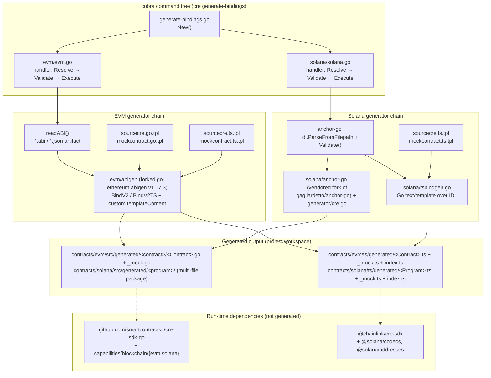
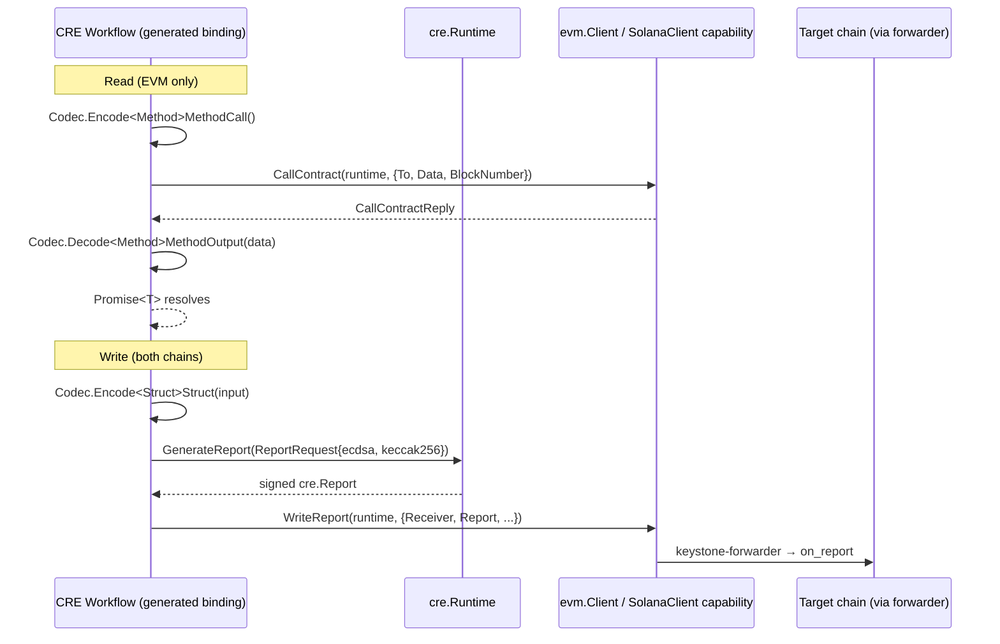

# CRE CLI Bindings Generator (`cre generate-bindings`)

> **Module path:** `cre-cli/cmd/generate-bindings` (Go module `github.com/smartcontractkit/cre-cli`)
> **Parent module:** [Developer Toolchain (CLI, SDKs & API Clients)](Developer_Toolchain_(CLI,_SDKs___API_Clients).md)

## 1. Purpose

The bindings generator is the code-generation engine of the [CRE CLI](cre-cli-workflow-commands.md). Exposed to users as:

```bash
cre generate-bindings evm     # from Solidity/EVM contract ABIs
cre generate-bindings solana  # from Anchor program IDLs
```

it turns **on-chain contract interfaces** (EVM ABI JSON files, Solana Anchor IDL JSON files) into **typed workflow bindings** for CRE workflows written in **Go** or **TypeScript**. The generated code lets a workflow:

- **Read contract state** (EVM `CallContract` promise-based wrappers) and decode accounts/events (Solana discriminator-checked decoders),
- **Write on-chain** via CRE-signed reports (`WriteReport` / keystone-forwarder flow),
- **Subscribe to log triggers** with typed filters and automatic log decoding,
- **Mock contracts** in the workflow simulation / test framework (`<Contract>_mock.go`, `<Program>_mock.ts`).

Language targets are **auto-detected** from project files (`.go` → Go, `.ts` → TypeScript) or forced with `--language`.

## 2. Architecture Overview

The module is a cobra command tree (`generate-bindings.go`) with one handler package per chain family. Each handler resolves/validates inputs, then delegates to a chain-specific generator. Generators are built around **vendored/forked upstream code plus CRE-specific templates**:



Key architectural properties:

1. **Fork-and-extend strategy.** Both chain generators reuse proven upstream generators (go-ethereum's `abigen`, gagliardetto's `anchor-go`) and inject CRE behaviour through custom templates (`//go:embed`ed `sourcecre*` / `mockcontract*` templates) and CRE extension files (`solana/anchor-go/generator/cre.go`). Fork provenance is tracked in `cre-cli/cmd/generate-bindings/evm/abigen/FORK_METADATA.md` (upstream v1.17.3; modifications: custom template support, `isDynTopicType` topic hashing helper, struct-name sanitisation).
2. **Handler ↔ generator separation.** `evm/evm.go` and `solana/solana.go` own CLI concerns (flags, viper resolution, validation via `internal/validation`, project-layout conventions, post-generation `go get`/`go mod tidy`); `bindgen.go` / `tsbindgen.go` own pure code generation and are also callable as a library (both chain READMEs show the programmatic API).
3. **Golden-file testing.** The generated surfaces are pinned by committed golden files under `testdata/` and compared byte-for-byte (or source-compared) by `gen_test.go` / `bindings_test.go` / `tsbindgen_test.go`. Fixtures are regenerated with `go generate ./cmd/generate-bindings/solana` (see `solana/testdata/gen/main.go` and `evm/testdata/gen/main.go`).
4. **Shared CLI plumbing.** Language auto-detection, flag naming (`--project-root`, `--language`, `--pkg`/`--out`), the `contracts/…/src|ts/generated` output conventions, the TypeScript `index.ts` barrel emission, and the post-generation dependency installation are deliberately mirrored between the EVM and Solana handlers.

### Command interface

| Flag | `evm` | `solana` | Meaning |
|---|---|---|---|
| `-p, --project-root` | ✔ | ✔ | Project root (defaults to CWD); must contain a `contracts/` folder |
| `-l, --language` | ✔ | ✔ | `go`, `typescript`, or omitted → auto-detect from project files |
| `-a, --abi` | ✔ | – | ABI file/dir (default `contracts/evm/src/abi/`; `*.abi` and `*.json` artifacts) |
| `-i, --idl` | – | ✔ | IDL file/dir (default `contracts/solana/src/idl/`) |
| `-k, --pkg` | ✔ | – | Base Go package name (each contract gets its own subdirectory) |
| `-o, --out` | – | ✔ | Override output dir for the selected language (ambiguous for both languages → rejected) |

Default output locations:

| Language | EVM | Solana |
|---|---|---|
| Go | `contracts/evm/src/generated/<snake_case_contract>/<Contract>.go` + `_mock.go` | `contracts/solana/src/generated/<program>/` (one multi-file package per program) |
| TypeScript | `contracts/evm/ts/generated/<Contract>.ts` + `_mock.ts` + `index.ts` | `contracts/solana/ts/generated/<Program>.ts` + `<Program>_mock.ts` + `index.ts` |

## 3. Sub-module Documentation Map

The module splits naturally along its two generator backends and their golden fixtures. Detailed documentation for each area lives in this module's sub-folder (`Developer_Toolchain_(CLI,_SDKs___API_Clients)/cre-cli-bindings-generator/`):

| Sub-module | Scope | Documentation file |
|---|---|---|
| **EVM bindings & golden fixture** | The generated EVM Go binding surface — embedded ABI metadata, structs, `Codec` (method call packing / output unpacking, topic encoding, log hashing), promise-based contract reads, `WriteReport` methods, typed log triggers with `Adapt` decoding, `FilterLogs` helpers, and revert-error decoding — as pinned byte-for-byte by the `DataStorage` golden file `evm/testdata/bindings.go` | [cre-cli-bindings-generator_evm-bindings.md](cre-cli-bindings-generator/cre-cli-bindings-generator_evm-bindings.md) |
| **Solana Go generator (anchor-go fork)** | The vendored `anchor-go` generator (fork of `gagliardetto/anchor-go`) with CRE extensions in `generator/cre.go`, IDL parsing/validation and Go-identifier safety, the generated multi-file Go package layout (instructions, accounts, events, errors, triggers, fetchers), custom-error decoding (`CustomError` / `DecodeCustomError`), and the `data_storage` Go golden including the Anchor Rust source fixture `data_storage.rs` | [cre-cli-bindings-generator_solana-go-generator.md](cre-cli-bindings-generator/cre-cli-bindings-generator_solana-go-generator.md) |
| **Solana TypeScript bindings** | The native `tsbindgen.go` generator (Go `text/template` over the Anchor IDL), its Anchor→TypeScript type/codec mapping, subkey-based log-trigger filters, discriminator-checked decoders, keystone-forwarder `writeReport` methods, and the `DataStorage.ts` / `FeatureMatrix.ts` golden files | [cre-cli-bindings-generator_solana-ts-bindings.md](cre-cli-bindings-generator/cre-cli-bindings-generator_solana-ts-bindings.md) |

## 4. Generated Binding Surface (cross-chain summary)

Both generators emit a **consistent, CRE-reachable surface**; the Solana README (`cre-cli/cmd/generate-bindings/solana/README.md`) documents the deliberate scoping:

- **Writes go through the keystone-forwarder.** The on-chain entrypoint is always `on_report`; the payload is a bare encoded struct. Both chains get per-struct write methods (`writeReportFrom<Struct>` / `WriteReportFrom<Struct>`), plural `…s` variants for encoded `Vec`/slice payloads, and a generic raw-payload write.
- **Reads/simulates are not a CRE capability on Solana**, so Solana bindings emit pure (discriminator-checked) decoders only; EVM bindings expose promise-based `CallContract` wrappers instead.
- **Log triggers are first-class.** Each IDL event/ABI event gets: a filters type, an encode helper (EQ comparers / topic encoding, single filter row), a typed `logTrigger<Event>Log` registration whose output adapts the raw log into decoded event data (`bindings.DecodedLog[T]` in Go, `SolanaDecodedLog<T>` in TS), and a `FilterLogs…` helper (EVM).
- **Wire format (Solana):** `ForwarderReport = [32-byte sha256(concat account pubkeys)][u32-LE payload len][payload]`, report request `EncoderName="solana"`, `SigningAlgo="ecdsa"`, `HashingAlgo="keccak256"` — mirroring the Go bindings in `cre-sdk-go`.



## 5. Testing, Build & Release Context

- **Test harness:** `make test` / `make test-quick` in [`cre-cli/Makefile`](https://github.com/smartcontractkit/chainlink/blob/main/cre-cli/Makefile) run the full `cre-cli` suite, including the generator golden tests (`gen_test.go`, `bindings_test.go`, `evm_test.go`, `solana_test.go`, `tsbindgen_test.go`) and linting via `golangci-lint` (config: `cre-cli/.golangci.yml`).
- **Golden regeneration:** `go generate ./cmd/generate-bindings/solana` executes `solana/testdata/gen/main.go` (Go package + both TS goldens); EVM goldens are refreshed through `evm/testdata/gen/main.go`.
- **Fixtures:** EVM fixtures are the Solidity sources `DataStorage.sol` / `EmptyContract.sol` plus `solc --combined-json` artifacts; the Solana fixture is the Anchor Rust program `solana/testdata/contracts/source/data_storage.rs` with its IDL under `testdata/contracts/idl/`.
- **Release packaging** of the `cre` binary (including this command) is governed by `cre-cli/.goreleaser.yml`; module dependencies are pinned in `cre-cli/go.mod`.
- **Licensing:** the vendored `evm/abigen` fork is **LGPL-3.0-or-later** (go-ethereum derived); everything else in the generator is **MIT** — see `cre-cli/cmd/generate-bindings/evm/README.md`.

## 6. Related Modules

- [cre-cli-workflow-commands](cre-cli-workflow-commands.md) — the `workflow` command family (deploy/activate/pause/delete/simulate) that consumes generated bindings in workflows and simulations.
- [cre-sdk-core](cre-sdk-core.md) — the TypeScript CRE SDK (`@chainlink/cre-sdk`) that generated TS bindings are written against (runtime, triggers, codecs).
- [cre-sdk-generated-capabilities](cre-sdk-generated-capabilities.md) — the pre-generated capability SDKs (EVM/Solana `ClientCapability`s) that bindings import at runtime.
- [cre-cli-backend-clients](cre-cli-backend-clients.md) — backend GraphQL/storage clients used by the workflow commands the bindings feed into.
- [crec-go-sdk](crec-go-sdk.md) — a Go SDK with go-ethereum-style binding interfaces (`interfaces/erc20`, `transact`) illustrating the broader binding ecosystem.
- [Workflow & Capability Runtime (CRE Engine)](../Workflow___Capability_Runtime_(CRE_Engine).md) — the node-side engine that executes workflows using these bindings and the keystone-forwarder path on Solana.
