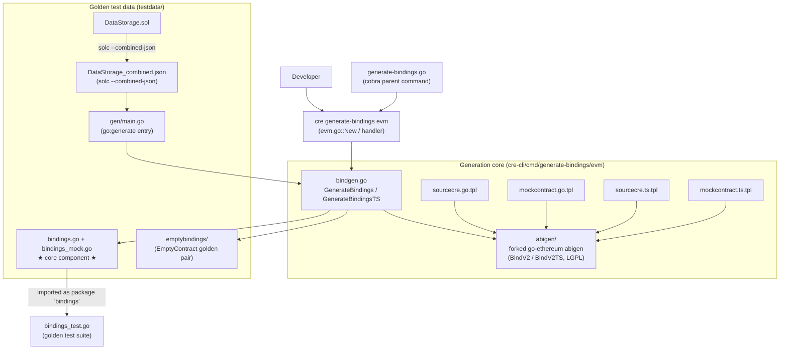
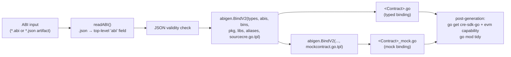
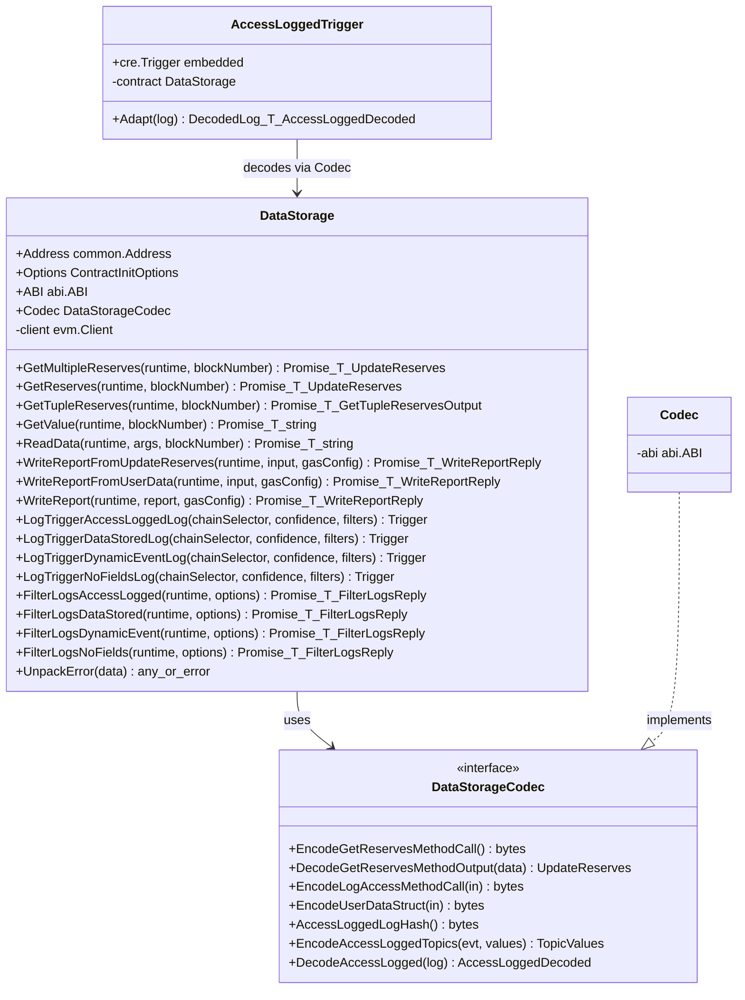
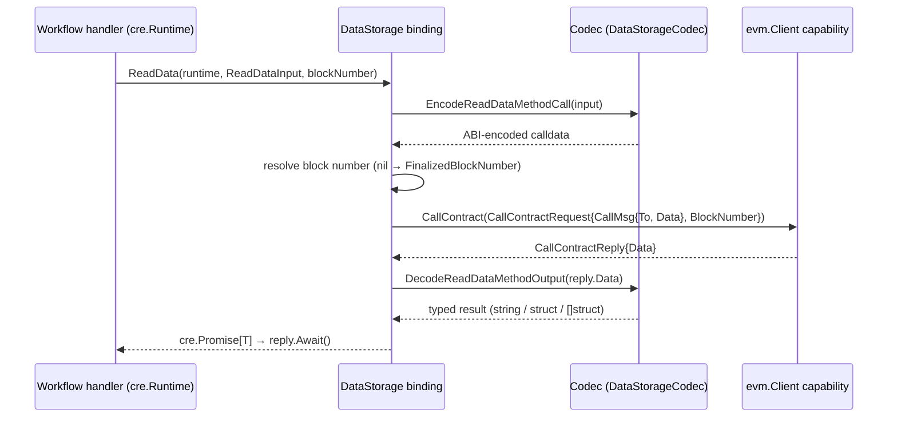
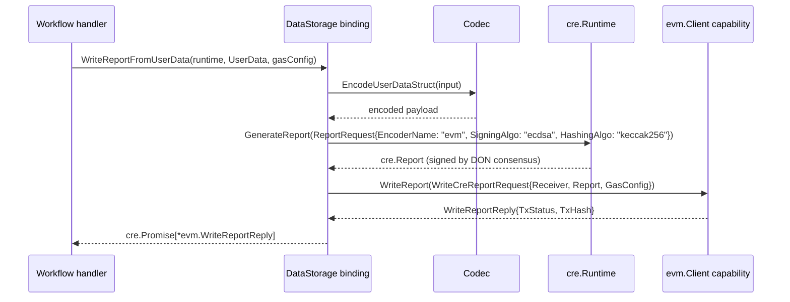
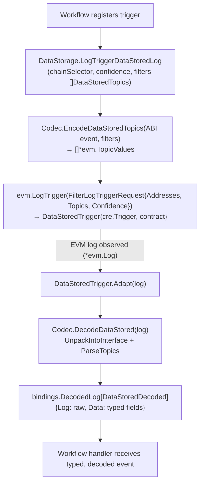

# cre-cli Bindings Generator — EVM Bindings

## 1. Introduction

This module documents the **EVM bindings generator** inside the [`cre` CLI](../cre-cli-workflow-commands.md) and, more importantly, the **golden generated artifact** it produces: `cre-cli/cmd/generate-bindings/evm/testdata/bindings.go`. That file is the reference output of `cre generate-bindings evm` for the `DataStorage` example contract and is the module's core component. It exercises every feature of the generator:

- Typed **read methods** that return `cre.Promise[T]` values via the EVM client capability.
- Typed **write-report methods** that combine a struct encoder, the consensus `GenerateReport` flow, and `WriteReport` transmission.
- A per-contract **`Codec`** interface that encodes ABI calldata, decodes return data and reverts, and encodes/decodes event topics and logs.
- **Log triggers** (`<Event>Trigger`) that wrap the raw EVM log trigger and expose *decoded* events to workflow handlers.
- **Solidity custom errors** decoded into typed Go errors via a 4-byte selector switch.
- **Golden test data** used by `bindings_test.go` to validate the generator and its forked `abigen` templates against mocked SDK capabilities.

The generator itself is a thin orchestration layer over a **forked go-ethereum `abigen`** (LGPL-3.0-or-later; the rest of `cre-cli` is MIT — see `cre-cli/cmd/generate-bindings/evm/README.md`) that renders CRE-specific Go/TypeScript templates. The Solana counterparts of this generator are documented in [Solana Go generator](cre-cli-bindings-generator_solana-go-generator.md) and [Solana TypeScript bindings](cre-cli-bindings-generator_solana-ts-bindings.md); see the parent page [cre-cli-bindings-generator](../cre-cli-bindings-generator.md) for the overall picture.

---

## 2. Architecture & Component Relationships

The module spans three layers:

1. **CLI layer** — the `cre generate-bindings evm` cobra command (`cre-cli/cmd/generate-bindings/evm/evm.go`), registered under the parent `generate-bindings` command (`cre-cli/cmd/generate-bindings/generate-bindings.go`).
2. **Generation core** — `bindgen.go` exposes `GenerateBindings` (Go output) and `GenerateBindingsTS` (TypeScript output). Both call the embedded forked abigen (`BindV2` / `BindV2TS`) with `go:embed`-ed templates: `sourcecre.go.tpl` / `mockcontract.go.tpl` for Go and `sourcecre.ts.tpl` / `mockcontract.ts.tpl` for TypeScript.
3. **Golden artifacts** — `testdata/` contains the `DataStorage.sol` source, its `solc --combined-json` artifact (`DataStorage_combined.json`), and the committed generator outputs (`bindings.go`, `bindings_mock.go`, plus the minimal `emptybindings/` contract). A `go:generate` program (`testdata/gen/main.go`) regenerates them.



### The `cre generate-bindings evm` command

Defined in `cre-cli/cmd/generate-bindings/evm/evm.go`:

| Flag | Default | Behaviour |
|------|---------|-----------|
| `-p, --project-root` | current directory | Must contain a `contracts/` folder. |
| `-l, --language` | auto-detect | `go` and/or `typescript`; auto-detected by walking the project for `.go` / `.ts` files (skipping `node_modules`, `.git`). |
| `-a, --abi` | `contracts/evm/src/abi` | Directory or single file. Supports `*.abi` and `*.json` (ABI read from the JSON artifact's top-level `"abi"` field, extracted in `readABI`). |
| `-k, --pkg` | `bindings` | Base Go package name; **each contract gets its own snake_case package subdirectory** (`IERC20.abi` → `generated/ierc20/`). |

The handler (`ResolveInputs` → `ValidateInputs` → `Execute`) enforces: the ABI path exists and contains at least one ABI file, no duplicate contract names across `.abi`/`.json` extensions, no Go package-name collisions, and a resolvable target language. After Go generation succeeds, it installs the SDK dependencies into the user project (`go get github.com/smartcontractkit/cre-sdk-go@<SdkVersion>`, `go get .../cre-sdk-go/capabilities/blockchain/evm@<EVMCapabilitiesVersion>`, then `go mod tidy`).

---

## 3. Generation Data Flow



Key implementation details (`bindgen.go`):

- **Single-ABI mode** (used by the CLI): one contract, no deploy bytecode (`bins = [""]`), no library placeholders. The contract's Go type name comes from the file name (`contractNameFromFile`).
- **Combined-JSON mode** (used by the golden-artifact generator): parses `solc --combined-json` output via `go-ethereum/compiler.ParseCombinedJSON`, emits one binding per contract and registers library placeholder prefixes from the keccak256 hash of `path:contractName`.
- **Two outputs per contract**: the main binding file and a parallel `*_mock.go` produced from the mock template — both rendered by the same forked `abigen.BindV2` call with different templates.

---

## 4. Anatomy of the Generated Binding (`testdata/bindings.go`)

The golden file for the `DataStorage` contract is organised into the following sections, all rendered from `sourcecre.go.tpl`:

| Section | Generated content | Example from golden file |
|---------|-------------------|--------------------------|
| Metadata | `bind.MetaData` embedding the full ABI JSON (and bytecode when available) | `DataStorageMetaData` |
| Structs | Go structs for Solidity tuple types | `UpdateReserves`, `UserData` |
| Method inputs | One input struct per non-empty parameter list | `LogAccessInput`, `OnReportInput`, `ReadDataInput`, `StoreDataInput`, `StoreUserDataInput`, `UpdateDataInput` |
| Method outputs | Output struct only when a call returns **more than one** value | `GetTupleReservesOutput` |
| Errors | One struct per Solidity custom error, implementing `error` | `DataNotFound`, `DataNotFound2` |
| Events | `<Event>Topics` (filter input) and `<Event>Decoded` (decode output) pairs | see §5 |
| Codec | `DataStorageCodec` interface + `Codec` implementation bound to the parsed ABI | `NewCodec()` |
| Contract | `DataStorage` struct, `NewDataStorage(client, address, options)` constructor | §6 |
| Triggers | `<Event>Trigger` wrapper types with `Adapt`, plus `LogTrigger<Event>Log` factories | §7 |

### 4.1 Event decode structs (the module's core components)

The file comments define the two-phase usage pattern that the generator follows for every event:

> - The `<Event>Topics` struct is used as a **filter** (for log triggers). Only indexed fields can be filtered. Indexed `string`/`bytes` fields are `common.Hash` and must be keccak256-hashed by the caller; indexed tuple/slice/array fields are passed as-is and hashed by `Encode<Event>Topics`.
> - The `<Event>Decoded` struct is the result of calling **`Adapt`** (decode) on the log trigger result. Indexed dynamic-type fields surface as `common.Hash`.

| Core component | Source event | Fields | Notable behaviour exercised |
|----------------|--------------|--------|-----------------------------|
| `AccessLoggedDecoded` | `AccessLogged(address indexed caller, string message)` | `Caller common.Address`, `Message string` | Simple value-type indexed decoding via `abi.ParseTopics`; the happy path covered by `TestDecodeEvents`. |
| `DataStoredDecoded` | `DataStored(address indexed sender, string key, string value)` | `Sender common.Address`, `Key string`, `Value string` | Used by the log-trigger and topics-encoding tests. |
| `DynamicEventDecoded` | `DynamicEvent(string indexed key, UserData indexed userData, string sender, bytes indexed metadata, bytes[] indexed metadataArray)` | `Key string`, `UserData common.Hash`, `Sender string`, `Metadata common.Hash`, `MetadataArray common.Hash` | Demonstrates indexed **tuple / bytes / bytes[]** handling: the topics encoder accepts `UserData` and `[][]byte` as-is (hashing them) while decoded output carries `common.Hash` for the indexed dynamic fields. |
| `NoFieldsDecoded` | `NoFields()` | *(none)* | Degenerate case: `EncodeNoFieldsTopics` builds topics with no filter rules; decode unpacks only the event ID. |

Decode is implemented per event as `Codec.Decode<Event>(log *evm.Log)`:

1. `abi.UnpackIntoInterface` on `log.Data` fills the non-indexed fields.
2. Indexed inputs are collected (tuple types are down-cast to `abi.BytesTy` because upstream `abigen` throws on tuples).
3. `log.Topics[1:]` are converted to `[]common.Hash` and applied with `abi.ParseTopics`.

---

## 5. Codec Interface

`DataStorageCodec` (implemented by `Codec{abi *abi.ABI}`) exposes three families of methods, one pair per ABI entry:



- **Method calls** — `Encode<Method>MethodCall(inputs)` produces ABI calldata via `abi.Pack`; `Decode<Method>MethodOutput(data)` unpacks return values. Tuple outputs (e.g. `[]UpdateReserves`, `UpdateReserves`) round-trip through JSON marshal/unmarshal to bind the go-ethereum unpack result to the generated Go types; multi-value returns are unpacked positionally into the generated `<Method>Output` struct.
- **Struct encoding for reports** — `EncodeUpdateReservesStruct` / `EncodeUserDataStruct` build an `abi.Arguments` with a synthetic `tuple` type and pack a single struct (used for CRE report payloads).
- **Events** — `<Event>LogHash()` returns the event ID bytes; `Encode<Event>Topics` translates `[]<Event>Topics` filters into `[]*evm.TopicValues` (zero-value filter fields become wildcard `common.Hash{}` rules, dynamic values are hashed through `bindings.PrepareTopicArg`); `Decode<Event>` is described in §4.1.

---

## 6. Runtime Interaction Flows

### 6.1 Contract read (CallContract)

Every read method encodes calldata, resolves the block number (`bindings.FinalizedBlockNumber` when the caller passes `nil`), calls the EVM capability, and decodes the reply — all composed with `cre.Promise` combinators so the workflow author gets a typed, asynchronous value.



### 6.2 Report write (consensus → on-chain transmission)

`WriteReportFromUserData` / `WriteReportFromUpdateReserves` encode a generated struct, ask the runtime to produce a signed OCR3-style report, then transmit it through the EVM client capability:



A raw `WriteReport(runtime, report, gasConfig)` variant bypasses struct encoding for workflows that build reports manually.

### 6.3 Log trigger & decoded event flow



`FilterLogs<Event>(runtime, options)` is the historical counterpart: it issues a one-shot `evm.FilterLogsRequest` constrained to the contract address and the single event-topic hash, with `bindings.FilterOptions` (`BlockHash`, `FromBlock`, `ToBlock`).

### 6.4 Custom-error decoding

`UnpackError(data []byte)` switches on the first four bytes of revert data against `ABI.Errors` selectors, dispatching to typed decoders (`DecodeDataNotFoundError`, `DecodeDataNotFound2Error`) that unpack arguments, validate arity/type assertions, and return structs implementing the `error` interface. An unknown selector yields `"unknown error selector"`.

---

## 7. Golden Tests & Regeneration

`cre-cli/cmd/generate-bindings/evm/bindings_test.go` imports the golden artifact as package `datastorage` and validates the generated API end-to-end against **mocked SDK capabilities** (`evmmock.NewClientCapability`, `consensusmock.NewConsensusCapability`, `testutils.NewRuntime`):

- `TestGeneratedBindingsCodec` — every encoder round-trips without error.
- `TestDecodeEvents` — topic/data construction and `DecodeAccessLogged` round-trip.
- `TestReadMethods` — single value, tuple-array (`[]UpdateReserves`) and multi-value tuple returns decoded through a mocked `CallContract` + `HeaderByNumber`.
- `TestWriteReportMethods` — full `EncodeUserDataStruct → GenerateReport → WriteReport` path with an OCR3 `Metadata`-encoded raw report.
- `TestEncodeStruct`, `TestErrorHandling` (valid/invalid selectors), `TestFilterLogs`, `TestLogTrigger` (multi-filter topic encoding, addresses/topics assertions).

**Regeneration** is driven by a `go:generate` directive in `gen.go`:

```bash
# inside cre-cli/cmd/generate-bindings/evm
go generate ./...   # runs testdata/gen/main.go, re-rendering bindings.go and emptybindings
```

The whole suite runs via the repo's standard targets in `cre-cli/Makefile` (`make test`, `make test-quick`, which uses `-short` and skips slow e2e tests).

> **Maintenance rule:** never hand-edit `testdata/bindings.go` (or `bindings_mock.go`). Change the templates (`sourcecre.go.tpl`, `mockcontract.go.tpl`) or the forked abigen, then regenerate and let the golden tests confirm the contract with `cre-sdk-go` still holds.

---

## 8. Dependencies & Tooling

From `cre-cli/go.mod` (module `github.com/smartcontractkit/cre-cli`):

| Dependency | Role in this module |
|------------|---------------------|
| `github.com/smartcontractkit/cre-sdk-go v1.21.0` | `cre.Runtime`, `cre.Promise`, `cre.Trigger` — see [cre-sdk-core](../cre-sdk-core.md). |
| `github.com/smartcontractkit/cre-sdk-go/capabilities/blockchain/evm v1.0.0-beta.20` | `evm.Client`, `evm.Log`, `evm.CallContractRequest`, `evm.WriteCreReportRequest`, `evm.FilterLogTriggerRequest`, `bindings.FilterOptions`, `bindings.DecodedLog`, `bindings.PrepareTopics/PrepareTopicArg`, `bindings.FinalizedBlockNumber`. |
| `github.com/smartcontractkit/chainlink-protos/cre/go` | `values/pb` (`pb.BigInt`), `sdk` (`ReportRequest`/`AggregationType`). |
| `github.com/ethereum/go-ethereum v1.17.4` | ABI packing/unpacking, topics, `bind.MetaData`, combined-JSON parsing. |
| `cmd/generate-bindings/evm/abigen` (in-repo fork) | `BindV2` / `BindV2TS` template-driven code generation (LGPL-3.0-or-later, per `cre-cli/cmd/generate-bindings/evm/README.md`). |
| Foundry (`make install-foundry` in `cre-cli/Makefile`) | Toolchain support for contract workflows around the CLI. |

The generated code therefore depends on exactly two external packages at runtime — `cre-sdk-go` (runtime/promises/triggers and the EVM capability client) and `chainlink-protos` (protobuf values) — plus go-ethereum for ABI mechanics.

---

## 9. Relationship to the Rest of the System

- **Consumed by CRE workflows.** Developers import the generated package into Go workflows; the workflow deploy/simulate lifecycle that packages and runs these workflows is covered in [cre-cli workflow commands](../cre-cli-workflow-commands.md), and simulation/runtime behaviour of the SDK in [cre-sdk-core](../cre-sdk-core.md).
- **Runtime counterpart.** At execution time the `evm.Client` calls issued by generated bindings are served by the EVM chain capability running in the CRE engine — see [chain_capability_evm](<../../Workflow___Capability_Runtime_(CRE_Engine)/chain_capability_evm.md>) (its plugin runtime and write-report path are documented in [chain_capability_evm_plugin_runtime](<../../Workflow___Capability_Runtime_(CRE_Engine)/chain_capability_evm/chain_capability_evm_plugin_runtime.md>) and [chain_capability_evm_actions](<../../Workflow___Capability_Runtime_(CRE_Engine)/chain_capability_evm/chain_capability_evm_actions.md>)).
- **Shared wire types.** The `evm.Log`, filter-query and reply protobufs that flow between generated bindings and the capability are part of the shared domain types documented in [types-chains EVM](<../../Shared_Foundation_Libraries___Domain_Types/types-chains/types-chains_evm.md>).
- **Chain-family siblings.** The generator's Solana pipelines (Anchor-IDL → Go bindings, and TypeScript bindings) live in the same parent command and are documented in [cre-cli-bindings-generator_solana-go-generator](cre-cli-bindings-generator_solana-go-generator.md) and [cre-cli-bindings-generator_solana-ts-bindings](cre-cli-bindings-generator_solana-ts-bindings.md).
- **TypeScript variant.** For TypeScript projects the same command renders `sourcecre.ts.tpl`/`mockcontract.ts.tpl` into `contracts/evm/ts/generated/<Contract>.ts` (+ `*_mock.ts`) with a barrel `index.ts`; the golden TS artifacts for Solana illustrate the shape (the EVM golden set is Go-only).

---

## 10. Summary

`cre-cli-bindings-generator_evm-bindings` is the EVM half of the CRE CLI's contract-binding toolchain. Its generator converts ABI JSON (or solc combined-JSON) into typed, promise-based Go bindings — and mock bindings for tests — via a forked abigen and CRE templates. The golden `testdata/bindings.go` artifact for `DataStorage` is simultaneously the regression contract for the generator, executable documentation of its output shape (codecs, read/write/trigger/filter APIs, custom-error decoding, indexed-dynamic-type handling), and the integration point with `cre-sdk-go`'s runtime, promises and EVM client capability.
