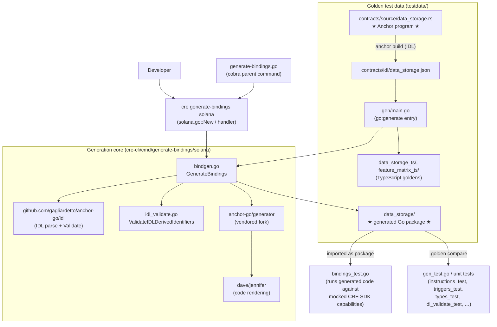
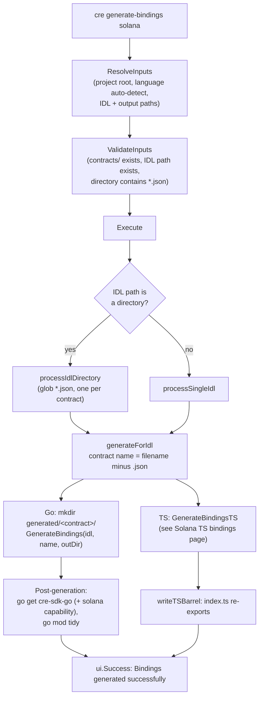
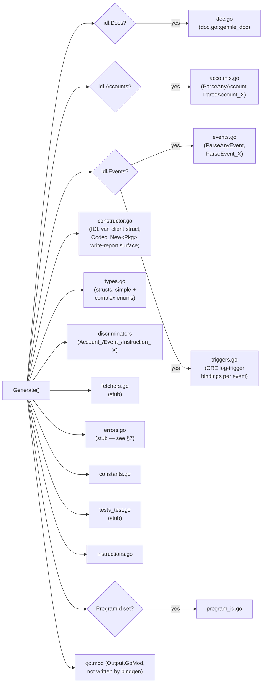
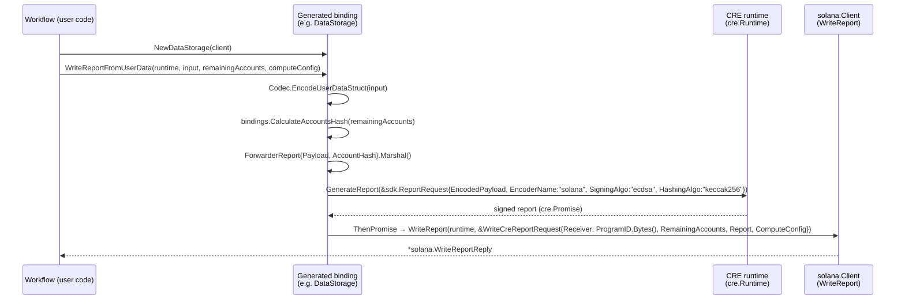

# cre-cli Bindings Generator — Solana Go Generator

## 1. Introduction

This module documents the **Solana Go bindings generator** inside the [`cre` CLI](../cre-cli-workflow-commands.md). It is the half of `cre generate-bindings solana` that turns **Anchor IDL files** (JSON descriptions of Solana programs) into **Go packages** that CRE workflows use to interact with on-chain programs — encoding reports, decoding accounts and events, and registering typed log triggers.

The implementation is a **vendored fork of [anchor-go](https://github.com/gagliardetto/anchor-go)** (upstream by gagliardetto), located at `cre-cli/cmd/generate-bindings/solana/anchor-go/generator/`. The fork keeps the original file layout (files are annotated `//nolint:all // Forked from anchor-go generator, maintaining original code structure`) and adds a dedicated `cre.go` with **CRE write-report and log-trigger extensions**. IDL parsing itself comes from the upstream `github.com/gagliardetto/anchor-go` Go module (see `cre-cli/go.mod`), while the generator emits code with [dave/jennifer](https://github.com/dave/jennifer).

The module's **core components** are:

- **`cre-cli/cmd/generate-bindings/solana/anchor-go/generator/errors.go`** — the generator-side custom error model: the `CustomError` interface, its `customErrorDef` implementation, the `Errors` registry, and RPC error-code decoding (`DecodeCustomError` / `decodeErrorCode`). Its `gen_errors` output file is currently a stub (TODO in the fork).
- **`cre-cli/cmd/generate-bindings/solana/testdata/contracts/source/data_storage.rs`** — the reference Anchor program (Rust) that produces the golden `data_storage.json` IDL. It deliberately exercises every feature the generator must support: PDAs, events (including nested structs and empty events), custom error codes, tuple/vec returns, and the keystone-forwarder entry point `on_report`.
- **`cre-cli/cmd/generate-bindings/solana/testdata/data_storage/instructions.go`** — the **golden generated output** for that IDL: instruction builders, discriminator-checked instruction parsers, and the `ParseInstruction*` family. It serves as both a regression baseline and executable documentation of the generator's instruction surface.

The TypeScript counterpart of this generator is documented in [Solana TypeScript bindings](cre-cli-bindings-generator_solana-ts-bindings.md), and the EVM equivalent in [EVM bindings](cre-cli-bindings-generator_evm-bindings.md). The overall bindings-generator picture lives in the parent page [cre-cli-bindings-generator](../cre-cli-bindings-generator.md).

---

## 2. Architecture & Component Relationships

The module spans four layers:

1. **CLI layer** — the `cre generate-bindings solana` cobra command (`cre-cli/cmd/generate-bindings/solana/solana.go`), registered under the parent `generate-bindings` command (`cre-cli/cmd/generate-bindings/generate-bindings.go`) alongside the `evm` subcommand.
2. **Generation core** — `cre-cli/cmd/generate-bindings/solana/bindgen.go` exposes `GenerateBindings(pathToIdl, programName, outputDir)`, which parses/validates the IDL, normalizes identifiers, and drives the generator.
3. **Generator fork** — `cre-cli/cmd/generate-bindings/solana/anchor-go/generator/`: one file per generated aspect (`types.go`, `instructions.go`, `accounts.go`, `events.go`, `triggers.go`, …) plus the CRE-specific `cre.go` and the pre-flight validator `idl_validate.go`.
4. **Golden test data** — `testdata/`: the Anchor source (`contracts/source/data_storage.rs`), its compiled IDL (`contracts/idl/data_storage.json`), the regenerated Go package (`data_storage/`) and TypeScript goldens (`data_storage_ts/`, `feature_matrix_ts/`), wired up by the `go:generate` program `testdata/gen/main.go`.



### Relationship to the CRE SDK

The generated packages import the Go CRE SDK at runtime. The import paths are hard-coded in `cre.go`:

| Constant | Import path |
|---|---|
| `PkgCRE` | `github.com/smartcontractkit/cre-sdk-go/cre` |
| `PkgPbSdk` | `github.com/smartcontractkit/chainlink-protos/cre/go/sdk` |
| `PkgSolanaCre` | `github.com/smartcontractkit/cre-sdk-go/capabilities/blockchain/solana` |
| `PkgBindings` | `github.com/smartcontractkit/cre-sdk-go/capabilities/blockchain/solana/bindings` |

After generation, the CLI runs `go get` for `cre-sdk-go` and `cre-sdk-go/capabilities/blockchain/solana` (pinned via `constants.SdkVersion` / `constants.SolanaCapabilitiesVersion` in `cre-cli/go.mod`) followed by `go mod tidy`, so the generated package compiles inside the user's workflow module immediately. The generated code targets the Solana **chain capability** described in [chain_capability_solana](../../Workflow___Capability_Runtime_(CRE_Engine)/chain_capability_solana.md).

---

## 3. CLI Command Flow

`solana.go` implements the cobra command and its `handler`. Flags:

| Flag | Default | Notes |
|---|---|---|
| `--project-root/-p` | current directory | must contain a `contracts/` folder |
| `--language/-l` | auto-detected | `go` or `typescript`; detection walks project files for `.go` / non-`.d.ts` `.ts` files (skipping `node_modules`, `.git`) |
| `--idl/-i` | `contracts/solana/src/idl/` | directory of `*.json` or a single IDL file |
| `--out/-o` | `contracts/solana/src/generated/` (Go), `contracts/solana/ts/generated/` (TS) | rejected when generating for both languages at once |



Go bindings are written **one package per program** (`generated/<contract>/`) to avoid identifier collisions between programs; TypeScript bindings are flat `<Program>.ts` / `<Program>_mock.ts` pairs with an `index.ts` barrel. Language handling and barrel emission are shared with the EVM command (see [cre-cli-workflow-commands](../cre-cli-workflow-commands.md) and the [EVM bindings page](cre-cli-bindings-generator_evm-bindings.md)).

---

## 4. Generation Core (`bindgen.go`)

`GenerateBindings` performs the full pipeline before the forked generator runs:

1. **Create output directory** (`0o777`).
2. **Parse the IDL** with `idl.ParseFromFilepath` (upstream `anchor-go/idl` package) and `parsedIdl.Validate()`.
3. **Program ID handling** — warn (do not fail) if the IDL `address` is missing or zero; `program_id.go` is only generated when an address exists (enforced by `genfile_programID` and verified by `gen_test.go::TestGenerateBindings_MissingAddress`).
4. **Identifier normalization** — the IDL `metadata.name` is snake-cased (`bin.ToSnakeForSighash`); reserved Go keywords get a `_program` suffix, invalid identifiers get a `my_` prefix. The output package name is derived from the contract filename by `normalizeGoPackageName` (lowercase, `-` → `_`, rejected if still a keyword/invalid).
5. **Pre-flight identifier validation** — `generator.ValidateIDLDerivedIdentifiers(parsedIdl)` (in `idl_validate.go`) replays every name transformation the generator will perform (account/event/instruction names, discriminator variables, builder function names, instruction struct types, arg params, account fields + `Writable`/`Signer` flag names, constants) and fails fast if any would produce an invalid Go identifier.
6. **Run the generator** — `generator.NewGenerator(parsedIdl, &options).Generate()` with `GeneratorOptions{OutputDir, Package, ProgramName, ProgramId}`.
7. **Render and write** each `OutputFile` through jennifer into `<outputDir>/<file.Name>` with `0o600`.

---

## 5. The anchor-go Fork Generator

### 5.1 Orchestration

`generator.go` defines `Generator{options, idl, complexEnumRegistry}` and `GeneratorOptions{OutputDir, Package, ModPath, ProgramId, ProgramName, SkipGoMod}`. `Generate()` validates the IDL, registers **complex enums** found in `idl.Types` (they need the dedicated encoding path in `complex-enums.go`), then composes output files conditionally:



Notes:

- Discriminators are emitted as `binary.TypeID` values (not `[8]byte`) so equality checks survive wasm/wasip1 `memequal` pointer-type differences — a wasm-relevant detail documented inline in `discriminator.go`.
- `Output.GoMod` (from `gomod.go`) is returned by `Generate()` but **not** written by `bindgen.go`: generated packages are meant to live inside the user's workflow module, not as standalone modules.
- The generated surface includes **CRE-reachable features only**: native Anchor instruction builders and account fetchers make no sense for TypeScript (no read/simulate capability), and for Go the write path is always the keystone forwarder.

### 5.2 Generated Go surface (per program)

| Generated file | Contents |
|---|---|
| `constructor.go` | Embedded `IDL` JSON string; `<Pkg>` struct (`client *solana.Client`, `Codec <Pkg>Codec`); `New<Pkg>(client)`; `EncodeBorshVecU32`; `WriteReportFromBorshEncodedVec`; `<Pkg>Codec` interface |
| `types.go` | IDL `types` as Go structs with `Marshal`/`Unmarshal`/`UnmarshalWithDecoder` (Borsh); simple enums as `binary.BorshEnum`; data-carrying enums via `complex-enums.go` |
| `instructions.go` | `New<Name>Instruction` builders; `<Name>Instruction` structs + parsers; `ParseInstruction`, `ParseInstructionTyped[T]`, `ParseInstructionWithoutAccounts`, `ParseInstructionWithAccounts` |
| `accounts.go` | `ParseAnyAccount` + `ParseAccount_<Name>` discriminator-checked decoders |
| `events.go` | `ParseAnyEvent` + `ParseEvent_<Name>` discriminator-checked decoders |
| `triggers.go` | `<Event>Filters`, `Codec.Encode<Event>Subkeys`, `<Event>Trigger` + `Adapt`, `LogTrigger<Event>Log` |
| `discriminators` | `Account_<Name>`, `Event_<Name>`, `Instruction_<Name>` 8-byte constants |
| `program_id.go` | `ProgramID solana.PublicKey` (only when the IDL has an address) |
| `errors.go`, `constants.go`, `fetchers.go`, `tests_test.go`, `doc.go` | Currently stubs / minimal placeholders in the fork |

Per-IDL-defined struct `X`, the codec also emits `WriteReportFrom<X>` (single) and `WriteReportFrom<X>s` (slice) write methods — see §6.2.

---

## 6. CRE Extensions (`cre.go`)

`cre.go` is the only file in the fork that is *not* copied from upstream; upstream files delegate into it. It contains all knowledge about the CRE SDK and the **keystone-forwarder** write path.

### 6.1 Codec

The generated `<Pkg>Codec` interface (see the golden `constructor.go`) combines:

- `Decode<Account>(data []byte) (*Account, error)` — one per IDL account, delegating to `ParseAccount_<Name>`.
- `Encode<Struct>Struct(in Struct) ([]byte, error)` — one per IDL type (enums excluded), delegating to the struct's `Marshal`.
- `Encode<Event>Subkeys(filters []<Event>Filters) ([]*solana.SubkeyConfig, error)` — one per IDL event.

### 6.2 Write-report flow (keystone forwarder)

On Solana, CRE cannot invoke arbitrary program instructions; writes go through the **keystone forwarder**, whose on-chain entrypoint is always `on_report`. The generated methods therefore never build native instructions — they wrap the payload in a `bindings.ForwarderReport` and submit a signed report:



Wire format (from the Solana bindings README):

```
ForwarderReport = [32-byte sha256(concat account pubkeys)][u32-LE payload len][payload]
report request: EncoderName="solana", SigningAlgo="ecdsa", HashingAlgo="keccak256"
```

Variants generated on the `<Pkg>` binding:

- `WriteReportFrom<Struct>(runtime, input, remainingAccounts, computeConfig)` — single struct payload.
- `WriteReportFrom<Struct>s(runtime, inputs, remainingAccounts, computeConfig)` — encodes each element then defers to the generic method.
- `WriteReportFromBorshEncodedVec(runtime, elementPayloads, remainingAccounts, computeConfig)` — raw escape hatch; `EncodeBorshVecU32` lays out `u32-LE count` + concatenated pre-encoded elements.
- The generated doc comments document the forwarder account layout for `remainingAccounts`: index 0 `forwarderState`, index 1 `forwarderAuthority` (PDA of `["forwarder", forwarderState, receiverProgram]`), index 2+ receiver-specific accounts.

### 6.3 Log triggers

For each IDL event, `triggers.go` generates:

- **`<Event>Filters`** — optional filter values; only *filterable* fields included.
- **`Codec.Encode<Event>Subkeys`** — converts a single filter row into `[]*solana.SubkeyConfig` using `bindings.PrepareSubkeyValue` and `ComparisonOperator_COMPARISON_OPERATOR_EQ` comparers (path = `[FieldName]`). Multi-row input is rejected (the trigger configuration currently supports one row).
- **`<Event>Trigger`** — embeds `cre.Trigger[*solana.Log, *solana.Log]` and exposes `Adapt(*solana.Log) (*bindings.DecodedLog[Event], error)` via `ParseEvent_<Event>`.
- **`LogTrigger<Event>Log(chainSelector, filterName, filters, opts)`** — builds `solana.FilterLogTriggerRequest{Name, Address: ProgramID.Bytes(), EventName, ContractIdlJson: []byte(IDL), Subkeys}`; when `opts.CPI` is set it attaches `bindings.AnchorCPILogTriggerConfig` for Anchor `emit_cpi!` events — then wraps `solana.LogTrigger`.

**Filterability** is decided by `isFilterableField` in `cre.go`, mirroring the chainlink-solana log-poller subkey support (only types `NewIndexedValue` can encode and `ExtractField` can traverse): option/COption recurse into their inner type; **vecs, arrays, defined types, bool, u128 and i128 are not filterable** and need a manual `SubkeyConfig`.

---

## 7. Core Component: `generator/errors.go` (Custom Error Model)

> File: `cre-cli/cmd/generate-bindings/solana/anchor-go/generator/errors.go`

This file has two distinct roles:

1. **Generation** — `gen_errors()` produces the `errors.go` output file. In the current fork it is a **stub**: it iterates `g.idl.Errors` but emits no declarations (the IDL error struct definition is quoted in comments as a TODO). The golden `testdata/data_storage/errors.go` is correspondingly empty apart from header comments.
2. **Runtime error model** — the file defines the typed error model intended to pair with generated error codes:

| Symbol | Role |
|---|---|
| `CustomError` (interface) | `Code() int`, `Name() string`, `Error() string` — the contract for generated program-error values |
| `customErrorDef` | Struct implementation `{code, name, msg}`; `Error()` renders `"<name>(<code>): <msg>"` |
| `Errors` | `map[int]CustomError` registry keyed by numeric Anchor error code |
| `DecodeCustomError(rpcErr)` | Attempts to extract an Anchor custom error code from an RPC error and look it up in `Errors`; returns `(err, ok)` |
| `decodeErrorCode(rpcErr)` | Navigates `*jsonrpc.RPCError.Data` as `map["err"]["InstructionError"][…, {"Custom": code}]`, accepting the code as either `json.Number` or `float64` |

Because `gen_errors` does not yet populate per-program error codes, `Errors` remains empty and `DecodeCustomError` effectively reports `ok=false` for generated packages today. The golden Anchor program still defines a custom error (`DataError::DataNotFound = 0` with message `"data not found"`, which appears in the IDL as `{"code":6000,"name":"DataNotFound","msg":"data not found"}`), so this component is exercised by the test fixture even though code emission is pending.

---

## 8. Golden Test Data

### 8.1 Source fixture: `testdata/contracts/source/data_storage.rs`

The reference Anchor program (program ID `ECL8142j2YQAvs9R9geSsRnkVH2wLEi7soJCRyJ74cfL`) is chosen to stress the whole generator:

| Fixture element | Generator feature exercised |
|---|---|
| `GetReserves` / `GetMultipleReserves` / `GetTupleReserves` contexts + returns (`UpdateReserves`, `Vec<UpdateReserves>`, `(u64, u64)`) | Defined-type returns, vec returns, tuple return handling |
| `initialize_data_account` with PDA `seeds = [b"data_account", user.key()]` | PDA metadata in the IDL, 3-account layouts with writable/signer flags, `system_program` |
| `update_key_value_data` / `update_user_data` | Scalar args vs. defined-struct args; `DynamicEvent` emission |
| `on_report(_metadata, payload)` | The keystone-forwarder entrypoint the CRE write path targets |
| `handle_forwarder_report` / `log_access` | Additional account-context shapes |
| `DataAccount` account with string fields | Account decoders + `EncodeDataAccountStruct` |
| `DynamicEvent` (nested `UserData`, `Vec<u8>`, `Vec<Vec<u8>>`), `AccessLogged` (`Pubkey`), `NoFields` | Event parsers, filter-field selection (nested structs/vecs filtered out; `Pubkey`/string filterable) |
| `DataError` enum with `#[msg("data not found")] DataNotFound = 0` | IDL `errors` array feeding the §7 error model |
| `UserData`, `ForwarderReport`, `UpdateReserves` | Defined struct codecs |

Compiling this program produces `testdata/contracts/idl/data_storage.json`, which is the actual generator input.

### 8.2 Generated golden: `testdata/data_storage/instructions.go`

The committed `instructions.go` shows exactly what the generator emits for the fixture's seven instructions:

- **Builders** (`NewGetReservesInstruction`, `NewInitializeDataAccountInstruction`, `NewLogAccessInstruction`, `NewOnReportInstruction`, `NewUpdateKeyValueDataInstruction`, `NewUpdateUserDataInstruction`, …): write the 8-byte instruction discriminator via a Borsh encoder, Borsh-encode each arg (field-scoped errors via `errors.NewField`), assemble `solanago.AccountMetaSlice` honoring writable/signer metadata per account, and return a `solanago.Instruction` for `ProgramID`.
- **Instruction structs** (`GetReservesInstruction`, `InitializeDataAccountInstruction`, `LogAccessInstruction`, `OnReportInstruction`, `UpdateKeyValueDataInstruction`, `UpdateUserDataInstruction`, …) carrying args plus account `PublicKey` fields and `Writable`/`Signer` flag fields, implementing the `Instruction` interface:
  - `GetDiscriminator()`
  - `UnmarshalWithDecoder(*binary.Decoder)` — discriminator-checked arg decoding
  - `UnmarshalAccountIndices(buf)` — decodes account indices from transaction message bytes
  - `PopulateFromAccountIndices(indices, accountKeys)` — bounds-checked resolution of indices into public keys
  - `GetAccountKeys()`
- **Dispatch family**: `ParseInstruction(instructionData, accountIndicesData, accountKeys)` switches on the extracted `binary.TypeID` discriminator (minimum 8-byte input enforced), `ParseInstructionTyped[T Instruction]` for type-asserted parsing, plus `ParseInstructionWithoutAccounts` / `ParseInstructionWithAccounts` conveniences.

This golden is a **compile-and-execute test fixture**: `bindings_test.go` imports it as package `data_storage` and runs its codec and write-report methods against mocked CRE SDK capabilities (`solanasdkmock`, `consensusmock`), proving the generated code is not just syntactically valid but behaves correctly.

### 8.3 Regeneration

The `//go:generate go run ./testdata/gen` directive in `gen.go` runs `testdata/gen/main.go`, which calls `solana.GenerateBindings` (Go golden) and `solana.GenerateBindingsTS` (both TypeScript goldens) against the fixture IDLs. Regenerate with:

```bash
go generate ./cmd/generate-bindings/solana
```

---

## 9. Testing Strategy

| Layer | Files | What is verified |
|---|---|---|
| Golden regeneration | `gen_test.go` | `TestGenerateBindings` rewrites the goldens from the fixture IDL; `TestGenerateBindings_MissingAddress` asserts `program_id.go` is skipped when the IDL has no `address` |
| Generated code behavior | `bindings_test.go` | Compiles the golden `testdata/data_storage` package; codec encode functions; write-report methods end-to-end with mocked consensus (`GenerateReport`) and Solana client (`WriteReport`) |
| CLI resolution | `solana_test.go` | Default path fallbacks, custom `--out`, language selection, single-IDL processing |
| Generator units | `anchor-go/generator/*_test.go` | `idl_validate_test.go` (identifier pre-flight), `instructions_test.go`, `triggers_test.go` (filter-field selection/subkey encoding), `types_test.go`, `complex_enums_test.go` / `complex_enum_encode_test.go` / `u256_test.go` (Borsh encoding corners), `constants_test.go`, `collision_field_names_test.go` (identifier collision safety) |

Run everything through the `cre-cli` module targets (`cre-cli/Makefile`): `make test` (lint + full `go test`) or `make test-quick` (`-short`, skips slow e2e suites). Lint configuration for the module is `cre-cli/.golangci.yml`; note that the forked generator files are excluded from linting via `//nolint:all` markers to preserve upstream diffability.

---

## 10. Dependencies

Key modules from `cre-cli/go.mod`:

| Dependency | Role |
|---|---|
| `github.com/gagliardetto/anchor-go v1.0.0` | IDL parsing/validation types (`idl`, `tools`) |
| `github.com/gagliardetto/binary v0.8.0` | Borsh encoder/decoder, `TypeID` discriminators |
| `github.com/gagliardetto/solana-go v1.13.0` | Solana primitives (`PublicKey`, `Instruction`, `AccountMeta`, `rpc/jsonrpc.RPCError`) |
| `github.com/dave/jennifer v1.7.1` | Go code rendering |
| `golang.org/x/mod` | `modfile` for the (currently unwritten) generated `go.mod` |
| `github.com/smartcontractkit/cre-sdk-go v1.21.0` | `cre.Runtime`, promises, Solana capability + `bindings` helpers (`ForwarderReport`, `CalculateAccountsHash`, `DecodedLog`, `PrepareSubkeyValue`, `AnchorCPILogTriggerConfig`) |
| `github.com/smartcontractkit/chainlink-protos/cre/go` | `sdk.ReportRequest` protobuf |

---

## 11. Related Modules

- [cre-cli-bindings-generator](../cre-cli-bindings-generator.md) — parent module: overall bindings-generator architecture.
- [cre-cli-bindings-generator_evm-bindings](cre-cli-bindings-generator_evm-bindings.md) — the EVM sibling generator (forked `abigen`).
- [cre-cli-bindings-generator_solana-ts-bindings](cre-cli-bindings-generator_solana-ts-bindings.md) — the Solana TypeScript sibling sharing the same IDL inputs and wire format.
- [cre-cli-workflow-commands](../cre-cli-workflow-commands.md) — the surrounding CLI command suite and runtime context.
- [chain_capability_solana](../../Workflow___Capability_Runtime_(CRE_Engine)/chain_capability_solana.md) — the on-node Solana chain capability the generated workflows bind to.
- [types-chains_solana](../../Shared_Foundation_Libraries___Domain_Types/types-chains/types-chains_solana.md) — Solana domain types used across the platform.
- [cre-cli-build-and-release](../cre-cli-build-and-release.md) — how the `cre` binary containing this command is built and released.
