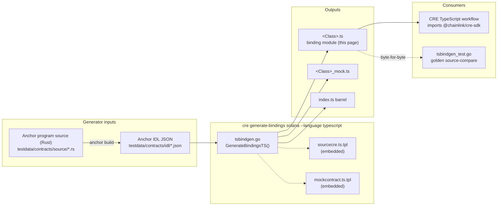
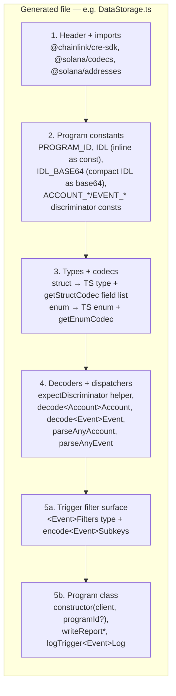
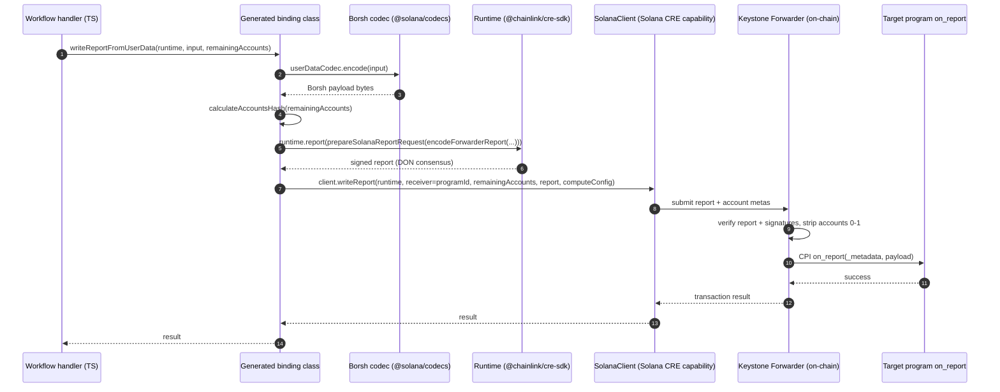
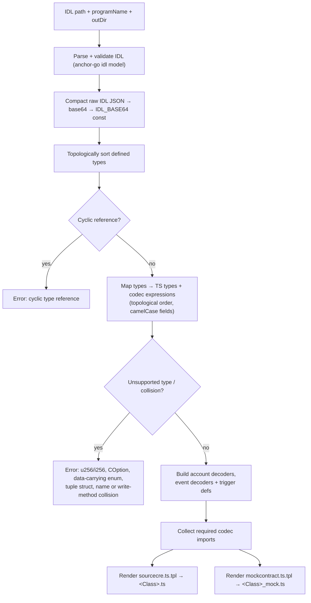

# Solana TypeScript Bindings — Generated Fixtures (`data_storage_ts` / `feature_matrix_ts`)

This page documents the **TypeScript output surface of the CRE CLI's Solana bindings generator**, as pinned by its golden test fixtures:

| Core component | Path |
|---|---|
| `DataStorage` | `cre-cli/cmd/generate-bindings/solana/testdata/data_storage_ts/DataStorage.ts` |
| `FeatureMatrix` | `cre-cli/cmd/generate-bindings/solana/testdata/feature_matrix_ts/FeatureMatrix.ts` |

These files are **generated TypeScript binding modules** ("Code generated — DO NOT EDIT") produced by `tsbindgen.go` from Anchor IDL files. They serve two purposes simultaneously:

1. **Golden test fixtures** — `TestGenerateBindingsTS_Golden` in `cre-cli/cmd/generate-bindings/solana/tsbindgen_test.go` regenerates the bindings in a temp directory and byte-compares the result against these files, so any change to the generator's output template is caught in review (see [Testing & maintenance](#testing--maintenance)).
2. **Reference contract** — they are the canonical example of what `cre generate-bindings solana --language typescript` delivers to users: a self-contained module that a CRE TypeScript workflow imports to (a) write Borsh-encoded reports on-chain through the keystone-forwarder and (b) register typed Solana log triggers.

Each fixture directory also contains a companion mock file (`DataStorage_mock.ts`, `FeatureMatrix_mock.ts`) generated from `cre-cli/cmd/generate-bindings/solana/mockcontract.ts.tpl`; it exposes a thin `new<Class>Mock(solanaMock, programId?)` helper that registers a `SolanaContractMock` via `@chainlink/cre-sdk/test` for workflow simulation (see [Simulation](../cre-cli-workflow-commands/cre-cli-workflow-commands_simulation.md)).

> **Parent module:** [cre-cli-bindings-generator](../cre-cli-bindings-generator.md) — for the EVM (ABI → Go) counterpart see [EVM bindings fixtures](cre-cli-bindings-generator_evm-bindings.md), and for the Go (IDL → Go) counterpart see [Solana Go generator](cre-cli-bindings-generator_solana-go-generator.md).

---

## Module purpose

The Solana CRE capability is **write-only**: workflows cannot call read/simulate entrypoints on Solana programs. The generated TypeScript bindings therefore expose exactly the operations reachable through the capability, and nothing more (per `cre-cli/cmd/generate-bindings/solana/README.md`):

- **Writes** — per-struct `writeReportFrom<Struct>` / `writeReportFrom<Struct>s` methods plus generic `writeReport` / `writeReportFromBorshEncodedVec`, all routing through the on-chain **keystone-forwarder** (`on_report` entrypoint).
- **Decoders** — pure, discriminator-checked account/event decoders (`decode<Event>Event`, `decode<Account>Account`, `parseAnyAccount`, `parseAnyEvent`). Because there is no read capability, callers obtain raw bytes elsewhere (e.g. from a log trigger payload or an external index) and decode them locally.
- **Typed log triggers** — per-event `<Event>Filters` types, `encode<Event>Subkeys` encoders, and `logTrigger<Event>Log(filterName, filters, opts)` methods that adapt a raw `SolanaLog` into `SolanaDecodedLog<T>`.
- **Mocks** — `<Class>_mock.ts` for the simulation framework.

Native Anchor **instruction builders and account fetchers are deliberately not generated for TypeScript** (they are unreachable through the capability). This is the main difference from the Go generator, which emits both (e.g. `InitializeDataAccountInstruction` with its account list in the [Solana Go generator](cre-cli-bindings-generator_solana-go-generator.md)).

---

## Architecture

### Position in the generation pipeline

The fixtures sit at the end of the generation pipeline. The Go CLI (`github.com/smartcontractkit/cre-cli`, see `cre-cli/go.mod`) embeds the templates, parses the Anchor IDL with the vendored `anchor-go` IDL model, and renders two TypeScript files per program.



**CLI defaults** (from the generator README):

| | IDL input | Output |
|---|---|---|
| TypeScript | `contracts/solana/src/idl/*.json` | `contracts/solana/ts/generated/<Program>.ts` + `<Program>_mock.ts` + `index.ts` barrel |
| Go | `contracts/solana/src/idl/*.json` | `contracts/solana/src/generated/<program>/` (one package per program) |

### Runtime dependencies of the generated code

The generated modules are self-contained files with no generated-side state; everything delegates to two ecosystems:

| Import | Role | Documented in |
|---|---|---|
| `@chainlink/cre-sdk` | `Runtime`, `SolanaClient`, `Trigger`, `adaptTrigger`, report/trigger helpers (`prepareSolanaReportRequest`, `encodeForwarderReport`, `calculateAccountsHash`, `encodeBorshVecU32`, `bytesToHex`, `bytesToBase64`, `solanaAddressToBytes`, `solanaAccountMetasToJson`, `prepareSubkeyValue`, `anchorCPILogTriggerConfig`), trigger/config JSON types (`SolanaSubkeyConfigJson`, `SolanaValueComparatorJson`, `SolanaFilterLogTriggerRequestJson`, `SolanaDecodedLog`, `SolanaLogTriggerOptions`, `SolanaLog`) | [cre-sdk-core](../cre-sdk-core.md) |
| `@solana/codecs` | Borsh-compatible codec primitives (`getStructCodec`, `getArrayCodec`, `getBytesCodec`, `getUtf8Codec`, `getU32Codec`, …) | — |
| `@solana/addresses` | `Address` type and `getAddressCodec()` | — |

The wire contract mirrored by these helpers matches the Go bindings' `bindings` package in `cre-sdk-go`:

```
ForwarderReport = [32-byte sha256(concat account pubkeys)][u32-LE payload len][payload]
report request: EncoderName="solana", SigningAlgo="ecdsa", HashingAlgo="keccak256"
```

---

## Anatomy of a generated binding file

Both fixtures share the same five-layer structure, rendered from `sourcecre.ts.tpl` in a fixed order:



### 1. Program constants

- `<PROGRAM>_PROGRAM_ID` — the base58 program ID baked into the IDL (`address` field). If the IDL has no address, the constant is `''` and callers **must** supply the program ID at construction time (verified by `TestGenerateBindingsTS_MissingAddress`).
- `<PROGRAM>_IDL` — the full IDL inlined as an `as const` object for introspection.
- `<PROGRAM>_IDL_BASE64` — the compact IDL JSON, base64-encoded once, and sent verbatim as `contractIdlJson` in every log-trigger request so the off-chain trigger service can decode events.
- `<ACCOUNT|EVENT>_<NAME>_DISCRIMINATOR` — the 8-byte Anchor discriminators, exported as `Uint8Array`.

### 2. Types and codecs

Each IDL defined type becomes a pair: an exported TS type (snake_case → camelCase properties) and an exported codec constant built from `@solana/codecs` primitives. Named types referenced by fields become nested codec references (e.g. `['userData', userDataCodec]`).

### 3. Decoders and dispatchers

- `expectDiscriminator` validates the leading 8-byte discriminator and returns the payload slice; short data or a mismatch throws with a descriptive label.
- `decode<Account>Account` / `decode<Event>Event` — discriminator-checked decoding into the corresponding type.
- `parseAnyAccount` / `parseAnyEvent` — dispatch on the discriminator across all accounts/events of the program, throwing `unknown account discriminator: [...]` / `unknown event discriminator: [...]` otherwise. Generated only when the IDL declares accounts/events respectively (the `feature_matrix` IDL has neither, and its output contains no dispatcher code — asserted by the tests).

### 4. Log-trigger filter surface

For every IDL event, the generator emits:

- `<Event>Filters` — an optional-fields filter type. Only **top-level scalar fields with supported subkey encodings** are auto-filterable; nested structs, vecs, arrays, `bool`, `u128`, and `i128` are excluded (users needing those must hand-assemble a `SubkeyConfig`).
- `encode<Event>Subkeys(filters)` — converts set fields into `SolanaSubkeyConfigJson[]` with `COMPARISON_OPERATOR_EQ` comparers. Pubkey values are converted via `solanaAddressToBytes` → base64; other values via `prepareSubkeyValue` (floats use `prepareSubkeyFloatValue`). Subkey paths use the Go bindings' PascalCase field names (e.g. `['Caller']`) so both language bindings stay wire-compatible. Exactly one filter row is supported — a second row throws `multiple filter rows are not supported for <Event>`.

### 5. Program class

The `<Class>` class is the entrypoint a workflow instantiates:

```typescript
new DataStorage(client: SolanaClient, programId?: string | Uint8Array)
```

The program ID defaults to the generated constant (unlike EVM bindings, where the address is always a runtime value). Methods:

| Method family | Behaviour |
|---|---|
| `writeReport(runtime, payload, remainingAccounts, computeConfig?)` | Encodes the forwarder envelope, requests a signed report via `runtime.report(...)`, then calls `client.writeReport(...)` targeting `on_report` on this program. `remainingAccounts` must follow the forwarder layout: index 0 = forwarder state, index 1 = forwarder authority PDA, index 2+ = receiver accounts. The full list is hashed into the report; the forwarder strips indices 0–1 before CPI. |
| `writeReportFromBorshEncodedVec(runtime, payloads, …)` | Wraps pre-encoded elements in a Borsh `Vec` (u32-LE count + concatenated elements) and delegates to `writeReport`. |
| `writeReportFrom<Struct>(…)` / `writeReportFrom<Struct>s(…)` | Encodes one struct (or an array of structs as a `Vec`) with the generated codec and delegates. Method-name collisions (types `Foo` and `Foos`) are rejected at generation time. |
| `logTrigger<Event>Log(filterName, filters?, opts?)` | Builds a `SolanaFilterLogTriggerRequestJson` (`name`, base64-encoded `address`, `eventName`, `contractIdlJson`, `subkeys`), optionally attaching `anchorCPILogTriggerConfig(this.programId)` when `opts.cpi` is set (for Anchor `emit_cpi!` events), registers it via `client.logTrigger`, and adapts the raw log with the event decoder. Returns `Trigger<SolanaLog, SolanaDecodedLog<T>>`. |

---

## Data flows

### Write path: `writeReportFrom<Struct>` → keystone-forwarder → `on_report`



The on-chain counterpart (forwarder program, receiver entrypoint, account layout) is documented in [chain capability: Solana](../../Workflow___Capability_Runtime_(CRE_Engine)/chain_capability_solana.md) and deployed via [cre-forwarder (Solana)](../../CRE___Keystone_Deployment_Suite/cre-forwarder/cre-forwarder_solana.md).

### Read/observe path: typed log trigger

```mermaid
flowchart LR
    A["logTriggerAccessLoggedLog(filterName, filters, opts)"] --> B["encodeAccessLoggedSubkeys(filters)"]
    B --> C["SolanaFilterLogTriggerRequestJson:<br/>name, address = base64(programId),<br/>eventName, contractIdlJson = IDL_BASE64,<br/>subkeys"]
    C --> D{"opts.cpi?"}
    D -- yes --> E["anchorCPILogTriggerConfig(programId)"]
    D -- no --> F["client.logTrigger(config)"]
    E --> F
    F --> G["Raw SolanaLog emitted on-chain"]
    G --> H["adaptTrigger: decodeAccessLoggedEvent(log.data)"]
    H --> I["Trigger&lt;SolanaLog, SolanaDecodedLog&lt;AccessLogged&gt;&gt;<br/>{ log, data }"]
```



---

## Generation process (fail-loud design)

`GenerateBindingsTS(pathToIdl, programName, outDir)` in `cre-cli/cmd/generate-bindings/solana/tsbindgen.go`:



Unsupported constructs **fail at generation time** rather than silently mis-encoding: `u256`/`i256`, `COption`, data-carrying enums, tuple structs, generics, cyclic references, and all name collisions (type names after PascalCase mapping, field names after camelCase mapping, codec constants, and per-struct write-method names). JS reserved-word *field names* are suffixed with `_` (the `default` field becomes `default_`); reserved-word *type names* are rejected.

---

## TypeScript type-coverage matrix (v1)

Pinned by the `feature_matrix` fixture and asserted in `TestGenerateBindingsTS_GeneratedContent`:

| Anchor type | TypeScript | Codec |
|---|---|---|
| `bool` | `boolean` | `getBooleanCodec()` |
| `u8…u32` / `i8…i32` | `number` | `getU8Codec()` … `getI32Codec()` |
| `u64`/`u128` / `i64`/`i128` | `bigint` | `getU64Codec()` … `getI128Codec()` |
| `f32` / `f64` | `number` | `getF32Codec()` / `getF64Codec()` |
| `string` | `string` | `addCodecSizePrefix(getUtf8Codec(), getU32Codec())` |
| `bytes` | `Uint8Array` | `addCodecSizePrefix(getBytesCodec(), getU32Codec())` |
| `pubkey` | `Address` | `getAddressCodec()` |
| `vec<T>` | `T[]` | `getArrayCodec(inner, { size: getU32Codec() })` |
| `array<T, N>` | `T[]` | `getArrayCodec(inner, { size: N })` |
| `option<T>` | `T \| null` | `getNullableCodec(inner)` |
| defined struct | type reference | generated codec const |
| enum (scalar) | TS enum | `getEnumCodec(Enum)` (u8 tag) |

---

## The two fixtures

### `DataStorage.ts` — realistic program surface

Generated from `testdata/contracts/idl/data_storage.json` (source: `testdata/contracts/source/data_storage.rs`, program `ECL8142j2YQAvs9R9geSsRnkVH2wLEi7soJCRyJ74cfL`). It exercises the full CRE-reachable surface of a program with state, events, and errors:

- **Types/codecs (6):** `AccessLogged` (pubkey + string), `DataAccount` (account state, 3 strings), `UserData`, `DynamicEvent` (string + nested `UserData` + string + `bytes` + `vec<bytes>`), `NoFields` (empty struct → `Record<string, never>`), `UpdateReserves` (2 × u64 → `bigint`).
- **Decoders:** one account decoder (`decodeDataAccountAccount`) and three event decoders, plus `parseAnyAccount` / `parseAnyEvent` dispatchers.
- **Triggers:** `AccessLoggedFilters` (`caller?`, `message?`), `DynamicEventFilters` (`key?`, `sender?`, `metadata?` — note `userData` and `metadataArray` are intentionally **not** filterable), and `NoFieldsFilters = Record<string, never>` (trigger still generated, with empty subkeys).
- **Class methods:** `writeReport`, `writeReportFromBorshEncodedVec`, and `writeReportFrom<Struct>(s)` for all six types, plus `logTriggerAccessLoggedLog`, `logTriggerDynamicEventLog`, `logTriggerNoFieldsLog`.

### `FeatureMatrix.ts` — exhaustive type coverage

Generated from `testdata/contracts/idl/feature_matrix.json` ("Fixture exercising the v1 TypeScript type-coverage matrix"). It isolates the type-mapping layer: a single `on_report` instruction, **no accounts and no events**, so the output contains no decoders, dispatchers, trigger code, or trigger-related imports.

- `Color` — scalar enum (`Red|Green|Blue`) → TS enum + `getEnumCodec`.
- `Inner` — nested struct (`u32` + `string`).
- `Everythings` — a single struct containing every supported v1 type: `bool`, `u8`, `i8`, `u16`, `i16`, `u32`, `i32`, `u64`, `i64`, `u128`, `i128`, `f32`, `f64`, `string`, `bytes`, `pubkey`, `vec<u64>`, fixed `array<u8, 32>`, `option<string>`, nested `Inner`, `option<Inner>`, enum field, `vec<enum>`, and the reserved-word field `default` → `default_: boolean`.
- **Class methods:** `writeReport`, `writeReportFromBorshEncodedVec`, `writeReportFromInner(s)`, `writeReportFromEverything(s)`.

### Fixture comparison

| Aspect | `DataStorage` | `FeatureMatrix` |
|---|---|---|
| Purpose | End-to-end surface: accounts, events, errors, triggers | Exhaustive v1 type mapping |
| Instructions | 7 (incl. `on_report`, PDA-backed writes) | 1 (`on_report`) |
| Accounts / Events | 1 / 3 | 0 / 0 |
| Decoders + dispatchers | yes | no |
| Log triggers | yes (3 events) | no |
| Enums, floats, `i128`, options, fixed arrays | no | yes |
| Reserved-word handling | — | `default` → `default_` |
| `writeReportFrom<Struct>` types | 6 | 2 |

### Consumption in workflows

The generated file is vendored into workflow projects unchanged (apart from formatting). The reference consumer is the `solana-onchain-write` example: `cre-sdk-typescript/packages/cre-sdk-examples/src/workflows/solana-onchain-write/DataStorage.ts`, a copy of this fixture imported by an example workflow that calls `writeReport` through `@chainlink/cre-sdk` — see [cre-sdk-core](../cre-sdk-core.md) and [cre-sdk examples & plugins](../cre-sdk-examples-and-plugins.md).

---

## Testing & maintenance

**Golden source-compare tests** (`cre-cli/cmd/generate-bindings/solana/tsbindgen_test.go`, executed via `go test` under the `cre-cli` module):

- `TestGenerateBindingsTS_Golden` — regenerates both fixtures into a temp directory and compares `DataStorage.ts` / `DataStorage_mock.ts` and `FeatureMatrix.ts` / `FeatureMatrix_mock.ts` **byte-for-byte** against the checked-in goldens. A diff failure instructs: *regenerate with `go generate ./cmd/generate-bindings/solana` if the change is intended*.
- `TestGenerateBindingsTS_GeneratedContent`, `..._DispatchFunctions`, `..._LogTriggers`, `..._TriggerFilterEncodings` — spot-check type mappings, dispatcher emission, subkey encoders/paths, CPI opt-in, and non-filterable field exclusion.
- `TestGenerateBindingsTS_FailLoud`, `..._MissingAddress`, `..._WriteMethodCollision` — pin the error behaviour of the generator.

The fixtures double as the reference for the parallel Go generator tests (same IDLs, same trigger semantics — see [Solana Go generator](cre-cli-bindings-generator_solana-go-generator.md)).

**Build/test entry points** (`cre-cli/Makefile`): `make test` (lint + full `go test`), `make test-quick` (short mode, 30s timeout, skips slow/flaky e2e names), `make test-e2e` (`./test/`). Release/packaging of the `cre` binary is described in [cre-cli build and release](../cre-cli-build-and-release.md); the CLI's config/telemetry plumbing in [cre-cli platform config](../cre-cli-platform-config.md).

---

## Related modules

- [cre-cli-bindings-generator](../cre-cli-bindings-generator.md) — parent: generator overview and shared concepts.
- [Solana Go generator](cre-cli-bindings-generator_solana-go-generator.md) — Go bindings for the same IDLs; the TS wire format mirrors it.
- [EVM bindings fixtures](cre-cli-bindings-generator_evm-bindings.md) — the EVM counterpart of this fixture set.
- [cre-sdk-core](../cre-sdk-core.md) — the `@chainlink/cre-sdk` runtime, client, and trigger APIs the generated code depends on.
- [cre-cli workflow simulation](../cre-cli-workflow-commands/cre-cli-workflow-commands_simulation.md) — where the `_mock.ts` companions are used.
- [chain capability: Solana](../../Workflow___Capability_Runtime_(CRE_Engine)/chain_capability_solana.md) — the on-chain Solana capability (log trigger service, write-report actions) these bindings target.
- [cre-forwarder (Solana)](../../CRE___Keystone_Deployment_Suite/cre-forwarder/cre-forwarder_solana.md) — deployment of the keystone-forwarder contract assumed by `writeReport`.
- [types-chains: Solana](../../Shared_Foundation_Libraries___Domain_Types/types-chains/types-chains_solana.md) — Go-side Solana client types that share the wire model.
