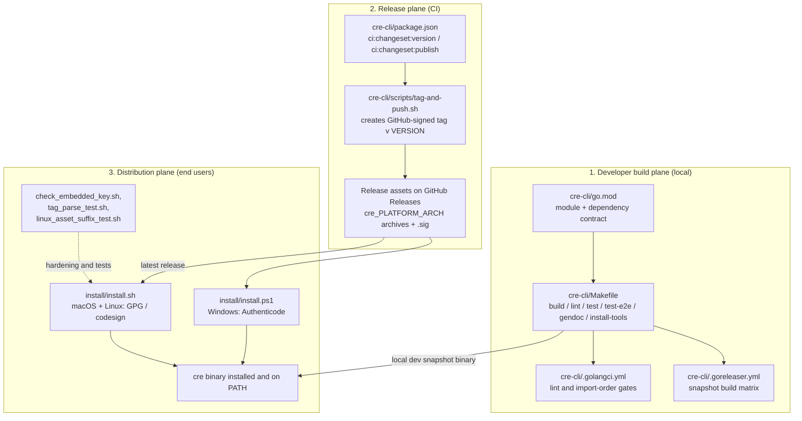
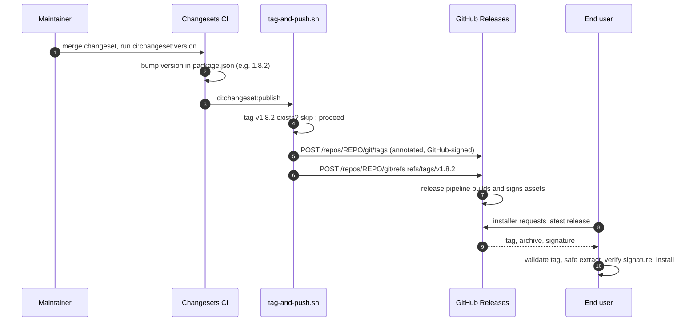
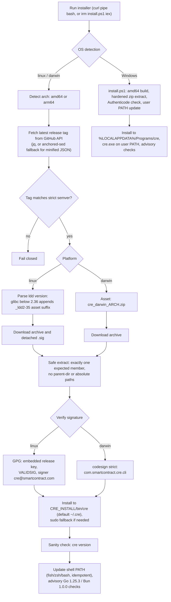

# cre-cli — Build & Release Pipeline

> **Module scope:** how the `cre` CLI (`github.com/smartcontractkit/cre-cli`) is built, quality-gated, versioned, signed, distributed and installed.
> **Part of:** [Developer Toolchain (CLI, SDKs & API Clients)](<../Developer_Toolchain_(CLI,_SDKs___API_Clients).md>)

## 1. Purpose

The `cre` CLI is the developer-facing entry point to CRE: it deploys, activates, pauses and deletes workflows, simulates them against local chains, manages secrets and generates chain bindings. This module implements **none of those commands**. Instead it answers a different question: *how does the source tree under `cre-cli/` become a signed, versioned binary that a developer can trust and install with one command?*

Concretely, the module owns:

| Concern | Artifact | Responsibility |
|---|---|---|
| Dependency contract | `cre-cli/go.mod` | Module path, Go version (1.26.4) and every direct dependency of the CLI |
| Developer workflow | `cre-cli/Makefile` | Canonical local loop: build (with version stamping), lint, tiered tests, doc generation, tool bootstrap |
| Quality gates | `cre-cli/.golangci.yml` | golangci-lint v2 policy, incl. a `forbidigo` ban on direct `viper` access and strict import grouping |
| Snapshot builds | `cre-cli/.goreleaser.yml` | CGO-free linux/darwin builds for amd64/arm64 via GoReleaser |
| Versioning & tagging | `cre-cli/package.json`, `cre-cli/scripts/tag-and-push.sh` | Changesets-driven version bumps; GitHub-signed `v{version}` tags created through the GitHub API |
| Distribution & install | `cre-cli/install/install.sh`, `cre-cli/install/install.ps1` | Hardened macOS/Linux and Windows installers with GPG / codesign / Authenticode verification |
| Installer guards & tests | `cre-cli/install/check_embedded_key.sh`, `cre-cli/install/tag_parse_test.sh`, `cre-cli/install/linux_asset_suffix_test.sh` | Key-sync guard plus bash-level unit tests for tag parsing and glibc asset selection |

## 2. Architecture Overview

The module is organized into three planes that hand off to each other:

1. **Developer build plane.** `make build` compiles the binary `cre` with the commit SHA injected via `ldflags` (`-X .../cmd/version.Version=build <COMMIT_SHA>`); `make lint` runs golangci-lint with auto-fix; `make test` runs lint first and then the unit suite (excluding the `usbwallet` package); `make test-quick` runs a fast `-short` subset with a 30s timeout and an explicit skip list of slow/flaky e2e scenarios; `make test-e2e` runs the full `./test/` end-to-end suite with `-p 5`. `make gendoc` regenerates the CLI reference docs through `gendoc/main.go`, and `make goreleaser-dev-build` produces local snapshot binaries from `.goreleaser.yml`. Tooling bootstrap (`make install-tools`, `make install-foundry`) installs asdf-managed Go/golangci-lint/goreleaser plus Foundry v1.1.0 used by bindings/contract tooling. `make run-op` runs the local binary through the 1Password CLI (`op run --env-file=".env"`) for secrets-injected local sessions.

2. **Release plane.** Changesets bumps the version in `cre-cli/package.json` (`ci:changeset:version` → `pnpm changeset version`), and CI then invokes `ci:changeset:publish` → `scripts/tag-and-push.sh`, which reads the version, skips if the tag already exists (idempotent), creates an *annotated tag object via the GitHub API* — so tags are signed by GitHub and display as “Verified” — and finally creates `refs/tags/v{version}`. The published release assets consumed downstream follow the installer-expected layout `cre_{platform}_{arch}[.tar.gz|.zip]` with detached `.sig` files; the `.goreleaser.yml` in this directory is the *local snapshot* config (binary `cre-cli-cli`), not the asset-naming source for published releases.

3. **Distribution plane.** The installers fetch the latest release, validate the tag strictly, download the platform archive, extract it safely, verify it cryptographically per-OS, install to a user-writable directory, run `cre version` as a sanity check, wire up the shell `PATH`, and print advisory Go/Bun version checks for building CRE workflows.

## 3. Sub-modules

Detailed documentation for each sub-module:

| Sub-module | Contents | Documentation |
|---|---|---|
| Build & Developer Tooling | `cre-cli/go.mod`, `cre-cli/Makefile`, `cre-cli/.golangci.yml`, `cre-cli/.goreleaser.yml` — the local development, lint and snapshot-build surface | [Build & Developer Tooling](cre-cli-build-and-release/cre-cli-build-and-release_build-tooling.md) — *generated: `cre-cli-build-and-release_build-tooling.md`* |
| Installers & Release Verification | `cre-cli/install/install.sh`, `cre-cli/install/install.ps1`, `cre-cli/install/check_embedded_key.sh`, `cre-cli/install/tag_parse_test.sh`, `cre-cli/install/linux_asset_suffix_test.sh` — cross-platform hardened installation and cryptographic verification | [Installers & Release Verification](cre-cli-build-and-release/cre-cli-build-and-release_installers.md) — *generated: `cre-cli-build-and-release_installers.md`* |
| Release Automation | `cre-cli/package.json` changesets wiring (`ci:changeset:version`, `ci:changeset:publish`) and `cre-cli/scripts/tag-and-push.sh` GitHub-signed tagging | [Release Automation](cre-cli-build-and-release/cre-cli-build-and-release_release-automation.md) — *generated: `cre-cli-build-and-release_release-automation.md`* |

## 4. End-to-End Flows

### 4.1 Release train (changesets → signed tag → assets)

### 4.2 First-time user installation

### 4.3 Local development loop

- `make all` → `clean` + `test` + `build` (the default pre-push gate; `clean` also removes leftover `test/proposal_*.json` MCMS artifacts from e2e runs).
- `make build` stamps the version as `build <COMMIT_SHA>` so `cre version` always identifies the exact commit; release builds stamp the real tag, and both installers use `cre version` as a post-install sanity check.
- `make lint` / `make test` enforce the `.golangci.yml` policy on every change; `make gendoc` keeps generated CLI docs in sync with the command tree.

## 5. Security & Verification Model

| Platform | Mechanism | Enforced checks |
|---|---|---|
| Linux | Detached GPG signature | Embedded public key must equal `install/public_key.asc` (`check_embedded_key.sh`); `[GNUPG:] VALIDSIG` present; signer is `cre@smartcontract.com` |
| macOS | Code signing | `codesign --verify --strict --identifier com.smartcontract.cre.cli` |
| Windows | Authenticode | Signature status `Valid`, signer certificate subject contains `SmartContract` |
| All | Release-tag validation | Fail-closed regex `^v?[0-9]+\.[0-9]+\.[0-9]+([-.+][0-9A-Za-z.-]+)*$` — rejects `latest`, path traversal, command substitution, URL injection |
| All | Archive extraction | Rejects `..`/absolute/backslash-traversal entries and requires *exactly one* expected archive member |
| All | Version hygiene | Tags created server-side via the GitHub API (GitHub-signed, “Verified”); `tag-and-push.sh` is idempotent; glibc-aware `_ldd2-35` asset suffix avoids load failures on older distros |

Key invariants worth knowing when changing this module:

- The PGP key block embedded in `install.sh` (`write_release_public_key`) **must** stay byte-identical to `cre-cli/install/public_key.asc`; `check_embedded_key.sh` diffs the two (with trailing-newline normalization) and fails otherwise.
- `tag_parse_test.sh` and `linux_asset_suffix_test.sh` source helpers from `install.sh` by **line ranges** (`sed -n '244,261p'` and `'198,242p'`); moving those helpers requires updating the test ranges too.
- `forbidigo` in `.golangci.yml` bans `viper.Get*/Set*/BindPFlags/WriteConfigAs` at call sites to force all configuration through the settings layer (see [cre-cli-platform-config](cre-cli-platform-config.md)).

## 6. Relationship to the Rest of the System

- **Ships the binary for** the CLI's functional sub-modules: [cre-cli-workflow-commands](cre-cli-workflow-commands.md) (deploy/activate/pause/delete/simulate), [cre-cli-backend-clients](cre-cli-backend-clients.md) (GraphQL clients), [cre-cli-secrets](cre-cli-secrets.md) (vault-backed secrets — note the `tdh2` crypto dependency in `go.mod`), [cre-cli-bindings-generator](cre-cli-bindings-generator.md) (Foundry, `dave/jennifer`, `anchor-go` codegen) and [cre-cli-platform-config](cre-cli-platform-config.md) (settings/tenant/telemetry; its `internal/update` release check complements the installers).
- **Repo-wide build & CI** (chainlink GNUmakefile, release-changelog tooling, githooks, workspace scripts) is documented separately in [Build, CI & Release Infrastructure](<../Build,_CI___Release_Infrastructure.md>); this module is the *product-specific* build/release layer for the `cre` CLI only.
- The `chainlink-common`, `chainlink-protos`, `mcms` and `cre-sdk-go` dependencies consumed through `go.mod` are documented under the [Plugin Process Framework (Loop)](<../Plugin_Process_Framework_(Loop).md>) and [Shared Foundation Libraries & Domain Types](<../Shared_Foundation_Libraries___Domain_Types.md>) modules.
