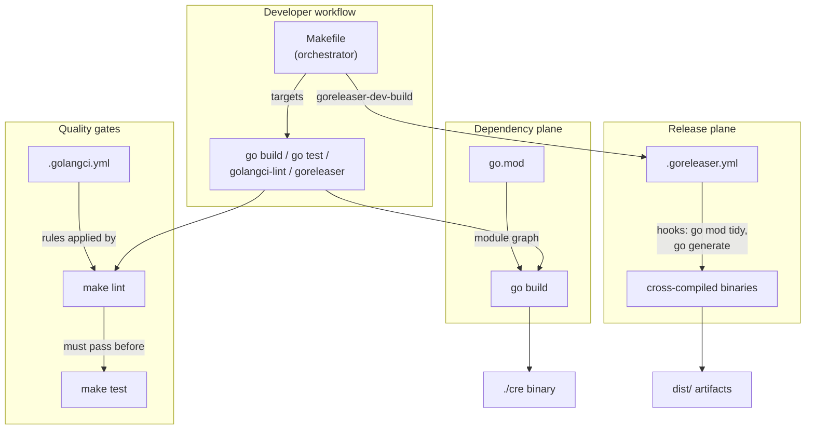
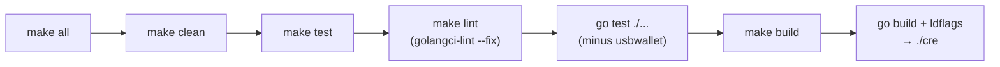
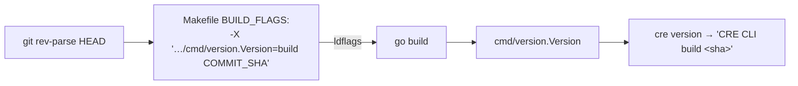
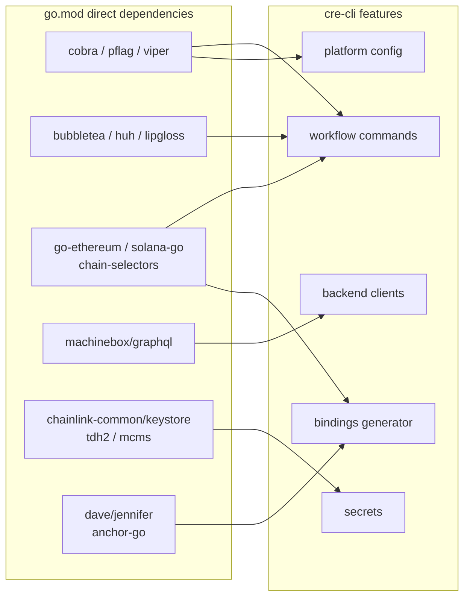
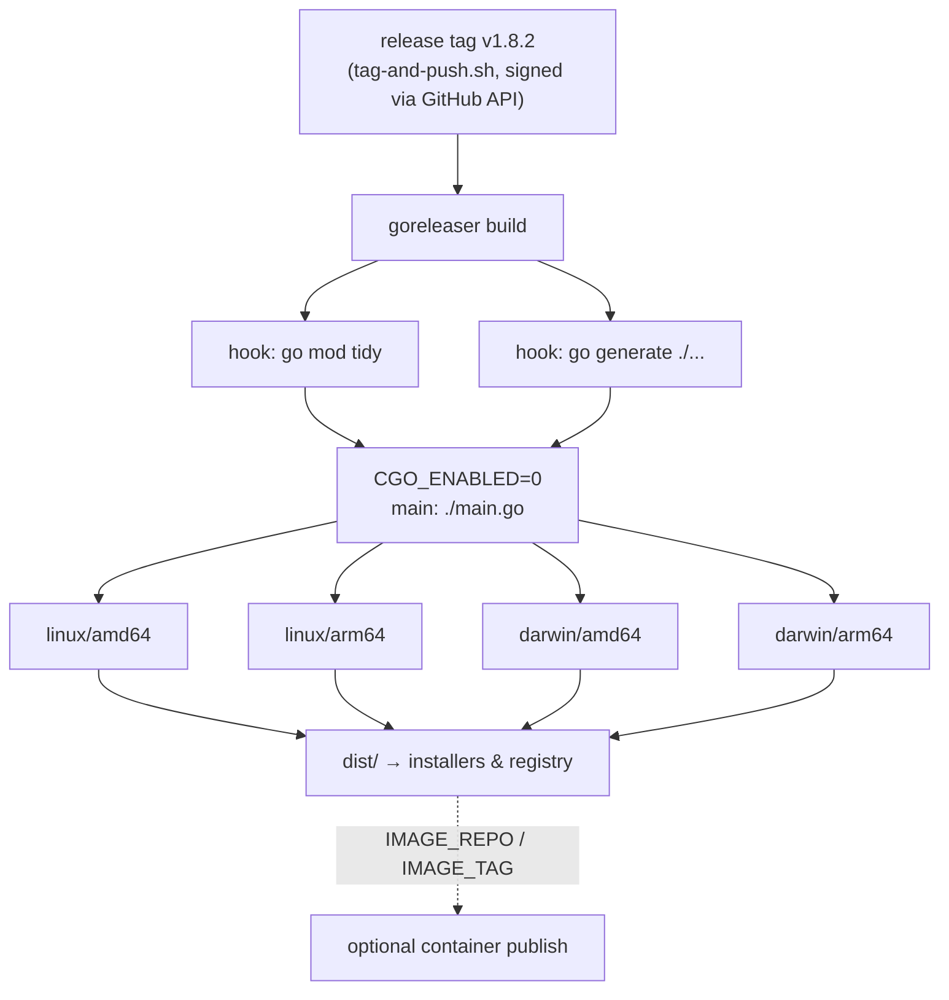
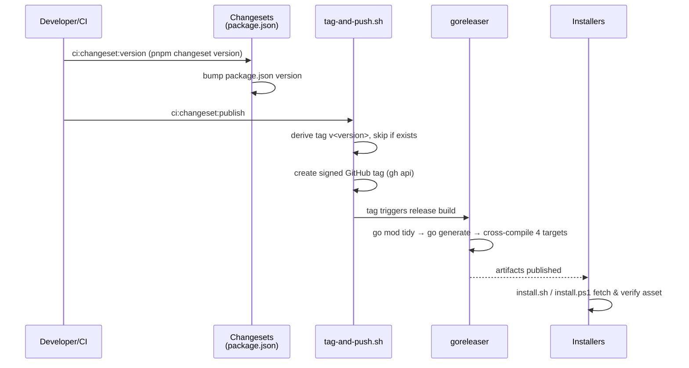

# cre-cli Build Tooling

## Overview

This module defines the **build, quality-gate and packaging toolchain for the `cre` CLI** (module `github.com/smartcontractkit/cre-cli`). It is not application code: it is the set of build-configuration artifacts that turn the cre-cli source tree into a locally runnable binary, enforce code quality, run tests, generate CLI documentation, and produce release artifacts for downstream distribution.

It is one of three sub-modules of the [cre-cli build & release](../cre-cli-build-and-release.md) area:

| Sub-module | Responsibility |
|---|---|
| **build-tooling** (this page) | Makefile targets, Go module definition, linting rules, goreleaser build matrix |
| [Installers](cre-cli-build-and-release_installers.md) | Post-release installation scripts for end users (`install.sh`, `install.ps1`, embedded-key and asset-suffix checks) |
| [Release automation](cre-cli-build-and-release_release-automation.md) | Version management and git tagging (`package.json` changeset scripts, `tag-and-push.sh`) |

The build tooling consumes the source code documented in the sibling feature pages — [workflow commands](../cre-cli-workflow-commands.md), [backend clients](../cre-cli-backend-clients.md), [secrets](../cre-cli-secrets.md), [bindings generator](../cre-cli-bindings-generator.md) and [platform config](../cre-cli-platform-config.md) — and produces the `cre` executable from it.

---

## Artifacts at a Glance

| Artifact | Role |
|---|---|
| `cre-cli/Makefile` | Declarative entry point for the developer workflow: `all`, `build`, `lint`, `test`, `test-e2e`, `test-quick`, `clean`, `run`, `run-op`, `gendoc`, `install-tools`, `goreleaser-dev-build` |
| `cre-cli/go.mod` | Go module declaration (`go 1.26.4`) and the dependency manifest that maps every cre-cli feature to its libraries |
| `cre-cli/.golangci.yml` | golangci-lint v2 configuration: enabled linters, `forbidigo` policy against direct `viper` access, `revive` rule set, import-grouping formatters |
| `cre-cli/.goreleaser.yml` | Release build recipe: pre-build hooks, CGO-free cross-compilation matrix, and container-registry environment variables |

---

## Architecture

The four artifacts form a layered toolchain. The Makefile orchestrates everything; the Go module pins what can be built; the lint config gates what may be committed; goreleaser defines how releases are compiled.



### Repository context

cre-cli is a standalone Go module inside the polyglot Chainlink monorepo. Its module-level conventions (changesets, linting style) mirror the repo-wide tooling described in [Build, CI & Release Infrastructure](../../Build,_CI___Release_Infrastructure.md) — e.g. the same `ci:changeset:*` npm-script convention used by [capabilities workspace tooling](../../Build,_CI___Release_Infrastructure/capabilities_workspace_tooling.md) and [chainlink build and tooling](../../Build,_CI___Release_Infrastructure/chainlink_build_and_tooling.md).

---

## Makefile — the Developer Workflow

`cre-cli/Makefile` defines the canonical entry points. All targets are declared `.PHONY` and parameterize the toolchain through variables:

```makefile
COMMIT_SHA   = $(shell git rev-parse HEAD)
BUILD_FLAGS  = -ldflags "-w -X 'github.com/smartcontractkit/cre-cli/cmd/version.Version=build $(COMMIT_SHA)'"
BINARY_NAME  = cre
```

| Target | Description |
|---|---|
| `all` | Full developer cycle: `clean → test → build` |
| `build` | `go build` with version ldflags → `./cre` |
| `lint` | `golangci-lint run ./... --fix -v` (auto-fixes issues in place) |
| `test` | Depends on `lint`, then `go test -v` over all packages **except** `usbwallet` |
| `test-e2e` | End-to-end suite from `./test/`, run with package parallelism `-p 5` |
| `test-quick` | Fast inner loop: `-short` mode, 30 s timeout, skips known slow/flaky tests (multi-command happy paths, gateway posting, workflow simulation, auto-linking, etc.) |
| `clean` | Removes `cre`, `cre-admin`, `gendoc-cli`, `dist/`, `go clean`, and test proposal artifacts (`test/proposal_*.json`) |
| `run` | Builds then executes `./cre $(CMD)` — e.g. `make run CMD="workflow deploy"` |
| `run-op` | Same as `run` but wraps the process in `op run --env-file=".env"` so secrets come from a 1Password vault |
| `goreleaser-dev-build` | `goreleaser build --snapshot --clean` to exercise the release pipeline locally |
| `install-tools` | Registers asdf plugins for **Go**, **golangci-lint** and **goreleaser**, then `asdf install` (also installs foundry) |
| `install-foundry` | Installs Foundry (pinned `v1.1.0` via `foundryup`) used by EVM contract-related tests |
| `gendoc` | Deletes and regenerates `docs/` by running `gendoc/main.go` |

### Build pipeline flow



Key properties:

- **Lint is a hard prerequisite of `test`** — a failing lint blocks the test phase, keeping the quality gate in the inner loop (see [Linting](#linting-and-code-quality-golangcliml)).
- **`test-quick` exists for fast iteration**: it combines `-short` mode with an explicit `-skip` list (captured in the Makefile comment) so contributors can run the suite in ~30 s without e2e/network-dependent tests.
- **`clean` removes test run-off artifacts** (`test/proposal_*.json`), which are produced by the workflow proposal commands documented in [workflow commands → deploy](../cre-cli-workflow-commands/cre-cli-workflow-commands_deploy.md).

### Version injection at build time

The version printed by `cre version` is not hardcoded in releases; it is injected by the linker. The source placeholder lives in `cre-cli/cmd/version/version.go`:

```go
// Default placeholder value
var Version = "development"
```

The Makefile overrides it with the current git commit, prefixed `build`:



Any change to the version package's variable name or path must be mirrored in `BUILD_FLAGS` (and kept consistent with goreleaser-based release builds, where tags produced by the [release automation](cre-cli-build-and-release_release-automation.md) become the release version).

### Documentation generation (`gendoc`)

The `gendoc` target runs `cre-cli/gendoc/main.go`, a standalone program that:

1. Creates the `docs/` output directory if missing,
2. Rewrites every cobra command's usage line to append `[optional flags]` (via `customizeUsageStrings`),
3. Emits the Markdown command tree with `cobra/doc.GenMarkdownTree`.

Because the target `rm -f docs/*` first, any hand-written files under `cre-cli/docs/` are transient — treat `docs/` as generated output.

### Local release rehearsal

`make goreleaser-dev-build` invokes goreleaser against `cre-cli/.goreleaser.yml` in **snapshot mode**, producing `dist/` artifacts without publishing. Use it to validate cross-compilation changes before a real release.

---

## Go Module — Dependency Landscape

`cre-cli/go.mod` declares `module github.com/smartcontractkit/cre-cli` at **Go 1.26.4** and pins the libraries each cre-cli feature is built on. The direct-dependency block doubles as a feature map:

| Dependency group | Libraries | Powers |
|---|---|---|
| CLI framework | `spf13/cobra`, `spf13/pflag`, `spf13/viper` | Command tree, flags, project config (`internal/settings`) |
| Terminal UX | `charmbracelet/bubbletea`, `bubbles`, `huh`, `lipgloss` | Interactive prompts & TUI rendering |
| Chain clients | `ethereum/go-ethereum`, `chainlink-evm/gethwrappers`, `gagliardetto/solana-go`, `chainlink-solana`, `chain-selectors` | EVM/Solana interactions, chain selectors ([workflow commands → simulation](../cre-cli-workflow-commands/cre-cli-workflow-commands_simulation.md)) |
| Backend APIs | `machinebox/graphql`, `hasura/go-graphql-client` | Private-registry / workflow-data clients ([backend clients](../cre-cli-backend-clients.md)) |
| Crypto & keys | `chainlink-common/keystore`, `tdh2`, `mcms`, `golang.org/x/crypto` | Secret encryption bundles, MCMS proposals ([secrets](../cre-cli-secrets.md)) |
| Code generation | `dave/jennifer`, `gagliardetto/anchor-go` | EVM/Solana bindings generation ([bindings generator](../cre-cli-bindings-generator.md)) |
| Validation & config | `go-playground/validator/v10`, `BurntSushi/toml`, `joho/godotenv`, `sigs.k8s.io/yaml` | Input validation, YAML/TOML parsing (`project.yaml`, secrets configs) |
| Platform services | `chainlink-common`, `chainlink-protos/cre/go`, `chainlink-protos/workflows/go`, `chainlink/deployment`, `cre-sdk-go` | Registry contracts, workflow protobufs, deployment framework types |
| Observability | `zap`, `zerolog` | Structured logging & telemetry client |
| Testing | `testify`, `test-go/testify`, `jarcoal/httpmock` | Unit tests + HTTP mocking (used heavily by the `*_test.go` files listed in the [toolchain module tree](../../Developer_Toolchain_(CLI,_SDKs___API_Clients).md)) |



**Maintenance notes**

- The module is deliberately self-contained (its own `go.mod`, not part of `chainlink/go.mod`), which keeps the CLI's dependency graph independent from the node. Repo-wide module hygiene conventions are described in [build-and-repo-tooling](../../Build,_CI___Release_Infrastructure/build-and-repo-tooling.md).
- Bumping `golang.org/x/mod`, `Masterminds/semver` or the protos usually affects [platform config](../cre-cli-platform-config.md) (update checks, tenant context) — re-run `make test-quick` after upgrades.

---

## Linting and Code Quality (`.golangci.yml`)

The golangci-lint **v2** configuration enforces the project's code standards. `make lint` runs it with `--fix`, so many findings are auto-corrected.

**Enabled linters**

| Linter | Purpose |
|---|---|
| `copyloopvar` | Flags redundant loop-variable copies (Go ≥1.22 semantics) |
| `errorlint` | Correct error wrapping/comparison (`%w`, `errors.Is/As`) |
| `exhaustive` | Requires exhaustive `switch` over enums (`default-signifies-exhaustive: true`) |
| `forbidigo` | **Bans direct viper access** (see below) |
| `gosec` | Security checks; `G101` (hardcoded credentials) excluded |
| `misspell` | Typo detection |
| `revive` | Style/lint rules at confidence 0.8, including `package-comments`, `error-strings`, `confusing-naming`, `identical-branches`, `atomic`, `defer` and many more |
| `rowserrcheck` | Correct `sql.Rows.Err` handling |
| `govet: shadow` | Flags shadowed variables (except `err`) |

**The `forbidigo` policy** is the most opinionated rule and encodes an architectural convention: code must not call `viper.BindPFlags`, `viper.Get*`, `viper.Set*` or `viper.WriteConfigAs` directly. All configuration access is funneled through the settings layer documented in [platform config → project settings](../cre-cli-platform-config/cre-cli-platform-config_project-settings.md). Adding new viper call sites will fail CI lint.

**Formatters** enforce a four-group import order via `gci`/`goimports`:

1. standard library,
2. external (default),
3. `prefix(github.com/smartcontractkit)`,
4. `prefix(github.com/smartcontractkit/cre-cli)` (local).

**Targeted exclusions** (do not remove casually):

- `revive` disabled for `deployment/memory/(.+)\.go` — generated-style memory-blob code;
- `gosec G404` — weak RNG is intentional in simulation/test contexts;
- `govet` "declaration of `err` shadows" — accepted pattern;
- standard `generated: lax` presets so protobuf/mock output is not linted.

---

## Release Builds (`.goreleaser.yml`)

`.goreleaser.yml` (project name `cre-cli`) defines how release binaries are produced. It is exercised locally by `make goreleaser-dev-build` and in CI after a release tag is created by [release automation](cre-cli-build-and-release_release-automation.md).

```yaml
builds:
  - binary: cre-cli-cli
    env:
      - CGO_ENABLED=0
    main: ./main.go
    goarch: [arm64, amd64]
    goos:   [linux, darwin]
```

- **`before` hooks** run `go mod tidy` and `go generate ./...` before compiling, ensuring generated code (e.g. bindings test fixtures) is fresh.
- **`CGO_ENABLED=0`** guarantees fully static binaries — required for portable distribution by the [installers](cre-cli-build-and-release_installers.md).
- **Cross-compilation matrix**: `linux`/`darwin` × `amd64`/`arm64` (4 targets). Note there is no `windows` goos entry; Windows users are served by the PowerShell installer fallback path documented in [installers](cre-cli-build-and-release_installers.md).
- **Container env vars**: `IMAGE_REPO` (default `localhost:5001/cre-cli`) and `IMAGE_TAG` (default `local`) support optional container publishing of the built binary.



The naming difference between the local dev binary (`BINARY_NAME=cre` in the Makefile) and the goreleaser output (`binary: cre-cli-cli`) is intentional: local builds produce the ergonomic `./cre` for `make run`, while release artifacts use the distribution name that the install scripts map onto `cre` on the user's PATH.

---

## Process Flows

### Full release pipeline (end to end)



### Adding a dependency safely

1. `go get <module>` (updates `go.mod`).
2. `make lint` — confirms import grouping (`gci`) and no new `forbidigo` violations.
3. `make test-quick` — fast verification.
4. If the dependency belongs to a feature area, update the relevant feature page ([workflow commands](../cre-cli-workflow-commands.md), [secrets](../cre-cli-secrets.md), …) rather than this one.

---

## Relationship to Other Modules

- **Parent**: [cre-cli build & release](../cre-cli-build-and-release.md) — groups build tooling, installers and release automation for the CLI.
- **Feature modules built by this toolchain**: [workflow commands](../cre-cli-workflow-commands.md), [backend clients](../cre-cli-backend-clients.md), [secrets](../cre-cli-secrets.md), [bindings generator](../cre-cli-bindings-generator.md), [platform config](../cre-cli-platform-config.md).
- **Repo-wide CI**: the monorepo-level [Build, CI & Release Infrastructure](../../Build,_CI___Release_Infrastructure.md) documents shared conventions (changesets, SonarQube properties, golangci style) that cre-cli's config follows.
- **Downstream users of `cre`**: the [CRE & Keystone Deployment Suite](../../CRE___Keystone_Deployment_Suite.md) and [Deployment Framework](../../Deployment_Framework_Core___Product_Deployments.md) workflows assume a working `cre` binary produced by this toolchain; end-user acquisition is documented in the [installers](cre-cli-build-and-release_installers.md) page.

---

## Maintenance Checklist

| Task | Where | Watch out for |
|---|---|---|
| Bump Go version | `go.mod` `go` directive + `asdf` plugin in `install-tools` | CI runners must have matching toolchain |
| Add a linter | `.golangci.yml` `linters.enable` | Keep `forbidigo` viper patterns intact |
| Change binary name | Makefile `BINARY_NAME` **and** `.goreleaser.yml` `binary` | `clean` removes `cre`, `cre-admin`, `gendoc-cli` |
| Update version string format | `BUILD_FLAGS` ldflags `cmd/version.Version` | `version.go` placeholder is `development` |
| Add slow test | — | Consider adding it to the `test-quick` `-skip` list |
| Add goreleaser target OS | `.goreleaser.yml` `goos`/`goarch` | Verify installer asset-suffix logic in [installers](cre-cli-build-and-release_installers.md) (`linux_asset_suffix_test.sh`) |
| Regenerate CLI docs | `make gendoc` | `docs/` is wiped each run |
