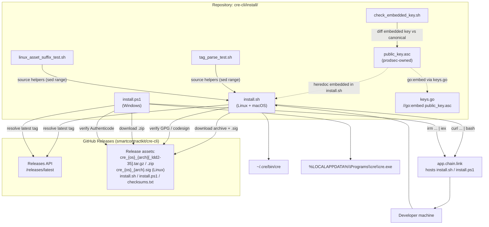
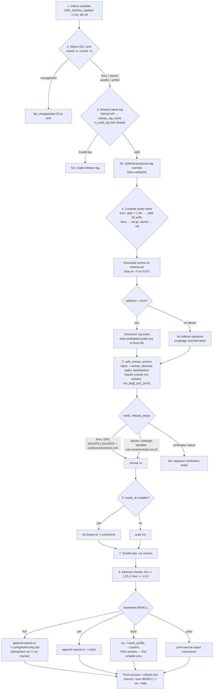
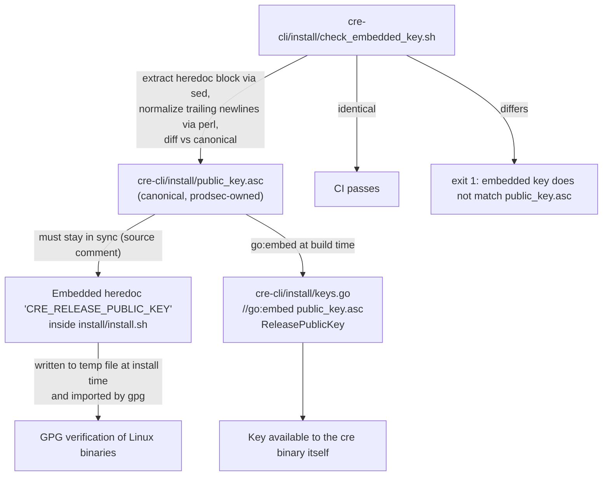

# CRE CLI — Bootstrap Installers

The **installers** module contains the bootstrap scripts that install the `cre` CLI (the Chainlink CRE developer command line tool) onto a user's machine from prebuilt GitHub release binaries. It covers Linux, macOS, and Windows, enforces cryptographic verification of every downloaded binary, and ships with dedicated shell test harnesses that guard its security-critical parsing logic.

---

## Overview

Every installer in this module follows the same contract:

1. **Detect** the host OS and CPU architecture.
2. **Resolve** the latest release tag from the GitHub Releases API (`smartcontractkit/cre-cli`).
3. **Download** the matching release archive into a temporary directory.
4. **Verify** the extracted binary's signature (GPG / Apple codesign / Authenticode) before it is ever executed or installed.
5. **Install** the binary into a user-scoped directory and configure the shell `PATH`.
6. **Advise** the user about optional workflow toolchain dependencies (Go, Bun) via non-blocking warnings.

The scripts are designed to be consumed via the classic "curl pipe to shell" bootstrap pattern:

| Platform | Command |
|---|---|
| Linux / macOS | `curl -sSL https://app.chain.link/install.sh \| bash` |
| Windows (PowerShell) | `irm https://app.chain.link/install.ps1 \| iex` |

> **Trust note:** the bootstrap scripts themselves are served from `app.chain.link`. Users who prefer to inspect them first can download `install.sh` / `install.ps1` plus a `checksums.txt` (published with each release) and verify SHA-256 digests before running. See the repo file `cre-cli/install/README.md` for the copy-paste verification recipes.

### Component inventory

| Component | Path | Role |
|---|---|---|
| `install.sh` | `cre-cli/install/install.sh` | Universal bash installer for Linux and macOS: platform/arch detection, tag resolution, download, safe extraction, GPG/codesign verification, install, PATH setup, dependency advisories |
| `install.ps1` | `cre-cli/install/install.ps1` | PowerShell installer for Windows: arch detection, tag validation, zip download/extraction, Authenticode verification, user-PATH registration |
| `check_embedded_key.sh` | `cre-cli/install/check_embedded_key.sh` | CI guard that fails if the GPG public key embedded in `install.sh` drifts from the canonical `install/public_key.asc` |
| `tag_parse_test.sh` | `cre-cli/install/tag_parse_test.sh` | Unit tests for `extract_tag_name` / `is_valid_tag` helpers sourced out of `install.sh` |
| `linux_asset_suffix_test.sh` | `cre-cli/install/linux_asset_suffix_test.sh` | Unit tests for glibc detection and the Linux asset-suffix selection helpers in `install.sh` |
| `public_key.asc` *(supporting asset)* | `cre-cli/install/public_key.asc` | Canonical, prodsec-owned copy of the Linux GPG release public key |
| `keys.go` *(supporting asset)* | `cre-cli/install/keys.go` | Go embed (`//go:embed public_key.asc`) exposing the release public key to the CLI binary |
| `README.md` *(supporting asset)* | `cre-cli/install/README.md` | User-facing install instructions and script-verification guidance |

---

## Architecture

The installers sit at the boundary between the repository (where they are authored and tested), the release pipeline (which publishes signed assets), and end-user machines (which download and verify them).



Key structural points:

- **Single source of truth for the signing key.** `install/public_key.asc` is the canonical key; `install.sh` embeds an identical copy as a heredoc (the installer must work standalone on a fresh machine, before the repo is cloned), and `keys.go` embeds it into the `cre` binary itself. `check_embedded_key.sh` exists specifically to catch drift between the script copy and the canonical file.
- **Release assets are the integration contract.** The installers do not build anything; they consume assets named `cre_{platform}_{arch}[_ldd2-35].{tar.gz,zip}` (plus a `.sig` for Linux) published per tag. The local `.goreleaser.yml` (see [Build Tooling](cre-cli-build-and-release_build-tooling.md)) is used for snapshot/dev builds; production assets are published by the release pipeline (see [Release Automation](cre-cli-build-and-release_release-automation.md)).
- **Hosted entry point.** `app.chain.link` serves the scripts so users can install with a one-liner; the README documents how to verify the served script against the `checksums.txt` published in the release.

---

## Installation flow (Linux / macOS — `install.sh`)

The script is organized into eight numbered phases (matching the `# N.` comments in the source):



Phase highlights and implementation details:

1. **Variables.** Install root is controlled by the `CRE_INSTALL` environment variable (default `~/.cre`); the binary lands at `$CRE_INSTALL/bin/cre`.
2. **Detection.** `uname -s` maps to `linux`/`darwin` (Windows users are redirected to the PowerShell script); `uname -m` maps to `amd64` (`x86_64`/`amd64`) or `arm64` (`arm64`/`aarch64`).
3. **Tag resolution.** `extract_tag_name` prefers `jq` and falls back to an anchored `sed` that works on minified release JSON. `is_valid_tag` fails closed on anything that is not a plausible `vMAJOR.MINOR.PATCH` (optional pre-release/build suffix). This validation is mandatory because the tag is interpolated into a download URL — see [Security model](#security-model).
4. **Asset naming.** Linux archives are `.tar.gz`, macOS archives are `.zip`; the embedded binary inside is always named `cre_{tag}_{platform}_{arch}`. Linux binaries may carry a glibc-compatibility suffix — see [Linux glibc compatibility](#linux-glibc-compatibility-_ldd2-35).
5. **Safe extraction.** Both tar and zip paths enumerate every member, reject unsafe entries (parent traversal `../`, absolute paths, backslashes), and require *exactly one* member matching the expected binary name before extracting. This blocks archive-slip attacks even if a release artifact were tampered with.
6. **Install with privilege fallback.** If `$CRE_INSTALL` is not writable the script escalates via `sudo mv` (requiring `sudo` to be present).
7. **Smoke test.** `cre version` must succeed, otherwise installation is declared failed.
8. **PATH setup is idempotent.** Each shell branch appends an export block guarded by a `# cre` marker comment so repeated runs do not duplicate lines. Non-writable configs (or unknown shells) result in printed manual instructions. `fish` uses `set --export`, POSIX shells use `export`.

## Windows flow (`install.ps1`)

`install.ps1` mirrors the bash flow with Windows-specific substitutions:

| Concern | Implementation |
|---|---|
| Architecture | `$env:PROCESSOR_ARCHITECTURE` → `AMD64` or `ARM64`. *Both currently resolve to the `amd64` build* (no separate ARM64 Windows asset is consumed). |
| Tag resolution / validation | `Invoke-RestMethod` on the Releases API; `Test-ValidTag` applies the same fail-closed semver regex as `install.sh`. |
| Asset | `cre_windows_amd64.zip` containing `cre_{tag}_windows_amd64.exe`. |
| Safe extraction | `System.IO.Compression.ZipFile::OpenRead`; `Test-UnsafeZipEntry` rejects `..`, leading `/` or `\`, and drive-letter paths; requires exactly one matching entry. |
| Signature verification | `Get-AuthenticodeSignature`: status must be `Valid`, a signer certificate must be present, and the subject must match `*SmartContract*`. |
| Install location | `$env:LOCALAPPDATA\Programs\cre` (user scope — **no admin rights required**). |
| PATH | User-scope `Path` registry value via `[System.Environment]::SetEnvironmentVariable(..., "User")`, only if not already present. |
| Error handling | `$ErrorActionPreference = "Stop"`; a top-level `try/catch` prints `Installation failed: <message>` and exits non-zero. |
| Dependency advisories | Same Go ≥ 1.25.3 and Bun ≥ 1.0.0 advisory checks (warnings only). |

```mermaid
flowchart LR
    A["Detect arch<br/>(PROCESSOR_ARCHITECTURE)"] --> B["Fetch latest tag<br/>+ Test-ValidTag"]
    B --> C["Download cre_windows_amd64.zip<br/>to per-run temp dir"]
    C --> D["Extract expected .exe<br/>(single-entry, traversal-checked)"]
    D --> E["Test-ReleaseAuthenticode<br/>(Valid + SmartContract subject)"]
    E --> F["Copy to %LOCALAPPDATA%\\Programs\\cre\\cre.exe"]
    F --> G["cre version smoke test"]
    G --> H["Add install dir to User PATH"]
    H --> I["Advisory Go / Bun checks"]
```



---

## Security model

The installers are the first code an operator executes when adopting the CRE CLI, so their security posture is deliberately layered. Verification is applied to the **binary** by the scripts, and to the **bootstrap scripts themselves** by the published `checksums.txt`.

### Release binary verification

| Platform | Mechanism | Pass criteria | Failure mode |
|---|---|---|---|
| Linux | GPG: `gpg --batch --import` of the embedded public key, then `gpg --batch --status-fd=1 --verify` | Output contains `[GNUPG:] VALIDSIG` **and** the signer identity is `cre@smartcontract.com` | Hard failure (`fail`) — binary is never installed |
| macOS | Apple `codesign --verify --strict --identifier com.smartcontract.cre.cli` | `codesign` exits 0 | Hard failure |
| Windows | Authenticode via `Get-AuthenticodeSignature` | Status `Valid`, signer certificate present, subject matches `*SmartContract*` | Hard failure |

Verification happens **after extraction but before** `chmod +x` / install / execution, so an unverified binary is never executed.

### Public key lifecycle

The Linux GPG key has three synchronized representations, enforced by a drift guard:



Rules for maintainers:

- **Key rotation:** update `install/public_key.asc` **and** the heredoc block in `install/install.sh` in the same commit, then run `cre-cli/install/check_embedded_key.sh` to prove synchronization. The comment `CRE_RELEASE_PUBLIC_KEY - must stay in sync with install/public_key.asc (prodsec-owned)` marks the heredoc.
- **Normalization matters:** `check_embedded_key.sh` normalizes trailing newlines with `perl` before diffing so editors that add/strip a final newline do not cause spurious CI failures.

### Archive extraction safety

Both installers implement the same extraction invariants:

- **Member enumeration before extraction:** `tar -tzf` / `unzip -Z1` / `ZipFile::OpenRead` list all entries first.
- **Traversal rejection:** entries containing `../` segments, absolute paths (`/...`, `\...`, drive letters on Windows) are rejected outright.
- **Single-member enforcement:** the archive must contain *exactly one* member (archives are produced with a single wrapped binary), and that member must equal the expected `cre_{tag}_{os}_{arch}` name. Any deviation — extra files, renamed binary, nested directories — is a hard failure.
- **Extraction targets only the expected member** into the temp directory, never the whole archive.

### Fail-closed tag validation

The release tag is user-influenceable data (a positional argument overrides the fetched tag) and is interpolated directly into a download URL:

```
https://github.com/{repo}/releases/download/{LATEST_TAG}/{ASSET}
```

`is_valid_tag` therefore enforces `^v?[0-9]+\.[0-9]+\.[0-9]+([-.+][0-9A-Za-z.-]+)*$` and nothing else. The test suite explicitly asserts rejection of `../../evil`, `$(rm -rf /)`, `v1.2.3/../../etc`, the string `latest`, and empty input. Both installers fail closed: an unparsable tag aborts the install rather than attempting a download.

---

## Linux glibc compatibility (`_ldd2-35`)

Go binaries built with CGO can depend on the host glibc version. To support older enterprise distros, the pipeline publishes a second Linux build per release, and the installer selects between them at runtime:

- `parse_glibc_version_from_ldd_output` extracts `MAJOR.MINOR` from the first line of `ldd --version` (handles Ubuntu-style and RHEL-style banners).
- `version_lt` implements a pure-shell "less than" using `sort -V`.
- `linux_asset_suffix` returns `_ldd2-35` when glibc `< 2.36` (`LINUX_GLIBC_THRESHOLD`), otherwise an empty string.
- The suffix is appended to both the archive asset name and the `.sig` signature asset name.
- **Fail-open policy:** if `ldd` is missing or its output is unparsable, the script uses the *default* (modern) asset rather than aborting — the rationale being that very old systems will fail at dynamic-linking time with a clear error, while failing closed would block modern systems where `ldd` output is unexpected.

The resulting asset matrix per Linux arch is `cre_linux_{arch}.tar.gz` (modern glibc) and `cre_linux_{arch}_ldd2-35.tar.gz` (glibc ≤ 2.35).

## Post-install environment checks (Go / Bun)

After the CLI itself is installed, both scripts run **advisory, non-blocking** checks for the toolchains used to *author* CRE workflows:

| Tool | Required floor | Missing behavior | Old-version behavior |
|---|---|---|---|
| Go | `1.25.3` (major `1`, minor `25`) | Warning that Go is needed to build CRE Go workflows | Warning with detected version |
| Bun | `1.0.0` (major `1`, minor `0`) | Warning that Bun is needed for TypeScript workflows (e.g. `bun x cre-setup` postinstall) | Warning with detected version |

These checks never abort installation — the CLI binary itself has no runtime dependency on Go or Bun; they only affect local workflow development (see [cre-cli-workflow-commands](../cre-cli-workflow-commands.md)).

---

## Test harnesses

The install directory ships two self-contained bash test files. Both work the same way: they `source` selected line ranges out of `install.sh` (extracting only the helper functions, not executing the installer) and assert behavior.

| Test file | Functions sourced (`sed` range from `install.sh`) | Coverage |
|---|---|---|
| `tag_parse_test.sh` | lines `244–261`: `extract_tag_name`, `is_valid_tag` | jq path and sed fallback against pretty/minified JSON; `tag_name` in non-leading position; valid tags (`v1.2.3`, `1.2.3`, pre-release, build metadata); invalid tags (empty, `latest`, `v1`, path traversal, command substitution, URL injection) |
| `linux_asset_suffix_test.sh` | lines `198–242`: `parse_glibc_version_from_ldd_output`, `version_lt`, `linux_asset_suffix` constants | Ubuntu 22.04 (`2.35` → `_ldd2-35`), Ubuntu 24.04 (`2.39` → default), RHEL-style `2.34` → suffix, empty output → parse rejected / suffix selection fails open to default |

Run them directly:

```bash
bash cre-cli/install/tag_parse_test.sh        # "All tag parse tests passed."
bash cre-cli/install/linux_asset_suffix_test.sh  # "All linux asset suffix tests passed."
bash cre-cli/install/check_embedded_key.sh    # key drift guard
```

> **Maintenance caution:** the tests extract functions by *line range* (`sed -n '198,242p'`, `sed -n '244,261p'`). Any edit to `install.sh` that shifts those line numbers must update the corresponding ranges in both test files, or the harnesses will silently source the wrong code.

The tests track real regressions: the minified-JSON `tag_name` case documents a bug in an earlier `grep | sed` parser, and the empty-`ldd`-output cases pin the fail-open compatibility policy described above.

---

## Release asset contract

The installers define the de-facto asset contract that the release pipeline must satisfy for every tag `vX.Y.Z`:

| Asset | Consumed by | Purpose |
|---|---|---|
| `cre_linux_amd64.tar.gz` / `cre_linux_arm64.tar.gz` | `install.sh` | Default Linux binary (glibc ≥ 2.36), member `cre_{tag}_linux_{arch}` |
| `cre_linux_{arch}_ldd2-35.tar.gz` | `install.sh` (glibc < 2.36 hosts) | Older-glibc Linux binary |
| `cre_linux_{arch}[_ldd2-35].sig` | `install.sh` | Detached GPG signature over the Linux archive (signed with the `cre@smartcontract.com` key) |
| `cre_darwin_{arch}.zip` | `install.sh` | macOS binary, verified via codesign identifier `com.smartcontract.cre.cli` |
| `cre_windows_amd64.zip` | `install.ps1` | Windows binary, verified via Authenticode |
| `install.sh`, `install.ps1`, `checksums.txt` | users verifying the bootstrap scripts | Scripts published with each release; `checksums.txt` uses a `filename: sha256` format (per `cre-cli/install/README.md`, not `sha256sum -c` layout) |

Notes for release engineers:

- The checked-in `cre-cli/.goreleaser.yml` currently declares only linux/darwin targets with binary name `cre-cli-cli` and `CGO_ENABLED=0`; it is exercised locally via `make goreleaser-dev-build` (see [Build Tooling](cre-cli-build-and-release_build-tooling.md)). The per-platform asset set above — including the Windows zip, the detached Linux `.sig`, and `checksums.txt` — is produced by the production release pipeline; keep its configuration in sync with this contract (see [Release Automation](cre-cli-build-and-release_release-automation.md)).
- Tag creation itself is automated by changesets + `cre-cli/scripts/tag-and-push.sh`, which creates server-side signed GitHub tags — the same `vMAJOR.MINOR.PATCH` shape that `is_valid_tag` accepts.
- The asset naming convention is reused by other tooling: the SDK workspace's `cre-sdk-typescript/scripts/setup-cre-cli.sh` downloads `cre_linux_amd64.tar.gz` and extracts `cre_{tag}_linux_amd64` (see [cre-sdk-workspace-build](../cre-sdk-workspace-build.md)). Renaming assets or inner binary names would break that script as well as both installers.
- The `Releases/latest` API endpoint is also polled at CLI runtime by the update checker (see [cre-cli-platform-config_update-check](../cre-cli-platform-config/cre-cli-platform-config_update-check.md)); tag semantics are shared across these consumers.

---

## Operational notes for maintainers

- **Modifying `install.sh` helpers:** keep `extract_tag_name`/`is_valid_tag` and the glibc helpers within the ranges referenced by the test harnesses, or update the `sed` ranges together with the code.
- **Changing verification:** any change to key material, codesign identifiers, or Authenticode subject expectations must be mirrored in `install.sh`, `install.ps1`, `public_key.asc`, and the release signing configuration simultaneously — partial updates fail closed at install time by design.
- **Adding a platform/arch:** add the mapping to both scripts' detection blocks and confirm the release pipeline publishes a matching asset; the scripts fail fast with an explicit "unsupported" message otherwise (note Windows ARM64 currently maps to the amd64 build).
- **Testing an overridden version:** both scripts accept an explicit tag argument (bash) which must still pass `is_valid_tag`, enabling reproducible installs of pinned releases.

## Related documentation

- [cre-cli-build-and-release](../cre-cli-build-and-release.md) — parent module: build, release, and installer pipeline overview
- [cre-cli-build-and-release_build-tooling](cre-cli-build-and-release_build-tooling.md) — Makefile, `.goreleaser.yml`, lint configuration, module manifest
- [cre-cli-build-and-release_release-automation](cre-cli-build-and-release_release-automation.md) — changesets versioning and signed tag creation
- [cre-cli-workflow-commands](../cre-cli-workflow-commands.md) — what the installed `cre` CLI does (deploy, simulate, registry operations)
- [cre-cli-platform-config_update-check](../cre-cli-platform-config/cre-cli-platform-config_update-check.md) — runtime update checks against the same GitHub releases
- [Developer_Toolchain_(CLI,_SDKs___API_Clients)](../../Developer_Toolchain_\(CLI,_SDKs___API_Clients\).md) — toolchain root page
