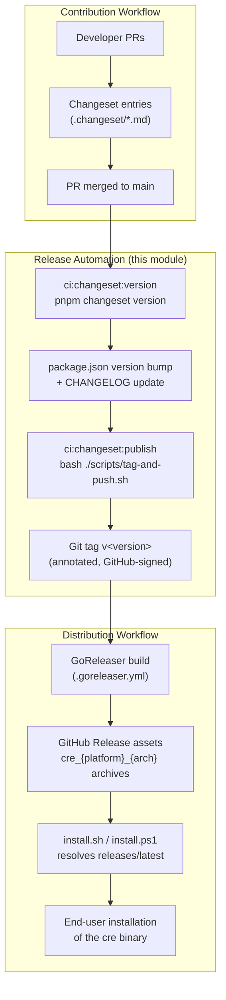
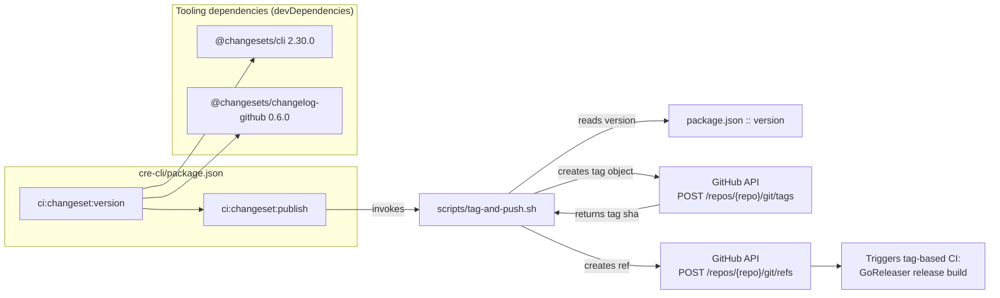

# cre-cli Build & Release — Release Automation

## Introduction

The **release-automation** module implements the versioning and release-tagging pipeline for the `cre-cli` npm package — the package that produces the `cre` (CRE CLI) binary distributed to developers. It is the orchestration layer that turns merged changes into a **signed, immutable git tag**, which in turn drives binary builds, GitHub Release publication, and installer distribution.

The module is intentionally minimal and consists of two cooperating pieces:

1. **A changesets-driven versioning configuration** (`cre-cli/package.json`), which defines how accumulated change entries are collapsed into a version bump and changelog update (`ci:changeset:version`), and how the resulting version is published as a git tag (`ci:changeset:publish`).
2. **The `tag-and-push.sh` script** (`cre-cli/scripts/tag-and-push.sh`), which performs idempotent, GitHub-signed tag creation through the GitHub REST API.

Because the `cre` binary is installed by end users via a `curl | bash` installer, the tag produced by this module is the **single source of truth** for the entire distribution chain: it anchors the GitHub Release that GoReleaser populates, and it is the value that the installer resolves and validates before downloading artifacts.

> **Scope note:** This page covers only version automation and tag publication. Binary compilation, linting, and local developer builds are covered in the sibling [Build Tooling](cre-cli-build-and-release_build-tooling.md) page; release artifact download, verification, and onboarding are covered in [Installers](cre-cli-build-and-release_installers.md).

---

## Module Components

| Component | Location | Role |
|---|---|---|
| `package.json` | `cre-cli/package.json` | npm manifest declaring the package identity (`cre-cli`), the current version, changesets tooling dependencies, and the two CI entry points |
| `ci:changeset:version` script | `cre-cli/package.json` → `scripts` | Runs `pnpm changeset version` to consume pending changesets, bump the version, and regenerate the changelog |
| `ci:changeset:publish` script | `cre-cli/package.json` → `scripts` | Runs `bash ./scripts/tag-and-push.sh` to create the release tag from the bumped version |
| `tag-and-push.sh` | `cre-cli/scripts/tag-and-push.sh` | Idempotent, GitHub-API-based creation of an annotated, GitHub-signed `v<version>` tag |

### Manifest facts (`cre-cli/package.json`)

- **Name:** `cre-cli`, marked `private: true` (the package is a build/release vehicle, never published to npm).
- **Version:** the authoritative release version, e.g. `1.8.2`. This field is mutated by `ci:changeset:version` and read by `ci:changeset:publish`.
- **DevDependencies:**
  - `@changesets/cli@2.30.0` — the changesets versioning engine (`changeset version` / `changeset publish` primitives).
  - `@changesets/changelog-github@0.6.0` — changelog generator that renders entries with GitHub PR/author links.
- **Scripts:**
  - `"ci:changeset:version": "pnpm changeset version"`
  - `"ci:changeset:publish": "bash ./scripts/tag-and-push.sh"`

The `ci:changeset:*` naming convention matches the same scripts used by other packages in the monorepo (e.g. `capabilities/package.json`, `chainlink/package.json`), so CI can discover and invoke release steps uniformly across projects.

---

## Architecture

The module sits between the **contribution workflow** (engineers open PRs with changeset files) and the **distribution workflow** (GoReleaser builds and the universal installer downloads). Its job is the narrow, correctness-critical step in the middle: convert a merged-and-version-bumped state into a verified tag.



### Component relationships



---

## Release Pipeline

A release proceeds through four stages. Each stage is idempotent or fail-fast so that CI jobs can be safely re-run.

### Stage 1 — Changeset accumulation (precondition)

During development, contributors add changeset markdown files under `.changeset/` describing their change and its semver impact. The changesets CLI (installed via `@changesets/cli`) treats these files as the queue of pending changes. No automation in this module runs until a release job decides to consume that queue.

### Stage 2 — Version bump (`ci:changeset:version`)

```
pnpm changeset version
```

`@changesets/cli` reads the pending changeset entries, computes the highest applicable semver bump, then:

- Updates the `version` field in `cre-cli/package.json` (this is the value `tag-and-push.sh` later reads).
- Deletes the consumed changeset files.
- Regenerates `CHANGELOG.md` using the GitHub-flavored template from `@changesets/changelog-github` (linking PRs and authors).

The version-bump commit is what `ci:changeset:publish` tags, so **the tag always points at a commit whose `package.json` version equals the tag name** — an important invariant for traceability.

### Stage 3 — Tag creation (`ci:changeset:publish` → `tag-and-push.sh`)

```
bash ./scripts/tag-and-push.sh
```

The script executes the following logic (from `cre-cli/scripts/tag-and-push.sh`):

1. **Strict mode:** `set -euo pipefail` — any failed command, unbound variable, or pipeline failure aborts the job.
2. **Version resolution:** reads the version straight from the manifest with `node -p "require('./package.json').version"` and derives `tag="v${version}"` (e.g. `1.8.2` → `v1.8.2`).
3. **Idempotency check:** runs `git rev-parse "$tag"`; if the tag already exists locally in the remote-tracking refs, the script prints `Tag $tag already exists. Skipping...` and **exits 0**. This makes re-running a partially failed publish job safe.
4. **Target commit:** captures `sha=$(git rev-parse HEAD)` — the tag anchors the version-bump commit from Stage 2.
5. **Repository context:** uses `repo="${GITHUB_REPOSITORY}"`, implying the script runs inside GitHub Actions, where this environment variable identifies the `owner/name` repository.
6. **Signed tag object creation:** calls the GitHub REST API through the `gh` CLI:
   - `POST /repos/{repo}/git/tags` with `tag=$tag`, `message="CRE CLI $tag"`, `object=$sha`, `type="commit"`, extracting the resulting tag object SHA with `--jq '.sha'`.
   - Tags created **server-side as annotated tag objects** are signed by GitHub's own key, so the tag displays a **"Verified"** badge in the UI without requiring GPG keys in CI.
7. **Ref creation:** calls `POST /repos/{repo}/git/refs` with `ref="refs/tags/$tag"` and `sha=$tag_sha`, which publishes the tag. Creating the ref is the event that downstream tag-triggered workflows (GoReleaser release builds) observe.

```mermaid
sequenceDiagram
    autonumber
    participant CI as CI Job<br/>(ci:changeset:publish)
    participant S as tag-and-push.sh
    participant PJ as package.json
    participant GH as GitHub API (via gh)
    participant REL as Tag-triggered release CI

    CI->>S: bash ./scripts/tag-and-push.sh
    S->>PJ: node -p "require('./package.json').version"
    PJ-->>S: version (e.g. 1.8.2)
    S->>S: tag = v1.8.2 ; git rev-parse tag
    alt tag already exists
        S-->>CI: "Tag already exists. Skipping..." (exit 0)
    else tag is new
        S->>S: sha = git rev-parse HEAD
        S->>GH: POST /repos/{GITHUB_REPOSITORY}/git/tags<br/>(tag, message, object=sha, type=commit)
        GH-->>S: tag object sha (GitHub-signed, "Verified")
        S->>GH: POST /repos/{GITHUB_REPOSITORY}/git/refs<br/>(refs/tags/v1.8.2, sha)
        GH-->>S: ref created
        S-->>CI: "Tag v1.8.2 created and verified."
        REL->>GH: observes refs/tags/v1.8.2
        REL->>REL: GoReleaser build & release assets
    end
```

### Stage 4 — Downstream consumption

The pushed tag `v<version>` is consumed by two independent consumers:

- **Release build CI:** a tag-triggered workflow runs GoReleaser against `cre-cli/.goreleaser.yml`, which cross-compiles the `cre-cli-cli` binary for `linux`/`darwin` on `amd64`/`arm64` (`CGO_ENABLED=0`, `main: ./main.go`, with `go mod tidy` and `go generate ./...` pre-hooks) and attaches archives named `cre_{platform}_{arch}(.tar.gz|.zip)` to the GitHub Release. Locally, the same config is exercised via `make goreleaser-dev-build` (snapshot mode) — see [Build Tooling](cre-cli-build-and-release_build-tooling.md).
- **The universal installer:** `cre-cli/install/install.sh` queries `https://api.github.com/repos/smartcontractkit/cre-cli/releases/latest`, extracts `tag_name` with `extract_tag_name`, validates it with `is_valid_tag` (semver-only, rejects `latest`, path traversal, command substitution), and then downloads assets from `releases/download/{tag}/…`. The parse/validation helpers are covered by `cre-cli/install/tag_parse_test.sh`. See [Installers](cre-cli-build-and-release_installers.md).

This closes the loop: **the tag created by this module is the contract between release CI and every consumer of the CLI.**

---

## Design Properties

### Idempotency

`tag-and-push.sh` treats an existing tag as success (`exit 0`) rather than an error. Because changesets versioning is also idempotent once the changeset files are consumed, the `publish` job can be re-run after infrastructure failures (e.g. a transient GitHub API error, a failed downstream build) without risk of duplicate tags or conflicting refs.

### Fail-fast semantics

`set -euo pipefail` guarantees that:
- A missing/invalid `package.json` version aborts before any API call.
- A failed `gh api` call aborts the script; no ref is created for a failed tag object.
- The two API calls are strictly ordered: the ref is only created after the tag object succeeds, so consumers never see a ref pointing at a nonexistent tag object.

### Trust and signing

- Tags are signed **by GitHub itself** by creating the tag object through the API rather than locally with `git tag -s`; this yields a "Verified" tag without provisioning GPG keys to CI runners.
- The script relies on `gh`'s ambient authentication (`GITHUB_TOKEN` in Actions) and on `GITHUB_REPOSITORY` for the target repo — no repository URLs are hardcoded.
- Separately, release **artifacts** are verified by users against the PGP public key embedded in `install.sh`; `cre-cli/install/check_embedded_key.sh` guards that the embedded key stays in sync with `install/public_key.asc`. That verification path is documented in [Installers](cre-cli-build-and-release_installers.md).

---

## Operational Guide

### Cutting a release

1. Ensure all desired changesets are merged and the `.changeset/` queue is populated.
2. Run (or trigger CI to run) `ci:changeset:version` — commit the resulting version bump and changelog.
3. Run (or trigger CI to run) `ci:changeset:publish` — a `v<version>` tag appears, verified, on the version-bump commit.
4. The tag-triggered release build publishes binaries to the GitHub Release; the installer immediately serves the new version as `releases/latest`.

### Re-running a failed publish

Safe to re-run at any point. If the tag object was created but the ref wasn't, note that a duplicate `POST /git/tags` for the same tag name creates a second tag object — the ref creation still targets the latest returned `tag_sha`, and the script's pre-check only detects *refs*, not orphaned tag objects. In practice, re-running after a ref was successfully created short-circuits at the existence check.

### Prerequisites

- Node.js (to read the version from `package.json`).
- `gh` CLI, authenticated with a token that has `contents: write` permission on the repository (tag and ref creation).
- The job must run in a context where `GITHUB_REPOSITORY` is set (GitHub Actions).

### Failure modes

| Symptom | Likely cause | Mitigation |
|---|---|---|
| `Tag $tag already exists. Skipping...` | Version was already published | Expected behavior; the release job can proceed to or skip the build stage |
| `gh api` 422 on `git/tags` | Tag object already exists from a previous partial run | Create only the ref, or bump the version and re-run the full pipeline |
| `gh api` 403 on `git/refs` | Insufficient token permissions | Grant `contents: write` to the CI token |
| Empty version / malformed tag | `package.json` version bump step never ran | Run `ci:changeset:version` before publishing |

---

## Relationship to Other Modules

- **[cre-cli Build & Release (parent)](../cre-cli-build-and-release.md)** — overview of the whole build-and-release toolchain for the CRE CLI.
- **[cre-cli Build Tooling](cre-cli-build-and-release_build-tooling.md)** — `Makefile` targets (`goreleaser-dev-build`, `clean` removes `dist/`), `.goreleaser.yml` build matrix, and `install-tools` (installs GoReleaser via asdf). Release automation produces the tag; build tooling produces the artifacts from it.
- **[cre-cli Installers](cre-cli-build-and-release_installers.md)** — `install.sh` / `install.ps1`, tag parsing and validation tests, and PGP release-key integrity checks. The installer is the primary consumer of the tags this module creates.
- **[cre-cli Workflow Commands](../cre-cli-workflow-commands.md)** — the `cre` command surface (workflow deploy/activate/pause/delete) that end users run once the CLI is installed from a release.
- **[Build, CI & Release Infrastructure](../../Build,_CI___Release_Infrastructure.md)** — repository-wide CI conventions, including the shared `ci:changeset:*` script pattern (also present in `capabilities/package.json` and `chainlink/package.json`) and the auxiliary [release-changelog](../../Build,_CI___Release_Infrastructure/release-changelog.md) tool used for cross-product release notes.

## Component Reference

### `cre-cli/package.json`

- `package.json` — private npm manifest: `name: cre-cli`, `version` (currently `1.8.2`), changesets devDependencies, and the `ci:changeset:version` / `ci:changeset:publish` scripts.
- `ci:changeset:version` — `pnpm changeset version`; consumes `.changeset/` entries, bumps `version`, updates `CHANGELOG.md`.
- `ci:changeset:publish` — `bash ./scripts/tag-and-push.sh`; converts the bumped version into a signed git tag.

### `cre-cli/scripts/tag-and-push.sh`

- `tag-and-push.sh` — idempotent release-tag publisher: resolves `v<version>` from the manifest, skips existing tags, creates a GitHub-signed annotated tag object (`POST /repos/{repo}/git/tags`) pointing at `HEAD`, then publishes `refs/tags/<tag>` (`POST /repos/{repo}/git/refs`). Requires `gh` + `GITHUB_REPOSITORY`; strict mode via `set -euo pipefail`.
