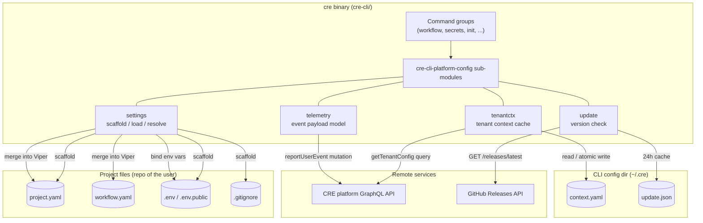
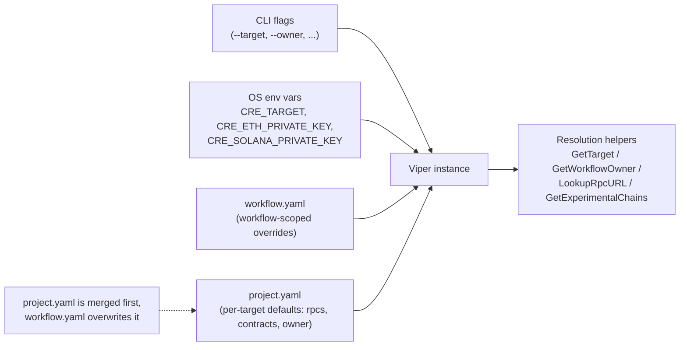
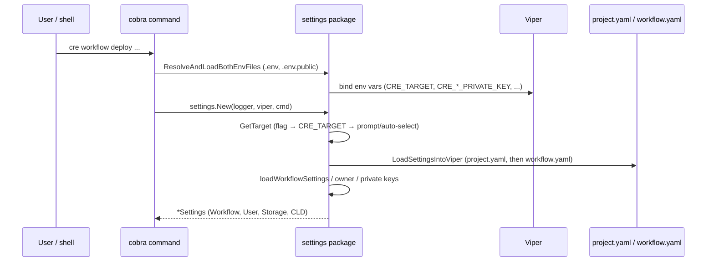
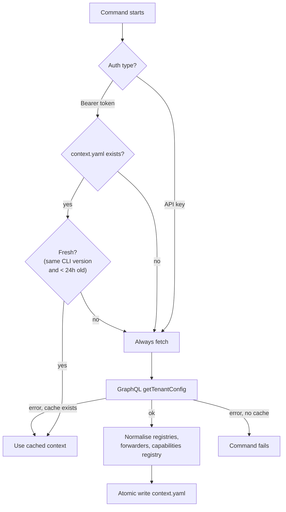
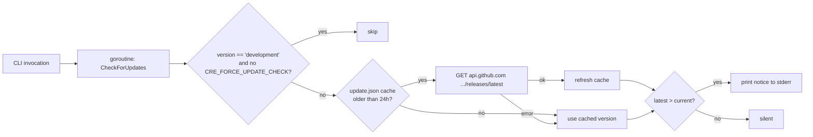

# CRE CLI Platform Configuration (`cre-cli-platform-config`)

## Overview

The `cre-cli-platform-config` module is the **platform-configuration backbone of the CRE command-line interface** (the `cre` binary, source tree [`cre-cli/`](https://github.com/smartcontractkit/cre-cli)). Every `cre` invocation — workflow deployment, secrets management, simulation, init — needs to answer the same questions before it can do any work:

- *Which project am I operating on?* (discovery of `project.yaml` / `workflow.yaml`)
- *Which target environment and chains?* (targets, RPC endpoints, chain selectors)
- *Who owns the workflow?* (EOA derived from a private key, or a multisig address)
- *Which tenant / registries / forwarders / vault gateway belong to me?* (cached platform context)
- *Am I up to date, and what telemetry should I report?* (update check + usage events)

This module implements those cross-cutting concerns. It deliberately **does not** implement any workflow operation itself; it is the shared foundation consumed by every command group, and it is the only place that owns:

1. **Project settings lifecycle** — scaffolding (`project.yaml`, `workflow.yaml`, `.env`, `.gitignore` from embedded templates), discovery (walk-up search), loading (Viper merge), and surgical patching (RPC URL updates that preserve comments/formatting).
2. **Runtime settings resolution** — target selection, RPC lookup, contract groups, experimental chains, chain-selector ↔ chain-name translation, and workflow-owner resolution (EOA vs. MSIG with consistency validation).
3. **Tenant context caching** — fetching the per-tenant configuration (`getTenantConfig` GraphQL query) and caching it in `~/.cre/context.yaml` with a 24-hour TTL and CLI-version pinning.
4. **Telemetry payload model** — the typed event (`UserEventInput`) and response shape (`ReportUserEventResponse`) for anonymous CLI usage reporting.
5. **Update checking** — a non-blocking, cached comparison of the running CLI version against GitHub releases.

## Position in the Developer Toolchain

This module is one of the foundational packages inside the `cre-cli` Go module (`github.com/smartcontractkit/cre-cli`, see `cre-cli/go.mod`). Its relationships to sibling toolchain modules:

| Sibling module | Relationship |
|---|---|
| [cre-cli-backend-clients](cre-cli-backend-clients.md) | `tenantctx` and `telemetry` both issue GraphQL requests through the shared `internal/client/graphqlclient` client; settings resolution feeds the workflow-data clients. |
| [cre-cli-workflow-commands](cre-cli-workflow-commands.md) | The primary consumer: deploy/activate/pause/delete strategies read targets, owners, RPC URLs and registries resolved by this module. |
| [cre-cli-secrets](cre-cli-secrets.md) | Consumes the `VaultGatewayURL` and forwarders exposed by the tenant context. |
| [cre-cli-bindings-generator](cre-cli-bindings-generator.md) | Uses chain-selector/name resolution from settings when generating chain bindings. |
| [cre-cli-build-and-release](cre-cli-build-and-release.md) | The build/release pipeline produces the version string that the update checker compares against GitHub releases. |

## Architecture

### Component context

### Configuration layering and precedence

The CLI builds a single Viper instance from several sources. `settings.LoadSettingsIntoViper` merges `project.yaml` first and then overwrites it with `workflow.yaml` for workflow-scoped commands, while CLI flags and bound environment variables take precedence over both files.

Key resolution rules implemented by this module:

| Concern | Rule |
|---|---|
| Target | `--target` flag → `CRE_TARGET` env var → interactive prompt (or auto-select if only one target in `project.yaml` / `--non-interactive`). |
| Workflow owner | With `--unsigned`/`--changeset`: must be `account.workflow-owner-address` in settings (treated as MSIG). Otherwise: EOA address derived from `CRE_ETH_PRIVATE_KEY`, cross-checked against a settings owner if one is configured. |
| RPC URL | Looked up under `targets.<target>.rpcs` by chain name; `${VAR}` references resolved from the environment (`ResolveEnvVars`); missing RPC is not an error for `LookupRpcURL` but is for `GetRpcUrlSettings`. |
| Chain identity | Chain selectors ↔ chain names via `smartcontractkit/chain-selectors` (EVM plus Aptos, Solana, Sui, Tron, TON, Starknet, Stellar, Canton families). |
| Experimental chains | Chains not present in `chain-selectors` are declared under `targets.<target>.experimental-chains` (selector + `chain-type` + optional forwarder) and used by the simulator. |

### On-disk artifacts

| Path | Owner component | Purpose |
|---|---|---|
| `project.yaml` | settings | Per-target chains, RPC endpoints, contract groups (`registries`, `keystone`), workflow owner. Generated from `template/project.yaml.tpl`. |
| `workflow.yaml` | settings | Per-workflow settings (name, path, config/secrets paths, deployment registry). Generated from `template/workflow.yaml.tpl`. |
| `.env` / `.env.public` | settings | Secrets (private keys, GitHub token) and non-sensitive build config; loaded with `godotenv` and bound into Viper. `.env` is listed in the generated `.gitignore`. |
| `~/.cre/context.yaml` | tenantctx | Cached tenant context keyed by environment name (24h TTL + CLI-version pinning, atomic writes). |
| `~/.cre/update.json` | update | Cached latest-version/last-check timestamp (24h refresh interval). |

The `~/.cre` directory is managed by the sibling `internal/creconfig` package (`DirPath`/`FilePath`/`EnsureDir`), which every cache in this module funnels through.

## Sub-modules

Detailed documentation for each sub-module lives under [`cre-cli-platform-config/`](cre-cli-platform-config/):

| Sub-module | Documentation | Core files | Summary |
|---|---|---|---|
| Project Settings | [`cre-cli-platform-config_project-settings.md`](cre-cli-platform-config/cre-cli-platform-config_project-settings.md) | `internal/settings/settings_generate.go`, `internal/settings/settings_get.go`, `internal/settings/settings_load.go` | Scaffolding of `project.yaml` / `workflow.yaml` / `.env` / `.gitignore` from embedded templates, Viper-based loading with target-scoped keys, and resolution of targets, RPC endpoints, contract groups, experimental chains, chain selectors and the workflow owner (EOA vs. MSIG), plus comment-preserving RPC patching. |
| Tenant Context | [`cre-cli-platform-config_tenant-context.md`](cre-cli-platform-config/cre-cli-platform-config_tenant-context.md) | `internal/tenantctx/tenantctx.go` | Fetching the `getTenantConfig` GraphQL query, normalising registries/forwarders/capabilities-registry entries, and caching them in `~/.cre/context.yaml` (24h TTL, CLI-version pinning, atomic writes, stale-cache fallback). |
| Telemetry Event Model | [`cre-cli-platform-config_telemetry.md`](cre-cli-platform-config/cre-cli-platform-config_telemetry.md) | `internal/telemetry/types.go` | The typed payload (`UserEventInput` and its `CommandInfo`/`MachineInfo`/`WorkflowInfo`/`ActorInfo` parts) and the `ReportUserEventResponse` shape for the `reportUserEvent` GraphQL mutation. |
| Update Check | [`cre-cli-platform-config_update-check.md`](cre-cli-platform-config/cre-cli-platform-config_update-check.md) | `internal/update/update.go` | Non-blocking comparison of the running version against the GitHub Releases API, backed by the `~/.cre/update.json` cache (24h refresh) and silent-failure semantics. |

> All sub-module pages above are generated from the module's core components and mirror the file layout in the repository.

## Key flows

### Command start-up: settings resolution

### Tenant context: ensure-fresh-cache

### Update check (non-blocking)

## Third-party dependencies

From `cre-cli/go.mod`, this module leans on:

- `github.com/spf13/viper` + `github.com/spf13/cobra` — configuration merge and flag plumbing.
- `gopkg.in/yaml.v3` / `gopkg.in/yaml.v2` — comment-preserving YAML node edits and manifest (de)serialisation.
- `github.com/joho/godotenv` — `.env` loading.
- `github.com/machinebox/graphql` — GraphQL transport used by `tenantctx` and `telemetry` (via `internal/client/graphqlclient`).
- `github.com/Masterminds/semver/v3` — semantic-version comparison in the update check.
- `github.com/smartcontractkit/chain-selectors` — canonical chain-selector/chain-name registry.
- `github.com/rs/zerolog` — structured logging.

## Related documentation

- Parent group: [Developer Toolchain (CLI, SDKs & API Clients)](<../Developer_Toolchain_(CLI,_SDKs___API_Clients).md>)
- [cre-cli-workflow-commands](cre-cli-workflow-commands.md) — the commands that consume this configuration.
- [cre-cli-backend-clients](cre-cli-backend-clients.md) — the GraphQL/storage clients this module's caches and telemetry rely on.
- [cre-cli-build-and-release](cre-cli-build-and-release.md) — how the `cre` binary (and its embedded version string) is built and released.
