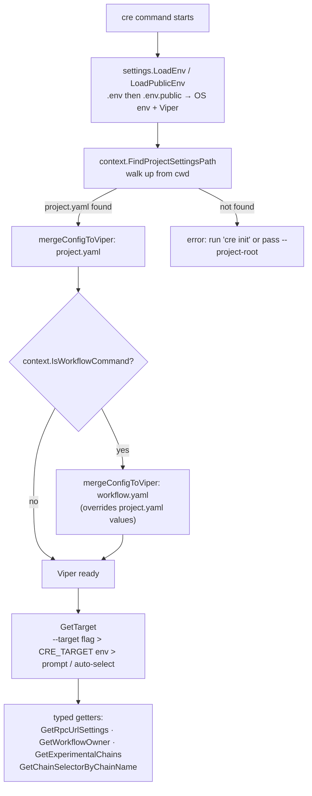
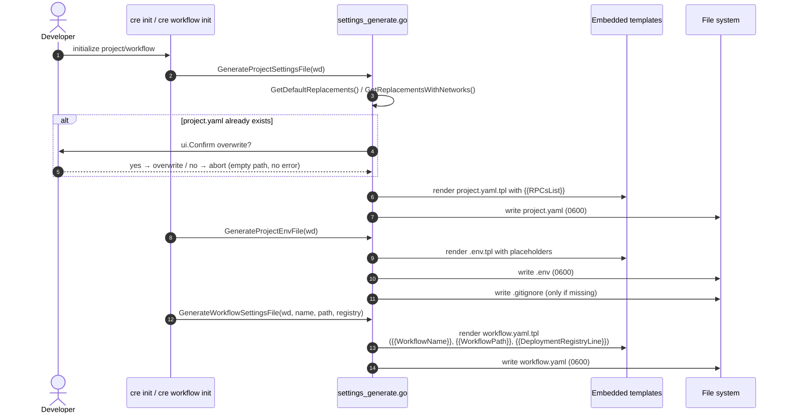

# CRE CLI — Project Settings (`cre-cli-platform-config_project-settings`)

## 1. Introduction

The `project-settings` module is the **file-based configuration layer** of the CRE CLI (`cre`). It owns the full lifecycle of the CLI's project-level and workflow-level configuration:

1. **Generation** — scaffolding a CRE project on disk (`project.yaml`, `workflow.yaml`, `.env`, `.gitignore`) by rendering embedded templates.
2. **Loading** — discovering those files on disk (walking up the directory tree), merging them into a [Viper](https://github.com/spf13/viper) instance, and defining the canonical CLI flag registry.
3. **Reading / deriving** — exposing typed, validated accessors over the merged configuration: RPC endpoints, workflow owner identity (EOA vs. multisig), target selection, contract groups, experimental chains, and chain-name ↔ chain-selector resolution.

All code lives in the `cre-cli` Go module (`github.com/smartcontractkit/cre-cli`, see `cre-cli/go.mod`), primarily in the package `internal/settings`. This page documents the leaf module of [cre-cli-platform-config](../cre-cli-platform-config.md) within the [Developer Toolchain area](../../Developer_Toolchain_(CLI,_SDKs___API_Clients).md); its sibling pages cover the [tenant context](cre-cli-platform-config_tenant-context.md), [telemetry](cre-cli-platform-config_telemetry.md), and [update check](cre-cli-platform-config_update-check.md) facilities.

---

## 2. Module Scope

| Concern | Files | Key identifiers |
|---|---|---|
| Template rendering & file generation | `cre-cli/internal/settings/settings_generate.go` | `ProjectEnv`, `GenerateProjectSettingsFile`, `GenerateProjectEnvFile`, `GenerateWorkflowSettingsFile`, `FindOrCreateProjectSettings`, `PatchProjectRPCs`, `GenerateGitIgnoreFile`, `BuildRPCsListYAML` |
| Flag registry & Viper loading | `cre-cli/internal/settings/settings_load.go` | `flagNames` / `Flags`, `LoadSettingsIntoViper`, config-name constants (`RpcsSettingName`, `WorkflowOwnerSettingName`, …) |
| Typed accessors & chain resolution | `cre-cli/internal/settings/settings_get.go` | `ContractGroups`, `Contract`, `RpcEndpoint`, `ExperimentalChain`, `GetTarget`, `GetWorkflowOwner`, `LookupRpcURL`, `GetRpcUrlSettings`, `GetExperimentalChains`, `GetAvailableTargets`, `GetChainSelectorByChainName` |
| Supporting files (same package) | `settings.go`, `envresolve.go`, `private_key_env.go`, `workflow_settings.go` | `Settings`, `ChainType` (`CRE_ETH_PRIVATE_KEY`, `CRE_SOLANA_PRIVATE_KEY`), `CRE_TARGET`, `ResolveEnvVars`, `ResolveEthPrivateKeyFromEnv`, `WorkflowSettings` |

### 2.1 Embedded templates

The generator embeds its templates into the binary with `go:embed` (`settings_generate.go`), so scaffolding works without network access:

| Template | Destination | Purpose |
|---|---|---|
| `cre-cli/internal/settings/template/project.yaml.tpl` | `project.yaml` | Project-wide settings, per-target `rpcs` blocks |
| `cre-cli/internal/settings/template/workflow.yaml.tpl` | `workflow.yaml` | Per-workflow settings that override `project.yaml` |
| `cre-cli/internal/settings/template/.env.tpl` | `.env` | Sensitive environment variables (`CRE_ETH_PRIVATE_KEY`, RPC API keys) |
| `cre-cli/internal/settings/template/.gitignore.tpl` | `.gitignore` | Ensures `*.env` is never committed |

### 2.2 Key dependencies

- **`internal/context`** — `FindProjectSettingsPath` walks up from the current directory to locate `project.yaml`; `IsWorkflowCommand` decides whether `workflow.yaml` must be layered on top (`cre-cli/internal/context/project_context.go`).
- **`internal/constants`** — default file names (`project.yaml`, `workflow.yaml`, `.env`, `.env.public`) and default chain names / RPC URLs (Sepolia public RPC, mainnet placeholder) sourced from `smartcontractkit/chain-selectors` (`cre-cli/internal/constants/constants.go`).
- **`smartcontractkit/chain-selectors`** — bidirectional chain-name ↔ chain-selector mapping across EVM, Aptos, Solana, Sui, Tron, Ton, Starknet, Stellar and Canton.
- **`spf13/viper` + `spf13/cobra`** — configuration store and flag plumbing.
- **`internal/ui`** — interactive confirmation prompts shown before overwriting generated files.

---

## 3. Architecture and Component Relationships

```mermaid
flowchart TB
    subgraph cmd["cre-cli commands"]
        INIT["cre init /<br/>cre workflow init"]
        WF["workflow commands<br/>deploy · simulate · activate · pause · delete"]
        SEC["secrets commands"]
    end

    subgraph settingspkg["internal/settings package"]
        direction TB
        GEN["settings_generate.go<br/>template rendering + file writers"]
        LOAD["settings_load.go<br/>Flags registry + LoadSettingsIntoViper"]
        GET["settings_get.go<br/>typed getters + chain-selector resolution"]
        BASE["settings.go<br/>Settings assembly, target prompt,<br/>.env / .env.public loading"]
        ENVRES["envresolve.go<br/>ResolveEnvVars ($&#123;VAR&#125;)"]
        PRIVKEY["private_key_env.go<br/>ResolveEthPrivateKeyFromEnv"]
    end

    TPL["embedded templates<br/>project.yaml.tpl · workflow.yaml.tpl<br/>.env.tpl · .gitignore.tpl"]
    CONST["internal/constants<br/>file names, default RPCs, chain names"]
    CTX["internal/context<br/>FindProjectSettingsPath, IsWorkflowCommand"]
    V["spf13/viper<br/>merged configuration"]
    SEL["smartcontractkit/<br/>chain-selectors"]

    INIT -->|"scaffold"| GEN
    GEN --> TPL
    GEN --> CONST
    WF --> LOAD
    WF --> GET
    SEC --> BASE
    LOAD --> CTX
    LOAD --> V
    GET --> V
    GET --> SEL
    GET --> ENVRES
    GET --> PRIVKEY
    BASE --> LOAD
```



**Consumers:** every CRE CLI command ultimately reads configuration through this module. The [workflow commands](../cre-cli-workflow-commands.md) (see [deploy](../cre-cli-workflow-commands/cre-cli-workflow-commands_deploy.md) and [simulation](../cre-cli-workflow-commands/cre-cli-workflow-commands_simulation.md)) use `LoadSettingsIntoViper` and the typed getters; the [secrets commands](../cre-cli-secrets.md) rely on the `.env` scaffolding and private-key handling; backend talks to the [private registry / storage / workflow-data clients](../cre-cli-backend-clients.md) are parameterized by the RPC endpoints and workflow paths resolved here. Build and release mechanics of the CLI binary that ships the embedded templates are covered by [cre-cli-build-and-release](../cre-cli-build-and-release.md).

---

## 4. Configuration Files and Schemas

### 4.1 `project.yaml` — project settings

Generated from `template/project.yaml.tpl`. The top-level keys are **target environments**; each target may contain `rpcs`, `account`, `contracts`, and `experimental-chains` groups. Example after `cre init`:

```yaml
staging-settings:
  rpcs:
    - chain-name: ethereum-testnet-sepolia
      url: https://ethereum-sepolia-rpc.publicnode.com
production-settings:
  rpcs:
    - chain-name: ethereum-testnet-sepolia
      url: https://ethereum-sepolia-rpc.publicnode.com
```

Structured groups read by `settings_get.go`:

| Group | Type | Notes |
|---|---|---|
| `rpcs` | `[]RpcEndpoint` | `chain-name` + `url`; `url` supports `${VAR_NAME}` interpolation |
| `contracts` | `ContractGroups` | `registries` and `keystone` lists of `Contract{name, address, chain-selector}` |
| `experimental-chains` | `[]ExperimentalChain` | `chain-type` (defaults to `evm`), `chain-selector`, `rpc-url`, `forwarder` — for chains not yet in official chain-selectors; automatically consumed by the workflow **simulator** |

### 4.2 `workflow.yaml` — workflow settings

Generated from `template/workflow.yaml.tpl` by `GenerateWorkflowSettingsFile`. Values here **override** `project.yaml` values for the same target:

```yaml
staging-settings:
  user-workflow:
    workflow-name: "my-workflow-staging"
    deployment-registry: "0x…"        # optional line, only rendered when provided
  workflow-artifacts:
    workflow-path: "./main.ts"
    config-path: "./config.staging.json"
    secrets-path: ""
production-settings:
  user-workflow:
    workflow-name: "my-workflow-production"
  workflow-artifacts:
    workflow-path: "./main.ts"
    config-path: "./config.production.json"
    secrets-path: ""
```

The strongly-typed view of this file is `WorkflowSettings` (`cre-cli/internal/settings/workflow_settings.go`); the same file is also mutated in place by `GetWorkflowPathFromFile` / `SetWorkflowPathInFile` during build/deploy flows.

### 4.3 `.env` / `.env.public` — environment files

`.env` is generated by `GenerateProjectEnvFile` from `template/.env.tpl` with placeholder values (`your-github-token`, the `DefaultEthPrivateKeyEnvPlaceholder` for `CRE_ETH_PRIVATE_KEY`, `your-solana-private-key`). A companion `.gitignore` containing `*.env` is created automatically so generated env files are never committed. Loading behavior (from `settings.go`):

- `CRE_TARGET`, `CRE_ALLOW_INSECURE_RPC`, `CRE_ETH_PRIVATE_KEY` and `CRE_SOLANA_PRIVATE_KEY` are bound into Viper in addition to every variable in the file.
- Precedence: `.env.public` **>** `.env` **>** exported shell variables; a warning is logged for keys defined in both files.
- Values starting with `op://` are skipped, so secrets resolved through 1Password (`op run`) are not clobbered by the raw reference.

### 4.4 Setting-name registry

`settings_load.go` centralizes YAML field paths so commands never hard-code strings:

| Constant | YAML path | Meaning |
|---|---|---|
| `WorkflowOwnerSettingName` | `account.workflow-owner-address` | Owner wallet / MSIG address |
| `WorkflowNameSettingName` | `user-workflow.workflow-name` | Registry workflow name |
| `WorkflowPathSettingName` | `workflow-artifacts.workflow-path` | Workflow entry point |
| `ConfigPathSettingName` | `workflow-artifacts.config-path` | Runtime config file |
| `SecretsPathSettingName` | `workflow-artifacts.secrets-path` | Secrets file |
| `SethConfigPathSettingName` | `logging.seth-config-path` | Seth logging config |
| `RegistriesSettingName` / `KeystoneSettingName` | `contracts.registries` / `contracts.keystone` | Contract address groups |
| `DeploymentRegistrySettingName` | `user-workflow.deployment-registry` | Deployment registry address |
| `RpcsSettingName` | `rpcs` | RPC endpoint list |
| `ExperimentalChainsSettingName` | `experimental-chains` | Simulator-only chains |

---

## 5. Flag Registry (`flagNames` / `Flags`)

`settings_load.go` defines the canonical cobra flag names/short forms used across the CLI:

| Flag | Short | Purpose |
|---|---|---|
| `owner` | `-o` | Workflow owner override |
| `project-root` | `-R` | Explicit project root (instead of upward search) |
| `env` / `public-env` | `-e` / `-E` | Custom `.env` / `.env.public` paths |
| `verbose` | `-v` | Debug logging |
| `target` | `-T` | Target environment key in `project.yaml` |
| `override-previous-root` | `-O` | Root-override behaviour |
| `unsigned` | — | Return/print raw transactions instead of sending |
| `changeset` / `changeset-file` | — | CLD changeset output (**hidden** flags) |
| `non-interactive` | — | Never prompt; auto-select targets where possible |
| `yes` | `-y` | Skip confirmation prompts (added via `AddSkipConfirmation`) |
| `allow-unknown-chains` / `allow-insecure-rpc` | — | Relax validation; the latter is also bound to the `CRE_ALLOW_INSECURE_RPC` env var |

`AddTxnTypeFlags` attaches the raw-transaction/changeset trio to signing commands. The `ledger`/`ledger-derivation-path` flags are defined but currently disabled (commented out) as experimental.

---

## 6. Configuration Precedence and Load Flow

`LoadSettingsIntoViper` implements a two-stage YAML merge with an explicit precedence order:

1. CLI flags (highest),
2. `workflow.yaml` (workflow commands only — overwrites project values),
3. `project.yaml` (discovered by walking up from the working directory),
4. Environment variables / `.env` files (bound by `settings.LoadEnv`).



Notes on target resolution (from `settings.go` / `settings_get.go`):

- If neither `--target` nor `CRE_TARGET` is set, `settings.New` either **auto-selects** the single available target (non-interactive mode) or presents an interactive picker listing the targets discovered by `GetAvailableTargets`.
- `GetAvailableTargets` parses `project.yaml` with the `yaml.Node` API so the **file order** of targets is preserved (used for the picker and `cre target list`-style UX).

---

## 7. Project Generation Flow

Generation happens when a user initializes a project or workflow. All writes use `0600` permissions, and the template engine is a simple `{{PLACEHOLDER}}` → value substitution via `strings.NewReplacer` (`GenerateFileFromTemplate`).



Key generation functions:

- **`BuildRPCsListYAML(networks, rpcURLs)`** — renders the indented `rpcs:` block; falls back to `ethereum-testnet-sepolia` (from `chain-selectors`) with the default public Sepolia RPC when no networks are given.
- **`FindOrCreateProjectSettings(startDir, replacements)`** — used by flows that require a project file to exist: if `context.FindProjectSettingsPath` finds nothing, a `project.yaml` is created *without* prompting.
- **`GenerateGitIgnoreFile`** — idempotent: returns the existing file's path if present, otherwise renders `template/.gitignore.tpl` (`*.env`).
- **`PatchProjectRPCs(projectYAMLPath, rpcURLs)`** — surgically updates RPC URLs in an existing `project.yaml`. It walks the document with the `yaml.Node` API, matching entries by `chain-name`, so **comments and formatting are preserved**; unmatched chains and empty URLs are left untouched. This is how the CLI refreshes endpoints (e.g. after resolving new RPC URLs) without rewriting user documentation embedded in the file.
- **`ProjectEnv`** — the typed bundle (`FilePath`, `GitHubAPIToken`, `EthPrivateKey`, `SolanaPrivateKey`) describing the generated environment scaffolding.

---

## 8. Typed Access and Derivation (`settings_get.go`)

### 8.1 RPC URL resolution

```mermaid
flowchart TD
    A["LookupRpcURL(v, chainName)"] --> B["GetTarget(v)"]
    B --> C["key: <target>.rpcs"]
    C --> D{"entry with matching chain-name?"}
    D -->|"no"| E["return ok=false (not an error)"]
    D -->|"yes"| F["ResolveEnvVars(url)<br/>substitute $&#123;VAR&#125; references"]
    F --> G{"all referenced vars set?"}
    G -->|"yes"| H["return resolved URL"]
    G -->|"no"| I["error with guidance:<br/>add var to .env or export it"]
```



- `LookupRpcURL` returns `(url, ok, err)` — a missing chain is **not** an error (`ok=false`), which lets callers fall back to defaults; `GetRpcUrlSettings` is the strict wrapper that turns `ok=false` into an error.
- `${VAR}` interpolation (`envresolve.go`) keeps API keys out of the committed `project.yaml`; the template documents this pattern explicitly.

### 8.2 Workflow owner identity

`GetWorkflowOwner` implements the two owner modes of the CLI:

| Mode | Trigger | Owner source | Returned type |
|---|---|---|---|
| MSIG | `--unsigned` or `--changeset` set | Required `account.workflow-owner-address` in settings (missing ⇒ hard error) | `MSIG` |
| EOA | default | Address derived from `CRE_ETH_PRIVATE_KEY` via `ResolveEthPrivateKeyFromEnv` + `ethkeys.DeriveEthAddressFromPrivateKey` | `EOA` |

Safety rule: if an owner address is **also** configured in settings during the EOA path, the two must match exactly (case-insensitive hex compare) or the command fails — preventing accidental signing with the wrong key. Owner-type constants (`EOA`, `MSIG`, `ORG_DERIVED`) live in `internal/constants`.

### 8.3 Chain-name ↔ selector resolution

- `GetChainNameByChainSelector(selector)` / `ChainNameFromSelectorString(raw)` resolve via `chain-selectors` (family lookup + chain-ID conversion).
- `GetChainSelectorByChainName(name)` first tries the EVM family, then scans every non-EVM family (Aptos, Solana, Sui, Tron, Ton, Starknet, Stellar, Canton); unknown names produce an actionable error suggesting `cre workflow supported-chains`.
- `GetExperimentalChains(v)` reads `<target>.experimental-chains` and interpolates `${VAR}` in each `rpc-url`; these entries power simulator runs for chains that are not yet in official chain-selectors (see [workflow simulation](../cre-cli-workflow-commands/cre-cli-workflow-commands_simulation.md)).

### 8.4 Misc accessors

- `GetEnvironmentVariable(filePath, key)` — minimal `KEY=value` parser used for reading specific entries out of an env file directly.
- `ContractGroups` — typed access to registered `registries`/`keystone` contract addresses per chain selector (consumed by registry-aware commands, e.g. the [registry operations](../cre-cli-workflow-commands/cre-cli-workflow-commands_registry-operations.md)).

---

## 9. Security Considerations

1. **File permissions** — every generated file is written with `0600` (`GenerateFileFromTemplate`), including `project.yaml`.
2. **Secrets never committed** — `.gitignore` is auto-generated with `*.env`, and `.env.tpl` warns against plaintext secrets; RPC URLs should use `${VAR}` references instead of embedding API tokens.
3. **Placeholder hygiene** — `private_key_env.go` treats the `cre init` placeholder for `CRE_ETH_PRIVATE_KEY` as *unset* rather than attempting hex validation, avoiding confusing errors on freshly scaffolded projects.
4. **1Password compatibility** — `op://` values in `.env` are skipped during loading so `op run`-injected secrets survive.
5. **Overwrite protection** — destructive generation paths prompt via `ui.Confirm` (bypassable with `--yes` for automation); `FindOrCreateProjectSettings` deliberately never overwrites.
6. **Owner/key consistency** — the EOA-vs-configured-owner comparison in `GetWorkflowOwner` guards against signing workflows with an unintended identity.

---

## 10. Extension Guide

- **Add a CLI flag**: extend the `flagNames` struct and `Flags` var in `settings_load.go` (never hard-code flag strings elsewhere), then attach it to commands in the relevant command packages.
- **Add a setting**: choose a YAML path, add a `…SettingName` constant in `settings_load.go`, and (if structured) a `mapstructure`/`yaml`-tagged type in `settings_get.go` with a `Get…` accessor that resolves it under the active target.
- **Add a chain family** to name resolution: extend `findNonEVMSelectorByName` with the new `chainSelectors.<Family>ALL` scan.
- **Change scaffolding**: edit the templates under `cre-cli/internal/settings/template/`; they are embedded at build time, so a rebuild is required (see [cre-cli-build-and-release](../cre-cli-build-and-release.md)).
- **Add a default replacement**: extend `GetDefaultReplacements` and the corresponding `.tpl` placeholders; keep chain defaults sourced from `internal/constants` (which itself derives chain names from `chain-selectors`).

---

## 11. Related Documentation

- [cre-cli-platform-config](../cre-cli-platform-config.md) — parent module (platform configuration overview).
- [Tenant context](cre-cli-platform-config_tenant-context.md) · [Telemetry](cre-cli-platform-config_telemetry.md) · [Update check](cre-cli-platform-config_update-check.md) — sibling platform-config modules.
- [Workflow commands](../cre-cli-workflow-commands.md) — primary consumers of settings ([deploy](../cre-cli-workflow-commands/cre-cli-workflow-commands_deploy.md), [registry operations](../cre-cli-workflow-commands/cre-cli-workflow-commands_registry-operations.md), [simulation](../cre-cli-workflow-commands/cre-cli-workflow-commands_simulation.md)).
- [Backend clients](../cre-cli-backend-clients.md) — GraphQL/storage clients parameterized by these settings.
- [Secrets commands](../cre-cli-secrets.md) — consume `.env` scaffolding and key handling.
- [Developer Toolchain area](../../Developer_Toolchain_(CLI,_SDKs___API_Clients).md) — top-level context for the CLI/SDK family.

**Repository references:** `cre-cli/internal/settings/settings_generate.go`, `settings_load.go`, `settings_get.go`, `settings.go`, `envresolve.go`, `private_key_env.go`, `workflow_settings.go`; `cre-cli/internal/settings/template/{project.yaml.tpl, workflow.yaml.tpl, .env.tpl, .gitignore.tpl}`; `cre-cli/internal/constants/constants.go`; `cre-cli/internal/context/project_context.go`; `cre-cli/go.mod`.
