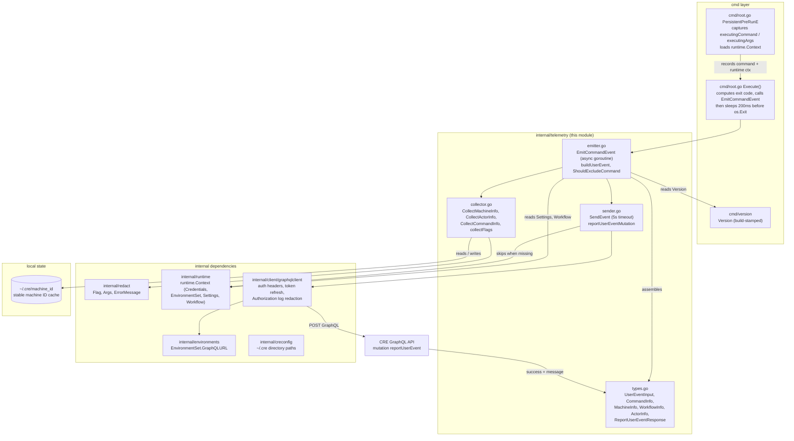
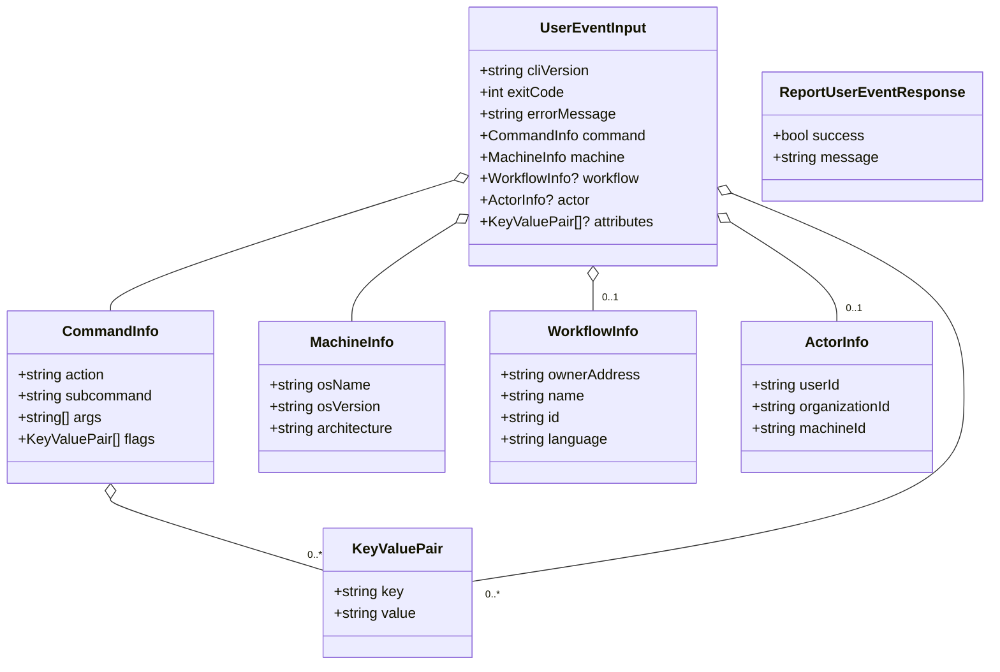
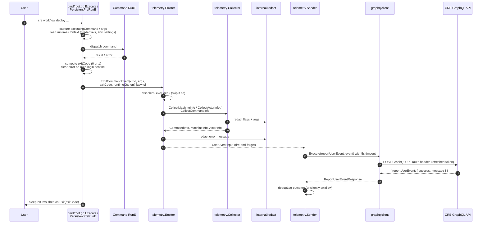
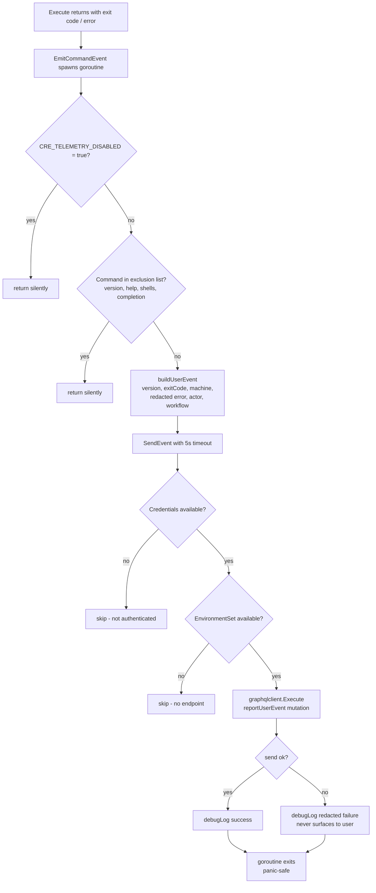
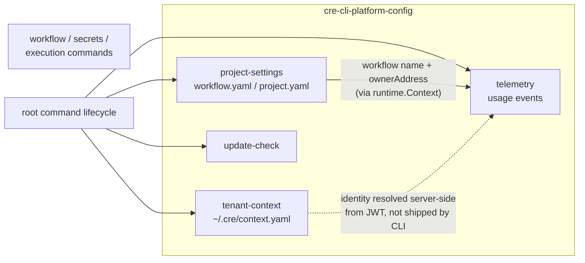

# CRE CLI — Usage Telemetry (`cre-cli-platform-config_telemetry`)

## 1. Introduction

The `telemetry` module is the **usage-reporting layer** of the CRE CLI (`cre`). Every time a user runs a command, the module captures *what* was run (action, subcommand, arguments, explicitly-set flags), *how* it ended (exit code, error message), and *where* it ran (OS, architecture, stable machine ID), then asynchronously ships that event to the CRE platform through the authenticated GraphQL `reportUserEvent` mutation.

Its defining characteristics are:

- **Silent and non-blocking** — telemetry runs in a background goroutine with panic recovery, never affects command output, and swallows every error unless explicitly debugged.
- **Privacy-first** — a dedicated redaction layer (`internal/redact`) scrubs flags, arguments, and error messages before anything leaves the machine; user identity (`userId`/`organizationId`) is *never* sent by the client and is resolved server-side from the JWT.
- **Opt-out, not opt-in** — telemetry is on by default and disabled per machine via `CRE_TELEMETRY_DISABLED=true`.
- **Deeply integrated with the CLI lifecycle** — emission is driven by the root command's `Execute()` / `PersistentPreRunE` in `cre-cli/cmd/root.go`, not by individual commands, so all subcommands report uniformly.

The module lives in `cre-cli/internal/telemetry/` (types, emitter, collector, sender) inside the `github.com/smartcontractkit/cre-cli` Go module (`cre-cli/go.mod`). This page documents the leaf module of [cre-cli-platform-config](../cre-cli-platform-config.md) within the [Developer Toolchain area](<../../Developer_Toolchain_(CLI,_SDKs___API_Clients).md>); its siblings cover [project settings](cre-cli-platform-config_project-settings.md), [tenant context](cre-cli-platform-config_tenant-context.md), and the [update check](cre-cli-platform-config_update-check.md).

---

## 2. Module Scope

| Concern | Location | Key identifiers |
|---|---|---|
| Wire types / event payload model | `cre-cli/internal/telemetry/types.go` | `UserEventInput`, `CommandInfo`, `MachineInfo`, `WorkflowInfo`, `ActorInfo`, `KeyValuePair`, `ReportUserEventResponse` |
| Event emission entry point | `cre-cli/internal/telemetry/emitter.go` | `EmitCommandEvent`, `buildUserEvent`, `ShouldExcludeCommand`, `TelemetryDisabledEnvVar`, `TelemetryDebugEnvVar` |
| Environment/context collection | `cre-cli/internal/telemetry/collector.go` | `CollectMachineInfo`, `CollectActorInfo`, `CollectCommandInfo`, `collectFlags`, `getOrCreateMachineID`, `MachineIDFile` |
| Transport (GraphQL send) | `cre-cli/internal/telemetry/sender.go` | `SendEvent`, `reportUserEventMutation`, `sendTimeout` |
| CLI lifecycle wiring | `cre-cli/cmd/root.go` | `Execute`, `PersistentPreRunE`, `executingCommand`, `runtimeContextForTelemetry` |

### 2.1 What problem it solves

The CLI team needs to know how `cre` is used in the field — which commands dominate, where commands fail, which platform environments and workflow languages are exercised — without:

- **Degrading the user experience** (no extra latency, no error noise from a failed analytics backend),
- **Leaking secrets** (`.env` contents, payloads, tokens, or keys typed on a command line), or
- **Trusting the client with identity** (the server, not the CLI, decides who the event belongs to).

The module answers this with a fire-and-forget pipeline: *collect → redact → emit asynchronously → send over authenticated GraphQL → silently discard failures*.

---

## 3. Architecture and Component Relationships

The telemetry package is deliberately small and dependency-light. Its only "heavy" dependency is the shared GraphQL client, which it reuses from the [backend clients](../cre-cli-backend-clients.md) layer.

### 3.1 Design principles encoded in the architecture

| Principle | Mechanism |
|---|---|
| Never break the CLI | `EmitCommandEvent` runs in a goroutine with `defer recover()`; `SendEvent` also recovers from panics (`emitter.go`, `sender.go`) |
| Never block shutdown | `Execute()` sleeps only 200 ms after emission; hard ceilings: 10 s max emit wait, 5 s send timeout |
| Never emit noise | Failed sends, missing credentials, and missing environments are silent no-ops unless `CRE_TELEMETRY_DEBUG=true` |
| Never leak secrets | Every value passes through `internal/redact` before serialization; identity fields are left blank for the server to fill |
| Never invent transport | Reuses the shared authenticated [GraphQL client](../cre-cli-backend-clients.md) rather than a bespoke HTTP stack |

---

## 4. Component Reference

### 4.1 Event payload model — `types.go`

`types.go` defines the JSON shape of a telemetry event as consumed by the `reportUserEvent($event: UserEventInput!)` mutation.

| Type | Role | Populated by |
|---|---|---|
| `UserEventInput` | Root mutation input; one instance per command invocation | `buildUserEvent` (`emitter.go`) |
| `CommandInfo` | `action` (parent command, e.g. `workflow`) + `subcommand` (e.g. `deploy`); positional `args` and user-set `flags` | `CollectCommandInfo` / `collectFlags` (`collector.go`) |
| `MachineInfo` | `runtime.GOOS`, OS version (via `sw_vers` / `/etc/os-release` / `uname -r` / `cmd /c ver`), `runtime.GOARCH` | `CollectMachineInfo` (`collector.go`) |
| `WorkflowInfo` | Workflow `name` / `ownerAddress` from loaded project settings; `id` / `language` from the runtime context. Optional — omitted for non-workflow commands | `buildUserEvent` from `runtime.Context` |
| `ActorInfo` | **Only `machineId` is filled client-side.** `userId` and `organizationId` are resolved server-side from the JWT — the CLI deliberately does not ship identity claims | `CollectActorInfo` (`collector.go`) |
| `KeyValuePair` | Generic flag/attribute pair | `collectFlags` |
| `ReportUserEventResponse` | Transport-only response envelope: `{ "reportUserEvent": { "success", "message" } }` | `SendEvent` unmarshals into it |

The struct tags follow the GraphQL input casing expected by the platform API (`cliVersion`, `exitCode`, `osName`, `ownerAddress`, …), so the Go structs serialize directly as the `event` variable of the mutation.

### 4.2 Emission entry point — `emitter.go`

- **`EmitCommandEvent(cmd, args, exitCode, runtimeCtx, err)`** — the module's single public entry point. Spawns a goroutine that: recovers from panics, applies a 10 s deadline, honors the disable flag, applies the command exclusion list, builds the event, and hands it to `SendEvent`.
- **`ShouldExcludeCommand`** — suppresses telemetry for low-signal/utility commands: `version`, `help`, `bash`, `zsh`, `fish`, `powershell`, and `completion`.
- **`buildUserEvent`** — assembles the `UserEventInput`: CLI version from `cmd/version`'s `Version` variable (a `development` placeholder that release builds stamp; see [build and release](../cre-cli-build-and-release.md)), exit code, redacted `errorMessage` when the command failed, machine info, actor (machine ID), and — when a runtime context with loaded settings is present — workflow name/owner/id/language.
- **`isTelemetryDisabled` / `isTelemetryDebugEnabled` / `debugLog`** — environment-variable gates (strict `"true"` comparison); debug output goes to stderr with a `[TELEMETRY DEBUG]` prefix.

### 4.3 Context collection — `collector.go`

- **Machine info** — `runtime.GOOS`/`GOARCH` plus a best-effort OS version probe per platform (macOS `sw_vers`/`sysctl`, Linux `/etc/os-release`/`uname -r`, Windows `cmd /c ver`); `"unknown"` as last resort.
- **Machine ID** — `getOrCreateMachineID` implements a *cache → system → fallback* strategy:
  1. Read `~/.cre/machine_id` (`MachineIDFile`, resolved via `internal/creconfig`).
  2. Otherwise compute the OS machine ID with `github.com/denisbrodbeck/machineid` (`cre-cli/go.mod`) and persist it behind a `machine_` prefix.
  3. Otherwise derive a coarse `machine_<hostname>_<goos>_<goarch>` fallback ID. Errors are logged only; telemetry never fails because of identity resolution.
- **Command info** — maps the cobra hierarchy to `action`/`subcommand` (parent name is the action unless the parent is the `cre` root), collects positional args through `redact.Args`, and collects **only flags the user explicitly set** (`flag.Changed`) through `redact.Flag`, avoiding default-value noise.
- **`CollectWorkflowInfo`** — currently a placeholder returning `nil`; workflow context is populated by `buildUserEvent` from the runtime context instead.

### 4.4 Transport — `sender.go`

`SendEvent(ctx, event, creds, envSet, logger)`:

1. Wraps the caller's context in a **5-second timeout** (`sendTimeout`).
2. Installs a panic recovery guard.
3. Bails out silently when `creds == nil` (not authenticated) or `envSet == nil` (environment not loaded).
4. Builds a `graphqlclient.Client` against `envSet.GraphQLURL`, attaching the provided logger only when telemetry debug is enabled — otherwise a logger writing to `io.Discard`, so the client's own debug logging never surfaces.
5. Executes the `reportUserEvent` mutation (the only wire query in the module) into a `ReportUserEventResponse`.
6. Logs the redacted outcome via `debugLog` and returns `void` — telemetry delivery is intentionally unchecked by callers.

The GraphQL client adds authentication (API-key or Bearer), automatic token refresh, and Authorization-header redaction in debug logs — details are documented in [backend clients](../cre-cli-backend-clients.md).

---

## 5. Data Flow and Process Lifecycle

### 5.1 End-to-end sequence

### 5.2 Emission decision flow

Key takeaway: there is **no code path** where a telemetry problem can propagate an error, panic, or delay beyond the fixed 200 ms / 10 s budgets to the user's command.

---

## 6. Privacy and Redaction

Redaction is applied **at collection time**, before the payload is serialized, using the shared `internal/redact` helpers (defined in `cre-cli/internal/redact/redact.go`):

| Input surface | Helper | Behavior |
|---|---|---|
| Flag values | `redact.Flag(name, value)` | Full `[REDACTED]` for sensitive flags (`env`, `public-env`, `http-payload`, `public_key`, `ledger-derivation-path`, `config`, `changeset-file`); URL scrubbing for `rpc-url`/`wasm`; basename-only for `project-root`; heuristic redaction of output/payload-like values; length cap of 256 chars |
| Positional args | `redact.Args(action, subcommand, args)` | `secrets` args reduced to basenames (e.g. `/home/u/project/secrets.yaml` → `secrets.yaml`); sensitive-looking `templates add` args redacted; backstop heuristics for error/output text on the command line |
| Error messages | `redact.ErrorMessage(msg)` | Scrubs JWT segments, `Bearer …`, `Apikey …`, `CRE_API_KEY=…`, hex private keys, and URLs (kept host-only) |
| Debug transport logs | graphqlclient `redactSensitiveHeaders` | `Authorization` header values never reach logs even in debug mode |

Identity is handled cooperatively with the server:

- The CLI sends **only** `ActorInfo.MachineID` (a pseudonymous, locally cached hardware/hostname-derived ID).
- `userId` and `organizationId` are **populated server-side from the authenticated JWT**, mirroring how the [tenant context](cre-cli-platform-config_tenant-context.md) module treats identity as platform state rather than local state.

The test suite locks this in: `telemetry_test.go` asserts redacted flag values (`env`, `http-payload`, URL-truncated `wasm`), redacted secrets file args, and a redacted `Bearer` token in error messages.

### 6.1 Opt-out and debug controls

| Environment variable | Effect |
|---|---|
| `CRE_TELEMETRY_DISABLED=true` | Disables emission entirely (checked in the emit goroutine; strict `true` match — `1` or `yes` do not disable) |
| `CRE_TELEMETRY_DEBUG=true` | Prints `[TELEMETRY DEBUG]` diagnostics to stderr and enables GraphQL client request/response logging for telemetry traffic |

---

## 7. Integration with the CLI Lifecycle

The module is wired once, at the root command, in `cre-cli/cmd/root.go`:

1. **Capture (every invocation)** — `PersistentPreRunE` records the executing command and args into `executingCommand` / `executingArgs`, and stores the shared `runtime.Context` in `runtimeContextForTelemetry`. For commands that skip login (e.g. `generate-bindings`, `workflow build`), `runtime.Context.TryAttachCredentials` silently loads credentials when present so their events can still be attributed; when absent, `SendEvent` skips delivery.
2. **Emit (process exit)** — `Execute()` maps the result to an exit code (clearing the auto-login sentinel error so it is recorded as success), calls `telemetry.EmitCommandEvent(...)`, sleeps **200 ms** to give the goroutine a chance to flush, then exits.
3. **Version stamping** — `event.CliVersion` comes from `cmd/version.Version`, injected at release build time (see [build and release](../cre-cli-build-and-release.md)).

Because emission is centralized in `Execute()`, every current and future subcommand reports consistently without per-command instrumentation — including help-like invocations, which are filtered by the exclusion list rather than by wiring.

### 7.1 Relationship to sibling platform-config modules

- **[Project settings](cre-cli-platform-config_project-settings.md)** — enrich `WorkflowInfo` (name, owner address) through the runtime context when workflow settings were loaded for the command.
- **[Tenant context](cre-cli-platform-config_tenant-context.md)** — complementary identity model: tenant context *reads* platform identity into the CLI, while telemetry *defers* identity to the server.
- **[Update check](cre-cli-platform-config_update-check.md)** — the other root-command lifecycle hook (post-run notice), with which telemetry shares the `PersistentPostRun`-adjacent execution window.

---

## 8. Testing

Unit tests live alongside the module in `cre-cli/internal/telemetry/telemetry_test.go` and cover:

- Machine info collection (`GOOS`/`GOARCH`/non-empty version),
- `CollectCommandInfo` action/subcommand derivation for top-level vs. nested commands,
- `CRE_TELEMETRY_DISABLED` and `CRE_TELEMETRY_DEBUG` strict-value semantics,
- The command exclusion list,
- Event building (version present, exit code preserved, machine fields set),
- **Redaction guarantees** for flags, secrets args, and error messages,
- OS version detection returning a non-empty result.

Run them with the CLI's standard test targets, e.g. `make test` from `cre-cli/Makefile` (or `test-quick` for the fast suite). Lint conventions for the package are governed by `cre-cli/.golangci.yml`.

---

## 9. File Inventory

| File | Responsibility |
|---|---|
| `cre-cli/internal/telemetry/types.go` | Event payload wire types and the `ReportUserEventResponse` envelope (core documented component) |
| `cre-cli/internal/telemetry/emitter.go` | Async emission, exclusion policy, event assembly, env-var gates |
| `cre-cli/internal/telemetry/collector.go` | Machine/command/actor collection, machine-ID cache, flag/arg extraction |
| `cre-cli/internal/telemetry/sender.go` | GraphQL transport for `reportUserEvent` with timeout and silent-failure semantics |
| `cre-cli/internal/telemetry/telemetry_test.go` | Unit tests for collection, policy, assembly, and redaction |
| `cre-cli/cmd/root.go` | Lifecycle wiring (`Execute`, `PersistentPreRunE`, `TryAttachCredentials` usage) |
| `cre-cli/internal/redact/redact.go` | Redaction primitives consumed by the collector and emitter |
| `cre-cli/go.mod` | Third-party deps used here: `machinebox/graphql`, `denisbrodbeck/machineid`, `spf13/cobra`, `rs/zerolog` |

## 10. Related Documentation

- Parent module: [cre-cli-platform-config](../cre-cli-platform-config.md)
- Siblings: [project settings](cre-cli-platform-config_project-settings.md) · [tenant context](cre-cli-platform-config_tenant-context.md) · [update check](cre-cli-platform-config_update-check.md)
- Transport layer: [backend clients](../cre-cli-backend-clients.md) (shared GraphQL client)
- Version stamping: [build and release](../cre-cli-build-and-release.md)
- Consumers of workflow context: [workflow commands](../cre-cli-workflow-commands.md)
