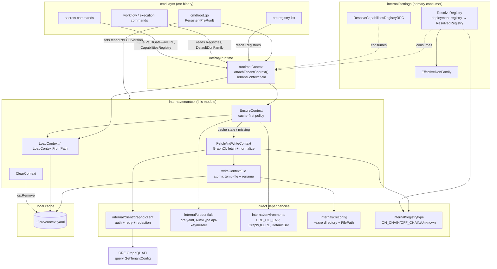
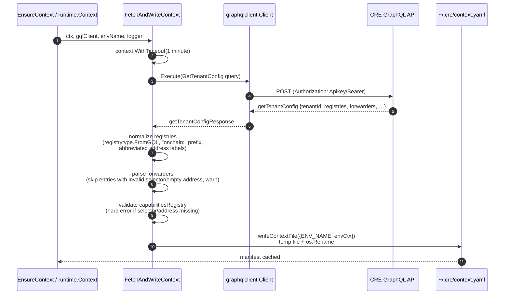
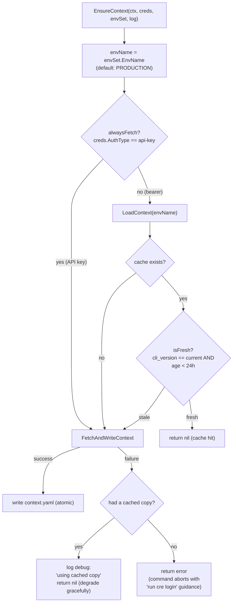
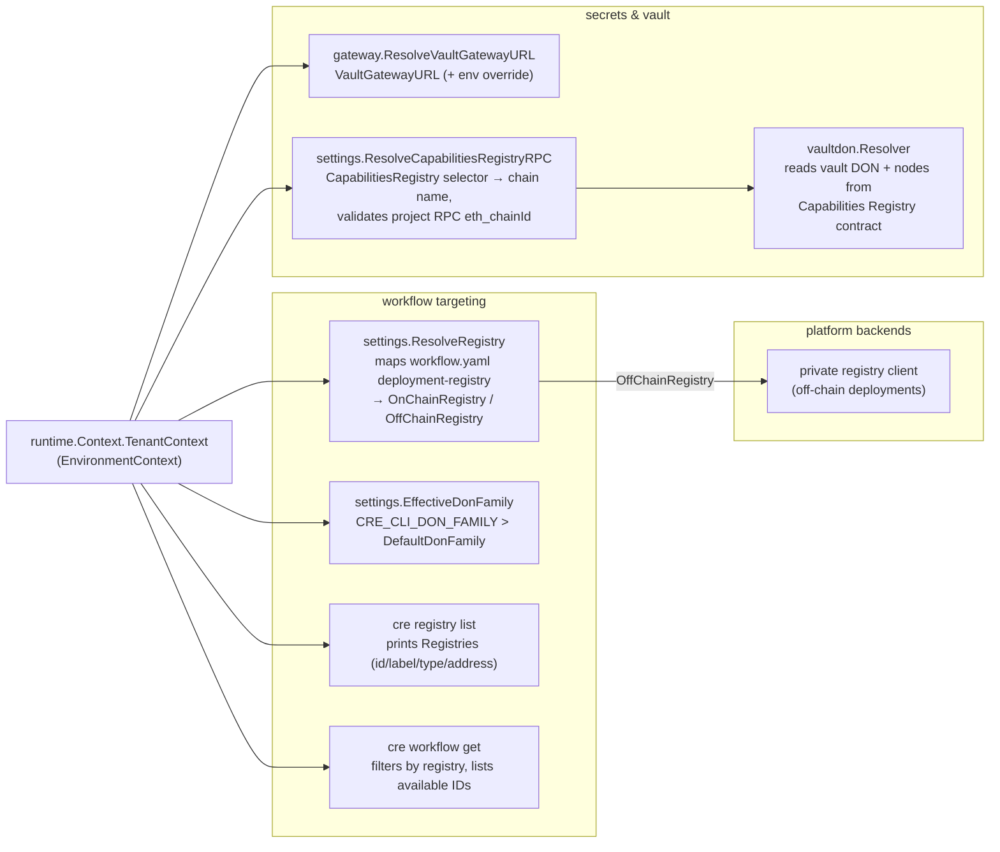
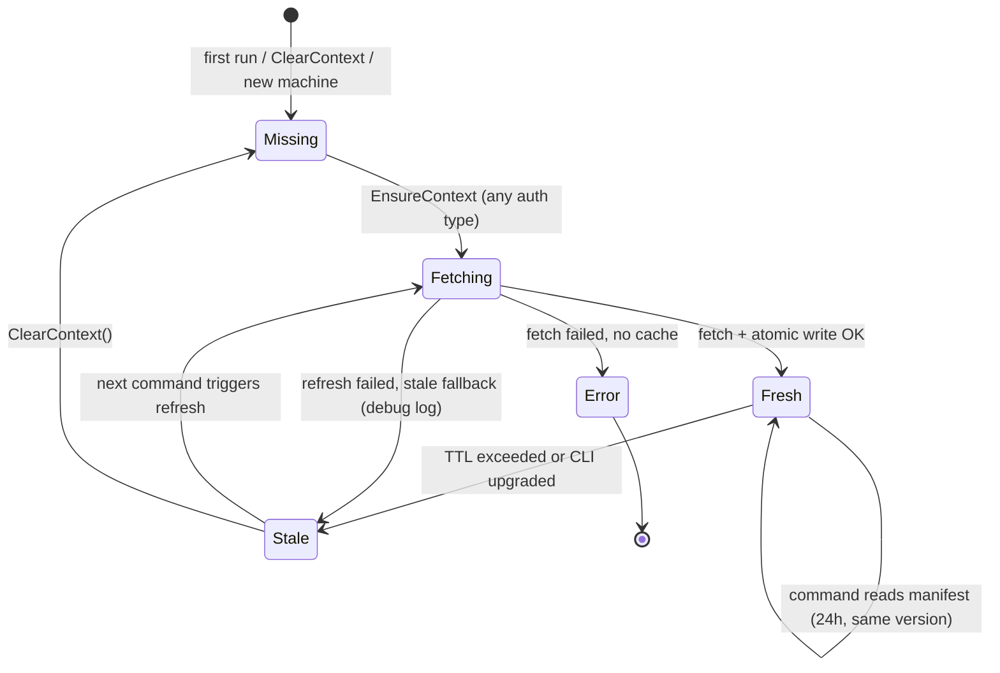

# CRE CLI — Tenant Context (`cre-cli-platform-config_tenant-context`)

## 1. Introduction

The `tenant-context` module is the **server-provisioned configuration layer** of the CRE CLI (`cre`). While the sibling [project-settings](cre-cli-platform-config_project-settings.md) module owns the *developer-authored* files inside a CRE project (`project.yaml`, `workflow.yaml`), this module owns the *per-tenant platform data* the CLI needs to talk to Chainlink's CRE platform: which tenant (organization) the user belongs to, which workflow registries they may deploy to, where the Vault gateway lives, which DON family to default to, and which Capabilities Registry and mock forwarder contracts are provisioned for them.

All of this is captured in a single **registry manifest**, cached at `~/.cre/context.yaml`, that is fetched from the CRE GraphQL API (`GetTenantConfig` query) and kept fresh through a version-pinned, 24-hour TTL cache with graceful stale-cache fallback.

The module lives in a single file, `cre-cli/internal/tenantctx/tenantctx.go`, inside the `github.com/smartcontractkit/cre-cli` Go module (`cre-cli/go.mod`). This page documents the leaf module of [cre-cli-platform-config](../cre-cli-platform-config.md) within the [Developer Toolchain area](../../Developer_Toolchain_(CLI,_SDKs___API_Clients).md); its siblings cover [project settings](cre-cli-platform-config_project-settings.md), [telemetry](cre-cli-platform-config_telemetry.md), and the [update check](cre-cli-platform-config_update-check.md).

---

## 2. Module Scope

| Concern | Location | Key identifiers |
|---|---|---|
| Public API: fetch / load / clear / ensure | `cre-cli/internal/tenantctx/tenantctx.go` | `FetchAndWriteContext`, `LoadContext`, `LoadContextFromPath`, `ClearContext`, `EnsureContext` |
| Manifest data model (persisted) | `cre-cli/internal/tenantctx/tenantctx.go` | `EnvironmentContext`, `Registry`, `Forwarder`, `OnChainContract`, `ContextFile` |
| GraphQL wire types (transport-only) | `cre-cli/internal/tenantctx/tenantctx.go` | `getTenantConfigResponse`, `gqlForwarder`, `gqlOnChainContract`, `getTenantConfigQuery` |
| Cache freshness & write atomicity | `cre-cli/internal/tenantctx/tenantctx.go` | `isFresh`, `writeContextFile`, `contextTTL`, `CLIVersion` |
| Normalization helpers | `cre-cli/internal/tenantctx/tenantctx.go`, `cre-cli/internal/registrytype/registrytype.go` | `parseChainSelectorJSON`, `abbreviateAddress`, `registrytype.FromGQL` |

### 2.1 What problem it solves

Every `cre` command that touches the platform needs answers to questions the CLI cannot derive locally:

- *"Which workflow registries can this organization deploy to, and are they on-chain or private (off-chain)?"* → drives `deployment-registry` resolution in `workflow.yaml`.
- *"Where is the Vault gateway that secrets commands should talk to?"* → drives `cre secrets create/update/delete/list/execute`.
- *"Which contract holds the Capabilities Registry for this tenant, and on which chain?"* → drives on-chain Vault DON validation.
- *"Which DON family should DON-scoped operations target by default?"* → drives DON family defaults for registry simulation and vault lookups.

Fetching this on every command would be slow and would break offline usage; hard-coding it would break multi-tenancy. The module therefore implements a **fetch → normalize → cache → serve** lifecycle with a conservative invalidation policy.

---

## 3. Architecture and Component Relationships



**How it is wired into the CLI** (from `cre-cli/cmd/root.go` and `cre-cli/internal/runtime/runtime_context.go`):

1. At startup the root command sets `tenantctx.CLIVersion = version.Version` (a package-level var, to avoid an import cycle with `cmd/version`).
2. In `PersistentPreRunE`, after credentials and environment are attached, the root command calls `runtime.Context.AttachTenantContext` (spinner step *"Loading user context…"*).
3. `AttachTenantContext` calls `tenantctx.EnsureContext` (fetch-or-refresh decision) followed by `tenantctx.LoadContext`, and stores the result in `runtime.Context.TenantContext`.
4. Failure at this point aborts the command with actionable guidance: run `cre login`, and check that `~/.cre/context.yaml` (rendered via `creconfig.FilePathHint(tenantctx.ContextFile)`) exists and is readable.

---

## 4. The Registry Manifest (`~/.cre/context.yaml`)

### 4.1 Data model

`EnvironmentContext` is the persisted, per-environment snapshot of the tenant config:

| Field | YAML key | Type | Meaning |
|---|---|---|---|
| `TenantID` | `tenant_id` | `string` | Platform tenant (organization) identifier |
| `DefaultDonFamily` | `default_don_family` | `string` | Fallback DON family (overridable by `CRE_CLI_DON_FAMILY`) |
| `VaultGatewayURL` | `vault_gateway_url` | `string` | Vault DON gateway endpoint for secrets operations |
| `CapabilitiesRegistry` | `capabilities_registry` | `*OnChainContract` | Chain selector + address of the tenant's Capabilities Registry |
| `Registries` | `registries` | `[]*Registry` | Workflow registries available to the tenant |
| `Forwarders` | `forwarders` | `[]Forwarder` | Mock forwarder contract per chain selector |
| `FetchedAt` | `fetched_at` | `time.Time` | UTC timestamp of the last successful fetch (TTL input) |
| `CLIVersion` | `cli_version` | `string` | CLI build that produced the cache (cache-pinning input) |

`Registry` entries distinguish on-chain from private registries:

| Field | Type | Notes |
|---|---|---|
| `ID` | `string` | On-chain registries are prefixed `"onchain:"`; off-chain IDs are verbatim (e.g. `private`) |
| `Label` | `string` | Display label; on-chain labels append the abbreviated contract address |
| `Type` | `string` | Normalized via `registrytype.FromGQL`: `on-chain`, `off-chain`, or `unknown` |
| `ChainSelector` | `*string` | Decimal string of the uint64 chain selector (kept as string to preserve precision) |
| `Address` | `*string` | Registry contract address; empty/nil for off-chain registries |

`Forwarder` and `OnChainContract` share the shape `ChainSelector uint64` + `Address string`.

### 4.2 Example manifest

```yaml
PRODUCTION:
  tenant_id: "42"
  default_don_family: zone-a
  vault_gateway_url: https://gateway.example.com/
  capabilities_registry:
    chain_selector: 16015286601757825753
    address: 0x7f3191EaF73429177bAB3bAc5c36Ed2D5E39985f
  registries:
    - id: onchain:ethereum-testnet-sepolia
      label: ethereum-testnet-sepolia (0xaE55...135)
      type: on-chain
      chain_selector: "16015286601757825753"
      address: 0xaE55eB3EDAc48a1163EE2cbb1205bE1e90Ea1135
    - id: private
      label: Private (Chainlink-hosted)
      type: off-chain
  forwarders:
    - chain_selector: 16015286601757825753
      address: 0x15fC6ae953E024d975e77382eEeC56A9101f9F88
  fetched_at: 2025-01-01T00:00:00Z
  cli_version: 1.2.3
```

The top-level map is keyed by **uppercase environment name** (`PRODUCTION`, `STAGING`, `DEVELOPMENT` — names come from `CRE_CLI_ENV` / `cre-cli/internal/environments/environments.yaml`), so switching environments never loses the other environment's context.

---

## 5. Fetch and Normalization Flow

`FetchAndWriteContext` executes the `GetTenantConfig` GraphQL query and normalizes the response before persisting it:



The transport query is:

```graphql
query GetTenantConfig {
  getTenantConfig {
    tenantId
    defaultDonFamily
    vaultGatewayUrl
    capabilitiesRegistry { chainSelector address }
    registries { id label type chainSelector address }
    forwarders { chainSelector address }
  }
}
```

### 5.1 Normalization and validation rules

| Input | Rule | Failure behaviour |
|---|---|---|
| Registry `type` | Mapped by `registrytype.FromGQL`: `ON_CHAIN` → `on-chain`, `OFF_CHAIN` → `off-chain`, anything else → `unknown` with a warning | Unknown types are **kept** in the manifest; resolution later fails with an upgrade hint ("run `cre login` after upgrading") |
| On-chain registry `ID`/`Label` | `ID` gains an `"onchain:"` prefix; `Label` becomes `"<id> (<abbreviated-address>)"` | — |
| Registry `chainSelector` | Parsed by `parseChainSelectorJSON` — accepts a decimal **string** (preferred) or JSON number; must fit `uint64` | Value stored as-is for registries (resolution re-validates); forwarders with invalid selectors are **skipped with a warning** |
| Forwarder `address` | Trimmed; must be non-empty | Skipped with a warning (non-fatal) |
| `capabilitiesRegistry` | Selector must parse and address must be non-empty | **Hard error** — the whole fetch fails; secrets commands cannot operate without it |
| `chainSelector` transport type | Strings are preferred because chain selectors are 64-bit values exceeding JavaScript's safe-integer range | Malformed values yield `chain selector must be a decimal string or integer JSON value` |

The `abbreviateAddress` helper shortens long addresses to `0xaE55...135` style (first 6 + `...` + last 4 characters) so labels stay readable in tables and prompts.

### 5.2 Atomic, concurrency-safe persistence

`writeContextFile` guarantees the manifest is never observed half-written:

1. `creconfig.EnsureDir()` creates `~/.cre` with `0700` permissions if needed.
2. The marshalled YAML is written to a **unique** temp file created with `os.CreateTemp(dir, "context.yaml.*.tmp")` — unique names ensure that two concurrent `cre` processes refreshing at the same time don't clobber each other.
3. The temp file is `os.Rename`d over `context.yaml` (atomic on POSIX filesystems), and the deferred cleanup removes any leftover temp file.

---

## 6. Cache and Freshness Policy (`EnsureContext`)

`EnsureContext` decides whether the cached manifest can be reused or must be refetched. Its decision logic:



Policy highlights:

| Aspect | Behaviour | Rationale |
|---|---|---|
| **TTL** | `contextTTL = 24 * time.Hour` | Bounds how long server-side tenant changes (new registries, rotated forwarders) stay invisible to bearer-token users |
| **Version pinning** | A cache is only "fresh" when its `cli_version` matches the running binary (`isFresh`) | A different CLI version may expect fields or environments the cache predates |
| **Auth-type asymmetry** | API-key users (`credentials.AuthTypeApiKey`, e.g. `CRE_API_KEY` set) always fetch; bearer users use the cache | API-key flows have no interactive login step that would otherwise establish the manifest |
| **Stale-cache fallback** | If a refresh fails but a (stale) cache exists, the CLI proceeds with the cached copy and logs at debug level | A stale cache beats failing every command while the API is unreachable (e.g. VPN to `.ts.net` environments is down) |
| **Forced refresh** | `ClearContext()` removes `context.yaml` (tolerating a missing file) so the next `EnsureContext` refetches | Used when cached content is known to be wrong |

Because the fetch embeds the environment name, running with `CRE_CLI_ENV=STAGING` refreshes only the `STAGING` key of the shared manifest file.

---

## 7. Consumers and Downstream Use

The loaded `EnvironmentContext` is published on `runtime.Context.TenantContext` and consumed across the CLI:



- **Registry targeting** — [workflow commands](../cre-cli-workflow-commands.md) (see [deploy](../cre-cli-workflow-commands/cre-cli-workflow-commands_deploy.md) and [registry operations](../cre-cli-workflow-commands/cre-cli-workflow-commands_registry-operations.md)) set `deployment-registry` in `workflow.yaml` to a `Registries[].ID` from this manifest. `settings.ResolveRegistry` looks the ID up in the manifest, derives the chain name from the selector (via `smartcontractkit/chain-selectors`), and produces either an `OnChainRegistry` (address + chain + explorer URL) or an `OffChainRegistry` handled by the [private registry client](../cre-cli-backend-clients.md).
- **`cre registry list`** — renders `TenantContext.Registries` verbatim (labels, IDs, types, addresses) and hints how to set `deployment-registry`.
- **`cre workflow get`** — uses `Registries` to validate the `--all-registries` filter and to enrich the status view with registry metadata.
- **Secrets** — [secrets commands](../cre-cli-secrets.md) resolve the Vault gateway URL from the manifest (with a `CRE_VAULT_DON_GATEWAY_URL` environment override), and validate gateway responses against the Vault DON resolved from the tenant's Capabilities Registry contract address/selector (`settings.ResolveCapabilitiesRegistryRPC` + `internal/onchain/capabilitiesregistry` client).
- **DON family defaults** — `EffectiveDonFamily` prefers the `CRE_CLI_DON_FAMILY` environment override and falls back to `DefaultDonFamily` from the manifest; used by registry resolution and vault DON lookups.

---

## 8. Lifecycle and Failure Modes



Common failure modes and how the module surfaces them:

| Symptom | Underlying cause | Resolution surfaced by the CLI |
|---|---|---|
| `no context found for environment "X" in context.yaml` | Manifest lacks a key for the selected `CRE_CLI_ENV` | Re-run the command while authenticated to fetch that environment's context |
| `capabilitiesRegistry address is empty` / invalid selector | Tenant platform misconfiguration | Hard fetch error; contact platform admin / re-run `cre login` after fix |
| `registry "r" not found in user context; available: […]` | `deployment-registry` in `workflow.yaml` doesn't match a manifest ID | Pick one of the listed IDs (see `cre registry list`) |
| `registry "r" is not supported by this CLI version (unrecognised type from server)` | Server returned a registry type this binary doesn't know (`unknown`) | Upgrade the CLI, then `cre login` to refresh the manifest |
| `failed to fetch user context` on every command, no cache | API unreachable and no cached copy exists | Restore connectivity (e.g. Tailscale for `.ts.net` environments), then retry |
| Vault validation: `capabilities registry is not configured in your user context` | Manifest predates the Capabilities Registry field or fetch failed | `cre login` to refresh `~/.cre/context.yaml` |

Debug-level logs make the policy observable: fetches log the environment and whether the trigger was API-key auth (`fetching user context`), and stale fallback logs `failed to refresh user context; using cached copy`.

---

## 9. Testing

The module is covered by `cre-cli/internal/tenantctx/tenantctx_test.go`, which uses the shared helpers in `cre-cli/internal/testutil` (`testutil/graphql_mock.go` for a fake GraphQL server, `testutil/cli_home.go` to redirect `~/.cre` into a temp dir). The fixtures exercise the two representative tenants — one with an on-chain registry plus a private registry and a forwarder, one private-only — and assert on normalization, TTL/version-pinned cache reuse, API-key always-fetch behaviour, and stale-cache fallback. Run the suite from `cre-cli/` via the Makefile's `test` / `test-quick` targets (`cre-cli/Makefile`).

---

## 10. Related Documentation

- [cre-cli-platform-config](../cre-cli-platform-config.md) — parent module: platform configuration concerns of the CLI.
- [cre-cli-platform-config_project-settings](cre-cli-platform-config_project-settings.md) — the developer-authored configuration this module complements.
- [cre-cli-platform-config_telemetry](cre-cli-platform-config_telemetry.md) and [cre-cli-platform-config_update-check](cre-cli-platform-config_update-check.md) — sibling platform-config facilities wired in the same root-command flow.
- [cre-cli-workflow-commands](../cre-cli-workflow-commands.md) — primary consumer of registry resolution for deploy/activate/pause/delete.
- [cre-cli-secrets](../cre-cli-secrets.md) — consumer of the Vault gateway URL and Capabilities Registry.
- [cre-cli-backend-clients](../cre-cli-backend-clients.md) — GraphQL/HTTP clients used to fetch the tenant config.
- [cre-cli-build-and-release](../cre-cli-build-and-release.md) — how the `cre` binary (and hence the `CLIVersion` pinned into the cache) is built and released.
