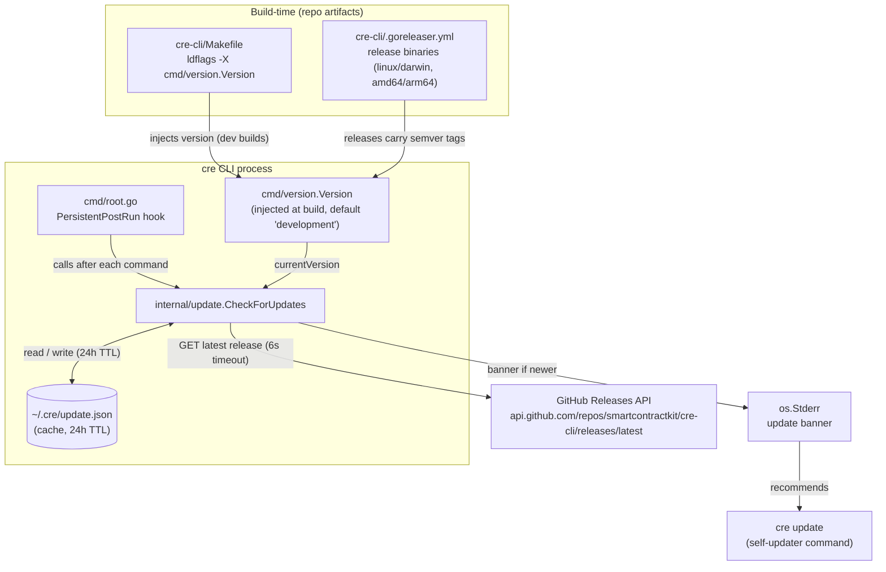
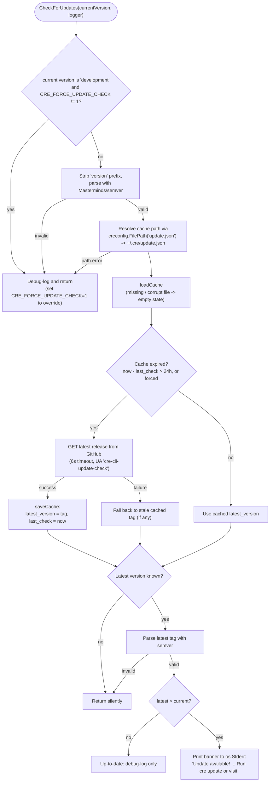
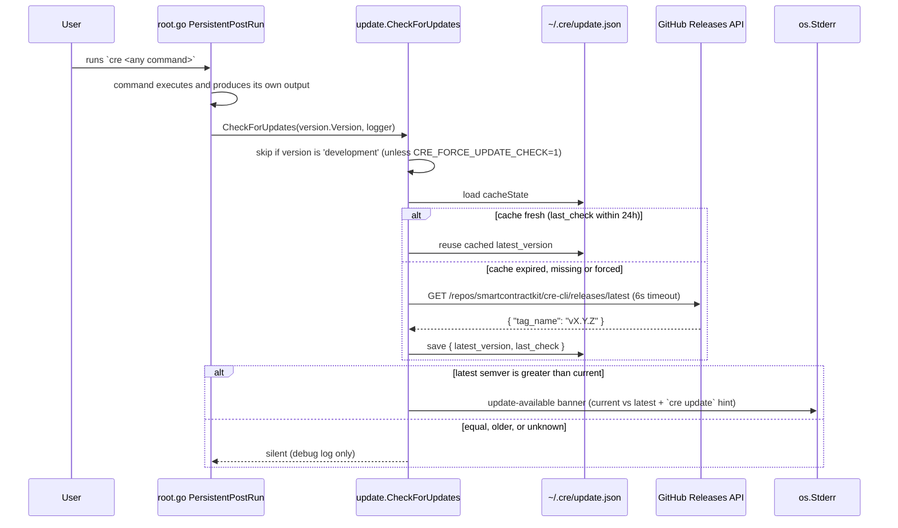
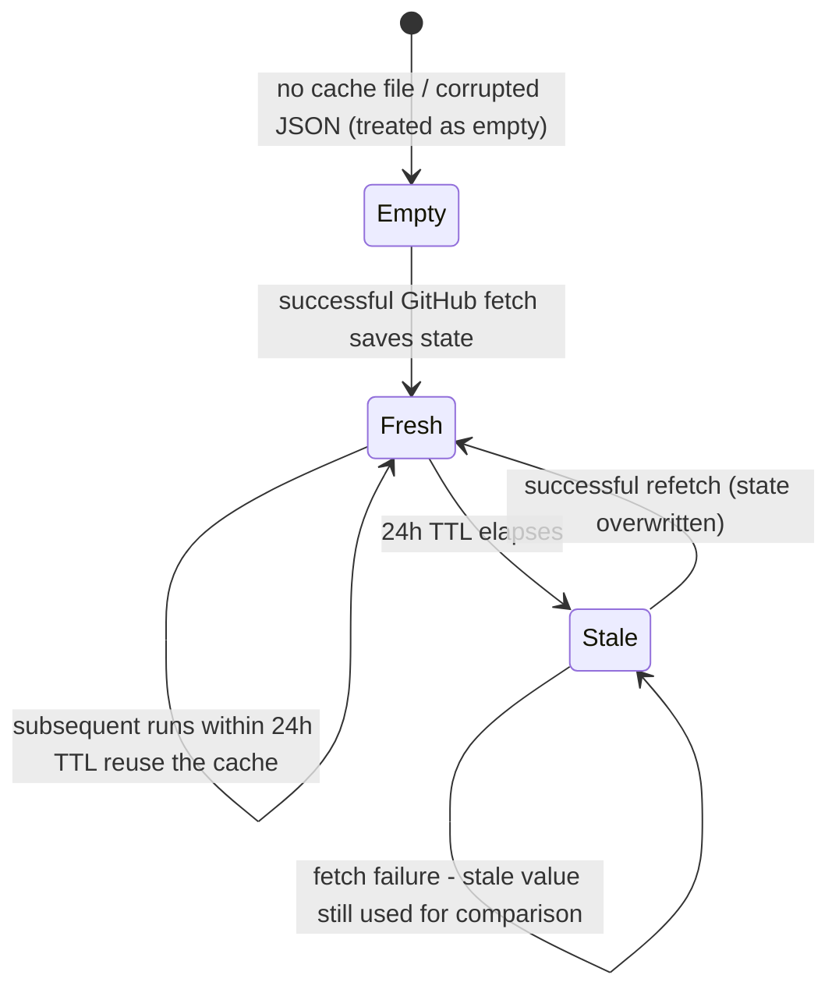

# cre-cli-platform-config / Update Check

## Introduction

The **update-check** module (`cre-cli/internal/update`) implements the passive release-notification mechanism of the `cre` CLI. After a user runs any CLI command, the module compares the binary's build version against the latest published release of [`smartcontractkit/cre-cli` on GitHub](https://github.com/smartcontractkit/cre-cli/releases). If a newer release exists, it prints a non-intrusive banner to `stderr` suggesting the `cre update` self-updater command.

The module is deliberately designed to be **invisible when everything goes right and harmless when anything goes wrong**: every failure path (no network, corrupt cache, unparseable version, rate-limited API) is swallowed with a debug-level log so that the check can never interfere with the user's actual command, its output, or its exit code. Its only outputs are an optional `stderr` banner and a small JSON cache file at `~/.cre/update.json`.

This page documents the check itself. It is one of four cross-cutting platform concerns of the CLI described under [cre-cli-platform-config](../cre-cli-platform-config.md):

- [Project settings](cre-cli-platform-config_project-settings.md) — project/environment resolution
- [Tenant context](cre-cli-platform-config_tenant-context.md) — authenticated user/tenant state
- [Telemetry](cre-cli-platform-config_telemetry.md) — user event reporting
- **Update check** (this page) — release awareness

## System Context

The update check sits between three sources of state:

1. **The build pipeline** injects the current version into the binary (see [Version source](#version-source-and-build-time-injection)).
2. **The root command** invokes the check after every command completes (see [Integration with the root command](#integration-with-the-root-command)).
3. **The GitHub Releases API** is the sole source of truth for the latest version.



> The `cre update` self-updater (`cre-cli/cmd/update/update.go`) is the *active* counterpart to this *passive* check: it downloads the release asset, verifies its signature (GPG on Linux, codesign on macOS, Authenticode on Windows) and replaces the running binary in place. Release packaging and installation mechanics are covered in [cre-cli build and release](../cre-cli-build-and-release.md).

## Architecture & Components

The module is a single file, `cre-cli/internal/update/update.go`, with one public entry point (`CheckForUpdates`) and a set of private helpers.

| Component | Kind | Responsibility |
|---|---|---|
| `CheckForUpdates(currentVersion string, logger *zerolog.Logger)` | Exported function | Orchestration entry point: dev-version gate, cache lookup, optional fetch, semver comparison, banner emission. Never returns an error. |
| `githubRelease{TagName string}` | Exported? struct (private file type) | Minimal mapping of the GitHub `/releases/latest` JSON payload (`tag_name`). |
| `cacheState{LatestVersion string; LastCheck time.Time}` | Private struct | On-disk cache record, serialized to `~/.cre/update.json` with JSON keys `latest_version` / `last_check`. |
| `getCachePath(logger)` | Private function | Delegates to `creconfig.FilePath(UpdateCacheFile)` to resolve `~/.cre/update.json`. |
| `loadCache(path, logger)` | Private function | Reads and unmarshals the cache. A **missing or corrupt file yields an empty state, not an error**, so the next write heals the cache. |
| `saveCache(path, state, logger)` | Private function | Marshals and writes the cache, creating the parent directory with mode `0750` and the file with mode `0600`. |
| `fetchLatestVersionFromGitHub(logger)` | Private function | Performs the HTTP GET against the constant GitHub API URL with a 6s timeout, `User-Agent: cre-cli-update-check` and `Accept: application/vnd.github.v3+json`. Requires HTTP 200 and a non-empty `tag_name`. |
| `UpdateCacheFile = "update.json"` | Exported constant | Canonical cache file name, shared with tests and tooling. |

Other file-level constants:

| Constant | Value | Purpose |
|---|---|---|
| `githubAPIURL` | `https://api.github.com/repos/smartcontractkit/cre-cli/releases/latest` | Latest-release endpoint (fixed constant; noted with `#nosec G704`). |
| `repoURL` | `https://github.com/smartcontractkit/cre-cli/releases` | Printed in the banner as the manual-upgrade URL. |
| `timeout` | `6 * time.Second` | HTTP client timeout, keeping worst-case overhead small. |
| `cacheDuration` | `24 * time.Hour` | Cache TTL before a fresh GitHub fetch. |

External dependencies: `github.com/Masterminds/semver/v3` (version parsing/comparison), `github.com/rs/zerolog` (debug logging), and the CLI-internal `internal/creconfig` package (config-directory path resolution, `~/.cre`).

## Version Source and Build-Time Injection

The "current version" is not discovered at runtime — it is compiled into the binary:

- `cre-cli/cmd/version/version.go` declares the package variable `var Version = "development"` and exposes the `cre version` command that prints it.
- `cre-cli/Makefile` injects the value at link time:

  ```make
  BUILD_FLAGS=-ldflags "-w -X 'github.com/smartcontractkit/cre-cli/cmd/version.Version=build $(COMMIT_SHA)'"
  ```

  Local builds therefore carry `build <commit-sha>`, which is intentionally **not** parseable as semver — the check detects this and skips silently.
- `cre-cli/.goreleaser.yml` produces the distributed release binaries (linux/darwin × amd64/arm64). These carry real release tags such as `v0.7.3-alpha`, which is what makes meaningful update checks possible in production.

`CheckForUpdates` additionally tolerates version strings that embed a literal `version` prefix (e.g. `"version v0.7.3-alpha"`): it strips the first occurrence of `"version"` and trims whitespace before handing the remainder to `semver.NewVersion`.

## Update Check Process Flow

The following flowchart captures the exact decision logic of `CheckForUpdates`:



Key properties of this flow:

- **Fail-open everywhere.** Cache path errors, unreadable/corrupt cache, network failures, non-200 responses, missing `tag_name`, and unparseable versions all reduce to a debug log and a silent return. The check *never* fails a user command.
- **Cache healing.** Because `loadCache` maps missing *and* corrupt files to an empty `cacheState`, a malformed `~/.cre/update.json` is silently overwritten by the next successful `saveCache`.
- **Stale-read strategy.** If a refresh fetch fails, the previous `latest_version` is still used for comparison — no cache invalidation failure can block the check.
- **stderr output.** The banner is written to `os.Stderr` specifically so it never corrupts `stdout`, keeping pipes (e.g. `cre workflow build | jq`) clean.
- **Concurrency-friendly.** The function holds no global state (only local variables, the filesystem cache, and stderr); its doc comment notes it is designed to be runnable in a goroutine. In the current wiring it runs *synchronously* — see below.

## Integration with the Root Command

`cre-cli/cmd/root.go` wires the check into the global Cobra lifecycle:

- **Invocation point.** `PersistentPostRun` on the root command calls:

  ```go
  if shouldCheckForUpdates(cmd) {
      intupdate.CheckForUpdates(version.Version, runtimeContext.Logger)
  }
  ```

  Running it in `PersistentPostRun` (rather than a goroutine during startup) is a deliberate ordering guarantee: the banner always prints **last**, after all command output, telemetry flushes and spinners have finished.

- **Gating.** `shouldCheckForUpdates` excludes commands where the banner would be noise or self-referential:
  - shell-completion generators: `bash`, `zsh`, `fish`, `powershell`
  - `update` — the self-updater itself must not advertise itself

  Every other command, including bare `cre` (which shows help via its own `RunE`), triggers the check.

- **Version and logger injection.** The current version comes from the `cmd/version` package variable, and the logger is the shared zerolog instance from the runtime context — so check activity is visible in `--verbose` (debug) runs and hidden otherwise.



## Cache Data Model & Lifecycle

`~/.cre/update.json` (path built by `internal/creconfig`, which resolves the CLI config directory as `$HOME/.cre`):

| Field | JSON key | Meaning |
|---|---|---|
| `LatestVersion` | `latest_version` | Last known latest release tag (e.g. `v0.7.3`). |
| `LastCheck` | `last_check` | RFC-3339 timestamp of the last successful GitHub fetch; drives the 24h TTL. |



File permissions are defensive by design: the cache directory is created with `0750` and the file itself with `0600`.

## Operational Notes & Edge Cases

| Scenario | Behaviour |
|---|---|
| Development binary (`make build`, version `build <sha>` or `development`) | Check skipped; debug-logged. Override with `CRE_FORCE_UPDATE_CHECK=1` (also bypasses the 24h TTL by forcing a fetch). |
| GitHub API unreachable / non-200 / rate-limited | Debug-logged; cached tag (if present) is still compared; no error surfaces. |
| `~/.cre/update.json` corrupted | Treated as empty; overwritten on next successful fetch. |
| Current or latest version not valid semver | Check aborted with a debug log — deliberately conservative, matching the updater's own fail-closed version comparison. |
| Output piping | Banner goes to stderr; stdout is never touched. |
| Command exit codes / telemetry | Unaffected — the check runs after `PersistentPostRun`-adjacent finalization and reports nothing to telemetry; failures are debug-only. |
| Worst-case latency | Bounded by the 6s HTTP timeout; on cache hits, only a file read occurs. |

## Related Documentation

- [cre-cli-platform-config](../cre-cli-platform-config.md) — sibling platform concerns: [project settings](cre-cli-platform-config_project-settings.md), [tenant context](cre-cli-platform-config_tenant-context.md), [telemetry](cre-cli-platform-config_telemetry.md).
- [cre-cli build and release](../cre-cli-build-and-release.md) — Makefile/goreleaser version injection, release packaging, and the install scripts that place the `cre` binary on the user's `PATH`.
- [cre-cli workflow commands](../cre-cli-workflow-commands.md) — the commands whose execution concludes with this update check.
- [cre-cli backend clients](../cre-cli-backend-clients.md) — HTTP/GQL client patterns used elsewhere in the CLI (this module intentionally uses a plain `net/http` client instead, to keep the check dependency-free).
- [Developer Toolchain (CLI, SDKs & API Clients)](../../Developer_Toolchain_(CLI,_SDKs___API_Clients).md) — parent overview of the CRE developer toolchain.
