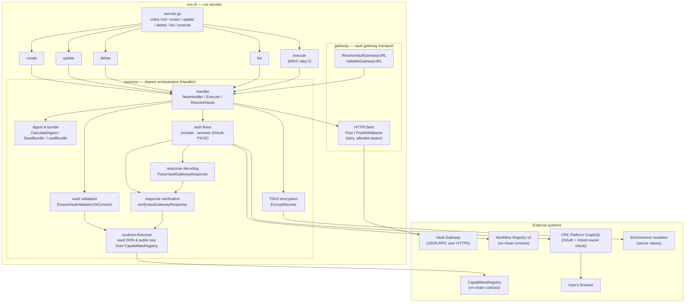
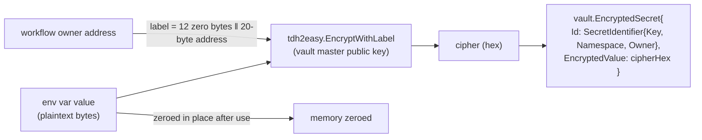
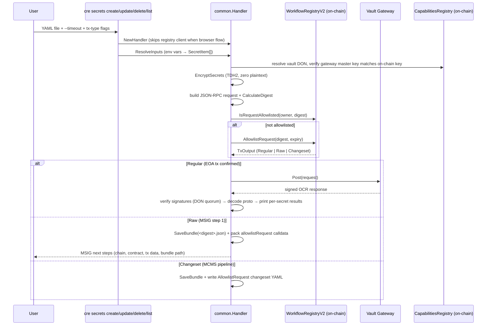
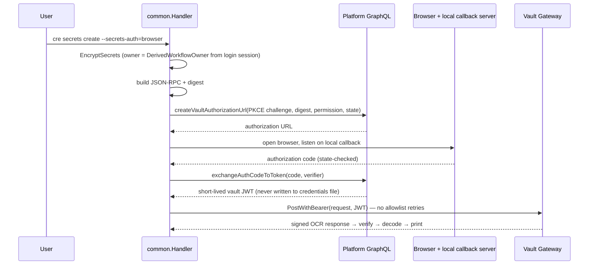

# cre-cli-secrets — Vault Secrets Management (`cre secrets`)

## 1. Purpose and Scope

`cre-cli-secrets` implements the **`cre secrets` command family** of the CRE CLI. It allows workflow
owners to **create, update, list, and delete secrets** that live in the **Vault DON** — a decentralized
oracle network capability that stores encrypted secrets on behalf of workflows — and it does so without
the CLI ever seeing a plaintext secret on any server side: all values are encrypted **client-side** with
a threshold (TDH2) public key before they leave the machine.

Concretely, the module:

- Parses YAML "secrets" files (`secretsNames` maps/lists) and resolves secret values from environment variables.
- Encrypts each secret with the **vault master public key** using [TDH2 threshold encryption](#tdh2-encryption) and binds it to a workflow owner label.
- Builds **JSON-RPC 2.0 requests** (`secrets.create`, `secrets.update`, `secrets.delete`, `secrets.list`, `publicKey/get`) and computes a **request digest** over the exact payload.
- Authorizes each request through one of two flows:
  - **onchain** — an on-chain `allowlistRequest` call against the **Workflow Registry v2** contract (direct EOA transaction, raw MSIG bundle, or MCMS changeset), or
  - **browser** — a platform **OAuth PKCE** flow that issues a short-lived, digest-bound vault JWT.
- POSTs the digest-bound request to the **Vault Gateway** (JSON-RPC over HTTPS), optionally retries while the allowlist transaction finalizes, then verifies the **signed OCR response** (per-DON signer quorum) and prints per-secret results.
- Supports **two-step MSIG workflows** by persisting an *unsigned bundle* (`<digest>.json`) that `cre secrets execute` replays verbatim once the allowlist transaction is finalized.

The module lives under `cre-cli/cmd/secrets/` and is one of the command groups of the CRE CLI, alongside
the workflow lifecycle commands ([cre-cli-workflow-commands](cre-cli-workflow-commands.md)) and the
backend GraphQL/storage clients ([cre-cli-backend-clients](cre-cli-backend-clients.md)).

## 2. Architecture Overview

### 2.1 Component map



### 2.2 Layering and responsibilities

| Layer | Files | Responsibility |
|---|---|---|
| **CLI surface** | `secrets.go`, `create/`, `update/`, `delete/`, `list/`, `execute/` | cobra command definitions, flag validation (`--timeout`, `--secrets-auth`, tx-type flags, `--non-interactive`/`--yes`), delegation to the shared Handler |
| **Shared orchestration** | `common/handler.go`, `common/bundle.go`, `common/validate.go`, `common/vault_validation.go`, `common/vaultdon/resolver.go`, `common/vault_response_verify.go`, `common/vault_response_decode.go`, `common/browser_flow.go` | Secrets YAML parsing, TDH2 encryption, JSON-RPC construction + digests, on-chain allowlist coordination, MSIG bundles, OAuth browser flow, response signature verification and decoding |
| **Gateway transport** | `common/gateway/http_client.go`, `common/gateway/resolver.go`, `common/gateway/url.go` | HTTPS JSON-RPC POST with retry policy, bearer-token variant, gateway URL resolution/validation |

### 2.3 Sub-module documentation

The detailed write-ups for each layer are maintained as separate sub-module pages:

1. **[Gateway transport](cre-cli-secrets/cre-cli-secrets_gateway.md)** (`cre-cli-secrets_gateway`)
   The `gateway.Client` interface and `HTTPClient` implementation: JSON-RPC POST with the allowlist-aware retry policy, the `PostWithBearer` variant for the OAuth flow, plus `ResolveVaultGatewayURL` (env var → tenant context → embedded default) and `ValidateGatewayURL` (HTTPS-only, loopback exception).

2. **[Shared orchestration — the Handler](cre-cli-secrets/cre-cli-secrets_handler.md)** (`cre-cli-secrets_handler`)
   The heart of the module: `SecretsYamlConfig`/`UpsertSecretsInputs` YAML resolution, TDH2 `EncryptSecrets`, `CalculateDigest`, on-chain allowlist coordination and MSIG `UnsignedBundle` persistence, the browser OAuth PKCE flow (`ExecuteBrowserVaultAuthorization`), vault-validation consent, OCR response verification/decoding (`ParseVaultGatewayResponse`), the `vaultdon.Resolver` for on-chain master-key cross-checks, and the test doubles (`MockClientFactory`, mock vault DON fixtures).

3. **[CLI commands](cre-cli-secrets/cre-cli-secrets_commands.md)** (`cre-cli-secrets_commands`)
   The five cobra subcommands — `create`, `update`, `delete` (`SecretsDeleteYamlConfig`), `list`, and `execute` — including their flag validation, shared `--timeout`/`--secrets-auth` handling, and how each delegates to the Handler (or, for `execute`, replays a saved bundle as MSIG step 2).

### 2.4 External dependencies (shared libraries)

The module leans on domain types and protobufs from other documented modules:

- **Vault request/response protobufs** — `vault.CreateSecretsRequest`, `EncryptedSecret`, `SecretIdentifier`, `SignedOCRResponse`, method constants (`MethodSecretsCreate`, …) come from `chainlink-common/pkg/capabilities/actions/vault` and `chainlink/v2/core/capabilities/vault/vaulttypes`; see [capabilities_vault](../Workflow___Capability_Runtime_(CRE_Engine)/capabilities/capabilities_vault.md).
- **On-chain clients** — the on-chain `allowlistRequest` / `IsRequestAllowlisted` / `IsOwnerLinked` calls go through `cre-cli/cmd/client.WorkflowRegistryV2Client` (part of the CLI's command-layer clients; see [cre-cli-workflow-commands](cre-cli-workflow-commands.md) for the registry contract surface).
- **Platform GraphQL** — owner link verification (`listWorkflowOwners`) and the OAuth URL/token-exchange mutations go through `internal/client/graphqlclient` (sibling of the documented clients in [cre-cli-backend-clients](cre-cli-backend-clients.md)).
- **Settings/tenant context** — chain selectors, MCMS config, deployment RPC and capabilities-registry RPC resolution come from `internal/settings` and `internal/tenantctx`, documented in [cre-cli-platform-config](cre-cli-platform-config.md).

## 3. Core Concepts

### 3.1 Secrets YAML format

Two shapes are accepted, both namespaced under a `secretsNames` key:

```yaml
# create / update:  secret-id -> environment variable holding the value
secretsNames:
  API_KEY: MY_API_KEY_ENV
  DB_URL: MY_DB_URL_ENV

# delete: a plain list of secret ids
secretsNames:
  - API_KEY
  - DB_URL
```

- Values are read **only from environment variables** (never from the YAML itself), keeping the file committable.
- Every secret is placed in the `"main"` namespace by default (CLI `--namespace` for `list`).
- A payload is capped at `constants.MaxSecretItemsPerPayload` (10) items.
- The create/update shape is captured by `SecretsYamlConfig`, the delete shape by `SecretsDeleteYamlConfig` (see [handler sub-module](cre-cli-secrets/cre-cli-secrets_handler.md) and [commands sub-module](cre-cli-secrets/cre-cli-secrets_commands.md)).

### 3.2 TDH2 encryption and owner binding

Before any gateway call, each plaintext value is encrypted client-side:



- The vault **master public key** is fetched from the gateway (`publicKey/get`) and, when a CapabilitiesRegistry RPC is configured, **cross-checked against the on-chain vault DON capability config** — a mismatch aborts encryption.
- The TDH2 *label* is the canonical owner address left-padded to 32 bytes, so only workflows of that owner can decrypt.
- Plaintext slices are **zeroed in place** (`ZeroUpsertSecretValues`) as soon as they are encrypted, and `Handler.Execute` defers zeroing of all inputs.

### 3.3 Digest binding and allowlisting

Every JSON-RPC request carries a UUID `id`, and `CalculateDigest` hashes the canonical request envelope (version, id, method, params) into a 32-byte digest. The gateway accepts a request only if `WorkflowRegistry.allowlistRequest(owner, digest)` was called on-chain for that owner/digest pair (or the request carries a digest-bound vault JWT from the browser flow). This is what ties off-chain secret operations to on-chain ownership.

## 4. Authentication and Execution Flows

The `--secrets-auth` flag selects the flow; `common.ValidateSecretsAuthFlow` / `IsBrowserFlow` gate the branches.

### 4.1 On-chain flow (EOA wallet, default)



`cre secrets execute <bundle.json>` performs **MSIG step 2**: it reloads the bundle, re-checks the digest is allowlisted on-chain, and POSTs the **exact saved request body**, so the digest checked on-chain is the digest the gateway verifies.

### 4.2 Browser flow (`--secrets-auth=browser`)



Differences from the on-chain flow: no registry client, no on-chain allowlist; the vault JWT is bound to the request digest and permission (`VAULT_PERMISSION_*`), and the owner identity comes from the JWT-derived `DerivedWorkflowOwner` rather than settings.

### 4.3 Gateway retry policy

The gateway client distinguishes three retry classes (detailed in the [gateway sub-module](cre-cli-secrets/cre-cli-secrets_gateway.md)):

1. **Transport errors** → retried.
2. **Non-200 with "request not allowlisted"** → retried (default 5 attempts, 4 s apart) because the allowlist transaction may still be finalizing; the CLI prints *"Waiting for on-chain allowlist finalization…"*.
3. **Any other non-200** → treated as unrecoverable and fails immediately.
4. **Bearer mode** (`PostWithBearer`) retries transport errors only — a rejected JWT will never be retried.

## 5. Response Verification and Result Reporting

Every gateway reply is a JSON-RPC envelope whose result is a `vaulttypes.SignedOCRResponse`:

1. **Envelope checks** — JSON-RPC error short-circuits; response `id` must echo the request `id`.
2. **Signature verification** (skipped only when the user explicitly opted out) — the vault DON is resolved from the CapabilitiesRegistry, signer addresses and the fault-tolerance-derived quorum (`MinOCRSignatures(F)`) are computed, and `vaulttypes.ValidateSignatures` verifies the DON's OCR signatures.
3. **Payload decoding** — `protojson` with `DiscardUnknown` so older CLIs can decode newer gateway payloads; per-method protos (`CreateSecretsResponse`, `UpdateSecretsResponse`, `DeleteSecretsResponse`, `ListSecretIdentifiersResponse`).
4. **Per-secret reporting** — one log line per identifier with `secret_id`, `owner`, `namespace` and success/error.

Validation opt-out is interactive and explicit: `EnsureVaultValidationOrConsent` requires an RPC for the capabilities-registry chain, and in `--non-interactive` mode it *fails* rather than silently skipping; skipping requires `--yes` (with a loud warning that encryption key and DON signatures are then trusted to the gateway alone). The decision is cached on the Handler for the lifetime of the command.

## 6. Security Model Summary

| Concern | Mitigation |
|---|---|
| Plaintext exposure | Secrets live in env vars; plaintext buffers zeroed after encryption; YAML contains only env-var names |
| Key substitution | Gateway master key cross-checked against on-chain vault DON capability config before use |
| Unauthorized writes | Digest-bound on-chain `allowlistRequest` (owner) or digest-bound OAuth vault JWT (browser) |
| MSIG replay safety | Bundle stores the exact request body; `execute` re-verifies the digest on-chain before POSTing |
| Gateway spoofing | HTTPS-only gateway URLs (loopback HTTP allowed for local dev); signed OCR responses verified against DON signers/quorum |
| TLS downgrade / SSRF | `ValidateGatewayURL` rejects non-HTTPS schemes except loopback |
| Accidental data loss | `--non-interactive` requires `--yes`; validation skips require explicit consent; allowlist durations capped (`MaxVaultAllowlistDuration`, default 2 days) |
| File hygiene | Bundles written `0600`; bundle filename is the request digest |

## 7. Source Layout

```text
cre-cli/cmd/secrets/
├── secrets.go                  # cobra root: persistent --timeout / --secrets-auth, wires subcommands
├── create/create.go            # cre secrets create
├── update/update.go            # cre secrets update
├── delete/delete.go            # cre secrets delete (SecretsDeleteYamlConfig)
├── list/list.go                # cre secrets list
├── execute/execute.go          # cre secrets execute (MSIG step 2)
└── common/
    ├── handler.go              # Handler, SecretsYamlConfig, encryption, digests, Execute, response parsing
    ├── validate.go             # auth-flow constants and validation (onchain | browser)
    ├── bundle.go               # UnsignedBundle save/load, digest-derived filename
    ├── browser_flow.go         # OAuth PKCE flow, bearer POST
    ├── vault_validation.go     # EnsureVaultValidationOrConsent, registry client lifecycle
    ├── vault_response_verify.go# OCR signature verification
    ├── vault_response_decode.go# protojson decoding (DiscardUnknown)
    ├── vaultdon/resolver.go    # vault DON + master public key from CapabilitiesRegistry
    ├── gateway/
    │   ├── http_client.go      # Client interface, HTTPClient with allowlist-aware retry
    │   ├── resolver.go         # ResolveVaultGatewayURL (env → tenant context → embedded default)
    │   └── url.go              # ValidateGatewayURL (HTTPS-only, loopback exception)
    └── test_helpers.go / test_helpers_capreg.go  # MockClientFactory, mock vault DON fixtures
```

## 8. Related Documentation

- [cre-cli-workflow-commands](cre-cli-workflow-commands.md) — workflow deploy/activate/pause/delete/simulate; shares the `WorkflowRegistryV2Client` and tx-type machinery used by the secrets allowlist flow.
- [cre-cli-backend-clients](cre-cli-backend-clients.md) — the private-registry, storage, and workflow-data clients; the secrets module uses the same GraphQL client infrastructure for owner-link checks and OAuth mutations.
- [cre-cli-platform-config](cre-cli-platform-config.md) — project settings, tenant context, tx-type flags and MCMS/chain-selector resolution consumed by the Handler.
- [capabilities_vault](../Workflow___Capability_Runtime_(CRE_Engine)/capabilities/capabilities_vault.md) — the Vault capability protobuf definitions (requests, identifiers, signed responses) that the CLI speaks to the gateway.
