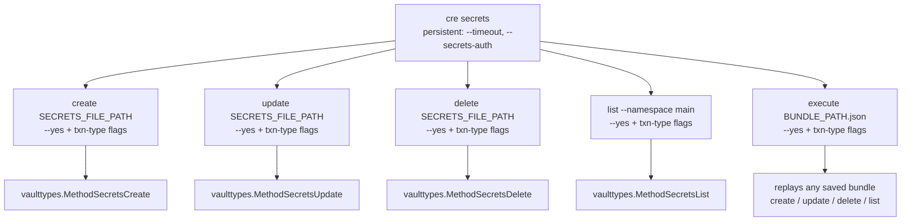
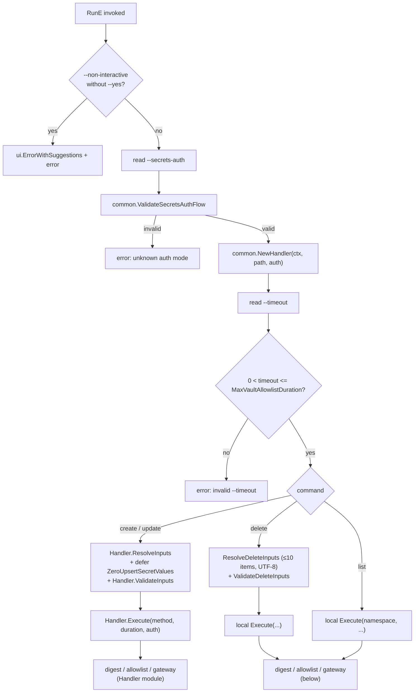
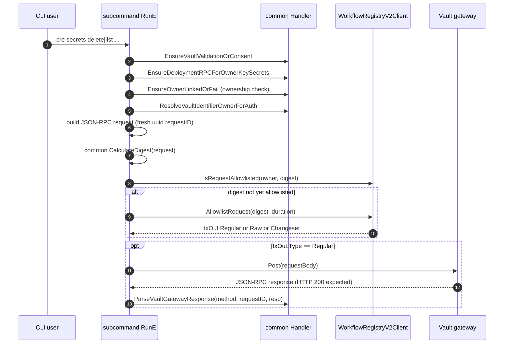
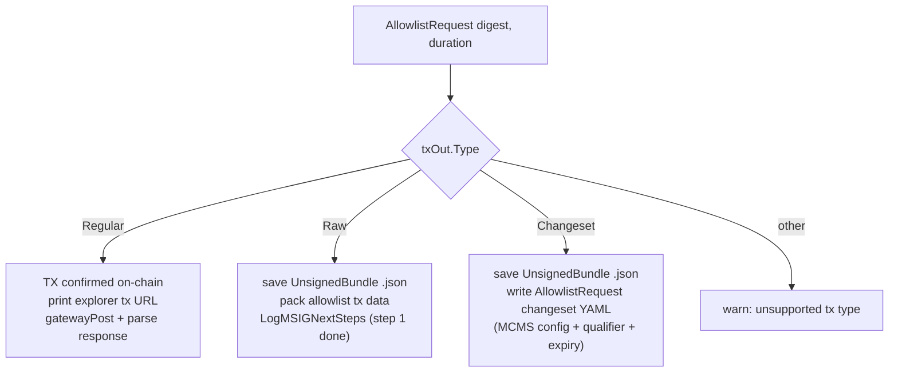
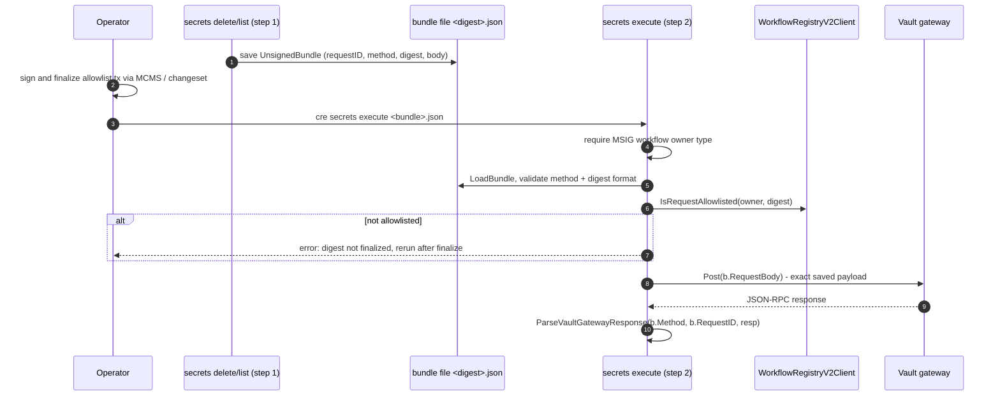
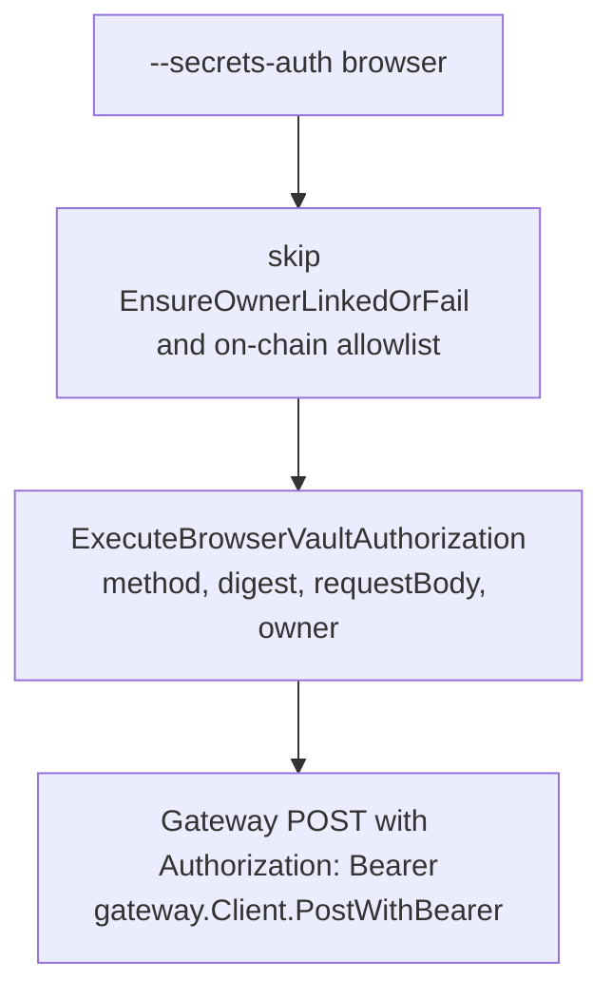
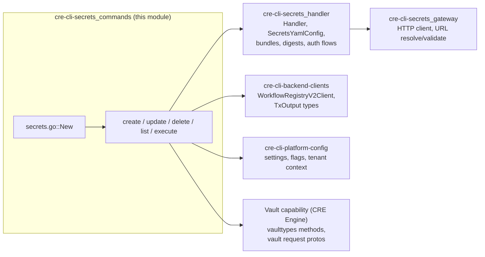

# cre-cli-secrets Commands (`cre secrets`)

## 1. Introduction

The `cre-cli-secrets_commands` module implements the user-facing **`cre secrets`** command group of the CRE CLI. It lets workflow operators manage secrets stored in the **Vault DON** (a decentralized vault service executed by Chainlink node operators) directly from the command line:

| Command | Purpose | Vault method invoked |
|---|---|---|
| `cre secrets create` | Create secrets from a YAML file | `vaulttypes.MethodSecretsCreate` |
| `cre secrets update` | Update existing secrets from a YAML file | `vaulttypes.MethodSecretsUpdate` |
| `cre secrets delete` | Delete secrets listed in a YAML file | `vaulttypes.MethodSecretsDelete` |
| `cre secrets list` | List secret identifiers for the current owner | `vaulttypes.MethodSecretsList` |
| `cre secrets execute` | Execute a previously prepared MSIG bundle (step 2) | any of the four, read from the bundle |

The commands are thin, mostly declarative Cobra wrappers. Heavy lifting — request construction, cryptography, allowlist bookkeeping, gateway communication, and response parsing — is delegated to two sibling modules:

- **[cre-cli-secrets Handler](cre-cli-secrets_handler.md)** — `common.Handler`, YAML config types, digests, bundles, auth flows, and response parsing.
- **[cre-cli-secrets Gateway](cre-cli-secrets_gateway.md)** — HTTP client, gateway URL resolution, and URL validation for the Vault Gateway.

> For a higher-level view of how these three modules fit together, see the [cre-cli-secrets overview](../cre-cli-secrets.md).

## 2. Command Architecture

`cre-cli/cmd/secrets/secrets.go::New` builds the parent `secrets` command, attaches two **persistent flags** that are inherited by every subcommand, and registers the five subcommands. Each subcommand is created by its own `New(runtime.Context)` factory and configured with shared settings helpers (`settings.AddTxnTypeFlags`, `settings.AddSkipConfirmation`).



### 2.1 Persistent flags (defined on the group)

| Flag | Type | Default | Description |
|---|---|---|---|
| `--timeout` | duration | `constants.DefaultVaultAllowlistDuration` (2 days) | How long the on-chain allowlist entry for the request digest stays valid. Validated per command: must be `> 0` and `<= constants.MaxVaultAllowlistDuration`. |
| `--secrets-auth` | string | `onchain` | Authentication mode. `onchain` uses a wallet key against the on-chain workflow registry; `browser` uses account credentials (OAuth) against the private registry. Validated by `common.ValidateSecretsAuthFlow`. |

### 2.2 Per-command flags

Every subcommand additionally registers:

- **Transaction-type flags** (`settings.AddTxnTypeFlags`) — select how the on-chain allowlist transaction is produced: a regular EOA transaction (`client.Regular`), a raw unsigned transaction for manual signing (`client.Raw`), or a CLD changeset file (`client.Changeset`). Flag definitions live in the [cre-cli-platform-config](../cre-cli-platform-config.md) module.
- **`--yes` / skip-confirmation** (`settings.AddSkipConfirmation`) — required together with `--non-interactive`; non-interactive mode without `--yes` aborts with `ui.ErrorWithSuggestions`.
- `list` adds `--namespace` (default `main`).

### 2.3 Component reference

| Component | Location | Role |
|---|---|---|
| `New` (root) | `cre-cli/cmd/secrets/secrets.go` | Builds the `secrets` group; owns persistent flags; wires subcommands. |
| `New` (create) | `cre-cli/cmd/secrets/create/create.go` | Upsert flow via `Handler.Execute` with `MethodSecretsCreate`. |
| `New` (update) | `cre-cli/cmd/secrets/update/update.go` | Upsert flow via `Handler.Execute` with `MethodSecretsUpdate`. |
| `New`, `Execute`, `ResolveDeleteInputs`, `ValidateDeleteInputs`, `SecretsDeleteYamlConfig` | `cre-cli/cmd/secrets/delete/delete.go` | Delete flow; owns its own request build, allowlist, gateway POST, and MSIG branching. |
| `New`, `Execute` | `cre-cli/cmd/secrets/list/list.go` | List flow; same self-contained pipeline as delete but with no file input. |
| `New` | `cre-cli/cmd/secrets/execute/execute.go` | MSIG step 2: loads a saved bundle, verifies the allowlist, replays the exact saved request. |

## 3. Shared Execution Pipeline

`create`, `update`, `delete`, and `list` follow the same preflight pipeline before diverging into request-specific logic. The commands enforce validation locally and delegate persistence to the [Handler module](cre-cli-secrets_handler.md).



Key pipeline behaviors:

1. **Non-interactive guard** — `--non-interactive` requires `--yes`; otherwise the command fails fast with a hint.
2. **Auth-flow validation** — only `onchain` and `browser` are accepted.
3. **Handler construction** — `common.NewHandler` resolves the workflow owner, gateway URL, registry client, and credentials (see [Handler module](cre-cli-secrets_handler.md)).
4. **Timeout bounding** — the allowlist duration is clamped so a grant can never exceed the configured maximum.
5. **Secret hygiene** — create/update defer `common.ZeroUpsertSecretValues(inputs)`, which zeroes secret material in memory as soon as the `RunE` function returns.

## 4. Request Flow: On-Chain (EOA) Path

`delete` and `list` implement their full pipeline locally (create/update route through `Handler.Execute`, which follows the same shape). The on-chain path authorizes a request by allowlisting a **digest of the exact JSON-RPC payload** on the Workflow Registry contract, then POSTing that payload to the Vault Gateway.



Notes:

- The JSON-RPC envelope is built from `chainlink-common/pkg/jsonrpc2` (`Request[...]` with a fresh `uuid` request ID); params use types from `chainlink-common/pkg/capabilities/actions/vault` (e.g. `DeleteSecretsRequest`, `ListSecretIdentifiersRequest`, `SecretIdentifier`) — these belong to the Vault capability documented under the [CRE Engine / core capabilities runtime](<../../Workflow___Capability_Runtime_(CRE_Engine)/core_capabilities_runtime.md>).
- `delete` populates each `SecretIdentifier` with `Key` from the YAML, `Namespace: "main"`, and the resolved owner. `list` sends `Owner` and `--namespace` directly.
- If the digest is **already allowlisted**, the command skips the transaction and goes straight to the gateway POST.
- A non-HTTP-200 gateway response is surfaced as an error including the response body.

### 4.1 Allowlist transaction outcomes

When an allowlist transaction is required, the configured transaction type determines what happens next:



- **`Regular`** — the CLI sends and confirms the allowlist transaction itself, then immediately POSTs to the gateway.
- **`Raw`** — the CLI writes an `UnsignedBundle` JSON file (named `<digest>.json`; next to the secrets file for `delete`, in the working directory for `list`) containing `request_id`, `method`, `digest_hex`, the exact `request_body`, and `created_at`, then prints the multi-sig next steps. Execution is completed later with `cre secrets execute`.
- **`Changeset`** — the CLI writes a CLD changeset YAML (`types.UserAllowlistRequestInput` with expiry timestamp, digest, chain selector, MCMS config, and the workflow registry qualifier) so the allowlist request can be applied through the standard changeset pipeline. See [CCIP Deployment Suite / changesets](<../../CCIP_Deployment_Suite.md>) for the general changeset mechanism.

## 5. MSIG Two-Step Flow (`secrets execute`)

The `execute` command is **MSIG step 2**: after the allowlist transaction from step 1 has been signed and finalized off-band, `execute` replays the saved request byte-for-byte.



Guarantees provided by this design:

- **Payload integrity** — the bundle stores the exact request body; `execute` POSTs it unmodified, so the on-chain allowlist (which was computed over the digest of that same body) always matches what the gateway receives.
- **Method safety** — only the four known vault methods are accepted from a bundle; anything else is rejected.
- **Owner restriction** — `execute` refuses to run unless the workflow owner type is MSIG (`constants.WorkflowOwnerTypeMSIG`), since EOA users get the integrated one-shot path.

## 6. Browser Authentication Flow

With `--secrets-auth browser`, the on-chain allowlist and ownership-verification steps are skipped entirely. Instead, the command delegates to `Handler.ExecuteBrowserVaultAuthorization` (implemented in the [Handler module](cre-cli-secrets_handler.md)), which authenticates the operator through account credentials and sends the digest-signed request to the gateway with a bearer token via `gateway.Client.PostWithBearer`.



URL selection for the browser/private-registry backend is handled by `ResolveVaultGatewayURL` and guarded by `ValidateGatewayURL` (HTTPS required except for loopback hosts) — see the [Gateway module](cre-cli-secrets_gateway.md).

## 7. Input Formats

### 7.1 Create / Update — `SecretsYamlConfig` (Handler module)

```yaml
secretsNames:
  main:            # namespace
    - "API_KEY:abc123"
    - "DB_URL:postgres://..."
```

`secretsNames` is a map of **namespace → list of secret entries**. The Handler parses this into `UpsertSecretsInputs`, validates it, and zeroes the values from memory when the command returns.

### 7.2 Delete — `SecretsDeleteYamlConfig` (this module)

```yaml
secretsNames:
  - SECRET_NAME1
  - SECRET_NAME2
```

- Entries are trimmed; empty IDs and non-UTF-8 IDs are rejected.
- Every entry is targeted at namespace `main`.
- At most `constants.MaxSecretItemsPerPayload` (10) items are accepted per payload.

`delete` and `list` validate with the shared `internal/validation` validator (`DeleteSecretItem.ID` is required).

## 8. Security and Validation Guarantees

| Guarantee | Mechanism |
|---|---|
| Digest-bound authorization | The SHA-256-style digest of the exact JSON-RPC payload (including `requestID`) must be allowlisted on the Workflow Registry before the gateway accepts it. |
| Replay integrity for MSIG | `execute` POSTs the exact bytes saved in the bundle — no reconstruction, no drift between signed digest and transmitted payload. |
| Bounded grants | `--timeout` is validated against `MaxVaultAllowlistDuration`; default is 2 days. |
| Secret hygiene | `defer common.ZeroUpsertSecretValues(inputs)` scrubs secret material from memory. |
| Input hardening | Payload size cap (10 items), UTF-8 checks, trimmed and required IDs, struct validation. |
| Ownership checks | `EnsureVaultValidationOrConsent` and `EnsureOwnerLinkedOrFail` (on-chain flow) verify the operator owns the vault identifiers before mutating anything. |
| Transport security | Gateway URLs must be HTTPS (except loopback) — enforced in the [Gateway module](cre-cli-secrets_gateway.md). |

## 9. Dependencies



- **[cre-cli-secrets Handler](cre-cli-secrets_handler.md)** — `Handler`, `SecretsYamlConfig`, `ValidateSecretsAuthFlow`, `UnsignedBundle`, `CalculateDigest`, `ZeroUpsertSecretValues`, browser flow, vault DON resolver.
- **[cre-cli-secrets Gateway](cre-cli-secrets_gateway.md)** — `gateway.Client` (`Post`, `PostWithBearer`), URL resolution and validation.
- **[cre-cli-backend-clients](../cre-cli-backend-clients.md)** — `cmd/client.WorkflowRegistryV2Client` for allowlist checks/transactions, and the `client.TxOutput` types (`Regular` / `Raw` / `Changeset`).
- **[cre-cli-platform-config](../cre-cli-platform-config.md)** — `internal/settings` (txn-type flags, `--yes`, `--non-interactive`, chain selector / MCMS settings), `internal/runtime.Context`, `internal/ui`, `internal/constants`.
- **Vault capability (CRE Engine)** — `chainlink/v2/core/capabilities/vault/vaulttypes` method constants and `chainlink-common/pkg/capabilities/actions/vault` request types; see [core capabilities runtime — vault types](<../../Workflow___Capability_Runtime_(CRE_Engine)/core_capabilities_runtime/core_capabilities_runtime_vault_types.md>).

## 10. Building and Testing

The `cre` binary and its tests are driven by `cre-cli/Makefile` (tooling details in [cre-cli-build-and-release](../cre-cli-build-and-release.md)):

| Target | Command | Purpose |
|---|---|---|
| `make build` | `go build -o cre` | Build the CLI binary (version stamped from commit SHA). |
| `make test` | `go test ./...` (after lint) | Unit tests for all commands. |
| `make test-quick` | `go test -short -timeout 30s` | Fast loop, skipping slow/flaky e2e suites (including gateway POST tests). |
| `make test-e2e` | `go test ./test/` | End-to-end tests. |
| `make gendoc` | `go run gendoc/main.go` | Regenerate CLI docs. |

When extending this module (e.g. adding a new secrets subcommand), follow the existing pattern: create a `New(ctx *runtime.Context) *cobra.Command` factory, reuse the preflight guard blocks, register transaction-type and confirmation flags, and route execution through `common.Handler` where possible.