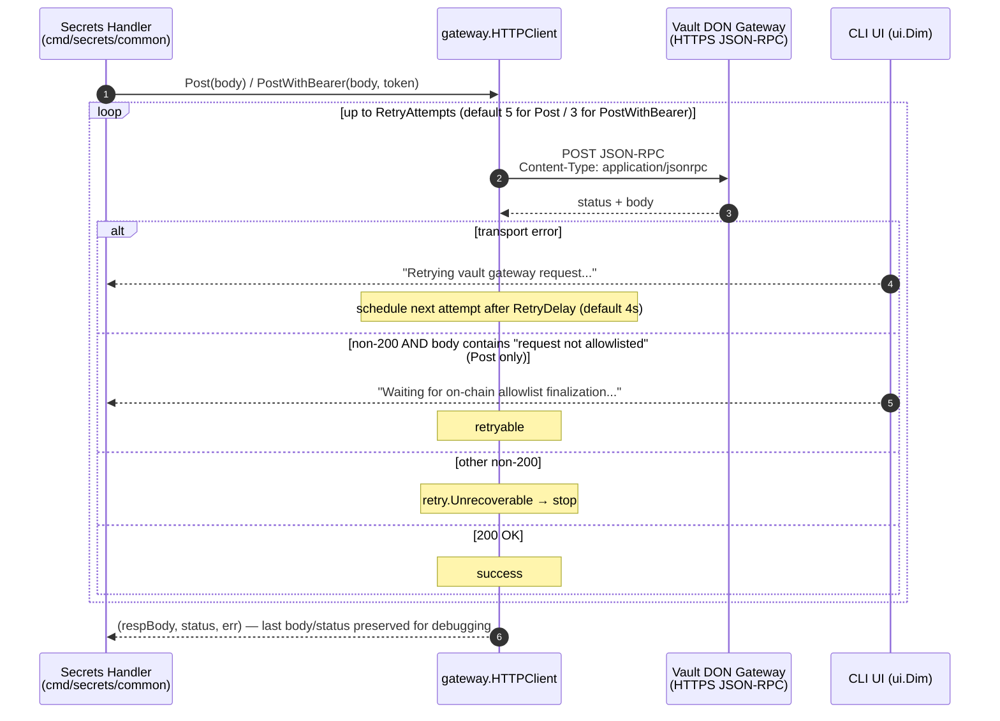
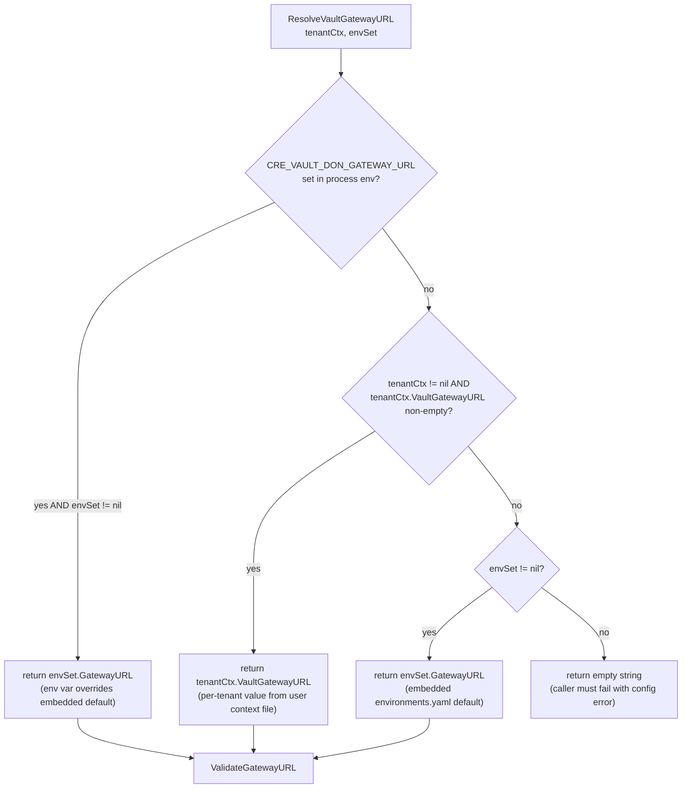
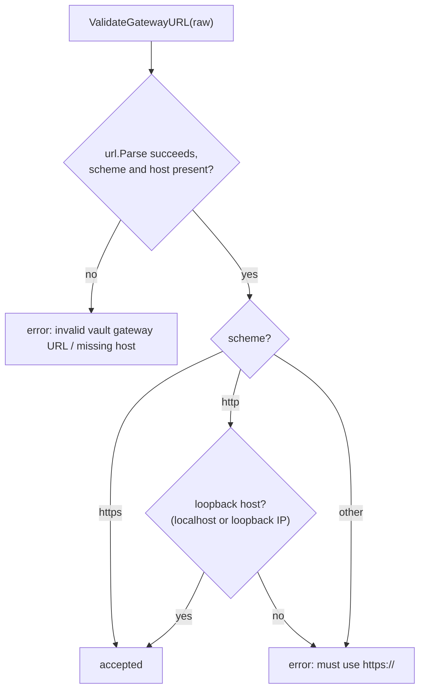
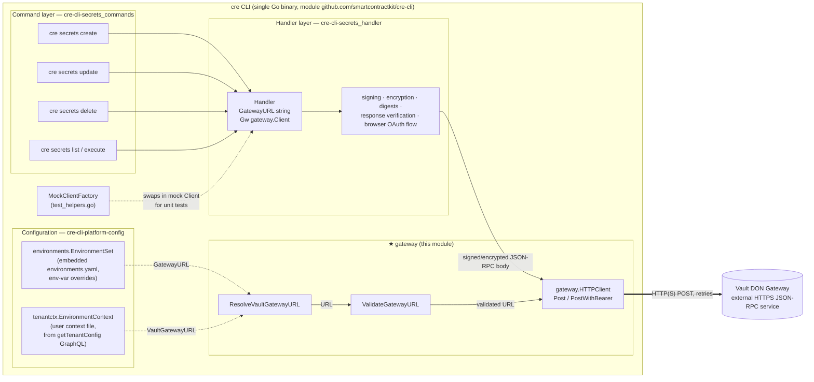
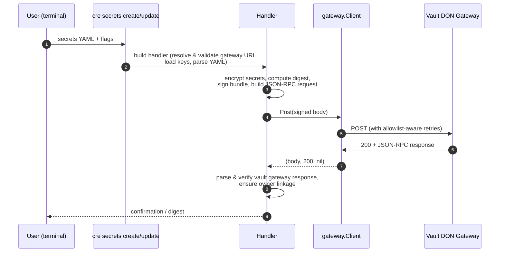

# cre-cli-secrets / Gateway

> **Module path:** `cre-cli/cmd/secrets/common/gateway` · **Parent:** [cre-cli-secrets](../cre-cli-secrets.md) · **Product area:** [Developer Toolchain (CLI, SDKs & API Clients)](../../Developer_Toolchain_(CLI,_SDKs___API_Clients).md)

## 1. Introduction

The `gateway` package is the **HTTP transport layer** that the `cre` CLI's secrets commands use to talk to the **Vault DON Gateway** — the off-chain service operated by the Chainlink Vault Decentralized Oracle Network that accepts encrypted secret bundles and serves secret-fetch requests.

The package intentionally contains no secrets logic of its own. It is a small, focused library with three responsibilities:

1. **Transport** — send JSON-RPC request bodies to the gateway over HTTP(S), with retry semantics that understand the gateway's *on-chain allowlist* behavior ([`Client`](#21-client-interface--httpclient-implementation)).
2. **Endpoint resolution** — determine *which* gateway URL to use, from environment variables, the per-tenant user context file, or the embedded environment defaults ([`ResolveVaultGatewayURL`](#22-endpoint-resolution---resolvevaultgatewayurl)).
3. **Endpoint validation** — enforce a security policy on resolved URLs (HTTPS everywhere, HTTP only for loopback during local development) ([`ValidateGatewayURL`](#23-endpoint-validation---validategatewayurl)).

Everything else in the secrets workflow — request signing, bundle encryption, response verification, owner linkage checks — lives in the sibling [handler](cre-cli-secrets_handler.md) module; the user-facing commands are documented in [cre-cli-secrets_commands](cre-cli-secrets_commands.md).

---

## 2. Component Reference

| Component | File | Kind | Purpose |
|---|---|---|---|
| `Client` | `cre-cli/cmd/secrets/common/gateway/http_client.go` | Go interface | Transport contract: `Post` and `PostWithBearer` |
| `HTTPClient` | `cre-cli/cmd/secrets/common/gateway/http_client.go` | Go struct | Default `Client` implementation with configurable retry policy |
| `ResolveVaultGatewayURL` | `cre-cli/cmd/secrets/common/gateway/resolver.go` | Function | Returns the vault gateway URL using a fixed precedence chain |
| `ValidateGatewayURL` | `cre-cli/cmd/secrets/common/gateway/url.go` | Function | Rejects non-HTTPS (non-loopback) gateway URLs |

### 2.1 `Client` interface & `HTTPClient` implementation

```go
type Client interface {
    Post(body []byte) (respBody []byte, status int, err error)
    // PostWithBearer sends the JSON-RPC body with Authorization: Bearer
    // for the browser OAuth flow (no allowlist retries).
    PostWithBearer(body []byte, bearerToken string) (respBody []byte, status int, err error)
}
```

`HTTPClient` is the production implementation. It is a plain value struct — there is no constructor — so callers (the secrets [`Handler`](cre-cli-secrets_handler.md)) populate it directly:

| Field | Type | Meaning |
|---|---|---|
| `URL` | `string` | Fully-qualified gateway endpoint (resolved and validated before use) |
| `Client` | `*http.Client` | Underlying HTTP transport; must be non-nil or requests fail fast |
| `RetryAttempts` | `uint` | Max attempts; **0 selects the mode-specific default** (see below) |
| `RetryDelay` | `time.Duration` | Base delay between attempts; **0 selects `4s`** |

Both methods share the same wire format:

- HTTP method: `POST`
- Headers: `Content-Type: application/jsonrpc`, `Accept: application/json`
- Body: pre-serialized JSON-RPC bytes (built by the handler layer)
- Optional header (`PostWithBearer` only): `Authorization: Bearer <token>`

The two methods differ in **authentication mode** and **retry policy**:

| | `Post` | `PostWithBearer` |
|---|---|---|
| Auth mode | Workflow-owner signature flow (handler signs the request; see [handler](cre-cli-secrets_handler.md)) | Browser OAuth flow (`Authorization: Bearer` header) |
| Default attempts | **5** | **3** |
| Default delay | 4 s | 4 s |
| Retries on transport errors | ✅ | ✅ |
| Retries on *"request not allowlisted"* responses | ✅ | ❌ (any non-200 is terminal) |
| Other non-200 responses | Terminal (unrecoverable) | Terminal (unrecoverable) |
| Empty bearer token guard | n/a | ❌ fails immediately |

The allowlist retry behavior in `Post` is the package's most important domain-specific feature. When a workflow owner (or vault authorization) has *just* been registered on-chain, the gateway may not yet observe the finalized allowlist entry and replies with a body containing `request not allowlisted`. Rather than surfacing this as an error, `Post` treats it as a transient condition and polls until the on-chain state propagates, printing a dimmed progress line per attempt via the shared UI helper (`ui.Dim`):

```
Waiting for on-chain allowlist finalization... (attempt 2/5): gateway not allowlisted yet (status=400)
```

All retries use `github.com/avast/retry-go/v4` (pinned at `v4.7.0` in `cre-cli/go.mod`) with `retry.LastErrorOnly(true)`, so the returned error carries only the final failure. On terminal failure, the **last observed response body and status code are still returned** to the caller to aid debugging.



**Retry decision matrix (`Post`):**

| Observed result | Classified as | Effect |
|---|---|---|
| `http.Client.Do` error / body read error | Transport failure | Retryable |
| Non-200 with `"request not allowlisted"` in body (case-insensitive) | Allowlist not yet finalized on-chain | Retryable |
| Any other non-200 | Hard failure | Terminal — `retry.Unrecoverable` |
| 200 OK | Success | Loop exits |

**Retry decision matrix (`PostWithBearer`):**

| Observed result | Classified as | Effect |
|---|---|---|
| Transport failure | Transient | Retryable |
| Any non-200 | Hard failure | Terminal |
| 200 OK | Success | Loop exits |

### 2.2 Endpoint resolution — `ResolveVaultGatewayURL`

```go
func ResolveVaultGatewayURL(tenantCtx *tenantctx.EnvironmentContext,
    envSet *environments.EnvironmentSet) string
```

The resolver implements a fixed precedence chain across the three configuration sources available to the CLI:

1. **`CRE_VAULT_DON_GATEWAY_URL` environment variable** — when this env var is set in the process environment (and an `EnvironmentSet` is available), the `EnvironmentSet.GatewayURL` field is returned. This works because `environments.NewEnvironmentSet` (`cre-cli/internal/environments/environments.go`) copies non-empty process env vars over the values loaded from the embedded `environments.yaml` — so `envSet.GatewayURL` *is* the env var's value in this branch, and the env var effectively overrides everything else. A warning is emitted once per process when the override is active.
2. **Per-tenant user context file** — `tenantCtx.VaultGatewayURL`, which the CLI persists locally after fetching `getTenantConfig.vaultGatewayUrl` from the platform GraphQL API (see [cre-cli-platform-config](../cre-cli-platform-config.md), `internal/tenantctx`). Used only if it is non-empty after trimming.
3. **Embedded environment default** — the `CRE_VAULT_DON_GATEWAY_URL` key of the embedded `cre-cli/internal/environments/environments.yaml` for the selected environment (`CRE_CLI_ENV`, default `PRODUCTION`).
4. If no source yields a value, the empty string is returned and callers are expected to fail with a configuration error.



This ordering means an operator can force a specific gateway with an environment variable (useful for staging, local Vault DON stacks, and integration tests), while ordinary users transparently pick up the gateway bound to their tenant, falling back to the built-in default for the selected environment.

### 2.3 Endpoint validation — `ValidateGatewayURL`

```go
func ValidateGatewayURL(raw string) error
```

Validation enforces the transport security policy for every URL that reaches the gateway client:

| Rule | Detail |
|---|---|
| Must parse | `url.Parse` on the trimmed input; parse errors are wrapped |
| Must have a scheme | Rejects scheme-less URLs |
| Must have a host | Rejects URLs without an authority component |
| `https://` | Always accepted |
| `http://` | Accepted **only** for loopback hosts — the literal `localhost` or any IP where `net.ParseIP(host).IsLoopback()` (e.g. `127.0.0.1`, `::1`) — to support local development and integration tests |
| Any other scheme | Rejected with an error stating `vault gateway URL must use https://` |



The loopback carve-out is deliberate: it lets developers point `CRE_VAULT_DON_GATEWAY_URL` at a locally running Vault DON over plain HTTP without weakening the requirement for real deployments, where secrets traffic must be TLS-protected.

---

## 3. Architecture & Integration

The gateway package sits at the bottom of the `cre-cli` secrets subsystem. The [handler](cre-cli-secrets_handler.md) owns an instance (`Handler.Gw gateway.Client` plus `Handler.GatewayURL`), builds the JSON-RPC payloads, signs/encrypts them, and interprets responses; the commands layer ([cre-cli-secrets_commands](cre-cli-secrets_commands.md)) only orchestrates flags and user interaction.



Key integration points:

- **Consumers:** all five secrets commands reach the gateway exclusively through the `Client` interface, which makes the transport trivially mockable — `MockClientFactory` (in `cre-cli/cmd/secrets/common/test_helpers.go`, documented in the [handler](cre-cli-secrets_handler.md) module) injects fake clients in tests.
- **Configuration:** the two resolution inputs come from the platform-config module — `EnvironmentSet` from the embedded environment file plus process env overrides, and `EnvironmentContext` from the cached per-tenant context file. See [cre-cli-platform-config](../cre-cli-platform-config.md).
- **Sibling transport clients:** this package is *not* the generic GraphQL/REST client used elsewhere in the CLI. The workflow-registry, artifact-storage, and workflow-data clients are separate modules documented in [cre-cli-backend-clients](../cre-cli-backend-clients.md). The gateway client is specific to the JSON-RPC protocol spoken by the Vault DON, hence its dedicated retry semantics.
- **Reverse direction:** at workflow runtime, the Vault DON participates in secret delivery to WASM workflows via the gateway connector plumbing described in the node-side [gateway](../../Node_Platform_Services/gateway.md) and [http_action_capability](../../Workflow___Capability_Runtime_(CRE_Engine)/http_action_capability.md) modules. This package covers only the developer-facing CLI side of that protocol.

### Typical end-to-end flow (secrets upsert)



Steps inside the handler — encryption, digest calculation, response verification, and the browser-based OAuth variant that uses `PostWithBearer` — are specified in [cre-cli-secrets_handler](cre-cli-secrets_handler.md) and are not repeated here.

---

## 4. Configuration Reference

| Setting | Source | Used by | Notes |
|---|---|---|---|
| `CRE_VAULT_DON_GATEWAY_URL` | Process environment | `ResolveVaultGatewayURL` (via `EnvironmentSet`) | Highest precedence; also emitted as a one-time warning when set (`cre-cli/internal/environments/environments.go`) |
| `CRE_CLI_ENV` | Process environment | `environments.New()` | Selects `PRODUCTION` / `STAGING` / `DEVELOPMENT` block of the embedded `environments.yaml`; unknown values fall back to `PRODUCTION` |
| `vault_gateway_url` | User context file (`tenantctx`) | `ResolveVaultGatewayURL` | Per-tenant value fetched from the platform GraphQL `getTenantConfig` query |
| *(embedded default)* | `cre-cli/internal/environments/environments.yaml` | `ResolveVaultGatewayURL` | Lowest precedence fallback |
| `RetryAttempts`, `RetryDelay` | Caller-supplied struct fields | `HTTPClient` | `0` ⇒ mode defaults (5 attempts / 4 s for `Post`; 3 attempts / 4 s for `PostWithBearer`) |

Build/dependency context: the package depends on `github.com/avast/retry-go/v4 v4.7.0` (declared in `cre-cli/go.mod`) and reuses the shared `internal/ui` styling helpers for retry progress output. The `cre` binary itself is built with the standard toolchain targets in `cre-cli/Makefile` (`build`, `test`, `test-e2e`).

---

## 5. Security Considerations

- **TLS enforcement.** `ValidateGatewayURL` guarantees that, outside loopback, secrets traffic only ever targets `https://` endpoints. Because resolution and validation are separate functions, callers are expected to run validation on whatever `ResolveVaultGatewayURL` returns before instantiating the client.
- **Trusted-origin URLs.** The outbound requests carry a `#nosec G704` justification: the URL originates from trusted CLI configuration (embedded environment file, tenant context, or explicit operator override), not from untrusted input.
- **Bearer tokens.** `PostWithBearer` rejects empty tokens up front and never logs the token; retry output surfaces only statuses and response bodies.
- **Error surfacing.** On terminal failure, the raw gateway response body and status are returned for diagnostics. Interpretation and *cryptographic verification* of responses (e.g., `verifyVaultGatewayResponse`, `unmarshalVaultResponsePayload`) happen in the handler layer — see [cre-cli-secrets_handler](cre-cli-secrets_handler.md).
- **Loopback exception surface.** Plain-HTTP loopback URLs are accepted for developer convenience only; production profiles resolve to HTTPS gateways from the embedded environment configuration.

---

## 6. Related Documentation

- [cre-cli-secrets](../cre-cli-secrets.md) — parent module: secrets subsystem overview.
- [cre-cli-secrets_handler](cre-cli-secrets_handler.md) — request building, signing/encryption, response verification, browser OAuth flow, `MockClientFactory`.
- [cre-cli-secrets_commands](cre-cli-secrets_commands.md) — the `cre secrets create/update/delete/list/execute` commands.
- [cre-cli-platform-config](../cre-cli-platform-config.md) — `EnvironmentSet`, tenant context (`tenantctx`), settings, telemetry.
- [cre-cli-backend-clients](../cre-cli-backend-clients.md) — the CLI's other remote clients (private registry, artifact storage, workflow data).
- Node-side counterpart: [Node Platform Services / Gateway](../../Node_Platform_Services/gateway.md).
