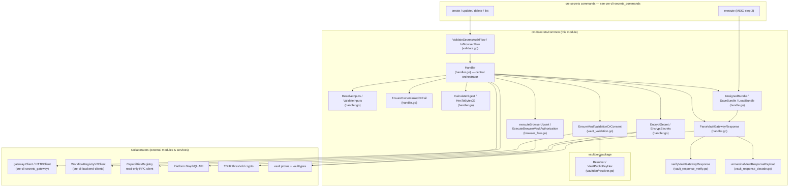
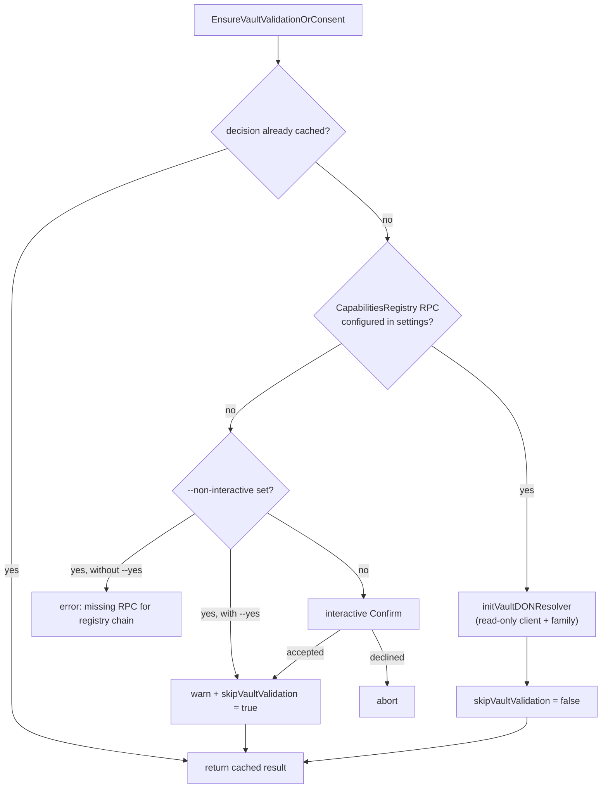
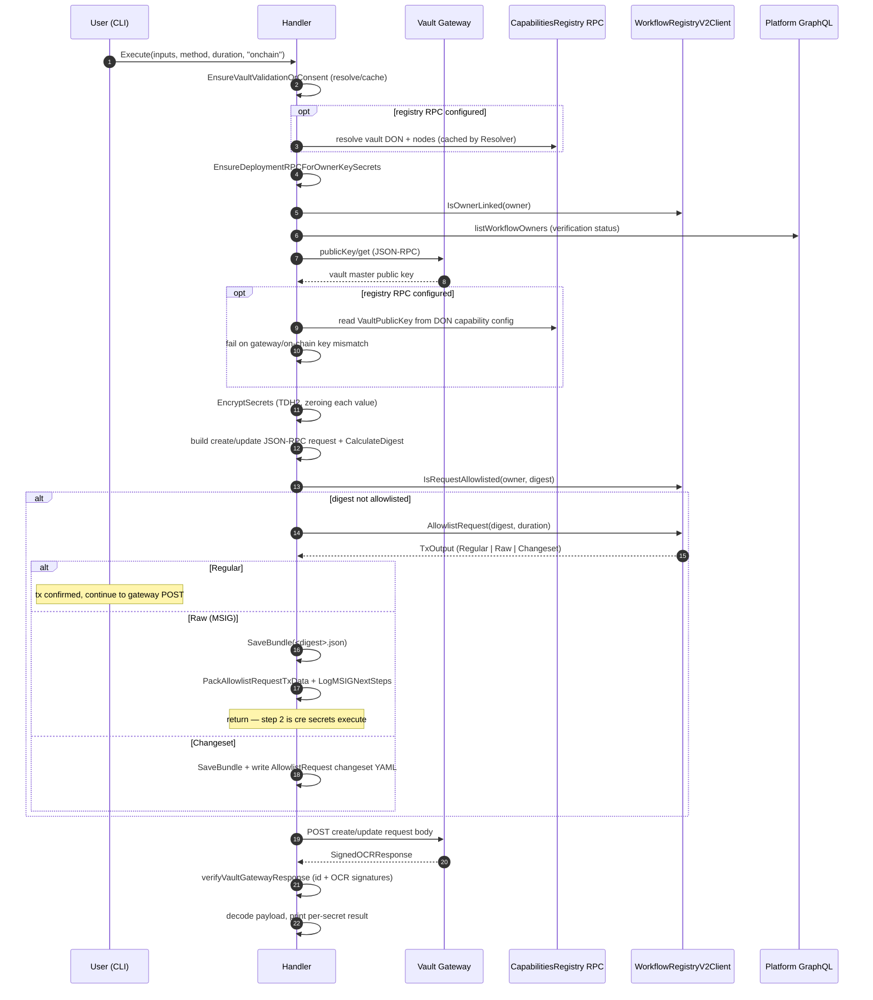
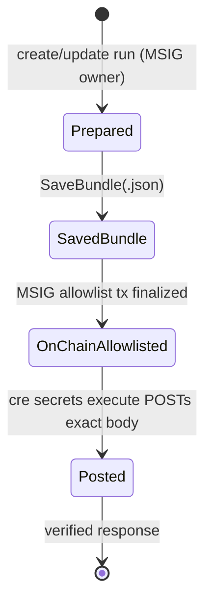
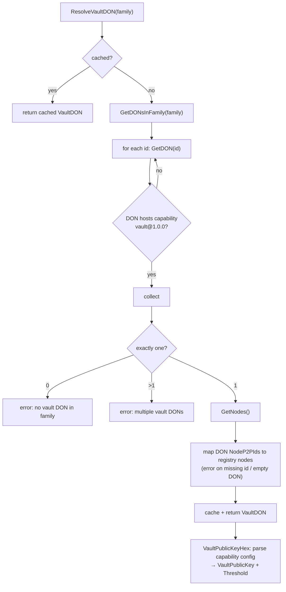

# cre-cli-secrets_handler

`cmd/secrets/common` is the shared engine behind every `cre secrets` command (`create`, `update`, `delete`, `list`, `execute`). Its central type is the **`Handler`**, which owns the full lifecycle of a Vault DON secrets operation:

1. Load and validate secret declarations from a YAML file.
2. Resolve the workflow owner identity for the selected auth flow.
3. Fetch (and optionally cross-verify) the vault master public key.
4. Encrypt payloads with TDH2 threshold encryption and compute a JSON-RPC request digest.
5. Route the request through either the **on-chain allowlist flow** (owner EOA / MSIG) or the **browser OAuth flow** (organization sign-in).
6. Parse, verify (OCR signatures), and report the gateway response.

The package intentionally holds no cobra wiring; the command definitions live in [cre-cli-secrets_commands](cre-cli-secrets_commands.md) and the HTTP transport in [cre-cli-secrets_gateway](cre-cli-secrets_gateway.md). See the parent page [cre-cli-secrets](../cre-cli-secrets.md) for the feature overview.

---

## Architecture



### Component responsibilities

| File | Core components | Responsibility |
|---|---|---|
| `handler.go` | `Handler`, `SecretsYamlConfig`, `UpsertSecretsInputs`, `EncryptSecret`, `CalculateDigest`, `ParseVaultGatewayResponse`, `EnsureOwnerLinkedOrFail` | Orchestration, YAML input loading, TDH2 encryption, digest computation, JSON-RPC envelope construction, response parsing, owner-link verification |
| `validate.go` | `ValidateSecretsAuthFlow`, `IsBrowserFlow`, `SecretsAuthOnchain` / `SecretsAuthBrowser` | Auth-mode selection and validation |
| `browser_flow.go` | `ExecuteBrowserVaultAuthorization`, `executeBrowserUpsert`, `postVaultGatewayWithBearer` | OAuth 2.0 + PKCE authorization against the platform, Bearer-authenticated gateway POST |
| `vault_validation.go` | `EnsureVaultValidationOrConsent`, `SkipVaultValidation`, `VaultDONResolver`, `initVaultDONResolver` | Decides whether independent on-chain validation is possible; prompts for explicit consent otherwise; owns the CapabilitiesRegistry client lifecycle |
| `vault_response_verify.go` | `verifyVaultGatewayResponse` | JSON-RPC id check and OCR signature verification against vault DON signers |
| `vault_response_decode.go` | `unmarshalVaultResponsePayload` | Forward-compatible protojson decoding (`DiscardUnknown: true`) |
| `bundle.go` | `UnsignedBundle`, `DeriveBundleFilename`, `SaveBundle`, `LoadBundle` | Persists the exact JSON-RPC request for the two-step MSIG flow |
| `vaultdon/resolver.go` | `Resolver`, `Reader`, `VaultDON`, `VaultPublicKeyHex` | Resolves the tenant's vault capability DON and its member nodes from the CapabilitiesRegistry |
| `test_helpers.go` | `MockClientFactory`, `newMockHandler` | Test doubles for the handler |
| `test_helpers_capreg.go` | `attachMockVaultDONResolver`, `mockCapRegReader` | Injects a mocked vault DON resolver for handler tests |

---

## Handler lifecycle

Commands construct the handler via `common.NewHandler(execCtx, ctx, secretsFilePath, secretsAuth)`:

- Loads the EVM private key from settings when present (decoded with `crypto.HexToECDSA`); its absence is treated as a multisig request.
- Resolves and validates the vault gateway URL via the gateway sub-module (`ResolveVaultGatewayURL` → `ValidateGatewayURL`, see [cre-cli-secrets_gateway](cre-cli-secrets_gateway.md)) and wires a `gateway.HTTPClient` with a **90 s** timeout.
- **Only for the on-chain flow** (`!IsBrowserFlow(secretsAuth)`), creates the `WorkflowRegistryV2Client` through the shared `client.Factory`. Browser flow deliberately skips this so it never requires a mainnet RPC URL (see [cre-cli-backend-clients](../cre-cli-backend-clients.md)).
- `CloseCapRegClient()` releases the read-only CapabilitiesRegistry RPC client opened for vault validation; `Handler.Execute` defers it.

---

## Input resolution and validation

`ResolveInputs` turns the YAML file into `UpsertSecretsInputs`:

```yaml
secretsNames:
  myApiToken:
    - MY_API_TOKEN_ENV_VAR   # value comes from the environment, never the file
```

Rules enforced:

- File extension must be `.yaml`/`.yml`; otherwise the error points MSIG users to `cre secrets execute <bundle.json>`.
- `secretsNames` must be a non-empty map; each secret ID must be valid UTF-8.
- Each secret must declare **exactly one** environment variable name; the variable must exist and be valid UTF-8.
- Payload is capped at `constants.MaxSecretItemsPerPayload` (**10**) items.
- Every resolved `SecretItem` gets the fixed namespace `"main"`.
- `ValidateInputs` applies `go-playground/validator` rules (`ID` and `Value` required).
- `ZeroUpsertSecretValues` wipes raw values from memory — `Handler.Execute` defers it, and `EncryptSecrets` zeroes each value as it encrypts, so raw secrets are never retained after use.

## Owner identity resolution

`ResolveVaultIdentifierOwnerForAuth(secretsAuth)` selects the identity used in vault JSON-RPC payloads (`SecretIdentifier.Owner`, list responses, TDH2 labels):

- **On-chain flow** — the checksummed `OwnerAddress` from project settings (`ResolveEffectiveOwner`), i.e. the workflow owner EOA.
- **Browser flow** — the `DerivedWorkflowOwner` captured from `getCreOrganizationInfo` at `cre login` time (JWT-derived); API-key credentials are explicitly rejected because the browser flow requires an interactive session.

## Vault public key resolution and TDH2 encryption

`vaultMasterPublicKeyHex` implements **defense in depth**:

1. `fetchVaultMasterPublicKeyHex` performs a JSON-RPC `publicKey/get` call through the gateway, strictly checking version, id, and method echo.
2. When a CapabilitiesRegistry RPC is configured (or a resolver was injected in tests), `optionalCapRegVaultPublicKeyHex` reads the on-chain commitment and **fails hard on mismatch**; if no RPC is configured, the gateway key is used unverified (the consent gate below governs this).

`EncryptSecrets` then, for each item:

- Encrypts with `tdh2easy.EncryptWithLabel` against the vault master public key.
- Derives the TDH2 label as a 32-byte left-padded owner address (12 zero bytes + 20-byte EVM address) — the same construction the Vault DON uses for decryption.
- Wraps the ciphertext hex in `vault.EncryptedSecret` with a `vault.SecretIdentifier{Key, Namespace: "main", Owner}` (protos defined in [capabilities_vault](../../Workflow___Capability_Runtime_(CRE_Engine)/capabilities/capabilities_vault.md)).

## Digest computation

`CalculateDigest` marshals the typed JSON-RPC params, re-wraps them as `json.RawMessage`, and delegates to `jsonrpc2.Request.Digest()`; `HexToBytes32` converts the resulting hex into a `[32]byte`. The digest is the unit of trust that binds the JSON-RPC request to both the on-chain allowlist entry and the browser OAuth authorization.

---

## Execution flows

### Auth-mode selection

`ValidateSecretsAuthFlow` accepts only `onchain` (default) or `browser` (`--secrets-auth`); `IsBrowserFlow` routes `Execute` into the matching implementation.

### Vault validation consent gate

Before any gateway traffic, `EnsureVaultValidationOrConsent` decides whether the CLI can verify keys/signatures **independently of the gateway**. The decision is cached for the handler lifetime so encrypt and response parsing prompt at most once per command.



`initVaultDONResolver` builds a read-only CapabilitiesRegistry client from the tenant context (`TenantContext.CapabilitiesRegistry.Address`) and the effective DON family (see [cre-cli-platform-config](../cre-cli-platform-config.md)); `CapabilitiesRegistryRPC`, `CapabilitiesRegistryChainName`, and `VaultDONResolver` expose the cached state.

### On-chain (owner-key / MSIG) upsert flow



Key behaviors:

- `EnsureOwnerLinkedOrFail` requires the owner to be linked on the WorkflowRegistry **and** verified via the platform GraphQL query (`VERIFICATION_STATUS_SUCCESSFULL`), preventing key hijacking.
- The three `TxOutput` kinds map to the transaction modes configured by [cre-cli-platform-config](../cre-cli-platform-config.md) flags: direct EOA send (`Regular`), a raw calldata payload for a wallet/MSIG UI (`Raw` — `PackAllowlistRequestTxData` ABI-packs `allowlistRequest(digest, deadline)` and `LogMSIGNextSteps` prints the two-step instructions), or an MCMS changeset file (`Changeset`).
- `UnsignedBundle` (`bundle.go`) snapshots `RequestID`, `Method`, `DigestHex`, the exact `RequestBody`, and `CreatedAt` to `<digest>.json` with mode `0o600`. `cre secrets execute` (MSIG step 2, documented in [cre-cli-secrets_commands](cre-cli-secrets_commands.md)) reloads it with `LoadBundle`, confirms the digest is allowlisted on-chain, and POSTs the byte-identical body.



### Browser (OAuth) upsert flow

```mermaid
sequenceDiagram
    autonumber
    participant U as User (CLI + browser)
    participant H as Handler
    participant GQL as Platform GraphQL
    participant CB as Local callback server
    participant GW as Vault Gateway

    U->>H: Execute(inputs, method, duration, "browser")
    H->>H: EnsureVaultValidationOrConsent
    H->>H: ResolveVaultIdentifierOwnerForAuth (JWT-derived owner, API keys rejected)
    H->>GW: publicKey/get
    H->>H: EncryptSecrets (TDH2) + CalculateDigest
    H->>H: GeneratePKCE (verifier + challenge), RandomState
    H->>GQL: createVaultAuthorizationUrl(digest, permission, state, challenge, owner)
    GQL-->>H: authorization URL
    H->>CB: start SecretsCallbackHandler listener
    H->>U: open browser (URL printed if auto-open fails)
    U->>CB: authorize; redirect delivers code (state-checked)
    H->>GQL: exchangeAuthCodeToToken(code, verifier)
    GQL-->>H: short-lived vault JWT
    H->>GW: PostWithBearer(request body, JWT)
    GW-->>H: SignedOCRResponse
    H->>H: verify + decode + print
```

Notable details:

- The permission string is derived per method (`VAULT_PERMISSION_CREATE_SECRETS`, `_UPDATE_`, `_DELETE_`, `_LIST_`), so a JWT is scoped to exactly one operation.
- The authorization request binds `requestDigest` **and** `workflowOwnerAddress`, aligning OAuth scope with gateway digest validation.
- The login session stored in CLI credentials is untouched; the vault JWT is short-lived and used only for this POST.
- Timeouts: 500 s waiting for the callback, 5 s graceful callback-server shutdown.
- Delete and list operations use the same digest + Bearer machinery via `ExecuteBrowserVaultAuthorization` without the create/update envelope construction.

### Vault DON resolver (`vaultdon`)

`Resolver.ResolveVaultDON` is the on-chain source of truth for the vault capability DON:



The `Reader` interface (`GetDONsInFamily`, `GetDON`, `GetNodes`) abstracts the CapabilitiesRegistry contract wrapper, which is what makes the resolver trivially mockable (`mockCapRegReader`).

### Gateway response handling

`ParseVaultGatewayResponse` is shared by all five commands and both auth flows:

1. Unmarshals the `jsonrpc2.Response[vaulttypes.SignedOCRResponse]` envelope; a JSON-RPC error is surfaced verbatim.
2. `verifyVaultGatewayResponse` — when validation is enabled — requires the response id to equal the request id, resolves the vault DON, and verifies OCR signatures via `vaulttypes.ValidateSignatures` against the DON's signer addresses with `minSigs` derived from `DON.F`. Until the follow-up in `DEVSVCS-5365` lands, responses with zero signatures pass through unverified.
3. `unmarshalVaultResponsePayload` decodes the payload with `protojson` and `DiscardUnknown: true`, so newer gateway payloads remain decodable when the CLI's chainlink-common pin lags the vault DON.
4. Method-specific printing: per-secret success/error lines for create/update/delete and identifier listing for list.

The vault wire types (`MethodSecrets*` constants, `SignedOCRResponse`, `ValidateSignatures`) come from the node's vault capability package — see [core_capabilities_runtime_vault_types](../../Workflow___Capability_Runtime_(CRE_Engine)/core_capabilities_runtime/core_capabilities_runtime_vault_types.md).

---

## Security model

| Property | Mechanism |
|---|---|
| Secrets never touch disk in plaintext | Values are read from environment variables; YAML holds only env-var **names**; bundles contain encrypted request bodies only |
| Memory hygiene | `ZeroUpsertSecretValues` deferred in `Execute`; per-item zeroing during `EncryptSecrets` |
| Confidentiality | TDH2 threshold encryption to the vault DON master public key; label = left-padded workflow owner address (only the DON can decrypt) |
| Key authenticity | Gateway public key is compared against the on-chain CapabilitiesRegistry commitment whenever RPC settings exist |
| Request authenticity (on-chain) | JSON-RPC digest must be allowlisted on the WorkflowRegistry for `(owner, digest)` before the gateway accepts the POST |
| Request authenticity (browser) | Digest and workflow owner are bound into the OAuth authorization; short-lived, permission-scoped JWT |
| Response authenticity | JSON-RPC id echo + OCR signature quorum check against resolved DON signers (skippable only with explicit consent) |
| Replay resistance | Unique UUID request IDs per operation; digest binding; bundle reuse requires finalized on-chain allowlist |

If a CapabilitiesRegistry RPC is unavailable, the CLI proceeds only after an interactive confirmation (or an explicit `--yes` in non-interactive mode) and prints the warning: *"Vault gateway validation skipped; the encryption key and response signatures will not be verified independently of the gateway."*

---

## Testing support

- `test_helpers.go` — `newMockHandler` builds a handler with a `MockClientFactory` (testify mock of `client.Factory`) and a generated ECDSA key; it panics on the unused `GetTxType` / `GetSkipConfirmation` methods.
- `test_helpers_capreg.go` — `attachMockVaultDONResolver` installs a `mockCapRegReader` exposing a single DON in family `zone-a` hosting the vault capability with a caller-supplied `VaultPublicKey` (threshold 1), and resets `skipVaultValidation` so signature-verification paths can be exercised.
- Package tests cover handler upsert paths, parse/verify/decode, browser flow, and the validation gate; the repo-level `cre-cli/Makefile` (`cre-cli/Makefile`) runs them via `make test` (lint + full suite), `make test-quick` (short mode, skipping known-slow checks such as `TestCheckLinkStatusViaGraphQL` and `TestPostToGateway`), and `make test-e2e`.

Module dependencies are pinned in `cre-cli/go.mod` (`cre-cli/go.mod`): `chainlink-common` (vault protos, `jsonrpc2`), `chainlink/v2` (vaulttypes), `chainlink-evm/gethwrappers` (WorkflowRegistry v2 / CapabilitiesRegistry ABI), `tdh2/go/tdh2` (threshold encryption), plus `go-playground/validator`, `yaml.v2`, and `machinebox/graphql`.

---

## Related documentation

- Parent module: [cre-cli-secrets](../cre-cli-secrets.md) — command overview, YAML format, auth flags
- Commands: [cre-cli-secrets_commands](cre-cli-secrets_commands.md) — cobra wiring for `create`/`update`/`delete`/`list`/`execute`
- Gateway transport and URL resolution: [cre-cli-secrets_gateway](cre-cli-secrets_gateway.md)
- Registry clients used by the handler: [cre-cli-backend-clients](../cre-cli-backend-clients.md)
- Settings, tenant context, and transaction-mode flags: [cre-cli-platform-config](../cre-cli-platform-config.md)
- Vault capability and wire types on the node side: [capabilities_vault](../../Workflow___Capability_Runtime_(CRE_Engine)/capabilities/capabilities_vault.md), [core_capabilities_runtime_vault_types](../../Workflow___Capability_Runtime_(CRE_Engine)/core_capabilities_runtime/core_capabilities_runtime_vault_types.md)
- Toolchain index: [Developer Toolchain (CLI, SDKs & API Clients)](<../Developer_Toolchain_(CLI,_SDKs___API_Clients).md>)
