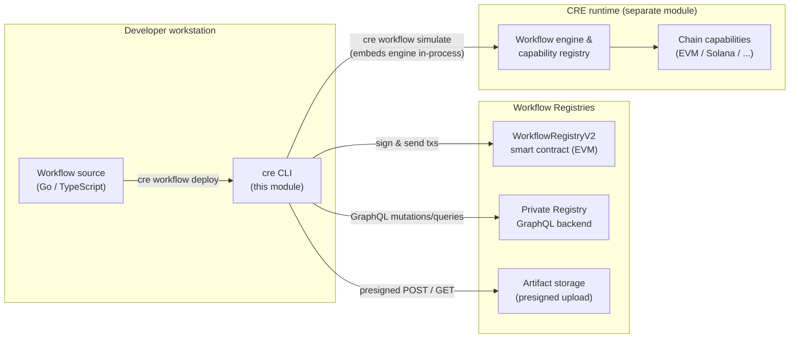
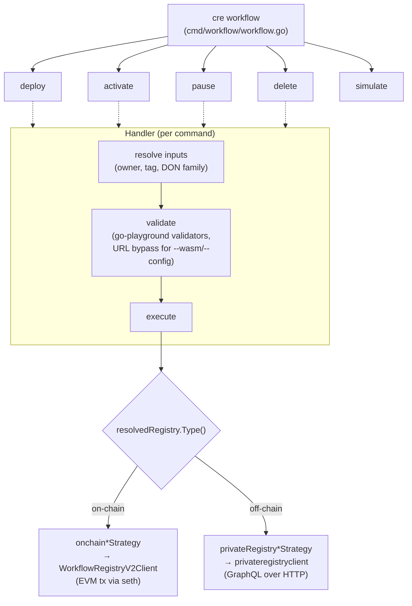
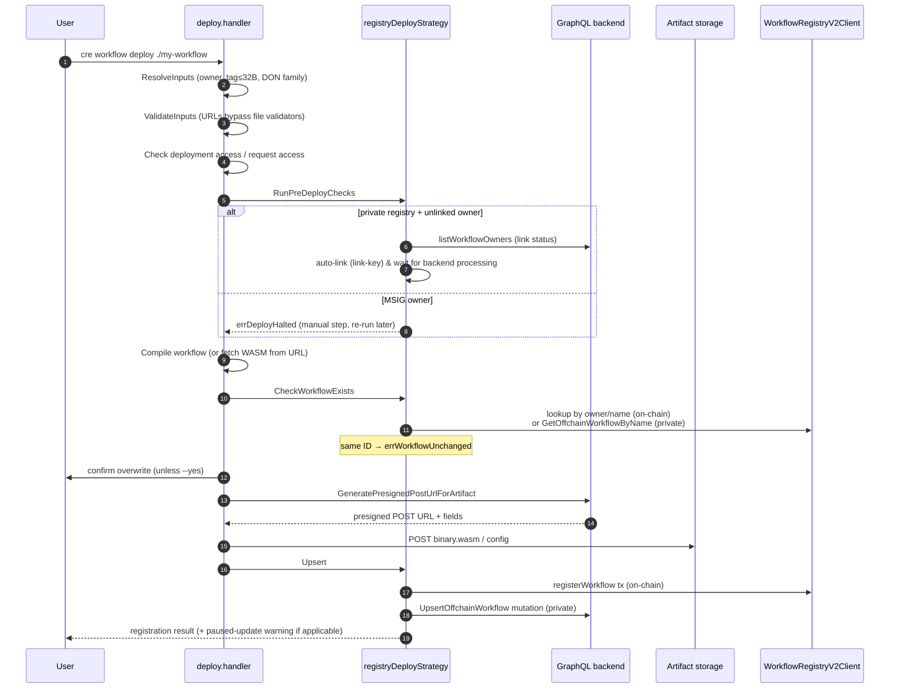
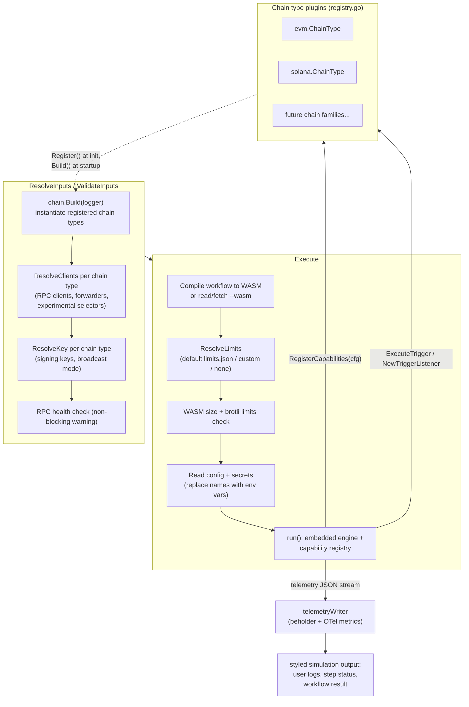

# CRE CLI — Workflow Command Surface (`cre-cli-workflow-commands`)

> **Scope:** This module covers the workflow-facing command surface of the `cre` CLI (`github.com/smartcontractkit/cre-cli`, see [`cre-cli/go.mod`](https://github.com/smartcontractkit/cre-cli) — Go 1.26, cobra/viper based): the `cre workflow deploy / activate / pause / delete` registry lifecycle commands, the `cre workflow simulate` local simulation engine, and the on-chain `WorkflowRegistryV2` client that backs registry operations. Source roots: `cre-cli/cmd/workflow/**`, `cre-cli/cmd/client/**`.

---

## 1. Purpose & Overview

The Chainlink CRE (Chainlink Runtime Environment) lets developers write **workflows** (WASM binaries compiled from Go or TypeScript via the [CRE SDK](cre-sdk-core.md)) and register them with a **Workflow Registry** so that DONs (Decentralized Operator Networks) can execute them. This module is the developer's primary tool for that lifecycle:

| Command group | Purpose | Backends |
|---|---|---|
| `cre workflow deploy <folder>` | Compile (or fetch) a workflow, upload WASM/config artifacts, and register/update it in a registry | On-chain `WorkflowRegistryV2` contract, or off-chain **private registry** (GraphQL) |
| `cre workflow activate <...>` | Activate a paused workflow | On-chain contract or private registry |
| `cre workflow pause <...>` | Pause an active workflow | On-chain contract or private registry |
| `cre workflow delete <...>` | Fetch and remove workflows | On-chain contract or private registry |
| `cre workflow simulate <folder>` | Run the workflow locally against an embedded CRE engine with simulated chains | In-process chain fakes (EVM, Solana), embedded simulator, beholder telemetry |

The full `cre workflow` command tree (defined in `cre-cli/cmd/workflow/workflow.go`) also includes auxiliary commands — `build`, `convert`, `hash`, `list`, `get`, `test`, `supported-chains`, and `limits` (limits export from [`limits/export.go`](cre-cli-workflow-commands/cre-cli-workflow-commands_deploy.md)) — which share the same settings/runtime plumbing but are not core components of this documentation.

The module's defining design decision is a **registry-type strategy pattern**: every registry lifecycle command is orchestrated by a *handler* that delegates target-specific behaviour to a *strategy* selected from the resolved registry settings — either an **on-chain** strategy (signs and sends EVM transactions through the [`WorkflowRegistryV2Client`](cre-cli-workflow-commands/cre-cli-workflow-commands_registry-operations.md)) or a **private registry** strategy (calls the GraphQL backend exposed by the [backend clients module](cre-cli-backend-clients.md)).

---

## 2. System Context

Relationships to other documented modules:

- **[Backend clients](cre-cli-backend-clients.md)** — provides `privateregistryclient` (GraphQL mutations like `UpsertOffchainWorkflow`), `storageclient` (artifact upload/download), and `workflowdataclient` (deployment/execution history) used by the private-registry strategies.
- **[Platform config](cre-cli-platform-config.md)** — `internal/settings` resolves `project.yaml`/`workflow.yaml` into `ResolvedRegistry` (on-chain vs off-chain, DON family, owner type), which drives strategy selection here.
- **[CRE engine module](../Workflow___Capability_Runtime_(CRE_Engine).md)** — `cre workflow simulate` embeds the real workflow engine (`chainlink/v2/core/services/workflows/v2`, the standalone engine from [workflows_standalone](../Workflow___Capability_Runtime_(CRE_Engine)/workflows/workflows_standalone.md)) and registers chain capabilities into a `capabilities.Registry` ([core_capabilities_runtime](../Workflow___Capability_Runtime_(CRE_Engine)/core_capabilities_runtime.md)).
- **[Secrets command](cre-cli-secrets.md)** — `cre secrets` manages the secrets files consumed by simulation.

---

## 3. Architecture

### 3.1 Command tree and handler pattern

Every sub-command follows the same cobra handler contract (`ResolveInputs` → `ValidateInputs` → `Execute`), sharing `internal/runtime.Context` (logger, viper, credentials, environment set, settings).

### 3.2 Registry abstraction — the strategy pattern

Each lifecycle command defines its own strategy interface in a `registry_*_strategy.go` file, plus a small factory that dispatches on the registry type:

| Command | Strategy interface | Methods | Dispatch |
|---|---|---|---|
| `deploy` | `registryDeployStrategy` | `RunPreDeployChecks`, `CheckWorkflowExists`, `Upsert` | `newRegistryDeployStrategy` |
| `activate` | `registryActivateStrategy` | `Activate` | `newRegistryActivateStrategy` |
| `pause` | `registryPauseStrategy` | `Pause` | `newRegistryPauseStrategy` |
| `delete` | `registryDeleteStrategy` | `FetchWorkflows`, `DeleteWorkflows` (over `WorkflowToDelete{ID, Owner, DonFamily, Tag, BinaryURL, Status, RawID}`) | `newRegistryDeleteStrategy` |

All factories compare `resolvedRegistry.Type()` against `settings.RegistryTypeOffChain` to return the private-registry or on-chain implementation.

The deploy strategy interface is the richest and defines two **sentinel errors** that shape the orchestrator's control flow:

- `errDeployHalted` — `RunPreDeployChecks` stopped the deploy *without* being an error (e.g., MSIG auto-link requires a manual signature step before re-running the command).
- `errWorkflowUnchanged` — `CheckWorkflowExists` found a registered workflow whose ID matches the artifact being deployed, blocking a redundant redeployment.

The on-chain strategies eagerly initialise their `WorkflowRegistryV2Client` in a background goroutine (guarded by a `sync.WaitGroup` + `initErr`) so contract binding overlaps with input resolution.

> Detailed per-command behaviour, private/on-chain implementations, and the artifact-upload mechanics are documented in the sub-modules: [deploy](#41-deploy), [registry operations](#42-registry-operations-activate--pause--delete--workflow-registry-client), [simulation](#43-simulation).

### 3.3 Cross-cutting concerns

- **Owner identity.** `deploy` resolves the workflow owner from credentials (EOA private key, MSIG, or org-derived address for the private registry) and warns when deploying with a raw private key (`warnIfDeployingWithPrivateKey`). On-chain owners can be *linked* to an org identity via `LinkOwner` / auto-link polling.
- **Validation.** Both deploy and simulate strip URL values (`--wasm`/`--config` may be URLs) before struct validation so local file validators don't reject them, then restore the values. Validation errors are surfaced as `validation.ValidationErrors` keyed by field path.
- **Limits.** Simulation (and deployment for DON limits) enforces production parity limits (`cresettings.Workflows`): WASM binary/compressed size, report size, gas limit; see the simulation sub-module.
- **Telemetry & UX.** The CLI renders simulator telemetry locally rather than shipping it to a collector; `internal/ui` provides spinners and styled output. Usage analytics go through `internal/telemetry` ([platform config module](cre-cli-platform-config.md)).

---

## 4. Sub-modules

### 4.1 Deploy

**[→ `cre-cli-workflow-commands_deploy`](cre-cli-workflow-commands/cre-cli-workflow-commands_deploy.md)**

The most complex command: a fixed orchestrator sequence — deployment-access check, strategy pre-deploy checks (ownership linking / auto-link via GraphQL, duplicate detection), existing-workflow confirmation, artifact upload, and registry upsert. Covers compile-or-fetch handling, the `workflowArtifact` model (binary + config + computed `WorkflowID`), presigned-URL artifact uploads, DON workflow-limit enforcement (`checkUserDonLimitBeforeDeploy`), and the test harness (httpmock GraphQL servers, `chainsim.SimulatedEnvironment`).

### 4.2 Registry operations (activate / pause / delete / Workflow Registry client)

**[→ `cre-cli-workflow-commands_registry-operations`](cre-cli-workflow-commands/cre-cli-workflow-commands_registry-operations.md)**

The activate/pause/delete command pairs and the shared on-chain `WorkflowRegistryV2Client` that wraps the go-ethereum binding of the `WorkflowRegistry` contract (owner linking, allowlist requests, registration, status changes) with transaction building/signing via `seth`.

### 4.3 Simulation

**[→ `cre-cli-workflow-commands_simulation`](cre-cli-workflow-commands/cre-cli-workflow-commands_simulation.md)**

`cre workflow simulate`: an embedded CRE engine plus a **plugin registry of chain types** (`ChainType` interface with `Register`/`Build`/`Get`/`All`; EVM and Solana register via package `init()`), trigger replay/listen modes, capability registration with production limits, and the `telemetryWriter` that decodes beholder JSON logs (base64 protobufs of `workflows.v1.*` events) and OpenTelemetry `MetricsLog` records into readable simulation output.

---

## 5. Key Data Flows

### 5.1 Deploy (both registry targets)

### 5.2 Simulation

---

## 6. Build & Testing

- **Build:** `cre-cli/Makefile` builds the `cre` binary (`make build`, commit-stamped via `-ldflags`), runs lint (`golangci-lint` per `cre-cli/.golangci.yml`), unit tests (`make test`), and fast unit runs (`make test-quick`, which skips known-slow e2e tests such as `TestWaitForBackendLinkProcessing` and `TestCheckLinkStatusViaGraphQL`). Release packaging is governed by `cre-cli/.goreleaser.yml` and the installer scripts in `cre-cli/install/` — see the [build & release module](cre-cli-build-and-release.md).
- **Test infrastructure:** GraphQL endpoints are faked with `httptest` servers or `httpmock` responders; EVM environments come from `internal/testutil/chainsim.SimulatedEnvironment` (which provisions a simulated `WorkflowRegistry` contract); contract bindings are mocked with testify mocks (e.g. `mockWorkflowRegistryV2Contract`).

---

## 7. Related Documentation

- [cre-cli-backend-clients](cre-cli-backend-clients.md) — GraphQL/storage/workflow-data clients behind the private-registry strategies.
- [cre-cli-platform-config](cre-cli-platform-config.md) — settings resolution, tenant context, update checks, telemetry types.
- [cre-cli-secrets](cre-cli-secrets.md) — secrets CRUD against the vault gateway (consumed by simulation).
- [cre-sdk-core](cre-sdk-core.md) — the TypeScript SDK used to author workflows that these commands build and deploy.
- [Workflow & Capability Runtime (CRE Engine)](../Workflow___Capability_Runtime_(CRE_Engine).md) — the engine and capabilities registry embedded by `simulate`.
- [Deployment suites](../CRE___Keystone_Deployment_Suite.md) — server-side counterpart that provisions the `WorkflowRegistry` contracts this CLI targets.
