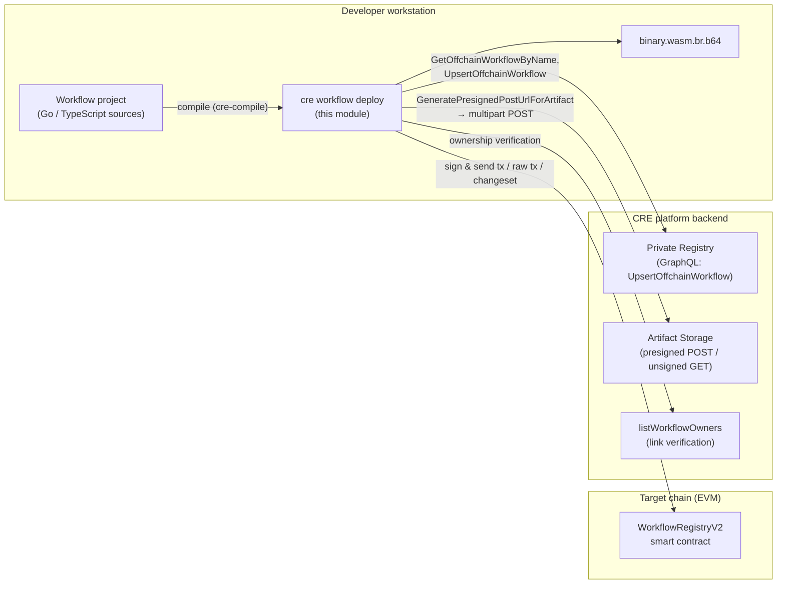
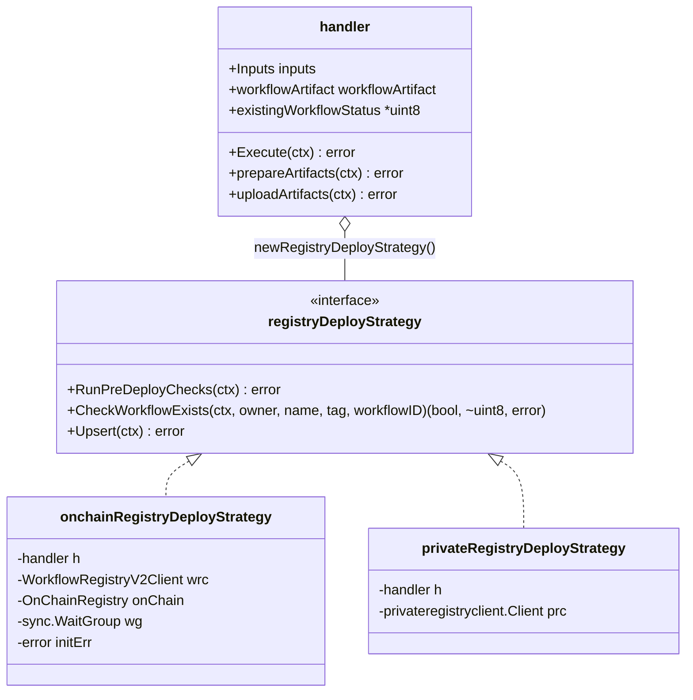
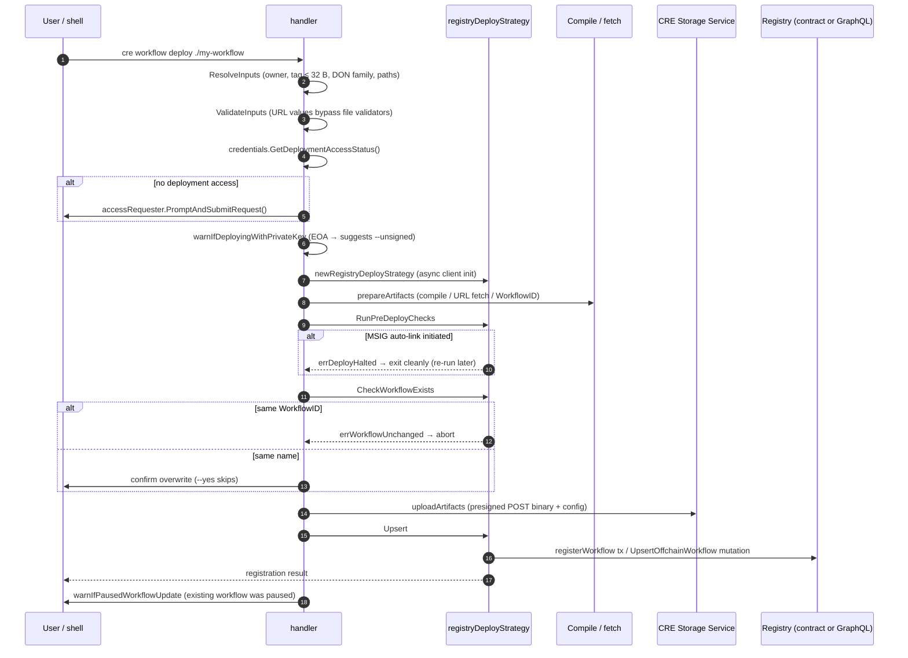
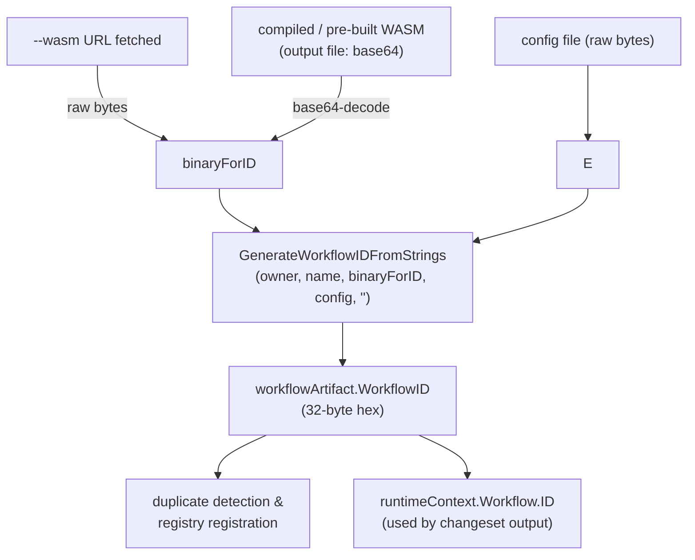
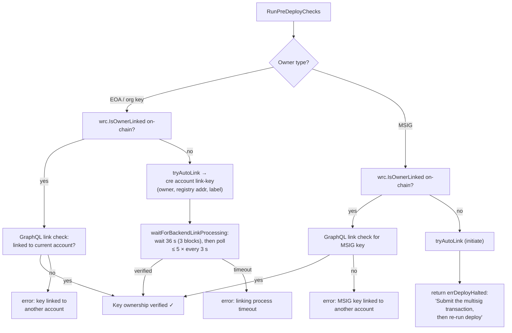
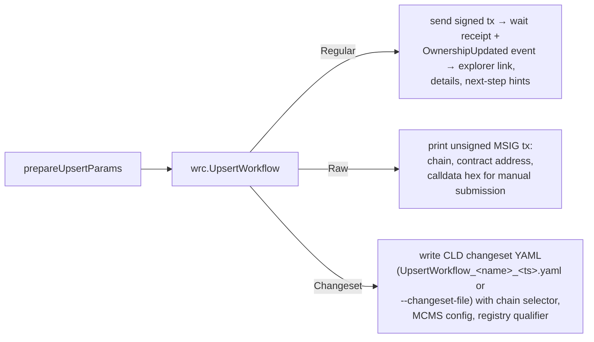

# CRE CLI — `cre workflow deploy` (`cre-cli-workflow-commands_deploy`)

> **Scope:** The `deploy` sub-command of the `cre workflow` command group in the `cre` CLI (`github.com/smartcontractkit/cre-cli`, Go 1.26, cobra/viper — see [cre-cli/go.mod](https://github.com/smartcontractkit/cre-cli/blob/main/go.mod)). It compiles (or fetches) a workflow, computes its content-derived `WorkflowID`, uploads the WASM/config artifacts to the CRE Storage Service, and registers or updates the workflow in either the **on-chain `WorkflowRegistryV2` smart contract** or the **off-chain private registry** (GraphQL backend). Source root: `cre-cli/cmd/workflow/deploy/**`.

Parent module: [CRE CLI — Workflow Command Surface](../cre-cli-workflow-commands.md) · Siblings: [registry operations](cre-cli-workflow-commands_registry-operations.md) · [simulation](cre-cli-workflow-commands_simulation.md)

---

## 1. Purpose & Overview

`cre workflow deploy <workflow-folder-path>` is the one-shot publishing path for a Chainlink CRE workflow: it takes a workflow project on disk (Go or TypeScript, authored with the [CRE SDK](../cre-sdk-core.md)), turns it into a deployable artifact, and makes it visible to a DON (Decentralized Operator Network) by writing a registry entry. The command encapsulates the entire pipeline:

1. **Resolve & validate inputs** — workflow name, owner address, DON family, tag (≤32 bytes), artifact paths/URLs, and confirmation flags.
2. **Compile or fetch** — build the workflow to WASM (brotli-compressed, base64-encoded), or use a pre-built `--wasm` binary, or reference artifacts by URL.
3. **Prepare the artifact model** — compute the deterministic `WorkflowID` from `(owner, name, binary, config)` via `chainlink-common/pkg/workflows.GenerateWorkflowIDFromStrings`.
4. **Pre-deploy checks** — ownership verification/auto-linking (on-chain) and duplicate detection.
5. **Upload artifacts** — presigned-URL uploads to the CRE Storage Service.
6. **Upsert** — submit the registration as an on-chain transaction (direct / raw MSIG / changeset) or a GraphQL `UpsertOffchainWorkflow` mutation.

The module's defining design decision is a **registry-type strategy pattern**: a single orchestrator (`handler.Execute`) runs a fixed step sequence and delegates the registry-specific behaviour to one of two strategies selected from the resolved registry settings. This mirrors the same pattern used by the sibling [activate / pause / delete commands](cre-cli-workflow-commands_registry-operations.md).

### 1.1 Command surface

| Flag | Description |
|---|---|
| `<workflow-folder-path>` | Positional arg (exactly one) — workflow project folder. |
| `-o/--output` | Output path for the compiled WASM (default `./binary.wasm.br.b64`). |
| `-l/--owner-label` | Owner label used during auto-link when the owner is not yet linked. |
| `--wasm` | Path **or URL** to a pre-built WASM binary (skips compilation). |
| `--config` / `--no-config` / `--default-config` | Mutually exclusive group (`MarkFlagsMutuallyExclusive`); override / omit / use `workflow.yaml` config path. |
| `--skip-type-checks` | Forwarded to `cre-compile` for TypeScript workflows. |
| `--yes` | Skip the overwrite confirmation prompt (required with `--non-interactive`). |
| `--unsigned` | Emit a raw, unsigned MSIG transaction instead of sending it. |
| `--changeset`, `--changeset-file` | Hidden flags — emit a CLD changeset YAML instead of a transaction. |

---

## 2. System Context



Relationships to other modules:

- **[Workflow command surface](../cre-cli-workflow-commands.md)** — deploy is one of four registry lifecycle commands sharing the handler/strategy pattern; the parent page covers the shared runtime context and command tree.
- **[Backend clients](../cre-cli-backend-clients.md)** — supplies `privateregistryclient` (GraphQL registry mutations), `storageclient` (presigned artifact upload), and the GraphQL client used for link verification.
- **[Registry operations](cre-cli-workflow-commands_registry-operations.md)** — owns the shared `WorkflowRegistryV2Client` (go-ethereum binding via `seth`) that the on-chain deploy strategy drives.
- **[Platform config](../cre-cli-platform-config.md)** — `internal/settings` resolves `project.yaml`/`workflow.yaml` + tenant context into a `ResolvedRegistry` (`OnChainRegistry` vs `OffChainRegistry`, DON family, owner type), which drives strategy selection.
- **[CRE & Keystone Deployment Suite](../../CRE___Keystone_Deployment_Suite.md)** — server-side counterpart that provisions the `WorkflowRegistry` contracts and DONs this command targets; the `--changeset` output feeds the changeset pipeline of the [Deployment Framework](../../Deployment_Framework_Core___Product_Deployments.md).
- **[Workflow & Capability Runtime](../../Workflow___Capability_Runtime_(CRE_Engine).md)** — the engine that eventually executes the registered workflow; the WorkflowID scheme matches the node-side artifacts v2 store.

---

## 3. Architecture

### 3.1 Package layout

All files live in `cre-cli/cmd/workflow/deploy/`:

| File | Responsibility |
|---|---|
| `deploy.go` | Cobra command definition, `Inputs` struct, `handler`, orchestrator (`Execute`), input resolution/validation, owner resolution, overwrite confirmation, warnings. |
| `registry_deploy_strategy.go` | **Core component** — the `registryDeployStrategy` interface, its two sentinel errors, and the `newRegistryDeployStrategy` factory. |
| `registry_deploy_strategy_onchain.go` | On-chain strategy: async client init, ownership linking, duplicate detection, DON-limit + upsert. |
| `registry_deploy_strategy_private.go` | Private-registry strategy: GraphQL existence check and upsert, status mapping. |
| `compile.go` | Compilation / pre-built WASM / URL handling → brotli + base64 artifact file. |
| `prepare.go` | `workflowArtifact` model and `WorkflowID` computation. |
| `artifacts.go` | Presigned-URL artifact uploads (binary + optional config). |
| `auto_link.go` | Owner link verification, auto-link via `link-key`, backend polling. |
| `register.go` | On-chain upsert parameter building and transaction-mode handling. |
| `limits.go` | DON workflow-limit accounting (`checkUserDonLimitBeforeDeploy`). |

### 3.2 The strategy contract

`registryDeployStrategy` (from `registry_deploy_strategy.go`) is deliberately minimal — the orchestrator calls its methods in a **fixed sequence** with the common upload step sandwiched between pre-checks and upsert:



The interface defines two **sentinel errors** that shape the orchestrator's control flow (they are *not* user-facing failures):

| Sentinel | Produced by | Orchestrator behaviour |
|---|---|---|
| `errDeployHalted` | `RunPreDeployChecks` | Stop the deploy **without** returning an error — e.g. an MSIG auto-link was initiated and the deploy must be re-run after the multisig transaction is submitted. |
| `errWorkflowUnchanged` | `CheckWorkflowExists` | A registered workflow with the same ID as the incoming artifact already exists; redundant redeployment is blocked with an explanatory error. |

The factory dispatches on the resolved registry type:

```go
func newRegistryDeployStrategy(ctx context.Context, resolvedRegistry settings.ResolvedRegistry, h *handler) (registryDeployStrategy, error) {
    if resolvedRegistry.Type() == settings.RegistryTypeOffChain {
        return newPrivateRegistryDeployStrategy(h), nil
    }
    return newOnchainRegistryDeployStrategy(ctx, h)
}
```

The on-chain strategy **eagerly initialises its `WorkflowRegistryV2Client` in a background goroutine** (guarded by a `sync.WaitGroup` + captured `initErr`) so contract binding overlaps with artifact preparation; `RunPreDeployChecks` later joins the goroutine (with context-aware `waitWithContext`). The private strategy lazily creates its GraphQL client on first use.

### 3.3 Orchestrator sequence

`handler.Execute` enforces a strict pipeline — note that artifact **upload is deferred until after the overwrite confirmation** so that a declined deploy does not upload anything:



---

## 4. Key Subsystems

### 4.1 Input resolution & validation

`Inputs` is a declarative struct validated with `go-playground/validator` (custom tags: `workflow_name` — ≤64 chars, `[a-zA-Z0-9_-]`; `workflow_owner` — `0x`-prefixed EVM address; `owner_label` — blocks YAML-scalar breakout and command substitution such as `bad"; echo pwned` or `bad$(id)`; DON family is required, including for private-registry targets where it comes from the resolved registry).

Notable behaviours:

- **URL bypass.** `--wasm` and `--config` accept URLs. `ValidateInputs` temporarily blanks URL values so file-existence validators don't reject them, then restores them (`TestValidateInputs_URLBypass`).
- **Tag truncation.** `WorkflowTag` defaults to the workflow name and is truncated to **32 bytes**; `WorkflowName` itself is never truncated (on-chain registries key lookups by name + tag).
- **Config-path precedence.** `--config` (path or URL) overrides `workflow.yaml`; `--no-config` clears it; `--default-config` uses the settings value; the three are mutually exclusive at the cobra level.
- **Owner resolution.** For on-chain targets, the configured `account.workflow-owner-address` is used directly. For private-registry targets, the **derived workflow owner** from the authenticated runtime context (JWT org identity) is used; a missing derived owner is a hard error.
- **WASM pre-build modes.** `--wasm` may be a local file (normalised to brotli+base64 at the output path), a URL (fetched once, bytes cached for `WorkflowID` computation, no local write), or omitted (source compile via `cmdcommon.CompileWorkflowToWasm`, with the language detected from the workflow main file and `--skip-type-checks` forwarded to `cre-compile`).

### 4.2 Artifact model & WorkflowID computation

`prepare.go` defines the `workflowArtifact` carrier and derives the workflow identity. The binary read from the output file is base64-encoded (of a brotli-compressed WASM), so it is **decoded before hashing** — matching the node-side artifacts v2 store semantics:



Binary/config hashes and the final workflow hash are printed before any network interaction, giving the user a deterministic preview of what will be registered.

### 4.3 Artifact upload (presigned-URL flow)

`uploadArtifacts` (`artifacts.go`) uses the [`storageclient`](../cre-cli-backend-clients.md) to move both artifacts:

1. GraphQL mutation `GeneratePresignedPostUrlForArtifact` (carries `workflowId`, `artifactType` ∈ {`BINARY`, `CONFIG`}, MD5 content hash, and the **resolved** `workflowOwnerAddress`) → presigned POST URL + fields.
2. Multipart `POST` of the content to the storage origin (accepted statuses: 201/204).
3. GraphQL mutation `GenerateUnsignedGetUrlForArtifact` → the public URL stored in the registry entry.

Each network step is retried up to 3 times (`avast/retry-go`). A `key ... already exists` error from the presign step is treated as **"artifact already uploaded"** — the upload is skipped and the GET URL is still resolved, making redeploys idempotent. Artifacts supplied by URL (`--wasm URL` / `--config URL`) skip the corresponding upload entirely; if both are URLs nothing is uploaded. Timeouts are configurable via `StorageSettings.CREStorage` in the project settings.

### 4.4 Ownership linking & auto-link (`auto_link.go`)

On-chain deployment requires the workflow owner address to be *linked* to the authenticated user/org. The check combines an **on-chain** read (`wrc.IsOwnerLinked`) with a **backend** verification (GraphQL `listWorkflowOwners(linkStatus: LINKED_ONLY)`), matching addresses case-insensitively and requiring the `VERIFICATION_STATUS_SUCCESSFULL` verification state (the misspelling is intentional — it matches the external API):



Key details:

- `tryAutoLink` constructs a fresh `runtime.Context` and invokes the **`link-key` command's `Exec`** in-process — the deploy command never shells out. Its inputs (registry contract address, owner label, confirmation flags) are derived from the **resolved on-chain registry**, not from ad-hoc flags.
- The private-registry strategy's `RunPreDeployChecks` is a no-op: ownership is implied by the authenticated org identity (derived workflow owner), and no on-chain linking exists.

### 4.5 Duplicate detection & DON limits

- **Duplicate detection.** Both strategies look up a same-name workflow for the target and return `(exists, status, err)`. When the existing `WorkflowID` equals the incoming artifact's ID, `errWorkflowUnchanged` is returned — redeploying identical artifacts is rejected. Otherwise `existingWorkflowStatus` (0 = active, 1 = paused on-chain; mapped from `WORKFLOW_STATUS_ACTIVE`/`WORKFLOW_STATUS_PAUSED` for the private registry) is retained to drive status preservation and the post-deploy warning.
- **DON limits.** `checkUserDonLimitBeforeDeploy` (limits.go) is only enforced for *new* workflows (updates are exempt). When `KeepAlive` is false, the same name's already-active workflows on the DON are counted (paginated lookups via `GetWorkflowListByOwnerAndName`, page size 200) and discounted from the pending-slot count before `CheckUserDonLimit` is consulted — preventing needless limit rejections when redeploying replaces an active same-name workflow.

### 4.6 Registration (`Upsert`)

**On-chain** (`register.go`): `prepareUpsertParams` builds `RegisterWorkflowV2Parameters` (status defaults to active `0`, or preserves the existing status; `WorkflowID` is hex-decoded into `[32]byte`). `wrc.UpsertWorkflow` then returns a `TxOutput` whose `TxType` selects the delivery mode:



The changeset mode is the bridge to the [Deployment Framework](../../Deployment_Framework_Core___Product_Deployments.md) changeset pipeline used for governance-gated (MCMS/timelock) deployments; the `--changeset` and `--changeset-file` flags are intentionally hidden.

**Private registry** (`registry_deploy_strategy_private.go`): `buildPrivateRegistryInput` maps the artifact and inputs into an `OffchainWorkflowInput` (preserving a paused status, attaching config URL and tag when present), then calls `UpsertWorkflowInRegistry` — the GraphQL `UpsertOffchainWorkflow` mutation. The client-side validator enforces field lengths (name ≤64, binary URL ≤200, tag ≤32, attributes ≤1024) before dispatch.

---

## 5. Testing

The deploy package has one of the richest test suites in the CLI. The three core test files are themselves documented components:

### 5.1 `deploy_test.go` — orchestrator & validation (`deployMockGraphQLRequest`)

| Test | What it pins down |
|---|---|
| `TestWorkflowDeployCommand/validation errors` | Table-driven `validation.ValidationErrors` assertions: workflow-name charset/length, owner `0x`-address format, required DON family, and **owner-label injection safety** (`bad"; echo pwned`, `bad$(id)` rejected). |
| `TestResolveInputs_TagTruncation` | Names ≤32 bytes are used verbatim as tags; longer names keep the full name but truncate the tag to exactly 32 bytes. |
| `TestResolveInputs_ConfigFlags` | Config-path precedence (`--config` > `--default-config`/settings; `--no-config` clears; URL values pass through). |
| `TestConfigFlagsMutuallyExclusive` | Cobra rejects combinations of `config` / `no-config` / `default-config`. |
| `TestValidateInputs_URLBypass`, `TestValidateInputs_PrivateRegistry` | URL artifacts bypass file validators; private targets accept URL artifacts + JWT-derived owner and still require DON family. |
| `TestExecute_PrivateRegistry` | Full private-registry execution against `newAssertGQLServer` (an `httptest` GraphQL server with typed request assertions): not-found lookup → upsert succeeds; existing workflow + `--yes` overwrite proceeds; GraphQL errors surface as `failed to register workflow in private registry: ... unauthorized`; transport errors surface as `failed to check if workflow exists`. |
| `TestWarnExistingPausedWorkflowUpdate`, `TestWarnIfDeployingWithPrivateKey` | Stderr-capture tests for the paused-update warning and the EOA private-key warning (MSIG/org-derived owners produce no warning). |
| `TestCheckUserDonLimitBeforeDeploy` | Uses a `fakeUserDonLimitClient`: limit rejection, keepAlive=false accounting (active same-name workflows discount pending slots), and the update exemption when `existingWorkflowStatus` is set. |

### 5.2 `artifacts_test.go` — upload pipeline (`GraphQLRequest`)

Uses `jarcoal/httpmock` to intercept the GraphQL endpoint (`mockGraphQL` responder distinguishes the presign and get-URL mutations) plus a mocked origin upload endpoint. Coverage:

- Successful binary + config upload resolves both `BinaryURL`/`ConfigURL` to the unsigned GET URL; empty config is a valid no-op.
- Error contracts: nil artifact, empty binary (`content is empty for artifactType BINARY`), empty `workflowID`; origin HTTP 501 surfaces as `upload to origin`.
- **Idempotency:** a presign failure containing `already exists` skips the upload yet still resolves the GET URL successfully.
- **Owner fidelity:** presign variables carry the **resolved** `WorkflowOwner`, even when the settings-configured owner differs (`TestUpload_UsesResolvedWorkflowOwnerForPresignedUrls`).

### 5.3 `auto_link_test.go` — linking & polling (`mockGraphQLRequest`)

Runs against real `httptest` GraphQL servers with a `chainsim.NewSimulatedEnvironment` (which provisions a simulated `WorkflowRegistry` contract):

- `TestCheckLinkStatusViaGraphQL` — linked / not linked / **case-insensitive address matching** / linked-but-pending-verification / GraphQL errors, with the query shape asserted (`listWorkflowOwners`).
- `TestWaitForBackendLinkProcessing` — immediate success, success after transient empty responses, timeout (`linking process timeout`), and GraphQL errors tolerated mid-polling. This test is deliberately slow (real 36 s block-confirmation wait), so the `cre-cli/Makefile` `test-quick` target skips it along with `TestTryAutoLink` and `TestCheckLinkStatusViaGraphQL`.
- `TestTryAutoLinkUsesOnChainRegistry` — auto-link inputs take the **contract address from the resolved on-chain registry** and forward `--owner-label` / confirmation flags faithfully.

Shared test scaffolding lives in `internal/testutil/chainsim` (simulated environment, client factory, simulated `WorkflowRegistry` contract) and in-package helpers (`makeTestJWT`, `makeBearerCredentials`, `makeAPIKeyCredentials`, `createTestSettings`).

---

## 6. Build, Configuration & CI

The deploy command's behaviour is coupled to several repository artifacts:

- **Module & dependencies** — `cre-cli/go.mod` (Go 1.26.4): `go-ethereum` + `chainlink-evm/gethwrappers` (WorkflowRegistry v2 binding), `chainlink-testing-framework/seth` (transaction plumbing), `chainlink-common/pkg/workflows` (WorkflowID), `machinebox/graphql`, `go-playground/validator/v10`, `avast/retry-go`, and `jarcoal/httpmock` (tests).
- **Build & test targets** — `cre-cli/Makefile`: `make build` (commit-stamped via `-ldflags`), `make lint` (golangci-lint per `cre-cli/.golangci.yml`), `make test`, `make test-quick` (30 s timeout, skips the slow auto-link/polling and e2e tests listed above), `make test-e2e`, `make gendoc`.
- **Release packaging** — `cre-cli/.goreleaser.yml` and the installer scripts `cre-cli/install/install.sh` / `cre-cli/install/install.ps1` (with `cre-cli/install/check_embedded_key.sh` integrity check); see the [build & release module](../cre-cli-build-and-release.md).
- **Settings files** — `project.yaml` / `workflow.yaml` supply the workflow name, owner address/type, artifact paths, storage timeouts, and (hidden) CLD changeset settings; resolution into `ResolvedRegistry` is covered by the [platform config module](../cre-cli-platform-config.md).

---

## 7. Related Documentation

- [Workflow command surface (parent)](../cre-cli-workflow-commands.md) — shared handler contract, command tree, cross-command concerns.
- [Registry operations](cre-cli-workflow-commands_registry-operations.md) — activate / pause / delete and the shared `WorkflowRegistryV2Client`.
- [Simulation](cre-cli-workflow-commands_simulation.md) — `cre workflow simulate`, the local counterpart for testing workflows before deploying.
- [Backend clients](../cre-cli-backend-clients.md) — `privateregistryclient`, `storageclient`, `workflowdataclient`.
- [Platform config](../cre-cli-platform-config.md) — settings resolution, tenant context, telemetry.
- [Workflow & Capability Runtime (CRE Engine)](../../Workflow___Capability_Runtime_(CRE_Engine).md) — the engine and the artifacts v2 store that defines the WorkflowID scheme.
- [CRE & Keystone Deployment Suite](../../CRE___Keystone_Deployment_Suite.md) — provisioning of `WorkflowRegistry` contracts, capabilities registries, and DONs.
- [Deployment Framework](../../Deployment_Framework_Core___Product_Deployments.md) — the changeset/operation framework targeted by `--changeset` output.
