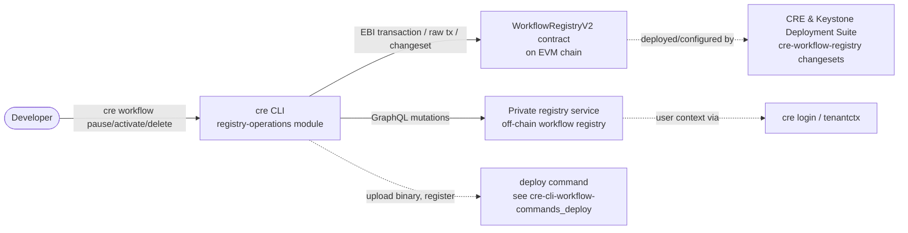
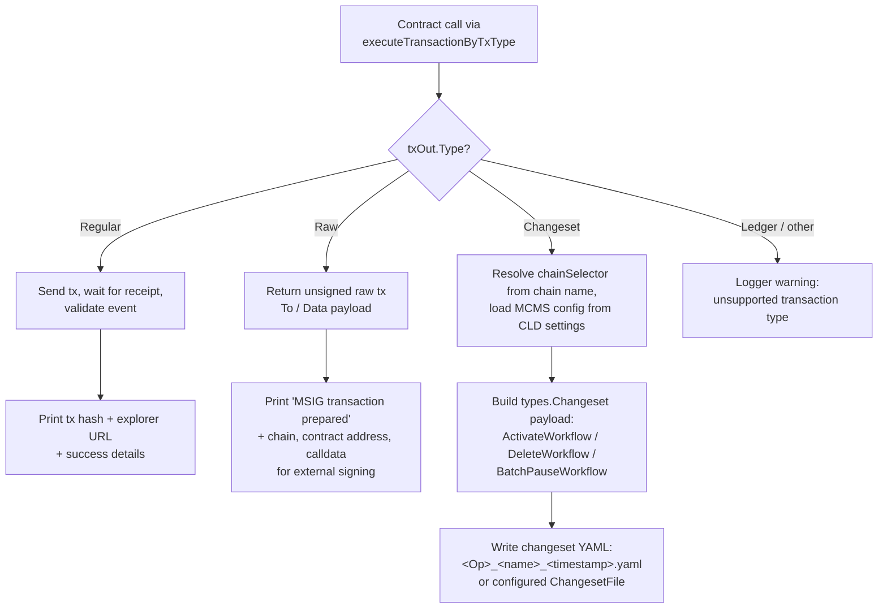
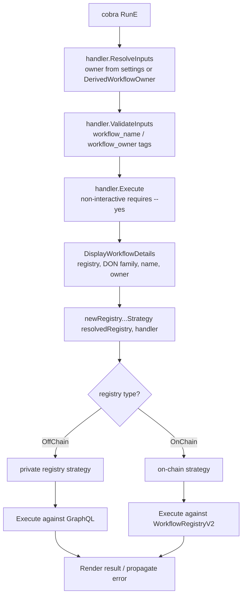
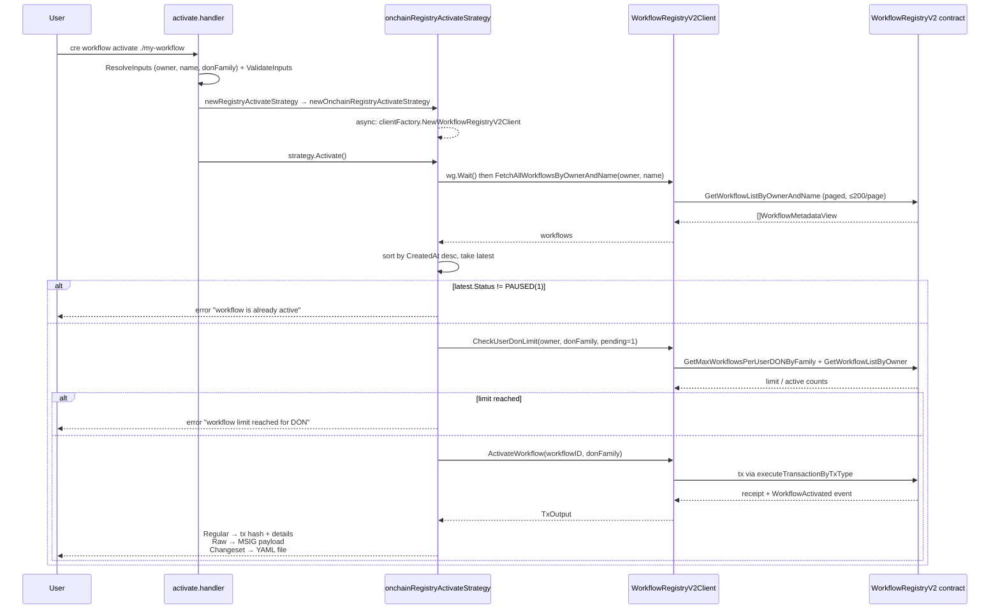
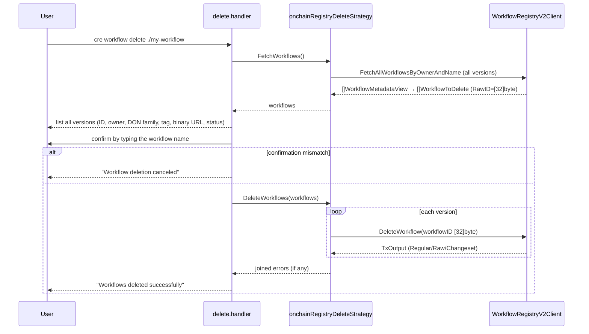

# cre-cli Workflow Commands — Registry Operations (Pause / Activate / Delete)

## Introduction

The **registry-operations** module implements the lifecycle-management commands of the `cre` CLI that operate on *already deployed* workflows: **`cre workflow pause`**, **`cre workflow activate`**, and **`cre workflow delete`**. Each command can target one of two registry backends:

1. **On-chain registry** — the `WorkflowRegistryV2` smart contract deployed on an EVM chain. Operations are Ethereum transactions that may be sent directly, prepared as raw MSIG payloads, or rendered as CLD changeset files.
2. **Off-chain (private) registry** — a hosted GraphQL service. Operations are GraphQL mutations performed on behalf of an authenticated user.

The module's defining design decision is a **strategy pattern applied uniformly across all three commands**: every command defines a small strategy interface plus a factory (`newRegistryActivateStrategy`, `newRegistryPauseStrategy`, `newRegistryDeleteStrategy`) that selects the private-registry or on-chain implementation based on the resolved registry type. This keeps command orchestration (input resolution, validation, confirmation prompts, output rendering) identical across backends while isolating transport-specific logic in the strategy implementations.

This page covers the registry-operations slice of the workflow commands. For binary upload and initial registration see [cre-cli-workflow-commands_deploy.md](cre-cli-workflow-commands_deploy.md); for local execution see [cre-cli-workflow-commands_simulation.md](cre-cli-workflow-commands_simulation.md).

> **Module path:** `Developer_Toolchain_(CLI,_SDKs___API_Clients)/cre-cli-workflow-commands/cre-cli-workflow-commands_registry-operations`
> **Parent:** [cre-cli-workflow-commands](../cre-cli-workflow-commands.md) · **Grandparent:** [Developer Toolchain (CLI, SDKs & API Clients)](../../Developer_Toolchain_(CLI,_SDKs___API_Clients).md)

---

## 1. Purpose and Core Functionality

| Command | Use | Effect (on-chain) | Effect (private registry) |
|---|---|---|---|
| `cre workflow activate <path>` | Resume a paused workflow | `ActivateWorkflow(workflowID, donFamily)` tx — requires the latest version to be in status `PAUSED (1)` and a free DON slot | GraphQL `activateOffchainWorkflow` mutation — requires status ≠ `WORKFLOW_STATUS_ACTIVE` |
| `cre workflow pause <path>` | Suspend an active workflow | `BatchPauseWorkflows(workflowIDs)` tx — only workflows currently in status `ACTIVE (0)` are paused | GraphQL `pauseOffchainWorkflow` mutation — requires status ≠ `WORKFLOW_STATUS_PAUSED` |
| `cre workflow delete <path>` | Remove all versions of a workflow | `DeleteWorkflow(workflowID)` tx per version, after an interactive type-the-name confirmation | GraphQL `deleteOffchainWorkflow` mutation |

Shared behaviours across all three commands:

- **Owner resolution** — for on-chain registries the owner is the configured `WorkflowOwnerAddress` from project settings; for off-chain registries it is the `DerivedWorkflowOwner` produced by CLI authentication (an error is raised if authentication has not succeeded).
- **Input validation** — handlers validate `WorkflowName`, `WorkflowOwner`, and (for activate) `DonFamily` via the internal validator before executing.
- **Non-interactive safety** — `--non-interactive` mode requires `--yes` (`SkipConfirmation`), otherwise the command aborts with a suggestion.
- **Workflow ID propagation** — the resolved workflow ID is stored on `runtimeContext.Workflow.ID` for telemetry and downstream tooling.

---

## 2. Architecture

### 2.1 Component Relationships

The three command packages (`activate`, `pause`, `delete`) mirror each other structurally. Each contains a cobra command + handler (`activate.go`, `pause.go`, `delete.go`), a strategy interface + factory (`registry_*_strategy.go`), and two strategy implementations (`registry_*_strategy_onchain.go`, `registry_*_strategy_private.go`).

```mermaid
flowchart TB
    subgraph Commands["Command packages (cmd/workflow/...)"]
        direction LR
        subgraph ACT["activate"]
            AC[activate.go<br/>cobra cmd + handler]
            ASF[registry_activate_strategy.go<br/>interface + factory]
            ASO[..._strategy_onchain.go]
            ASP[..._strategy_private.go]
            ASF -.selects.-> ASO
            ASF -.selects.-> ASP
        end
        subgraph PAU["pause"]
            PC[pause.go<br/>cobra cmd + handler]
            PSF[registry_pause_strategy.go<br/>interface + factory]
            PSO[..._strategy_onchain.go]
            PSP[..._strategy_private.go]
            PSF -.selects.-> PSO
            PSF -.selects.-> PSP
        end
        subgraph DEL["delete"]
            DC[delete.go<br/>cobra cmd + handler]
            DSF[registry_delete_strategy.go<br/>interface + WorkflowToDelete]
            DSO[..._strategy_onchain.go]
            DSP[..._strategy_private.go]
            DSF -.selects.-> DSO
            DSF -.selects.-> DSP
        end
    end

    WLC[cmd/workflow/common<br/>FetchAllWorkflowsByOwnerAndName<br/>DisplayWorkflowDetails]
    RES[internal/settings<br/>ResolvedRegistry / AsOnChain]

    subgraph Backends["Transport backends"]
        WRC[cmd/client<br/>WorkflowRegistryV2Client<br/>+ TxClient]
        PRC[internal/client/privateregistryclient<br/>Client (GraphQL)]
        TX[cmd/client TxType<br/>Regular / Raw / Ledger / Changeset]
    end

    AC --> ASF
    PC --> PSF
    DC --> DSF

    ASO --> WRC
    PSO --> WRC
    DSO --> WRC
    ASP --> PRC
    PSP --> PRC
    DSP --> PRC

    ASO & PSO & DSO --> WLC
    AC & PC & DC --> RES
    AC & PC & DC -.resolve type.-> ASF & PSF & DSF
    WRC --> TX
```

### 2.2 Strategy Interfaces and Factories

Each strategy interface is minimal and command-specific (`cre-cli/cmd/workflow/{activate,pause,delete}/registry_*_strategy.go`):

```go
// activate
type registryActivateStrategy interface { Activate() error }

// pause
type registryPauseStrategy interface { Pause() error }

// delete
type registryDeleteStrategy interface {
    FetchWorkflows() ([]WorkflowToDelete, error)
    DeleteWorkflows(workflows []WorkflowToDelete) error
}
```

Every factory performs the same type-based dispatch on the resolved registry:

```go
func newRegistryActivateStrategy(resolvedRegistry settings.ResolvedRegistry, h *handler) (registryActivateStrategy, error) {
    if resolvedRegistry.Type() == settings.RegistryTypeOffChain {
        return newPrivateRegistryActivateStrategy(h), nil
    }
    return newOnchainRegistryActivateStrategy(h)
}
```

The delete command additionally defines the shared transfer record `WorkflowToDelete` (`ID`, `Owner`, `DonFamily`, `Tag`, `BinaryURL`, `Status`, and `RawID any`). `RawID` holds the backend-native identifier — `[32]byte` for on-chain, `string` for the private registry — so the shared handler can render results identically while strategies keep their native types.

### 2.3 Strategy Implementations

| | On-chain strategy | Private-registry strategy |
|---|---|---|
| **Transport** | `client.WorkflowRegistryV2Client` (go-ethereum bindings over `seth`) | `privateregistryclient.Client` (GraphQL over HTTP) |
| **Client lifecycle** | Created asynchronously at strategy construction via `handler.clientFactory.NewWorkflowRegistryV2Client` and a `sync.WaitGroup`; strategy methods `wg.Wait()` before first use | Created lazily in `ensureClient()` on first use, from runtime credentials + environment set |
| **Lookup** | `FetchAllWorkflowsByOwnerAndName` (paginated contract reads, page size 200) | `GetWorkflowByName` (single GraphQL query) |
| **Preconditions** | activate: latest version must be `PAUSED`; DON capacity check via `CheckUserDonLimit`. pause: at least one `ACTIVE` version. delete: none (all versions listed) | activate: status ≠ `ACTIVE`. pause: status ≠ `PAUSED` |
| **Mutation** | `ActivateWorkflow` / `BatchPauseWorkflows` / `DeleteWorkflow` contract calls through `executeTransactionByTxType` | `ActivateWorkflowInRegistry` / `PauseWorkflowInRegistry` / `DeleteWorkflowInRegistry` mutations |
| **Output** | Depends on `TxType` (see §4) | Immediate result rendering with status via `privateregistryclient.FormatStatus` |

The on-chain strategies assert `settings.AsOnChain(h.runtimeContext.ResolvedRegistry, "<command>")` at construction so that an off-chain registry reaching the wrong strategy fails fast with a descriptive error.

---

## 3. How the Module Fits into the System



- The **on-chain registry** the CLI mutates is the same `WorkflowRegistryV2` contract that the deployment suite deploys and configures through changesets — see [CRE & Keystone Deployment Suite → workflow registry](../../CRE___Keystone_Deployment_Suite/cre-workflow-registry.md). In fact, the CLI can itself *emit* changeset files consumed by that suite (§4).
- **Off-chain registry access** depends on authenticated tenant context (`cre login`); the GraphQL transport details of `privateregistryclient` are documented in [cre-cli-backend-clients](../cre-cli-backend-clients.md).
- **Registry resolution, owner settings, and transaction-type flags** come from the settings layer documented in [cre-cli-platform-config](../cre-cli-platform-config.md).

---

## 4. Transaction Output Modes (On-Chain Strategies)

The `TxClient` supports four `TxType` values — `Regular`, `Raw`, `Ledger`, and `Changeset` — selected via CLI flags registered with `settings.AddTxnTypeFlags`. The on-chain strategies handle three of them explicitly:



Notable details:

- **Changeset mode** bridges the CLI into the deployment-framework pipeline: the generated file contains `ChainSelector`, `MCMSConfig`, and `WorkflowRegistryQualifier` and is executed by the CLD changeset runner rather than by the CLI itself.
- **Delete in changeset/raw mode** iterates every matched workflow version and accumulates errors (`errors.Join`) so one failed deletion does not mask the others.
- **Event validation**: `Regular` transactions are only reported as successful after `validateReceiptAndEvent` confirms the expected event (`WorkflowActivated`, `WorkflowDeleted`, `WorkflowStatusUpdated`, …) was emitted.

---

## 5. Data and Process Flows

### 5.1 Command Execution Flow (shared skeleton)



### 5.2 On-Chain Activate (sequence)



### 5.3 On-Chain Pause (batch semantics)

The pause strategy fetches all versions for owner+name, filters those with status `ACTIVE (0)`, and submits them in a single `BatchPauseWorkflows` transaction. If no active versions exist the command aborts with "workflow is already paused". Because the deploy flow currently registers one workflow per name, the batch normally contains a single ID.

### 5.4 On-Chain Delete (two-phase with confirmation)



### 5.5 Private-Registry Operations (uniform pattern)

All three private-registry strategies follow the same five steps: lazy-create the GraphQL client from runtime credentials → `GetWorkflowByName` → status precondition check (abort if already in the target state) → set `runtimeContext.Workflow.ID` → invoke the corresponding mutation (`ActivateWorkflowInRegistry` / `PauseWorkflowInRegistry` / `DeleteWorkflowInRegistry`) and render the returned `OffchainWorkflow` (or deleted ID). Only the delete command skips the status precondition, and it renders the deleted workflow ID rather than a status.

---

## 6. Status Models

The two backends encode workflow status differently, and the strategies convert between them:

| State | On-chain (`uint8`) | Private registry (`OffchainWorkflowStatus` string) |
|---|---|---|
| Active | `0` (`WorkflowStatusActive` in pause package) | `"WORKFLOW_STATUS_ACTIVE"` |
| Paused | `1` (`WorkflowStatusPaused` in activate package) | `"WORKFLOW_STATUS_PAUSED"` |
| Unspecified | — | `"WORKFLOW_STATUS_UNSPECIFIED"` |

The delete strategies map on-chain status codes to display labels (`0 → "ACTIVE"`, `1 → "PAUSED"`) when filling `WorkflowToDelete`, while private-registry results use `privateregistryclient.FormatStatus` (`"Active"`, `"Paused"`, `"Unspecified"`).

---

## 7. Supporting Components

### 7.1 WorkflowRegistryV2Client (`cre-cli/cmd/client/workflow_registry_v2_client.go`)

The on-chain workhorse shared by the on-chain strategies (and by the deploy command). It embeds `TxClient` and binds the `chainlink-evm` `workflow_registry_wrapper_v2` bindings. Methods relevant to this module:

- **Mutations** — `ActivateWorkflow(ctx, workflowID [32]byte, donFamily string)`, `BatchPauseWorkflows(ctx, workflowIDs [][32]byte)`, `DeleteWorkflow(ctx, workflowID [32]byte)`, each routed through `executeTransactionByTxType` and validated against the expected event.
- **Quota enforcement** — `CheckUserDonLimit(ctx, owner, donFamily, pending)` pages `GetWorkflowListByOwner` (page size 200), counts active workflows for the DON family, and rejects the operation when `currentActive + pending > maxAllowed` (`GetMaxWorkflowsPerUserDONByFamily`).
- **Ownership & administration** — `LinkOwner` / `UnlinkOwner` (with signature + validity timestamp), `CanLinkOwner` / `CanUnlinkOwner` / `IsOwnerLinked` / `GetLinkedOwners` / `TotalLinkedOwners`, `UpdateAllowedSigners` / `IsAllowedSigner`, `SetDonLimit` / `SetUserDONOverride` / `SetDefaults`, plus read helpers `GetWorkflow`, `GetWorkflowListByOwnerAndName`, `TypeAndVersion`.

### 7.2 FetchAllWorkflowsByOwnerAndName (`cre-cli/cmd/workflow/common/workflow_list.go`)

A backend-agnostic paginator against the `WorkflowListByOwnerAndNameClient` interface, accumulating versions until a short page is returned. Used by all on-chain strategies; accepted by them through the interface so tests can substitute fakes.

### 7.3 Registry Resolution (`cre-cli/internal/settings/registry_resolution.go`)

`ResolvedRegistry` is an interface (`ID()`, `Type()`, `DonFamily()`) implemented by `OnChainRegistry` (with `Address()`, `ChainName()`, `ExplorerURL()`) and `OffChainRegistry`. `ResolveRegistry` maps the `--deployment-registry` flag (or environment defaults) to a concrete registry using tenant context; `AsOnChain` is the guard used by the on-chain strategies. Registry types are `RegistryTypeOnChain`, `RegistryTypeOffChain`, and `RegistryTypeUnknown` (unsupported server-side types produce an actionable "run `cre login` after upgrading" error).

### 7.4 Test Support (`cre-cli/cmd/client/workflow_registry_v2_client_test.go::mockWorkflowRegistryV2Contract`)

`mockWorkflowRegistryV2Contract` is a testify mock of the `workflowRegistryV2Contract` interface (the minimal surface the client needs for allowlist flows):

```go
type workflowRegistryV2Contract interface {
    AllowlistRequest(opts *bind.TransactOpts, requestDigest [32]byte, expiryTimestamp uint32) (*types.Transaction, error)
    IsRequestAllowlisted(opts *bind.CallOpts, owner common.Address, requestDigest [32]byte) (bool, error)
}
```

The test suite exercises:

- **`TestIsRequestAllowlisted_Success`** — the client's `IsRequestAllowlisted` delegates to the contract binding and propagates the boolean result.
- **`TestIsRequestAllowlisted_ContractError`** — revert errors surface verbatim (`"revert: not allowed"`).
- **`TestCallContractMethodV2_ErrorWrapped`** — errors from inner contract calls are propagated by the generic `callContractMethodV2[T]` helper via `DecodeSendErr` without panicking, even when only a stubbed `EthClient` is present.

The mock is injected into `WorkflowRegistryV2Client.Wr`, demonstrating that the client's dependency on the generated wrapper is interface-seamed for testing. The `newTestWRC` helper constructs a client with a no-op zerologger and a mocked `seth`-backed `EthClient`.

---

## 8. Error Handling Summary

| Situation | Behaviour |
|---|---|
| Workflow not found (on-chain) | `no workflows found for owner=… name=…` |
| Activate non-paused workflow | `workflow is already active, cancelling transaction` |
| Pause non-active workflow | `workflow is already paused, cancelling transaction` |
| DON quota exceeded (activate) | `workflow limit reached for DON <family>: n/m active workflows` |
| Delete confirmation mismatch | Deletion canceled with warning (no error) |
| Partial delete failures | Remaining versions still processed; failures joined via `errors.Join` |
| Non-interactive without `--yes` | Error with suggestion to pass `--yes` |
| Private registry + no derived owner | `derived workflow owner is not available; ensure authentication succeeded` |
| Unknown `TxType` | Logged warning, no transaction emitted |

---

## 9. Related Documentation

- **Parent module:** [cre-cli-workflow-commands](../cre-cli-workflow-commands.md) — shared command structure and conventions
- **Sibling — binary upload & registration:** [cre-cli-workflow-commands_deploy](cre-cli-workflow-commands_deploy.md)
- **Sibling — local workflow simulation:** [cre-cli-workflow-commands_simulation](cre-cli-workflow-commands_simulation.md)
- **GraphQL transport & response types:** [cre-cli-backend-clients](../cre-cli-backend-clients.md)
- **Settings, tenant context, update & telemetry:** [cre-cli-platform-config](../cre-cli-platform-config.md)
- **On-chain contract deployment/configuration of WorkflowRegistryV2:** [CRE & Keystone Deployment Suite → workflow registry](../../CRE___Keystone_Deployment_Suite/cre-workflow-registry.md)
- **Toolchain overview:** [Developer Toolchain (CLI, SDKs & API Clients)](../../Developer_Toolchain_(CLI,_SDKs___API_Clients).md)
