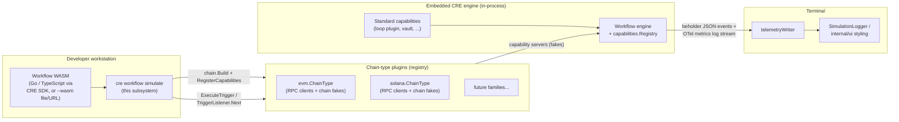
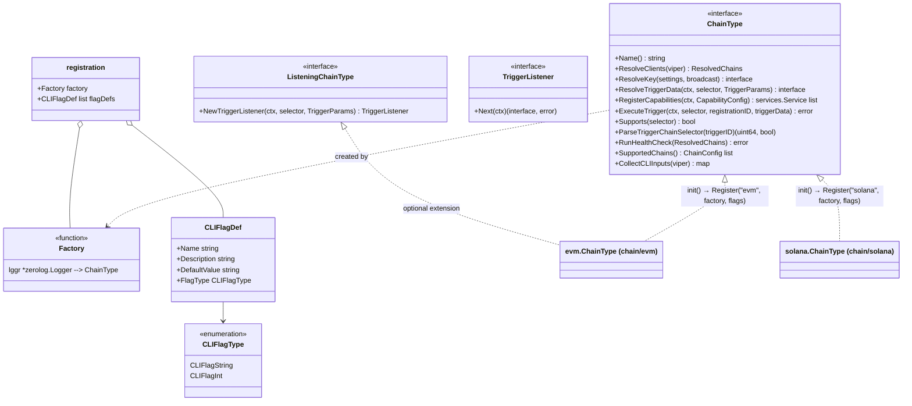
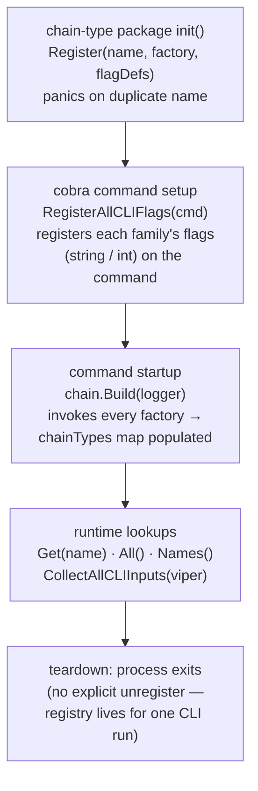
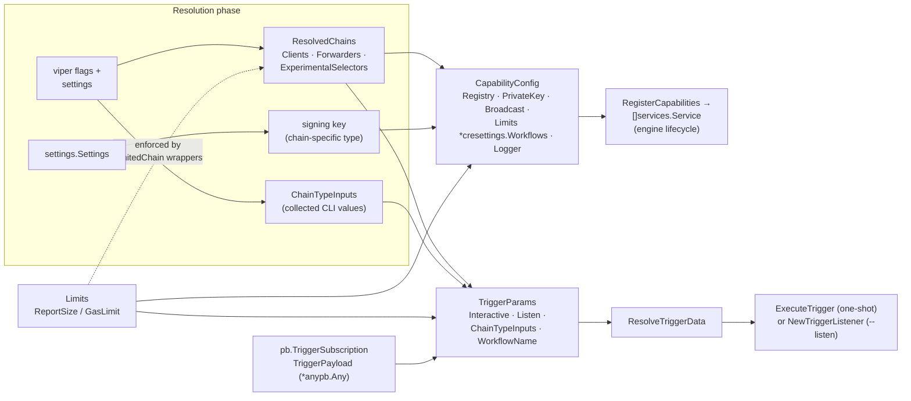
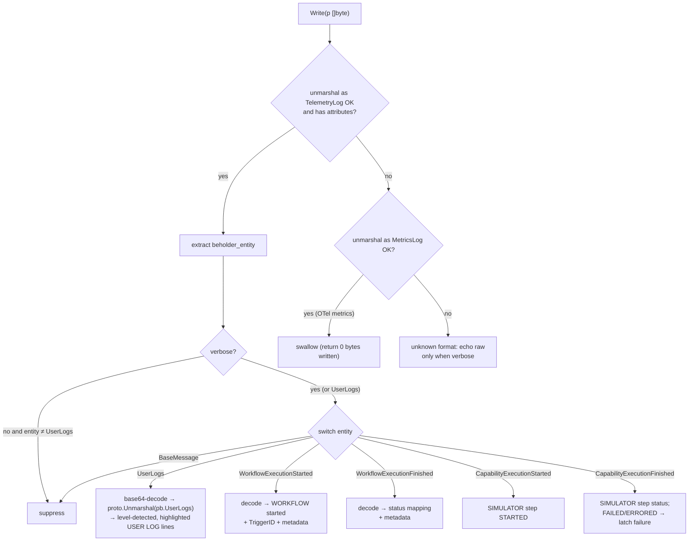
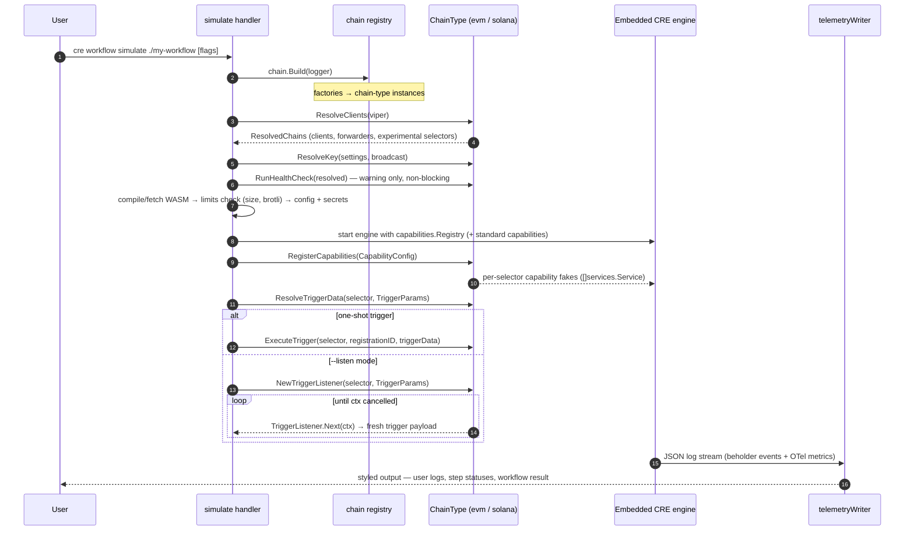
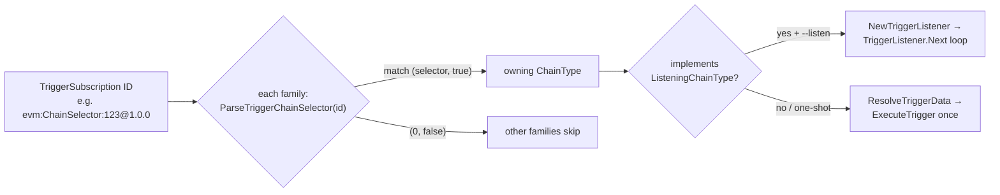
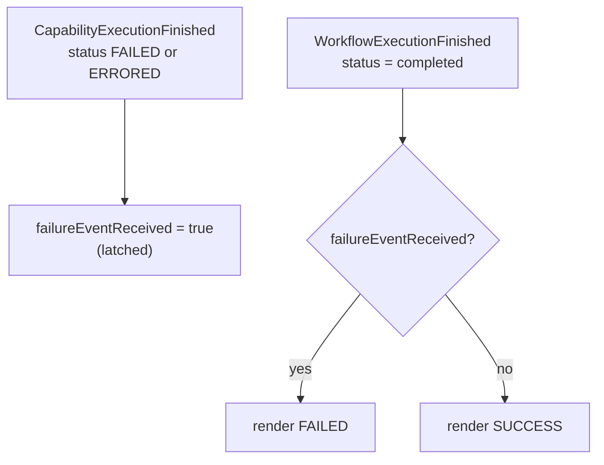
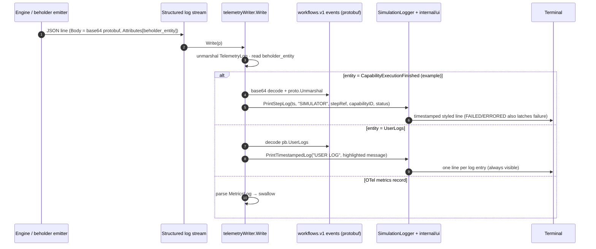

# CRE CLI — `cre workflow simulate` Simulation Subsystem (`cre-cli-workflow-commands_simulation`)

> **Scope:** The local workflow simulation subsystem of the `cre` CLI (`github.com/smartcontractkit/cre-cli`, Go 1.26, cobra/viper — see [cre-cli/go.mod](https://github.com/smartcontractkit/cre-cli/blob/main/go.mod)). It backs the `cre workflow simulate` command: a **plugin registry of chain types** (`ChainType` interface with init-time self-registration), the **shared chain-simulation contracts** (`ChainClient`, `ChainConfig`, `Limits`, `ResolvedChains`, `CapabilityConfig`, `TriggerParams`), and the **telemetry writer** that decodes the simulator's beholder/OpenTelemetry log stream into readable simulation output. Source roots: `cre-cli/cmd/workflow/simulate/**`.

Parent module: [CRE CLI — Workflow Command Surface](../cre-cli-workflow-commands.md) · Siblings: [deploy](cre-cli-workflow-commands_deploy.md) · [registry operations](cre-cli-workflow-commands_registry-operations.md)

---

## 1. Purpose & Overview

`cre workflow simulate <workflow-folder-path>` is the developer's inner loop: it runs a compiled workflow WASM **locally against an embedded CRE engine** with **simulated chains** — no registry registration, no DON, no real chain interaction beyond the developer's own RPC endpoints. The subsystem documented here is the plumbing that makes simulation extensible and observable:

1. **Chain-type plugin registry** (`chain/registry.go`) — a runtime registry into which chain families (EVM, Solana, …) inject themselves at package `init()` time. The simulator core only ever talks to the `ChainType` interface, so new chain families are added without touching the simulator.
2. **Shared simulation contracts** (`chain/types.go`) — the common data structures threaded through every phase of a simulation run: resolved RPC clients, capability-registration inputs, trigger parameters, and the per-family limits enforced for production parity.
3. **Telemetry pipeline** (`telemetry_writer.go`) — an `io.Writer` that intercepts the simulator's structured log stream (beholder telemetry events + OpenTelemetry metric records), decodes the base64 protobuf event bodies, and re-renders them as styled, human-readable simulation output (user logs, per-step capability status, workflow result).

### 1.1 Core components

| Component | File | Kind | Role |
|---|---|---|---|
| `ChainType` (interface) | `cmd/workflow/simulate/chain/registry.go` | Plugin contract | Everything a chain family must implement to participate in simulation |
| `ListeningChainType`, `TriggerListener` | `cmd/workflow/simulate/chain/registry.go` | Optional extension | Continuous trigger-event listening (`--listen` mode) |
| `Register` / `Build` / `Get` / `All` / `RegisterAllCLIFlags` / `CollectAllCLIInputs` / `Names` | `cmd/workflow/simulate/chain/registry.go` | Registry functions | Plugin lifecycle: register at `init()`, flag wiring at setup, instantiation at startup |
| `ChainClient`, `ChainConfig`, `Limits`, `ResolvedChains`, `CapabilityConfig`, `TriggerParams` | `cmd/workflow/simulate/chain/types.go` | Shared types | Contracts exchanged between the simulator and chain-type plugins |
| `telemetryWriter` / `MetricsLog` | `cmd/workflow/simulate/telemetry_writer.go` | Telemetry | beholder event + OTel metric interception, decoding, styled rendering |

> Command-level behaviour (flags, input resolution, WASM compilation, limits resolution, secrets handling) is shared with the other `cre workflow` commands and summarised in the [parent module](../cre-cli-workflow-commands.md#42-simulation). This page goes one level deeper into the simulation-specific machinery above.

---

## 2. System Context

Relationships to other documented modules:

- **[Workflow command surface](../cre-cli-workflow-commands.md)** — the parent page defines the shared cobra handler contract (`ResolveInputs` → `ValidateInputs` → `Execute`), the settings/runtime context, and the cross-cutting concerns (validation, telemetry/UX) that `simulate` inherits.
- **[Workflow & Capability Runtime (CRE Engine)](../../Workflow___Capability_Runtime_(CRE_Engine).md)** — `simulate` embeds the real engine: the standalone engine utilities from [workflows_standalone](../../Workflow___Capability_Runtime_(CRE_Engine)/workflows/workflows_standalone.md) (e.g. `fileBasedSecrets` for YAML secrets, `standardCapConfig` for the standard-capabilities loop plugin) and a `capabilities.Registry` from [core_capabilities_runtime](../../Workflow___Capability_Runtime_(CRE_Engine)/core_capabilities_runtime.md) into which chain-type plugins register their capability fakes.
- **[Beholder telemetry](../../Telemetry___Observability_Platform/beholder-telemetry.md)** — the `TelemetryLog` JSON stream parsed by `telemetryWriter` is the log output of beholder's emitters ([emission](../../Telemetry___Observability_Platform/beholder-telemetry/beholder-telemetry_emission.md)); the CLI renders it locally instead of shipping it to a collector.
- **[Settings (CRE schema)](../../Shared_Foundation_Libraries___Domain_Types/settings/settings_cre_schema.md)** — `CapabilityConfig.Limits` / `TriggerParams.Limits` carry a `*cresettings.Workflows` (the per-workflow scope of the CRE settings schema) to enforce production-parity limits.
- **[Secrets command](../cre-cli-secrets.md)** — `cre secrets` produces the secrets files that simulation injects via `fileBasedSecrets`.
- **[Backend clients](../cre-cli-backend-clients.md)** — not used by simulation itself (it runs fully locally), which is exactly what distinguishes it from the [deploy](cre-cli-workflow-commands_deploy.md) and [registry operations](cre-cli-workflow-commands_registry-operations.md) siblings.

---

## 3. Architecture

### 3.1 Package layout

| Path | Responsibility |
|---|---|
| `cmd/workflow/simulate/` | Cobra command definition, input resolution/validation, WASM compile-or-fetch, limits resolution, config/secrets loading, engine bootstrap, run loop. |
| `cmd/workflow/simulate/chain/` | **This module's core** — `registry.go` (plugin registry + `ChainType` contract) and `types.go` (shared contracts). |
| `cmd/workflow/simulate/chain/evm/`, `.../solana/` | Concrete chain types; each calls `chain.Register(...)` from its package `init()` and registers its own CLI flags. |
| `cmd/workflow/simulate/telemetry_writer.go` | `telemetryWriter` (`io.Writer`), beholder event decoding, OTel `MetricsLog` detection, status mapping, styled output via `SimulationLogger` + `internal/ui`. |

### 3.2 Chain-type plugin registry (`chain/registry.go`)

The registry is a classic **self-registering plugin pattern** with a two-stage lifecycle: chain-type packages *register a factory* at `init()` time, and the simulator *instantiates* them once at command startup with its logger.

#### Registry lifecycle

Registry functions and their guarantees:

| Function | Concurrency | Contract |
|---|---|---|
| `Register(name, factory, flagDefs)` | write-locked (`sync.RWMutex`) | Called from chain-type package `init()`; **panics on duplicate registration** (treated as a programming error, not a runtime failure). |
| `RegisterAllCLIFlags(cmd *cobra.Command)` | read-locked | Registers every family's `CLIFlagDef` on the cobra command. `CLIFlagInt` flags default to `-1` when no (parseable) default is given; string flags use `DefaultValue` verbatim. Must run **before** `Build()`. |
| `Build(lggr)` | write-locked | Invokes every registered factory with the simulator's `*zerolog.Logger`. Must be called once at startup before `Get`/`All` return meaningful results. |
| `Get(name)` | read-locked | Returns the instance or an error listing the registered names (`unknown chain type %q; registered: ...`). |
| `All()` / `Names()` | read-locked | Defensive copies / sorted names — callers cannot mutate the registry through them. |
| `CollectAllCLIInputs(viper)` | read-locked (via `All`) | Merges every family's `CollectCLIInputs` map into one bag of key-value strings, which becomes `TriggerParams.ChainTypeInputs`. |

#### The `ChainType` contract, by phase

| Method | Phase | Purpose |
|---|---|---|
| `Name()` | identity | Chain-family identifier (`"evm"`, `"solana"`, …) used as registry key and in subscription IDs. |
| `ResolveClients(v *viper.Viper)` | resolve | Creates RPC clients for **all** chains the family can simulate — built-in supported chains *plus* chains from the experimental-chain settings — returning a `ResolvedChains` bundle keyed by chain selector (clients, forwarders, and the experimental-selector set). |
| `ResolveKey(settings, broadcast)` | resolve | Parses/validates the family's signing key from settings. With `broadcast=true` a missing or default-sentinel key is a **hard error**; otherwise a sentinel may be used with a warning. Returns `nil` for families that don't sign. |
| `RunHealthCheck(resolved ResolvedChains)` | resolve | Validates RPC connectivity for all resolved clients. Receives the same `ResolvedChains` bundle back so it is self-contained (no hidden instance state). |
| `SupportedChains()` | resolve | Built-in supported chain list (display/documentation). |
| `CollectCLIInputs(v)` | resolve | Reads this family's CLI flags from viper into key-value strings for `TriggerParams.ChainTypeInputs`. |
| `RegisterCapabilities(ctx, cfg CapabilityConfig)` | execute | Creates the family's capability servers (per-selector chain fakes) inside the engine's `capabilities.Registry`; returns the underlying `services.Service`s so the caller owns their lifecycle. |
| `ResolveTriggerData(ctx, selector, params TriggerParams)` | execute | Produces the family-specific trigger payload for a selector from runtime parameters. |
| `ExecuteTrigger(ctx, selector, registrationID, triggerData)` | execute | Fires the trigger once (one-shot mode). |
| `Supports(selector)` | execute | Whether an initialised capability exists for this selector in the current run (supported + RPC configured). |
| `ParseTriggerChainSelector(triggerID)` | listen | Extracts the family's selector from a trigger subscription ID such as `"evm:ChainSelector:123@1.0.0"`; returns `(0, false)` for foreign IDs. |

### 3.3 Shared contracts (`chain/types.go`)

| Type | Fields | Notes |
|---|---|---|
| `ChainClient` | — (empty interface) | **Opaque handle** to a chain-specific RPC client; each chain type casts it to its concrete type internally. This is what lets heterogeneous chains (go-ethereum, solana-go, …) sit behind one interface. |
| `ChainConfig` | `Selector uint64`, `Forwarder string` | Identifies one supported chain within a family: chain selector + family-specific forwarding address. |
| `Limits` | `ReportSize int`, `GasLimit uint64` | The **common per-family limits contract** enforced by the `LimitedChain` wrappers that surround resolved clients — the same guardrails production workflows face. |
| `ResolvedChains` | `Clients map[uint64]ChainClient`, `Forwarders map[uint64]string`, `ExperimentalSelectors map[uint64]bool` | Result of `ResolveClients`. `ExperimentalSelectors` marks selectors that came from experimental-chain config rather than the built-in list, and is used for error labelling (`"experimental chain N"` vs a chain name). |
| `CapabilityConfig` | `Registry *capabilities.Registry`, `Clients`, `Forwarders`, `PrivateKey interface{}`, `Broadcast bool`, `Limits *cresettings.Workflows` (nil disables enforcement), `Logger logger.Logger` | Everything a family needs to register its capabilities: the engine's registry, resolved clients, the chain-specific private key (e.g. `*ecdsa.PrivateKey` for EVM), and limits. |
| `TriggerParams` | `Clients`, `Interactive bool`, `Listen bool`, `Limits`, `ChainTypeInputs map[string]string`, `TriggerPayload *anypb.Any`, `WorkflowName string` | Chain-agnostic trigger inputs. `ChainTypeInputs` is a free-form bag of CLI-supplied strings — **each family interprets the keys it knows about and ignores the rest**. `TriggerPayload` is the protobuf `Any` from the selected `pb.TriggerSubscription`; families unmarshal it into their own trigger-config message (e.g. `evm.FilterLogTriggerRequest`) to learn what the workflow actually subscribed to. `WorkflowName` is used to render replay-command hints in interactive copy. |

How the contracts flow through a run:

### 3.4 Telemetry pipeline (`telemetry_writer.go`)

The embedded engine emits its telemetry through beholder, which produces **JSON-encoded log lines** whose bodies are **base64 protobuf** messages and whose attributes carry the `beholder_entity` type discriminator. Rather than showing raw JSON, the simulator redirects its log stream through `telemetryWriter`, which implements `io.Writer` and re-renders events with the `SimulationLogger`/`internal/ui` styling.

Recognised entity types (`workflows.v1.*` events from `chainlink-protos/workflows/go/events`):

| `beholder_entity` | Protobuf event | Rendering | Non-verbose mode |
|---|---|---|---|
| `workflows.v1.UserLogs` | `pb.UserLogs` | One styled `USER LOG` line per log line; log level auto-detected from the message, level keywords highlighted | **shown** |
| `workflows.v1.WorkflowExecutionStarted` | `pb.WorkflowExecutionStarted` | `WORKFLOW … WorkflowExecutionStarted` + `TriggerID` + workflow metadata | suppressed |
| `workflows.v1.WorkflowExecutionFinished` | `pb.WorkflowExecutionFinished` | `WORKFLOW … WorkflowExecutionFinished - Status:` (mapped) + metadata | suppressed |
| `workflows.v1.CapabilityExecutionStarted` | `pb.CapabilityExecutionStarted` | `SIMULATOR <stepRef> <capability> STARTED` | suppressed |
| `workflows.v1.CapabilityExecutionFinished` | `pb.CapabilityExecutionFinished` | `SIMULATOR <stepRef> <capability> <STATUS>`; `FAILED`/`ERRORED` **latches** `failureEventReceived` | suppressed |
| `BaseMessage` (envelope) | — | always suppressed | suppressed |

`MetricsLog` is the second stream: OpenTelemetry metric records (the `Resource` / `ScopeMetrics` / `Metrics` / `DataPoints` JSON shape). They are **detected and swallowed** so numeric metric dumps never pollute simulation output; unknown formats are passed through raw only in verbose mode.

---

## 4. Key Process Flows

### 4.1 End-to-end simulation run

### 4.2 Trigger modes: one-shot vs listening

- **One-shot** (default): the simulator resolves trigger data once per selected selector and calls `ExecuteTrigger`. `Supports(selector)` guards this — it reports whether the family has an *initialised* capability for the selector (supported chain **and** RPC configured) in the current run.
- **Listening** (`--listen`): families that implement the optional `ListeningChainType` extension expose `NewTriggerListener`, whose `TriggerListener.Next(ctx)` blocks and returns a fresh trigger payload for each matching event until the caller's context is cancelled. `ParseTriggerChainSelector` maps incoming subscription IDs (e.g. `"evm:ChainSelector:123@1.0.0"`) back to selectors so the simulator can route payloads to the right family.

### 4.3 Limits and production parity

Simulation deliberately mirrors the production limit regime so that a workflow passing locally will not be rejected by a DON later:

- `Limits {ReportSize, GasLimit}` is enforced by the **`LimitedChain` wrappers** around each resolved client — chain-type plugins cannot bypass them.
- `CapabilityConfig.Limits` / `TriggerParams.Limits` carry the resolved `*cresettings.Workflows` (the per-workflow scope of the [CRE settings schema](../../Shared_Foundation_Libraries___Domain_Types/settings/settings_cre_schema.md)); passing `nil` **disables** enforcement entirely.
- The WASM artifact itself is checked against binary-size/brotli-compression limits before the engine starts, and the deploy-side DON workflow-limit accounting (see [deploy](cre-cli-workflow-commands_deploy.md#43-don-limit-and-ownership-checks)) does not apply here — simulation never touches a registry.

### 4.4 Embedded engine integration

The simulator reuses the node's engine pieces rather than a bespoke mini-engine:

- **Secrets** come from a file-based provider (`fileBasedSecrets`, [workflows_standalone](../../Workflow___Capability_Runtime_(CRE_Engine)/workflows/workflows_standalone.md)) reading the YAML secrets files managed by `cre secrets`, with secret names replaced by env-var references at load time.
- **Standard capabilities** are configured via `standardCapConfig` (enabled flag + config string passed to the loop plugin's `Initialise`).
- **Capability registration** targets the engine's `capabilities.Registry` (`CapabilityConfig.Registry`), the same registry type used by node-side capability orchestration — see [core_capabilities_runtime](../../Workflow___Capability_Runtime_(CRE_Engine)/core_capabilities_runtime.md).

### 4.5 Output rendering rules

`telemetryWriter` maps backend statuses to terminal-friendly labels, with one important nuance — **a capability failure overrides a nominal workflow "completed" status**:

| Reported status | Rendered as |
|---|---|
| `completed` + a capability finished `FAILED`/`ERRORED` earlier | **FAILED** (failure latch wins) |
| `completed` (no failures seen) | SUCCESS |
| `success` | SUCCESS |
| `failed` | FAILED |
| `errored` / `error` | ERRORED |
| `started` | STARTED |
| anything else | upper-cased raw status |

---

## 5. Key Data Flows

### 5.1 Telemetry decode flow (engine → terminal)

The same stream in reverse-engineering terms: the CLI never talks to a telemetry backend during simulation — [beholder's emission layer](../../Telemetry___Observability_Platform/beholder-telemetry/beholder-telemetry_emission.md) is reused purely as the *format*, and `telemetryWriter` is the local "collector".

---

## 6. Build & Testing

- **Build & lint:** the [`cre-cli/Makefile`](https://github.com/smartcontractkit/cre-cli/blob/main/Makefile) builds the `cre` binary (`make build`, commit-stamped via `-ldflags`) and lints with `golangci-lint` (configuration: `cre-cli/.golangci.yml`).
- **Tests:** `make test` runs the full suite; `make test-quick` runs the fast path (`-short`, 30 s timeout) and deliberately skips known-slow/e2e tests — including `TestBlankWorkflowSimulation`, `MultiCommandHappyPaths`, `TestWaitForBackendLinkProcessing`, `TestTryAutoLink`, and `TestCheckLinkStatusViaGraphQL`; `make test-e2e` runs the `./test/` suite (`-p 5`). The presence of `TestBlankWorkflowSimulation` in the skip list reflects the simulation smoke test that compiles and runs an empty workflow end-to-end through the embedded engine.
- **Key dependencies** ([cre-cli/go.mod](https://github.com/smartcontractkit/cre-cli/blob/main/go.mod)): `chainlink/v2` (embedded engine + `core/capabilities` registry), `chainlink-common` (`settings/cresettings`, `logger`, `services`, `beholder`), `chainlink-protos/workflows/go` (telemetry event protobufs rendered by `telemetryWriter`), `go-ethereum` and `gagliardetto/solana-go` (concrete RPC clients behind `ChainClient`), `rs/zerolog`, `spf13/cobra`, `spf13/viper`.
- Release packaging and installers are covered separately in [cre-cli-build-and-release](../cre-cli-build-and-release.md).

---

## 7. Related Documentation

- [cre-cli-workflow-commands](../cre-cli-workflow-commands.md) — parent: shared command surface, handler contract, cross-cutting concerns.
- [cre-cli-workflow-commands_deploy](cre-cli-workflow-commands_deploy.md) / [cre-cli-workflow-commands_registry-operations](cre-cli-workflow-commands_registry-operations.md) — the registry-lifecycle siblings simulation deliberately avoids (fully local execution).
- [cre-cli-secrets](../cre-cli-secrets.md) — secrets files consumed by simulation's `fileBasedSecrets`.
- [cre-cli-platform-config](../cre-cli-platform-config.md) — settings resolution feeding `ResolveClients` / `ResolveKey` / limits.
- [cre-sdk-core](../cre-sdk-core.md) — the SDK used to author the workflows that `simulate` runs.
- [Workflow & Capability Runtime (CRE Engine)](../../Workflow___Capability_Runtime_(CRE_Engine).md) — the embedded engine, capability registry, and standalone-engine utilities.
- [Beholder telemetry](../../Telemetry___Observability_Platform/beholder-telemetry.md) — the telemetry format decoded by `telemetryWriter`.
- [Settings — CRE schema](../../Shared_Foundation_Libraries___Domain_Types/settings/settings_cre_schema.md) — the `cresettings` schema behind simulation limits.
