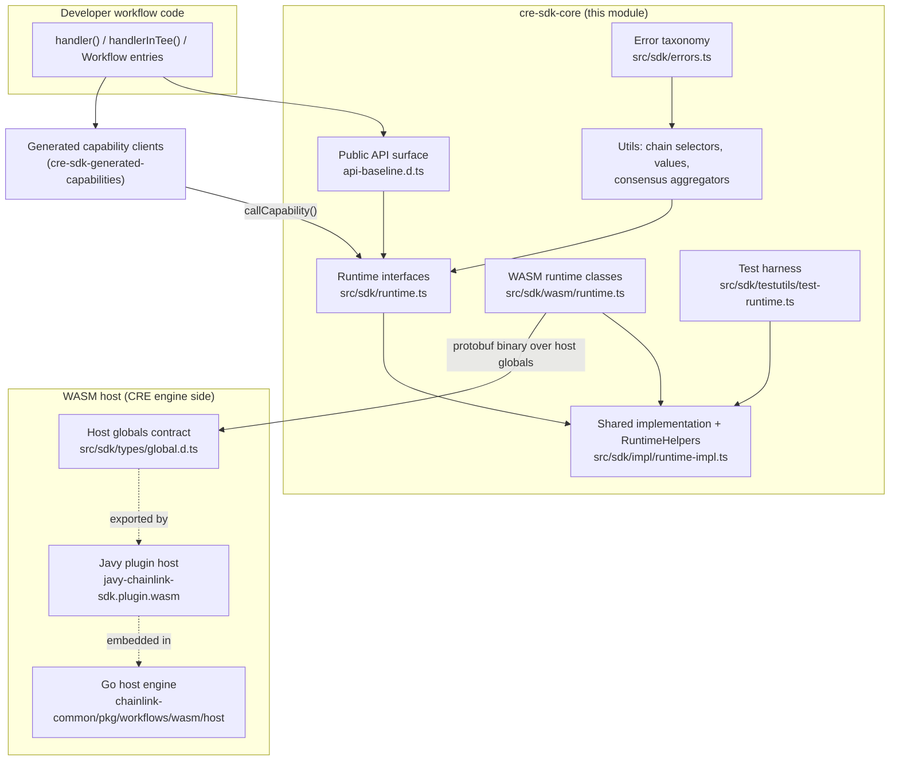
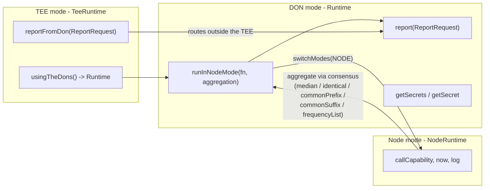
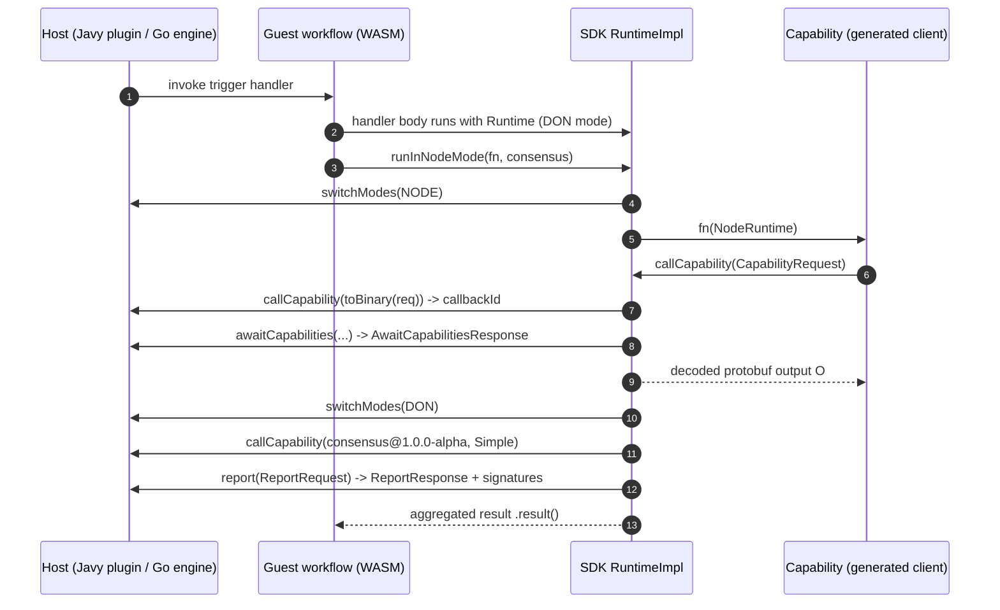
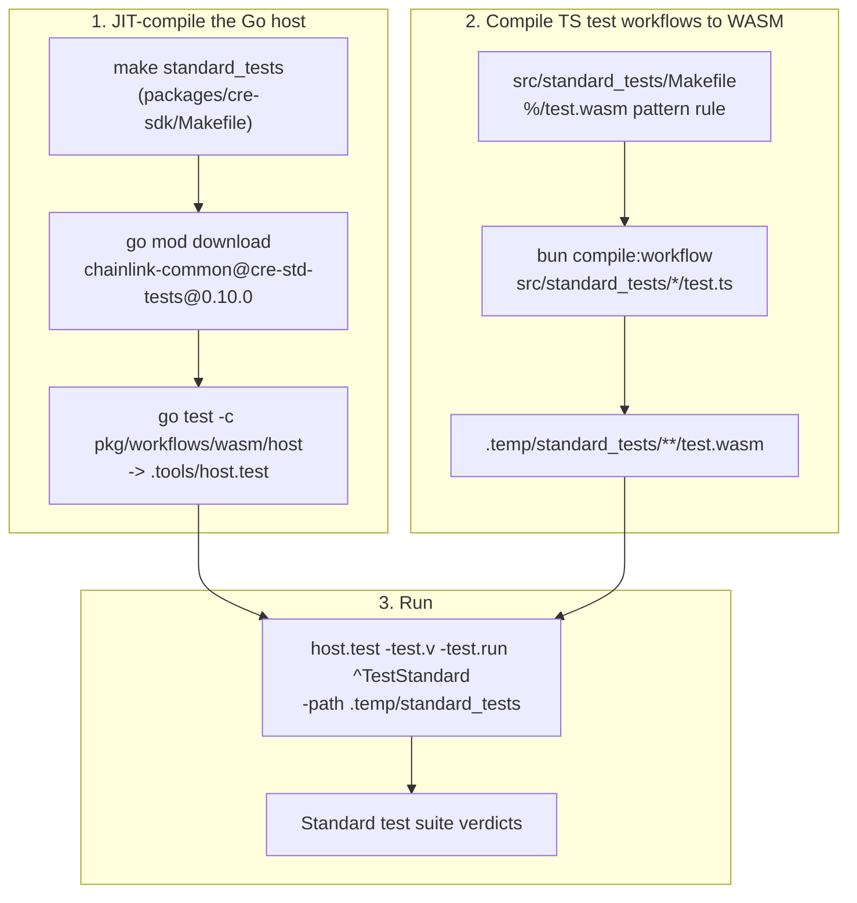
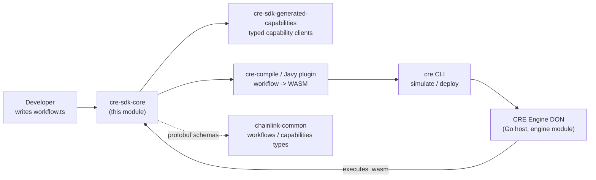

# CRE SDK Core (`@chainlink/cre-sdk`)

## 1. Purpose and Scope

The **cre-sdk-core** module is the foundation of the **Chainlink Runtime Environment (CRE) TypeScript SDK** — the npm package `@chainlink/cre-sdk` published from `cre-sdk-typescript/packages/cre-sdk` (v1.23.0, see `cre-sdk-typescript/packages/cre-sdk/package.json`). It is everything a workflow developer touches when authoring a CRE workflow in TypeScript:

1. **A workflow programming model** — declare trigger handlers (`handler`, `handlerInTee`, the `Workflow` array) that the CRE engine invokes when triggers fire.
2. **A runtime abstraction over three execution modes** — DON mode (`Runtime`), Node mode (`NodeRuntime`) and Trusted-Execution-Environment mode (`TeeRuntime`), including the `runInNodeMode` consensus primitive.
3. **The guest/host ABI contract** — TypeScript declarations for the host functions a compiled workflow's WASM module can call (`callCapability`, `awaitCapabilities`, `getSecrets`, `switchModes`, …), implemented by the Javy plugin host.
4. **Developer utilities** — protobuf-based capability calls (`@bufbuild/protobuf`), chain-selector lookups, a `CreSerializable` value type system, and typed consensus aggregators.
5. **A test harness** — a `TestRuntime`/`TestTeeRuntime` that emulates the host under `bun:test`, plus the "standard tests" pipeline that compiles real workflows to WASM and executes them against the production Go host (`chainlink-common/pkg/workflows/wasm/host`).

This page documents the **core** of the SDK. Sibling pages cover the rest of the toolchain:

- Auto-generated capability clients: [cre-sdk-generated-capabilities](cre-sdk-generated-capabilities.md)
- Monorepo build tooling (turbo/biome/scripts): [cre-sdk-workspace-build](cre-sdk-workspace-build.md)
- Example workflows & Rust plugins: [cre-sdk-examples-and-plugins](cre-sdk-examples-and-plugins.md)
- The `cre` CLI that deploys/simulates workflows: [cre-cli-workflow-commands](cre-cli-workflow-commands.md)

## 2. Architecture Overview

### 2.1 Layered View

Key design points:

- **Interfaces vs. implementations are split.** `src/sdk/runtime.ts` declares the execution-mode contracts (`BaseRuntime`, `NodeRuntime`, `Runtime`, `TeeRuntime`, `SecretsProvider`) with zero implementation. Shared behaviour lives in `src/sdk/impl/runtime-impl.ts` behind the internal `RuntimeHelpers` interface, which has exactly two backends:
  - `WasmRuntimeHelpers` (`src/sdk/wasm/runtime.ts`) — production; serializes protobuf requests with `toBinary` and talks to the host via the globals declared in `src/sdk/types/global.d.ts`.
  - `createTestRuntimeHelpers` (`src/sdk/testutils/test-runtime.ts`) — testing; dispatches to in-memory capability handlers and a seeded secrets map.
- **Everything crosses the WASM boundary as protobuf.** Requests/responses use generated schemas from `@cre/generated/sdk/v1alpha/sdk_pb` (`CapabilityRequest`, `AwaitCapabilitiesRequest`, `GetSecretsRequest`, …) and `toBinary`/`fromBinary` conversion, with an explicit `maxResponseSize` guard per host call.
- **The public surface is frozen by a baseline.** `api-baseline.d.ts` is the concatenation of the compiled `.d.ts` files (regenerated via the `update-api-baseline` script in `packages/cre-sdk/package.json`), reviewed as one file to catch accidental API changes.

### 2.2 Execution Modes

The SDK models the CRE engine's three execution contexts as distinct runtime types. The host exposes a `switchModes(mode)` global and the SDK raises dedicated errors when a mode is violated.

| Mode | TypeScript interface | Entered via | Capabilities |
|---|---|---|---|
| **DON** | `Runtime<C>` | default handler runtime | `runInNodeMode`, `report`, secrets access, `callCapability` |
| **Node** | `NodeRuntime<C>` | argument of the `runInNodeMode` callback | `callCapability`, `now`, `log` (brand-checked via `_isNodeRuntime`) |
| **TEE** | `TeeRuntime<C>` | `handlerInTee(...)` with a `TeeConstraint` | `reportFromDon`, `usingTheDons()`, secrets access |

### 2.3 Guest/Host ABI (Host Functions)

`src/sdk/types/global.d.ts` declares the globals the Javy plugin host injects into every WASM guest. These are the *only* trusted-computing-base functions a workflow can call:

| Host function | Purpose | SDK wrapper |
|---|---|---|
| `callCapability(request): number` | Start an async capability call, returns callback ID | `BaseRuntime.callCapability` |
| `awaitCapabilities(awaitRequest, maxResponseLen): Uint8Array` | Block until pending capability calls finish | `RuntimeImpl` await logic |
| `getSecrets(request, maxResponseLen): number` | Start async secret retrieval | `SecretsProvider.getSecrets` |
| `awaitSecrets(awaitRequest, maxResponseLen): Uint8Array` | Block until secret requests finish | `SecretsProvider` await logic |
| `log(message)`, `sendResponse(response)` | Diagnostics and final workflow response | `BaseRuntime.log`, host entrypoint |
| `switchModes(mode)`, `versionV2()` | Mode switching (0=unspecified, 1=DON, 2=NODE) and SDK-version marker | `runInNodeMode` / handshake |
| `randomSeed(mode)`, `getWasiArgs()`, `now()`, `sleep(ms)` | Entropy, WASI args, clock, delays | `RuntimeImpl` helpers |

Polyfill-style globals (`console`, `TextEncoder`/`TextDecoder`, `Buffer`, `atob`/`btoa`, `URL`/`URLSearchParams`) are declared structurally (`CreTextDecoder`, `CreTextEncoder`, `CreURL`) so workflows typecheck even without `@types/node`.

### 2.4 Request Flow Through the ABI

### 2.5 Build, Compile and Test Pipeline

The SDK's behaviour depends on how it is built and packaged (cited from the repository):

- **Javy plugin (host) build** — `cre-sdk-typescript/packages/cre-sdk-javy-plugin/Dockerfile` performs a *deterministic* build: a `wasm32-wasip1` Rust cdylib is compiled and finalized with `javy init-plugin --deterministic`, producing `javy-chainlink-sdk.plugin.wasm` that embeds the QuickJS-based host for all SDK packages.
- **Workflow compilation** — `cre-compile` (the SDK's `bin`) / `bun compile:workflow` turn TypeScript workflows into `test.wasm`/`main.wasm` guests linked against that plugin. The `cre` CLI wraps this for simulation and deployment ([cre-cli-workflow-commands](cre-cli-workflow-commands.md)).
- **Standard tests** — the pipeline below is what `bun run test:standard` and `make standard_tests` execute; it is part of `full-checks.sh` (see `cre-sdk-typescript/scripts/full-checks.sh`) and `prepublishOnly`.

The Go host side of these tests (`GOOS=wasip1 GOARCH=wasm go build -o test.wasm .` guests) is maintained in `chainlink-common/pkg/workflows/wasm/host` and is documented on the engine side in [workflows_engine](../../Workflow___Capability_Runtime_(CRE_Engine)/workflows/workflows_engine.md).

## 3. Sub-Module Documentation

The core of the SDK is organized into five sub-modules. Detailed documentation for each lives on its own page:

| Sub-module | Page | Contents |
|---|---|---|
| **Runtime & Execution Model** | [cre-sdk-core_runtime](cre-sdk-core/cre-sdk-core_runtime.md) | `BaseRuntime` / `Runtime` / `NodeRuntime` / `TeeRuntime` interfaces, the WASM runtime classes (`WasmRuntimeHelpers`), and the guest/host ABI declared in `global.d.ts`. |
| **Test Harness & Standard Tests** | [cre-sdk-core_test-harness](cre-sdk-core/cre-sdk-core_test-harness.md) | `TestRuntime` / `TestTeeRuntime` under `bun:test` (in-memory capability registry via `AsyncLocalStorage`), and the Makefiles that compile Go host + WASM guests for the standard test suite. |
| **Chain Selectors** | [cre-sdk-core_chain-selectors](cre-sdk-core/cre-sdk-core_chain-selectors.md) | `NetworkInfo` types, the O(1) `NetworkLookup` service, and the `generate-chain-selectors.ts` codegen from the `chain-selectors` YAML sources. |
| **Error Taxonomy** | [cre-sdk-core_errors](cre-sdk-core/cre-sdk-core_errors.md) | Typed errors for mode violations (`DonModeError`/`NodeModeError`), secrets failures, and report parsing/verification, plus the deprecated `CapabilityError`. |
| **Public API Surface** | [cre-sdk-core_api-surface](cre-sdk-core/cre-sdk-core_api-surface.md) | The `api-baseline.d.ts` API-contract mechanism, the handler/`Workflow` model, and the compile-time-verified `CreSerializable` and consensus-aggregator type systems. |

Read them in the order above if you are new to the SDK: execution model first, then how to test against it, then the supporting utilities and contracts.

## 4. How the Module Fits into the Overall System

- **Consumes** generated capability clients and protobuf schemas produced by the `generate:sdk` pipeline ([cre-sdk-generated-capabilities](cre-sdk-generated-capabilities.md), [cre-sdk-workspace-build](cre-sdk-workspace-build.md)) and chain-family contracts/interfaces documented under [Shared Foundation Libraries & Domain Types](../Shared_Foundation_Libraries___Domain_Types.md) (e.g. [types-core plugin services](../Shared_Foundation_Libraries___Domain_Types/types-core/types-core_plugin-services.md)).
- **Produces** WASM workflow binaries executed by the Go host engine of the [Workflow & Capability Runtime (CRE Engine)](../../Workflow___Capability_Runtime_(CRE_Engine).md); the engine-side execution host is covered in [workflows_engine](../../Workflow___Capability_Runtime_(CRE_Engine)/workflows/workflows_engine.md) and the capability model in [capabilities_core](../../Workflow___Capability_Runtime_(CRE_Engine)/capabilities/capabilities_core.md).
- **Is exercised by** the `cre` CLI for simulation and deployment ([cre-cli-workflow-commands](cre-cli-workflow-commands.md)), whose simulate command compiles workflows with this SDK and runs them locally.

## 5. Maintainer Notes

- **API changes:** any change to exported types must be reflected in `api-baseline.d.ts` (regenerate via `update-api-baseline`) — it is the reviewed public-API contract of the package.
- **Response size limits:** every host call takes a `maxResponseSize`; the WASM layer validates i32 range (`toI32ResponseSize`) and the test harness enforces the limit with the `RESPONSE_BUFFER_TOO_SMALL` sentinel.
- **Determinism:** the Javy plugin is built with `javy init-plugin --deterministic` (see the plugin Dockerfile); keep plugin builds reproducible when touching the host crate.
- **Standard-test pinning:** the standard tests run against `chainlink-common` at a pinned pseudo-version (`cre-std-tests@0.10.0`) so engine and SDK test suites stay in lockstep; bump `COMMON_VERSION` in `packages/cre-sdk/Makefile` deliberately.
