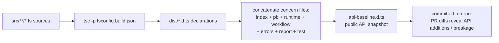
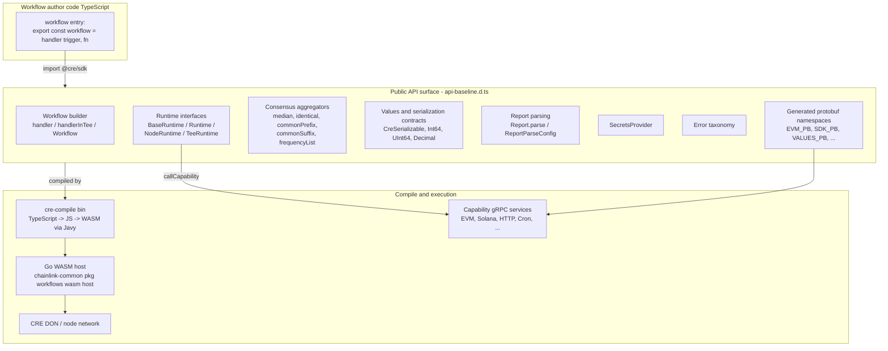
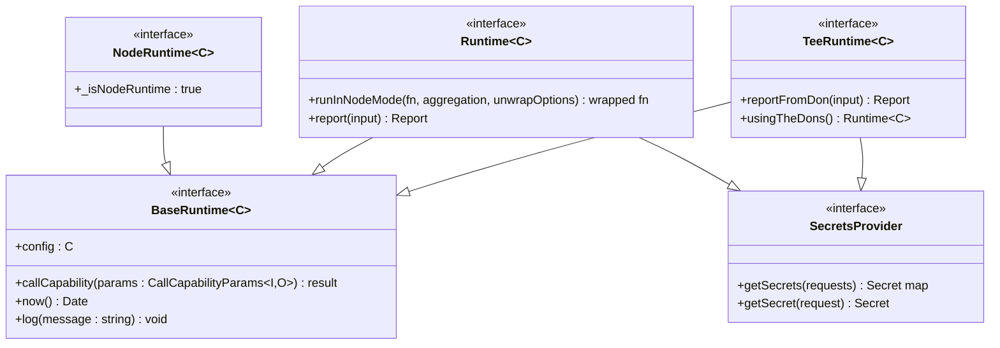
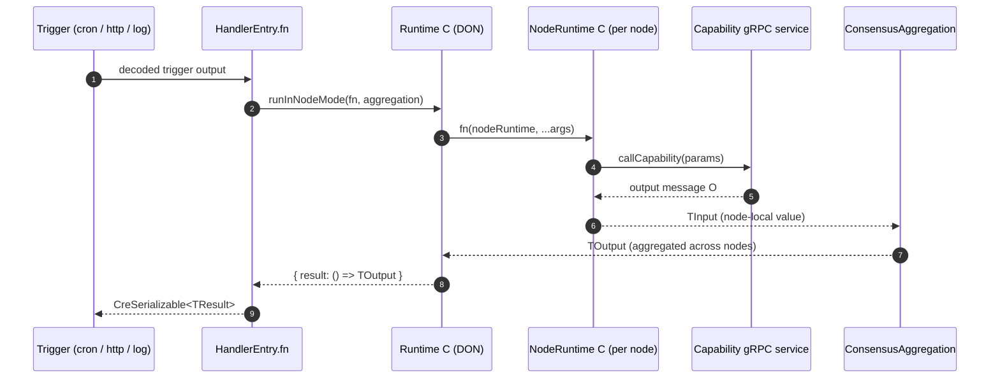
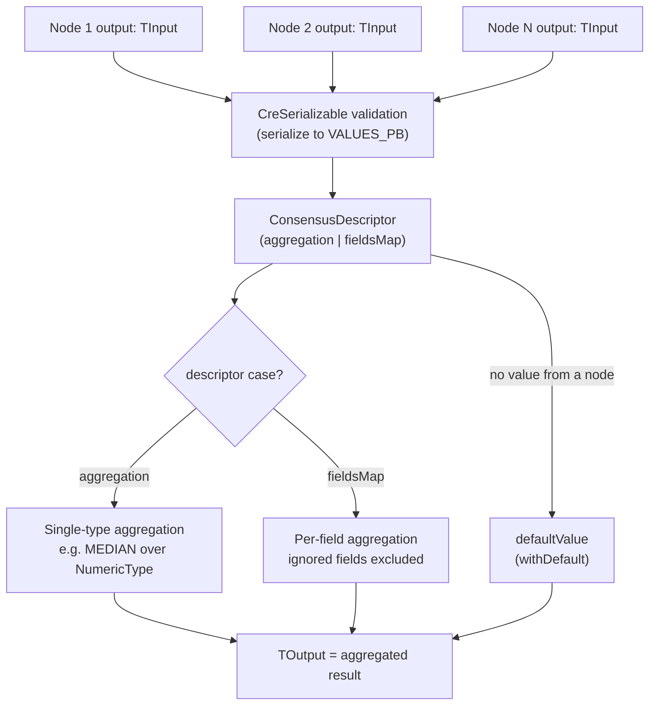
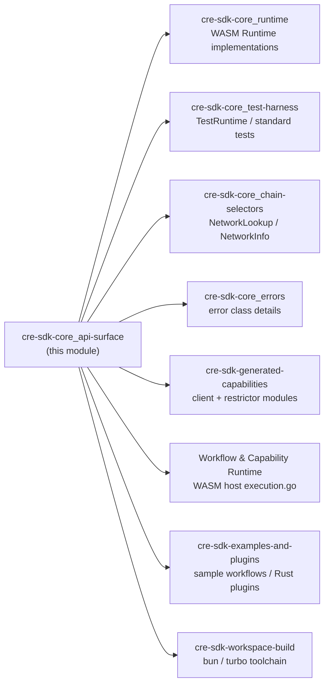

# CRE SDK Core — Public API Surface (`@cre/sdk`)

## 1. Introduction

The **`cre-sdk-core_api-surface`** module defines the *public contract* of the CRE (Chainlink Runtime Environment) TypeScript SDK — the `@chainlink/cre-sdk` npm package (internally referenced as `@cre/sdk`). It is the layer that workflow authors program against: everything they may `import`, the runtime objects their handler functions receive, and the type-level rules that keep workflow values compatible with the WASM execution environment.

The module is anchored by three source artifacts:

| Artifact | Role |
| --- | --- |
| `cre-sdk-typescript/packages/cre-sdk/api-baseline.d.ts` | **The public API surface itself** — a generated snapshot of all compiled type declarations, serving as the canonical export barrel and the API-compatibility baseline. Key anchor type: `HandlerEntry`. |
| `cre-sdk-typescript/packages/cre-sdk/src/sdk/utils/values/serializer_types.test.ts` | Compile-time contract tests for **what values may cross the serialization boundary** (`CreSerializable`, `PrimitiveTypes`, `NonSerializable`, ...). Key fixture: `TestSerializableClass`. |
| `cre-sdk-typescript/packages/cre-sdk/src/sdk/utils/values/consensus_aggregators.test.ts` | Contract tests for **how per-node values are combined into DON consensus** (`median`, `identical`, `commonPrefix`, ...). Key fixture: `SimpleFieldType`. |

> **Parent context:** This page is a sub-module of [cre-sdk-core](../cre-sdk-core.md), which sits inside the broader [Developer Toolchain](<../../Developer_Toolchain_(CLI,_SDKs___API_Clients).md>) alongside the [CRE CLI](../cre-cli-workflow-commands.md), [generated capabilities](../cre-sdk-generated-capabilities.md), and the [Go SDK clients](../crec-go-sdk.md).

---

## 2. Module Identity

| Aspect | Value | Source |
| --- | --- | --- |
| Package name | `@chainlink/cre-sdk` | `cre-sdk-typescript/packages/cre-sdk/package.json` |
| Version (at time of writing) | `1.23.0` | `cre-sdk-typescript/packages/cre-sdk/package.json` |
| Execution model | Workflow TypeScript is compiled to WASM via the Javy plugin (`@chainlink/cre-sdk-javy-plugin`) and executed by the Go WASM host | `package.json` → `dependencies`, `bin.cre-compile`; `cre-sdk-typescript/packages/cre-sdk-javy-plugin/Dockerfile` |
| Standard-test host | `github.com/smartcontractkit/chainlink-common@cre-std-tests@0.10.0` (`pkg/workflows/wasm/host`) | `cre-sdk-typescript/packages/cre-sdk/Makefile` |
| License | BUSL-1.1 | `cre-sdk-typescript/packages/cre-sdk/package.json` |

### 2.1 Package export map

The `exports` field in `cre-sdk-typescript/packages/cre-sdk/package.json` partitions the surface by trust level and concern:

| Export path | Purpose | Corresponding baseline section |
| --- | --- | --- |
| `.` (default) | Main public API: runtime interfaces, workflow builder, values, report, errors, aggregators | `dist/index.d.ts` → top-level re-exports of `api-baseline.d.ts` |
| `./pb` | Raw generated protobuf message types | `EVM_PB`, `SOLANA_PB`, `SDK_PB`, `VALUES_PB`, ... namespace re-exports |
| `./test` | **Test-only surface**: `newTestRuntime`, `TestRuntime`, capability mocks | `dist/sdk/test/index.d.ts` → "Test-only surface" export block |
| `./restricted-apis` | Type declarations for APIs that are *restricted* inside the WASM sandbox | referenced by `./unrestricted` consumers |
| `./restricted-node-modules` | Type declarations blocking Node built-ins (`fs`, `net`, ...) inside WASM | runtime-safety boundary |
| `./unrestricted` | Unrestricted index for tooling/tests that run outside WASM | `dist/index-unrestricted.d.ts` |

The published binary `cre-compile` (see `bin` in `package.json`) drives the TypeScript → JS → WASM compilation pipeline documented in [cre-sdk-workspace-build](../cre-sdk-workspace-build.md).

### 2.2 How the baseline is generated

`api-baseline.d.ts` is **not hand-written**. It is regenerated from the compiled declarations via the `update-api-baseline` script in `cre-sdk-typescript/packages/cre-sdk/package.json`:

```bash
bun run compile:build && cat \
  dist/index.d.ts dist/pb.d.ts \
  dist/sdk/index.d.ts dist/sdk/runtime.d.ts dist/sdk/workflow.d.ts \
  dist/sdk/errors.d.ts dist/sdk/report.d.ts \
  dist/sdk/test/index.d.ts \
  > api-baseline.d.ts
```



Because the file is committed, any change to the public surface shows up as a reviewable diff in pull requests — the baseline doubles as the change-detection mechanism for semantic-versioning decisions.

---

## 3. Architecture

### 3.1 Position in the system

The API surface is the contract between **workflow author code** and the **CRE execution stack**. Author code imports only from `@cre/sdk`; the SDK compiles to WASM and interacts with capabilities and the CRE network through gRPC defined by protobuf schemas.



**Key structural facts:**

- `api-baseline.d.ts` re-exports `./sdk` wholesale, then layers on namespaced protobuf re-exports and the test-only surface. Nothing else is considered public API.
- Capability protobuf types are surfaced as named namespaces (`EVM_PB`, `HTTP_CLIENT_PB`, `CRON_TRIGGER_PB`, ...) so workflows never import generated paths directly — see [cre-sdk-generated-capabilities](../cre-sdk-generated-capabilities.md) for how those modules are produced.
- The runtime objects the SDK exposes are **interfaces**; their concrete WASM implementations (`src/sdk/wasm/runtime.ts`) and the host contract live in the [cre-sdk-core_runtime](cre-sdk-core_runtime.md) sub-module.

### 3.2 Runtime interface hierarchy

All runtime flavors extend `BaseRuntime<C>`, where `C` is the user's workflow config type. Secret access and report generation are only available in network-connected modes (DON / TEE).



| Interface | Execution mode | Extra members beyond `BaseRuntime` | Notes |
| --- | --- | --- | --- |
| `BaseRuntime<C>` | — | — | `config`, capability invocation (`callCapability` — "meant to be called by generated code only"), `now()`, `log()`. |
| `NodeRuntime<C>` | inside `runInNodeMode` callbacks | type-level marker `_isNodeRuntime: true` | No secrets, no report: node-local data must flow through consensus. |
| `Runtime<C>` | DON mode (default handler) | `runInNodeMode(fn, consensusAggregation, unwrapOptions?)`, `report(input)` | `runInNodeMode` runs `fn` on every node and aggregates node outputs via the supplied `ConsensusAggregation`. |
| `TeeRuntime<C>` | TEE mode (`handlerInTee`) | `reportFromDon(input)`, `usingTheDons()` | Requests made via `usingTheDons()` are routed *outside* the TEE to the CRE DONs. |

The deferred-result pattern `{ result: () => O }` (rather than returning `O` directly) is used consistently by `callCapability`, `runInNodeMode`, `report`, `reportFromDon`, and `getSecret(s)` — it keeps capability calls asynchronous under the WASM host while presenting a synchronous-looking DSL to authors.

---

## 4. Workflow Definition API

The workflow-building API (defined in `src/sdk/workflow.ts`, surfaced through the baseline) is built around one anchor type, **`HandlerEntry`**:

```ts
export interface HandlerEntry<TConfig, TRawTriggerOutput extends Message<string>,
                              TTriggerOutput, TResult, TRuntime = Runtime<TConfig>> {
    trigger: Trigger<TRawTriggerOutput, TTriggerOutput>;
    fn: HandlerFn<TConfig, TTriggerOutput, TResult, TRuntime>;
    hooks?: Hooks<TConfig, TTriggerOutput>;
    requirements?: Requirements;
}

export type Workflow<TConfig> = ReadonlyArray<HandlerEntry<TConfig, any, any, any, any>>;
```

Supporting types:

- **`HandlerFn<TConfig, TTriggerOutput, TResult, TRuntime>`** — `(runtime, triggerOutput) => Promise<CreSerializable<TResult>> | CreSerializable<TResult>`. The return type is statically constrained to *serializable* values (see §6).
- **`Hooks<TConfig, TTriggerOutput>`** — optional `preHook?: (config, triggerOutput) => RestrictionsJson`, evaluated before execution to emit capability restrictions (used by TEE constraints).

Two builder functions construct entries:

| Builder | Signature essence | Runtime passed to `fn` | Typical use |
| --- | --- | --- | --- |
| `handler(trigger, fn, hooks?)` | generic over `TRuntime = Runtime<TConfig>` | `Runtime<TConfig>` (DON mode) | Default: every node executes; results aggregated via consensus. |
| `handlerInTee(trigger, fn, tees, hooks?)` | requires a `TeeConstraint` argument | `TeeRuntime<TConfig>` | Confidential execution inside a TEE; `tees` selects regions/bindings (`buildTeeRequirements`, `NITRO_REGIONS`, `REGIONS`, `teeConstraintSchema` are re-exported from `./tee-constraints`). |

A workflow is the exported `Workflow<TConfig>` array; the [CRE CLI deploy command](../cre-cli-workflow-commands.md) packages it and registers it, while the [workflow engine](<../../Workflow___Capability_Runtime_(CRE_Engine).md>) executes it.

---

## 5. Capability & Consensus Data Flow

### 5.1 DON-mode execution



### 5.2 Consensus aggregation API

The aggregators (defined in `src/sdk/utils/values/consensus_aggregators.ts`) wrap a protobuf `ConsensusDescriptor` (from `SDK_PB`) and are consumed by `runInNodeMode`:

```ts
type ConsensusAggregation<TInput, TOutput, U> = {
    readonly descriptor: ConsensusDescriptor
    readonly defaultValue?: TInput
    withDefault(t: TInput): ConsensusAggregation<TInput, TOutput, U>
    _usesUToForceShape(u: U): void
}
```

The third phantom type parameter `U` (only ever `true`) is a **type-level guard**: only the exported builders can construct values whose shape satisfies `U`, preventing authors from hand-crafting descriptors and bypassing static validation.

| Builder / helper | `AggregationType` | Valid input → output (per contract tests) | Notes |
| --- | --- | --- | --- |
| `consensusMedianAggregation<T>()` / `median` | `MEDIAN` | `NumericType` → same | Restricted to `number`, `bigint`, `Date`, `Decimal`, `Int64`, `UInt64`. |
| `consensusIdenticalAggregation<T>()` / `identical` | `IDENTICAL` | any `PrimitiveTypes` → same | `RegExp` rejected (`false` case in tests). |
| `consensusCommonPrefixAggregation<T>()` / `commonPrefix` | `COMMON_PREFIX` | `T[]` of primitives → `T[]` | Longest common prefix across nodes. |
| `consensusCommonSuffixAggregation<T>()` / `commonSuffix` | `COMMON_SUFFIX` | `T[]` of primitives → `T[]` | Longest common suffix. |
| `consensusFrequencyListAggregation<T>()` / `frequencyList` | `FREQUENCY_LIST` | `T[]` of primitives → `FrequencyListEntry<T>[]` | Output carries value/count pairs. |
| `ConsensusAggregationByFields<T>(fields)` | per-field `fieldsMap` | object → object | Each field gets its own aggregator; produces a `ConsensusDescriptor` with `case: 'fieldsMap'`. |
| `ignore` (field-level only) | — | excludes a field from the map | Used for fields that need not agree across nodes. |
| `agg.withDefault(value)` | unchanged descriptor | — | Supplies a fallback when a node yields no value; re-application overrides. |

Field-level consensus (tested with the `SimpleFieldType<T>` fixture — an object with `f1`, `f2`):

```ts
const aggregation = ConsensusAggregationByFields<SimpleFieldType<number>>({
    f1: median,
    f2: median,
})
```



---

## 6. Serialization Type Contracts

Values that cross the node → consensus → report boundary must be `CreSerializable`. The conditional type (from `src/sdk/utils/values/serializer_types.ts`) defines the rules recursively:

```ts
type CreSerializable<T> = T extends PrimitiveTypes
    ? T
    : T extends Function      ? never
    : T extends NonSerializable ? never
    : T extends any[]           ? CreSerializableNested<T[number]>[]
    : T extends object          ? { [K in keyof T]: CreSerializableNested<T[K]> }
    : never
```

Foundational types:

| Type | Definition |
| --- | --- |
| `NumericType` | `number \| bigint \| Date \| Decimal \| Int64 \| UInt64` |
| `PrimitiveTypes` | `NumericType \| boolean \| string \| Uint8Array` |
| `NonSerializable` | `null \| Map<unknown, unknown> \| Set<unknown> \| RegExp \| Int8Array \| Promise<unknown>` |
| `CreSerializableNested<T>` | Recursive variant used for *nested positions*; unlike top-level `CreSerializable` it **tolerates function-typed members**. |
| `TypeVerifier<T, U>` | The `verifyType<T, U>(isType)` helper signature used by the contract tests. |

Rules established by `serializer_types.test.ts`:

| Value kind | `CreSerializable` (top level) | `CreSerializableNested` (nested) |
| --- | --- | --- |
| Numeric types (`number`, `bigint`, `Date`, `Int64`, `UInt64`, `Decimal`) | ✅ | ✅ |
| `string`, `boolean`, `Uint8Array` | ✅ | ✅ |
| `RegExp`, `Map`, `Set`, `Promise`, `null`, `Int8Array` | ❌ | ❌ |
| Arrays / objects of serializable members | ✅ | ✅ |
| Classes with serializable **public** members | ✅ | ✅ |
| Private members (`private` / `private readonly`, e.g. `RegExp`) | excluded from the mapped type → class still serializable | excluded |
| Function values at top level | ❌ (`never`) | ✅ |
| `chainlink-common` values (`Value` from `utils/values/value`) | ✅ | ✅ |

The fixture `TestSerializableClass` (a class with a `string` field, a function-typed field, and a method) is the canonical example of "user-defined classes are serializable if their *public* shape is". These tests are compile-time in nature — *"the compilation itself is enough to validate it is correct"* — but are split into named tests so each type path (with at least one negative case) is visible in test output.

---

## 7. Report Parsing API

The `Report` class (from `src/sdk/report`, re-exported through the baseline) lets workflows consume DON-generated reports — e.g. for on-chain transmission verification or cross-workflow consumption:

- **`Report.parse(runtime, rawReport, signatures, reportContext, config?)`** — static async entry point. Verifies ECDSA signatures (unless `skipSignatureVerification`), then parses the fixed 109-byte metadata header (`REPORT_METADATA_HEADER_LENGTH = 109`).
- **`ReportParseConfig`** — `acceptedZones?: Zone[]`, `acceptedEnvironments?: Environment[]`, `skipSignatureVerification?: boolean` (zone/environment types come from `./don-info`).
- **Accessors** — `seqNr()`, `configDigest()`, `reportContext()`, `rawReport()`, `version()`, `executionId()`, `timestamp()`, `donId()`, `donConfigVersion()`, `workflowId()`, `workflowName()`, `workflowOwner()`, `reportId()`, `body()`, plus the internal `x_generatedCodeOnly_unwrap()`.
- **`ReportMetadataHeader`** — the decoded header shape (`version`, `executionId`, `timestamp`, `donId`, `donConfigVersion`, `workflowId`, `workflowName`, `workflowOwner`, `reportId`, `body`).

Parse-time failures surface as the dedicated error classes in §8.

---

## 8. Error Taxonomy

All public error classes are re-exported through the baseline (`./errors` plus the `CapabilityError as CapabilityRuntimeError` alias). Detailed behavior is documented in [cre-sdk-core_errors](cre-sdk-core_errors.md).

| Error | Thrown when |
| --- | --- |
| `DonModeError` / `NodeModeError` | An API is invoked in the wrong execution mode (e.g. secrets access on a `NodeRuntime`). |
| `SecretsError(secretRequest, error)` | A single secret fetch failed. |
| `SecretsBatchError(secretRequests, error)` | A batched secret fetch failed. |
| `NullReportError` | Report payload was null. |
| `WrongSignatureCountError`, `ParseSignatureError`, `RecoverSignerError`, `UnknownSignerError`, `DuplicateSignerError` | Report signature verification failed during `Report.parse`. |
| `RawReportTooShortError(need, got)` | Raw report is shorter than the 109-byte metadata header. |
| `CapabilityRuntimeError` (alias of `CapabilityError`) | A capability invocation failed. |

---

## 9. Test-Only Surface & Standard Tests

The baseline explicitly separates the *test-only* surface (`./test` export; block at the bottom of `api-baseline.d.ts`):

- `newTestRuntime`, `TestRuntime`, `TestRuntimeState`, `NewTestRuntimeOptions`, `test`, `Secrets`, `registerTestCapability`, `getTestCapabilityHandler`, `CapabilityHandler` — unit-test runtimes that emulate the WASM environment.
- `addContractMock` / `addSolanaContractMock` (+ option types) — EVM/Solana contract mocks; `TestWriter` for output capture.

Usage guidance lives in [cre-sdk-core_test-harness](cre-sdk-core_test-harness.md).

**Cross-language standard tests.** The SDK's behavior is additionally pinned against the *Go* WASM host by the package `Makefile` (`cre-sdk-typescript/packages/cre-sdk/Makefile`):

```make
COMMON_VERSION ?= cre-std-tests@0.10.0
MODULE := github.com/smartcontractkit/chainlink-common
standard_tests:
	... builds pkg/workflows/wasm/host go test binary and runs -test.run '^TestStandard'
```

`bun run test:standard` (`scripts/run-standard-tests.sh`) and `compile:all-standard-tests` compile the TS test workflows under `src/standard_tests/` (whose `Makefile` is copied into a temp dir for JIT compilation) and execute them inside the real host binary from `chainlink-common@cre-std-tests`. This is the integration gate that guarantees the TypeScript surface matches the host contract implemented by the [workflow engine](<../../Workflow___Capability_Runtime_(CRE_Engine).md>).

---

## 10. Generated Protobuf Re-Exports

The baseline re-exports every capability wire format as a namespace, keeping workflows decoupled from generated import paths (see [cre-sdk-generated-capabilities](../cre-sdk-generated-capabilities.md) and the shared [capabilities protobuf schemas](<../../Shared_Foundation_Libraries___Domain_Types.md>)):

| Namespace | Generated module |
| --- | --- |
| `EVM_PB` | `@cre/generated/capabilities/blockchain/evm/v1alpha/client_pb` |
| `SOLANA_PB` | `@cre/generated/capabilities/blockchain/solana/v1alpha/client_pb` |
| `CONFIDENTIAL_HTTP_CLIENT_PB` | `@cre/generated/capabilities/networking/confidentialhttp/v1alpha/client_pb` |
| `HTTP_CLIENT_PB` | `@cre/generated/capabilities/networking/http/v1alpha/client_pb` |
| `HTTP_TRIGGER_PB` | `@cre/generated/capabilities/networking/http/v1alpha/trigger_pb` |
| `CRON_TRIGGER_PB` | `@cre/generated/capabilities/scheduler/cron/v1/trigger_pb` |
| `SDK_PB` | `@cre/generated/sdk/v1alpha/sdk_pb` (`ReportRequest`, `Requirements`, `SecretRequest`, `ConsensusDescriptor`, ...) |
| `VALUES_PB` | `@cre/generated/values/v1/values_pb` |
| `BUFBUILD_TYPES` | `@cre/sdk/types/bufbuild-types` |

Additional utility re-exports: `./utils` (values, triggers), `./utils/capabilities/http/http-helpers`, `./utils/capabilities/confidentialhttp/confidential-http-helpers`, `./wasm`, `./cre`, `./don-info`, `./report`, `./errors`, and TEE helpers (`buildTeeRequirements`, `teeConstraintSchema`, `NITRO_REGIONS`, `REGIONS`).

---

## 11. Relationship to Other Modules



| Related module | Relationship |
| --- | --- |
| [cre-sdk-core](../cre-sdk-core.md) | Parent module: SDK architecture and runtime design overview. |
| [cre-sdk-core_runtime](cre-sdk-core_runtime.md) | Implements the `BaseRuntime` / `Runtime` / `NodeRuntime` / `TeeRuntime` interfaces declared on this surface (`src/sdk/runtime.ts`, `src/sdk/wasm/runtime.ts`). |
| [cre-sdk-core_test-harness](cre-sdk-core_test-harness.md) | Consumes the `./test` export block; runs the cross-language standard tests. |
| [cre-sdk-core_errors](cre-sdk-core_errors.md) | Detailed semantics of the error classes re-exported here. |
| [cre-sdk-core_chain-selectors](cre-sdk-core_chain-selectors.md) | `NetworkLookup` / `NetworkInfo` used by chain-capability restrictors exposed via the surface. |
| [cre-sdk-generated-capabilities](../cre-sdk-generated-capabilities.md) | Produces the `*_PB` namespaces and typed capability clients/stub types re-exported through the baseline. |
| [cre-sdk-workspace-build](../cre-sdk-workspace-build.md) | Workspace-level build/lint/typecheck tooling that enforces baseline consistency (`typecheck`, `check:ci` scripts in `cre-sdk-typescript/package.json`). |
| [Workflow & Capability Runtime (CRE Engine)](<../../Workflow___Capability_Runtime_(CRE_Engine).md>) | Executes compiled workflows against this contract (`chainlink-common/pkg/workflows/wasm/host`). |

## 12. Summary

- **`api-baseline.d.ts` is the single source of truth** for what workflow authors can import; it is *generated* from compiled declarations and committed as a reviewable API-compatibility snapshot.
- The surface is organized around **runtime interfaces** (mode-dependent capabilities), a **two-builder workflow API** (`handler` / `handlerInTee`), **phantom-guarded consensus aggregators**, and a **recursive serializability type system**.
- Two contract test suites (`serializer_types.test.ts`, `consensus_aggregators.test.ts`) encode the type-level rules as executable documentation; the Go-host standard tests verify the surface end-to-end against the real execution environment.
