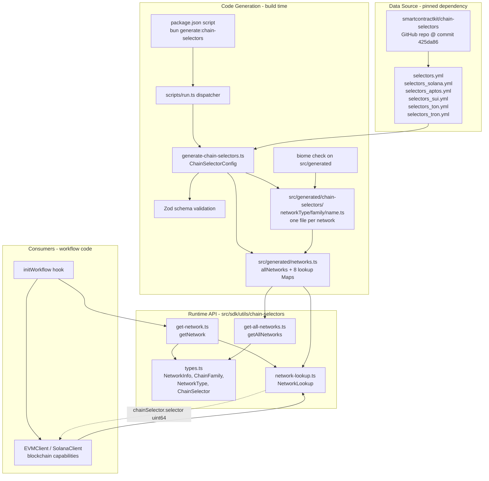
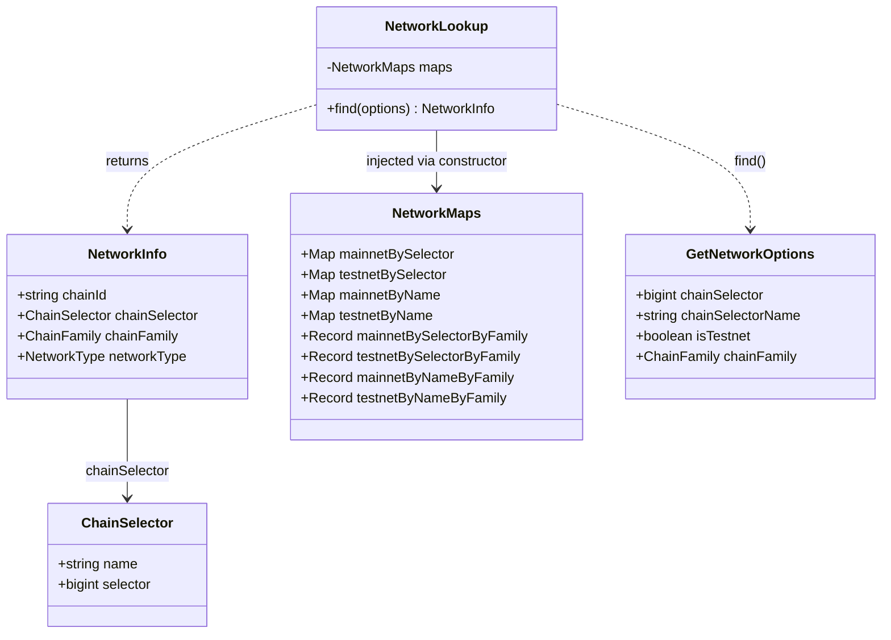
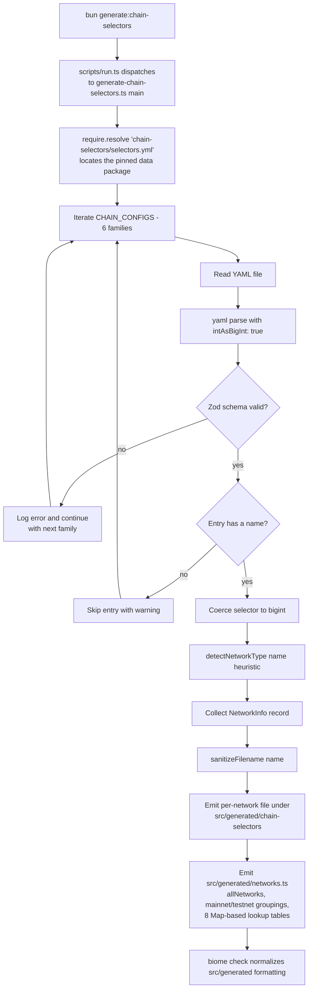
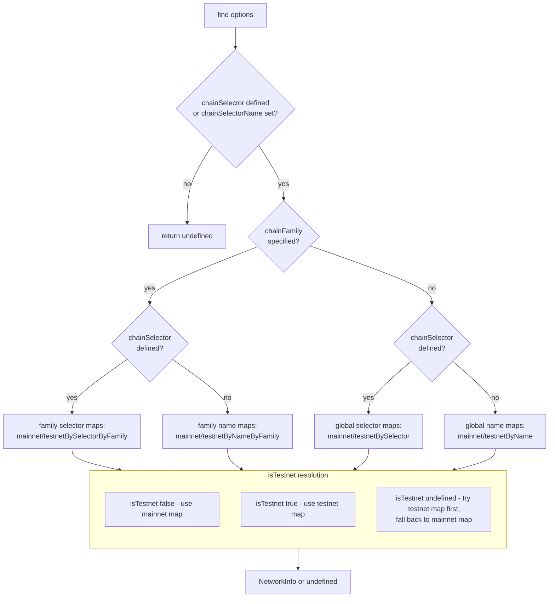

# Chain Selectors (`cre-sdk-core`)

The **chain-selectors** module is the network-identity subsystem of the [CRE TypeScript SDK](../cre-sdk-core.md). It gives workflow authors a canonical, type-safe way to resolve *chain selectors* — the globally unique `uint64` identifiers Chainlink assigns to every supported blockchain network — from human-friendly inputs such as a selector `bigint`, a selector name (`"ethereum-testnet-sepolia"`), a chain family, or a network type.

The module has two halves:

1. **A code-generation pipeline** (build time) that converts the canonical network registry published in the [`smartcontractkit/chain-selectors`](https://github.com/smartcontractkit/chain-selectors) repository into static TypeScript artifacts inside the SDK package.
2. **A runtime lookup API** (`getNetwork`, `getAllNetworks`, `NetworkLookup`) that performs O(1) queries against pre-built in-memory maps, so workflows never fetch network metadata over the network at execution time.

## At a Glance

| Aspect | Detail |
| --- | --- |
| Module location | `cre-sdk-typescript/packages/cre-sdk` |
| Runtime source | `src/sdk/utils/chain-selectors/` (`types.ts`, `network-lookup.ts`, `get-network.ts`, `get-all-networks.ts`, `index.ts`) |
| Generator source | `scripts/src/generate-chain-selectors.ts` |
| Data source | `chain-selectors` npm devDependency, pinned to commit `425da86147b75ee0fdd0d95d840a0966b837056b` of `smartcontractkit/chain-selectors` |
| Generated artifacts | `src/generated/networks.ts` + `src/generated/chain-selectors/<networkType>/<family>/<name>.ts` |
| Public entry points | `getNetwork(options)`, `getAllNetworks()`, types `NetworkInfo`, `ChainFamily`, `NetworkType`, `ChainSelector` |
| Primary consumers | Workflow `initWorkflow` hooks, blockchain client capabilities (`EVMClient`, `SolanaClient`) |

## Role in the System

CRE workflows run as WASM modules inside the [Workflow & Capability Runtime](../../Workflow___Capability_Runtime_(CRE_Engine).md). When a workflow interacts with a blockchain through a capability client (`EVMClient`, `SolanaClient`, …), it must address the target chain by its canonical chain selector — the same identifier scheme used across Chainlink products (CCIP, OCR, relayers; see [types-core relayer documentation](../../Shared_Foundation_Libraries___Domain_Types/types-core/types-core_relayer.md)).

This module is the bridge between **configuration ergonomics** and **protocol identifiers**:

- Workflow configuration files (e.g. `config.production.json`) reference networks by readable `chainSelectorName` strings.
- At workflow initialization, `getNetwork` resolves the name to a `NetworkInfo` record.
- The workflow passes `network.chainSelector.selector` (a `bigint`) into capability clients, which forward it to the node in capability requests.

Because the registry is **compiled into the workflow bundle** (static generated data, no runtime I/O), lookups are deterministic and free of side effects — consistent with the SDK's determinism requirements checked during builds (see the `check-determinism` script in `scripts/run.ts`).

## Architecture



Key properties of this design:

- **Compile-time binding**: the registry snapshot is frozen into the WASM bundle at build time. Bumping network data is an explicit, reviewable dependency update (see [Code Generation Pipeline](#code-generation-pipeline)).
- **No runtime I/O**: all lookups hit pre-built `Map` instances with O(1) access; nothing is fetched from the internet during execution.
- **Single source of truth**: the SDK never hard-codes selector values; every value originates from the official chain-selectors repository, as asserted by the integration tests.

## Component Model



### Type definitions — `src/sdk/utils/chain-selectors/types.ts`

| Type | Definition | Notes |
| --- | --- | --- |
| `ChainFamily` | `'evm' \| 'solana' \| 'aptos' \| 'sui' \| 'ton' \| 'tron'` | Supported chain families; matches the six YAML source files. |
| `NetworkType` | `'mainnet' \| 'testnet'` | Derived heuristically at generation time (see below). |
| `ChainSelector` | `{ name: string; selector: bigint }` | `selector` is the canonical `uint64` Chainlink chain selector, modeled as `bigint` to avoid precision loss. |
| `NetworkInfo` | `{ chainId: string; chainSelector: ChainSelector; chainFamily: ChainFamily; networkType: NetworkType }` | `chainId` is the native chain identifier as a string (EVM chain IDs, Solana cluster names, etc.). |

### Lookup engine — `src/sdk/utils/chain-selectors/network-lookup.ts`

`NetworkLookup` is a small, injectable class constructed over a `NetworkMaps` bundle (eight `Map`/`Record` structures). Its single `find(options)` method implements the full lookup decision matrix described in [Lookup Semantics](#lookup-semantics). Keeping the class dependency-injected makes the decision logic unit-testable against fixture maps without touching generated data — see `get-network.test.ts`.

### Public facades

- `src/sdk/utils/chain-selectors/get-network.ts` constructs a module-level singleton `NetworkLookup` over the generated maps and exports `getNetwork(options)`.
- `src/sdk/utils/chain-selectors/get-all-networks.ts` exports `getAllNetworks()`, returning the generated `allNetworks` array.
- `src/sdk/utils/chain-selectors/index.ts` re-exports both facades and the types; these are surfaced on the root `@chainlink/cre-sdk` package via `src/sdk/utils/index.ts` → `src/sdk/index.ts` → `src/index.ts`.
- `NetworkLookup` itself is exported from its module for advanced and test use, but is not part of the re-exported index surface.

## Code Generation Pipeline

The generator lives at `cre-sdk-typescript/packages/cre-sdk/scripts/src/generate-chain-selectors.ts` and is a Bun script (`#!/usr/bin/env bun`). It is registered with the SDK's script dispatcher (`scripts/run.ts` maps the name `generate-chain-selectors` to the module and invokes its exported `main()`).



### Input configuration — `ChainSelectorConfig`

Each family is described by a `ChainSelectorConfig { family, filename, schema }` entry in the `CHAIN_CONFIGS` array. Selectors are validated with Zod; `selector` accepts `bigint | string | number` and is normalized to `bigint` (the YAML parser runs with `intAsBigInt: true` so 64-bit selector values survive parsing).

| Family | Source YAML | Schema |
| --- | --- | --- |
| `evm` | `selectors.yml` | `EvmSelectorsSchema` |
| `solana` | `selectors_solana.yml` | `NonEvmSelectorsSchema` |
| `aptos` | `selectors_aptos.yml` | `NonEvmSelectorsSchema` |
| `sui` | `selectors_sui.yml` | `NonEvmSelectorsSchema` |
| `ton` | `selectors_ton.yml` | `NonEvmSelectorsSchema` |
| `tron` | `selectors_tron.yml` | `NonEvmSelectorsSchema` |

The `EvmSelectorsSchema` and `NonEvmSelectorsSchema` are structurally identical (`{ selectors: Record<chainId, { selector, name? }> }`); the split is kept for clarity and future divergence.

### Network-type detection

`detectNetworkType(name)` lowercases the selector name and classifies it as `'testnet'` if it contains any testnet indicator keyword, otherwise `'mainnet'`. Indicators include (non-exhaustive): `testnet`, `test`, `devnet`, `dev`, `localnet`, `local`, and well-known public testnet names such as `goerli`, `sepolia`, `holesky`, `mumbai`, `amoy`, `fuji`, `chapel`, `shasta`, `nile`, `kairos`, `shibuya`, `pangoro`, `cardona`, `puppynet`, `alfajores`, `moonbase`, `tatara`.

### Generated artifacts

1. **Per-network files** — `src/generated/chain-selectors/<networkType>/<family>/<sanitized-name>.ts`. Each file exports a single `NetworkInfo` constant, e.g. `src/generated/chain-selectors/mainnet/evm/ethereum-mainnet.ts`:

   ```typescript
   // This file is auto-generated. Do not edit manually.
   // Generated from: https://github.com/smartcontractkit/chain-selectors

   import type { NetworkInfo } from '@cre/sdk/utils/chain-selectors/types'

   const network: NetworkInfo = {
       chainId: '1',
       chainSelector: {
           name: 'ethereum-mainnet',
           selector: 5009297550715157269n,
       },
       chainFamily: 'evm',
       networkType: 'mainnet',
   } as const

   export default network
   ```

   The generator wipes and recreates the directory on each run (`rmSync` + `mkdirSync`), and file names are sanitized (`sanitizeFilename`) by replacing characters outside `[a-zA-Z0-9.-]` with dots.

2. **Aggregate registry** — `src/generated/networks.ts` exports:
   - `allNetworks: NetworkInfo[]` — every parsed network.
   - `mainnet` / `testnet` — objects grouping networks by `ChainFamily` as read-only arrays.
   - **Eight lookup maps** for O(1) access: `mainnetBySelector`, `testnetBySelector` (`Map<bigint, NetworkInfo>`), `mainnetByName`, `testnetByName` (`Map<string, NetworkInfo>`), and their family-scoped counterparts `mainnetBySelectorByFamily`, `testnetBySelectorByFamily`, `mainnetByNameByFamily`, `testnetByNameByFamily` (`Record<ChainFamily, Map<…>>`).

### Data source pinning and updates

The YAML inputs are **not** vendored in this repository. They come from the `chain-selectors` devDependency declared in `cre-sdk-typescript/packages/cre-sdk/package.json`, pinned to a fixed commit of `https://github.com/smartcontractkit/chain-selectors.git`:

```json
"chain-selectors": "https://github.com/smartcontractkit/chain-selectors.git#425da86147b75ee0fdd0d95d840a0966b837056b"
```

The generator locates the package via `require.resolve('chain-selectors/selectors.yml')`, which correctly handles Bun/Node workspace hoisting. To refresh network data: bump the pinned commit in `package.json`, then re-run generation (see [Build & Tooling Integration](#build--tooling-integration)) and commit the regenerated `src/generated/` diff.

### Failure behavior

- Per-family failures (unreadable file, schema mismatch) are logged and **do not abort** the whole run — remaining families still generate.
- A fatal error in the top-level `main()` logs and exits with process code `1`, failing the build.

## Lookup Semantics

`getNetwork(options)` accepts a `GetNetworkOptions` object:

```typescript
interface GetNetworkOptions {
    chainSelector?: bigint
    chainSelectorName?: string
    isTestnet?: boolean | undefined
    chainFamily?: ChainFamily
}
```

All fields are optional, but at least one of `chainSelector` or `chainSelectorName` must be provided.



### Behavior rules

1. **Selector takes precedence over name.** When both `chainSelector` and `chainSelectorName` are supplied, the selector path is used and the name is ignored.
2. **Family scoping narrows the search.** With `chainFamily` set, lookups use family-specific maps, so a selector that exists globally but not in that family returns `undefined` rather than cross-family matches.
3. **`isTestnet` resolution.**
   - `false` → mainnet map only.
   - `true` → testnet map only.
   - `undefined` → **testnet map first, then mainnet map** as a fallback. This matters when a selector or name exists in both maps: the testnet entry wins.
4. **Missing input.** Neither selector nor name → `undefined` immediately.
5. **Not found.** All paths return `undefined` rather than throwing; callers are expected to check the result (see [Usage in Workflows](#usage-in-workflows)).

These rules are pinned by the unit test `src/sdk/utils/chain-selectors/get-network.test.ts`, which builds a `NetworkLookup` over deterministic fixture maps and asserts every branch of the matrix above, including the "duplicate selector in both testnet and mainnet" preference cases.

## Usage in Workflows

Workflows resolve the target network inside their `initWorkflow` hook and hand the canonical selector to a capability client. Both examples below come from the [examples and plugins workspace](../cre-sdk-examples-and-plugins.md).

**EVM log-trigger workflow** (`cre-sdk-examples/src/workflows/log-trigger/main.ts`):

```typescript
import { EVMClient, getNetwork, handler, Runner, type Runtime } from '@chainlink/cre-sdk'

const initWorkflow = (config: Config) => {
    const network = getNetwork({
        chainFamily: 'evm',
        chainSelectorName: config.evms[0].chainSelectorName, // e.g. 'ethereum-testnet-sepolia'
        isTestnet: true,
    })

    if (!network) {
        throw new Error(`Network not found for chain selector name: ${config.evms[0].chainSelectorName}`)
    }

    const evmClient = new EVMClient(network.chainSelector.selector)
    // ... register trigger handlers on evmClient
}
```

**Solana on-chain write workflow** (`cre-sdk-examples/src/workflows/solana-onchain-write/main.ts`) follows the same pattern with `chainFamily: 'solana'` and `new SolanaClient(network.chainSelector.selector)`.

The `chainSelectorName` values in workflow configuration correspond to the `chainSelector.name` field of the generated registry (e.g. `ethereum-testnet-sepolia`, `solana-devnet`), so operators can configure environments by readable name while the protocol layer always receives the canonical `uint64` selector.

> Tip: because `getNetwork` returns `undefined` for unknown inputs, wrap the call and fail fast with a descriptive error, as shown above — a `null` selector handed to a capability client surfaces as a runtime error deep in the node instead.

## Testing

The module ships with two complementary test layers (`bun test`):

| Test file | Scope | What it guarantees |
| --- | --- | --- |
| `src/sdk/utils/chain-selectors/get-network.test.ts` | Unit | Full decision matrix of `NetworkLookup.find` against injected fixture maps: input validation, family scoping, selector-over-name precedence, testnet preference and mainnet fallback, not-found cases. |
| `src/sdk/utils/chain-selectors/chain-selectors.test.ts` | Integration | The *generated* registry: asserts that Sepolia (`selector = 16015286601757825753n`, `name = 'ethereum-testnet-sepolia'`) is present in `testnetBySelector`, `testnetByName`, and `allNetworks` with the correct `networkType`. Values are cross-checked against the official chain-selectors repository. |

Run them with `bun test` from the `packages/cre-sdk` directory, or as part of `full-checks` (see below).

## Build & Tooling Integration

The chain-selectors pipeline is wired into the SDK's build system ([workspace build overview](../cre-sdk-workspace-build.md)):

- **Invocation** — `cre-sdk-typescript/packages/cre-sdk/package.json` defines:
  - `"generate:chain-selectors": "bun scripts/run.ts generate-chain-selectors && BIOME_PATHS=\"src/generated\" bun check"` — regenerates artifacts, then runs Biome over `src/generated` so generated code conforms to repo formatting (tabs, single quotes), keeping diffs clean.
  - `"generate:sdk"` — the umbrella generator (`generate:proto` → `generate:chain-selectors` → `generate-sdks`) used by `full-checks` and releases.
- **Script dispatch** — `scripts/run.ts` maintains the registry of script names and dynamically imports `./src/generate-chain-selectors.ts`, calling its `main()`.
- **Monorepo orchestration** — the root `cre-sdk-typescript/package.json` uses Turborepo (`turbo.json`) to run `build`/`check`/`lint` tasks across workspace packages; the `cre-sdk` package's generated `src/` tree feeds directly into `compile:build` (tsc) and the WASM compilation pipeline (`compile:js-to-wasm`).
- **Publishing** — the `files` array includes `scripts/` and `dist/`; the generated data ends up compiled into `dist/`, so published `@chainlink/cre-sdk` consumers always ship a complete, pinned registry snapshot.

## Related Documentation

- [CRE SDK Core](../cre-sdk-core.md) — parent module: runtime, handlers, and workflow lifecycle.
- [SDK Runtime](cre-sdk-core_runtime.md) — `Runtime` and runner APIs that workflow hooks receive; chain clients are constructed in `initWorkflow`.
- [Errors](cre-sdk-core_errors.md) — error types surfaced when capability calls fail (e.g. after passing an invalid selector).
- [API Surface](cre-sdk-core_api-surface.md) — public export baseline (`api-baseline.d.ts`) that includes the `getNetwork`/`getAllNetworks`/type exports.
- [Generated Capabilities](../cre-sdk-generated-capabilities.md) — the capability client bindings (`EVMClient`, `SolanaClient`) that consume `chainSelector.selector`.
- [Relayer & chain identity types](../../Shared_Foundation_Libraries___Domain_Types/types-core/types-core_relayer.md) — how the same chain-selector identifiers are used across node-side relayers and plugins.
- [CRE CLI workflow simulation](../cre-cli-workflow-commands.md) — the simulator's chain configuration model, which workflows exercise with the same selector names during local testing.
