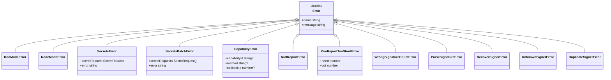
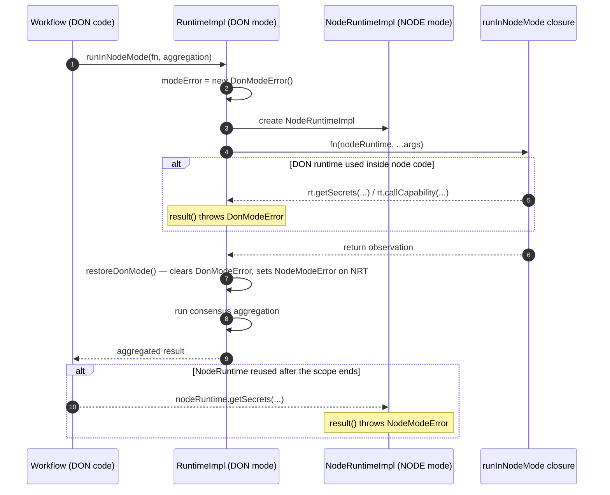
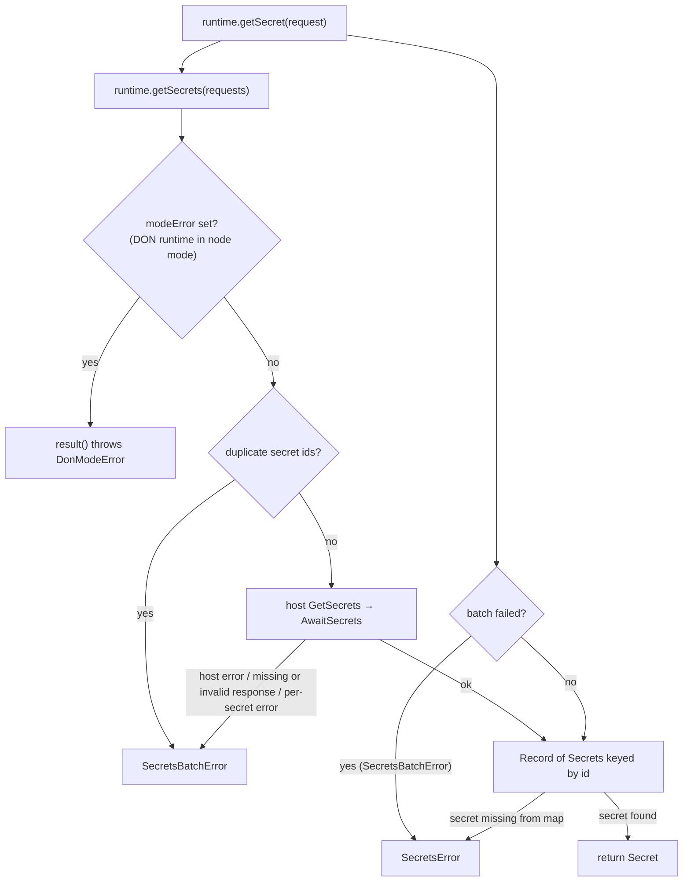
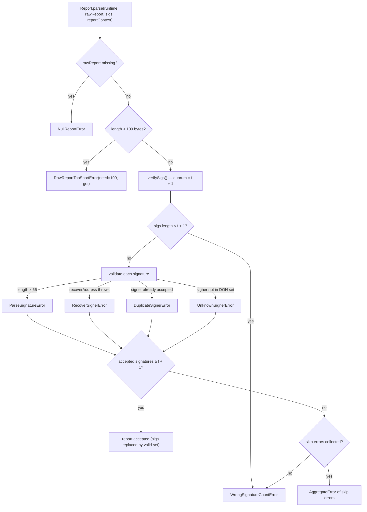
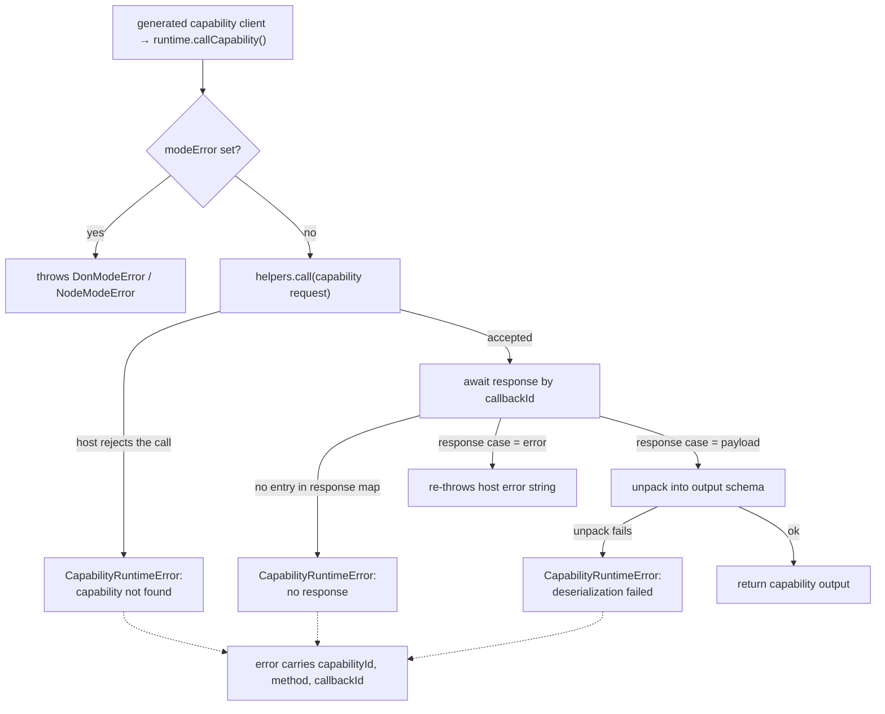
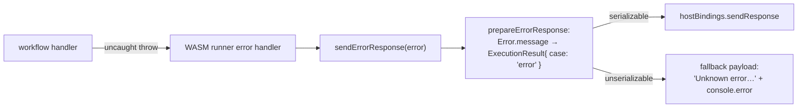

# cre-sdk-core: Error Types

The **cre-sdk-core errors module** defines the typed error classes thrown by the CRE TypeScript SDK (`@chainlink/cre-sdk`) inside workflow WASM executions. It provides a stable, name-tagged error taxonomy covering four failure domains: **runtime mode violations**, **secret retrieval**, **report verification/parsing**, and **capability invocation**. Workflow authors catch these classes (or compare `err.name`) to implement fine-grained recovery logic; the SDK itself uses them internally to surface host-level failures with actionable messages.

Source of this module:

| File | Contents |
| --- | --- |
| `cre-sdk-typescript/packages/cre-sdk/src/sdk/errors.ts` | All SDK error classes; re-exports `CapabilityError` as `CapabilityRuntimeError` |
| `cre-sdk-typescript/packages/cre-sdk/src/sdk/utils/capabilities/capability-error.ts` | The `CapabilityError` class (deprecated in favour of the `CapabilityRuntimeError` alias) |

Both files are re-exported publicly through `cre-sdk-typescript/packages/cre-sdk/src/sdk/index.ts` (`export * from './errors'`), so all errors are importable from the package root — see [cre-sdk-core API surface](cre-sdk-core_api-surface.md).

---

## Error Taxonomy at a Glance

All error classes extend the built-in `Error` and set `this.name` to their class name, so both `instanceof` checks and string comparisons against `err.name` are reliable.

| Error | Category | Context Carried | Raised By |
| --- | --- | --- | --- |
| `DonModeError` | Mode guard | – | DON `Runtime` methods called while inside `runInNodeMode` |
| `NodeModeError` | Mode guard | – | `NodeRuntime` methods called after `runInNodeMode` has returned |
| `SecretsError` | Secrets | `secretRequest`, `error` | `runtime.getSecret(...).result()` |
| `SecretsBatchError` | Secrets | `secretRequests[]`, `error` | `runtime.getSecrets(...).result()` |
| `CapabilityRuntimeError` (alias of `CapabilityError`) | Capability call | `capabilityId`, `method`, `callbackId` (optional) | `runtime.callCapability(...)` result unwrapping |
| `NullReportError` | Report parsing | – | `Report.parse()` when the raw report is missing |
| `RawReportTooShortError` | Report parsing | `need`, `got` | `Report.parse()` when the raw report is shorter than the 109-byte metadata header |
| `WrongSignatureCountError` | Report verification | – | Fewer valid signatures than the quorum `f + 1` |
| `ParseSignatureError` | Report verification | – | Signature is not exactly 65 bytes |
| `RecoverSignerError` | Report verification | – | ECDSA address recovery failed |
| `DuplicateSignerError` | Report verification | – | Same signer address recovered twice |
| `UnknownSignerError` | Report verification | – | Recovered signer is not in the DON signer set |

### Error Hierarchy



> **Naming note:** `errors.ts` re-exports the deprecated class under its canonical runtime name:
> ```typescript
> export { CapabilityError as CapabilityRuntimeError } from './utils/capabilities/capability-error'
> ```
> Per the `TODO` in the source, `CapabilityError` will be renamed to `CapabilityRuntimeError` on the next major version. They are the *same class*; always import and catch `CapabilityRuntimeError`.

---

## 1. Runtime Mode Guard Errors

The CRE engine executes workflow code in two mutually exclusive modes, implemented in the runtime module (see [cre-sdk-core runtime](cre-sdk-core_runtime.md)):

- **DON mode** — the workflow's top-level code, where consensus and DON-level operations are allowed.
- **Node mode** — the `runInNodeMode(fn, aggregation)` closure, where code runs per-node and DON-level operations are forbidden.

The guard is implemented via the `modeError` field on `BaseRuntimeImpl` (`cre-sdk-typescript/packages/cre-sdk/src/sdk/impl/runtime-impl.ts`):

1. `RuntimeImpl.runInNodeMode` sets `this.modeError = new DonModeError()` on the DON runtime before invoking the node closure. Any DON-level call (`callCapability`, `getSecrets`, `getSecret`) made *through the DON runtime* while node code runs returns a lazy result that throws `DonModeError` (`"cannot use Runtime inside RunInNodeMode"`).
2. When the closure finishes, `restoreDonMode` clears the DON guard and sets `nodeRuntime.modeError = new NodeModeError()` on the `NodeRuntimeImpl`. If node code holds a reference to the `NodeRuntime` and uses it after `runInNodeMode` has returned, its calls throw `NodeModeError` (`"cannot use NodeRuntime outside RunInNodeMode"`).



**Key behaviour:** because all SDK calls return lazy result handles, the mode error is *thrown when `.result()` is called*, not when the guarded method is invoked.

---

## 2. Secret Retrieval Errors

Secret access goes through the DON runtime's `getSecrets` (batch) and `getSecret` (single) methods. All failure paths produce `SecretsBatchError`, which `getSecret` then converts into the single-request `SecretsError` for a narrower context.

- **`SecretsBatchError`** carries `secretRequests` (the full batch) and an `error` detail string. Its message asks the developer to verify the host response is complete and that the workflow has access to the requested secrets. Raised for:
  - duplicate secret ids in one batch (responses are keyed by id),
  - host-side failures of the `GetSecrets` / `AwaitSecrets` host calls,
  - a missing response, a response count mismatch, a non-secret response case, or per-secret `error` payloads returned by the host.
- **`SecretsError`** carries the single `secretRequest` and the `error` detail. Its message embeds the secret id and namespace and hints to verify the secret name and workflow configuration.



---

## 3. Report Verification & Parsing Errors

These errors guard the integrity of DON-signed reports consumed by workflows (e.g. via `reportFromDon` on the TEE runtime). They are thrown from the report pipeline in `cre-sdk-typescript/packages/cre-sdk/src/sdk/report.ts`:

**Metadata header parsing** (`parseReportMetadataHeader`): the raw report must carry a fixed metadata header of `REPORT_METADATA_HEADER_LENGTH = 109` bytes (version, execution id, timestamp, DON id, DON config version, workflow id/name/owner, report id) before the report body.

- `NullReportError` — the raw report is `null`/`undefined`.
- `RawReportTooShortError` — the raw report is shorter than 109 bytes; carries `need` (109) and `got` (actual length).

**Signature verification** (`verifySigs`): at least `f + 1` signatures (`f` = DON fault tolerance, fetched from the capabilities registry contract) must validate:

- `WrongSignatureCountError` — fewer signatures than the required quorum, or insufficient accepted signatures and no per-signature errors.
- `ParseSignatureError` — a signature is not exactly 65 bytes (r, s, v).
- `RecoverSignerError` — ECDSA address recovery from the signature failed.
- `DuplicateSignerError` — the same signer address was recovered twice.
- `UnknownSignerError` — a recovered address is not a registered signer of the DON.

Per-signature problems are collected as skip errors; if the quorum still cannot be met, they are re-thrown together in an `AggregateError`. Invalid signatures are dropped rather than fatal, so a report with enough valid signatures still succeeds.



---

## 4. Capability Invocation Errors — `CapabilityRuntimeError`

Every generated capability client (see [cre-sdk-generated-capabilities](../cre-sdk-generated-capabilities.md)) delegates to `BaseRuntimeImpl.callCapability`, which wraps four failure cases in a `CapabilityRuntimeError` when `.result()` is called:

1. **Capability not found** — the host rejected the call (`helpers.call` returned `false`).
2. **No response** — the awaited response map has no entry for the allocated callback id.
3. **Deserialization failure** — the response payload could not be unpacked into the expected output schema.
4. **Unexpected response type** — the response case is neither `payload` nor `error`.

When constructed with options, the error carries `capabilityId`, `method`, and `callbackId`, enabling precise diagnostics of which generated capability call failed. Host-reported `error` responses (case `error`) are re-thrown as the host-provided error string instead of a `CapabilityRuntimeError`.



---

## 5. Error Propagation to the Host

Errors that escape the workflow handler bubble up to the WASM runner, which reports them back to the CRE host so the execution is marked as failed rather than silently lost.

In `cre-sdk-typescript/packages/cre-sdk/src/sdk/wasm/send-error-response.ts`:

- `prepareErrorResponse(error)` converts any thrown value into a serialized `ExecutionResult` protobuf with the `error` result case (using `Error.message` when available, otherwise `String(error)`).
- `sendErrorResponse(error)` sends that payload through `hostBindings.sendResponse`; if serialization fails, a fallback message (`"Unknown error: the original error could not be serialized"`) is emitted and the original error is logged to the console.



This makes every SDK error — including the typed classes in this module — visible to the node runtime and, ultimately, in execution telemetry (see [Workflow & Capability Runtime (CRE Engine)](../../Workflow___Capability_Runtime_(CRE_Engine).md)).

---

## Handling SDK Errors in Workflows

All errors are exported from the package root. Because calls are lazy, wrap the `.result()` invocation:

```typescript
import {
  CapabilityRuntimeError,
  DonModeError,
  NodeModeError,
  RawReportTooShortError,
  SecretsBatchError,
  SecretsError,
  WrongSignatureCountError,
} from '@chainlink/cre-sdk'

try {
  const secret = runtime.getSecret({ id: 'api-key', namespace: 'default' }).result()
} catch (err) {
  if (err instanceof SecretsError) {
    // err.secretRequest.id, err.secretRequest.namespace, err.error
  } else if (err instanceof SecretsBatchError) {
    // err.secretRequests, err.error
  } else if (err instanceof DonModeError || err instanceof NodeModeError) {
    // fix the runtime/scope used for the call
  } else {
    throw err // re-throw unknown errors so the host marks the execution as failed
  }
}

try {
  const out = myCapability.doThing(runtime, input).result()
} catch (err) {
  if (err instanceof CapabilityRuntimeError) {
    // err.capabilityId, err.method, err.callbackId
  }
}
```

Guidance:

- Prefer `instanceof` checks; every class also sets `this.name`, so `err.name === 'SecretsError'` works in contexts without class identity (e.g. across bundled copies).
- `SecretsError` / `SecretsBatchError` messages already contain remediation hints (verify secret name, namespace, and workflow access); surface them in workflow logs rather than swallowing them.
- For report verification, `ParseSignatureError` / `RecoverSignerError` / `DuplicateSignerError` / `UnknownSignerError` may arrive grouped in an `AggregateError` when the quorum cannot be met — inspect `err.errors`.

### Testing

Error behaviour is covered by the SDK's standard tests (mode guards, secrets, and report parsing) executed via the WASM host test harness — see [cre-sdk-core test harness](cre-sdk-core_test-harness.md) and the package build entry points in `cre-sdk-typescript/packages/cre-sdk/Makefile` (`standard_tests`, `standard_test_single`).

---

## Related Documentation

- [cre-sdk-core](../cre-sdk-core.md) — parent module overview
- [cre-sdk-core runtime](cre-sdk-core_runtime.md) — `Runtime`, `NodeRuntime`, `TeeRuntime` and the mode-guard implementation that raises `DonModeError` / `NodeModeError`
- [cre-sdk-core API surface](cre-sdk-core_api-surface.md) — public exports, including this module's error classes
- [cre-sdk-generated-capabilities](../cre-sdk-generated-capabilities.md) — generated clients that surface `CapabilityRuntimeError` through `.result()`
- [Workflow & Capability Runtime (CRE Engine)](../../Workflow___Capability_Runtime_(CRE_Engine).md) — host-side execution and how error responses are consumed
