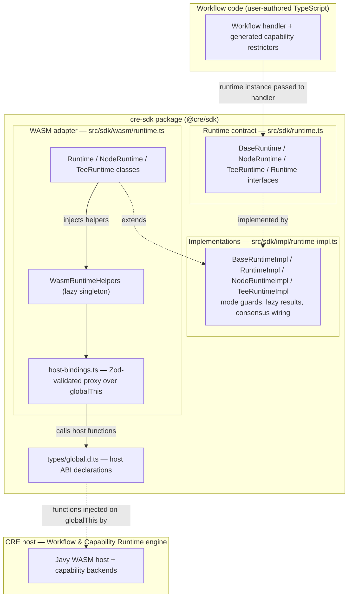
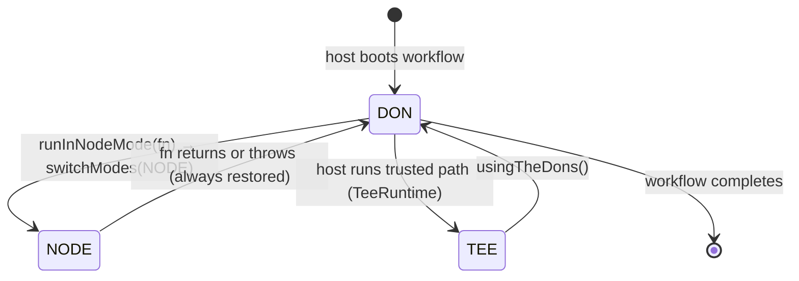
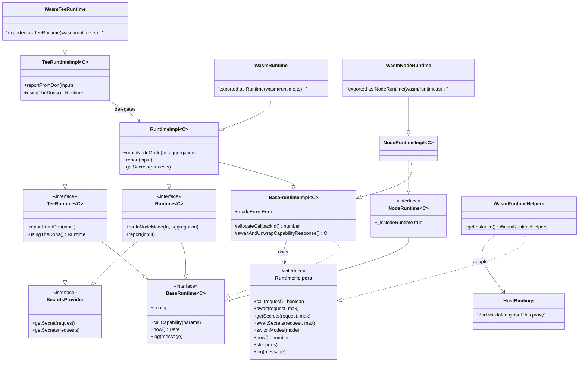
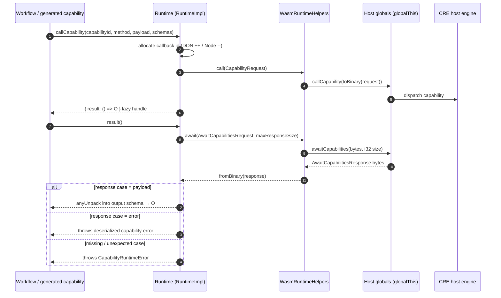
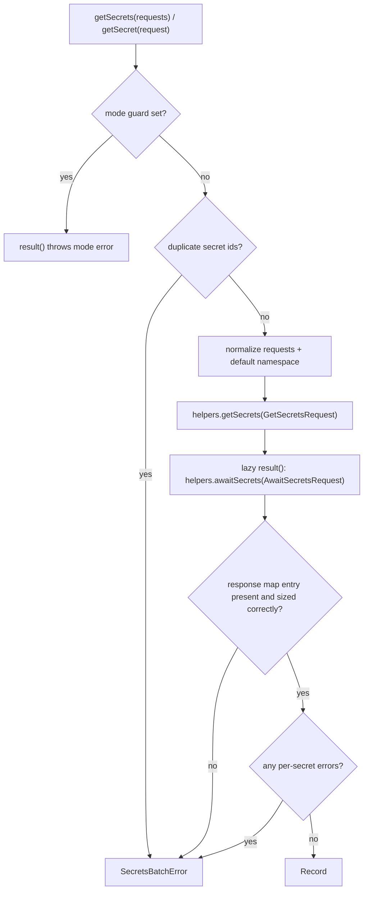
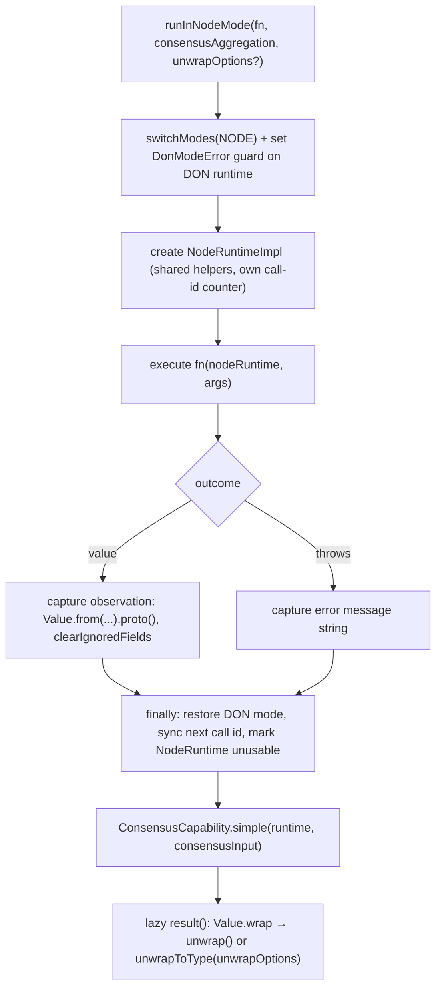

# CRE SDK Core — Runtime (`cre-sdk-core_runtime`)

## Introduction

The **runtime** module is the execution backbone of the CRE (Chainlink Runtime Environment) TypeScript SDK (`cre-sdk-typescript/packages/cre-sdk`, distributed as `@cre/sdk`). It defines the **runtime abstractions that every CRE workflow is written against** — `BaseRuntime`, `Runtime` (DON mode), `NodeRuntime` and `TeeRuntime` — together with the **WASM-backed adapter layer** that connects those abstractions to the CRE host process through a small set of global host functions.

Workflows never construct a runtime themselves. The host — a Javy-based WASM runner embedded in the [Workflow & Capability Runtime (CRE Engine)](<../../Workflow___Capability_Runtime_(CRE_Engine).md>) — instantiates the correct runtime class, injects the workflow configuration, a starting call ID and a maximum response size, and then invokes the workflow's exported handler. From that point on, the runtime mediates **all** interaction between workflow code and the outside world:

* **Capability invocation** (`callCapability`) — the single primitive behind every generated capability restrictor.
* **Secret retrieval** (`getSecret` / `getSecrets`) — batched, host-mediated access to the vault.
* **Consensus & reporting** (`runInNodeMode`, `report`, `reportFromDon`) — DON-level agreement and on-chain report generation.
* **Environment services** — host clock (`now`), sleep, logging, and execution-mode switching between DON / NODE / TEE.

**Module files**

| File | Role |
|---|---|
| `cre-sdk-typescript/packages/cre-sdk/src/sdk/runtime.ts` | Runtime interfaces and the `CallCapabilityParams` contract |
| `cre-sdk-typescript/packages/cre-sdk/src/sdk/wasm/runtime.ts` | WASM runtime classes, `WasmRuntimeHelpers`, response-size guard |
| `cre-sdk-typescript/packages/cre-sdk/src/sdk/types/global.d.ts` | TypeScript declaration of the host ABI injected on `globalThis` |
| `src/sdk/impl/runtime-impl.ts` | Shared mode-guarded implementations (supporting file) |
| `src/sdk/wasm/host-bindings.ts` | Zod validation of host functions at runtime (supporting file) |

## Architecture

The module is a strict layering of contracts over a thin WASM boundary:

1. **Workflow layer** — authors import the SDK and use generated capability restrictors (documented in [cre-sdk-generated-capabilities](<../cre-sdk-generated-capabilities.md>)); those restrictors are the *only* intended callers of `callCapability`.
2. **Contract layer** — pure TypeScript interfaces; no host coupling.
3. **Implementation layer** — mode enforcement, callback-ID allocation, protobuf (de)serialization and lazy result handles.
4. **WASM adapter layer** — binds the implementations to the host via a validated `RuntimeHelpers` port.
5. **Host ABI** — the set of functions the host injects on `globalThis`; the host side of this contract lives in the [Workflow & Capability Runtime (CRE Engine)](<../../Workflow___Capability_Runtime_(CRE_Engine).md>) module (engine internals: [workflows_engine](<../../Workflow___Capability_Runtime_(CRE_Engine)/workflows/workflows_engine.md>)).

## Runtime contract (`src/sdk/runtime.ts`)

Four interfaces describe what workflow code may do in each execution mode:

| Interface | Extends | Execution context | Key members |
|---|---|---|---|
| `BaseRuntime<C>` | — | Common denominator available in **all** modes | `config: C` (typed workflow config), `callCapability<I,O>(params)` (generated code only), `now(): Date`, `log(message)` |
| `NodeRuntime<C>` | `BaseRuntime<C>` | Node-local execution inside `runInNodeMode` | Marker `_isNodeRuntime: true` |
| `TeeRuntime<C>` | `BaseRuntime<C>` + `SecretsProvider` | Trusted Execution Environment | `reportFromDon(input)` — generates a DON report; `usingTheDons(): Runtime<C>` — returns a runtime whose requests are **routed outside of the TEE** |
| `Runtime<C>` | `BaseRuntime<C>` + `SecretsProvider` | DON-level execution | `runInNodeMode(fn, consensusAggregation, unwrapOptions?)`, `report(input)` |

Design points:

* **Lazy results everywhere.** Capability calls, secrets and consensus all return `{ result: () => T }` handles. The request is initiated immediately (side effects start), but responses are awaited and decoded only when `result()` is called — this lets workflows issue many concurrent capability calls before synchronising.
* **Typed configuration.** The `config: C` member carries the workflow's declared configuration into every mode.
* **`SecretsProvider`** is mixed into `Runtime` and `TeeRuntime` but deliberately *not* into `BaseRuntime`, so plain node-mode runtimes do not expose vault access.

## Execution modes and mode enforcement

The host distinguishes three execution modes (`Mode` protobuf enum: `0 = UNSPECIFIED`, `1 = DON`, `2 = NODE`); TEE is a distinct runtime class executing inside a DON. Mode transitions are coordinated with the host via `switchModes`:

Mode correctness is enforced in the implementation layer, not at the host boundary:

* While `runInNodeMode` executes the user function, the enclosing DON runtime sets its own `modeError = DonModeError` — any attempt to use DON-level operations inside node code surfaces `DonModeError` when `.result()` is called.
* After the function returns, the captured `NodeRuntime` gets `modeError = NodeModeError`, so node-scoped runtimes cannot be used after consensus resumes.
* Error types (`DonModeError`, `NodeModeError`, `SecretsError`, `SecretsBatchError`) are documented in [cre-sdk-core_errors](cre-sdk-core_errors.md).

## WASM adapter layer (`src/sdk/wasm/runtime.ts`)

The WASM file exports thin subclasses that wire the shared implementations to the host. Each constructor takes `(config, nextCallId, maxResponseSize)` and injects the `WasmRuntimeHelpers` singleton:

* `Runtime<C> extends RuntimeImpl<C>`
* `NodeRuntime<C> extends NodeRuntimeImpl<C>`
* `TeeRuntime<C> extends TeeRuntimeImpl<C>`

### `RuntimeHelpers` port

`WasmRuntimeHelpers` (private constructor + `getInstance()`) adapts the validated `hostBindings` proxy to the `RuntimeHelpers` interface expected by the implementations:

| `RuntimeHelpers` method | Host binding (globalThis) | Behaviour |
|---|---|---|
| `call(CapabilityRequest): boolean` | `callCapability` | Returns `false` when the host rejects the call (capability not found) |
| `await(AwaitCapabilitiesRequest, maxResponseSize)` | `awaitCapabilities` | Blocks until responses are ready; returns protobuf bytes |
| `getSecrets(GetSecretsRequest, maxResponseSize)` | `getSecrets` | Initiates a secrets request |
| `awaitSecrets(AwaitSecretsRequest, maxResponseSize)` | `awaitSecrets` | Blocks until secrets are ready |
| `switchModes(mode)` | `switchModes` | Switches host execution mode (DON ↔ NODE) |
| `now() / sleep(ms)` | `now / sleep` | Host clock (ms) and sleep |
| `log(message)` | `log` | Forwards log lines to the host log sink |

All wire traffic is protobuf, serialised with `toBinary` / deserialised with `fromBinary` using generated schemas from `@cre/generated/sdk/v1alpha/sdk_pb`.

### `toI32ResponseSize`

`toI32ResponseSize(maxResponseSize: bigint)` converts the SDK's `bigint` maximum response size into the `i32` expected by the WASM ABI and throws when the value falls outside the 32-bit signed range (`-2147483648 … 2147483647`). Response-size bounds cross the WASM boundary as 32-bit integers, so this guard prevents silent truncation.

### Host-bindings validation (`src/sdk/wasm/host-bindings.ts`)

`hostBindings` is a lazy `Proxy` over `globalThis`. On first access it validates the presence and shape of every required host function with a Zod schema (`globalHostBindingsSchema`) and throws a descriptive error listing missing functions when the workflow is executed outside a CRE WASM environment or against an incompatible host runtime version.

## Host ABI (`src/sdk/types/global.d.ts`)

`global.d.ts` is the authoritative TypeScript description of what the host injects into the WASM guest.

**Host functions**

| Function | Purpose |
|---|---|
| `callCapability(request: Uint8Array): number` | Initiates an async capability call; returns a callback ID |
| `awaitCapabilities(awaitRequest: Uint8Array, maxResponseLen: number): Uint8Array` | Awaits completion of async capability calls |
| `getSecrets(request: Uint8Array, maxResponseLen: number): number` | Initiates an async secrets request; returns a callback ID |
| `awaitSecrets(awaitRequest: Uint8Array, maxResponseLen: number): Uint8Array` | Awaits completion of secret requests |
| `log(message: string): void` | Logs to the host runtime |
| `sendResponse(response: Uint8Array): number` | Returns the workflow result to the host (status `0` = success) |
| `switchModes(mode: 0 \| 1 \| 2): void` | Switches execution between UNSPECIFIED / DON / NODE |
| `versionV2(): void` | Marks the module as a V2 SDK workflow |
| `randomSeed(mode: 1 \| 2): number` | Random seed: `1` non-deterministic, `2` deterministic |
| `getWasiArgs(): string` | Serialised WASI command-line arguments |
| `now(): number` / `sleep(ms: number): void` | Host clock (Unix ms) and sleep |

**Guest standard library.** The host also exposes JavaScript standard-library surfaces that are typed structurally with the `ExistingGlobal<K, Fallback>` helper, so the SDK compiles even when consumers opt out of `@types/node`:

* `console` (`CreConsole`: `log/warn/error/info/debug`)
* `TextEncoder` / `TextDecoder` — the module's named component `CreTextDecoder` describes the decoder surface (`encoding`, `fatal`, `ignoreBOM`, `decode`) provided via Javy's `text_encoding` support
* `Buffer` (`CreBuffer`, including `atob` / `btoa`) — exposed via `prepareRuntime()` from `node:buffer`
* `URL` / `URLSearchParams` (`CreURL`, `CreURLSearchParams`) — exposed via `prepareRuntime()` from `node:url`

## Component interaction

Notes:

* **Callback-ID allocation** — `allocateCallbackId()` increments in DON mode and decrements in Node mode, so DON calls and node calls can never collide on the same ID.
* **`TeeRuntimeImpl`** wraps a full `RuntimeImpl`: secrets, logging, clock and capability calls delegate to it; `reportFromDon` maps to `Runtime.report` and `usingTheDons()` hands out the inner DON runtime.

## Data flow

### Capability call lifecycle

The request payload is packed with the capability's input schema (`anyPack`) and the response is unpacked against the output schema (`anyUnpack`); a host rejection of the initial call (capability not found) is converted into a `CapabilityRuntimeError` naming the capability and method.

### Secrets flow (DON / TEE)

Batch semantics: the response is keyed by secret `id`, so duplicate IDs are rejected up front; per-secret errors are aggregated into a single `SecretsBatchError`. Single-secret requests surface failures as `SecretsError`.

### `runInNodeMode` consensus flow

Key properties:

* The node function executes **once per node** in Node mode; results and errors are captured as observations with the aggregation descriptor (and optional default value) attached.
* DON mode is **always restored** in a `finally` block, even when the node function throws.
* The consensus result is lazy — the aggregation round only completes when the workflow calls `result()`.

### Reporting paths

* **DON mode** — `Runtime.report(input)` delegates to `ConsensusCapability.report`; the returned `Report` is produced through consensus across the DON.
* **TEE mode** — `TeeRuntime.reportFromDon(input)` routes the same request out of the TEE; data obtained *through* this method is explicitly handled outside the enclave. Workflow code running inside the TEE reaches DON-level operations via `usingTheDons()`.

## Build, packaging and testing context

The runtime is designed for a Javy-compiled WASM deployment, and its behaviour is pinned by a conformance test suite:

* **Deterministic WASM build.** `cre-sdk-typescript/packages/cre-sdk-javy-plugin/Dockerfile` builds a `wasm32-wasip1` cdylib with a generated Javy host crate and finalises it with `javy init-plugin --deterministic`, emitting `javy-chainlink-sdk.plugin.wasm`. Determinism matters because workflow binaries are hashed and pinned in the workflow registry (see the [Workflow & Capability Runtime (CRE Engine)](<../../Workflow___Capability_Runtime_(CRE_Engine).md>) module). This is also the environment that injects the host ABI described above.
* **Standard (conformance) tests.** `cre-sdk-typescript/packages/cre-sdk/Makefile` (targets `standard_tests` and `standard_test_single TEST=…`) downloads the pinned conformance version (`chainlink-common` @ `cre-std-tests@0.10.0`), compiles the Go host test binary from `pkg/workflows/wasm/host`, and runs the `TestStandard*` suite against test workflows compiled locally by `cre-sdk-typescript/packages/cre-sdk/src/standard_tests/Makefile` via `bun compile:workflow`. This exercises the runtime against the real host implementation. Details of the harness live in [cre-sdk-core_test-harness](cre-sdk-core_test-harness.md).
* **Workspace tooling** (build, lint, typecheck, templates) is documented in [cre-sdk-workspace-build](<../cre-sdk-workspace-build.md>).

## Related modules

| Module | Relationship |
|---|---|
| [cre-sdk-core](../cre-sdk-core.md) | Parent module: SDK core package, API surface and support utilities |
| [cre-sdk-core_errors](cre-sdk-core_errors.md) | `DonModeError`, `NodeModeError`, `SecretsError` / `SecretsBatchError`, `CapabilityError` thrown by runtime guards |
| [cre-sdk-core_api-surface](cre-sdk-core_api-surface.md) | `HandlerEntry` baseline — the handler contract the host invokes through the runtime |
| [cre-sdk-core_chain-selectors](cre-sdk-core_chain-selectors.md) | Chain-selector utilities consumed alongside runtime config |
| [cre-sdk-core_test-harness](cre-sdk-core_test-harness.md) | `TestTeeRuntime` and the standard test suite that validate this module |
| [cre-sdk-generated-capabilities](<../cre-sdk-generated-capabilities.md>) | Generated restrictors — the only intended callers of `callCapability` |
| [Workflow & Capability Runtime (CRE Engine)](<../../Workflow___Capability_Runtime_(CRE_Engine).md>) | Host side: executes the compiled workflow module and provides the host bindings; engine in [workflows_engine](<../../Workflow___Capability_Runtime_(CRE_Engine)/workflows/workflows_engine.md>) |
| [Plugin Process Framework (Loop)](<../../Plugin_Process_Framework_(Loop)/loop-plugin-core.md>) | Go-side analogue: the gRPC plugin boundary for capabilities that run out-of-process rather than in-workflow |
