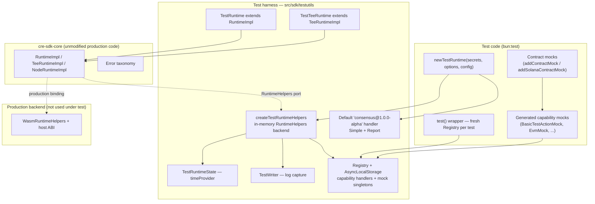
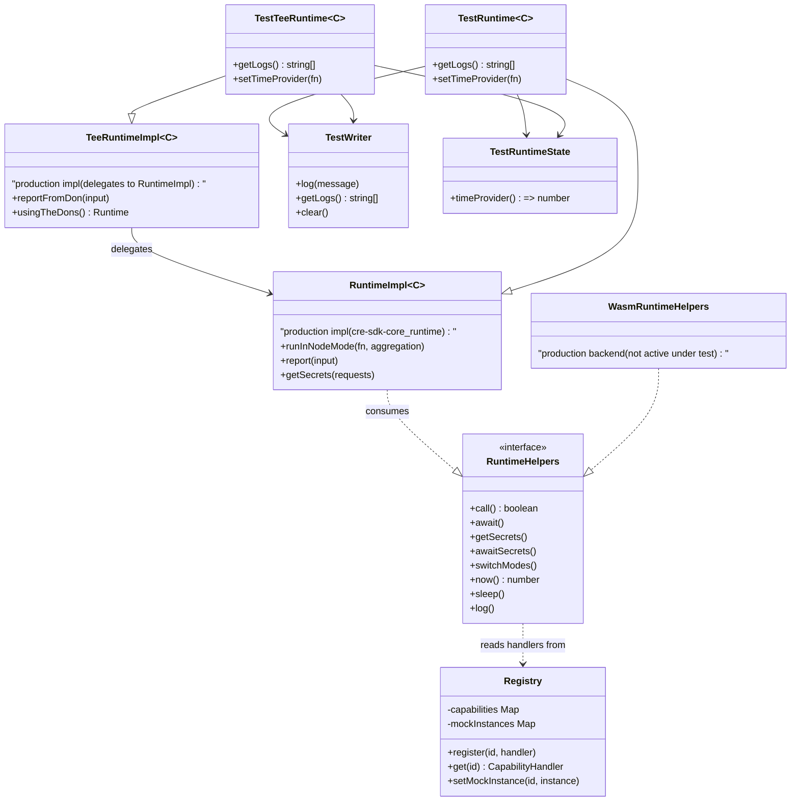
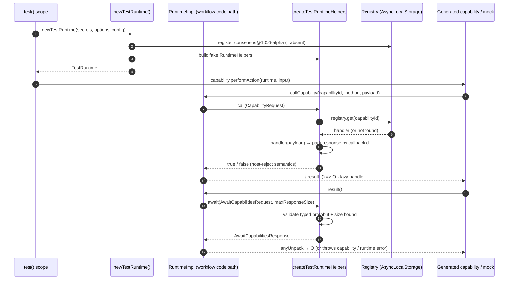
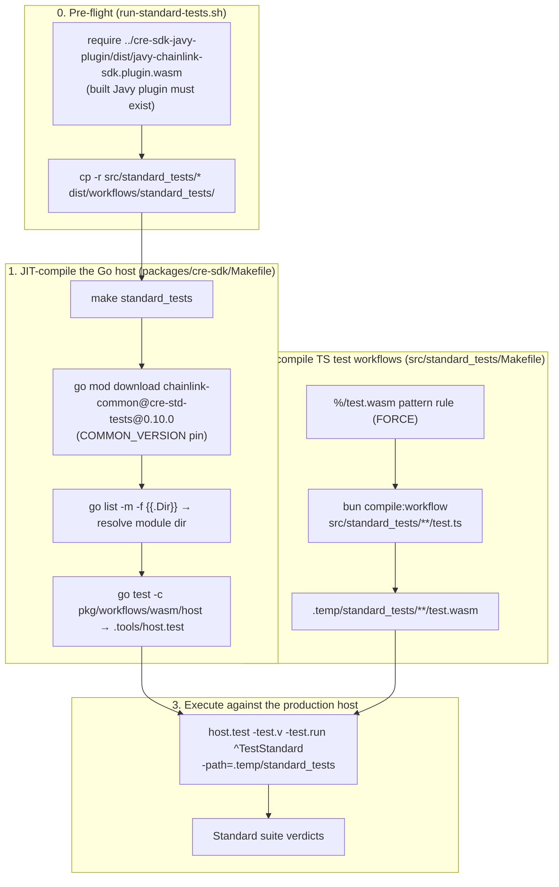
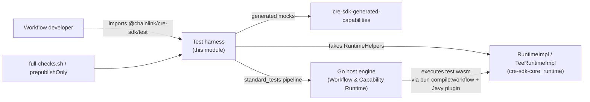

# CRE SDK Core — Test Harness (`cre-sdk-core_test-harness`)

## 1. Introduction

The **test harness** submodule of [cre-sdk-core](../cre-sdk-core.md) gives CRE workflow developers two complementary ways to validate workflows built with the `@chainlink/cre-sdk` package:

1. **The in-process runtime emulation** (`src/sdk/testutils/test-runtime.ts`) — `TestRuntime` and `TestTeeRuntime` replace the Javy/WASM execution environment with an in-memory implementation, so workflow logic, generated capability clients and generated mocks can be unit-tested under `bun:test` **without compiling to WASM or booting a host**.
2. **The "standard tests" pipeline** (`packages/cre-sdk/Makefile` + `src/standard_tests/Makefile`) — a cross-repo conformance suite that compiles real TypeScript workflows to WASM and executes them against the **production Go host engine** (`chainlink-common/pkg/workflows/wasm/host`), pinned to the SDK's version so engine and SDK semantics stay in lockstep.

The harness is intentionally asymmetric: it is *shipped* (the `./test` export of the npm package) so downstream workflow authors can mock capabilities and contracts in their own test suites, while the standard-tests pipeline is *dev-only* CI tooling that guards the SDK↔host contract.

**Module files**

| File | Role |
|---|---|
| `cre-sdk-typescript/packages/cre-sdk/src/sdk/testutils/test-runtime.ts` | `TestRuntime`, `TestTeeRuntime`, `newTestRuntime`, the in-memory `RuntimeHelpers` backend (`createTestRuntimeHelpers`), per-test `Registry` (AsyncLocalStorage) |
| `cre-sdk-typescript/packages/cre-sdk/src/sdk/testutils/test-writer.ts` | `TestWriter` — captured log buffer surfaced via `getLogs()` |
| `cre-sdk-typescript/packages/cre-sdk/src/sdk/test/index.ts` | Public test surface `@chainlink/cre-sdk/test` — re-exports the harness, contract mocks and generated capability mocks |
| `cre-sdk-typescript/packages/cre-sdk/Makefile` | `standard_tests` / `standard_test_single` targets — JIT-compiles the pinned Go host test binary and runs it |
| `cre-sdk-typescript/packages/cre-sdk/src/standard_tests/Makefile` | `%/test.wasm` pattern rule — JIT-compiles each standard test workflow with `bun compile:workflow` |
| `cre-sdk-typescript/packages/cre-sdk/scripts/run-standard-tests.sh` | Package script behind `bun run test:standard` — stages test sources and delegates to `make standard_tests` |

The runtime contracts and production WASM backend that this harness mirrors are documented in [cre-sdk-core_runtime](cre-sdk-core_runtime.md); error types (`DonModeError`, `NodeModeError`, `SecretsError`, …) in [cre-sdk-core_errors](cre-sdk-core_errors.md).

## 2. Architecture

The harness exploits the SDK's central design decision: all execution-mode behaviour lives in `RuntimeImpl` / `TeeRuntimeImpl` behind the internal **`RuntimeHelpers` port** (see [cre-sdk-core_runtime](cre-sdk-core_runtime.md) for the contract). The production layer binds that port to the host via `WasmRuntimeHelpers`; the harness binds it to in-memory fakes. Everything above the port — mode guards, callback-ID allocation, lazy results, consensus wiring — is exercised unmodified.



Key points:

- **One port, two backends.** `RuntimeImpl` consumes `RuntimeHelpers`; the test harness supplies a fake implementation, so the identical implementation code paths run under test and in production. The production `WasmRuntimeHelpers` binding is documented in [cre-sdk-core_runtime](cre-sdk-core_runtime.md).
- **Test isolation via `AsyncLocalStorage`.** A fresh `Registry` is created for every `test()` invocation and stored in an `AsyncLocalStorage` context, so capability handlers and mock singletons are scoped per test — parallel tests cannot observe each other's registrations.
- **Faithful failure semantics.** The fake `await` enforces the same `maxResponseSize` bound as the real WASM bridge (throwing the `RESPONSE_BUFFER_TOO_SMALL` sentinel), and rejects plain (non-protobuf) requests exactly as the binary bridge would fail — harness errors mirror host errors instead of hiding them.

## 3. Component Reference

### 3.1 Test-scoped registries (`test()` + `Registry`)

`Registry` is a private class holding two maps: capability handlers (id → `CapabilityHandler`) and mock singletons (id → instance). It is never exposed directly; it lives in `registryStorage`, an `AsyncLocalStorage<Registry>` populated by the exported `test()` wrapper:

```typescript
test('my workflow aggregates medians', () => {
  // inside this scope: registerTestCapability / mock singletons / newTestRuntime
})
```

| Export | Purpose |
|---|---|
| `test(title, fn)` | Wraps `bun:test`; runs `fn` inside a fresh `Registry` scope and clears it in a `finally` block |
| `registerTestCapability(id, handler)` | Registers a manual capability handler; throws outside a test scope or on duplicate ids |
| `getTestCapabilityHandler(id)` | Looks up a handler for cross-layer assertions |
| `__getTestMockInstance(id)` / `__setTestMockInstance(id, instance)` | Singleton storage used by **generated** capability mocks (`testInstance()` pattern — calling twice returns the same instance) |
| `__testOnlyRegistryStore()` / `__testOnlyRunWithRegistry(fn)` | Test-only escape hatches for registry-isolation assertions and cleanup/failure tests |

A `CapabilityHandler` receives `{ id, method, payload }` (payload is an `Any` protobuf) and returns either `{ response: { case: 'payload', value: Any } }` or `{ response: { case: 'error', value: string } }` — the exact response shape of a real capability.

### 3.2 `newTestRuntime()` and the default consensus handler

```typescript
const runtime = newTestRuntime<MyConfig>(secrets?, options?, config?)
```

- `secrets?: Secrets` — a `Map<namespace, Map<id, value>>` seeding the vault; missing entries resolve to `SecretError` responses (namespace defaults to `'default'`).
- `options.maxResponseSize` — response buffer bound (defaults to `DEFAULT_MAX_RESPONSE_SIZE_BYTES` = 5 MiB); must be a non-negative safe integer, otherwise the factory throws.
- `options.timeProvider` — deterministic clock (`runtime.now()` and `runtime.setTimeProvider()`).
- `config` — typed workflow config handed to the runtime (defaults to `{}`).

`newTestRuntime` also self-registers the **default consensus capability** (`consensus@1.0.0-alpha`) if the registry does not already have one, so workflows using `runInNodeMode` and `report` work out of the box:

| Method | Test-double behaviour |
|---|---|
| `Simple` | Unpacks `SimpleConsensusInputs`; an observation `value` is echoed back (ignoring aggregation semantics); an observation `error` falls back to the configured default value or throws; unknown observation shapes throw `unknown observation type` |
| `Report` | Unpacks `ReportRequest` and synthesizes a `ReportResponse`: `rawReport` = a synthetic 109-byte metadata header (`REPORT_METADATA_HEADER_LENGTH`, byte pattern `i % 256`) followed by the request's `encodedPayload`, plus two placeholder signatures (`default_signature_1` / `default_signature_2`, signer ids `1` / `2`); `configDigest` is empty, `seqNr` is `0` |
| anything else | Returns an `error` response (`unknown method …`) |

### 3.3 In-memory `RuntimeHelpers` backend (`createTestRuntimeHelpers`)

The fake backend implements the same port as `WasmRuntimeHelpers` (contract table in [cre-sdk-core_runtime](cre-sdk-core_runtime.md)). Test-specific semantics:

| Method | Behaviour under test |
|---|---|
| `call(request)` | Looks up the capability id in the current test `Registry`; returns `false` when not found (identical to host rejection → `CapabilityRuntimeError` in the impl layer). Handler exceptions are converted into `error` responses. Results are parked in `pendingCalls` keyed by the request's callback id |
| `await(request, max)` | Validates the request is a **typed protobuf** (`$typeName === 'sdk.v1alpha.AwaitCapabilitiesRequest'`) — plain objects are rejected with an explanation that the real WASM bridge would fail on them. Materializes parked responses for the requested ids, then serializes the aggregate response and throws `RESPONSE_BUFFER_TOO_SMALL` if it exceeds `maxResponseSize` |
| `getSecrets(request)` | Resolves each request against the seeded `Secrets` map; missing entries produce `SecretError` payloads (`could not find secret <namespace>`), stored per callback id |
| `awaitSecrets(request)` | Materializes parked secret responses; unknown callback ids throw `could not find call with id <id>` |
| `switchModes(mode)` | No-op — mode correctness is enforced by `RuntimeImpl`'s own guards (`DonModeError` / `NodeModeError`) |
| `now()` | `state.timeProvider()` when set, otherwise `Date.now()` |
| `sleep(ms)` | No-op (returns immediately — tests never block) |
| `log(message)` | Forwards to the test's `TestWriter` |

### 3.4 `TestRuntime` and `TestTeeRuntime`

Both classes add observability on top of the production implementations: `getLogs()` (captured log lines via `TestWriter`) and `setTimeProvider()` (clock control). Both are constructed with a starting callback id of `0` and the harness helpers.



Notes:

* `TestRuntime<T>` extends `RuntimeImpl<T>` (DON mode) and is the factory path (`newTestRuntime`). `TestTeeRuntime<T>` extends `TeeRuntimeImpl<T>`; its doc comment points to a `newTestTEERuntime` factory, but only the class is exported from `test-runtime.ts` today — the public test surface exports both classes so tests can construct a TEE runtime with the same helpers.
* Because `TeeRuntimeImpl` delegates to an internal `RuntimeImpl`, TEE-mode tests exercise the same helper backend, so `usingTheDons()` and `reportFromDon()` behave identically to production.
* The `TestWriter` and `TestRuntimeState` instances are per-runtime; a test can inspect `runtime.getLogs()` after invoking workflow logic to assert on `runtime.log(...)` output.

### 3.5 Constants

| Constant | Value | Meaning |
|---|---|---|
| `DEFAULT_MAX_RESPONSE_SIZE_BYTES` | `5 * 1024 * 1024` | Default response buffer bound applied by the fake `await` |
| `RESPONSE_BUFFER_TOO_SMALL` | `'response buffer too small'` | Sentinel error thrown when a response exceeds the bound — mirrors the host's buffer check |
| `REPORT_METADATA_HEADER_LENGTH` | `109` | Length of the synthetic report metadata header prepended by the default `Report` handler |

## 4. Data Flow

### 4.1 Capability call under the harness



Two deliberate fidelity behaviours are visible here:

1. A missing capability handler makes `call` return `false`, and the *production* impl layer converts that into a `CapabilityRuntimeError` — tests exercise real error mapping, not fake ones.
2. Response-size enforcement happens in the fake `await` because the real bridge checks the serialized byte length against the host-provided buffer; the harness reproduces this by serializing with `toBinary` before returning.

### 4.2 Secrets and diagnostics

* **Secrets**: `runtime.getSecret(...)` / `getSecrets(...)` issue the same batched protobuf flow as production; the fake `getSecrets`/`awaitSecrets` pair resolves against the seeded `Secrets` map and produces `SecretError` entries for misses, which the impl layer aggregates into `SecretsBatchError` (taxonomy in [cre-sdk-core_errors](cre-sdk-core_errors.md)). A dedicated standard test (`secrets_fail_in_node_mode`) verifies the mode guard rejects secrets in node mode.
* **Logs and time**: `runtime.log(...)` appends to the `TestWriter` (assertable via `getLogs()`), and `runtime.now()` follows the injected `timeProvider`, making time-dependent workflow logic deterministic.

## 5. Public Test Surface (`@chainlink/cre-sdk/test`)

The package exposes the harness through the `./test` export (see `cre-sdk-typescript/packages/cre-sdk/package.json`: `"./test": "./dist/sdk/test/index.js"`). `src/sdk/test/index.ts` re-exports:

| Group | Exports |
|---|---|
| Runtime harness | `newTestRuntime`, `test`, `TestRuntime`, `TestRuntimeState`, `NewTestRuntimeOptions`, `Secrets`, `CapabilityHandler`, `registerTestCapability`, `getTestCapabilityHandler`, `DEFAULT_MAX_RESPONSE_SIZE_BYTES`, `RESPONSE_BUFFER_TOO_SMALL`, `REPORT_METADATA_HEADER_LENGTH` |
| Log capture | `TestWriter` |
| Generated capability mocks | `EvmMock`, `SolanaMock`, `BasicTestActionMock`, `BasicTestActionTriggerMock`, `BasicTestNodeActionMock`, `ConsensusMock`, `ConfidentialHttpMock`, `HttpActionsMock` (auto-generated barrel `src/sdk/test/generated/index.ts`, regenerated by `generate:sdk`) |
| Contract mocks | `addContractMock` / `ContractMock` / `WriteReportMockInput` (EVM, viem ABI-based) and `addSolanaContractMock` / `SolanaContractMock` / `SolanaWriteReportMockInput` |

Typical usage:

```typescript
import { BasicTestActionMock, newTestRuntime, test } from '@chainlink/cre-sdk/test'
import { BasicActionCapability } from '@cre/generated-sdk/capabilities/internal/basicaction/v1/basicaction_sdk_gen'

test('my workflow', () => {
  const mock = BasicTestActionMock.testInstance()          // self-registers in the test registry
  mock.performAction = (input) => ({ adaptedThing: 'ok' }) // user-supplied handler

  const runtime = newTestRuntime()
  const result = new BasicActionCapability()
    .performAction(runtime, { inputThing: true })
    .result()

  // result.adaptedThing === 'ok'
})
```

The mocks decode the protobuf payload, invoke the user implementation, and re-encode the response — per-method handlers ride the registry, and the singleton pattern (`testInstance()`) is backed by `__setTestMockInstance` / `__getTestMockInstance`. `addContractMock` layers address- and ABI-selector-based routing on top of an `EvmMock` (the TypeScript equivalent of Go's `evmmock.AddContractMock`), intercepting `callContract` and `writeReport`; it depends on the chain types documented under [types-chains EVM](../../Shared_Foundation_Libraries___Domain_Types/types-chains/types-chains_evm.md). Integration coverage for this surface lives in `src/sdk/test/mock-integration.test.ts`, `evm-contract-mock.test.ts` and `solana-contract-mock.test.ts`.

## 6. Standard-Tests Pipeline

The second half of the module validates that the SDK's *emulated* semantics match the *real* host. Unlike the unit harness, this pipeline compiles actual workflows to WASM and runs them on the production Go host engine (documented engine-side in [workflows_engine](../../../Workflow___Capability_Runtime_(CRE_Engine)/workflows/workflows_engine.md)).

### 6.1 Pipeline stages

Invoked by `bun run test:standard` → `./scripts/run-standard-tests.sh` → `make standard_tests` (`cre-sdk-typescript/packages/cre-sdk/Makefile`):



Details per stage:

1. **Host binary** — the Makefile downloads `github.com/smartcontractkit/chainlink-common` at the pinned pseudo-version `COMMON_VERSION ?= cre-std-tests@0.10.0`, resolves its module directory with `go list -m -f '{{.Dir}}'`, and compiles the host test binary with `go test -c` from `<module>/pkg/workflows/wasm/host` into `.tools/host.test`. `TEST_PATTERN ?= ^TestStandard` selects the standard suite.
2. **Guest compilation** — the inner Makefile (`src/standard_tests/Makefile`) declares a `%/test.wasm: FORCE` pattern rule. It rejects paths deeper than two segments, and for `one/two`-style paths (e.g. `mode_switch/successful_mode_switch`) or single-segment paths it runs `bun compile:workflow` from the package root to emit `.temp/standard_tests/<name>/test.wasm`. The Makefile is copied into `.temp/standard_tests/` so the host can invoke it for JIT compilation of each guest before loading it.
3. **Execution** — `host.test -test.v -test.run $(TEST_PATTERN) -path=.temp/standard_tests` runs the standard suite; the host loads each `test.wasm`, fires triggers, and asserts on results and logs. `make standard_test_single TEST=TestStandardCapabilityCallsAreAsync` reruns a single test by overriding `TEST_PATTERN`.

The Go host maintains a mirror of this pattern for its own WASM guests (`chainlink-common/pkg/workflows/wasm/host/standard_tests/Makefile`: `GOOS=wasip1 GOARCH=wasm CGO_ENABLED=0 go build -o test.wasm .`), so the same `TestStandard` suite validates both TypeScript and Go SDK guests against identical host semantics.

### 6.2 Standard test suite inventory

The suite under `cre-sdk-typescript/packages/cre-sdk/src/standard_tests/` covers the behavioural contract of the runtime:

| Suite | Focus |
|---|---|
| `capability_calls_are_async` | Lazy `{ result: () => O }` handles — calls can be issued and awaited out of order |
| `mode_switch/successful_mode_switch` | `runInNodeMode` DON↔NODE transitions |
| `mode_switch/don_runtime_in_node_mode`, `mode_switch/node_runtime_in_don_mode` | Mode-violation errors (`DonModeError` / `NodeModeError`) |
| `tee_runtime` | `handlerInTee` handlers, `TeeRuntime` + `usingTheDons()` routing |
| `secrets`, `secrets_fail_in_node_mode` | Vault access flows and the node-mode secrets guard |
| `config`, `logging`, `errors`, `capability_errors` | Config parsing, log/`sendResponse` surfaces, error propagation |
| `frequency_list`, `random`, `time_interpretation`, `multiple_triggers` | Consensus aggregators, determinism/entropy, clock semantics, multi-trigger handlers |
| `host_wasm_write_errors_are_respected` | Host write-buffer error handling |
| `restrictions` | Restricted-API enforcement in the guest |

Each entry is a standalone `test.ts` compiled by the pattern rule — e.g. `tee_runtime/test.ts` registers both a `handlerInTee` handler and a regular DON handler and boots via `Runner.newRunner` from `@cre/sdk/wasm`.

### 6.3 CI wiring

* `package.json` (`cre-sdk-typescript/packages/cre-sdk`): `test:standard` → `run-standard-tests.sh`; both `prepublishOnly` and `full-checks` run `test` (bun unit tests, which exercise the harness) followed by `test:standard`.
* `cre-sdk-typescript/scripts/full-checks.sh` (workspace-level) runs, for the `cre-sdk` package: `compile:cre-setup`, `build`, `generate:sdk`, `typecheck`, `check`, `test`, then `test:standard` — i.e. the standard suite gates every full check and publish.

## 7. How the Module Fits into the Overall System



* **Consumes** the runtime implementation layer and error taxonomy of [cre-sdk-core](../cre-sdk-core.md) unmodified — the harness is only a `RuntimeHelpers` backend swap.
* **Is consumed by** workflow authors via the `./test` npm export, and by generated capability mocks from [cre-sdk-generated-capabilities](../cre-sdk-generated-capabilities.md), whose singleton pattern is powered by the harness's mock-instance registry.
* **Bridges to** the production host engine ([Workflow & Capability Runtime (CRE Engine)](../../../Workflow___Capability_Runtime_(CRE_Engine).md), engine internals: [workflows_engine](../../../Workflow___Capability_Runtime_(CRE_Engine)/workflows/workflows_engine.md)) through the standard-tests pipeline, using the same `bun compile:workflow` compilation step used for deployment by the `cre` CLI ([cre-cli-workflow-commands](../cre-cli-workflow-commands.md)).
* **Is orchestrated by** workspace tooling ([cre-sdk-workspace-build](../cre-sdk-workspace-build.md)): `full-checks.sh`, `prepublishOnly` and the Makefile targets described above.

## 8. Maintainer Notes

* **Keep the version pin deliberate.** `COMMON_VERSION ?= cre-std-tests@0.10.0` in `packages/cre-sdk/Makefile` pins the Go host used by the standard suite. Bumping it changes host semantics tested against the SDK; bump it in lockstep with engine releases.
* **The 109-byte header is a contract.** `REPORT_METADATA_HEADER_LENGTH` in the test harness mirrors the on-chain report context header size; if report framing changes on the host side, update the default `Report` handler's synthetic metadata accordingly.
* **Size-limit errors must not drift.** `RESPONSE_BUFFER_TOO_SMALL` is thrown by the harness's `await` exactly as the WASM bridge would; tests rely on this sentinel matching host behaviour, so don't reword it or move the check out of the fake backend.
* **Registry scope is load-bearing.** Capability handlers and mock singletons are resolved through `AsyncLocalStorage` at call time, not captured at runtime construction — code that caches handlers across tests will break isolation. The `__testOnly*` exports exist precisely to test that isolation; keep them out of production paths.
* **Mode guards belong to the impl layer.** The fake `switchModes` is intentionally a no-op: mode violations must surface through `DonModeError`/`NodeModeError` from `RuntimeImpl`, never through harness-side checks — otherwise standard tests (`mode_switch/*`) would pass in emulation and fail on the host.
* **Adding a standard test**: create `src/standard_tests/<suite>/test.ts` (or `<group>/<suite>/test.ts`, max depth two), import from `@cre/sdk/cre` / `@cre/sdk/wasm` / generated capabilities, and ensure the Javy plugin is built (`packages/cre-sdk-javy-plugin` `build`) before running `bun run test:standard` — `run-standard-tests.sh` fails fast otherwise. The suite name must match the Go-side `TestStandard*` discovery (`TEST_PATTERN`).
* **API surface:** changes to the public test exports flow into `api-baseline.d.ts` (see [cre-sdk-core_api-surface](cre-sdk-core_api-surface.md) and the `update-api-baseline` script, which already includes `dist/sdk/test/index.d.ts`).
