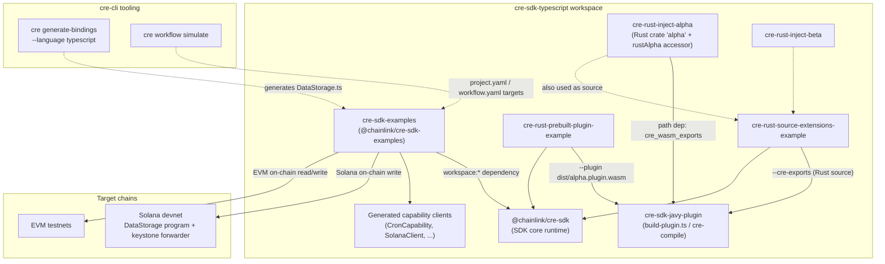
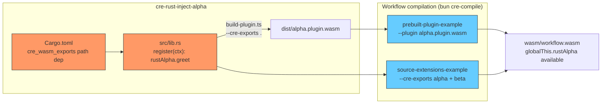

# CRE SDK Examples and Plugins

## 1. Introduction and Purpose

The `cre-sdk-examples-and-plugins` module is the **hands-on reference layer of the CRE TypeScript SDK**. It lives inside the `cre-sdk-typescript` Bun/Turborepo workspace and collects the packages that show the SDK in action:

1. **`packages/cre-sdk-examples`** (`@chainlink/cre-sdk-examples`) — a private demo application with a catalog of runnable example workflows covering every SDK feature area: cron/log/http triggers, HTTP fetch (plain, confidential, with secrets), EVM on-chain read/write, Solana on-chain write, proof-of-reserve, and secrets handling. Its repository root is also a **CRE project root**, so every workflow can be simulated directly with `cre workflow simulate` (see [cre-cli-workflow-commands](cre-cli-workflow-commands.md)).
2. **Rust plugin / extension example packages** — three small packages (`cre-rust-inject-alpha`, `cre-rust-prebuilt-plugin-example`, `cre-rust-source-extensions-example`) that demonstrate how to extend the Javy-based TypeScript→WASM compilation with **custom Rust code**, either by building a dedicated Javy plugin (`.plugin.wasm`) or by injecting Rust crates as *source extensions* at compile time.

While [cre-sdk-core](cre-sdk-core.md) documents the runtime primitives (`Runner`, `handler`, `Runtime`) and [cre-sdk-workspace-build](cre-sdk-workspace-build.md) documents the build system and the Javy plugin pipeline, this module is where both are exercised end-to-end. It serves two audiences:

- **Workflow developers** who copy the samples as starting points for their own workflows.
- **SDK/plugin developers** who need a working template for injecting native Rust extensions into the CRE WASM sandbox.

### Workspace footprint

| Package | Manifest | Role |
|---|---|---|
| `cre-sdk-examples` | `cre-sdk-typescript/packages/cre-sdk-examples/package.json` — `@chainlink/cre-sdk-examples`, private, `"@chainlink/cre-sdk": "workspace:*"`, deps on `@solana/addresses`, `@solana/codecs`, `@bufbuild/protobuf`, `viem`, `zod` | Example workflow catalog; always compiles against the in-repo SDK |
| `cre-rust-inject-alpha` | `cre-sdk-typescript/packages/cre-rust-inject-alpha/Cargo.toml` — Rust crate `alpha`, path-depends on `../cre-sdk-javy-plugin/src/cre_wasm_exports` | Sample Rust WASM extension + validated TypeScript accessor |
| `cre-rust-prebuilt-plugin-example` | `cre-sdk-typescript/packages/cre-rust-prebuilt-plugin-example/Makefile` | Workflow compiled against a prebuilt `alpha.plugin.wasm` (`--plugin`) |
| `cre-rust-source-extensions-example` | `cre-sdk-typescript/packages/cre-rust-source-extensions-example/Makefile` | Workflow compiled with Rust crates built from source (`--cre-exports`) |

## 2. Architecture Overview

The examples package consumes SDK primitives from [cre-sdk-core](cre-sdk-core.md) and generated capability clients (e.g. `CronCapability`) from [cre-sdk-generated-capabilities](cre-sdk-generated-capabilities.md). Chain interactions route through the node's chain capabilities (e.g. the Solana chain capability documented in [chain_capability_solana](../Workflow___Capability_Runtime_(CRE_Engine)/chain_capability_solana.md)). The Rust example packages plug into the Javy plugin build pipeline of [cre-sdk-workspace-build](cre-sdk-workspace-build.md).



### Example workflow catalog

The `cre-sdk-examples/src/workflows/` directory contains one self-contained folder per example, each with `main.ts` (entry point), `workflow.yaml` (CRE CLI target settings), and `config.staging.json` / `config.production.json`:

| Workflow | Demonstrates |
|---|---|
| `hello-world` | Minimal cron-triggered workflow |
| `http-fetch`, `http-fetch-no-sugar` | Plain HTTP capabilities |
| `http-confidential-fetch`, `http-confidential-fetch-with-secrets`, `confidential-http-with-body` | Confidential HTTP + secrets integration |
| `log-trigger` | EVM log trigger + ABI decoding |
| `secrets` | Vault-backed secrets |
| `on-chain`, `on-chain-write` | EVM contract reads/writes |
| `solana-onchain-write` | Solana on-chain write via generated bindings (core documented component) |
| `proof-of-reserve` | End-to-end PoR feed |
| `star-wars` | Composite HTTP example with trigger payloads |

Top-level `restricted-apis-example.ts` and `restricted-node-modules-example.ts` exercise the WASM sandbox restrictions (asserting that disallowed host APIs are unavailable).

## 3. Sub-modules

This module is split into two sub-modules, mirroring the two example families. Detailed documentation:

1. [`cre-sdk-examples-and-plugins/cre-sdk-examples-and-plugins_solana-onchain-write-example.md`](cre-sdk-examples-and-plugins/cre-sdk-examples-and-plugins_solana-onchain-write-example.md) — Solana On-Chain Write Example
2. [`cre-sdk-examples-and-plugins/cre-sdk-examples-and-plugins_rust-plugin-examples.md`](cre-sdk-examples-and-plugins/cre-sdk-examples-and-plugins_rust-plugin-examples.md) — Rust Plugin Examples

### 3.1 Solana On-Chain Write Example

Covers the `solana-onchain-write` workflow and its core component `DataStorage.ts` — a **`cre-cli`-generated TypeScript binding** for the Solana Anchor program `DataStorage`. The file bundles the Anchor IDL, Borsh codecs (`@solana/codecs`), instruction/account/event discriminators, decode helpers, and the `DataStorage` class whose `writeReport*` methods publish signed reports through the keystone-forwarder. The example `main.ts` wires it end-to-end: cron trigger → `getNetwork` / `SolanaClient` → `writeReportFromUserData` → on-chain `on_report` instruction.

📄 Detailed documentation: [Solana On-Chain Write Example](cre-sdk-examples-and-plugins/cre-sdk-examples-and-plugins_solana-onchain-write-example.md)

### 3.2 Rust Plugin Examples

Covers the three Rust extension packages and their Makefiles. `cre-rust-inject-alpha` defines a Rust crate that registers a `rustAlpha.greet` global into the QuickJS/WASM context via `extend_wasm_exports` (from the Javy plugin's `cre_wasm_exports` crate) plus a zod-validated TypeScript accessor. The two workflow examples show the two consumption modes of `bun cre-compile`: `--plugin` (reuse a prebuilt `dist/alpha.plugin.wasm`) and `--cre-exports` (compile Rust crates from source together with the workflow).

📄 Detailed documentation: [Rust Plugin Examples](cre-sdk-examples-and-plugins/cre-sdk-examples-and-plugins_rust-plugin-examples.md)

## 4. Build, Simulation and Deployment Flow

### 4.1 Example workflows

The examples repository root is a CRE project root (`cre-sdk-examples/project.yaml` defines `staging-settings`/`production-settings` with RPCs for `ethereum-testnet-sepolia` and `solana-devnet`). Each workflow's `workflow.yaml` maps CRE CLI targets (e.g. `staging-settings`) to the workflow entry point, config, and secrets paths. This is what enables the documented flow:

```bash
bun install && bun x cre-setup      # provision Javy + Chainlink plugin
cre workflow simulate ./src/workflows/solana-onchain-write
bun x cre-compile src/workflows/hello-world/main.ts dist/hello-world.wasm
```

For the CLI side of this flow (simulate, deploy, artifact upload, registry operations), see [cre-cli-workflow-commands](cre-cli-workflow-commands.md); for how the Javy plugin used by `cre-setup`/`cre-compile` is produced deterministically (Docker multi-stage build → `javy init-plugin --deterministic`), see [cre-sdk-workspace-build](cre-sdk-workspace-build.md).

### 4.2 Rust extension compilation



Both modes produce a workflow WASM in which `globalThis.rustAlpha` is callable from TypeScript; the difference is only *when* the Rust code is compiled (ahead of time into a reusable plugin vs. per-workflow from source).

## 5. Relationship to Other Modules

| Module | Relationship |
|---|---|
| [cre-sdk-core](cre-sdk-core.md) | Supplies `Runner`, `handler`, `Runtime` and the WASM runtime contract that all examples import |
| [cre-sdk-generated-capabilities](cre-sdk-generated-capabilities.md) | Supplies the typed capability clients (`CronCapability`, `SolanaClient`, HTTP capabilities, …) used by the examples |
| [cre-sdk-workspace-build](cre-sdk-workspace-build.md) | Owns the Javy plugin (`cre-sdk-javy-plugin`) whose `build-plugin.ts`, `cre-compile`, and deterministic Docker build underpin the Rust extension examples and workflow WASM output |
| [cre-cli-bindings-generator](cre-cli-bindings-generator.md) | `cre generate-bindings --language typescript` is the tool that produces generated bindings like `DataStorage.ts` |
| [cre-cli-workflow-commands](cre-cli-workflow-commands.md) | `cre workflow simulate` / `deploy` consume the examples' `project.yaml` + `workflow.yaml` targets |
| [chain_capability_solana](../Workflow___Capability_Runtime_(CRE_Engine)/chain_capability_solana.md) | The node-side Solana capability that executes the `writeReport` requests issued by the example binding |
