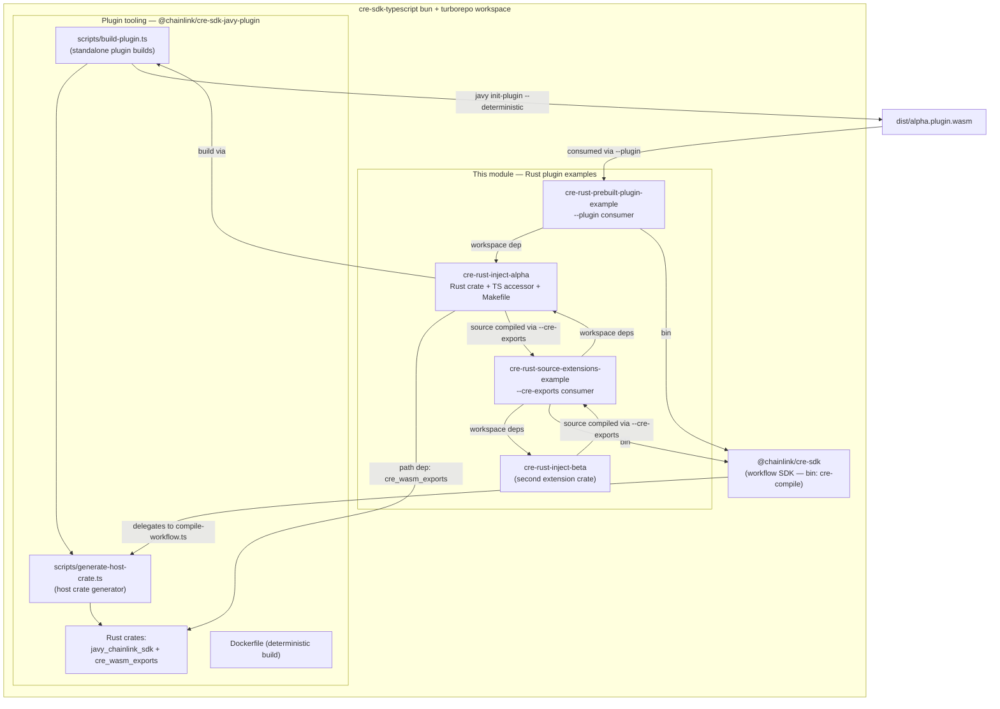
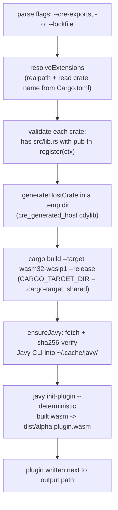
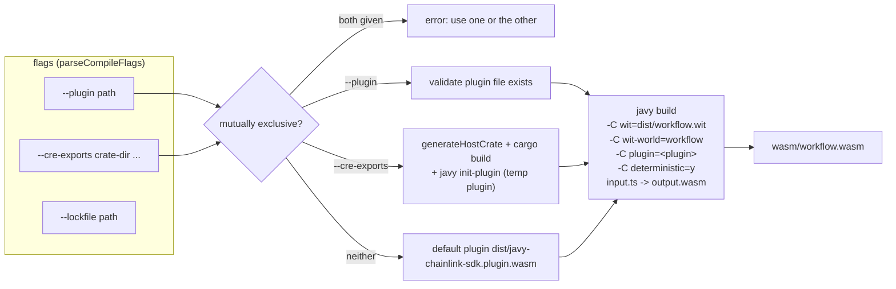
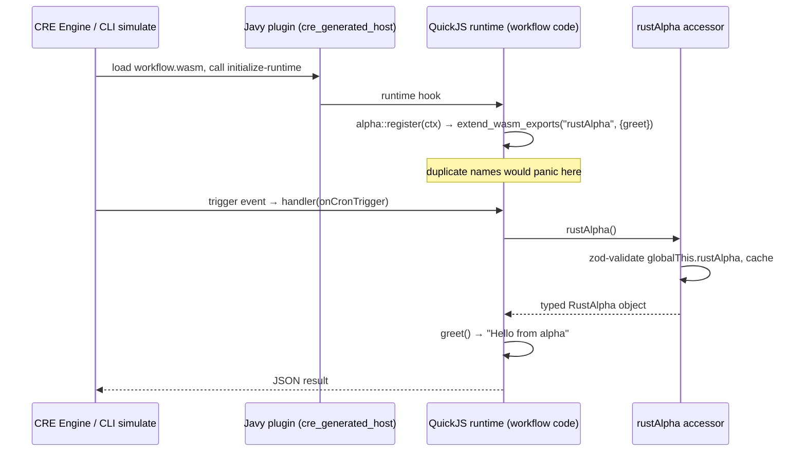

# Rust Plugin Examples

## Introduction

The **Rust Plugin Examples** module demonstrates the supported integration patterns for extending [CRE TypeScript SDK](../cre-sdk-core.md) workflows with native Rust code. CRE workflows are TypeScript programs compiled into WebAssembly and executed by the [Javy-based runtime](../cre-sdk-workspace-build.md) inside the Workflow & Capability Runtime (CRE Engine). Because that runtime embeds a QuickJS engine whose host plugin is itself a Rust cdylib, custom Rust code can be **statically linked into the plugin** and exposed to workflow code as regular JavaScript globals — bridging the performance and capability gap between TypeScript and native code.

The module ships three workspace packages, each showing one stage of a single lifecycle:

| Package | npm name | Role | Build command | Key artifact |
|---|---|---|---|---|
| `cre-rust-inject-alpha` | `@chainlink/cre-rust-inject-alpha` | Rust **extension crate** example + **pre-built plugin producer** | `make build` | `dist/alpha.plugin.wasm` |
| `cre-rust-prebuilt-plugin-example` | `@chainlink/cre-rust-prebuilt-plugin-example` | Workflow that **consumes a pre-built plugin** via `--plugin` | `make build` | `wasm/workflow.wasm` |
| `cre-rust-source-extensions-example` | `@chainlink/cre-rust-source-extensions-example` | Workflow that **compiles extension crates from source** via `--cre-exports` | `make build` | `wasm/workflow.wasm` |

All three rely on tooling exported by the `@chainlink/cre-sdk-javy-plugin` package (`scripts/build-plugin.ts`, the generated host crate, and the `javy_chainlink_sdk` / `cre_wasm_exports` Rust crates) and on the `cre-compile` binary shipped by `@chainlink/cre-sdk`. A fourth crate, `cre-rust-inject-beta` (`@chainlink/cre-rust-inject-beta`), exists purely as a second extension used by the source-extensions example to demonstrate multi-extension linking.

> These packages live in the `cre-sdk-typescript` repository under `packages/`, next to the SDK itself. For the TypeScript-only workflow examples (no Rust extensions), see the [parent module](../cre-sdk-examples-and-plugins.md); for a complete on-chain example built with the SDK, see the [Solana On-Chain Write example](cre-sdk-examples-and-plugins_solana-onchain-write-example.md).

---

## Architecture

The three example packages form a producer/consumer chain around the Javy plugin toolchain:



Key relationships:

- **`cre-rust-inject-alpha` is dual-purpose.** It is both (a) a template for writing a Rust extension crate, and (b) an npm-distributable plugin artifact — its `package.json` `files` list ships `dist/` (the compiled plugin), `src/` + `Cargo.toml` (the crate source) and `index.ts` (the typed TS accessor), so consumers can either load the pre-built WASM or compile the Rust themselves.
- **The two example workflows never contain Rust themselves.** Their `index.ts` files are ordinary [CRE SDK workflows](../cre-sdk-core.md); the Rust code arrives either baked into the plugin (`--plugin`) or compiled in at build time (`--cre-exports`).
- **Workspace wiring:** bun workspaces (`"workspaces": ["packages/*"]` in `cre-sdk-typescript/package.json`) plus Turborepo (`cre-sdk-typescript/turbo.json`, `build` task with `dependsOn: ["^build"]`, outputs `dist/**`). Note that these example packages deliberately expose **no npm `build` script** — plugin compilation is driven by their Makefiles — while turbo still coordinates `check`/`check:ci`/`typecheck` across them.

---

## Example 1: `cre-rust-inject-alpha` — extension crate and pre-built plugin producer

### Rust side (the extension contract)

`cre-sdk-typescript/packages/cre-rust-inject-alpha/Cargo.toml` defines a small library crate that depends on two things:

- `cre_wasm_exports` — a path dependency into the Javy plugin package (`../cre-sdk-javy-plugin/src/cre_wasm_exports`) that provides the registration helper, and
- `javy-plugin-api = "6.0.0"` — the Javy plugin API (QuickJS bindings).

`cre-sdk-typescript/packages/cre-rust-inject-alpha/src/lib.rs` implements the contract expected from every extension crate:

```rust
use cre_wasm_exports::extend_wasm_exports;
use javy_plugin_api::javy::quickjs::prelude::*;
use javy_plugin_api::javy::quickjs::{Ctx, Object};

pub fn register(ctx: &Ctx<'_>) {
    let obj = Object::new(ctx.clone()).expect("failed to create rustAlpha export object");
    obj.set("greet", Func::from(|| -> String { "Hello from alpha".to_string() }))
        .expect("failed to set rustAlpha.greet export");
    extend_wasm_exports(ctx, "rustAlpha", obj);
}
```

The pattern: create a QuickJS object, attach functions, and register it as a **JavaScript global** (`rustAlpha`) via `extend_wasm_exports`. That helper (in `cre-sdk-javy-plugin/src/cre_wasm_exports/src/lib.rs`) records every registered name in a thread-local set and **panics on duplicate registration**, so two extension crates claiming the same global fail fast at plugin initialization. It also exposes an SDK-internal `__clear_registry()` because Javy's `init-plugin` invokes `initialize-runtime` twice per build cycle; without the reset, the second pass would spuriously panic on every previously registered name.

### TypeScript side (typed accessor)

`cre-sdk-typescript/packages/cre-rust-inject-alpha/index.ts` mirrors the Rust export for TypeScript consumers:

```ts
import { createExtensionAccessor } from '@chainlink/cre-sdk-javy-plugin/runtime/validate-extension'
import { z } from 'zod'

const rustAlphaSchema = z.object({
        greet: z.function().args().returns(z.string()),
})

export type RustAlpha = z.infer<typeof rustAlphaSchema>

declare global {
        var rustAlpha: RustAlpha
}

export const rustAlpha = createExtensionAccessor('rustAlpha', rustAlphaSchema)
```

`createExtensionAccessor(name, schema)` (from `cre-sdk-javy-plugin/runtime/validate-extension.ts`) returns a lazy accessor that on **first call** reads `globalThis[name]`, validates it against the zod schema, and caches the result. If the global is missing (i.e. the plugin was compiled without the extension) it throws a descriptive error that tells the developer exactly which build flag to use:

> `..."rustAlpha" was not found on globalThis ... Use --plugin <path-to-plugin.wasm> to load a pre-built plugin, or --cre-exports <path-to-source> to compile from source...`

### Makefile targets

`cre-sdk-typescript/packages/cre-rust-inject-alpha/Makefile`:

| Target | Purpose |
|---|---|
| `build` | Builds the standalone plugin; default target resolves to `dist/alpha.plugin.wasm` |
| `dist/alpha.plugin.wasm` | File target with prerequisites `Cargo.toml src/lib.rs` — the plugin is rebuilt only when crate sources change |
| `clean` | Removes `dist/` |

The build recipe resolves the tooling package once and invokes the plugin builder:

```make
JAVY_PLUGIN := $(abspath ../cre-sdk-javy-plugin)

dist/alpha.plugin.wasm: Cargo.toml src/lib.rs
	mkdir -p dist
	CRE_SDK_JAVY_PLUGIN_HOME="$(JAVY_PLUGIN)" bun "$(JAVY_PLUGIN)/scripts/build-plugin.ts" \
		--cre-exports . \
		-o ./dist/alpha.plugin.wasm
```

The `CRE_SDK_JAVY_PLUGIN_HOME` environment variable tells the build scripts where the Javy plugin package lives, so they can locate its Rust crates (`src/javy_chainlink_sdk`, `src/cre_wasm_exports`), its `dist/workflow.wit`, and its pinned toolchain file. Inside the workspace this is the sibling package; in a standalone project it would point at the installed `node_modules/@chainlink/cre-sdk-javy-plugin`.

### Plugin build pipeline

`scripts/build-plugin.ts` accepts `--cre-exports <path>... -o <output.plugin.wasm> [--lockfile <path>]` and executes:



Details worth knowing:

- **Generated host crate.** `generateHostCrate` emits a temporary `cre_generated_host` crate (`crate-type = ["cdylib"]`) whose `Cargo.toml` path-depends on `javy_chainlink_sdk` plus every extension crate, and whose `src/lib.rs` exports `initialize_runtime` — the entry point Javy calls at plugin init. It calls `javy_plugin_api::initialize_runtime` and, inside the runtime hook, invokes each extension's `<crate>::register(&ctx)`.
- **Toolchain resolution.** The generated `rust-toolchain.toml` pins the channel to the **maximum** of the SDK's pinned version and any extension crate's own `rust-toolchain.toml`, always including the `wasm32-wasip1` target.
- **Reproducibility.** Passing `--lockfile` copies a `Cargo.lock` into the temp crate and adds `--locked` to the cargo invocation (the plugin package's own release build uses `src/cre_generated_host.Cargo.lock` this way).
- **Determinism.** `javy init-plugin --deterministic` strips build nondeterminism from the final `.plugin.wasm`. The same result can be produced hermetically via Docker: `build-plugin-docker.sh` runs the equivalent multi-stage build (see `cre-sdk-typescript/packages/cre-sdk-javy-plugin/Dockerfile`, stages `javy-cli` → `plugin-builder` → `scratch`, pinned bun and rust images, cache-mounted cargo builds).
- **Incrementality.** Cargo outputs land in the plugin package's shared `.cargo-target` directory, so repeated builds across examples reuse compiled dependencies.

---

## Example 2: `cre-rust-prebuilt-plugin-example` — consuming a pre-built plugin (`--plugin`)

This example shows the **distribution pattern**: compile the extension once, share the plugin, compile workflows against it.

`cre-sdk-typescript/packages/cre-rust-prebuilt-plugin-example/Makefile`:

```make
build:
	mkdir -p wasm
	@test -f "$(ALPHA_PKG)/dist/alpha.plugin.wasm" || (echo "❌ cre-rust-inject-alpha not built — run 'make build' in ../cre-rust-inject-alpha first" && exit 1)
	CRE_SDK_JAVY_PLUGIN_HOME="$(JAVY_PLUGIN)" bun cre-compile \
		--plugin $(ALPHA_PKG)/dist/alpha.plugin.wasm \
		./index.ts \
		./wasm/workflow.wasm
```

Behavior of the two targets:

- **`build`** first *guards* on the plugin artifact — if `../cre-rust-inject-alpha/dist/alpha.plugin.wasm` is missing it fails with an actionable message instead of a cryptic compiler error. It then invokes `bun cre-compile` (the workflow compiler binary exposed by `@chainlink/cre-sdk`, which delegates to the Javy plugin's `compile-workflow.ts`) passing `--plugin` to link the workflow against the pre-built plugin and produce `wasm/workflow.wasm`.
- **`clean`** removes `wasm/`.

Its `index.ts` is a standard CRE workflow that calls the Rust function through the validated accessor:

```ts
const onCronTrigger = (_runtime: Runtime<Config>) => {
        const alpha = rustAlpha().greet()
        return JSON.stringify({ alpha })
}

const initWorkflow = (config: Config) => {
        const cron = new CronCapability()
        return [handler(cron.trigger({ schedule: config.schedule }), onCronTrigger)]
}
```

`workflow.yaml` declares the compiled artifact and configuration for each environment (`local-simulation`, `staging-settings`, `production-settings`), pointing at `./wasm/workflow.wasm` and `./config.json` under the workflow name `rust-inject-prebuilt-plugin` — this is the file the CRE CLI consumes (see [Workflow artifacts and CRE CLI integration](#workflow-artifacts-and-cre-cli-integration)).

---

## Example 3: `cre-rust-source-extensions-example` — compiling extensions from source (`--cre-exports`)

This example shows the **integration pattern**: link one or more extension crates directly into the workflow build, with no intermediate plugin artifact.

`cre-sdk-typescript/packages/cre-rust-source-extensions-example/Makefile`:

```make
build:
	mkdir -p wasm
	CRE_SDK_JAVY_PLUGIN_HOME="$(JAVY_PLUGIN)" bun cre-compile \
		--cre-exports $(ALPHA_PKG) \
		--cre-exports $(BETA_PKG) \
		./index.ts \
		./wasm/workflow.wasm
```

Notable mechanics:

- `--cre-exports` is **repeatable**; both `cre-rust-inject-alpha` and `cre-rust-inject-beta` workspace packages are passed as crate directories. `resolveExtensions` resolves node_modules symlinks to canonical paths (`realpathSync`) so Cargo sees one package per crate and lockfile entries match — this is exactly what makes "install from npm, compile from source" work.
- `--plugin` and `--cre-exports` are **mutually exclusive** in the compiler; using neither selects the default pre-built plugin at `dist/javy-chainlink-sdk.plugin.wasm` inside the Javy plugin package (built by `bun run build` there, or provisioned by `bun x cre-setup`).
- Its workflow (`index.ts`) consumes **both** extensions in a single cron-triggered handler and returns `{ alpha, beta }` — exercising multi-extension linking and demonstrating that each crate registers a distinct global (`rustAlpha`, `rustBeta`) with duplicate-name protection provided by `extend_wasm_exports`.

Both example workflows declare their dependencies explicitly (`@chainlink/cre-sdk`, `@chainlink/cre-sdk-javy-plugin`, the extension packages, `zod`) with `workspace:*` versions, so bun resolves them to the local packages; `project.yaml` supplies Sepolia RPC endpoints per environment for on-chain simulation.

---

## Compilation internals

The single code path behind all three examples is `bin/compile-workflow.ts` in the Javy plugin package (surfaced as the `cre-compile` binary by `@chainlink/cre-sdk`'s `bin` mapping, `cre-sdk-typescript/packages/cre-sdk/package.json`):



Error handling is explicit at every stage: missing input file, missing plugin, both flags supplied, missing default plugin (with a hint to run `bun run build` in the plugin package or `bun x cre-setup`), missing extension `src/lib.rs`, missing `pub fn register(ctx: &Ctx<'_>)`, and duplicate WASM export names all fail with targeted messages.

---

## Runtime behavior

At runtime the compiled `workflow.wasm` is loaded by the CRE engine (or `cre workflow simulate`); the plugin's `initialize-runtime` runs once, registering the Rust globals, after which workflow handlers call them like any JavaScript function:



Two design points:

1. **Validation is deferred to first access.** A workflow compiled without its plugin still *compiles*; it fails at runtime with the accessor's guidance to use `--plugin` or `--cre-exports`. This keeps builds fast and makes misconfiguration obvious only where it matters.
2. **The duplicate registry spans extensions.** Because registration goes through `cre_wasm_exports::extend_wasm_exports`, a collision between `rustAlpha` and any other crate's global is detected during plugin init, not silently resolved by QuickJS's last-write-wins semantics.

---

## Workflow artifacts and CRE CLI integration

Each example directory is a **CRE project/workflow root** understood by the [CRE CLI](../cre-cli-workflow-commands.md):

- `Makefile` — builds `wasm/workflow.wasm` (the deployable artifact);
- `workflow.yaml` — per-environment (`local-simulation`, `staging-settings`, `production-settings`) mapping of workflow name, `workflow-path`, `config-path`, and `secrets-path`;
- `config.json` — workflow configuration deserialized through the workflow's zod `configSchema` (here: `{ schedule }`);
- `project.yaml` — project-level settings such as RPC endpoints used by simulation.

Typical usage mirrors the main examples project: `cre workflow simulate <workflow-dir>` compiles or reuses `wasm/workflow.wasm` and runs it locally against the configured triggers and RPCs; `cre workflow deploy` targets staging/production using the same artifact paths. See [cre-cli workflow commands](../cre-cli-workflow-commands/cre-cli-workflow-commands_simulation.md) for the simulation pipeline and [cre-cli workflow deploy](../cre-cli-workflow-commands/cre-cli-workflow-commands_deploy.md) for registry deployment strategies.

---

## Prerequisites and usage

- **Bun ≥ 1.2.21** (enforced by `engines` in the SDK and plugin packages; the workspace pins `packageManager: bun@1.3.9`).
- **Rust** with the `wasm32-wasip1` target (installed/selected automatically for the generated host crate via the resolved `rust-toolchain.toml`).
- **Javy CLI** — downloaded on demand by `ensure-javy.ts`, sha256-verified, cached under `~/.cache/javy/<version>/`, with a lock file to make concurrent installs safe. `bun x cre-setup` performs the same provisioning up front.
- First-time setup in the workspace: `bun install`, then build the tooling plugin once (`bun run build` inside `packages/cre-sdk-javy-plugin`) if you intend to compile workflows without custom extensions.

Build order for the end-to-end demo:

```bash
# 1. Produce the distributable plugin (Example 1)
cd cre-sdk-typescript/packages/cre-rust-inject-alpha && make build   # → dist/alpha.plugin.wasm

# 2. Compile a workflow against the pre-built plugin (Example 2)
cd ../cre-rust-prebuilt-plugin-example && make build                 # → wasm/workflow.wasm

# 3. Or compile two extension crates from source into a workflow (Example 3)
cd ../cre-rust-source-extensions-example && make build               # → wasm/workflow.wasm

# 4. Run it
cre workflow simulate ../cre-rust-source-extensions-example
```

Each package also supports `make clean`.

---

## Failure modes and diagnostics

| Symptom | Cause | Fix |
|---|---|---|
| `❌ cre-rust-inject-alpha not built — run 'make build' ...` (Example 2) | Pre-built plugin artifact missing | Run `make build` in `cre-rust-inject-alpha` first |
| `❌ Error: --plugin and --cre-exports are mutually exclusive` | Both compile flags passed | Use exactly one |
| `❌ Default plugin not found: .../dist/javy-chainlink-sdk.plugin.wasm` | No plugin package build / setup run | `bun run build` in `cre-sdk-javy-plugin` or `bun x cre-setup` |
| `Extension "..." is missing src/lib.rs` | `--cre-exports` path is not a crate root | Point at the directory containing `Cargo.toml` |
| `Extension "..." does not export pub fn register(ctx: &Ctx<'_>)` | Crate violates the extension contract | Implement `register` in `src/lib.rs` |
| Panic `Duplicate WASM export: '<name>' is already registered` | Two crates register the same global | Rename one extension's global |
| Accessor error `"<name>" was not found on globalThis ...` | Workflow compiled without the extension in its plugin | Rebuild with `--plugin` or `--cre-exports` |
| `Could not acquire installation lock at ...javy...` | Concurrent Javy downloads racing | Transient; the lock times out or is replaced if stale |

---

## Related documentation

- [CRE SDK examples and plugins](../cre-sdk-examples-and-plugins.md) — parent module: TypeScript workflow examples and plugin packaging
- [Solana On-Chain Write example](cre-sdk-examples-and-plugins_solana-onchain-write-example.md) — sibling example workflow
- [CRE SDK core](../cre-sdk-core.md) — runtime, handlers, capability restrictors, and API surface used by every workflow here
- [CRE SDK workspace build](../cre-sdk-workspace-build.md) — bun/turborepo orchestration, Javy plugin package, and container build for the default plugin
- [cre-cli workflow commands](../cre-cli-workflow-commands.md) — `cre workflow simulate` / `deploy` / registry strategies consuming the artifacts produced here
- [Developer Toolchain overview](../../Developer_Toolchain_(CLI,_SDKs___API_Clients).md)

---

## Source references

- `cre-sdk-typescript/packages/cre-rust-inject-alpha/Makefile` — plugin build targets (`build`, `clean`, `dist/alpha.plugin.wasm`)
- `cre-sdk-typescript/packages/cre-rust-inject-alpha/Cargo.toml`, `src/lib.rs`, `index.ts` — extension crate and typed accessor
- `cre-sdk-typescript/packages/cre-rust-inject-beta/` — second extension crate
- `cre-sdk-typescript/packages/cre-rust-prebuilt-plugin-example/Makefile`, `index.ts`, `workflow.yaml`, `config.json`, `project.yaml`
- `cre-sdk-typescript/packages/cre-rust-source-extensions-example/Makefile`, `index.ts`, `project.yaml`
- `cre-sdk-typescript/packages/cre-sdk-javy-plugin/scripts/build-plugin.ts` — standalone plugin builder
- `cre-sdk-typescript/packages/cre-sdk-javy-plugin/bin/compile-workflow.ts` — `cre-compile` backend (`--plugin` / `--cre-exports`)
- `cre-sdk-typescript/packages/cre-sdk-javy-plugin/scripts/generate-host-crate.ts` — host crate generation, extension validation, toolchain resolution
- `cre-sdk-typescript/packages/cre-sdk-javy-plugin/src/cre_wasm_exports/src/lib.rs` — `extend_wasm_exports` and duplicate detection
- `cre-sdk-typescript/packages/cre-sdk-javy-plugin/runtime/validate-extension.ts` — `createExtensionAccessor`
- `cre-sdk-typescript/packages/cre-sdk-javy-plugin/scripts/ensure-javy.ts` — Javy CLI provisioning
- `cre-sdk-typescript/packages/cre-sdk-javy-plugin/Dockerfile` — deterministic Docker build of the default plugin
- `cre-sdk-typescript/packages/cre-sdk/package.json` — `cre-compile` binary mapping
- `cre-sdk-typescript/package.json`, `cre-sdk-typescript/turbo.json` — workspace and task orchestration
