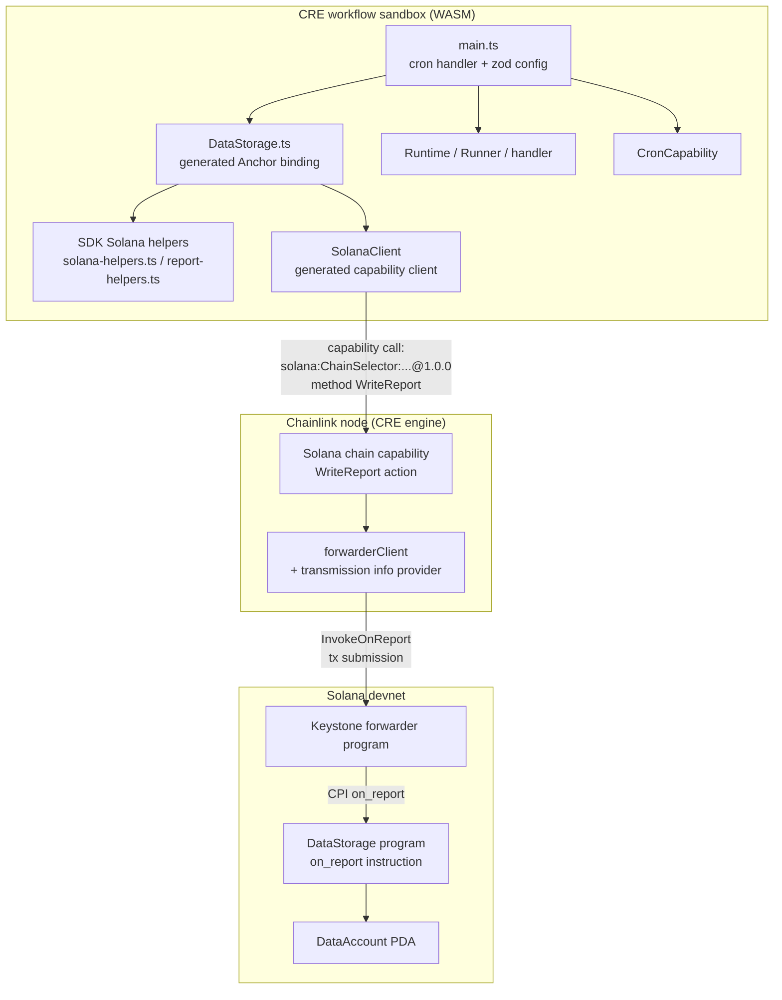
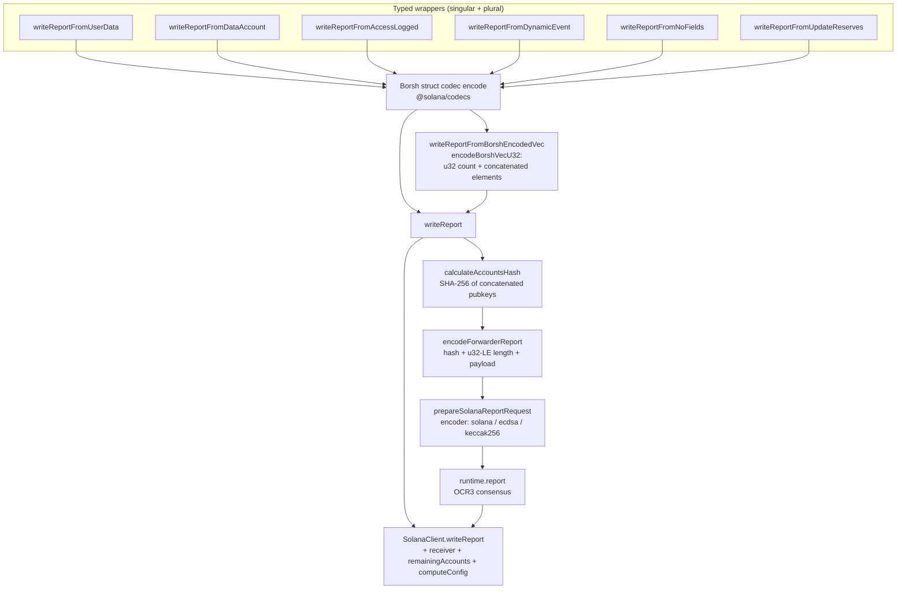
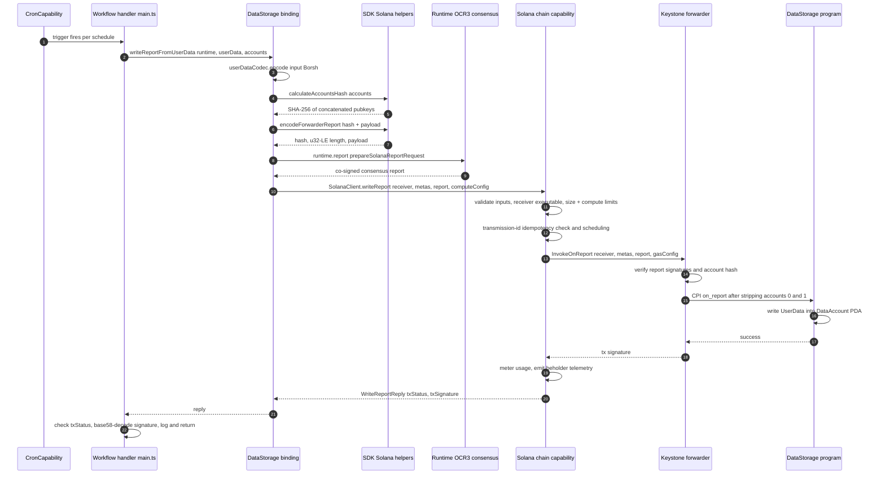
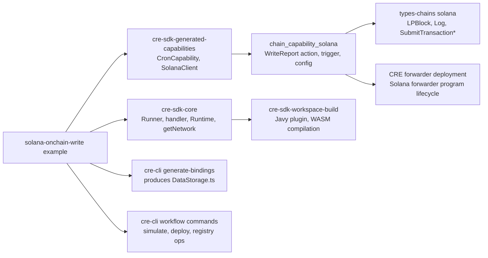

# Solana On-Chain Write Example

> **Module path:** `Developer_Toolchain_(CLI,_SDKs___API_Clients) → cre-sdk-examples-and-plugins → cre-sdk-examples-and-plugins_solana-onchain-write-example`
> **Repository location:** `cre-sdk-typescript/packages/cre-sdk-examples/src/workflows/solana-onchain-write/`
> **Core component:** [`DataStorage.ts::DataStorage`](../../../repo/cre-sdk-typescript/packages/cre-sdk-examples/src/workflows/solana-onchain-write/DataStorage.ts)

## 1. Introduction and Purpose

This module documents the **`solana-onchain-write` example workflow** — the reference implementation for writing data on-chain to Solana programs from a Chainlink Runtime Environment (CRE) workflow written in TypeScript. It is one of the runnable workflows in the `cre-sdk-examples` demo application (see the parent module [CRE SDK Examples and Plugins](../cre-sdk-examples-and-plugins.md)).

The example writes a Borsh-encoded `UserData` value to a Solana **Anchor** program (`DataStorage`, program ID `ECL8142j2YQAvs9R9geSsRnkVH2wLEi7soJCRyJ74cfL`) on Solana devnet. The write does not happen directly from the workflow: the report is first approved by OCR3 consensus across the DON, then transmitted on-chain through the **keystone-forwarder** program, which verifies the signed report and CPIs into the target program's `on_report` instruction.

The example demonstrates four things at once:

1. **Generated bindings** — `DataStorage.ts` is produced by `cre generate-bindings solana --language typescript` (never edited by hand). It bundles the program's Anchor IDL, Borsh codecs, discriminators, and a typed `DataStorage` client class.
2. **Solana chain capability usage** — the SDK-side `SolanaClient` issued against the node-side `solana@1.0.0` chain capability (`WriteReport` method).
3. **Keystone-forwarder integration** — the mandatory account layout (`forwarderState`, `forwarderAuthority`, receiver accounts) and the account-hash verification scheme.
4. **Workflow engineering practices** — zod config validation with base58 address checks, cron triggering, result checking (`SolanaTxStatus`), and base58 decoding of transaction signatures.

## 2. Module Layout

| File | Role |
|---|---|
| `main.ts` | Workflow entry point: config schema, cron handler, `Runner` bootstrap |
| `DataStorage.ts` | **Generated** Anchor binding (core documented component): IDL, codecs, decoders, `DataStorage` class |
| `workflow.yaml` | CRE CLI target settings mapping `staging-settings` / `production-settings` to entry point and config paths |
| `config.staging.json`, `config.production.json` | Per-target runtime config: cron schedule, chain selector name, forwarder and receiver addresses |
| `README.md` | Short developer-facing usage notes |

The example belongs to the `@chainlink/cre-sdk-examples` package (`cre-sdk-typescript/packages/cre-sdk-examples/package.json`), a private Bun workspace member that always compiles against the in-repo SDK via the `"@chainlink/cre-sdk": "workspace:*"` dependency, plus `@solana/addresses`, `@solana/codecs`, `zod`, and `@bufbuild/protobuf`.

## 3. Architecture Overview

The module spans three layers: the workflow sandbox (WASM), the node's chain capability, and the on-chain Solana programs. The workflow itself only orchestrates; all signing, consensus, and transmission are handled by the platform.



Layer responsibilities:

| Layer | Component | Responsibility |
|---|---|---|
| Workflow | `main.ts` | Trigger handling, config validation, account assembly, result interpretation |
| Workflow | `DataStorage.ts` | Borsh encoding/decoding, discriminator handling, report assembly, typed write API |
| SDK | [solana-helpers.ts](../../../repo/cre-sdk-typescript/packages/cre-sdk/src/sdk/utils/capabilities/blockchain/solana/solana-helpers.ts) | Address conversion, account metas, `calculateAccountsHash`, forwarder-report encoding, report request preparation |
| SDK | [client_sdk_gen.ts](../../../repo/cre-sdk-typescript/packages/cre-sdk/src/generated-sdk/capabilities/blockchain/solana/v1alpha/client_sdk_gen.ts) | `solana@1.0.0` capability client (`ClientCapability`), chain-selector-scoped capability IDs |
| Node | [write_report.go](../../../repo/capabilities/chain_capabilities/solana/actions/write_report.go) | Input validation, limits, idempotent transmission scheduling, tx submission, metering, telemetry |
| On-chain | keystone forwarder + DataStorage | Report signature & account-hash verification, CPI into `on_report`, PDA state update |

## 4. The Generated Binding — `DataStorage.ts`

### 4.1 Generation and regeneration

The file is marked `// Code generated — DO NOT EDIT.` It is regenerated from the target program's Anchor IDL:

```bash
cre generate-bindings solana --language typescript
```

The same generator (and the same `data_storage` fixture program) is used for the Go bindings test data in the [CRE CLI bindings generator](../cre-cli-bindings-generator.md); the TypeScript output is documented in [solana TS bindings](../cre-cli-bindings-generator/cre-cli-bindings-generator_solana-ts-bindings.md). If the on-chain program changes, regenerate the file — never patch it manually.

### 4.2 Embedded Anchor IDL

`DATA_STORAGE_IDL` embeds the complete Anchor IDL as a `const`, including:

- **Program address** — also exported separately as `DATA_STORAGE_PROGRAM_ID`.
- **Instructions** — `get_multiple_reserves`, `get_reserves`, `get_tuple_reserves` (view-style, no accounts), `initialize_data_account`, `log_access`, `on_report`, `update_key_value_data`, `update_user_data`, each with its 8-byte discriminator, account list (with PDA seeds and signer/writable flags), and args.
- **Account** — `DataAccount` (fields `sender`, `key`, `value`).
- **Events** — `AccessLogged`, `DynamicEvent`, `NoFields` (relevant for Solana log triggers, see [chain_capability_solana](../../Workflow___Capability_Runtime_(CRE_Engine)/chain_capability_solana.md)).
- **Types** — `UserData`, `UpdateReserves`, etc., and the custom error `DataNotFound` (code 6000).

Because the IDL is embedded, the binding is self-describing: the workflow needs no external IDL file at simulation or deployment time.

### 4.3 Borsh codecs

Wire codecs are built with `@solana/codecs` and exported per type so workflows and tests can reuse them:

| Export | Encoding notes |
|---|---|
| `userDataCodec` | struct of two `u32`-length-prefixed UTF-8 strings |
| `dataAccountCodec` | three length-prefixed UTF-8 strings |
| `accessLoggedCodec` | `caller` as `getAddressCodec()` pubkey + length-prefixed `message` |
| `dynamicEventCodec` | strings, nested `userDataCodec`, length-prefixed `bytes`, and a `u32`-counted array of length-prefixed byte vectors |
| `updateReservesCodec` | two `u64` fields (decoded to `bigint`) |
| `noFieldsCodec` | empty struct |

### 4.4 Anchor discriminators and decoders

Anchor prefixes account data and event payloads with an 8-byte discriminator. The generated file exports each discriminator as a `Uint8Array` constant and implements a single guard, `expectDiscriminator`, which:

1. rejects payloads shorter than 8 bytes (`data too short for discriminator`),
2. compares the leading 8 bytes and throws `discriminator mismatch` on any difference,
3. returns the remaining byte slice for decoding.

On top of that guard sit four pure decode helpers:

- `decodeDataAccountAccount(data)` — raw account bytes → `DataAccount`
- `decodeAccessLoggedEvent(data)` — raw event bytes → `AccessLogged`
- `decodeDynamicEventEvent(data)` — raw event bytes → `DynamicEvent`
- `decodeNoFieldsEvent(data)` — raw event bytes → `NoFields`

These are pure functions with no capability calls; account/event bytes must be obtained elsewhere (e.g. via the Solana read methods `getAccountInfoWithOpts`, `getProgramAccounts`, or a log trigger).

### 4.5 The `DataStorage` class

The class is the write-side façade. Its constructor takes a `SolanaClient` and an optional program ID (base58 string or raw 32 bytes); unlike the EVM bindings — where the contract address is a runtime value — the Solana program ID is **baked into the IDL**, so the parameter only exists to override it for tests or alternate deployments.

All writes funnel through a single core method:

```typescript
writeReport(runtime, payload, remainingAccounts, computeConfig?) {
    const report = runtime
        .report(
            prepareSolanaReportRequest(
                encodeForwarderReport({
                    accountHash: calculateAccountsHash(remainingAccounts),
                    payload,
                }),
            ),
        )
        .result()

    return this.client
        .writeReport(runtime, {
            remainingAccounts: solanaAccountMetasToJson(remainingAccounts),
            receiver: bytesToHex(this.programId),
            computeConfig,
            report,
        })
        .result()
}
```

Two phases are visible:

1. **Off-chain consensus** — the encoded forwarder report (account hash + payload) is submitted via `runtime.report(...)`. The DON reaches OCR3 consensus and returns the co-signed report.
2. **On-chain transmission** — the signed report, the account metas (converted to the capability's protobuf JSON shape with base64 public keys), and the receiver program ID are sent to the chain capability via `SolanaClient.writeReport`.

On top of `writeReport` the generator emits a typed wrapper family. Each singular wrapper encodes one value with its Borsh codec; each plural wrapper encodes every element and wraps them in a Borsh `Vec` (via `encodeBorshVecU32`), mirroring the Go binding's `WriteReportFromBorshEncodedVec`.



Helper semantics (all from [`solana-helpers.ts`](../../../repo/cre-sdk-typescript/packages/cre-sdk/src/sdk/utils/capabilities/blockchain/solana/solana-helpers.ts), byte-compatible with the Go bindings generator output):

| Helper | Behaviour |
|---|---|
| `solanaAddressToBytes` | base58 string → 32 raw bytes |
| `solanaAccountMeta` / `SolanaAccountMeta` | `{publicKey, isWritable}` entry builder (writable defaults to `false`) |
| `solanaAccountMetasToJson` | converts metas to the capability's `AccountMeta` protobuf JSON (base64 keys) |
| `calculateAccountsHash` | SHA-256 over the concatenated public keys of **all** accounts (null entries skipped, order matters) — matches the forwarder's on-chain check |
| `encodeForwarderReport` | `[32-byte accountHash][u32-LE payload length][payload]` |
| `encodeBorshVecU32` | `[u32-LE element count][concatenated pre-encoded elements]` |
| `prepareSolanaReportRequest` | wraps payload bytes into a `ReportRequest` with the default encoder `{encoderName: 'solana', signingAlgo: 'ecdsa', hashingAlgo: 'keccak256'}` |

## 5. Workflow Entry Point — `main.ts`

### 5.1 Config schema

Configuration is validated at workflow start with zod. `schedule` is a cron expression, and every Solana address is validated as base58 at config-parse time using `@solana/addresses` (`receiverProgramId`, `forwarderState`, `forwarderAuthority`, each entry of `receiverAccounts`). Invalid configuration fails fast with a `zod` error before any capability runs.

### 5.2 Cron-triggered handler

`initWorkflow` registers a single handler on a `CronCapability` trigger whose schedule comes from config. On each fire, `onCronTrigger`:

1. resolves the network with `getNetwork({chainFamily: 'solana', chainSelectorName, isTestnet: true})` (see [chain selectors](../cre-sdk-core/cre-sdk-core_chain-selectors.md)); a missing network throws before any write is attempted,
2. constructs `new DataStorage(new SolanaClient(network.chainSelector.selector), solanaConfig.receiverProgramId)`,
3. assembles the keystone-forwarder account list,
4. calls `dataStorage.writeReportFromUserData(runtime, {key: 'cre-example', value: 'hello from CRE'}, accounts)`,
5. checks `resp.txStatus !== SolanaTxStatus.SUCCESS` and throws on failure, otherwise logs the base58-decoded `txSignature` and returns `{Key, Value, TxSignature}`.

### 5.3 Keystone-forwarder account layout

`remainingAccounts` must follow the forwarder's layout — order is load-bearing because the full list is hashed into the report and verified on-chain:

| Index | Account | Writable | Notes |
|---|---|---|---|
| 0 | `forwarderState` | yes | The forwarder program's state account |
| 1 | `forwarderAuthority` | no | PDA of seeds `["forwarder", forwarderState, receiverProgram]` under the forwarder program |
| 2+ | receiver accounts | as required | Here: `user` (writable signer), `data_account` PDA (seeds `"data_account"` + user), `system_program` |

The on-chain forwarder strips indices 0 and 1 before CPI-ing into the receiver, but they **must still be present and correctly ordered** because they participate in the account hash. This layout is enforced in the example by `config.json` (`receiverAccounts` holds only the index-2+ accounts; the first two are always prepended by `main.ts`).

## 6. End-to-End Write Flow



Key behaviours on the node side ([write_report.go](../../../repo/capabilities/chain_capabilities/solana/actions/write_report.go)):

- **Validation** — the receiver must be an executable program (checked via RPC), and user-provided compute limits are checked against the node's `txComputeLimit` bound.
- **Idempotency** — a transmission ID is derived from receiver + report; if the report is already on-chain the stored signature is returned without re-submitting. Failed prior attempts with a lower compute budget are retried at the requested limit.
- **Limits** — `reportSizeLimit` bounds the raw report size; oversized reports are rejected as user errors.
- **Submission** — `forwarderClient.InvokeOnReport(receiver, remainingAccounts, report, computeConfig)` submits the transaction to the forwarder program ([forwarder_client.go](../../../repo/capabilities/chain_capabilities/solana/actions/forwarder_client.go)).
- **Observability** — every phase emits Beholder telemetry (`WriteReportInitiated` / `Success` / `Error`) and metering metadata derived from the final tx signature.

The forwarder program and its state account are part of the CRE deployment itself (node capability config keys `creForwarderAddress` / `creForwarderState` in [config.go](../../../repo/capabilities/chain_capabilities/solana/config/config.go)). Their lifecycle — deploy, init, configure, upgrade, clear config — is owned by the deployment operations `DeployForwarderOp`, `InitForwarderOp`, `ConfigureForwarderOp`, `SetUpgradeAuthorityOp`, `UpgradeForwarderOp`, and `ClearForwarderConfigOp` (v1.0.0) in [operation.go](../../../repo/chainlink/deployment/cre/forwarder/solana/sequence/operation/operation.go); see [CRE Forwarder deployment](../../CRE___Keystone_Deployment_Suite/cre-forwarder.md) and the [Solana forwarder sub-page](../../CRE___Keystone_Deployment_Suite/cre-forwarder/cre-forwarder_solana.md).

## 7. Dependencies and Integration Points



| Related module | Relationship | Documentation |
|---|---|---|
| `cre-sdk-core` | Supplies `Runner`, `handler`, `Runtime`, `getNetwork` used by `main.ts` | [cre-sdk-core](../cre-sdk-core.md) · [runtime](../cre-sdk-core/cre-sdk-core_runtime.md) · [chain selectors](../cre-sdk-core/cre-sdk-core_chain-selectors.md) |
| `cre-sdk-generated-capabilities` | Supplies `CronCapability` and the generated `solana@1.0.0` client (`SolanaClient`) | [cre-sdk-generated-capabilities](../cre-sdk-generated-capabilities.md) |
| `cre-cli` bindings generator | The tool that produced `DataStorage.ts` from the Anchor IDL | [cre-cli-bindings-generator](../cre-cli-bindings-generator.md) |
| `cre-cli` workflow commands | `cre workflow simulate` / `deploy` consume this workflow via its `workflow.yaml` | [cre-cli-workflow-commands](../cre-cli-workflow-commands.md) |
| `cre-sdk-workspace-build` | Javy plugin and `cre-compile` pipeline that turns `main.ts` into workflow WASM | [cre-sdk-workspace-build](../cre-sdk-workspace-build.md) |
| Solana chain capability (node side) | Executes the `WriteReport` capability call | [chain_capability_solana](../../Workflow___Capability_Runtime_(CRE_Engine)/chain_capability_solana.md) · [actions](../../Workflow___Capability_Runtime_(CRE_Engine)/chain_capability_solana/chain_capability_solana_actions.md) · [config](../../Workflow___Capability_Runtime_(CRE_Engine)/chain_capability_solana/chain_capability_solana_config.md) |
| Solana domain types | Node-side Solana service types (`SubmitTransactionRequest/Reply`, `LPBlock`, `Log`) | [types-chains solana](../../Shared_Foundation_Libraries___Domain_Types/types-chains/types-chains_solana.md) |
| CRE forwarder deployment | Deploys and configures the keystone forwarder the example writes through | [cre-forwarder](../../CRE___Keystone_Deployment_Suite/cre-forwarder.md) |

## 8. Configuration Reference

### 8.1 Workflow targets (`workflow.yaml`)

Each target block (`staging-settings`, `production-settings`) maps a CRE CLI target to:

| Key | Value in this example |
|---|---|
| `user-workflow.workflow-name` | `solana-onchain-write` (Workflow Registry name) |
| `workflow-artifacts.workflow-path` | `./main.ts` |
| `workflow-artifacts.config-path` | `./config.staging.json` / `./config.production.json` |
| `workflow-artifacts.secrets-path` | empty — this example uses no vault secrets |

### 8.2 Runtime config (`config.staging.json` / `config.production.json`)

| Field | Meaning |
|---|---|
| `schedule` | Cron expression driving the trigger (staging: `"0 */1 * * * *"` — hourly) |
| `solana.chainSelectorName` | Network name resolved via `getNetwork` (staging: `solana-devnet`; the capability client supports `solana-devnet` selector `16423721717087811551` and `solana-mainnet` selector `124615329519749607`) |
| `solana.receiverProgramId` | Base58 address of the DataStorage program |
| `solana.forwarderState` | Forwarder program's state account (report layout index 0) |
| `solana.forwarderAuthority` | Forwarder authority PDA (report layout index 1) |
| `solana.receiverAccounts[]` | Index-2+ accounts: `{publicKey, isWritable?}` — user, data-account PDA, system program |

The committed addresses are placeholders; replace them with the real devnet accounts of your deployment before running.

### 8.3 Node-side capability config

The node operator must configure the Solana chain capability with `creForwarderAddress` (forwarder program) and `creForwarderState`, plus `Transmitter`, network/RPC settings, and read-poller options — see [chain_capability_solana config](../../Workflow___Capability_Runtime_(CRE_Engine)/chain_capability_solana/chain_capability_solana_config.md). A workflow cannot write through a forwarder the node is not configured for.

## 9. Build, Simulation, and Deployment

The `cre-sdk-typescript` workspace is a Bun + Turborepo monorepo ([package.json](../../../repo/cre-sdk-typescript/package.json), [turbo.json](../../../repo/cre-sdk-typescript/turbo.json)); the examples package is linted with Biome and type-checked with `tsc` (`bun typecheck` / `bun check`). Typical loop for this example:

```bash
bun install && bun x cre-setup            # provision Javy + Chainlink plugin
cre workflow simulate ./src/workflows/solana-onchain-write
```

Simulation runs the compiled WASM against the local capability stack (cron fires immediately); `writeReport` calls are executed by the node-side capability against the configured network. For artifact upload, deployment to the Workflow Registry, and activation/pause/delete lifecycle, see [cre-cli-workflow-commands](../cre-cli-workflow-commands.md). For the Rust-extension variant of the compile pipeline, see the sibling [Rust plugin examples](cre-sdk-examples-and-plugins_rust-plugin-examples.md).

## 10. Failure Modes and Limits

| Stage | Failure | Where raised |
|---|---|---|
| Config parse | Non-base58 address in `config.json` | zod refinement in `main.ts` (workflow startup) |
| Trigger setup | Unknown `chainSelectorName` | `getNetwork` returns nothing → explicit `Error` in `onCronTrigger` |
| Encoding | Payload shorter than 8 bytes or wrong discriminator when using the decode helpers | `expectDiscriminator` |
| Consensus | Report rejected by the DON | `runtime.report(...).result()` throws before any capability call |
| Capability call | Receiver not executable / report exceeds `reportSizeLimit` / compute limit exceeded | Node-side validation → user error surfaced through the capability response |
| Transmission | Receiver execution reverted on-chain | `WriteReportReply.txStatus = FAILED` with `errorMessage` — the workflow checks `txStatus` and throws |
| On-chain CPI | Wrong account order or stale account hash | Forwarder's hash verification reverts; surfaces as a failed transmission |

Because the capability is idempotent per transmission ID, re-running a workflow execution after a partial failure either returns the already-committed signature or retries safely.

## 11. Related Documentation

- Parent module: [CRE SDK Examples and Plugins](../cre-sdk-examples-and-plugins.md)
- SDK primitives: [CRE SDK Core](../cre-sdk-core.md), [Runtime](../cre-sdk-core/cre-sdk-core_runtime.md), [Chain selectors](../cre-sdk-core/cre-sdk-core_chain-selectors.md)
- Capability clients: [Generated capabilities](../cre-sdk-generated-capabilities.md), [Blockchain clients](../cre-sdk-generated-capabilities/cre-sdk-generated-capabilities_blockchain.md)
- Tooling: [Bindings generator](../cre-cli-bindings-generator.md), [Workflow commands](../cre-cli-workflow-commands.md), [Workspace build](../cre-sdk-workspace-build.md)
- Node side: [Solana chain capability](../../Workflow___Capability_Runtime_(CRE_Engine)/chain_capability_solana.md), [Solana types](../../Shared_Foundation_Libraries___Domain_Types/types-chains/types-chains_solana.md)
- Deployment: [CRE Forwarder](../../CRE___Keystone_Deployment_Suite/cre-forwarder.md)
