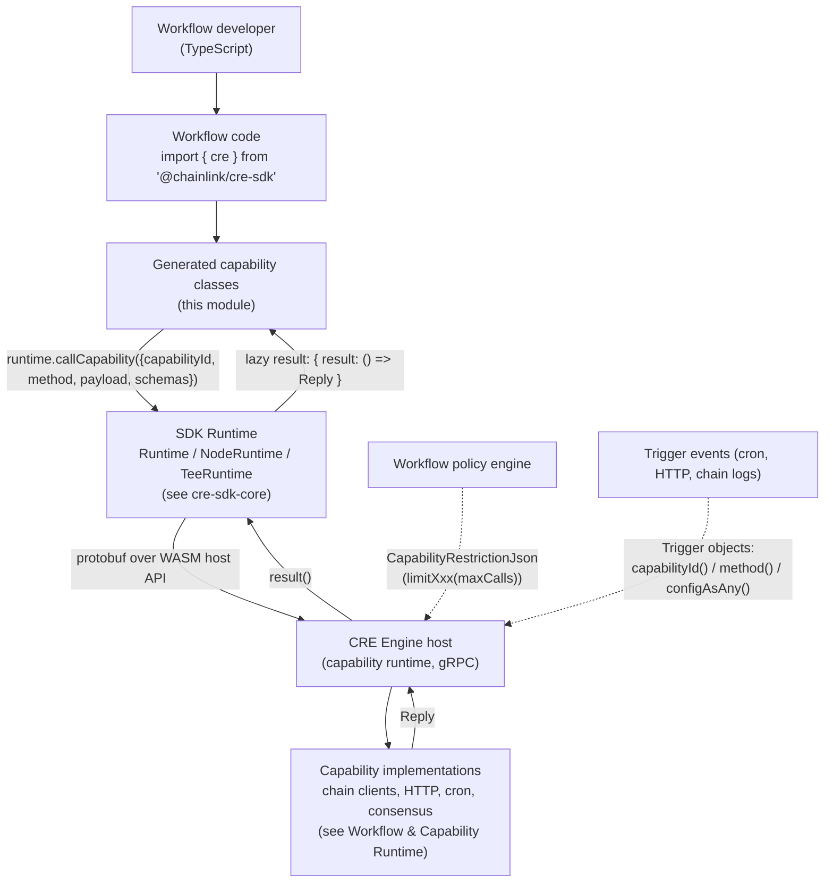
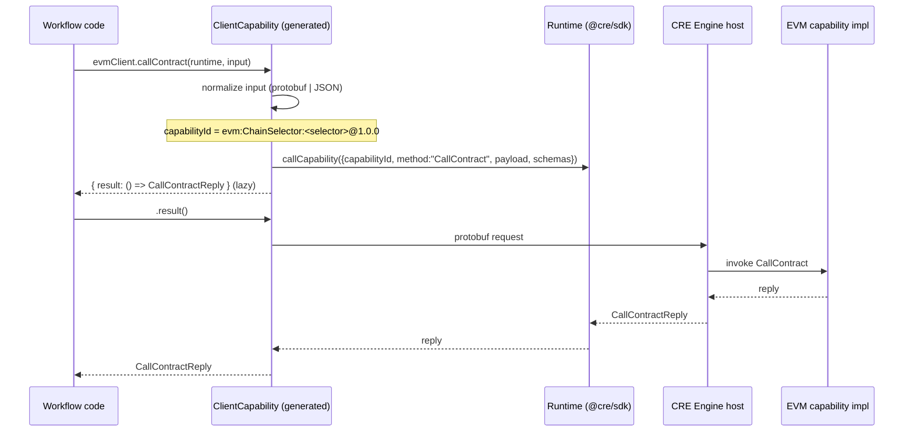
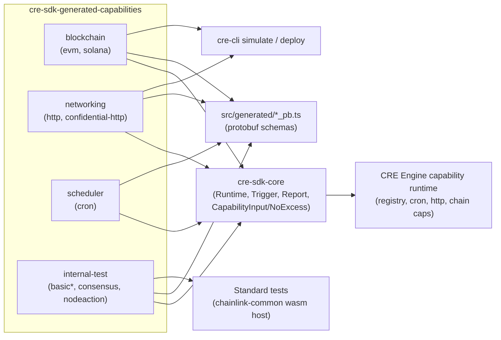

# CRE SDK Generated Capabilities (`cre-sdk-generated-capabilities`)

## 1. Introduction & Purpose

The **`cre-sdk-generated-capabilities`** module contains the **auto-generated TypeScript client wrappers** for all CRE (Chainlink Runtime Environment) capabilities that a workflow can invoke from inside the [CRE TypeScript SDK](cre-sdk-core.md).

Everything in this module lives under:

```
cre-sdk-typescript/packages/cre-sdk/src/generated-sdk/capabilities/
├── blockchain/   # EVM & Solana chain clients (actions, log triggers, report writes)
├── networking/   # HTTP action client, confidential HTTP, HTTP trigger
├── scheduler/    # Cron trigger
└── internal/     # Test capabilities used by the SDK standard test suite
```

The files (`*_sdk_gen.ts`) are **generated artifacts — never edited by hand**. They are produced by the SDK generator (`cre-sdk-typescript/packages/cre-sdk/src/generator/generate-sdk.ts`) from protobuf service definitions maintained in the `chainlink-protos/cre` submodule. Each protobuf service annotated with the custom `capability` metadata option (see `buf.gen.yaml`, which pulls from `submodules/chainlink-protos/cre/...`) gets a fully typed wrapper class emitted into `src/generated-sdk/capabilities/...`.

Regeneration is a single command (`cre-sdk-typescript/packages/cre-sdk/package.json`):

```
bun generate:sdk
# → bun generate:proto && bun generate:chain-selectors && bun scripts/run generate-sdks
```

What each generated file provides:

| Generated artifact | Responsibility |
|---|---|
| `XxxCapability` class | Typed methods per protobuf RPC; each method converts the caller's input (protobuf message *or* plain JSON), builds a routed capability ID, and delegates to `runtime.callCapability(...)` |
| `XxxTrigger` class | Implements the SDK `Trigger<Output, Adapted>` interface for server-streaming RPCs (cron, HTTP, log triggers) so workflows can subscribe to trigger events |
| `XxxRestrictor` class | Emits `CapabilityRestrictionJson` (`{ id, method, maxCalls }`) used by the CRE engine to enforce per-method call budgets on workflows |
| Report wrapper types | `WriteCreReportRequest` (+ `x_generatedCodeOnly_wrap_` / `unwrap_` helpers) that tag report-carrying payloads with `$report: true` and convert hex strings to bytes |
| Node-mode "sugar" helpers | For node-scoped actions (e.g. `http-actions`, `basic-test-node-action`): overloads that wrap a callback with `runtime.runInNodeMode(fn, consensusAggregation, unwrapOptions)` |

The wrappers are the **bridge** between workflow authoring ergonomics and the wire protocol of the [Workflow & Capability Runtime (CRE Engine)](../Workflow___Capability_Runtime_(CRE_Engine).md), which hosts the actual capability implementations (registry, cron, HTTP, chain clients, consensus).

---

## 2. Architecture Overview

### 2.1 Code-generation pipeline

```mermaid
flowchart LR
    subgraph protos["chainlink-protos/cre submodule"]
        P1["capabilities/blockchain/evm/v1alpha"]
        P2["capabilities/blockchain/solana/v1alpha"]
        P3["capabilities/networking/http/v1alpha"]
        P4["capabilities/networking/confidentialhttp/v1alpha"]
        P5["capabilities/scheduler/cron/v1"]
        P6["capabilities/internal/* (test capabilities)"]
        P7["sdk/v1alpha (Runtime, Mode, restrictions)"]
    end

    BUF["buf generate<br/>(buf.gen.yaml, protoc-gen-es)"]
    GEN_TSP["src/generated/**_pb.ts<br/>(message + schema types)"]
    CS["generate-chain-selectors<br/>(scripts/src/generate-chain-selectors.ts)"]
    SDKGEN["SDK generator<br/>src/generator/generate-sdk.ts<br/>+ generate-action / generate-trigger /<br/>generate-restrictor / generate-sugar /<br/>generate-report-wrapper / label-utils"]

    OUT_T["src/generated-sdk/capabilities/**/*_sdk_gen.ts<br/>(THIS MODULE)"]

    protos --> BUF --> GEN_TSP
    protos --> CS
    GEN_TSP --> SDKGEN
    CS --> SDKGEN
    SDKGEN --> OUT_T
```



The generator (`src/generator/generate-sdk.ts`) discovers services via the `capability` protobuf extension, then for each RPC:

- `server_streaming` methods → **trigger** class + trigger method (`generate-trigger.ts`)
- unary methods → **action** method (`generate-action.ts`), optionally with a node-mode sugar overload (`generate-sugar.ts`) when the capability declares `Mode.NODE`, and a **restrictor** method (`generate-restrictor.ts`)
- report-typed request/response messages get **wrapper types** (`generate-report-wrapper.ts`)
- capability **labels** declared in the metadata (e.g. `ChainSelector`, a `uint64Label`) become constructor parameters that are interpolated into the capability ID (`label-utils.ts`)

### 2.2 Position in the CRE workflow stack



### 2.3 Anatomy of a generated capability call

Every generated action method follows the same three-step pattern (shown here for `evm@1.0.0`, but identical across the module):

1. **Input normalization** — the method accepts either a protobuf message (detected via the `$typeName` marker) or a plain JSON object which is converted with `fromJson(XSchema, input)`. The parameter type is gated by `CapabilityInput<TInput, ...>` (a `NoExcess` helper from `@cre/sdk/utils/types/no-excess`) so callers cannot pass excess properties.
2. **Capability ID routing** — the fully qualified ID is assembled as `name[:Label:value ...]@version`, e.g. `evm:ChainSelector:5009297550715157269@1.0.0`. Labels let the engine route the call to the exact capability instance (e.g. a specific chain).
3. **Deferred execution** — the method returns `{ result: () => ReplyType }`. The actual host round-trip only happens when `.result()` is invoked, which is what makes capability calls composable in workflow code (and is verified by the standard test `capability_calls_are_async`).



### 2.4 Capability inventory

| Capability ID | Generated file (`src/generated-sdk/capabilities/...`) | Kinds | Distinctive features |
|---|---|---|---|
| `evm@1.0.0` | `blockchain/evm/v1alpha/client_sdk_gen.ts` | Actions (`callContract`, `filterLogs`, `balanceAt`, `estimateGas`, `getTransactionByHash`, `getTransactionReceipt`, `headerByNumber`), `LogTrigger`, `writeReport` | `ChainSelector` uint64 label with **67 baked-in selectors** (`SUPPORTED_CHAIN_SELECTORS`); report wrapper types |
| `solana@1.0.0` | `blockchain/solana/v1alpha/client_sdk_gen.ts` | Actions (`getBalance`, `getBlock`, `getProgramAccounts`, `getSignatureStatuses`, `getSlotHeight`, `getTransaction`, `getFeeForMessage`, `getAccountInfoWithOpts`, `getMultipleAccountsWithOpts`), `LogTrigger`, `writeReport` | `ChainSelector` label (devnet/mainnet); `ComputeConfig` + `remainingAccounts` on report writes |
| `confidential-http@1.0.0-alpha` | `networking/confidentialhttp/v1alpha/client_sdk_gen.ts` | Action `sendRequest` | TEE-confidential HTTP; simple unary surface |
| `http-actions@1.0.0-alpha` | `networking/http/v1alpha/client_sdk_gen.ts` | Action `sendRequest` | **Node-mode sugar**: `sendRequest(runtime, fn, consensusAggregation, ...)` overload using `runInNodeMode` |
| `http-trigger@1.0.0-alpha` | `networking/http/v1alpha/http_sdk_gen.ts` | Trigger | Incoming HTTP workflow trigger |
| `cron-trigger@1.0.0` | `scheduler/cron/v1/cron_sdk_gen.ts` | Trigger | `Payload` / `LegacyPayload` schemas |
| `consensus@1.0.0-alpha` | `internal/consensus/v1alpha/consensus_sdk_gen.ts` | Actions `simple`, `report` | `report` returns a wrapped `Report`; alpha version string |
| `basic-test-action@1.0.0` | `internal/basicaction/v1/basicaction_sdk_gen.ts` | Action `performAction` | Standard-test echo capability |
| `basic-test-trigger@1.0.0` | `internal/basictrigger/v1/basic_sdk_gen.ts` | Trigger | Standard-test trigger |
| `basic-test-action-trigger@1.0.0` | `internal/actionandtrigger/v1/basic_sdk_gen.ts` | Action + Trigger in one service | Both surfaces in a single generated file |
| `basic-test-node-action@1.0.0` | `internal/nodeaction/v1/basicaction_sdk_gen.ts` | Action `performAction` | `Mode.NODE` capability with node-mode sugar overload |

---

## 3. Sub-module Documentation

The module is organized into four sub-modules, each documented in detail on its own page:

| Sub-module | Contents | Source files (`src/generated-sdk/capabilities/...`) | Documentation |
|---|---|---|---|
| **Blockchain clients** | `evm@1.0.0` and `solana@1.0.0` `ClientCapability` / `ClientRestrictor`, chain-selector label routing, log triggers, `WriteReport` flows | `blockchain/evm/v1alpha/client_sdk_gen.ts`<br>`blockchain/solana/v1alpha/client_sdk_gen.ts` | [cre-sdk-generated-capabilities_blockchain](cre-sdk-generated-capabilities/cre-sdk-generated-capabilities_blockchain.md) |
| **Networking capabilities** | `http-actions` client with node-mode sugar, `confidential-http` client, `http-trigger` | `networking/http/v1alpha/client_sdk_gen.ts`<br>`networking/http/v1alpha/http_sdk_gen.ts`<br>`networking/confidentialhttp/v1alpha/client_sdk_gen.ts` | [cre-sdk-generated-capabilities_networking](cre-sdk-generated-capabilities/cre-sdk-generated-capabilities_networking.md) |
| **Internal test capabilities** | `basic-test-action`, `basic-test-trigger`, `basic-test-action-trigger`, `consensus`, `basic-test-node-action` — used by the SDK standard test suite | `internal/basicaction/v1/basicaction_sdk_gen.ts`<br>`internal/basictrigger/v1/basic_sdk_gen.ts`<br>`internal/actionandtrigger/v1/basic_sdk_gen.ts`<br>`internal/consensus/v1alpha/consensus_sdk_gen.ts`<br>`internal/nodeaction/v1/basicaction_sdk_gen.ts` | [cre-sdk-generated-capabilities_internal-test](cre-sdk-generated-capabilities/cre-sdk-generated-capabilities_internal-test.md) |
| **Scheduler (cron)** | `cron-trigger@1.0.0` trigger wrapper | `scheduler/cron/v1/cron_sdk_gen.ts` | [cre-sdk-generated-capabilities_scheduler](cre-sdk-generated-capabilities/cre-sdk-generated-capabilities_scheduler.md) |

---

## 4. Relationship to the Rest of the System

- **[cre-sdk-core](cre-sdk-core.md)** — supplies everything the generated code imports: the `Runtime` / `NodeRuntime` / `TeeRuntime` classes (`runtime.callCapability`, `runtime.runInNodeMode`), the `Trigger` interface, the `Report` wrapper, `CapabilityInput` / `NoExcess` helpers, and the public API surface guarded by `api-baseline.d.ts`.
- **[Workflow & Capability Runtime (CRE Engine)](../Workflow___Capability_Runtime_(CRE_Engine).md)** — hosts the *server* side of every capability referenced here: the capabilities registry ([capabilities](../Workflow___Capability_Runtime_(CRE_Engine)/capabilities.md)), the cron capability, HTTP action/trigger capabilities, chain capabilities (EVM/Solana/…), and the consensus capability. The generated capability IDs must match the IDs those implementations register, and the `Restrictor` output is enforced by the engine's policy layer.
- **[cre-cli workflow commands](cre-cli-workflow-commands.md)** — `cre workflow simulate` compiles workflow binaries that exercise these wrappers against simulated chains and capabilities; the internal test capabilities of this module are also what the SDK standard tests (`Makefile` targets `standard_tests` / `standard_test_single`, driven by `chainlink-common/pkg/workflows/wasm/host` Go tests at pinned version `cre-std-tests@0.10.0`) run against.
- **[cre-cli bindings generator](cre-cli-bindings-generator.md)** — a complementary (but separate) generator that produces *contract* bindings (Go/TypeScript) for EVM/Solana contracts, as opposed to this module's *capability* bindings produced from protobuf services.

### Dependency graph between sub-modules and their ecosystem



> **Maintenance note:** never edit `*_sdk_gen.ts` by hand. Change the protobuf definitions in `chainlink-protos/cre`, then run `bun generate:sdk` in `cre-sdk-typescript/packages/cre-sdk`. The `full-checks` script (generate → build → typecheck → biome → tests → standard tests) validates the regenerated output end-to-end.
