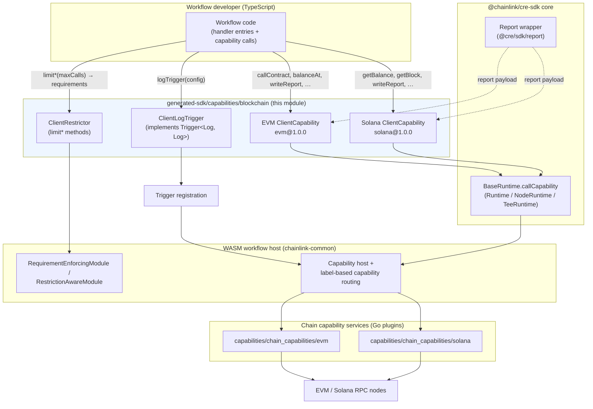
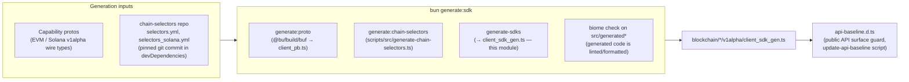
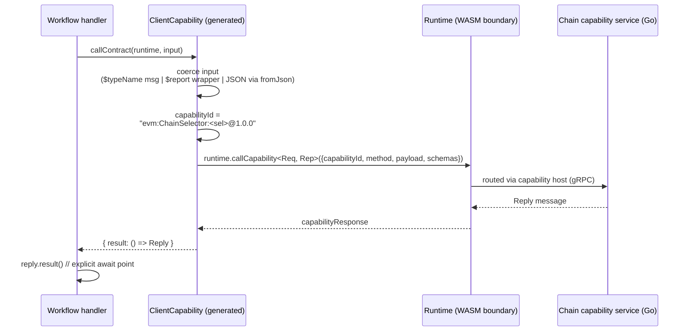
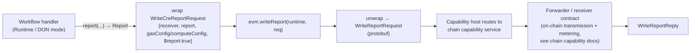
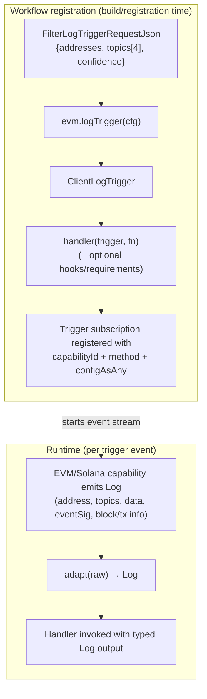

# CRE SDK Generated Capabilities — Blockchain (EVM & Solana)

> **Module path:** `Developer_Toolchain_(CLI,_SDKs___API_Clients)/cre-sdk-generated-capabilities/cre-sdk-generated-capabilities_blockchain`
>
> **Source files:**
> - `cre-sdk-typescript/packages/cre-sdk/src/generated-sdk/capabilities/blockchain/evm/v1alpha/client_sdk_gen.ts`
> - `cre-sdk-typescript/packages/cre-sdk/src/generated-sdk/capabilities/blockchain/solana/v1alpha/client_sdk_gen.ts`

## 1. Introduction

This module contains the **auto-generated TypeScript client wrappers** for the CRE (Chainlink Runtime Environment) *blockchain capabilities*:

| Capability | Wrapper class | Capability ID | Supported networks |
|---|---|---|---|
| EVM | `ClientCapability` | `evm@1.0.0` | 60+ networks (mainnets, testnets, L2 rollups, private testnets) via `SUPPORTED_CHAIN_SELECTORS` |
| Solana | `ClientCapability` | `solana@1.0.0` | `solana-mainnet`, `solana-devnet` |

These classes are the **only sanctioned way** for a CRE workflow written in TypeScript to:

- **Read chain state** — contract calls, balances, blocks, transactions, receipts, headers, program accounts.
- **Observe on-chain events** — log filters (historical `filterLogs`) and streaming **log triggers** (`logTrigger`).
- **Estimate gas / fees** — `estimateGas` (EVM) and `getFeeForMessage` (Solana).
- **Transmit DON reports on-chain** — `writeReport`, which posts a consensus-signed `ReportResponse` to a receiver contract via the chain capability's forwarder.

Everything in this directory is **generated code** (hence the `_gen` file suffix and `x_generatedCodeOnly_*` helper prefixes). Never edit it by hand — regenerate with `bun generate:sdk` in the `cre-sdk` package (see [Code generation pipeline](#4-code-generation-pipeline)).

This module is one of the capability families under [cre-sdk-generated-capabilities](../cre-sdk-generated-capabilities.md), alongside:

- [Internal test & consensus capabilities](cre-sdk-generated-capabilities_internal-test.md) (`basictrigger`, `basicaction`, `consensus`, `nodeaction`, `actionandtrigger`)
- [Networking capabilities](cre-sdk-generated-capabilities_networking.md) (`http`, `confidentialhttp`)
- [Scheduler capabilities](cre-sdk-generated-capabilities_scheduler.md) (`cron`)

## 2. Where This Module Fits in the CRE Toolchain

The blockchain capability clients sit between **workflow author code** and the **Go chain capability services** that actually talk to blockchain nodes. At build time they are compiled into the workflow WASM binary (via the Javy plugin); at run time they marshal protobuf payloads and route calls through the workflow `Runtime`.



**Related documentation:**

- SDK core runtime and execution modes: [cre-sdk-core runtime](../cre-sdk-core/cre-sdk-core_runtime.md) and [cre-sdk-core API surface](../cre-sdk-core/cre-sdk-core_api-surface.md)
- The Go counterparts that serve these capabilities: [chain capability EVM](../../Workflow___Capability_Runtime_(CRE_Engine)/chain_capability_evm.md) and [chain capability Solana](../../Workflow___Capability_Runtime_(CRE_Engine)/chain_capability_solana.md)
- How capabilities are registered and routed at DON level: [capabilities registry](../../Workflow___Capability_Runtime_(CRE_Engine)/capabilities/capabilities_registry.md)
- Where restriction/requirement enforcement happens: [workflows engine](../../Workflow___Capability_Runtime_(CRE_Engine)/workflows/workflows_engine.md)

## 3. Architecture and Components

Both files follow the same generated template and export an identical component set, specialised per chain family:

| Component | EVM file | Solana file | Role |
|---|---|---|---|
| `ClientCapability` | ✅ (`evm@1.0.0`) | ✅ (`solana@1.0.0`) | Typed façade of chain *actions*. Each method validates/coerces input, composes the labelled capability ID, and delegates to `runtime.callCapability`. |
| `ClientRestrictor` | ✅ | ✅ | Emits per-method `CapabilityRestrictionJson` entries (`maxCalls`) used in workflow requirements. |
| `ClientLogTrigger` (private) | ✅ | ✅ | Implements the SDK `Trigger<Log, Log>` interface for `FilterLogTriggerRequest` (see [Log triggers](#7-log-triggers-clientlogtrigger)). |
| `WriteCreReportRequest` + JSON type | ✅ | ✅ | Branded (`$report: true`) wrapped request type for `writeReport`. |
| `x_generatedCodeOnly_wrap/unwrap_WriteCreReportRequest`, `createWriteCreReportRequest` | ✅ | ✅ | Generated conversion helpers between wrapped/JSON/protobuf forms. |

**Key design points**

1. **Chain binding via constructor.** `new ClientCapability(chainSelector: bigint)` binds the client to one chain. The static `SUPPORTED_CHAIN_SELECTORS` map (network name → u64 selector, e.g. `'ethereum-mainnet': 5009297550715157269n`) is generated from the `chain-selectors` repository data (see §4).
2. **Labelled capability IDs.** Every call uses a capability ID of the form:

   ```
   <name>:ChainSelector:<selector>@<version>
   ```

   e.g. `evm:ChainSelector:5009297550715157269@1.0.0`. Labels let the capability host route the request to nodes that actually serve that chain (DON-level registration lives in the [capabilities registry](../../Workflow___Capability_Runtime_(CRE_Engine)/capabilities/capabilities_registry.md)).
3. **Lazy result handle.** Every action returns `{ result: () => Reply }`. Capability calls cross the WASM/host boundary asynchronously; callers must explicitly invoke `.result()` to obtain the reply. The SDK standard-test suite (`TestStandardCapabilityCallsAreAsync`, run via `packages/cre-sdk/Makefile`) enforces this contract.
4. **Three accepted input forms per action.** Generated methods accept:
   - a protobuf message instance (detected via the `$typeName` marker),
   - a wrapped/branded input (`CapabilityInput`, e.g. `$report: true` for `writeReport`),
   - plain JSON (converted via `fromJson(<Schema>, json)`; hex strings → bytes through `hexToBytes` from `@cre/sdk/utils/hex-utils`).
5. **Typed trigger configuration.** `logTrigger` accepts `NoExcess<TConfig, FilterLogTriggerRequestJson>` so workflows get autocompletion without excess-property errors.

## 4. Code Generation Pipeline

The files in this module are produced by the `generate:sdk` script of the `@chainlink/cre-sdk` package (`cre-sdk-typescript/packages/cre-sdk/package.json`):

```
"generate:sdk": "bun generate:proto && bun generate:chain-selectors && bun scripts/run generate-sdks && BIOME_PATHS=\"src/generated src/generated-sdk src/sdk/test/generated\" bun check"
```



Notes:

- **Wire types** (`@cre/generated/capabilities/blockchain/{evm,solana}/v1alpha/client_pb`) come from `generate:proto` (`@bufbuild/buf` + `@bufbuild/protoc-gen-es`, version-pinned at `2.6.3`). They mirror the Go capability proto contracts — e.g. the EVM `WriteReportRequest {receiver, report, gas_config}` / `GasConfig {gas_limit}` messages in `capabilities/chain_capabilities/evm/monitoring/write_report.proto`, the Solana `AccountMeta` / `ComputeConfig` messages in `capabilities/chain_capabilities/solana/monitoring/write_report.proto`, and the log-filter semantics (`FilterLogTriggerRequest`: fixed 4-slot `topics` array, `confidence` defaulting to "SAFE") in `capabilities/chain_capabilities/evm/monitoring/log_trigger.proto`. The shared chain data shapes (`Log`, `Receipt`, `LPBlock`, …) are defined for the Loop/relayer layer in `chainlink-common/pkg/chains/evm/evm.proto` and `chainlink-common/pkg/chains/solana/solana.proto` (see also [chain-grpc-protos EVM](../../Shared_Foundation_Libraries___Domain_Types/chain-grpc-protos/chain-grpc-protos_evm.md) and [chain-grpc-protos Solana](../../Shared_Foundation_Libraries___Domain_Types/chain-grpc-protos/chain-grpc-protos_solana.md)).
- **Chain selectors** are generated by `cre-sdk-typescript/packages/cre-sdk/scripts/src/generate-chain-selectors.ts`, which validates and transforms the YAML data of the `chain-selectors` package (a git dependency pinned to commit `425da86147b75ee0fdd0d95d840a0966b837056b` in the package manifest) into the `SUPPORTED_CHAIN_SELECTORS` const maps.
- The generation tooling is maintained together with the Go protoc plugins in `chainlink-common/pkg/capabilities/v2/protoc` (`TemplateGenerator`; built via the `cre-protoc` target of `chainlink-common/Makefile`) and the `protoc` target of `capabilities/Makefile` — see [capabilities workspace tooling](../../Build,_CI___Release_Infrastructure/capabilities_workspace_tooling.md).
- The public API surface of the SDK (which re-exports the blockchain `*_pb` namespaces as `EVM_PB` / `SOLANA_PB`) is guarded by `cre-sdk-typescript/packages/cre-sdk/api-baseline.d.ts`; intentional changes require running `update-api-baseline`.

## 5. Capability Invocation Model

All chain *actions* (everything except `logTrigger`) follow the same generated pattern:



Illustrative usage (fields abbreviated):

```ts
const evm = new ClientCapability(ClientCapability.SUPPORTED_CHAIN_SELECTORS['ethereum-mainnet'])

// read-only contract call
const reply = evm.callContract(runtime, { /* CallContractRequestJson */ }).result()

// subscribe to logs as a workflow trigger
export const workflow = [
  handler(evm.logTrigger({ addresses: [...], topics: [...] }), async (runtime, log) => {
    // log: Log (protobuf type from client_pb)
  }),
]
```

### 5.1 EVM ClientCapability

Capability `evm@1.0.0` — constructor takes the target chain selector.

| Method | Request → Reply | Purpose |
|---|---|---|
| `callContract` | `CallContractRequest` → `CallContractReply` | Read-only contract call (ABI-encoded `data`) |
| `filterLogs` | `FilterLogsRequest` → `FilterLogsReply` | Historical log query by addresses/topics/block range |
| `balanceAt` | `BalanceAtRequest` → `BalanceAtReply` | Account balance |
| `estimateGas` | `EstimateGasRequest` → `EstimateGasReply` | Gas estimation |
| `getTransactionByHash` | `GetTransactionByHashRequest` → `GetTransactionByHashReply` | Transaction lookup |
| `getTransactionReceipt` | `GetTransactionReceiptRequest` → `GetTransactionReceiptReply` | Receipt lookup |
| `headerByNumber` | `HeaderByNumberRequest` → `HeaderByNumberReply` | Block header by number |
| `writeReport` | `WriteCreReportRequest \| JSON` → `WriteReportReply` | Transmit a DON report to a receiver contract, with optional `GasConfig {gas_limit}` |
| `logTrigger` | `FilterLogTriggerRequestJson` → `ClientLogTrigger` | Register a log trigger |

`WriteCreReportRequest` (EVM) accepts a `receiver` (20-byte EVM address; hex string in JSON form), an optional `Report` (the SDK's parsed `ReportResponse` wrapper from `@cre/sdk/report` — see [cre-sdk-core API surface](../cre-sdk-core/cre-sdk-core_api-surface.md)) and an optional `gasConfig`.

### 5.2 Solana ClientCapability

Capability `solana@1.0.0` — two selectors: `solana-mainnet` (`124615329519749607n`) and `solana-devnet` (`16423721717087811551n`).

| Method | Request → Reply | Purpose |
|---|---|---|
| `getAccountInfoWithOpts` | `GetAccountInfoWithOptsRequest` → reply | Account info (single) |
| `getBalance` | `GetBalanceRequest` → reply | SOL balance |
| `getBlock` | `GetBlockRequest` → reply | Block data |
| `getFeeForMessage` | `GetFeeForMessageRequest` → reply | Fee estimation (Solana analogue of `estimateGas`) |
| `getMultipleAccountsWithOpts` | `GetMultipleAccountsWithOptsRequest` → reply | Batched account info |
| `getProgramAccounts` | `GetProgramAccountsRequest` → reply | Accounts owned by a program |
| `getSignatureStatuses` | `GetSignatureStatusesRequest` → reply | Transaction status by signature |
| `getSlotHeight` | `GetSlotHeightRequest` → reply | Current slot |
| `getTransaction` | `GetTransactionRequest` → reply | Transaction lookup |
| `writeReport` | `WriteCreReportRequest \| JSON` → `WriteReportReply` | Transmit a DON report to a 32-byte receiver program, with `remainingAccounts: AccountMeta[]` and optional `ComputeConfig {compute_limit, compute_max_price}` |
| `logTrigger` | `FilterLogTriggerRequestJson` → `ClientLogTrigger` | Register a log trigger |

Solana-specific differences from EVM:

- `receiver` is a 32-byte program address; `remainingAccounts` is a **required** array of `AccountMeta {public_key, is_writable}` (JSON form defaults to `[]`).
- `computeConfig` replaces gas config: compute-unit limit and max lamports per CU (mirroring `capabilities/chain_capabilities/solana/monitoring/write_report.proto`).

## 6. Report Transmission (`writeReport`)

`writeReport` deserves special attention because it moves data produced by DON consensus onto the target chain:



- The `$report: true` brand distinguishes wrapped requests from protobuf messages and from raw JSON; the generated `unwrap` helpers handle both branches (EVM checks `$report`, converts JSON via `createWriteCreReportRequest`).
- The on-chain semantics (forwarder contracts, transmission state errors, gas retries, duplicate-tx handling) are implemented by the Go capabilities documented in [chain capability EVM](../../Workflow___Capability_Runtime_(CRE_Engine)/chain_capability_evm.md) (actions such as `WriteReport`, `ErrUnexpectedSuccessfulTransmission`) and [chain capability Solana](../../Workflow___Capability_Runtime_(CRE_Engine)/chain_capability_solana.md) (`forwarderClient`, `OnChainTransmissionInfoProvider`). The monitoring protos (`WriteReport*` events) in `capabilities/chain_capabilities/{evm,solana}/monitoring/*.proto` define the corresponding observability wire events.

## 7. Log Triggers (`ClientLogTrigger`)

`logTrigger(config)` does **not** call the runtime — it constructs a trigger object that the workflow registration consumes. `ClientLogTrigger` implements the SDK `Trigger<Log, Log>` interface:

| Interface method | Generated implementation |
|---|---|
| `capabilityId()` | The labelled capability ID (`evm:ChainSelector:<sel>@1.0.0`) |
| `method()` | `"LogTrigger"` |
| `outputSchema()` | `LogSchema` (the `Log` protobuf message) |
| `configAsAny()` | `anyPack(FilterLogTriggerRequestSchema, config)` — packed `Any` carrying the filter definition |
| `adapt(rawOutput)` | Identity (`Log → Log`) |



`FilterLogTriggerRequest` semantics (from the capability protos): `addresses` (at least one 20/32-byte address), `topics` — a fixed 4-slot array where slot 0 holds event signatures (keccak256 of the event signature) and slots 1–3 hold optional values for indexed arguments — and an optional `confidence` level (default "SAFE"). For Go-side trigger implementation details (log polling, cursors, reorg handling) see the [EVM trigger service](../../Workflow___Capability_Runtime_(CRE_Engine)/chain_capability_evm/chain_capability_evm_trigger.md) and [Solana trigger service](../../Workflow___Capability_Runtime_(CRE_Engine)/chain_capability_solana/chain_capability_solana_trigger.md) docs.

## 8. Method Restrictions (`ClientRestrictor`)

Each generated file also exports `ClientRestrictor`, constructed with the same chain selector. Its `limit<Method>(maxCalls: number)` methods produce `CapabilityRestrictionJson` entries of the form:

```json
{ "method": { "id": "evm:ChainSelector:<sel>@1.0.0", "method": "WriteReport", "maxCalls": 1 } }
```

These restriction objects are attached to workflow `Requirements`/`RestrictionsJson` (types from `@cre/generated/sdk/v1alpha/sdk_pb`, e.g. via handler `hooks.preHook` or `requirements`). At run time the WASM host's **RequirementEnforcingModule / RestrictionAwareModule** rejects executions that exceed the declared call budget — see [workflows engine](../../Workflow___Capability_Runtime_(CRE_Engine)/workflows/workflows_engine.md). Restrictor methods mirror the action methods only (triggers are not restricted):

- EVM: `limitCallContract`, `limitFilterLogs`, `limitBalanceAt`, `limitEstimateGas`, `limitGetTransactionByHash`, `limitGetTransactionReceipt`, `limitHeaderByNumber`, `limitWriteReport`.
- Solana: `limitGetAccountInfoWithOpts`, `limitGetBalance`, `limitGetBlock`, `limitGetFeeForMessage`, `limitGetMultipleAccountsWithOpts`, `limitGetProgramAccounts`, `limitGetSignatureStatuses`, `limitGetSlotHeight`, `limitGetTransaction`, `limitWriteReport`.

## 9. Testing Integration

- **Standard tests.** `make standard_tests` in `cre-sdk-typescript/packages/cre-sdk/Makefile` downloads `github.com/smartcontractkit/chainlink-common` at the `cre-std-tests@0.10.0` tag, builds the WASM host test binary, and runs all `^TestStandard` host tests against workflow modules compiled from `src/standard_tests/**/test.ts` (the `src/standard_tests/Makefile` compiles each `test.ts` to `test.wasm` via `bun compile:workflow`). These tests exercise, among other things, the async `.result()` contract and capability call plumbing used by this module.
- **Unit-level mocks.** The test entry point of the SDK exposes `addContractMock` / `addSolanaContractMock` (with `WriteReportMockInput` / `SolanaWriteReportMockInput`) and a `TestRuntime` that can intercept `callCapability` traffic without the WASM environment — see [cre-sdk-core test harness](../cre-sdk-core/cre-sdk-core_test-harness.md).
- **Simulation.** The `cre` CLI's workflow simulator builds a local chain layer with matching `ChainClient` / `CapabilityConfig` abstractions — see [cre-cli workflow simulation](../cre-cli-workflow-commands/cre-cli-workflow-commands_simulation.md).

## 10. Build & Tooling Context

- The `cre-sdk-typescript` directory is a **Bun + Turborepo** workspace (`packageManager: bun@1.3.9`, workspaces `packages/*`, tasks defined in `cre-sdk-typescript/turbo.json`). Generated code participates in the normal `build` / `typecheck` / `check` pipeline.
- `cre-sdk-typescript/scripts/full-checks.sh` runs the complete verification loop: frozen-lockfile install, Javy plugin build, `generate:sdk` (regenerating this module), `build`, `typecheck`, `check`, `test`, and `test:standard` — ensuring generated capability code, protobuf types, and chain-selector data are mutually consistent.
- Runtime dependencies of the generated wrappers are minimal: `@bufbuild/protobuf` (create/fromJson/anyPack), the generated `client_pb` modules, and the SDK core (`Runtime`, `Report`, hex utils, trigger interface).
- Workflow binaries are compiled through the Javy plugin (`cre-sdk-typescript/packages/cre-sdk-javy-plugin/Dockerfile`), which is why generated code avoids Node-specific APIs (see the `global.d.ts` polyfills referenced by [cre-sdk-core runtime](../cre-sdk-core/cre-sdk-core_runtime.md)). Workspace-level details: [cre-sdk workspace build](../cre-sdk-workspace-build.md).

## 11. Key Invariants & Gotchas

1. **Do not edit generated files.** Any change must be made in the generator/templates and re-run via `bun generate:sdk`; `biome check` is applied to `src/generated*` after generation.
2. **Always call `.result()`.** Capability calls are asynchronous across the WASM boundary; treating the return value as the reply is a common integration bug (and is tested for by the standard tests).
3. **Capability ID labels are mandatory for routing.** The `ChainSelector` label embedded in the capability ID is what routes a call to nodes serving that chain; passing a selector for a chain the DON does not serve will fail at registration/dispatch time, not at code-generation time.
4. **`SUPPORTED_CHAIN_SELECTORS` is advisory but versioned.** It is regenerated from the pinned `chain-selectors` commit; treat selector values as stable identifiers (the same u64 selectors are used across CRE/CCIP).
5. **Three input forms, one wire type.** Actions accept protobuf messages, branded wrappers, or plain JSON; JSON hex fields (receiver addresses) are converted with `hexToBytes` before transmission.
6. **Restrictions are enforced host-side.** `limit*` declarations are security-relevant; exceeding `maxCalls` aborts the workflow run.

## 12. Related Documentation

- [cre-sdk-generated-capabilities](../cre-sdk-generated-capabilities.md) — parent module (all generated capability families)
- [Internal test & consensus capabilities](cre-sdk-generated-capabilities_internal-test.md) · [Networking capabilities](cre-sdk-generated-capabilities_networking.md) · [Scheduler capabilities](cre-sdk-generated-capabilities_scheduler.md)
- [cre-sdk-core](../cre-sdk-core.md) — runtime, errors, chain selectors, API baseline
- [Developer Toolchain overview](<../../Developer_Toolchain_(CLI,_SDKs___API_Clients).md>) — `cre` CLI, Go SDK, OpenAPI clients
- [Chain capability EVM](<../../Workflow___Capability_Runtime_(CRE_Engine)/chain_capability_evm.md>) and [Chain capability Solana](<../../Workflow___Capability_Runtime_(CRE_Engine)/chain_capability_solana.md>) — the Go capability services behind these wrappers
- [Workflows engine](<../../Workflow___Capability_Runtime_(CRE_Engine)/workflows/workflows_engine.md>) — requirement/restriction enforcement in the WASM host
- [Capabilities registry](<../../Workflow___Capability_Runtime_(CRE_Engine)/capabilities/capabilities_registry.md>) — DON-level capability registration and routing
- [Types: chains (EVM)](../../Shared_Foundation_Libraries___Domain_Types/types-chains/types-chains_evm.md) · [Types: chains (Solana)](../../Shared_Foundation_Libraries___Domain_Types/types-chains/types-chains_solana.md) — shared Go domain types mirrored by the wire contracts
