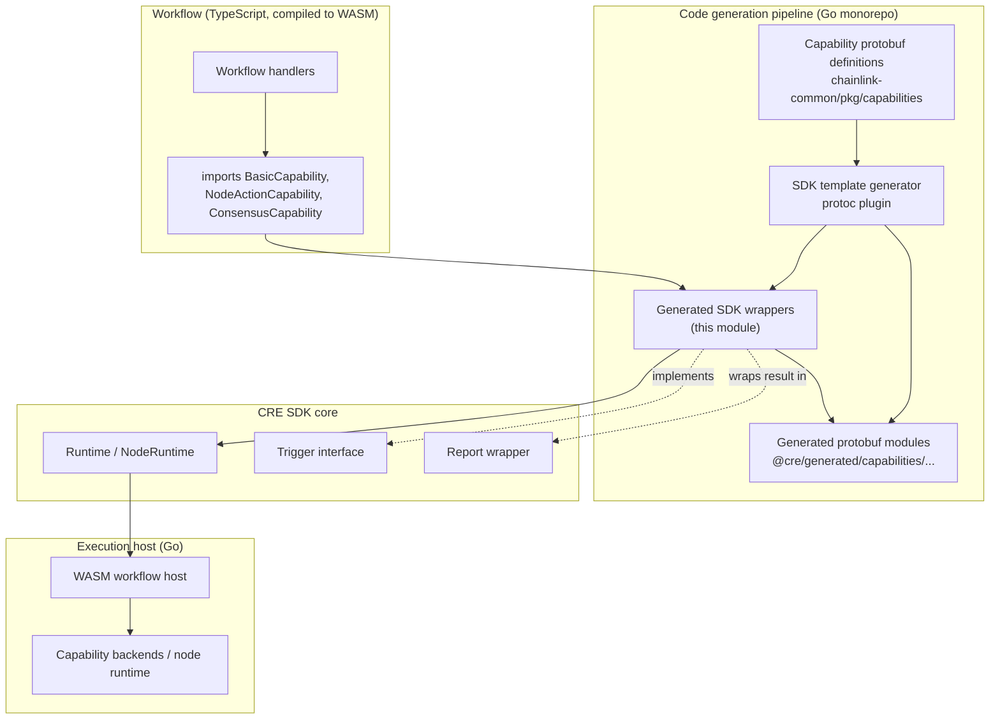
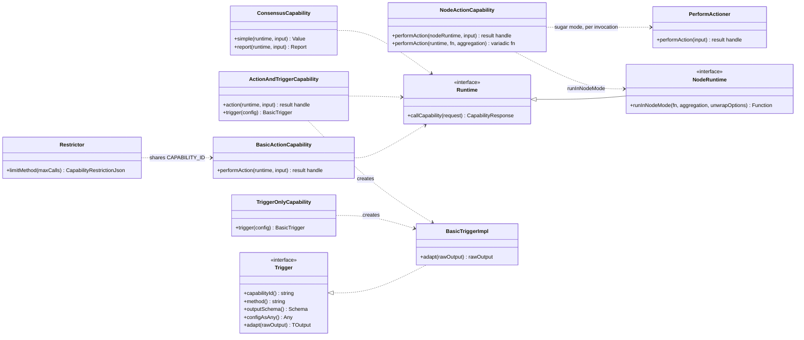
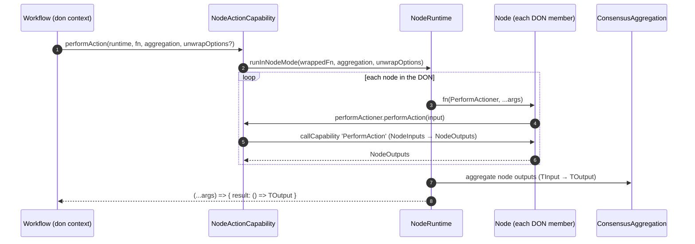
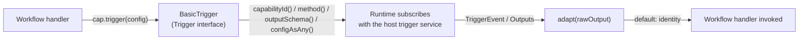
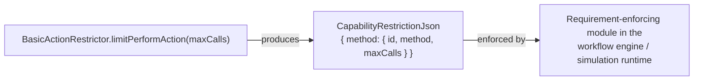
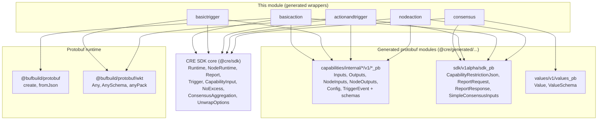

# Internal Test Capabilities (Generated SDK)

## Overview

This module documents the **internal test capability set** of the generated TypeScript SDK, located under
`cre-sdk-typescript/packages/cre-sdk/src/generated-sdk/capabilities/internal/`. These files are *generated* wrappers
(suffix `*_sdk_gen.ts`) that expose a small, deterministic family of capabilities — `basic-test-action`,
`basic-test-trigger`, `basic-test-action-trigger`, `basic-test-node-action` and `consensus` — to workflow authors
writing TypeScript against the [CRE SDK core](../cre-sdk-core.md).

Unlike the user-facing generated capability groups ([blockchain](cre-sdk-generated-capabilities_blockchain.md),
[networking](cre-sdk-generated-capabilities_networking.md), [scheduler](cre-sdk-generated-capabilities_scheduler.md)),
the internal capabilities are not meant for production workflows. They exist to exercise every execution pattern the
CRE SDK supports — don-level capability calls, node-level execution with consensus aggregation, trigger registration,
and capability restriction policies — and are the TypeScript-facing contract used by the SDK's cross-language
**standard test suite** (see [Build, test and regeneration](#build-test-and-regeneration)).

### Component inventory

| Source file | Capability class | Capability ID | Executable methods | Trigger | Restrictor |
|---|---|---|---|---|---|
| `internal/basicaction/v1/basicaction_sdk_gen.ts` | `BasicActionCapability` | `basic-test-action@1.0.0` | `performAction` → method `PerformAction` | — | `BasicActionRestrictor.limitPerformAction` |
| `internal/basictrigger/v1/basic_sdk_gen.ts` | `BasicCapability` | `basic-test-trigger@1.0.0` | — | `BasicTrigger` (internal) | `BasicRestrictor` (empty) |
| `internal/actionandtrigger/v1/basic_sdk_gen.ts` | `BasicCapability` | `basic-test-action-trigger@1.0.0` | `action` → method `Action` | `BasicTrigger` (internal) | `BasicRestrictor.limitAction` |
| `internal/nodeaction/v1/basicaction_sdk_gen.ts` | `BasicActionCapability` | `basic-test-node-action@1.0.0` | `performAction` → method `PerformAction` (node mode) | — | `BasicActionRestrictor.limitPerformAction` |
| `internal/consensus/v1alpha/consensus_sdk_gen.ts` | `ConsensusCapability` | `consensus@1.0.0-alpha` | `simple` → `Simple`, `report` → `Report` | — | `ConsensusRestrictor.limitSimple`, `limitReport` |

Each wrapper carries three static identity constants — `CAPABILITY_ID` (a `name@version` composite matching the
capability metadata format used by the capabilities registry in the
[capability framework](../../Workflow___Capability_Runtime_(CRE_Engine)/capabilities.md)),
`CAPABILITY_NAME`, and `CAPABILITY_VERSION`.

## Architecture

The wrappers are the last stage of a code-generation pipeline: capability definitions (protobuf) are processed by the
SDK template generator, which emits (a) protobuf message/schema modules exposed through the `@cre/generated/...` path
alias and (b) the ergonomic SDK classes in this module. At runtime, workflow code passes its `Runtime` handle into the
generated classes, which translate typed calls into `runtime.callCapability(...)` requests that cross the WASM/host
boundary into the capability backends.



The code-generation tooling itself lives in the Go monorepo (`chainlink-common/pkg/capabilities/v2/protoc/pkg/template_generator.go`);
for its role in the overall capability lifecycle see
[capabilities_v2_tooling](../../Workflow___Capability_Runtime_(CRE_Engine)/capabilities/capabilities_v2_tooling.md).

### Class model



`Runtime` and `NodeRuntime`, the `Trigger` interface and the `Report` wrapper are part of the SDK core and are
documented in [cre-sdk-core](../cre-sdk-core.md); this page focuses on the generated wrappers that consume them.

## Component reference

### `basicaction/v1` — `basic-test-action@1.0.0`

A minimal **don-level executable capability**.

- `BasicActionCapability.performAction(runtime, input)` — dual-typed input: either a protobuf `Inputs` message
  (detected via the `$typeName` marker property) or a plain JSON object converted with `fromJson(InputsSchema, input)`.
  Delegates to `runtime.callCapability` with method `PerformAction`, `InputsSchema` / `OutputsSchema`, and returns a
  lazy handle `{ result: () => Outputs }`.
- `BasicActionRestrictor.limitPerformAction(maxCalls)` — emits a `CapabilityRestrictionJson`
  (`{ method: { id, method, maxCalls } }`) for the `PerformAction` method.

### `basictrigger/v1` — `basic-test-trigger@1.0.0`

A **trigger-only capability**. The capability class exposes only `trigger(config)` (with `NoExcess<TConfig, ConfigJson>`
excess-property checking), returning an internal `BasicTrigger` that implements the SDK `Trigger<Outputs, Outputs>`
contract:

- `capabilityId()` / `method()` — identity and method (`Trigger`);
- `outputSchema()` — returns `OutputsSchema`;
- `configAsAny()` — packs the typed config with `anyPack(ConfigSchema, this.config)` into a protobuf `Any`;
- `adapt(rawOutput)` — identity transform by default (extension point for generators that post-process trigger payloads).

`BasicRestrictor` is deliberately empty: trigger registration is not an executable capability call, so there is nothing
to restrict. The class exists to keep the generated API surface symmetric across capabilities.

### `actionandtrigger/v1` — `basic-test-action-trigger@1.0.0`

A **combined capability** exercising both halves of the contract in one class:

- `action(runtime, input)` → `{ result: () => Output }` via method `Action`;
- `trigger<TConfig>(config)` → `BasicTrigger` bound to method `Trigger`, whose output schema is `TriggerEventSchema`;
- `BasicRestrictor.limitAction(maxCalls)` restricts only the executable `Action` method.

### `nodeaction/v1` — `basic-test-node-action@1.0.0`

A **node-level executable capability** demonstrating the two execution modes available to node capabilities:

1. **Basic call** — `performAction(nodeRuntime: NodeRuntime<unknown>, input)` runs inside `runtime.runInNodeMode`,
   calls method `PerformAction` and returns `{ result: () => NodeOutputs }`.
2. **Sugar mode** — `performAction(runtime, fn, consensusAggregation, unwrapOptions?)` where `fn` receives a
   `PerformActioner` (a thin wrapper pairing the node runtime with this capability). The implementation wraps `fn` and
   delegates to `runtime.runInNodeMode(wrappedFn, consensusAggregation, unwrapOptions)`, returning a variadic function
   `(...args: TArgs) => { result: () => TOutput }` — i.e., the user function's arguments are captured and the consensus
   output is resolved lazily.

Dispatch between the two overloads is by duck-typing (`typeof args[1] === 'function'`). The `consensusAggregation`
argument is a `ConsensusAggregation<TInput, TOutput, true>` (the `true` marks node-mode aggregation), and
`unwrapOptions` is required only when the aggregation input is not a `PrimitiveTypes` value
(`TInput extends PrimitiveTypes ? never : UnwrapOptions<TInput>`).

- `BasicActionRestrictor.limitPerformAction(maxCalls)` restricts `PerformAction`.

### `consensus/v1alpha` — `consensus@1.0.0-alpha`

The **built-in consensus capability** used to reach don-level agreement inside workflows (note the `alpha` version
suffix — the only one in this set):

- `simple(runtime, input)` → `{ result: () => Value }` — method `Simple`, aggregating `SimpleConsensusInputs` into a
  values-protobuf `Value` (`@cre/generated/values/v1/values_pb`);
- `report(runtime, input)` → `{ result: () => Report }` — method `Report`, sending `ReportRequest` and wrapping the
  `ReportResponse` in the SDK's `Report` class rather than returning the raw protobuf message;
- `ConsensusRestrictor.limitSimple` / `limitReport` — one restriction entry per executable method.

## Runtime interaction patterns

### Don-level capability call (data flow)

```mermaid
sequenceDiagram
    autonumber
    participant W as Workflow code
    participant C as Generated capability class
    participant R as Runtime (SDK core)
    participant H as Capability backend (Go host)

    W->>C: performAction / action / simple / report(runtime, input)
    Note over C: input normalization:<br/>$typeName present → protobuf message used as-is;<br/>otherwise fromJson(Schema, input)
    C->>R: callCapability{capabilityId, method, payload, inputSchema, outputSchema}
    R-->>C: capability response (lazy)
    C-->>W: { result: () => Output }
    W->>W: handle.result()
    R->>H: serialized request across WASM boundary
    H-->>R: typed output message
    R-->>W: Output / Outputs / Value / Report
```

All wrappers share this shape: **normalize input → fixed capability ID + method → `runtime.callCapability` → lazy
`result()` handle**. The only variant is `consensus.report`, whose `result()` wraps the raw `ReportResponse` in
`new Report(result)`.

### Node-mode execution with consensus aggregation



This is the pattern that makes `basic-test-node-action` distinct: the same user function is executed per-node, each
invocation performing its own capability call, and the aggregation strategy folds the node outputs into a single
don-level result.

### Trigger registration



### Restriction policies

Every executable method has a matching `limit*` factory on the paired `Restrictor` class:



The restriction JSON is consumed downstream by the requirement-enforcing machinery of the workflow runtime
(`RequirementEnforcingModule` / `RestrictionAwareModule`), described in
[workflows_engine](../../Workflow___Capability_Runtime_(CRE_Engine)/workflows/workflows_engine.md). Simulation
flows driven by the CLI rely on the same metadata — see
[cre-cli workflow commands](../cre-cli-workflow-commands.md).

## Dependencies



Dependency details:

- **SDK core (`@cre/sdk`)** — `Runtime` and `NodeRuntime` (transport for `callCapability` / `runInNodeMode`), the
  `Trigger` interface, `Report`, and helper types `CapabilityInput` / `NoExcess`, `ConsensusAggregation`,
  `PrimitiveTypes`, `UnwrapOptions`. Covered by [cre-sdk-core](../cre-sdk-core.md).
- **Generated protobuf modules** — one `*_pb` module per capability providing message classes, JSON types and
  `Schema` descriptors (e.g. `InputSchema`, `OutputsSchema`, `NodeInputsSchema`, `TriggerEventSchema`). The wrappers
  never hand-roll serialization; all conversion flows through these schemas.
- **Protobuf runtime** — `fromJson` for JSON→message conversion, `anyPack` for packing trigger configs into `Any`
  (Well-Known Types).

A template artifact worth noting for maintainers: several generated files import helpers (e.g. `Report`, `hexToBytes`,
`create`) that are unused in that particular file. This is uniform-template generation, not dead code introduced by
hand — do not "clean up" individual files by hand; changes belong in the generator templates.

## Build, test and regeneration

This module is generated code inside the `cre-sdk-typescript` Bun workspace (workspaces + turbo-orchestrated
`build` / `check` / `typecheck` / `lint` — see
[cre-sdk-workspace-build](../cre-sdk-workspace-build.md)). What makes this module special is its role in the
**standard test suite**, which verifies the generated SDK against the Go workflow host:

- `cre-sdk-typescript/packages/cre-sdk/Makefile` — target `standard_tests` pins the Go module version
  (`COMMON_VERSION ?= cre-std-tests@0.10.0` of `github.com/smartcontractkit/chainlink-common`), compiles the Go WASM
  host test binary from that module (`pkg/workflows/wasm/host`) and runs it with `TEST_PATTERN ?= ^TestStandard`;
  `standard_test_single TEST=<Name>` runs one test in isolation.
- `cre-sdk-typescript/packages/cre-sdk/src/standard_tests/Makefile` — pattern rule that JIT-compiles each
  `src/standard_tests/**/test.ts` workflow to `test.wasm` via `bun compile:workflow` (max two directory levels of
  nesting) before the host binary executes it.

In that flow, the internal test capabilities are the deterministic capability set the standard test workflows call:
`basic-test-action` / `basic-test-action-trigger` validate async don-level calls and combined capabilities,
`basic-test-trigger` validates trigger registration and event delivery, `basic-test-node-action` validates node-mode
execution with consensus aggregation, and `consensus` validates built-in consensus (`Simple`/`Report`). The Go-side
counterparts of these capabilities and the WASM host live in the CRE engine; see
[workflows_engine](../../Workflow___Capability_Runtime_(CRE_Engine)/workflows/workflows_engine.md) and
[capabilities](../../Workflow___Capability_Runtime_(CRE_Engine)/capabilities.md).

Regeneration is driven by the Go monorepo's capability tooling (the `*_sdk_gen.ts` files and their `@cre/generated/...`
imports are outputs, not sources). Treat hand-edits to files in `src/generated-sdk/capabilities/internal/` as
destructive: fix the templates or the underlying capability protobufs instead, then regenerate.

## Relationship to other modules

| Module | Relationship |
|---|---|
| [cre-sdk-generated-capabilities](../cre-sdk-generated-capabilities.md) | Parent module grouping all generated capability wrappers; this is the internal/test branch of that tree. |
| [cre-sdk-generated-capabilities_blockchain](cre-sdk-generated-capabilities_blockchain.md) | Sibling group (EVM, Solana client capabilities) — same generation patterns, user-facing scope. |
| [cre-sdk-generated-capabilities_networking](cre-sdk-generated-capabilities_networking.md) | Sibling group (HTTP, confidential HTTP) — same generation patterns, user-facing scope. |
| [cre-sdk-generated-capabilities_scheduler](cre-sdk-generated-capabilities_scheduler.md) | Sibling group (cron) — trigger-only, same `Trigger` contract as `basic-test-trigger`. |
| [cre-sdk-core](../cre-sdk-core.md) | Provides `Runtime` / `NodeRuntime`, `Trigger`, `Report` and the utility types consumed here. |
| [cre-sdk-workspace-build](../cre-sdk-workspace-build.md) | Workspace build, check and test-templates orchestration for this package. |
| [CRE capability framework](../../Workflow___Capability_Runtime_(CRE_Engine)/capabilities.md) | Defines the capability protobufs, registry metadata and v2 code-generation tooling that produce this module. |
| [Workflow engine](../../Workflow___Capability_Runtime_(CRE_Engine)/workflows/workflows_engine.md) | Hosts the WASM workflow execution and the requirement-enforcing module that consumes `CapabilityRestrictionJson`. |
