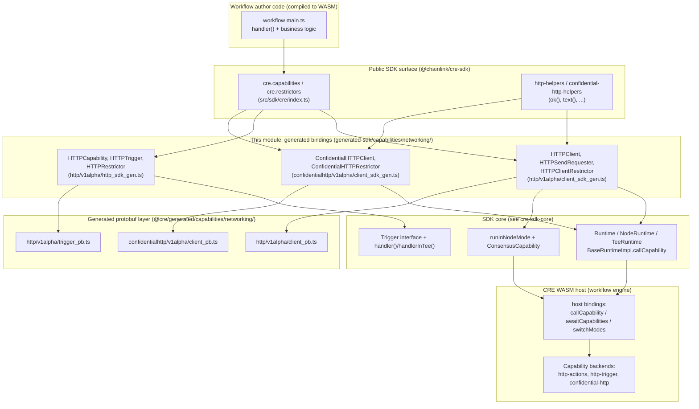
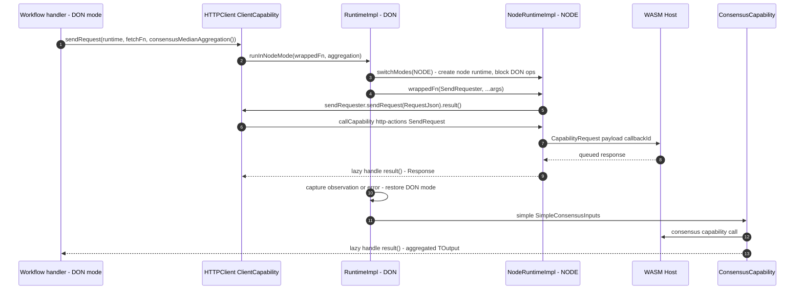
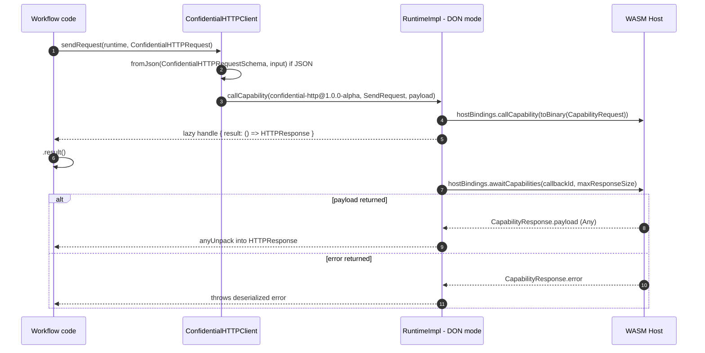
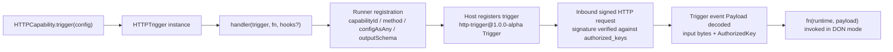
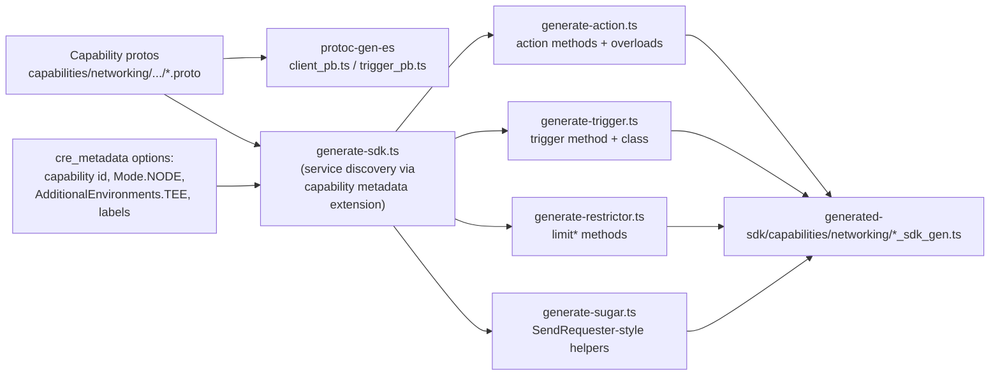

# Networking Capabilities (Generated SDK Bindings)

## Introduction

The `cre-sdk-generated-capabilities_networking` module contains the **auto-generated TypeScript SDK bindings** for the Chainlink Runtime Environment (CRE) *networking* capability family. These bindings live in the [`cre-sdk-typescript`](../../Developer_Toolchain_(CLI,_SDKs___API_Clients).md) monorepo under `cre-sdk-typescript/packages/cre-sdk/src/generated-sdk/capabilities/networking/` and expose typed, versioned classes that workflow authors use to:

- **Perform outbound HTTP requests** from workflow nodes (`http-actions@1.0.0-alpha`, exported as `HTTPClient`),
- **Receive inbound, signature-verified HTTP triggers** (`http-trigger@1.0.0-alpha`, exported as `HTTPCapability`),
- **Perform confidential HTTP requests** whose secrets are resolved and whose traffic is handled by a Vault DON enclave (`confidential-http@1.0.0-alpha`, exported as `ConfidentialHTTPClient`).

The generated files are **not hand-written**: they are produced by the SDK's code generator from capability protobuf schemas (see [Code Generation Pipeline](#code-generation-pipeline)). Developers should treat them as a stable, typed surface over the WASM host's capability protocol, and should not edit them manually.

> In CRE WASM workflows the browser-standard `fetch` API is **blocked** (declared `never` in `cre-sdk-typescript/packages/cre-sdk/src/sdk/types/restricted-apis.d.ts`); all outbound HTTP must go through the bindings in this module.

---

## Capability Inventory

| Generated file | Capability ID | Exported name | Kind | Execution mode |
|---|---|---|---|---|
| `http/v1alpha/client_sdk_gen.ts` | `http-actions@1.0.0-alpha` | `HTTPClient`, `HTTPSendRequester`, `HTTPClientRestrictor` | Action (unary `SendRequest`) | Node mode (+ TEE support); sugar overload runs DON-side consensus |
| `http/v1alpha/http_sdk_gen.ts` | `http-trigger@1.0.0-alpha` | `HTTPCapability`, `HTTPRestrictor` | Trigger (server-streaming `Trigger`) | DON-side event delivery |
| `confidentialhttp/v1alpha/client_sdk_gen.ts` | `confidential-http@1.0.0-alpha` | `ConfidentialHTTPClient`, `ConfidentialHTTPRestrictor` | Action (unary `SendRequest`) | DON mode only |

The SDK's public entry point re-exports these classes under their friendly names from `cre-sdk-typescript/packages/cre-sdk/src/sdk/cre/index.ts` and aggregates them into the `cre.capabilities` and `cre.restrictors` objects:

```typescript
import { cre, HTTPClient, HTTPCapability, ConfidentialHTTPClient } from '@chainlink/cre-sdk'
// equivalently: cre.capabilities.HTTPClient, cre.capabilities.HTTPCapability, ...
```

For the module-level context (what "generated capabilities" are and how this page relates to its siblings), see the parent overview [cre-sdk-generated-capabilities](../cre-sdk-generated-capabilities.md). Sibling pages cover [Blockchain capabilities](cre-sdk-generated-capabilities_blockchain.md), [Scheduler (Cron)](cre-sdk-generated-capabilities_scheduler.md), and [Internal test capabilities](cre-sdk-generated-capabilities_internal-test.md).

---

## Architecture

The module sits at the boundary between workflow author code and the CRE WASM host. Each generated binding is a thin, typed adapter that:

1. Normalizes inputs (accepts either a native protobuf message or a plain JSON object shaped like its `*Json` type),
2. Delegates to the SDK core runtime (`Runtime` / `NodeRuntime` / `TeeRuntime`) via `callCapability` or `runInNodeMode`,
3. Returns a **lazy result handle** — the request is dispatched immediately, but the response is only awaited when `.result()` is called.



Key architectural facts:

- **Mode system.** `Runtime` executes in **DON mode** (consensus scope); `NodeRuntime` executes in **NODE mode** (per-node scope). The runtime enforces the boundary by injecting mode errors into disallowed operations (`DonModeError` / `NodeModeError` — see [cre-sdk-core errors](../cre-sdk-core/cre-sdk-core_errors.md)). The generated signatures encode this: `http-actions` direct calls require a `NodeRuntime`/`TeeRuntime`, while `confidential-http` requires a DON-mode `Runtime`.
- **Lazy results.** `callCapability` returns `{ result: () => O }`. The request is serialized and dispatched to the host immediately; `.result()` blocks on the host's `awaitCapabilities` response (capability calls are asynchronous — verified by the `capability_calls_are_async` standard test).
- **Wire layer.** All payloads are protobuf messages generated with `protoc-gen-es` (codegenv2) from the capability `.proto` sources; JSON inputs are converted with `fromJson` at the call boundary.

---

## Component Reference

### 1. HTTP client — `http-actions@1.0.0-alpha` (`http/v1alpha/client_sdk_gen.ts`)

#### `ClientCapability` (exported as `HTTPClient`)

Constants: `CAPABILITY_ID = 'http-actions@1.0.0-alpha'`, `CAPABILITY_NAME`, `CAPABILITY_VERSION`.

`sendRequest` has **three overloads**:

| Overload | Signature | Semantics |
|---|---|---|
| Direct call | `sendRequest<TInput>(runtime: NodeRuntime \| TeeRuntime, input: CapabilityInput<TInput, Request, RequestJson>)` | Issues a single `SendRequest` call on the current node. Intended for use **inside node-mode code**. |
| Sugar (consensus) | `sendRequest(runtime, fn: (sendRequester: SendRequester, ...args) => TInput, consensusAggregation, unwrapOptions?)` | Runs `fn` on every node (each getting a `SendRequester`), aggregates the observations via the supplied [ConsensusAggregation](../cre-sdk-core/cre-sdk-core_api-surface.md) (e.g. `consensusMedianAggregation()`), and returns `(...args) => { result: () => TOutput }`. |
| Runtime dispatch | `sendRequest(...args: unknown[])` | Internal overload dispatcher: picks the sugar path when `args[1]` is a function, otherwise the direct-call path. |

The `CapabilityInput<TInput, Native, Json>` conditional type enforces, at the call boundary, that either a native protobuf message (`$typeName`-branded) or a **no-excess-key** JSON object is passed — unknown JSON fields (e.g. `body` instead of `bodyString`) are rejected at compile time.

#### `SendRequester` (exported as `HTTPSendRequester`)

A per-invocation view over `ClientCapability` bound to the current `NodeRuntime`. Inside a sugar callback, node code calls `sendRequester.sendRequest({ url, method, ... }).result()` — a direct node-mode HTTP call whose response becomes the node's observation for consensus.

#### `ClientRestrictor` (exported as `HTTPClientRestrictor`)

`limitSendRequest(maxCalls: number): CapabilityRestrictionJson` — produces a rate-limit restriction for the `SendRequest` method:

```json
{ "method": { "id": "http-actions@1.0.0-alpha", "method": "SendRequest", "maxCalls": 5 } }
```

See [Restriction Layer](#restriction-layer).

### 2. HTTP trigger — `http-trigger@1.0.0-alpha` (`http/v1alpha/http_sdk_gen.ts`)

#### `HTTPCapability`

`trigger<TConfig>(config: NoExcess<TConfig, ConfigJson>): HTTPTrigger` creates a trigger descriptor. `Config` carries `authorizedKeys: AuthorizedKey[]` — public keys against which inbound request signatures are verified.

#### `HTTPTrigger` (module-private, returned by `trigger()`)

Implements the SDK-core `Trigger<Payload, Payload>` interface (`cre-sdk-typescript/packages/cre-sdk/src/sdk/utils/triggers/trigger-interface.ts`):

| Method | Purpose |
|---|---|
| `capabilityId()` | Returns `http-trigger@1.0.0-alpha` |
| `method()` | Returns `Trigger` |
| `outputSchema()` | `PayloadSchema`, used by the runner to decode trigger events |
| `configAsAny()` | Packs `Config` as a protobuf `Any` for trigger registration |
| `adapt(rawOutput)` | Identity transform (default implementation) |

The trigger instance is consumed by `handler()` / `handlerInTee()` in `cre-sdk-typescript/packages/cre-sdk/src/sdk/workflow.ts`, which builds the `HandlerEntry` registered by `Runner`. The service-side counterpart that receives the signed HTTP requests and emits `Payload` events is the HTTP trigger capability in the CRE engine — see [http_trigger_capability](../../Workflow___Capability_Runtime_(CRE_Engine)/http_trigger_capability.md). The `cre-http-trigger` example package (`cre-sdk-typescript/packages/cre-http-trigger/`) demonstrates the client side of this contract: it sends a JWT-signed `workflows.execute` JSON-RPC request to the gateway to fire the trigger.

#### `HTTPRestrictor`

Intentionally **empty**: restrictor methods are generated per *callable* (unary) method, and a trigger service exposes none. Triggers are registered declaratively, not rate-limited through restrictors.

### 3. Confidential HTTP client — `confidential-http@1.0.0-alpha` (`confidentialhttp/v1alpha/client_sdk_gen.ts`)

#### `ClientCapability` (exported as `ConfidentialHTTPClient`)

A **DON-mode-only** action capability. `sendRequest<TInput>(runtime: Runtime<unknown>, input: CapabilityInput<TInput, ConfidentialHTTPRequest, ConfidentialHTTPRequestJson>)` dispatches `SendRequest` with a `ConfidentialHTTPRequest` payload and returns `{ result: () => HTTPResponse }`.

Because it runs in DON mode (no sugar overload is generated), the request executes **once on behalf of the DON**, with:

- `vaultDONSecrets: SecretIdentifier[]` — references to secrets (key, namespace, optional owner) resolved by the Vault DON, mirroring the runtime's [`runtime.getSecret()`](../cre-sdk-core/cre-sdk-core_runtime.md) mechanism,
- `request.body_string | request.body_bytes` (oneof) with **template public values** for interpolating resolved secrets into the body,
- `custom_root_ca_cert_pem` for custom TLS trust, `timeout`, and an `encrypt_output` flag,
- transport isolation: the HTTP request itself is performed by the Vault DON enclave rather than by every node (see the engine-side [gateway networking services](../../Workflow___Capability_Runtime_(CRE_Engine)/capabilities.md) and [confidential workflow attributes](../../Workflow___Capability_Runtime_(CRE_Engine)/workflows/workflows_engine.md)).

#### `ClientRestrictor` (exported as `ConfidentialHTTPRestrictor`)

`limitSendRequest(maxCalls)` — identical shape to the `http-actions` restrictor, keyed on `confidential-http@1.0.0-alpha`.

---

## Execution Flows

### Outbound request — sugar (consensus) path

This is the canonical `HTTPClient` flow from the `http-fetch` example: each node fetches independently, then results are aggregated by consensus.



Implementation details (`cre-sdk-typescript/packages/cre-sdk/src/sdk/impl/runtime-impl.ts`):

- Callback IDs are allocated from opposing directions (DON increments, Node decrements) so IDs never collide across modes.
- Node-function exceptions are captured as **error observations** (not crashes) and flow through consensus like values.
- `unwrapOptions` controls how the aggregated protobuf `Value` is unwrapped to the target type; it is disallowed for primitive types.

### Outbound request — direct call path

Used by `ConfidentialHTTPClient` from DON-mode handlers, and by `HTTPClient` inside node-mode code:



Error semantics of `callCapability` (all thrown lazily from `.result()`):

- **Unknown capability / rejected call** → `CapabilityRuntimeError` ("Capability '…' not found…") — e.g. the capability is not registered in the environment.
- **Host error response** → the deserialized capability error.
- **Malformed/missing response** → `CapabilityRuntimeError` with the callback ID and method for diagnosis.

### Trigger lifecycle



---

## Restriction Layer

Restrictors are the author-facing API for declaring per-workflow capability call budgets. Each `limit*` method emits a `CapabilityRestrictionJson` (`{ method: { id, method, maxCalls } }`). These are composed into `RestrictionsJson` returned by a handler's `hooks.preHook`, which the workflow host enforces as a hard cap on capability invocations (see `cre-sdk-typescript/packages/cre-sdk/src/standard_tests/restrictions/test.ts`):

```typescript
const preHook = (config: ByteArray, output: Outputs): RestrictionsJson => ({
    capabilities: {
        maxTotalCalls: 0,
        // + restrictor outputs, e.g.:
        // methods: [new HTTPClientRestrictor().limitSendRequest(1)]
    },
})
```

This module provides `limitSendRequest` on both `HTTPClientRestrictor` and `ConfidentialHTTPRestrictor`; `HTTPRestrictor` is empty (no callable methods). The same pattern applies to the [scheduler restrictor](cre-sdk-generated-capabilities_scheduler.md) and [blockchain restrictors](cre-sdk-generated-capabilities_blockchain.md).

---

## Wire Format (Protobuf Layer)

The generated classes import their message types from the protobuf layer under `cre-sdk-typescript/packages/cre-sdk/src/generated/capabilities/networking/` (produced by `protoc-gen-es v2.6.3`, with CRE capability metadata extensions embedded). Summary:

**`http/v1alpha/client_pb.ts`** — service `Client` (`SendRequest`), annotated `http-actions@1.0.0-alpha`:

| Message | Fields |
|---|---|
| `Request` | `url`, `method`, `headers` (map), `body` (bytes), `timeout` (`Duration`), `cache_settings` (`CacheSettings{store, maxAge}`), `multi_headers` (map → `HeaderValues`), `mtls` (`MtlsAuth{privateKey, certificate}`) |
| `Response` | `statusCode`, `headers` (map), `body` (bytes), `multi_headers` (map → `HeaderValues`) |

**`http/v1alpha/trigger_pb.ts`** — service `HTTP` (`Trigger`), annotated `http-trigger@1.0.0-alpha`:

| Message | Fields |
|---|---|
| `Config` | `authorizedKeys: AuthorizedKey[]` — "public keys against which the signature of incoming requests are validated" |
| `Payload` | `input` (bytes — JSON trigger input), `key: AuthorizedKey` (signing key of the request) |
| `AuthorizedKey` | `type: KeyType` (`KEY_TYPE_UNSPECIFIED`, `KEY_TYPE_ECDSA_EVM`), `publicKey` |

**`confidentialhttp/v1alpha/client_pb.ts`** — service `Client` (`SendRequest`), annotated `confidential-http@1.0.0-alpha`:

| Message | Fields |
|---|---|
| `ConfidentialHTTPRequest` | `vaultDONSecrets: SecretIdentifier[]`, `request: HTTPRequest` |
| `HTTPRequest` | `url`, `method`, body oneof (`bodyString` / `bodyBytes`), `multiHeaders`, `templatePublicValues`, `customRootCaCertPem`, `timeout`, `encryptOutput` |
| `HTTPResponse` | `statusCode`, `body` (bytes), `multiHeaders` |
| `SecretIdentifier` | `key`, `namespace`, `owner?` |

All action bindings accept either the native message or its `*Json` counterpart; conversion happens via `@bufbuild/protobuf`'s `fromJson` at the generated call boundary.

---

## Code Generation Pipeline

The files in this module are outputs of the TypeScript SDK generator (`cre-sdk-typescript/packages/cre-sdk/src/generator/`), which walks protobuf file descriptors carrying the CRE capability metadata extension (`tools/generator/v1alpha/cre_metadata_pb`: capability id, mode, labels, additional environments).



Generator behavior relevant to this module:

- **Trigger vs action detection:** server-streaming methods generate trigger classes; unary methods generate action methods (`generate-sdk.ts`).
- **Mode handling:** when the capability metadata declares `Mode.NODE`, the generator emits the direct-call overload *plus* the sugar overload and dispatching implementation (`generate-action.ts`); sugar helper classes (`SendRequester`) are produced by `generate-sugar.ts`. DON-mode capabilities get a single signature taking `Runtime<unknown>` (this is why `confidential-http` has no sugar overload).
- **TEE support:** if `AdditionalEnvironments.TEE` is present, direct-call signatures widen to `NodeRuntime<unknown> | TeeRuntime<unknown>` (the case for `http-actions`).
- **Restrictors:** one `limit<Method>` per unary method, emitting `CapabilityRestrictionJson` (`generate-restrictor.ts`).

The Go toolchain's equivalent template-driven generation framework lives in `chainlink-common/pkg/capabilities/v2/protoc/pkg/template_generator.go` (`TemplateGenerator`), used by the protoc plugins that generate Go capability SDKs; the TypeScript generator consumes the same descriptor/metadata sources so both languages stay in lockstep. The Go-side *implementations* of the capabilities served to workflows are documented in the CRE engine pages [http_action_capability](../../Workflow___Capability_Runtime_(CRE_Engine)/http_action_capability.md) and [http_trigger_capability](../../Workflow___Capability_Runtime_(CRE_Engine)/http_trigger_capability.md).

---

## Usage Examples

**Outbound HTTP with node-mode consensus** (`cre-sdk-typescript/packages/cre-sdk-examples/src/workflows/http-fetch/main.ts`):

```typescript
import { HTTPClient, consensusMedianAggregation, ok, text, handler, CronCapability } from '@chainlink/cre-sdk'

const fetchMathResult = (sendRequester: HTTPSendRequester, config: Config) => {
    const response = sendRequester.sendRequest({ url: config.apiUrl, method: 'GET' }).result()
    if (!ok(response)) throw new Error(`HTTP request failed with status: ${response.statusCode}`)
    return Number.parseFloat(text(response))
}

const onCronTrigger = (runtime: Runtime<Config>) => {
    return new HTTPClient()
        .sendRequest(runtime, fetchMathResult, consensusMedianAggregation())(runtime.config)
        .result()
}
```

**Confidential HTTP** (`cre-sdk-typescript/packages/cre-sdk-examples/src/workflows/http-confidential-fetch/main.ts`):

```typescript
const onCronTrigger = (runtime: Runtime<Config>) => {
    const response = new ConfidentialHTTPClient()
        .sendRequest(runtime, { request: { url: runtime.config.url, method: 'GET' } })
        .result()
    if (!ok(response)) throw new Error(`HTTP request failed with status: ${response.statusCode}`)
    return { result: Number.parseFloat(text(response)) }
}
```

**HTTP trigger** — a workflow registers `new HTTPCapability().trigger({ authorizedKeys: [...] })` inside `handler(...)`; `authorized_keys` are the public keys whose JWT-signed gateway requests are accepted as trigger events. Full runnable examples (including `http-fetch-no-sugar`, `confidential-http-with-body`, and `http-confidential-fetch-with-secrets`) live in [cre-sdk-examples-and-plugins](../cre-sdk-examples-and-plugins.md).

---

## Testing

- **Standard (host) tests.** The SDK is validated against the Go WASM host test harness from `chainlink-common/pkg/workflows/wasm/host`; `make standard_tests` / `make standard_test_single TEST=<name>` in `cre-sdk-typescript/packages/cre-sdk/Makefile` download a pinned `chainlink-common` version, compile `host.test`, and run `TestStandard*` suites (covering capability calls being async, errors, restrictions, mode switching, etc.).
- **Restrictions integration.** `cre-sdk-typescript/packages/cre-sdk/src/standard_tests/restrictions/test.ts` exercises `RestrictionsJson` composition via `preHook` — the enforcement path restrictor outputs feed into.
- **Workspace quality gates.** `typecheck`, `lint`, `test:templates`, and `full-checks` are orchestrated by the monorepo tooling (`cre-sdk-typescript/package.json`, `cre-sdk-typescript/turbo.json`, `cre-sdk-typescript/scripts/test-templates.sh`) — see [cre-sdk-workspace-build](../cre-sdk-workspace-build.md).

---

## Related Documentation

- [cre-sdk-generated-capabilities](../cre-sdk-generated-capabilities.md) — parent module: what generated capability bindings are and how they are versioned.
- [Blockchain capabilities](cre-sdk-generated-capabilities_blockchain.md) · [Scheduler (Cron)](cre-sdk-generated-capabilities_scheduler.md) · [Internal test capabilities](cre-sdk-generated-capabilities_internal-test.md) — sibling generated-capability families.
- [cre-sdk-core runtime](../cre-sdk-core/cre-sdk-core_runtime.md) — `Runtime`/`NodeRuntime`/`TeeRuntime`, host bindings, mode system.
- [cre-sdk-core API surface](../cre-sdk-core/cre-sdk-core_api-surface.md) — consensus aggregations, `ok()`/`text()` helpers, serializer types.
- [cre-sdk-core errors](../cre-sdk-core/cre-sdk-core_errors.md) — `CapabilityError`, `DonModeError`, `NodeModeError`, secrets errors.
- [CRE Engine capabilities](../../Workflow___Capability_Runtime_(CRE_Engine)/capabilities.md) — capability registry and gRPC protocol the host serves.
- [Developer Toolchain root](../../Developer_Toolchain_(CLI,_SDKs___API_Clients).md) — the toolchain landscape this module belongs to.
