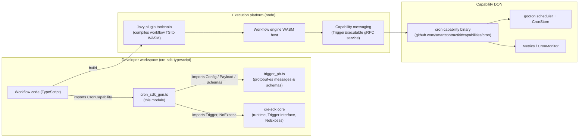
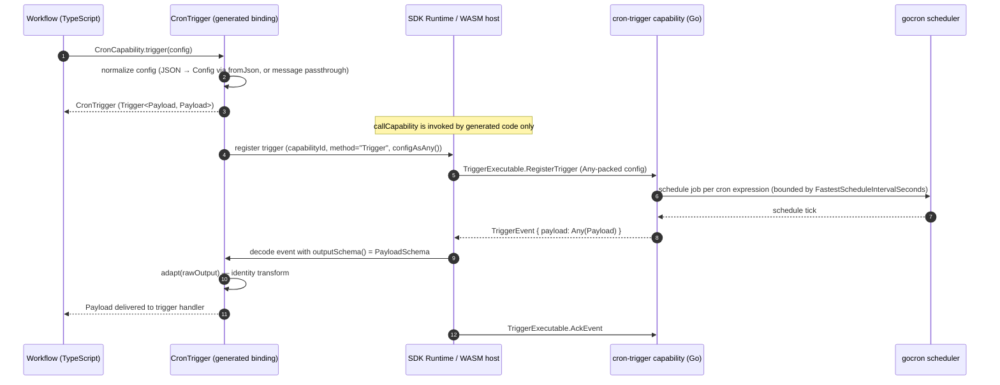
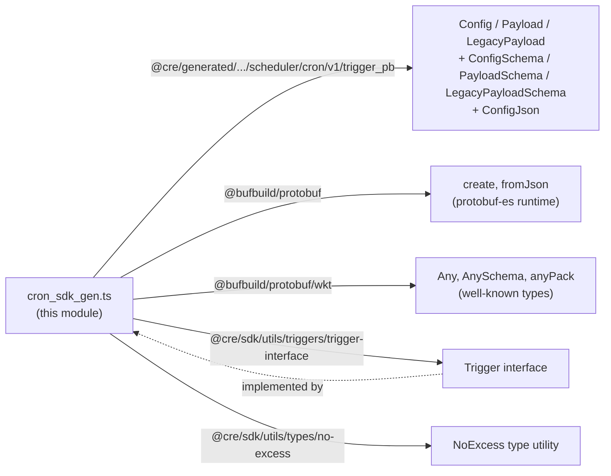
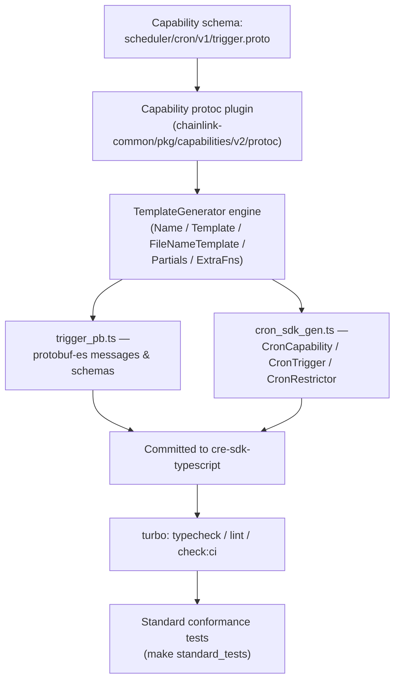

# Scheduler (Cron) Generated Capability — `cre-sdk` TypeScript Bindings

> **Module location:** `cre-sdk-typescript/packages/cre-sdk/src/generated-sdk/capabilities/scheduler/cron/v1/cron_sdk_gen.ts`
> **Capability ID:** `cron-trigger@1.0.0` · **Capability name:** `cron-trigger` · **Version:** `1.0.0`

## 1. Introduction

This module contains the **generated TypeScript SDK binding for the cron scheduler capability** of the Chainlink Runtime Environment (CRE). It is one of the per-capability binding files produced by the capability SDK code generator and committed under the [generated capabilities layer](../cre-sdk-generated-capabilities.md) of `cre-sdk`.

The binding gives workflow developers a typed, zero-boilerplate entry point — `CronCapability` — whose `trigger(config)` factory produces a `CronTrigger` object that conforms to the SDK's `Trigger` contract. The CRE workflow engine uses this object to:

1. **Register** the cron trigger with the capability DON (packing the trigger configuration as a `google.protobuf.Any`),
2. **Decode** the `Payload` events the capability emits each time a configured schedule fires, and
3. **Deliver** those events into the workflow's trigger handler.

The binding is a thin, strictly-typed adapter: it describes *what* to register and how to decode events, while all transport, scheduling, and execution concerns live in the [SDK core runtime](../cre-sdk-core.md) and the server-side [cron capability (Go)](../../Workflow___Capability_Runtime_(CRE_Engine)/cron_capability.md).

---

## 2. Position in the System

This module sits at the innermost "leaf" of the developer toolchain:

```
Developer_Toolchain (CLI, SDKs & API Clients)
└── cre-sdk-generated-capabilities          ← parent: generated capability bindings overview
    ├── cre-sdk-generated-capabilities_blockchain     (EVM, Solana client bindings)
    ├── cre-sdk-generated-capabilities_internal-test  (test-only trigger/action bindings)
    ├── cre-sdk-generated-capabilities_networking     (HTTP, confidential HTTP bindings)
    └── cre-sdk-generated-capabilities_scheduler      ← THIS MODULE (cron trigger binding)
```

- **Consumed by:** workflow code written against the [cre-sdk core](../cre-sdk-core.md); compiled to WASM via the Javy plugin toolchain and executed by the workflow engine's WASM host (see [Workflows](../../Workflow___Capability_Runtime_(CRE_Engine)/workflows.md)).
- **Paired with:** the Go standard capability binary in the `capabilities/cron` Go module (`github.com/smartcontractkit/capabilities/cron`), which actually runs the schedules — see [Cron capability (Go)](../../Workflow___Capability_Runtime_(CRE_Engine)/cron_capability.md).
- **Sibling bindings** follow an identical generated shape (static factory + `Trigger` implementation + `Restrictor` placeholder), which makes the API uniform across all capabilities: [blockchain](cre-sdk-generated-capabilities_blockchain.md), [internal test](cre-sdk-generated-capabilities_internal-test.md), [networking](cre-sdk-generated-capabilities_networking.md).

---

## 3. Architecture Overview

The generated binding is the bridge between developer-authored workflow logic and the distributed cron capability service:



Key points:

- The binding file depends only on the protobuf-es runtime, the generated `trigger_pb` schemas, and two small SDK utilities — it carries **no transport or execution logic** of its own.
- The workflow engine's WASM host mediates all capability traffic; the SDK's `BaseRuntime.callCapability` is explicitly *"meant to be called by generated code only"* (`cre-sdk-typescript/packages/cre-sdk/src/sdk/runtime.ts`), and this module is exactly the generated code that consumes it.

---

## 4. Generated API Surface

The file is fully generated from the capability's protobuf schema and carries the capability identity in its header comment. It exports three symbols:

| Export | Kind | Purpose |
|---|---|---|
| `CronCapability` | static class (factory) | Typed entry point for `cron-trigger@1.0.0`; exposes capability metadata constants and the `trigger()` factory. |
| `CronTrigger` | class (module-private) | Implements `Trigger<Payload, Payload>`: config normalization, wire serialization (`configAsAny`), event decoding (`outputSchema`), and output mapping (`adapt`). |
| `CronRestrictor` | class (placeholder) | Empty restrictor class emitted for **every** generated capability binding (same pattern as `BasicRestrictor` in the internal test bindings); reserved for future mode-restricted API surfaces. |

### 4.1 `CronCapability`

```typescript
export class CronCapability {
    static readonly CAPABILITY_ID = 'cron-trigger@1.0.0'
    static readonly CAPABILITY_NAME = 'cron-trigger'
    static readonly CAPABILITY_VERSION = '1.0.0'

    trigger<TConfig extends ConfigJson>(config: NoExcess<TConfig, ConfigJson>): CronTrigger
}
```

The static metadata constants pin the capability identity deterministically — no runtime lookup or instantiation is required to know *which* capability a workflow binds to.

### 4.2 `CronTrigger` — the `Trigger` contract

`CronTrigger` implements the SDK contract from `@cre/sdk/utils/triggers/trigger-interface`:

| Member | Value / behavior | Wire equivalent (`chainlink-common/pkg/capabilities/pb/capabilities.proto`) |
|---|---|---|
| `capabilityId()` | `'cron-trigger@1.0.0'` | `CapabilityInfoReply.id` / registration `capabilityId` |
| `method()` | `'Trigger'` | `TriggerRegistrationRequest.method` |
| `configAsAny()` | `anyPack(ConfigSchema, this.config)` — packs the config into a `google.protobuf.Any` | `TriggerRegistrationRequest.payload` |
| `outputSchema()` | `PayloadSchema` — schema used to decode incoming events | `TriggerEvent.payload` decoding |
| `adapt(rawOutput)` | Identity transform (`Payload` → `Payload`); generator-emitted hooks allow reshaping where a capability's raw output needs adaptation | n/a (SDK-side transformation hook) |

The binding therefore exercises the **"no DAG SDK" wire path** of the capability protocol: configuration travels as a typed `Any` payload, and events are decoded against the capability's own protobuf schema rather than as generic `values.Map` data.

### 4.3 Configuration normalization

The constructor accepts **either** a protobuf message or a plain JSON object, detected via the protobuf-es `$typeName` marker:

```typescript
this.config = (config as any).$typeName
    ? (config as Config)                                   // already a protobuf-es message
    : fromJson(ConfigSchema, config as ConfigJson)         // JSON, validated against ConfigSchema
```

This is what makes the ergonomic JSON-literal call sites type-safe: invalid configs are rejected at the moment the trigger is constructed, both by TypeScript and by protobuf-es validation.

### 4.4 `NoExcess` config typing

`trigger()`'s parameter is typed `NoExcess<TConfig, ConfigJson>` — a recursive utility from `@cre/sdk/utils/types/no-excess` that performs **excess-property checking** (up to a recursion depth of 6) while preserving full IDE autocompletion. Unknown keys in the config literal are rejected at compile time, without forcing developers to write explicit type annotations.

---

## 5. Data Model

All message types come from the sibling generated file `@cre/generated/capabilities/scheduler/cron/v1/trigger_pb` (protobuf-es output of the capability's `scheduler/cron/v1/trigger.proto`):

| Message | Schema constant | Role |
|---|---|---|
| `Config` / `ConfigJson` | `ConfigSchema` | Per-trigger registration configuration (the cron schedule and related settings, as defined by the capability's proto). Acceptable input is a message or JSON. |
| `Payload` | `PayloadSchema` | Event delivered to the workflow each time a scheduled tick fires. |
| `LegacyPayload` | `LegacyPayloadSchema` | Prior payload shape retained for backward compatibility with previously registered workflows. |

On the server side, the Go capability enforces a service-level limit via its own `Config` struct — `FastestScheduleIntervalSeconds` (`capabilities/cron/trigger/trigger.go`), applied through a `limits.TimeLimiter` so that registered cron schedules cannot fire faster than the configured floor. The client-side trigger `Config` message and this server-side service config are distinct artifacts of the same capability contract; see [Cron capability (Go)](../../Workflow___Capability_Runtime_(CRE_Engine)/cron_capability.md) for the scheduling and store internals.

---

## 6. Component Interaction & Runtime Flow



Flow notes:

- **Registration** uses the `TriggerExecutable.RegisterTrigger` RPC of the capability protocol (`chainlink-common/pkg/capabilities/pb/capabilities.proto`); the binding's `configAsAny()` output is placed directly into the request's `payload` (`google.protobuf.Any`) field.
- **Event delivery** round-trips through the WASM host: the raw `Any` is decoded using `outputSchema()`, passed through `adapt()` (an identity for cron), and handed to the workflow handler.
- **Acknowledgement** closes the loop via `TriggerExecutable.AckEvent`, as required by the protocol.

---

## 7. Dependency Graph

The file has a deliberately minimal dependency footprint:



Runtime context consumed by the engine side (not imported by this file): `BaseRuntime` / `TeeRuntime` / `Runtime` from the [cre-sdk core](../cre-sdk-core.md), with the WASM variant (`RuntimeImpl` + `WasmRuntimeHelpers`) in `src/sdk/wasm/runtime.ts`.

---

## 8. Generation Pipeline

This file is **not hand-written**. Like every file under `src/generated-sdk/`, it is emitted by the capability SDK code generator from the capability's protobuf schema, and is committed so that consumers get a stable, reviewable API:



The shared template machinery is defined in `chainlink-common/pkg/capabilities/v2/protoc/pkg/template_generator.go` (`TemplateGenerator` with its `Name`, `Template`, `FileNameTemplate`, `Partials`, and `ExtraFns` fields) and is the same engine that produces the Go capability SDKs. Because the output is templated, the uniform shape of *all* generated bindings — including the empty `CronRestrictor` placeholder emitted alongside `BasicRestrictor` and friends — is a property of the generator, not of individual hand edits.

**Regeneration rule of thumb:** when the capability's proto changes, regenerate the bindings rather than editing `cron_sdk_gen.ts` by hand; hand edits will be silently overwritten.

---

## 9. Build, Verification & Tooling

The module is verified by the standard conformance-test infrastructure of the `cre-sdk` package, which executes generated bindings inside a real WASM host:

| Artifact | Role |
|---|---|
| `cre-sdk-typescript/package.json` | Bun + Turborepo workspace root; scripts `build`, `check:ci`, `format`, `full-checks`, `lint`, `test:templates`, `typecheck` gate changes to generated files. |
| `cre-sdk-typescript/packages/cre-sdk/Makefile` | `standard_tests` target: downloads the pinned `chainlink-common` module at `cre-std-tests@0.10.0`, compiles the host test binary (`pkg/workflows/wasm/host`), and runs the `TestStandard*` suite (`TEST_PATTERN ?= ^TestStandard`). `standard_test_single TEST=...` runs one test. |
| `cre-sdk-typescript/packages/cre-sdk/src/standard_tests/Makefile` | Pattern rule `%/test.wasm` compiles per-capability test workflows (`src/standard_tests/**/test.ts`) via `bun compile:workflow`, with a depth guard for nested paths. |
| `cre-sdk-typescript/packages/cre-sdk-javy-plugin/Dockerfile` | Builds the Javy TS→WASM toolchain (stages `javy-cli`, `plugin-builder`, `stage_2`) used to compile workflows and standard tests to `test.wasm`. |

The server-side counterpart is versioned independently in the `capabilities/cron` Go module (`capabilities/cron/go.mod`: module `github.com/smartcontractkit/capabilities/cron`, depending on `go-co-op/gocron/v2` for scheduling, `jonboulle/clockwork` for clock injection, and `chainlink-protos/cre/go` for the capability protocol bindings). The generated binding's pinned version (`1.0.0`) and the standard-test pin (`cre-std-tests@0.10.0`) are the two compatibility anchors between client and server.

---

## 10. Design Notes & Extension Points

- **Identity adapter by default.** `adapt(rawOutput: Payload): Payload { return rawOutput }` is the generator's default; richer triggers override it to reshape raw output into developer-facing types. For cron, raw and adapted types coincide, so no transformation is needed.
- **Uniform surface across capabilities.** The `Restrictor` classes (here `CronRestrictor`) are emitted empty for every capability. They are the generator's reserved hook for mode-restricted capability APIs (e.g., capabilities unavailable in certain runtime modes), so adding restrictions later is a generator change, not a per-capability API break.
- **Dual input formats.** Accepting both `Config` messages and `ConfigJson` literals makes the binding usable both from dynamically-built configs and from statically-typed literals without conversion helpers.
- **Schema-first evolution.** Adding fields to the trigger config or payload is a proto change + regeneration; `NoExcess`-typed call sites keep compiling, and protobuf-es validation catches malformed configs at trigger-construction time.

---

## 11. Related Documentation

| Topic | Page |
|---|---|
| Generated capabilities layer (how bindings are organized & generated) | [cre-sdk-generated-capabilities](../cre-sdk-generated-capabilities.md) |
| SDK core: runtimes, `Trigger` contract, `NoExcess`, errors, chain selectors | [cre-sdk-core](../cre-sdk-core.md) |
| Sibling generated bindings: chain clients | [Blockchain capabilities](cre-sdk-generated-capabilities_blockchain.md) |
| Sibling generated bindings: HTTP / confidential HTTP | [Networking capabilities](cre-sdk-generated-capabilities_networking.md) |
| Sibling generated bindings: internal test triggers/actions | [Internal test capabilities](cre-sdk-generated-capabilities_internal-test.md) |
| Developer toolchain overview (cre-cli, SDKs, API clients) | [Developer Toolchain](../../Developer_Toolchain_(CLI,_SDKs___API_Clients).md) |
| Server-side cron capability (scheduling, store, metrics) | [Cron capability (Go)](../../Workflow___Capability_Runtime_(CRE_Engine)/cron_capability.md) |
| Workflow engine, syncer, artifacts, metering | [Workflows](../../Workflow___Capability_Runtime_(CRE_Engine)/workflows.md) |
| Capability protocol definitions (`TriggerExecutable`, `TriggerEvent`) | [Capabilities core (`chainlink-common`)](../../Workflow___Capability_Runtime_(CRE_Engine)/capabilities.md) |
