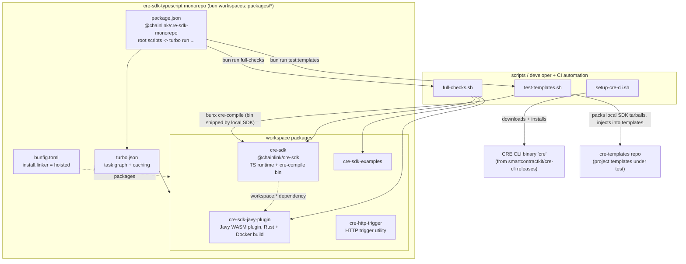
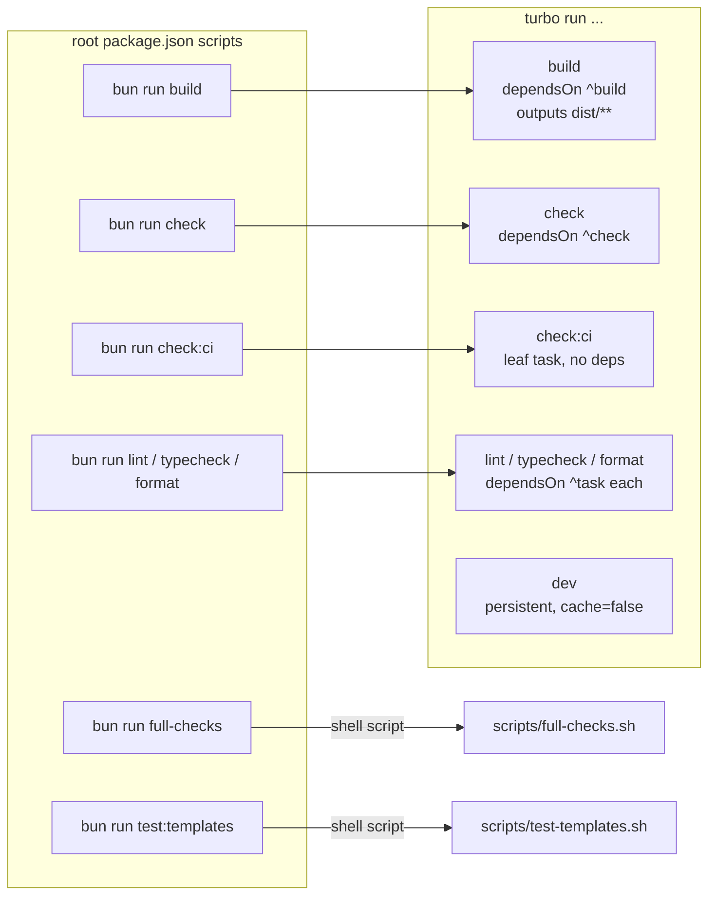
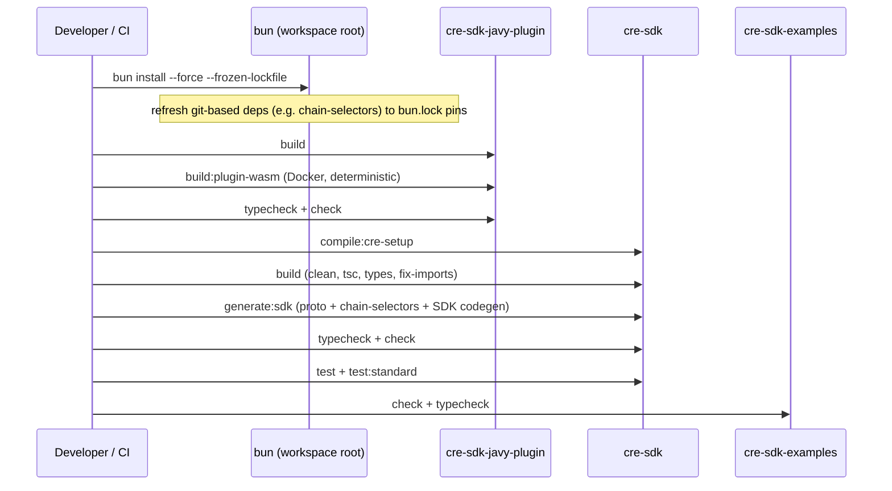
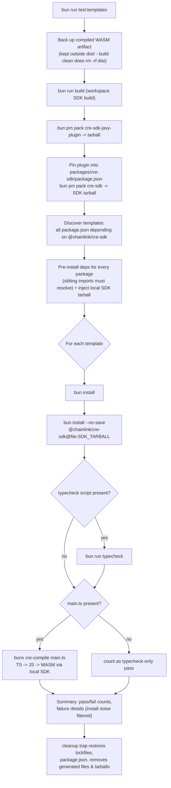
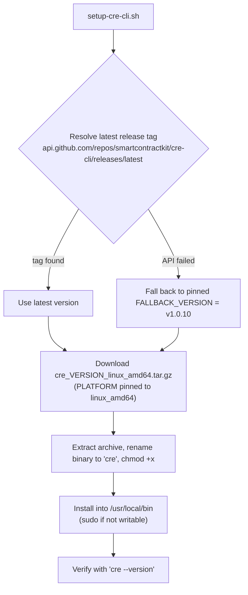
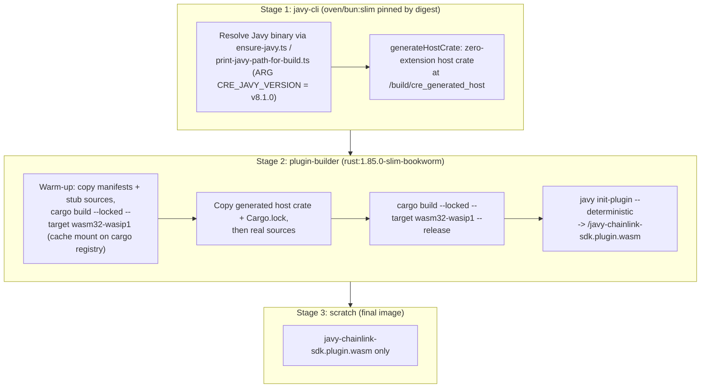

# CRE SDK Workspace Build

> **Module:** `cre-sdk-workspace-build` — the build & tooling layer of the `cre-sdk-typescript` monorepo
> **Parent:** [Developer Toolchain (CLI, SDKs & API Clients)](../Developer_Toolchain_(CLI,_SDKs___API_Clients).md)
> **Scope:** `cre-sdk-typescript/package.json`, `cre-sdk-typescript/bunfig.toml`, `cre-sdk-typescript/turbo.json`, `cre-sdk-typescript/scripts/*`, `cre-sdk-typescript/packages/cre-http-trigger/package.json`, `cre-sdk-typescript/packages/cre-sdk-javy-plugin/Dockerfile`

## 1. Purpose

The `cre-sdk-workspace-build` module is the **build, verification and developer-tooling backbone** of the `cre-sdk-typescript` Bun monorepo. It contains no runtime business logic; instead it defines *how the workspace is installed, built, checked, tested and packaged*:

| Concern | Where it lives |
|---|---|
| Package-manager pinning & install layout | `bunfig.toml`, root `package.json` (`packageManager: bun@1.3.9`) |
| Task orchestration & caching | `turbo.json` (Turborepo), root `package.json` scripts |
| Developer / CI automation | `scripts/full-checks.sh`, `scripts/test-templates.sh`, `scripts/setup-cre-cli.sh` |
| Per-package build surface | `packages/cre-http-trigger/package.json` |
| Deterministic WASM plugin container build | `packages/cre-sdk-javy-plugin/Dockerfile` |

The workspace produces the following artifacts (their *runtime behavior* is documented by the sibling modules, not here):

| Artifact | Producing package | Documented in |
|---|---|---|
| `@chainlink/cre-sdk` — the CRE TypeScript SDK (ships the `cre-compile` bin) | `packages/cre-sdk` | [cre-sdk-core](cre-sdk-core.md) |
| `javy-chainlink-sdk.plugin.wasm` — Javy plugin that executes SDK workflows | `packages/cre-sdk-javy-plugin` | [cre-sdk-core](cre-sdk-core.md) / [Package Builds](#4-sub-modules) |
| Generated capability bindings (`src/generated-sdk/…`) | `packages/cre-sdk` via `generate:sdk` | [cre-sdk-generated-capabilities](cre-sdk-generated-capabilities.md) |
| Example workflows & Rust plugin examples | `packages/cre-sdk-examples`, `packages/cre-rust-*` | [cre-sdk-examples-and-plugins](cre-sdk-examples-and-plugins.md) |
| HTTP trigger utility app | `packages/cre-http-trigger` | [Package Builds](#4-sub-modules) |

## 2. Tooling stack

| Concern | Tool / Version | Configured by |
|---|---|---|
| Package manager & runtime | Bun `1.3.9` (root `packageManager` pin; packages require `bun >= 1.2.21` via `engines`) | `cre-sdk-typescript/package.json`, `cre-sdk-typescript/bunfig.toml` |
| Task orchestration & caching | Turborepo `2.8.4` | `cre-sdk-typescript/turbo.json` |
| Lint / format | Biome `2.3.14` (scripts `check`, `check:ci`, `lint`, `format`) | per-package `package.json` |
| Type checking | TypeScript `5.9.3` (`tsc`) | per-package `typecheck` scripts |
| WASM plugin build | Rust `1.85.0` + Javy `v8.1.0`, deterministic mode | `packages/cre-sdk-javy-plugin/Dockerfile` |
| Workflow compile verification | `cre-compile` (bundled with `@chainlink/cre-sdk`) + CRE CLI `cre` | `scripts/test-templates.sh`, `scripts/setup-cre-cli.sh` |

## 3. Architecture

### 3.1 Component map

| Component | Responsibility |
|---|---|
| `cre-sdk-typescript/bunfig.toml::bunfig.toml` | Forces Bun's `hoisted` linker so all workspace packages share one classic `node_modules` layout — keeps TypeScript able to resolve built-in globals (`Response`, `Request`, …) inside workspaces. |
| `cre-sdk-typescript/package.json::package.json` | Root manifest: declares `workspaces: packages/*`, pins Bun/Turbo/Biome/TS versions, and maps root scripts (`build`, `check:ci`, `lint`, `typecheck`, `format`, `full-checks`, `test:templates`) onto `turbo run <task>` or shell scripts. |
| `cre-sdk-typescript/package.json::build` / `::check:ci` / `::format` / `::lint` / `::typecheck` | Thin root entry points: each delegates to `turbo run <task>` so the task graph applies. |
| `cre-sdk-typescript/package.json::full-checks` / `::test:templates` | Bridge entries that execute `./scripts/full-checks.sh` and `./scripts/test-templates.sh` respectively. |
| `cre-sdk-typescript/turbo.json::turbo.json` | Defines the task graph: dependency ordering (`dependsOn: ^task`), cache outputs (`dist/**`), a CI-only leaf task (`check:ci`), and an uncached persistent `dev` task. |
| `cre-sdk-typescript/scripts/full-checks.sh::full-checks.sh` | End-to-end verification pipeline: frozen-lockfile reinstall → Javy plugin build (incl. Docker WASM) → SDK compile/generate/typecheck/test/standard-tests → examples check/typecheck. |
| `cre-sdk-typescript/scripts/setup-cre-cli.sh::setup-cre-cli.sh` | Bootstraps the CRE CLI (`cre`) into `/usr/local/bin` from GitHub releases, with a pinned fallback version (`v1.0.10`). |
| `cre-sdk-typescript/scripts/test-templates.sh::test-templates.sh` | Builds & packs the local SDK as tarballs and runs them against every TypeScript project template in `cre-templates`, verifying install → typecheck → WASM compile end-to-end, with full restore-on-exit. |
| `cre-sdk-typescript/packages/cre-http-trigger/package.json::package.json` (+ its `check`/`check:ci`/`format`/`full-checks`/`lint`/`typecheck` entries) | The canonical per-package script surface every workspace package exposes so turbo tasks resolve; also the manifest of the HTTP trigger utility app. |
| `cre-sdk-typescript/packages/cre-sdk-javy-plugin/Dockerfile::Dockerfile` (stages `javy-cli`, `plugin-builder`, `stage_2`) | Multi-stage, reproducible container build of the Javy plugin: `wasm32-wasip1` cdylib + `javy init-plugin --deterministic`, exporting only the initialized `.plugin.wasm`. |

### 3.2 Architecture diagram

### 3.3 Workspace task graph (`turbo.json`)

Root scripts map 1:1 onto Turborepo tasks; `^task` dependencies force **topological execution** (a package's dependencies are processed before the package itself). Only `build` declares cache outputs (`dist/**`).

Task semantics (`cre-sdk-typescript/turbo.json`):

| Task | `dependsOn` | Notes |
|---|---|---|
| `build` | `["^build"]` | Cached; artifacts under `dist/**` |
| `check` | `["^check"]` | Biome auto-fix pass (`biome check --write`) |
| `check:ci` | *(none)* | Read-only CI variant (`biome ci .`) — deliberately dependency-free |
| `format`, `lint`, `typecheck` | `["^<task>"]` | Ordered after upstream packages |
| `dev` | — | `persistent: true`, `cache: false` |

### 3.4 Install layout: `bunfig.toml`

`cre-sdk-typescript/bunfig.toml` sets `[install] linker = "hoisted"`. Without it, newer Bun versions install workspace packages in a layout that breaks TypeScript's ability to find types for built-in globals (`Response`, `Request`). The `hoisted` linker keeps all packages in one shared `node_modules` (the classic layout), which is a prerequisite for the typecheck phases of `full-checks.sh` and `test-templates.sh` and for the generators that must resolve the same types in CI and locally.

## 4. Sub-modules

The module is organized into three sub-modules:

| Sub-module | Components | Summary |
|---|---|---|
| **[Workspace Configuration](cre-sdk-workspace-build/cre-sdk-workspace-build_workspace-configuration.md)** | `bunfig.toml`, root `package.json` (incl. all root scripts), `turbo.json` | The Bun + Turborepo foundation: `hoisted` install layout, workspace declaration, root script → turbo task mapping, the task graph (`dependsOn ^task`, cached `dist/**` outputs, CI-only `check:ci` leaf, uncached persistent `dev`), and dependency version pins (Bun `1.3.9`, Turbo `2.8.4`, Biome `2.3.14`, TS `5.9.3`). |
| **[Developer Workflow Scripts](cre-sdk-workspace-build/cre-sdk-workspace-build_developer-workflow-scripts.md)** | `scripts/full-checks.sh`, `scripts/setup-cre-cli.sh`, `scripts/test-templates.sh` | The automation layer: end-to-end verification (frozen-lockfile reinstall → plugin → SDK → examples), one-command CRE CLI bootstrap from GitHub releases with a pinned fallback, and the template regression harness that packs local SDK tarballs and compiles every `cre-templates` project to WASM with restore-on-exit safety. |
| **[Package Builds](cre-sdk-workspace-build/cre-sdk-workspace-build_package-builds.md)** | `packages/cre-http-trigger/package.json`, `packages/cre-sdk-javy-plugin/Dockerfile` (stages `javy-cli`, `plugin-builder`, `stage_2`) | Per-package build surfaces: the canonical per-package script set (`check`/`check:ci`/`format`/`lint`/`typecheck`/`full-checks`) that makes turbo tasks resolve, exemplified by the HTTP trigger utility, and the digest-pinned, deterministic Docker build that turns a Rust `wasm32-wasip1` cdylib into `javy-chainlink-sdk.plugin.wasm` via `javy init-plugin --deterministic`. |

## 5. Key flows

### 5.1 Full verification — `scripts/full-checks.sh`

Invoked via `bun run full-checks` (root `package.json::full-checks`). It is the strongest local signal short of CI:

1. **`bun install --force --frozen-lockfile`** — re-resolves dependencies so git-based packages (e.g. `chain-selectors`, pinned in `packages/cre-sdk/package.json` to a specific commit of `smartcontractkit/chain-selectors`) match the exact commit in `bun.lock`. Without this, stale `node_modules` can make generators emit output that differs from CI.
2. **`cre-sdk-javy-plugin`**: `build` (native cdylib compile) → `build:plugin-wasm` (deterministic Docker build, see [5.4](#54-deterministic-javy-plugin-build---packagescre-sdk-javy-plugindockerfile)) → `typecheck` → `check`.
3. **`cre-sdk`**: `compile:cre-setup` → `build` → `generate:sdk` → `typecheck` → `check` → `test` → `test:standard`.
4. **`cre-sdk-examples`**: `check` → `typecheck`.

### 5.2 Template regression testing — `scripts/test-templates.sh`

Invoked via `bun run test:templates` (optionally `--verbose|-v`). It proves that a locally built SDK works **outside** the monorepo, against every template in the `cre-templates` repository (default `../cre-templates`, override with the `TEMPLATES_DIR` env var):

Notable engineering details:

- **Restore-on-exit**: a `trap cleanup EXIT INT TERM` restores `bun.lock` / `package-lock.json` backups, restores `packages/cre-sdk/package.json` from its `.bak`, deletes generated files (`main.js`, `main.wasm`), SDK tarballs, and temp files — even on crash.
- **True local-SDK testing**: the plugin tarball is packed first, then referenced in `packages/cre-sdk` via `bun pm pkg set "dependencies.@chainlink/cre-sdk-javy-plugin=file:<tarball>"`, so the packed SDK depends on the packed plugin. Templates then get the local SDK injected with `bun install --no-save`, so typechecking and compilation exercise the SDK under test rather than the published version.
- **`cre-compile` comes from the SDK**: `@chainlink/cre-sdk` exposes the `cre-compile` binary (see `packages/cre-sdk/package.json` `bin` field), so `bunx cre-compile main.ts` inside a template resolves to the freshly installed local SDK.
- **Deterministic reporting**: parallel pass/fail/failure-step/failure-output arrays produce a summary; install noise (`^npm warn`, `^bun install v`) is filtered out of failure details; exits non-zero on any failure.

### 5.3 CRE CLI bootstrap — `scripts/setup-cre-cli.sh`

Installs the [CRE CLI](cre-cli-build-and-release.md) binary used for authoring, simulating and deploying workflows (see [cre-cli-workflow-commands](cre-cli-workflow-commands.md)):

Platform and install directory are fixed (`linux_amd64`, `/usr/local/bin`); the temp download directory is removed via a trap regardless of outcome.

### 5.4 Deterministic Javy plugin build — `packages/cre-sdk-javy-plugin/Dockerfile`

The plugin that runs compiled SDK workflows inside Javy is built reproducibly in a pinned multi-stage container (usage: `./scripts/build-plugin-docker.sh`, exposed as the `build:plugin-wasm` script):

Determinism and efficiency measures:

- Base image pinned **by digest** (`oven/bun:slim@sha256:1848dc9f…`); Rust toolchain pinned via `rust-toolchain.toml` and `rust:1.85.0-slim-bookworm`; Javy version pinned via `ARG CRE_JAVY_VERSION` (default `v8.1.0`, overridable from `build-plugin-docker.sh`).
- `javy init-plugin --deterministic` strips nondeterministic metadata; the final stage is `FROM scratch` so the artifact output contains only the initialized `.plugin.wasm` (the uninit cdylib never leaves the builder).
- A dependency warm-up layer (manifests + stub sources, `|| true` tolerated) populates a **cache mount** on `/usr/local/cargo/registry`, so later real-source builds are fast.
- The wrapper `packages/cre-sdk-javy-plugin/scripts/build-plugin-docker.sh` runs `docker build --platform linux/amd64 --build-arg CRE_JAVY_VERSION=… --output type=local,dest=dist`, producing `dist/javy-chainlink-sdk.plugin.wasm`; setting `SKIP_DOCKER_IMAGE=1` switches to the host-local build path (`build-plugin-local.sh`).

The same artifact is what `full-checks.sh` rebuilds and what `test-templates.sh` packs into the SDK tarball, keeping local, CI and template-testing builds on one code path.

## 6. Per-package build conventions

Workspace packages expose a canonical script surface so the root turbo tasks resolve uniformly (visible in `packages/cre-http-trigger/package.json`, `packages/cre-sdk/package.json`, `packages/cre-sdk-examples/package.json`):

| Script | Turbo task | Implementation |
|---|---|---|
| `build` | `build` | package-specific (SDK: clean + `tsc -p tsconfig.build.json` + types + fix-imports) |
| `check` / `check:ci` | `check` / `check:ci` | Biome auto-fix vs. read-only CI mode |
| `format`, `lint`, `typecheck` | same | Biome / `tsc` |
| `full-checks` | — | per-package convenience aggregate (e.g. `bun typecheck && bun check`) |
| `test` / `test:standard` | — | package-specific (standard tests documented in [cre-sdk-core](cre-sdk-core.md)) |

All packages declare `engines.bun >= 1.2.21`, consistent with the workspace-level `packageManager: bun@1.3.9` pin.

## 7. Relationships to other modules

- **[cre-sdk-core](cre-sdk-core.md)** — the SDK runtime package (`packages/cre-sdk`) built and verified by this module's pipelines; owns the runtime, WASM execution details and the standard-test harness invoked by `test:standard`.
- **[cre-sdk-generated-capabilities](cre-sdk-generated-capabilities.md)** — documents the `src/generated-sdk/capabilities/…` files produced by the `generate:sdk` step orchestrated here.
- **[cre-sdk-examples-and-plugins](cre-sdk-examples-and-plugins.md)** — the examples and Rust plugin packages that `full-checks.sh` typechecks and that share the per-package build conventions above.
- **[cre-cli-build-and-release](cre-cli-build-and-release.md)** — the `cre` binary installed by `scripts/setup-cre-cli.sh`; its workflow commands (deploy/activate/pause/delete/simulate) are covered by **[cre-cli-workflow-commands](cre-cli-workflow-commands.md)**, including the simulation chain client that `cre-compile` output is destined for.
- **[Build, CI & Release Infrastructure](../Build,_CI___Release_Infrastructure.md)** — repository-wide build/CI tooling that operates on the same workspaces.
