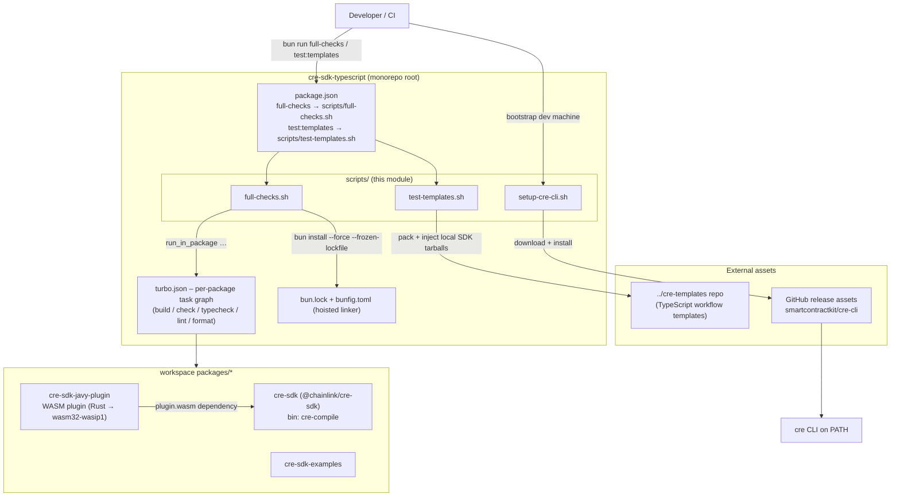
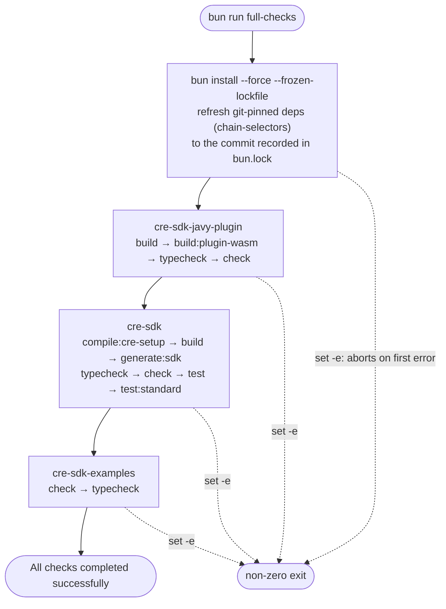
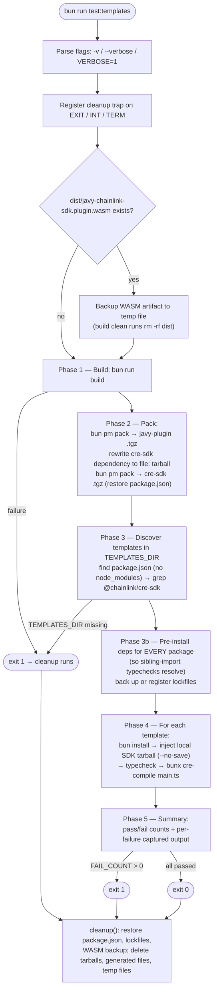
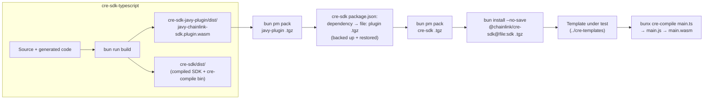
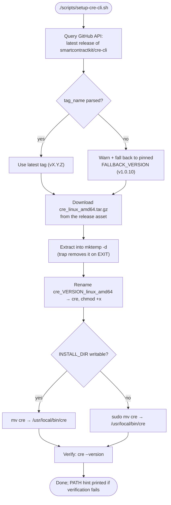

# CRE SDK Workspace Build — Developer Workflow Scripts

## Overview

This module contains the **shell-script automation layer** of the `cre-sdk-typescript` monorepo: three scripts in `cre-sdk-typescript/scripts/` that orchestrate builds, quality gates, SDK template testing, and developer environment bootstrapping. They are the imperative counterpart to the declarative workspace configuration covered in [Workspace Configuration](cre-sdk-workspace-build_workspace-configuration.md) (`turbo.json`, `bunfig.toml`, root `package.json`).

| Script | Shell | Entry point | Purpose |
|---|---|---|---|
| `full-checks.sh` | zsh (`set -e`) | `bun run full-checks` (root `package.json`) | Runs the complete build + generate + typecheck + lint + test pipeline across all workspace packages |
| `test-templates.sh` | bash | `bun run test:templates` (root `package.json`) | Packs the local SDK into tarballs and verifies that every TypeScript workflow template in the `cre-templates` repo typechecks and compiles against it |
| `setup-cre-cli.sh` | zsh (`set -e`) | run directly: `./scripts/setup-cre-cli.sh` | Downloads and installs the latest (or pinned fallback) `cre` CLI binary into `/usr/local/bin` |

All three scripts follow the same conventions: fail-fast via `set -e`, explicit echo banners for progress, and aggressive cleanup of any temporary or mutated state.

---

## Architecture and Position in the Workspace

The scripts sit at the **monorepo root**, below the `bun`/`turbo` orchestration layer and above the individual workspace packages. The root `package.json` (`cre-sdk-typescript/package.json`) wires the `full-checks` and `test:templates` npm scripts directly to these shell files; everything *inside* a package (build, typecheck, lint, check) is delegated to package-local scripts through the [Package Builds](cre-sdk-workspace-build_package-builds.md) toolchain, coordinated by the task graph in `turbo.json`.



Key relationships:

- **`full-checks.sh`** drives the same per-package tasks that `turbo run <task>` would execute, but sequentially and in dependency order, so a failure surfaces in a single deterministic stream.
- **`test-templates.sh`** consumes the artifacts produced by the packages: the WASM plugin (`packages/cre-sdk-javy-plugin/dist/javy-chainlink-sdk.plugin.wasm`, built natively or via the multi-stage `packages/cre-sdk-javy-plugin/Dockerfile`) and the compiled SDK in `packages/cre-sdk/dist/`.
- **`setup-cre-cli.sh`** provisions the `cre` binary that developers use for the workflows described in [CRE CLI Workflow Commands](../cre-cli-workflow-commands.md); the official cross-platform installers maintained by the CLI team live in [CRE CLI Build and Release](../cre-cli-build-and-release.md).

---

## `full-checks.sh` — Full Monorepo Verification

**File:** `cre-sdk-typescript/scripts/full-checks.sh` (zsh, `set -e`)

### What it does

1. **Lockfile-consistent reinstall.** Runs `bun install --force --frozen-lockfile` before anything else. The comment in the script explains why: git-based packages (notably the `chain-selectors` dependency pinned at a specific commit in `packages/cre-sdk/package.json`) must be refreshed to the exact commit in `bun.lock`. Without this, stale `node_modules` can cause the code generators run by `generate:sdk` to emit output that differs from CI.
2. **Per-package command sequence** via the `run_in_package` helper, which `cd`s into `packages/<name>`, runs `bun run <cmd>`, and returns to the root.

### Command matrix

| Package | Commands executed (in order) |
|---|---|
| `cre-sdk-javy-plugin` | `build` → `build:plugin-wasm` → `typecheck` → `check` |
| `cre-sdk` | `compile:cre-setup` → `build` → `generate:sdk` → `typecheck` → `check` → `test` → `test:standard` |
| `cre-sdk-examples` | `check` → `typecheck` |

Notes on the sequence:

- `generate:sdk` in `packages/cre-sdk/package.json` regenerates protobuf types, chain selectors, and SDK capability bindings from the freshly refreshed `chain-selectors` commit — this is the step most sensitive to dependency staleness.
- `test:standard` executes the standard-tests harness of the SDK runtime, documented in [CRE SDK Core](../cre-sdk-core.md) (`Makefile` targets `standard_tests` / `standard_test_single`).
- The order matters: the plugin must be built before the SDK (the SDK depends on `@chainlink/cre-sdk-javy-plugin: workspace:*`), and examples are checked last since they consume the compiled SDK.

### Failure semantics

`set -e` aborts at the **first failing command** with a non-zero exit code that propagates through `bun run full-checks`. There is no failure aggregation by design — this script is the "everything must pass, in order" gate.



---

## `test-templates.sh` — Template Compatibility Testing

**File:** `cre-sdk-typescript/scripts/test-templates.sh` (bash, `set -e` plus a comprehensive `trap cleanup EXIT INT TERM`)

This is the most involved script. It guarantees that every TypeScript workflow template in the companion `cre-templates` repository compiles **against the local, un-published SDK**, then fully restores the monorepo and templates to their pre-run state — even if the script crashes.

### Usage

```bash
bun run test:templates              # templates at ../cre-templates (default)
TEMPLATES_DIR=/path/to/cre-templates bun run test:templates
bun run test:templates --verbose    # or VERBOSE=1, -v
```

Environment variables: `TEMPLATES_DIR` (path to the `cre-templates` repo) and `VERBOSE` (`1` for verbose output, equivalent to `--verbose`).

### Pipeline phases



### Phase details

**1. Build** — runs `bun run build` at the monorepo root. Before building, the compiled plugin WASM (`packages/cre-sdk-javy-plugin/dist/javy-chainlink-sdk.plugin.wasm`) is backed up to a temp file *outside* `dist/` (the build's clean step runs `rm -rf dist`, which would destroy an in-place backup). A file copy is used instead of `git restore` so the developer's uncommitted state is restored, not just the last commit.

**2. Pack** — produces two tarballs via `bun pm pack`:

- the **Javy plugin tarball** (from `packages/cre-sdk-javy-plugin`), and
- the **SDK tarball** (from `packages/cre-sdk`), after temporarily rewriting its dependency `@chainlink/cre-sdk-javy-plugin` to `file:<plugin-tarball>` with `bun pm pkg set` (the original `package.json` is restored immediately after packing).

Tarball filenames are parsed from pack logs; a missing `.tgz` is a hard error.

**3. Discover templates** — `/usr/bin/find` collects every `package.json` under `TEMPLATES_DIR` (excluding `node_modules`), keeping only those referencing `"@chainlink/cre-sdk"`.

**3b. Pre-install pass** — installs dependencies for *every* discovered package, not only templates. This is required because some templates typecheck files imported from sibling packages (e.g. a workflow importing `../contracts/evm/ts/generated/*`); those imports only resolve if the sibling's dependencies exist too. Existing lockfiles (`package-lock.json`, `bun.lock`) are backed up; if none existed, the created ones are registered for deletion. Failures here are logged (verbose only) and non-fatal — they surface per-template in phase 4.

**4. Per-template test loop** — for each template:

1. `bun install`
2. Inject the local SDK: `bun install --no-save "@chainlink/cre-sdk@file:$TARBALL_PATH"` — this replaces the published SDK with the tarball under test, without touching the lockfile (`--no-save`).
3. `bun run typecheck` — **skipped** (non-fatal) if the template defines no `typecheck` script.
4. If `main.ts` exists: `bunx cre-compile main.ts` — the compiler shipped as the `bin` entry of `packages/cre-sdk/package.json`, producing `main.js` and `main.wasm` (both tracked as generated files). Templates without `main.ts` pass as *"typecheck only"*.

Each step's output is captured by the `run_captured` helper (streams via `tee` in verbose mode, otherwise captured silently and returned with the command's exit code).

**5. Summary** — prints pass/fail counts, then for each failure the template name, the failing step (`bun install`, `sdk install`, `typecheck`, `cre-compile`), and the captured output filtered through `grep -v "^npm warn"` / `"^bun install v"` to strip package-manager noise. Exits `1` if any template failed, `0` otherwise. Build/pack failures exit `1` immediately; the `trap` guarantees cleanup in all exit paths (`EXIT`, `INT`, `TERM`).

### State management

The script maintains four tracking arrays, all drained by the single `cleanup()` handler:

| Array | Holds | Restored/removed on cleanup |
|---|---|---|
| `LOCKFILE_BACKUPS` | `backup:original` path pairs (lockfiles **and** the WASM artifact backup — the array doubles as the generic restore list) | `mv backup original` |
| `GENERATED_FILES` | Created files: `main.js`, `main.wasm` per compiled template; lockfiles newly created where none existed | `rm` |
| `SDK_TARBALLS` | Packed `.tgz` files (plugin + SDK) | `rm` |
| `TEMP_FILES` | Misc temp files | `rm -f` |

Additionally, `packages/cre-sdk/package.json.bak` is restored before the generic pairs list (the pack phase mutates that file twice).

### Artifact flow



---

## `setup-cre-cli.sh` — CRE CLI Bootstrap

**File:** `cre-sdk-typescript/scripts/setup-cre-cli.sh` (zsh, `set -e`)

A one-shot bootstrap that installs the `cre` CLI binary so developers can compile workflows, manage secrets, and deploy to registries (see [CRE CLI Workflow Commands](../cre-cli-workflow-commands.md)). It fetches a release asset directly from GitHub — it is a convenience for Linux environments, not the supported installer matrix documented in [CRE CLI Build and Release](../cre-cli-build-and-release.md) (`install.sh` / `install.ps1`).

### Configuration constants

| Variable | Value | Meaning |
|---|---|---|
| `FALLBACK_VERSION` | `v1.0.10` | Pinned version used when the GitHub API cannot be reached |
| `PLATFORM` | `linux_amd64` | Hardcoded release-asset platform — **no other platform is handled** |
| `INSTALL_DIR` | `/usr/local/bin` | Installation target (sudo used if not writable) |

### Flow



### Failure semantics

- `set -e` aborts on download/extraction/install errors.
- Version resolution is deliberately resilient: `curl … | grep … || true`, so an API hiccup degrades to the pinned fallback rather than failing the setup.
- The final `cre --version` check is **non-fatal** — if it fails, the script prints a hint that `INSTALL_DIR` may need to be added to `PATH`.
- The temp directory is removed via `trap "rm -rf ${TMP_DIR}" EXIT`.

---

## Integration with Other Modules

| Related module | Relationship |
|---|---|
| [Workspace Configuration](cre-sdk-workspace-build_workspace-configuration.md) | Defines the declarative layer (`turbo.json` tasks, `bunfig.toml` hoisted linker, root `package.json` script wiring) that these scripts sit on top of |
| [Package Builds](cre-sdk-workspace-build_package-builds.md) | The per-package scripts (`build`, `typecheck`, `check`, `build:plugin-wasm`, …) and the Javy-plugin Docker build that `full-checks.sh` and `test-templates.sh` invoke |
| [CRE SDK Core](../cre-sdk-core.md) | Supplies `cre-compile` (bin entry of `packages/cre-sdk`), the standard-tests harness (`test:standard`), and the WASM runtime that templates target |
| [CRE SDK Examples and Plugins](../cre-sdk-examples-and-plugins.md) | `packages/cre-sdk-examples` is the last package gated by `full-checks.sh` |
| [CRE CLI Workflow Commands](../cre-cli-workflow-commands.md) | The `cre` binary installed by `setup-cre-cli.sh` drives workflow deploy/simulate flows against the templates tested here |
| [CRE CLI Build and Release](../cre-cli-build-and-release.md) | Source of the GitHub release assets consumed by `setup-cre-cli.sh`; maintains the official installers and release pipeline |

---

## Maintenance Notes

- **Shell interpreters differ by design.** `full-checks.sh` and `setup-cre-cli.sh` are zsh; `test-templates.sh` is bash because it relies on bash-only features (`PIPESTATUS` in `run_captured`, `printf -v`). Do not "port" them between shells without adapting these constructs.
- **Keep `run_in_package` and the package list in `full-checks.sh` in sync** with `workspaces` in the root `package.json` and the task names in `turbo.json` (`build`, `check`, `typecheck`, …).
- **Pin freshness:** the `--force --frozen-lockfile` reinstall at the top of `full-checks.sh` is not optional boilerplate — removing it reintroduces CI-drift in `generate:sdk` output (git-pinned `chain-selectors`).
- **When adding new backup categories to `test-templates.sh`**, append `"backup:original"` pairs to `LOCKFILE_BACKUPS` (the generic restore list) rather than inventing a parallel array; `cleanup()` only drains the four documented arrays.
- **`setup-cre-cli.sh` platform pin:** it only fetches `linux_amd64` assets. For macOS/ARM or other platforms, use the official installers from [CRE CLI Build and Release](../cre-cli-build-and-release.md); keep `FALLBACK_VERSION` aligned with the CLI's supported releases.
- **The hoisted bun linker** (`cre-sdk-typescript/bunfig.toml`) is a prerequisite for every `bun install` these scripts perform — TypeScript's ability to resolve built-in globals (`Response`, `Request`) depends on the classic single-`node_modules` layout.
