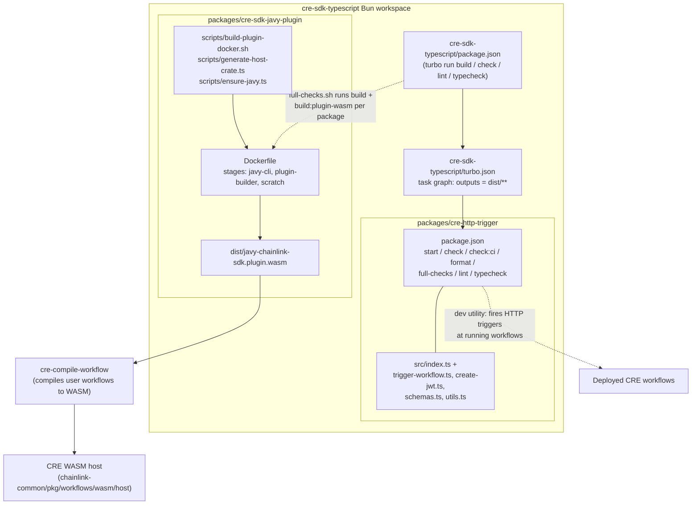
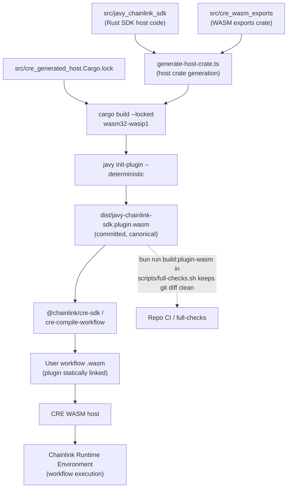
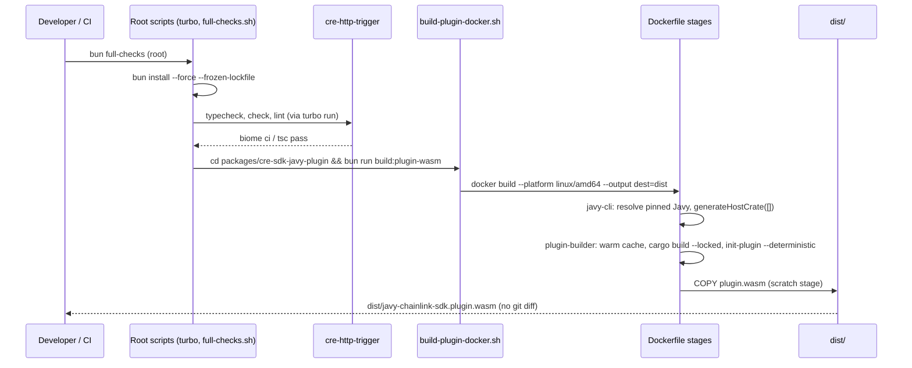

# CRE SDK Workspace — Package Builds

## Introduction

This module documents the **per-package build tooling** of the two standalone build deliverables inside the `cre-sdk-typescript` monorepo workspace:

| Deliverable | File(s) | Type of artifact |
|---|---|---|
| `@chainlink/cre-http-trigger` | `cre-sdk-typescript/packages/cre-http-trigger/package.json` | Bun/TypeScript utility **application** for triggering workflows over HTTP |
| `@chainlink/cre-sdk-javy-plugin` Docker build | `cre-sdk-typescript/packages/cre-sdk-javy-plugin/Dockerfile` | **Deterministic Docker build** producing the initialized Javy plugin WASM (`javy-chainlink-sdk.plugin.wasm`) |

While [workspace configuration](cre-sdk-workspace-build_workspace-configuration.md) (root `package.json`, `turbo.json`, `bunfig.toml`) defines *how tasks are orchestrated* across the workspace, and [developer workflow scripts](cre-sdk-workspace-build_developer-workflow-scripts.md) define *the top-level developer entry points*, this module covers the **package-level build definitions themselves**: the `package.json` script surface that Turbo fans out into, and the multi-stage container build that reproducibly compiles the SDK's Rust/WASM plugin.

Both packages are members of the Bun workspace declared in `cre-sdk-typescript/package.json` (`"workspaces": ["packages/*"]`), so every script they expose is addressable by Turborepo and by the root `full-checks.sh` orchestrator.

---

## Module Architecture

The two packages play complementary roles in the CRE SDK developer experience:

- **`@chainlink/cre-http-trigger`** is a *consumer-side* tool: a small private Bun app that lets a developer or test harness fire HTTP requests that trigger a deployed workflow. Its `package.json` wires the standard workspace quality gates (Biome lint/format, `tsc` typecheck) into the Turbo task graph.
- **`@chainlink/cre-sdk-javy-plugin`** is a *producer-side* tool: its `Dockerfile` is the **canonical, deterministic build path** for the Javy plugin that the [CRE SDK core](../cre-sdk-core.md) uses to compile TypeScript workflows to WebAssembly for execution inside the Chainlink Runtime Environment (CRE).



For the orchestration layer that drives these builds (`turbo run`, `bun install --frozen-lockfile`, per-package `full-checks`), see [workspace configuration](cre-sdk-workspace-build_workspace-configuration.md) and [developer workflow scripts](cre-sdk-workspace-build_developer-workflow-scripts.md).

---

## Component 1: `@chainlink/cre-http-trigger` package manifest

**Source:** `cre-sdk-typescript/packages/cre-http-trigger/package.json`

### Purpose

A private (not published), ESM Bun application described as *"Utility app that allows for easy triggering of workflows via HTTP."* Based on the package layout (`src/index.ts`, `src/trigger-workflow.ts`, `src/create-jwt.ts`, `src/get-config.ts`, `src/schemas.ts`), the app authenticates to a workflow's HTTP trigger endpoint — signing requests (JWT creation, EVM tooling via `viem`) — and invokes workflow triggers. It is a development/testing companion to the HTTP trigger capabilities of the CRE engine (see [capabilities module](../../Workflow___Capability_Runtime_(CRE_Engine)/capabilities.md)) and to local simulation via the CRE CLI (see [cre-cli workflow commands](../cre-cli-workflow-commands.md)).

### Script surface

| Script | Command | Role |
|---|---|---|
| `start` | `bun src/index.ts` | Runtime entry point (not a Turbo task — Turbo has no `start` task) |
| `check` | `biome check --write ${BIOME_PATHS:-.}` | Lint + format with autofix (respects `BIOME_PATHS` scoping) |
| `check:ci` | `biome ci .` | Read-only Biome check for CI (no writes, whole package) |
| `format` | `biome format --write ${BIOME_PATHS:-.}` | Formatting only |
| `lint` | `biome lint --write` | Lint only |
| `typecheck` | `tsc` | TypeScript project check |
| `full-checks` | `bun typecheck && bun check` | Local all-in-one gate (typecheck then autofixing check) |

All quality-gate scripts (`check`, `check:ci`, `format`, `lint`, `typecheck`) match Turbo task names declared in `cre-sdk-typescript/turbo.json`, so `turbo run check` etc. fan out into this package automatically. The `check`/`format` scripts honor the `BIOME_PATHS` convention used by the shared [developer workflow scripts](cre-sdk-workspace-build_developer-workflow-scripts.md) to scope reformatting to changed paths.

### Dependencies and their rationale

| Dependency | Version | Why it is needed |
|---|---|---|
| `viem` | 2.38.0 | EVM signing/wallet primitives used to authenticate trigger requests |
| `zod` | 3.25.76 | Schema validation of trigger payloads and configuration |
| `uuid` | 13.0.0 | Unique request/trigger identifiers |
| `json-stable-stringify` | 1.3.0 | Deterministic JSON serialization (stable signing/hashing of payloads) |
| `@types/bun` (dev) | 1.3.8 | Bun runtime type definitions for `tsc` |

### Runtime requirements

- `"type": "module"` — pure ESM.
- `engines.bun >= 1.2.21` — the same Bun floor enforced workspace-wide (`bunfig.toml` uses `linker = "hoisted"` to keep TypeScript global-type resolution working; see [workspace configuration](cre-sdk-workspace-build_workspace-configuration.md)).
- `"private": true` — the app ships with the repo, never to npm.

---

## Component 2: `cre-sdk-javy-plugin` deterministic Docker build

**Source:** `cre-sdk-typescript/packages/cre-sdk-javy-plugin/Dockerfile` (stages `javy-cli`, `plugin-builder`, `stage_2`)

### Purpose

The Dockerfile builds the **initialized Javy plugin** (`javy-chainlink-sdk.plugin.wasm`) — the WebAssembly module that exposes CRE host functions to guest workflows compiled from TypeScript/JavaScript. This is the *canonical* build path per `cre-sdk-typescript/packages/cre-sdk-javy-plugin/README.md`: it is the only path whose output is bit-reproducible and therefore the only one whose `dist/*.wasm` may be committed. Repo CI relies on this: `scripts/full-checks.sh` runs the `build:plugin-wasm` target so that `git diff` after `bun full-checks` stays clean.

The header comment states the contract explicitly:

> Deterministic build: wasm32-wasip1 cdylib, then `javy init-plugin --deterministic`. Exports to dist: initialized `.plugin.wasm` only (uninit cdylib stays in builder `target/` only).

### Determinism strategy

The build is made reproducible through five pinned inputs:

1. **Digest-pinned base image** — `oven/bun:slim@sha256:1848dc9f…` (Javy resolution stage).
2. **Version-pinned Rust image** — `rust:1.85.0-slim-bookworm` (compiler stage).
3. **Pinned Javy release** — `ARG CRE_JAVY_VERSION=v8.1.0` (overridable via `--build-arg`; the wrapper script defaults to the same tag, with `JAVY_VERSION` as a fallback). Javy is downloaded via `ensureJavy`, **never compiled from source**.
4. **Locked Cargo builds** — `cargo build --locked` against the committed `src/cre_generated_host.Cargo.lock`.
5. **Deterministic plugin initialization** — `javy init-plugin --deterministic`, plus a fixed `--platform linux/amd64` enforced by the caller `scripts/build-plugin-docker.sh`.

### Stage-by-stage breakdown

```mermaid
flowchart LR
    subgraph S1["Stage 1: javy-cli (oven/bun:slim, digest-pinned)"]
        A1["ARG CRE_JAVY_VERSION=v8.1.0"] --> A2["ensure-javy.ts /<br/>print-javy-path-for-build.ts"]
        A2 --> A3["javy binary<br/>-> /w/javy"]
        A4["generateHostCrate('/build/cre_generated_host',<br/>'/build', extensions=[])"] --> A5["cre_generated_host crate<br/>(Cargo.toml + src/lib.rs +<br/>rust-toolchain.toml)"]
        A6["Copy javy_chainlink_sdk/<br/>rust-toolchain.toml + manifests<br/>to /build/src/..."] --> A4
    end

    subgraph S2["Stage 2: plugin-builder (rust:1.85.0-slim-bookworm)"]
        B1["javy -> /usr/local/bin"] --> B2["apt: curl, ca-certificates,<br/>clang, libclang-dev, llvm-dev"]
        B2 --> B3["Warm-up: manifests + stub lib.rs<br/>cargo build --locked --target wasm32-wasip1<br/>(cache mount: /usr/local/cargo/registry)"]
        B3 --> B4["COPY generated host crate<br/>+ src/cre_generated_host.Cargo.lock"]
        B4 --> B5["COPY real sources:<br/>cre_wasm_exports/src +<br/>javy_chainlink_sdk/src"]
        B5 --> B6["cargo build --locked<br/>--target wasm32-wasip1 --release"]
        B6 --> B7["javy init-plugin --deterministic<br/>cre_generated_host.wasm<br/>-> /javy-chainlink-sdk.plugin.wasm"]
    end

    subgraph S3["Stage 3: scratch"]
        C1["/javy-chainlink-sdk.plugin.wasm"]
    end

    A3 --> B1
    A5 --> B4
    B7 --> C1
```



#### Stage 1 — `javy-cli` (Bun image)

- Resolves the **pinned Javy CLI** through the same code path as user builds: `bun scripts/print-javy-path-for-build.ts` (which drives `scripts/ensure-javy.ts`) prints the binary path, which is validated and copied to `/w/javy`. `CRE_SDK_JAVY_LOG_STDERR=1` keeps build logs clean.
- **Generates the host crate** by invoking the package's TypeScript generator in-process:

  ```js
  bun -e "import{generateHostCrate}from'./scripts/generate-host-crate.ts';generateHostCrate('/build/cre_generated_host','/build',[])"
  ```

  `generate-host-crate.ts` (documented in-file as *"Used by compile-workflow.ts, build-plugin.ts, and the Dockerfile"*) writes a minimal cdylib crate named `cre_generated_host` that:
  - path-depends on `src/javy_chainlink_sdk` plus `javy-plugin-api = "6.0.0"` and `javy = "7.0.0"`;
  - emits the `#[unsafe(export_name = "initialize-runtime")]` export that calls `javy_plugin_api::initialize_runtime(javy_chainlink_sdk::config, …)`;
  - writes a `rust-toolchain.toml` whose channel is the **maximum** of the SDK's pinned toolchain and any extension toolchains, with `targets = ["wasm32-wasip1"]` always set.
- The Docker build passes **zero extensions** (`[]`), producing the default standalone plugin; extension crates are only linked when users compile *their* workflows (`--cre-exports` flows through `bin/compile-workflow.ts`).
- `src/javy_chainlink_sdk/rust-toolchain.toml` is copied to `/build/src/javy_chainlink_sdk/` **before** generation so that the absolute paths baked into the generated `Cargo.toml` resolve identically in both stages (the Rust builder mirrors the same layout).

#### Stage 2 — `plugin-builder` (Rust image)

- Receives the Javy binary from stage 1 (`COPY --from=javy-cli /w/javy /usr/local/bin/javy`) and installs native build prerequisites: `curl`, `ca-certificates`, `clang`, `libclang-dev`, `llvm-dev`.
- **Dependency warm-up / cache priming:** only the `Cargo.toml` manifests of `src/cre_wasm_exports` and `src/javy_chainlink_sdk` are copied first, with stub empty `src/lib.rs` files, and a first `cargo build --locked --target wasm32-wasip1 --release` runs (tolerated to fail via `|| true`). Combined with `RUN --mount=type=cache,target=/usr/local/cargo/registry`, this populates a registry cache so subsequent image rebuilds only recompile the (small) package sources.
- The **generated host crate** and its committed lockfile (`src/cre_generated_host.Cargo.lock`) are copied from stage 1 / the repo, then the **real sources** (`src/cre_wasm_exports/src`, `src/javy_chainlink_sdk/src`) overwrite the stubs (`touch` invalidates the cached build).
- The final `cargo build --locked --target wasm32-wasip1 --release` produces the uninitialized cdylib, which is immediately transformed:

  ```sh
  javy init-plugin --deterministic \
      target/wasm32-wasip1/release/cre_generated_host.wasm \
      -o /javy-chainlink-sdk.plugin.wasm
  ```

#### Stage 3 — `FROM scratch`

The final image contains **only** `/javy-chainlink-sdk.plugin.wasm`. The caller script extracts it with a local output mount:

```sh
docker build --platform linux/amd64 \
    --build-arg "CRE_JAVY_VERSION=${CRE_JAVY_VERSION}" \
    --output type=local,dest=dist \
    .
```

producing `packages/cre-sdk-javy-plugin/dist/javy-chainlink-sdk.plugin.wasm` (alongside the committed `dist/workflow.wit` interface definitions). The uninitialized cdylib never leaves the builder stage.

### Local (non-Docker) build path

`scripts/build-plugin-docker.sh` supports a host-only escape hatch — setting `SKIP_DOCKER_IMAGE=1` (deprecated alias: `SKIP_DOCKER_CRE_JAVY_PLUGIN_BUILD=1`) delegates to `scripts/build-plugin-local.sh`, which performs the same `ensureJavy` + `cargo` + `init-plugin` sequence on the host. Per the README, **local builds are not byte-identical** to the Docker build (different OS/LLVM/rustc), so local output must not be committed to `dist/` — it is intended for machines without Docker.

### Where the artifact goes



- The committed `dist/javy-chainlink-sdk.plugin.wasm` is included in the published `@chainlink/cre-sdk-javy-plugin` npm package (`files: ["bin/", "scripts/", "runtime/", "dist/", "src/javy_chainlink_sdk/", "src/cre_wasm_exports/"]`) and is consumed by the [CRE SDK core](../cre-sdk-core.md) compilation tools (`bun x cre-compile-workflow`).
- Compiled user workflows execute inside the CRE WASM host — see the [workflows engine documentation](../../Workflow___Capability_Runtime_(CRE_Engine)/workflows/workflows_engine.md) for the runtime side, and [loop plugin core](../../Plugin_Process_Framework_(Loop)/loop-plugin-core.md) for the gRPC plugin surfaces the host exposes to plugins.

---

## Process flow: a full package build lifecycle



Key failure/exit semantics: the wrapper script uses `set -euo pipefail`, validates that the resolved Javy binary exists (`test -f "$JAVY_BIN"`), and the Dockerfile's `RUN set -eu;` blocks abort the build on any non-zero step — except the intentional warm-up build, which is neutralized with `|| true`.

---

## Related documentation

- **Parent module:** [CRE SDK workspace build](../cre-sdk-workspace-build.md)
- **Sibling — orchestration config:** [workspace configuration](cre-sdk-workspace-build_workspace-configuration.md) (root `package.json`, `turbo.json`, `bunfig.toml`)
- **Sibling — entry-point scripts:** [developer workflow scripts](cre-sdk-workspace-build_developer-workflow-scripts.md) (`scripts/full-checks.sh`, `scripts/setup-cre-cli.sh`, `scripts/test-templates.sh`)
- **SDK runtime that consumes the plugin:** [CRE SDK core](../cre-sdk-core.md)
- **Runtime side of compiled workflows:** [Workflows engine (CRE Engine)](../../Workflow___Capability_Runtime_(CRE_Engine)/workflows/workflows_engine.md)
- **Rust plugin examples with their own Makefiles:** [CRE SDK examples and plugins](../cre-sdk-examples-and-plugins.md)
- **Toolchain overview:** [Developer Toolchain (CLI, SDKs & API Clients)](../../Developer_Toolchain_(CLI,_SDKs___API_Clients).md)

## Referenced repository files

- `cre-sdk-typescript/packages/cre-http-trigger/package.json` — package manifest, scripts, dependencies, engines
- `cre-sdk-typescript/packages/cre-sdk-javy-plugin/Dockerfile` — three-stage deterministic plugin build
- `cre-sdk-typescript/packages/cre-sdk-javy-plugin/package.json` — `build`, `build:plugin-wasm`, `clean` and quality-gate scripts for the plugin package
- `cre-sdk-typescript/packages/cre-sdk-javy-plugin/scripts/build-plugin-docker.sh` — Docker wrapper, platform pinning, `SKIP_DOCKER_IMAGE` handling
- `cre-sdk-typescript/packages/cre-sdk-javy-plugin/scripts/generate-host-crate.ts` — host crate generation used by the Dockerfile and user builds
- `cre-sdk-typescript/packages/cre-sdk-javy-plugin/README.md` — canonical vs. local build policy and environment variables
- `cre-sdk-typescript/package.json`, `cre-sdk-typescript/turbo.json`, `cre-sdk-typescript/bunfig.toml` — workspace orchestration (see [workspace configuration](cre-sdk-workspace-build_workspace-configuration.md))
- `cre-sdk-typescript/scripts/full-checks.sh` — per-package build/check orchestration including `build:plugin-wasm`
- `cre-sdk-typescript/packages/cre-sdk/Makefile` — standard tests that exercise the built plugin against the Go WASM host
