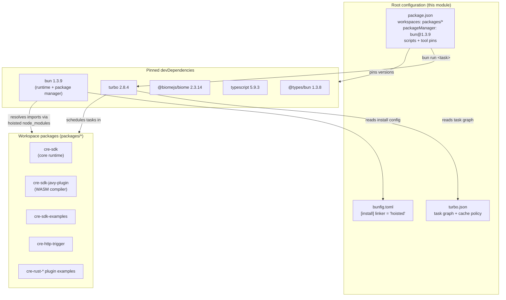
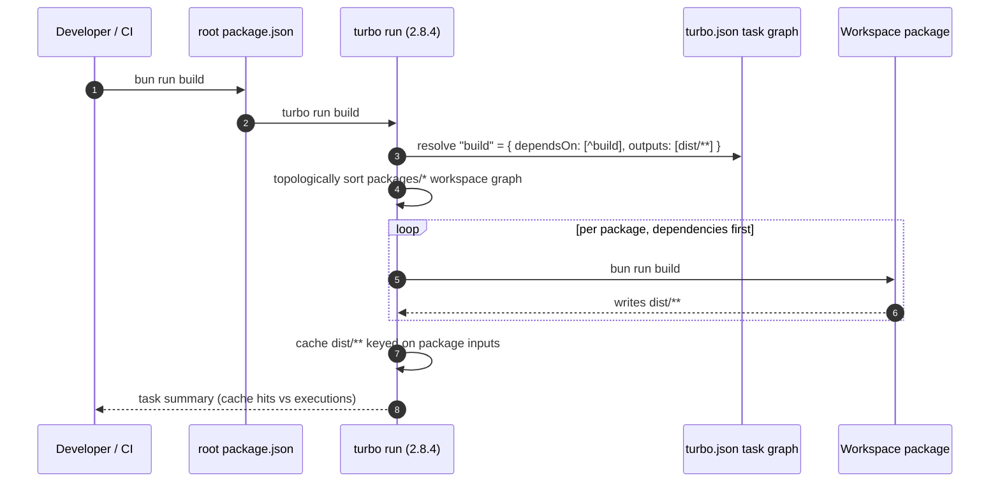
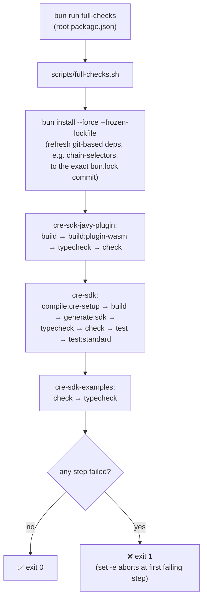
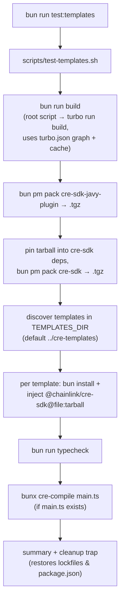
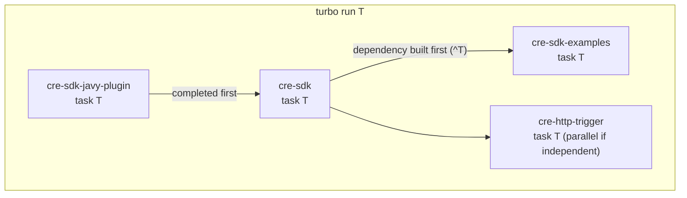

# CRE SDK Workspace — Workspace Configuration

> **Module:** `Developer_Toolchain_(CLI,_SDKs___API_Clients)/cre-sdk-workspace-build_workspace-configuration`
> **Repository scope:** `cre-sdk-typescript/` (root configuration files only)

## 1. Introduction

The **`cre-sdk-typescript`** repository is a Bun + Turborepo monorepo that hosts the CRE (Chainlink Runtime Environment) TypeScript SDK, its Javy/WASM compiler plugin, workflow examples, and developer utilities. The **workspace-configuration** module covers the three root-level files that define how this workspace is installed, built, and quality-gated:

| File | Tool | Role |
|---|---|---|
| `cre-sdk-typescript/bunfig.toml` | Bun | Package-manager installation behavior (linker strategy) |
| `cre-sdk-typescript/package.json` | Bun / npm semantics | Workspace declaration, pinned toolchain, top-level task entry points |
| `cre-sdk-typescript/turbo.json` | Turborepo | Task dependency graph and caching policy shared by all packages |

Together these files form the *contract* every developer and CI job operates under: **Bun 1.3.9** is the pinned runtime/package manager, **Turbo** orchestrates tasks across `packages/*` in dependency order with content-addressed caching, and **Biome/TypeScript** provide formatting, linting, and type checking.

For deeper detail on topics below, see the sibling modules:

- **Developer workflow scripts** (`scripts/full-checks.sh`, `scripts/setup-cre-cli.sh`, `scripts/test-templates.sh`): [cre-sdk-workspace-build_developer-workflow-scripts.md](cre-sdk-workspace-build_developer-workflow-scripts.md)
- **Package builds** (`cre-http-trigger`, `cre-sdk-javy-plugin` Docker image): [cre-sdk-workspace-build_package-builds.md](cre-sdk-workspace-build_package-builds.md)

## 2. Architecture Overview

The root configuration files do not contain business logic; they **declare and constrain** the environment in which workspace packages are built and validated.



**Key relationships**

1. `package.json` **declares** the workspace (`"workspaces": ["packages/*"]`), so every directory under `packages/` becomes a first-class workspace member that Bun links, installs, and can invoke tasks on.
2. `packageManager: "bun@1.3.9"` **pins the toolchain version**; combined with exact-pinned devDependencies, it guarantees reproducible installs and task execution.
3. `turbo.json` **defines the task graph** — `build`, `typecheck`, `lint`, `format`, `check` are topological (`^task` = build/validate dependencies first), while `check:ci` and `dev` are intentionally not.
4. `bunfig.toml` **adjusts installation layout** so the hoisted (classic, single shared `node_modules`) layout is used, which is a prerequisite for correct TypeScript resolution (see §3.1).

## 3. Component Reference

### 3.1 `cre-sdk-typescript/bunfig.toml` — Bun install configuration

```toml
[install]
linker = "hoisted"
```

| Setting | Value | Purpose |
|---|---|---|
| `install.linker` | `hoisted` | Forces the **classic layout**: one shared, root-level `node_modules` containing all packages, instead of the newer per-package isolated layout. |

**Why this matters (per the in-file comment):** newer Bun versions install workspace packages in a way that breaks TypeScript's ability to find type declarations for built-in globals such as `Response` and `Request`. The hoisted linker keeps all packages in a single shared `node_modules`, restoring the correct lookup for `@types/*` and lib types.

> ⚠️ **Do not remove this setting.** If `bun install` is ever run without it (e.g. a bare `bun i` in a fresh clone picks it up automatically — it is read from the repo root), `tsc` runs will fail with missing-global-type errors. It is the first thing to check when typechecking works on one machine but not another.

### 3.2 `cre-sdk-typescript/package.json` — Root manifest

```json
{
  "name": "@chainlink/cre-sdk-monorepo",
  "type": "module",
  "private": true,
  "devDependencies": {
    "@biomejs/biome": "2.3.14",
    "@types/bun": "1.3.8",
    "turbo": "2.8.4",
    "typescript": "5.9.3"
  },
  "scripts": {
    "build": "turbo run build",
    "check": "turbo run check",
    "check:ci": "turbo run check:ci",
    "format": "turbo run format",
    "full-checks": "./scripts/full-checks.sh",
    "test:templates": "./scripts/test-templates.sh",
    "lint": "turbo run lint",
    "typecheck": "turbo run typecheck"
  },
  "packageManager": "bun@1.3.9",
  "workspaces": ["packages/*"]
}
```

#### Manifest semantics

| Field | Value | Effect |
|---|---|---|
| `name` | `@chainlink/cre-sdk-monorepo` | Root scope identifier; not published. |
| `type` | `module` | All packages default to **ESM** (`import`/`export`); `.js` files are interpreted as ES modules. |
| `private` | `true` | Prevents accidental `npm`/`bun publish` of the root. |
| `workspaces` | `["packages/*"]` | Glob that enlists every package under `packages/` into the workspace; Bun resolves their inter-dependencies locally. |
| `packageManager` | `bun@1.3.9` | Pins the exact Bun version (Corepack-style pin). CI and contributors get a deterministic runtime and package manager. |

#### Pinned toolchain (exact versions, no `^`/`~` ranges)

| Package | Version | Role in the workspace |
|---|---|---|
| `bun` (`packageManager`) | 1.3.9 | Runtime, package manager, script runner, test runner. |
| `turbo` | 2.8.4 | Monorepo task orchestration + remote/local content-addressed caching. |
| `@biomejs/biome` | 2.3.14 | Linting and formatting (single fast toolchain, replaces ESLint+Prettier). |
| `typescript` | 5.9.3 | Type checking / declaration emit for all packages. |
| `@types/bun` | 1.3.8 | TypeScript definitions for Bun-specific APIs used in scripts and tests. |

> Note that exact pins (e.g. `2.3.14`, not `^2.3.14`) are deliberate: formatting and lint output must be byte-stable so `check`/`check:ci` results do not drift between contributors and CI.

#### Root scripts (task entry points)

| Script | Command | Consumers | Notes |
|---|---|---|---|
| `build` | `turbo run build` | Developers, CI, `test-templates.sh` | Builds all packages in dependency order; results cached in `dist/**`. |
| `check` | `turbo run check` | `full-checks.sh` | Per-package Biome `check` **with `--write`** (auto-fix) — a mutating pass. |
| `check:ci` | `turbo run check:ci` | CI pipelines | Read-only variant (e.g. `biome ci .`); **no `dependsOn` in `turbo.json`**, so packages may define their own CI check without dependency-ordering overhead. |
| `format` | `turbo run format` | Developers | Mutating formatting pass. |
| `lint` | `turbo run lint` | Developers | Mutating lint pass (`--write`). |
| `typecheck` | `turbo run typecheck` | `full-checks.sh`, CI | Runs `tsc` per package, after dependencies are typechecked. |
| `full-checks` | `./scripts/full-checks.sh` | Developers pre-merge; CI | Shell orchestration of the complete verification suite (see §4.2). |
| `test:templates` | `./scripts/test-templates.sh` | Release/SDK validation | Builds + packs the SDK and smoke-tests it against external templates (see §4.3). |

Workspace packages mirror this script vocabulary so the root wrappers fan out uniformly. For example, `packages/cre-http-trigger/package.json` defines `check` / `check:ci` / `format` / `lint` / `typecheck` with the same Biome/`tsc` semantics, plus a `start` script for the HTTP trigger utility app.

### 3.3 `cre-sdk-typescript/turbo.json` — Turborepo task graph

```json
{
  "$schema": "https://turborepo.com/schema.json",
  "tasks": {
    "build":     { "dependsOn": ["^build"],     "outputs": ["dist/**"] },
    "check":     { "dependsOn": ["^check"] },
    "check:ci":  {},
    "format":    { "dependsOn": ["^format"] },
    "lint":      { "dependsOn": ["^lint"] },
    "typecheck": { "dependsOn": ["^typecheck"] },
    "dev":       { "persistent": true, "cache": false }
  }
}
```

| Task | `dependsOn` | Cached outputs | Semantics |
|---|---|---|---|
| `build` | `^build` | `dist/**` | Build dependencies **before** dependents; only `dist/**` is captured in the cache (artifacts outside `dist/` are not cached). |
| `typecheck` | `^typecheck` | — | Dependencies are typechecked first so cross-package imports resolve against fresh declarations. |
| `lint` / `format` / `check` | `^<same>` | — | Topological ordering maintained; each pass is mutating (`--write`). |
| `check:ci` | *(none)* | — | Deliberately dependency-free: CI can fan this out across packages immediately (e.g. `biome ci .` needs no upstream artifacts). |
| `dev` | *(none)* | not cached, `persistent: true` | Long-running watch/serve tasks; Turbo keeps them alive and excludes them from caching and parallel scheduling constraints. |

**Cache invalidation:** because only `build` declares `outputs`, all other tasks are input-hashed only; adding `outputs` to a task would require its artifacts to be deterministic and relocatable. `build` results are keyed on the package's inputs, so `turbo run build` is a no-op summary when nothing changed.

## 4. Process Flows

### 4.1 Standard build invocation



Because `^build` edges exist, a package such as `cre-sdk` (which consumes the Javy plugin) is only built after `cre-sdk-javy-plugin` finishes; Turbo then parallelizes any unrelated branches of the graph.

### 4.2 `bun run full-checks` (verification pipeline)

The root `full-checks` script is a thin entry point; its step-by-step logic is documented in the [developer workflow scripts](cre-sdk-workspace-build_developer-workflow-scripts.md) module. Summary flow as driven by this module's configuration:



Configuration dependencies exercised here:

- `bun install --force --frozen-lockfile` relies on `bunfig.toml` (hoisted linker) and the lockfile committed at the workspace root.
- Every `bun run <task>` inside a package is the *same* task name `turbo.json` defines — but here invoked **directly per package** (not through Turbo) so failures surface with full output per package.

### 4.3 `bun run test:templates` (SDK release smoke test)

Detailed in [developer workflow scripts](cre-sdk-workspace-build_developer-workflow-scripts.md). The root-config-relevant path:



The `check:ci` / `typecheck` script conventions defined here are what allow the script to detect and execute per-template verification generically (it greps for a `typecheck` script in each template's `package.json`).

## 5. Task Dependency Model

The `^task` prefix in `turbo.json` creates cross-package ordering edges. Conceptually, for any task `T` in `{build, check, format, lint, typecheck}`:



- **`check:ci`** breaks out of this model on purpose: it is a leaf task with no ordering constraints, optimized for maximum CI parallelism.
- **`dev`** is persistent and uncached — it never blocks the graph and is never reused from cache.

## 6. Relationship to the Rest of the System

| Area | Relationship | Documentation |
|---|---|---|
| SDK core runtime | The `build`/`typecheck` graph guarantees `cre-sdk` consumers compile against freshly built dependencies (`^build`, `^typecheck`). | [cre-sdk-core](../cre-sdk-core.md) |
| Generated capabilities | `full-checks.sh` runs `generate:sdk` inside `cre-sdk`, regenerating typed capability clients; the pipeline is set up by this workspace config. | [cre-sdk-generated-capabilities](../cre-sdk-generated-capabilities.md) |
| Examples & Rust plugins | `cre-sdk-examples` and `cre-rust-*` packages are validated by the same `check`/`typecheck` fan-out. | [cre-sdk-examples-and-plugins](../cre-sdk-examples-and-plugins.md) |
| Javy plugin container build | `build:plugin-wasm` invoked by `full-checks.sh` corresponds to the Docker-based WASM plugin build. | [cre-sdk-workspace-build_package-builds](cre-sdk-workspace-build_package-builds.md) |
| CRE CLI | `scripts/setup-cre-cli.sh` installs the `cre` binary used by workflow commands; referenced from the workspace scripts, not from package.json directly. | [cre-cli-platform-config](../cre-cli-platform-config.md) |
| CI/release conventions | `check:ci` and changeset scripts follow the repo-wide CI conventions. | [Build, CI & Release Infrastructure](../../Build,_CI___Release_Infrastructure.md) |
| Toolchain overview | Parent module describing all CLI/SDK/API-client tooling. | [Developer Toolchain](../../Developer_Toolchain_(CLI,_SDKs___API_Clients).md) |

## 7. Operational Notes & Troubleshooting

1. **`bun install` uses the hoisted linker automatically** — it is read from `cre-sdk-typescript/bunfig.toml` at the workspace root. If typechecks fail with *"Cannot find name 'Response'"* (or similar built-in globals), verify this file exists and `linker = "hoisted"` is set, then re-run `bun install` from the root.
2. **Version drift between machines** — always respect `packageManager: bun@1.3.9`. Running a different Bun major version can change install layout behavior independent of `bunfig.toml`.
3. **`check` vs `check:ci`** — `check` mutates files (`--write`); run it locally before committing. `check:ci` is read-only and used by automation to *detect* violations, and it intentionally skips dependency ordering.
4. **Turbo cache and `dist/**`** — only `build` outputs are cached. If you add build products outside `dist/`, either move them under `dist/` or extend the `outputs` array in `turbo.json`.
5. **Adding a new workspace package** — create `packages/<name>/` with a `package.json` that (a) is `private` unless intended for publishing, (b) mirrors the standard scripts (`build`, `check`, `check:ci`, `format`, `lint`, `typecheck`), and (c) declares `engines.bun` compatibly with the root pin (see `cre-http-trigger` for the canonical shape). It is picked up automatically by the `packages/*` glob — no root change required.
6. **Script names are the contract** — `full-checks.sh` and `test-templates.sh` invoke per-package tasks by name; renaming a script in one package without updating `turbo.json` and the shell scripts will silently skip it.

## 8. File Inventory

| Path | Type | Components (as referenced in the module tree) |
|---|---|---|
| `cre-sdk-typescript/bunfig.toml` | Bun config | `bunfig.toml` |
| `cre-sdk-typescript/package.json` | Manifest | `package.json`, `build`, `check:ci`, `format`, `lint`, `typecheck`, `full-checks`, `test:templates` |
| `cre-sdk-typescript/turbo.json` | Build graph config | `turbo.json` |

Related artifacts consumed by this configuration (documented elsewhere): `cre-sdk-typescript/scripts/full-checks.sh`, `cre-sdk-typescript/scripts/test-templates.sh`, `cre-sdk-typescript/scripts/setup-cre-cli.sh`, `cre-sdk-typescript/packages/cre-http-trigger/package.json`, `cre-sdk-typescript/packages/cre-sdk-javy-plugin/Dockerfile`.
