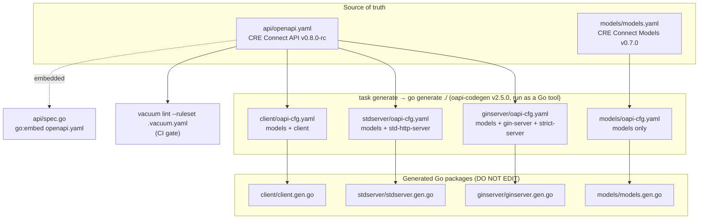
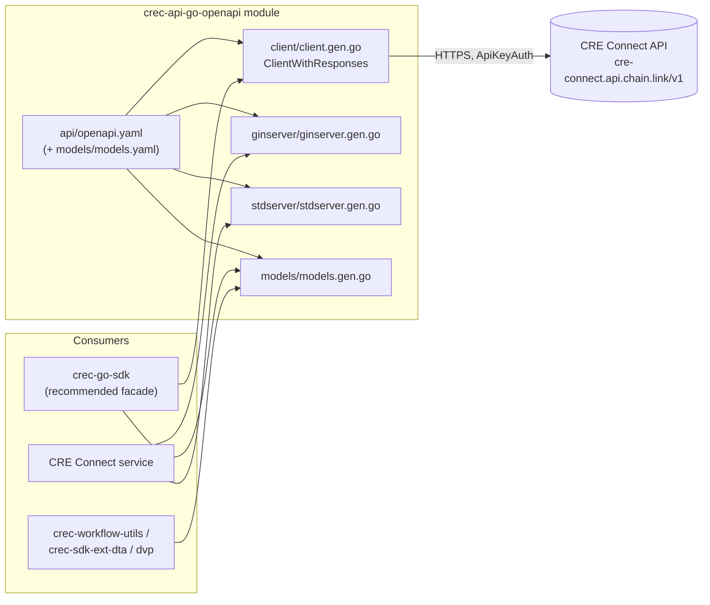
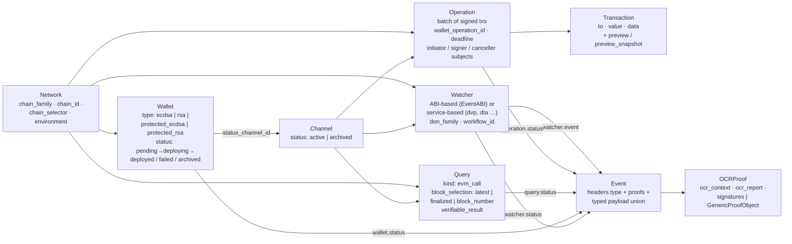
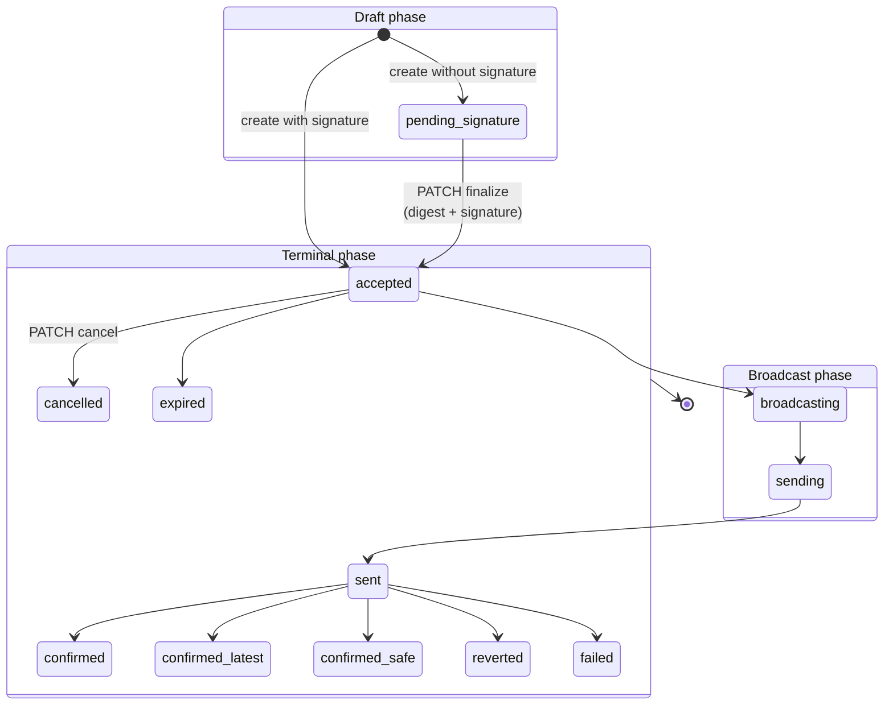
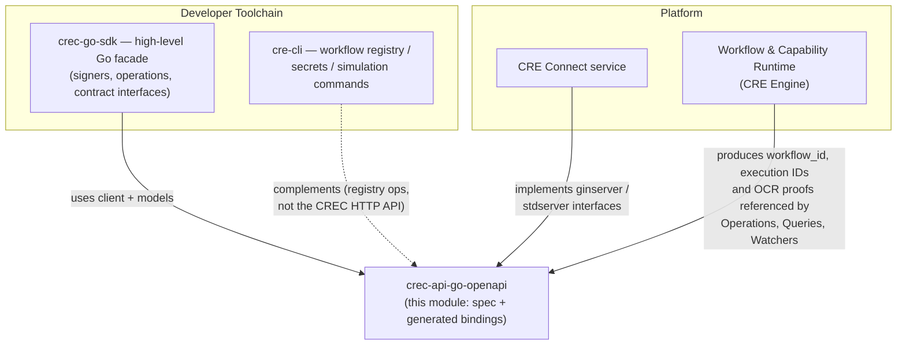

# crec-api-go-openapi — CRE Connect API Go Bindings

> **Go module:** `github.com/smartcontractkit/crec-api-go` (Go 1.26.3) · **API spec:** *CRE Connect API* `0.8.0-rc` (OpenAPI 3.0.4) · **Models spec:** *CRE Connect Models* `0.7.0`

This module is the **spec-first contract package** for the **CRE Connect (CREC) API** — Chainlink's managed wallet, channel and verifiable-event service. It deliberately contains no hand-written business logic: the OpenAPI specification (`crec-api-go/api/openapi.yaml`) is the single source of truth, and every Go artifact in the module — HTTP client, two flavors of server stubs, and shared domain models — is **generated** from it with [oapi-codegen v2.5.0](https://github.com/oapi-codegen/oapi-codegen).

Because the generated code is the *contract itself*, this module sits between two sides of the CRE platform:

- **Consumers** (most importantly the [crec-go-sdk](crec-go-sdk.md), plus event-listener workflow utilities) import the generated `client` and `models` packages to talk to CRE Connect.
- **The CRE Connect service** implements the generated server interfaces (`ginserver` / `stdserver`) so that its handlers can never drift from the published spec.

Part of the [Developer Toolchain (CLI, SDKs & API Clients)](../Developer_Toolchain_(CLI,_SDKs___API_Clients).md) group; the higher-level Go facade lives in [crec-go-sdk](crec-go-sdk.md).

---

## 1. Purpose and Scope

Per the module `README` (`crec-api-go/README.md`), the repository provides:

| Package | Purpose |
|---|---|
| `client` | Typed HTTP client for all CREC endpoints (channels, watchers, wallets, operations, events, queries, networks, health) |
| `models` | Shared types — `VerifiableEvent`, `EVMEvent`, `Channel`, `Wallet`, operation/event payloads — consumed by crec-workflow-utils, crec-sdk-ext-dta, crec-sdk-ext-dvp and other CREC components |
| `ginserver` | Generated Gin server stubs (classic + **strict** server interfaces) for implementing the API |
| `stdserver` | Generated `net/http` server stubs (Go 1.22+ `ServeMux` patterns) as a framework-free alternative |
| `api` | The embedded OpenAPI specification (`go:embed`), served/consumable at runtime |

The module answers three questions for anyone integrating with CRE Connect:

1. **What is the exact wire contract?** → `api/openapi.yaml` (linted in CI with vacuum).
2. **How do I call it from Go?** → `client.ClientWithResponses` (or wrap it via `crec-go-sdk`).
3. **How do I implement it in Go?** → `ginserver.StrictServerInterface` or `stdserver.ServerInterface`.

---

## 2. Architecture Overview

### 2.1 Spec-first generation pipeline

The whole module is a code-generation pipeline anchored on the OpenAPI spec. `generate.go` declares four `//go:generate` directives (one per output package), each driven by its own `oapi-cfg.yaml` (all with `output-options: {skip-prune: true}`):

Key mechanics:

- **Tool versioning is locked in `go.mod`.** The `tool` directive pins `github.com/oapi-codegen/oapi-codegen/v2/cmd/oapi-codegen` v2.5.0, and `generate.go` invokes it via `go tool oapi-codegen …` — no global binary drift.
- **Runtime dependencies are minimal by design:** `gin-gonic/gin` v1.10.1 (server flavor) and `oapi-codegen/runtime` v1.1.2 (parameter binding, JSON merge for union types).
- **The spec ships with the binaries.** `api/spec.go` embeds `openapi.yaml` and exposes `GetOpenAPISpec() (fs.File, error)`, so services can serve their own contract document.
- **Spec drift is impossible to commit.** CI regenerates the code and fails on any `git diff` (see §5).

### 2.2 Component relationship map

---

## 3. The CRE Connect API Surface

The specification (25 operations, 8 tags — `Health`, `Networks`, `Wallets`, `Channels`, `Watchers`, `Operations`, `Queries`, `Events`) models a **channel-oriented eventing and wallet-orchestration service**:

| Tag | Endpoint(s) | `operationId`(s) |
|---|---|---|
| Health | `GET /health-check` | `getHealthCheck` |
| Networks | `GET /networks` | `listNetworks` |
| Wallets | `POST /wallets`, `GET /wallets`, `GET/PATCH /wallets/{wallet_id}` | `createWallet`, `listWallets`, `getWallet`, `updateWallet` |
| Channels | `POST /channels`, `GET /channels`, `GET/PATCH /channels/{channel_id}` | `createChannel`, `listChannels`, `getChannel`, `updateChannel` |
| Events | `GET /channels/{channel_id}/events`, `…/events/search`, `…/events/search/{event_id}` | `listChannelEvents`, `searchChannelEvents`, `getChannelEvent` |
| Operations | `GET/POST /channels/{channel_id}/operations`, `GET/PATCH …/operations/{operation_id}` | `listOperations`, `createOperation`, `getOperation`, `finalizeOrCancelOperation` |
| Queries | `GET/POST /channels/{channel_id}/queries`, `GET …/queries/{query_id}` | `listQueries`, `createQuery`, `getQuery` |
| Watchers | `GET/POST /channels/{channel_id}/watchers`, `GET/PATCH …/watchers/{watcher_id}` | `listWatchers`, `createWatcher`, `getWatcher`, `updateWatcher` |

### 3.1 Resource model

Highlights of the domain:

- **Wallets** are chain-address containers with type-specific signer authorization (`allowed_ecdsa_signers`, `allowed_rsa_signers` — both deprecated in favor of the open `WalletConfiguration` map validated server-side, which also admits wallet types unknown to this spec). Wallet status transitions are mirrored onto a designated status channel.
- **Channels** are organization-scoped event streams. Watchers, operations and queries are all scoped to a channel; a channel cannot be archived while it has active watchers.
- **Watchers** bridge on-chain activity into channels. Creation is a **union type** (`CreateWatcher` with `AsCreateWatcherWithABI` / `AsCreateWatcherWithService` accessors): either raw event ABIs or a named service namespace with optional `service_config`. Every watcher is backed by a CRE workflow (`workflow_id`, `don_family`) deployed in the [Workflow & Capability Runtime](../Workflow___Capability_Runtime_(CRE_Engine).md).
- **Operations** are batches of transactions with an optional EIP-712 signature; creating without a signature yields a *draft* (`pending_signature`) that is later finalized via `PATCH` (`digest` + `signature`) or cancelled. Confirmed operations carry the IDs of the CRE workflows that executed and confirmed them, plus the on-chain `transaction_hash`.
- **Queries** are verifiable chain reads (`evm_call` MVP) with an `idempotency_key`, explicit block selection, and an OCR-attested `verifiable_result` on completion.

### 3.2 Operation lifecycle (implied by the `OperationStatus` enum)

The spec enumerates statuses but does not fix transitions; the state machine below groups the enum (`pending_signature, accepted, broadcasting, sending, sent, confirmed, confirmed_latest, confirmed_safe, reverted, failed, expired, cancelled`) into phases:

### 3.3 Verifiable events

Every channel event carries `headers` (an `offset` for ordering, a `type` discriminator, and a `proofs` array that is a union of `OCRProof` and the extensible `GenericProofObject`) plus a typed payload union. Payload variants are selected by `headers.type`:

| `headers.type` | Payload | Notes |
|---|---|---|
| `operation.status` | `OperationStatusPayload` | Includes `verifiable_event`, `event_hash`, CRE workflow/execution IDs, tx hash |
| `query.status` | `QueryStatusPayload` | Includes `verifiable_result` for terminal statuses |
| `wallet.status` | `WalletStatusPayload` | Mirrors wallet transitions to the status channel |
| `watcher.status` | `WatcherStatusPayload` | Watcher lifecycle (pending → active → archiving → archived / failed) |
| `watcher.event` | `WatcherEventPayload` | On-chain event detected by the watcher's CRE workflow |

The `verifiable_event` / `verifiable_result` blobs and `OCRProof` objects are produced by CRE workflows (see [Workflow & Capability Runtime](../Workflow___Capability_Runtime_(CRE_Engine).md)) and are the trust anchor for downstream consumers.

### 3.4 Cross-cutting contracts

- **Authentication** — an `ApiKeyAuth` security scheme applies to every operation (the generated wrappers push scopes into the request context under the `ApiKeyAuth.Scopes` key; the client attaches credentials via `WithRequestEditorFn`). A missing/unknown organization yields the shared **`401 OrganizationNotFound`** response (an alias of `ApplicationError`).
- **Error model** — a single `ApplicationError { type, code?, message }`. `type` ∈ `VALIDATION_ERROR` (400), `NOT_FOUND` (404), `CONFLICT` (409), `ORGANIZATION_NOT_FOUND` (401), `INTERNAL_ERROR` (5xx); `code` is a machine-readable enum (e.g. `WALLET_ALREADY_EXISTS`, `CHANNEL_ARCHIVED`, `IDEMPOTENCY_KEY_MISMATCH`, `RESOURCE_VERSION_CONFLICT`, `OPERATION_NOT_FINALIZABLE`, …). Adding a new `type` requires updating the enum in `api/openapi.yaml` *before* the server emits it (README §Error Types).
- **Pagination** — uniform `limit`/`offset` query parameters with `has_more` in every `*List` response; archived resources are excluded by default unless the `status` filter explicitly includes them.
- **Union types** — `CreateWatcher`, `Event_Payload`, `EventHeaders.proofs[]`, `PatchOperation` (discriminated on `status`: `accepted`/`cancelled`) and `QueryBlockSelection` (discriminated on `type`: `latest`/`finalized`/`block_number`) are generated as Go unions with `As*` / `From*` / `Merge*` accessors and `ValueByDiscriminator()` helpers.

---

## 4. Sub-module Documentation

### Confirmed sub-module pages

The detailed documentation was generated under `crec-api-go-openapi/` (one page per sub-module, cross-linked both ways with this page):

| Sub-module page | Scope covered |
|---|---|
| [crec-api-go-openapi_api-specification](crec-api-go-openapi/crec-api-go-openapi_api-specification.md) | `api/openapi.yaml` as the single source of truth; `models/models.yaml`; the four `//go:generate` directives in `generate.go`; per-target `oapi-cfg.yaml` configs; the `api/spec.go` `go:embed` entry point; vacuum ruleset and Taskfile validation tasks; module dependency pins. |
| [crec-api-go-openapi_generated-client](crec-api-go-openapi/crec-api-go-openapi_generated-client.md) | `client/client.gen.go`: `ClientWithResponsesInterface` / `ClientInterface`, `NewClient` + `ClientOption`s, `WithRequestEditorFn` auth injection (`Authorization: Apikey …`), typed `*Response` structs and `Parse*Response` helpers, union accessors (e.g. `CreateWatcher` → ABI- or service-based variants). |
| [crec-api-go-openapi_generated-servers](crec-api-go-openapi/crec-api-go-openapi_generated-servers.md) | `ginserver/ginserver.gen.go` (Gin `ServerInterface` + strict `StrictServerInterface` with `*RequestObject` / `*ResponseObject` types and `401`/`500` JSON response types) and `stdserver/stdserver.gen.go` (net/http handlers with Go 1.22 `ServeMux`, middleware chain, parameter-binding error types such as `RequiredParamError` and `InvalidParamFormatError`), plus the regeneration workflow. |

---

## 5. Build, Validation, and CI

The module's behavior as a *buildable artifact* is defined by three config files (cited from the repository):

- **`crec-api-go/Taskfile.yaml`** — the developer entry points:
  - `task generate` → `go generate ./` (runs the four oapi-codegen directives),
  - `task tools` → installs `vacuum` (pinned via the `VACUUM_VERSION` var, default `0.20.5`),
  - `task validate-openapi` → `vacuum lint --ruleset .vacuum.yaml ./api/openapi.yaml`.
- **`crec-api-go/.vacuum.yaml`** — extends `spectral:oas, recommended` and additionally enforces `operation-operationId`, `operation-tags`, `oas3-api-servers`, `oas3-schema`, `oas3-unused-component`, `oas3-parameter-description`, `operation-description`, `oas3-missing-example`, `component-description`, and treats `oas3-valid-schema-example` as `error`. Two rules are **deliberately disabled** with rationale comments: `camel-case-properties` (snake_case JSON is the intentional wire format; renaming would be breaking) and `description-duplication` (repeated error-response descriptions describe the same error type consistently by design).
- **`crec-api-go/.github/workflows/pull-request-main.yaml`** — three PR gates:
  1. `validate-openapi` — installs Task + vacuum v0.20.5 and runs `task validate-openapi`;
  2. `generate` — installs tools, runs `task generate`, then `git diff --exit-code` ("Generated code is out of date. Run 'task generate' and commit the changes."), then `go build ./...`;
  3. `mod-tidy` — `go mod tidy` followed by the same diff check.

**Regenerating locally:** `task tools && task generate` (README §Regenerating Bindings).

---

## 6. Relationship to Other Modules

- **[crec-go-sdk](crec-go-sdk.md)** — the recommended consumer facade (per the README, most users should not import this raw client directly). Its `transact` engine (EIP-712 signers, RSA public-key export) aligns with this API's operation signing and `allowed_rsa_signers` model.
- **[cre-cli](cre-cli-workflow-commands.md)** — operates on the *workflow* side of CRE (registry deploy/pause/activate, secrets), complementing this module's wallet/channel API surface.
- **[Workflow & Capability Runtime (CRE Engine)](../Workflow___Capability_Runtime_(CRE_Engine).md)** — every Watcher, Operation confirmation and Query result in this API is executed/attested by a CRE workflow: the `workflow_id` / `workflow_execution_id` fields and OCR proofs returned here originate from that runtime (e.g. the [Workflow Registry Syncer](../Workflow___Capability_Runtime_(CRE_Engine)/workflows/workflows_syncer.md) that materializes watcher workflows on DONs).

---

*Generated artifacts in this module are marked `DO NOT EDIT`; all changes must flow through `api/openapi.yaml`, `models/models.yaml`, or the per-package `oapi-cfg.yaml` files.*
