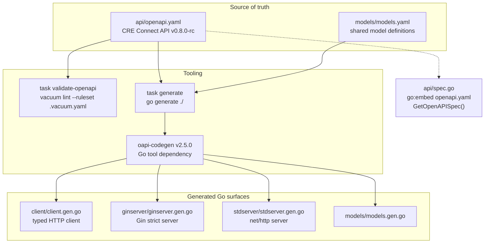
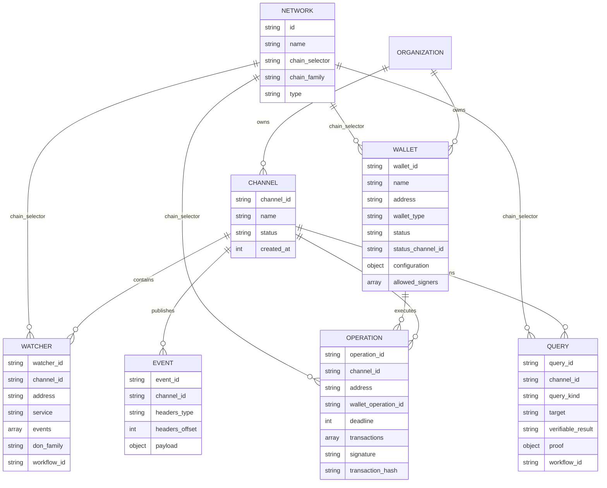
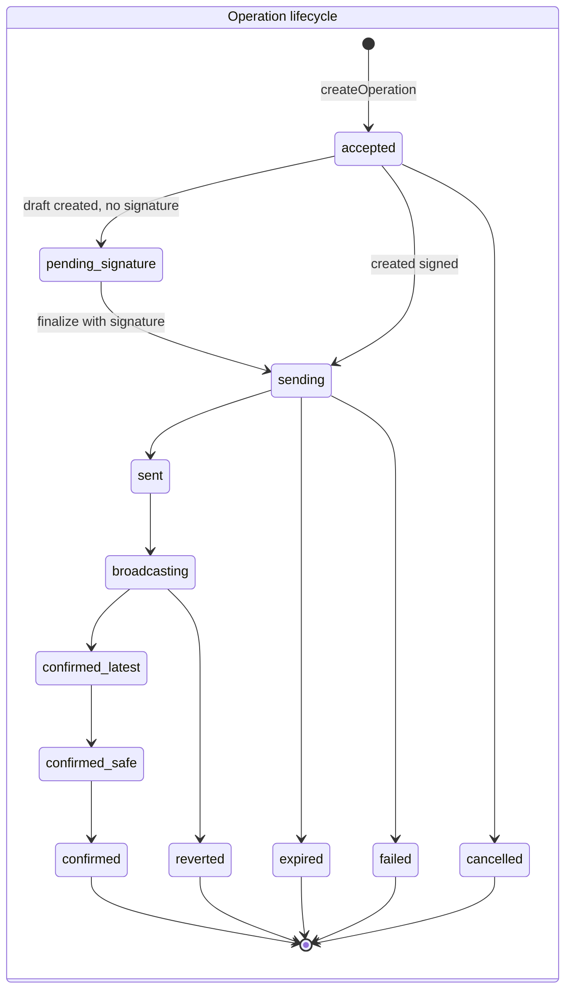
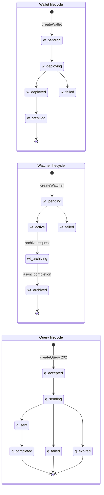

# CRE Connect API Specification (`crec-api-go`)

## Overview

The `crec-api-go` module is the **contract layer** for the **CRE Connect API** — Chainlink's public REST interface for managing **managed wallets, channels, contract-event watchers, signed transaction operations, verifiable chain queries, and their event streams**. Its central artifact is an [OpenAPI 3.0.4 specification](https://spec.openapis.org/oas/v3.0.4) (`crec-api-go/api/openapi.yaml`, title *CRE Connect API*, version `0.8.0-rc`) that serves as the **single source of truth**: all Go client and server code in the parent module is machine-generated from it.

The module contains no hand-written business logic. Instead it provides:

1. **The API contract** — `api/openapi.yaml`, defining every endpoint, schema, enum, error model, and security scheme.
2. **Code-generation wiring** — `generate.go` directives that run `oapi-codegen` to produce the [generated client](crec-api-go-openapi_generated-client.md) and [generated servers](crec-api-go-openapi_generated-servers.md).
3. **Contract validation** — a `vacuum`/Spectral lint ruleset (`.vacuum.yaml`) and Taskfile tasks that enforce spec quality on every change.
4. **Runtime spec embedding** — `api/spec.go` embeds the YAML into the compiled binary so the contract can be served or inspected at runtime.

## Position in the System

This module sits inside the [Developer Toolchain](<../Developer_Toolchain_(CLI,_SDKs___API_Clients).md>) group. The specification governs the CRE Connect service surface consumed by tooling such as the [crec Go SDK](<../crec-go-sdk.md>) and related CLI workflows ([cre CLI workflow commands](<../cre-cli-workflow-commands.md>)). It is deliberately *chain-agnostic in shape* but currently EVM-centric in payload types (`EthereumAddress`, `evm_call` queries, EIP-712 operation signatures), and it integrates with the Chainlink Runtime Environment (CRE) at the domain level: watchers and queries carry `don_family` / `workflow_id` / `workflow_execution_id` fields that tie API resources to CRE workflows executed on decentralized oracle networks (DONs).

## Module Structure and Files

| File | Role |
|---|---|
| `crec-api-go/api/openapi.yaml` | The OpenAPI 3.0.4 contract — ~130 KB covering all endpoints, schemas, enums, examples, and security. |
| `crec-api-go/api/spec.go` | `GetOpenAPISpec()` — embeds the YAML via `go:embed` and exposes it as an `fs.File` for runtime access. |
| `crec-api-go/generate.go` | `//go:generate` directives invoking `oapi-codegen` with four target configs. |
| `crec-api-go/go.mod` | Go module `github.com/smartcontractkit/crec-api-go` (Go 1.26.3); pins `gin-gonic/gin`, `oapi-codegen/runtime`, and the `oapi-codegen` **Go tool** dependency. |
| `crec-api-go/.vacuum.yaml` | Spectral/vacuum lint ruleset with project-specific rule decisions. |
| `crec-api-go/Taskfile.yaml` | Dev tasks: `generate`, `tools`, `validate-openapi`. |
| `crec-api-go/*/oapi-cfg.yaml` | Per-target oapi-codegen configs (see [Code Generation Pipeline](#code-generation-pipeline)). |

## Architecture

The specification is the hub of the module: it is linted, embedded, and compiled into three independent Go code surfaces.



Key architectural properties:

- **Contract-first codegen** — client and server types are never hand-edited; they are regenerated from the spec so drift between docs and code is impossible.
- **Dual server targets** — the same contract generates both a [Gin-based strict server](crec-api-go-openapi_generated-servers.md) and a stdlib `net/http` server, letting the service implementation choose (or support) either hosting stack.
- **Strict servers** — both server outputs use strict-server mode, which forces handlers to return one of the *exact* response objects declared per operation (e.g. `CreateWallet201JSONResponse`, `CreateChannel401JSONResponse`), making undocumented responses a compile error.
- **Spec embedding** — `GetOpenAPISpec()` returns the contract bytes at runtime, enabling self-description endpoints, contract tests, and diff tooling against the exact binary that serves traffic.

## The CRE Connect API Contract

### API Identity, Servers, and Authentication

| Property | Value |
|---|---|
| Title | CRE Connect API |
| Version | `0.8.0-rc` |
| OpenAPI version | 3.0.4 |
| Production server | `https://cre-connect.api.chain.link/v1` |
| Local dev server | `http://localhost:8080` |
| Security scheme | `ApiKeyAuth` — API key in the `Authorization` header, sent as `Authorization: Apikey <api-key>` |

All resources are **organization-scoped**: every authenticated request resolves the caller's organization, and a valid credential with no matching onboarded organization yields the shared `401` response component `OrganizationNotFound` (type `ORGANIZATION_NOT_FOUND`). Every operation documents this response via a shared `$ref`.

### Endpoint Catalog

The API groups into eight tags. `operationId` values are the contract for generated client method names (see the [generated client](crec-api-go-openapi_generated-client.md)).

| Tag | Endpoint | Method | `operationId` | Purpose |
|---|---|---|---|---|
| Health | `/health-check` | GET | `getHealthCheck` | Service liveness |
| Networks | `/networks` | GET | `listNetworks` | Supported networks (chain selector, chain ID, family, environment) |
| Wallets | `/wallets` | POST | `createWallet` | Create a managed wallet (ECDSA / RSA / protected variants) |
| Wallets | `/wallets` | GET | `listWallets` | Paginated list with filters (name, owner, address, type, status, chain environment) |
| Wallets | `/wallets/{wallet_id}` | GET / PATCH | `getWallet`, `updateWallet` | Fetch / rename a wallet; archived wallets are immutable (409) |
| Channels | `/channels` | POST / GET | `createChannel`, `listChannels` | Create and list channels — the scoping container for watchers, operations, queries, and events |
| Channels | `/channels/{channel_id}` | GET / PATCH | `getChannel`, `updateChannel` | Fetch / update (rename, archive — blocked while active watchers exist) |
| Queries | `/channels/{channel_id}/queries` | POST / GET | `createQuery`, `listQueries` | Submit verifiable chain read queries (`evm_call`) and list results |
| Queries | `/channels/{channel_id}/queries/{query_id}` | GET | `getQuery` | Query record incl. `verifiable_result` and OCR proof |
| Watchers | `/channels/{channel_id}/watchers` | POST / GET | `createWatcher`, `listWatchers` | Watch contract events via named service namespaces or raw ABIs |
| Watchers | `/channels/{channel_id}/watchers/{watcher_id}` | GET / PATCH | `getWatcher`, `updateWatcher` | Fetch / rename / archive (archiving is asynchronous → `202`) |
| Operations | `/channels/{channel_id}/operations` | POST / GET | `createOperation`, `listOperations` | Submit signed (or draft) transaction batches; list with audit-subject filters |
| Operations | `/channels/{channel_id}/operations/{operation_id}` | GET / PATCH | `getOperation`, `finalizeOrCancelOperation` | Track lifecycle; finalize (signature + digest) or cancel |
| Events | `/channels/{channel_id}/events` | GET | `listChannelEvents` | Poll latest events (ordered by descending offset) |
| Events | `/channels/{channel_id}/events/search` | GET | `searchChannelEvents` | Historical search with type-scoped filters and timestamp ranges |
| Events | `/channels/{channel_id}/events/search/{event_id}` | GET | `getChannelEvent` | Fetch a single event by ID |

### Resource Model

Resources form a strict containment hierarchy rooted at the (implicit, authenticated) organization; the **channel** is the unifying scoping entity, and the **network** (identified by a `chain_selector`) is the chain dimension.



Notable domain details:

- **Wallets** — `wallet_type` is one of `ecdsa`, `rsa`, `protected_ecdsa`, `protected_rsa`. Signer authorization moved from the deprecated `allowed_rsa_signers` / `allowed_ecdsa_signers` lists to the open `configuration` object, which is *validated server-side at wallet-creation time* (not by the schema) so wallet types unknown to this spec can carry their own configuration shape. `status_channel_id` links the wallet to a channel where its `wallet.status` events are published.
- **Watchers** — creation is a `oneOf` between a **service-based** definition (named service namespace such as `dta`, plus event names and optional `service_config`) and an **ABI-based** definition (raw `EventABI` entries). Returned watchers expose `don_family` (the DON family whose nodes sign events) and the CRE `workflow_id` executing them.
- **Operations** — a batch of 1–16 `TransactionRequest`s (`to`, `value`, `data`, optional preview) tied to a `wallet_operation_id` (a uint256 decimal string used as an on-chain nonce/replay guard) and an optional `deadline` (0 = no expiry). Operations may be submitted as **drafts** (signature omitted, status `pending_signature`) and later finalized via `PATCH` with an EIP-712 signature and digest, or cancelled. `transaction_hash` is populated after broadcast and is attested by `operation.status` events. Audit fields `initiator`, `signer`, and `canceller` are typed `Subject`s (`api_key` | `user`).
- **Queries** — currently `evm_call` only. Params are a closed object (`contract_address`, `call_data`, `block_selection`, optional `from_address`) where `block_selection` is a discriminated `oneOf` (`latest` | `finalized` | `block_number`). Terminal queries expose a base64 `verifiable_result` and an `OCRProof` (`alg: ocr2vrf`, report, context, signatures), plus the executing CRE workflow's `workflow_id` / `workflow_execution_id`.
- **Events** — a channel-scoped stream whose `headers` carry `type`, `offset`, and `proofs`. Payload shape is discriminated by `EventType`: `operation.status`, `query.status`, `watcher.status`, `watcher.event`, `wallet.status`. The `search` endpoint documents exactly which filter parameters apply per event type and rejects invalid combinations with `400`.

### Resource Lifecycles

Status machines are encoded as enums with per-state timestamps on the resources (e.g. `accepted_at`, `sending_at`, `sent_at`, `completed_at` on queries; `signed_at`, `cancelled_at`, `confirmed_at` on operations).





The watcher's `archiving` state is user-visible: archiving is asynchronous and `updateWatcher` responds `202` while the watcher transitions.

### Cross-Cutting Conventions

- **Wire format** — JSON property names are **snake_case**. This is an explicit, documented decision: the lint ruleset disables the `camel-case-properties` rule with the comment that renaming would be a breaking change (`crec-api-go/.vacuum.yaml`).
- **Pagination** — list endpoints take `limit` / `offset` (per-resource bounds: wallets 1–100, channels/watchers/queries/operations 1–100 or 1–50, events 1–200, all with defaults) and return `{data, has_more}` envelopes (`WalletList`, `ChannelList`, `WatcherList`, `OperationList`, `QueryList`, `EventList`).
- **Idempotency** — `createQuery` requires a customer-supplied `idempotency_key` scoped to organization + channel; reuse with a different canonical request yields `409 IDEMPOTENCY_KEY_MISMATCH`.
- **Asynchronous processing** — query creation returns `202 Accepted` with a `QueryAcceptedResponse`; watcher archiving returns `202`. Final progress is delivered via channel events.
- **Concurrency control** — state-conflict errors double as concurrency signals (e.g. wallet update conflicts report `WALLET_ALREADY_ARCHIVED`; a dedicated `RESOURCE_VERSION_CONFLICT` code exists).
- **Numeric fidelity** — uint256-scale values (`wallet_operation_id`, transaction `value`, `block_number`) are decimal *strings* to avoid JSON number precision loss; large byte blobs (`call_data`, signatures, RSA keys) are hex strings with documented prefix and length patterns.
- **Runtime-enforced limits** — documented in-schema where enforcement happens outside OpenAPI: org-scoped aggregate calldata byte limits, RSA modulus ≥ 2048 bits, signer lists capped at 10, transaction batches capped at 16.

### Error Model

A single `ApplicationError` schema covers all non-2xx responses:

```json
{ "type": "CONFLICT", "code": "WALLET_ALREADY_ARCHIVED", "message": "conflict error: wallet already in archived state" }
```

- `type` (required): `NOT_FOUND` | `VALIDATION_ERROR` | `CONFLICT` | `INTERNAL_ERROR` | `ORGANIZATION_NOT_FOUND`
- `code` (optional, machine-readable): `CHANNEL_NOT_FOUND`, `WALLET_NOT_FOUND`, `OPERATION_NOT_FOUND`, `WATCHER_NOT_FOUND`, `QUERY_NOT_FOUND`, `CHANNEL_ALREADY_EXISTS`, `WALLET_ALREADY_EXISTS`, `WATCHER_ALREADY_EXISTS`, `IDEMPOTENCY_KEY_MISMATCH`, `OPERATION_NOT_FINALIZABLE`, `OPERATION_NOT_CANCELLABLE`, `OPERATION_DEADLINE_ELAPSED`, `RESOURCE_VERSION_CONFLICT`, `WALLET_ALREADY_ARCHIVED`, `WALLET_NOT_READY`, `CHAIN_UNAVAILABLE`, `CHANNEL_ARCHIVED`
- `message` (required)

Operation-level docs include copy-paste examples for every status the operation can return (including per-error-code `examples` blocks, e.g. the three distinct `409` causes of finalizing an operation), which the lint ruleset's `oas3-missing-example` rule enforces.

### Data Flow: End-to-End Interaction

A typical consumer journey through the API:

```mermaid
sequenceDiagram
    participant C as API client
    participant API as CRE Connect API
    participant WF as CRE workflow on DON

    C->>API: POST /channels (createChannel)
    API-->>C: 201 Channel
    C->>API: POST /wallets (createWallet, status_channel_id)
    API-->>C: 201 Wallet pending
    API-->>C: wallet.status events via channel (pending -> deployed)
    C->>API: POST /channels/{id}/operations (draft, unsigned)
    API-->>C: 201 Operation
    C->>API: PATCH /operations/{id} (signature + digest)
    API-->>C: 200 Operation (sending ...)
    WF->>WF: broadcast + confirm transactions
    API-->>C: operation.status events (sending -> confirmed)
    C->>API: POST /channels/{id}/queries (evm_call, idempotency_key)
    API-->>C: 202 QueryAcceptedResponse
    WF->>WF: execute query, produce OCR2VRF proof
    API-->>C: query.status event; GET query returns verifiable_result + proof
    C->>API: GET /channels/{id}/events/search (historical audit)
    API-->>C: 200 EventList
```

## Code Generation Pipeline

`crec-api-go/generate.go` declares four `//go:generate` directives, executed by `task generate` (`go generate ./`):

```go
//go:generate go tool oapi-codegen -config ginserver/oapi-cfg.yaml ./api/openapi.yaml
//go:generate go tool oapi-codegen -config stdserver/oapi-cfg.yaml ./api/openapi.yaml
//go:generate go tool oapi-codegen -config client/oapi-cfg.yaml ./api/openapi.yaml
//go:generate go tool oapi-codegen -config models/oapi-cfg.yaml ./models/models.yaml
```

`oapi-codegen` is pinned as a **Go tool dependency** (`tool github.com/oapi-codegen/oapi-codegen/v2/cmd/oapi-codegen`, v2.5.0) in `crec-api-go/go.mod`, so generation uses the same toolchain version for all developers.

| Config | Output package / file | Generators enabled | Notes |
|---|---|---|---|
| `ginserver/oapi-cfg.yaml` | `ginserver/ginserver.gen.go` | `models`, `gin-server`, `strict-server` | Full Gin router + strict handler interfaces (`*RequestObject` / `*ResponseObject`) |
| `stdserver/oapi-cfg.yaml` | `stdserver/stdserver.gen.go` | `models`, `std-http-server` | Stdlib `net/http` server incl. typed param errors (`RequiredParamError`, `UnmarshalingParamError`, …) |
| `client/oapi-cfg.yaml` | `client/client.gen.go` | `models`, `client` | Typed client with `ClientWithResponsesInterface` and per-operation request/response types |
| `models/oapi-cfg.yaml` | `models/models.gen.go` | `models` | Generated from the secondary `models/models.yaml` definition |

All four configs set `skip-prune: true`, so every schema in the contract is materialized even if not referenced by a path (pruning is avoided because the server packages and the separate models package must stay structurally aligned).

The generated artifacts are documented separately — do not edit them by hand:

- Generated client: [crec-api-go-openapi_generated-client](crec-api-go-openapi_generated-client.md)
- Generated servers: [crec-api-go-openapi_generated-servers](crec-api-go-openapi_generated-servers.md)

## Spec Validation and Developer Tooling

`crec-api-go/Taskfile.yaml` provides the developer workflow:

| Task | Command | Purpose |
|---|---|---|
| `generate` | `go generate ./` | Regenerate client, both servers, and models from the spec |
| `tools` | `go install github.com/daveshanley/vacuum@v0.20.5` | Install the lint tool (version overridable via `VACUUM_VERSION`) |
| `validate-openapi` | `vacuum lint --ruleset .vacuum.yaml ./api/openapi.yaml` | Lint the contract |
| *(default)* | `task --list` | List tasks |

The `.vacuum.yaml` ruleset extends `spectral:oas, recommended` and hardens the baseline:

- **Enabled beyond defaults**: `operation-operationId` (stable generated method names), `operation-tags`, `oas3-api-servers`, `oas3-schema`, `oas3-unused-component`, `oas3-parameter-description`, `operation-description`, `oas3-missing-example`, `component-description`, and `oas3-valid-schema-example` escalated to **error** (examples are treated as executable documentation).
- **Disabled deliberately**:
  - `camel-case-properties` — the API's wire format is intentionally snake_case; renaming would be a breaking change.
  - `description-duplication` — repeated error-response descriptions across endpoints are by design, since they describe the same error type consistently.

A typical contribution loop: edit `api/openapi.yaml` → `task validate-openapi` → `task generate` → commit the spec together with the regenerated `client/`, `ginserver/`, `stdserver/`, and `models/` outputs.

## Embedding the Specification at Runtime

`crec-api-go/api/spec.go` uses `//go:embed openapi.yaml` to bake the contract into any binary importing the `api` package, and exposes:

```go
func GetOpenAPISpec() (fs.File, error)
```

This guarantees that whatever serves, validates, or documents the API at runtime does so against the *exact* contract compiled into the binary — no drift between deployed artifact and published spec.

## Related Documentation

- Module overview: [crec-api-go-openapi](../crec-api-go-openapi.md)
- Generated client: [crec-api-go-openapi_generated-client](crec-api-go-openapi_generated-client.md)
- Generated servers: [crec-api-go-openapi_generated-servers](crec-api-go-openapi_generated-servers.md)
- Toolchain root: [Developer Toolchain (CLI, SDKs & API Clients)](<../Developer_Toolchain_(CLI,_SDKs___API_Clients).md>)
- Consuming SDKs and CLI: [crec Go SDK](<../crec-go-sdk.md>), [cre CLI workflow commands](<../cre-cli-workflow-commands.md>), [cre CLI backend clients](<../cre-cli-backend-clients.md>)
