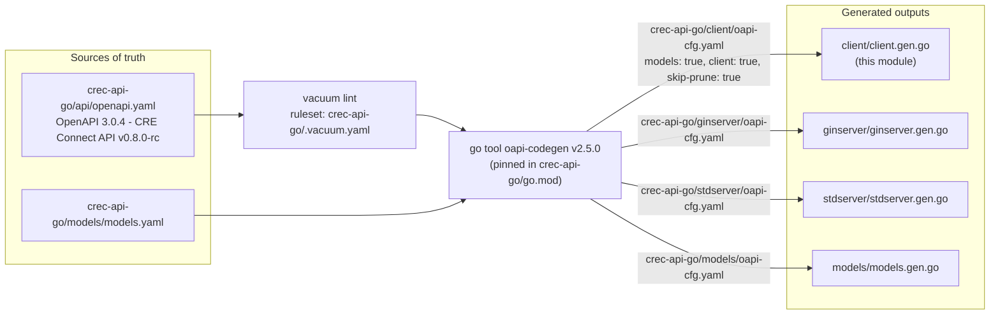
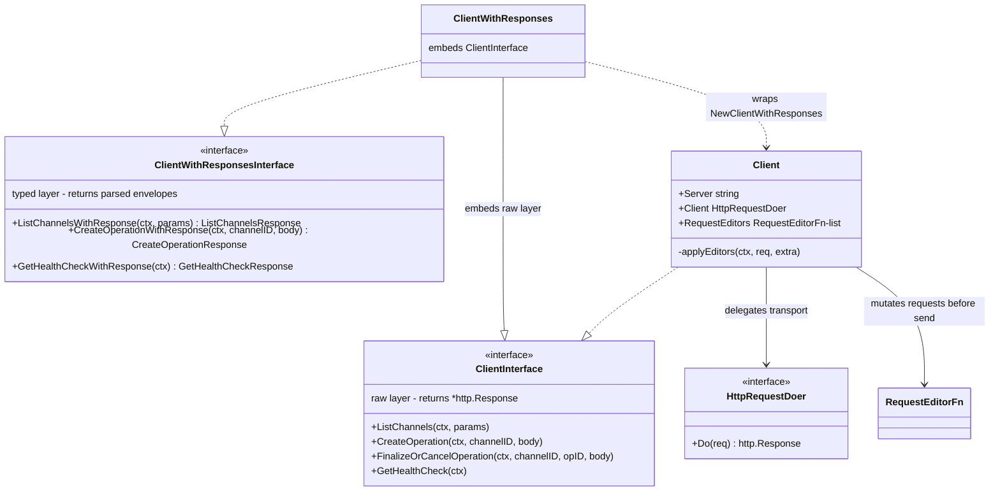
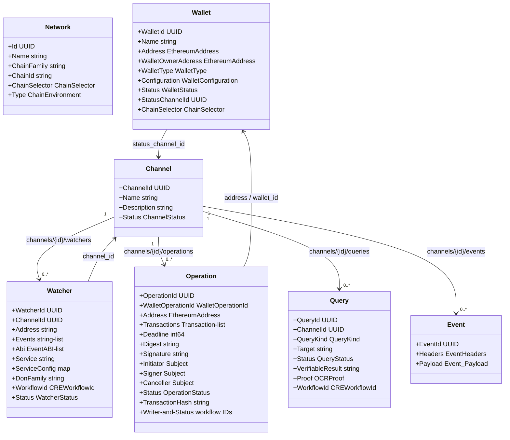
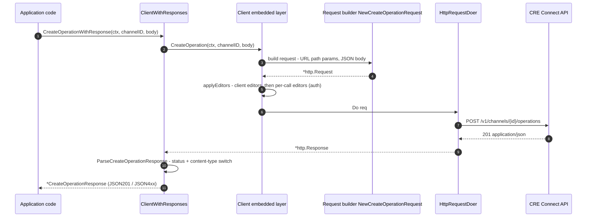
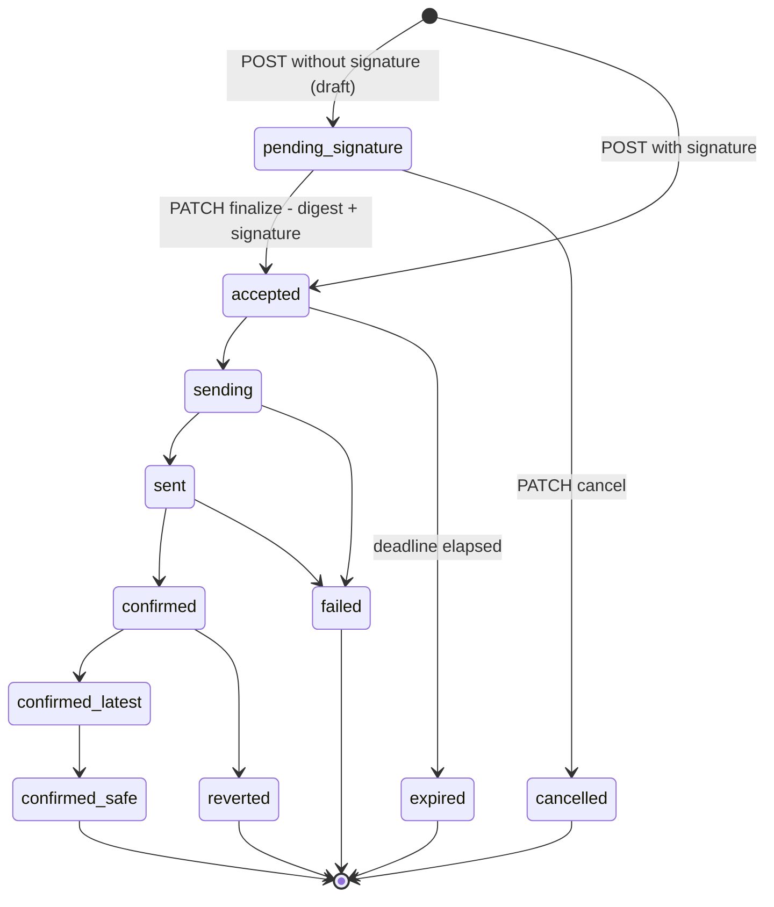
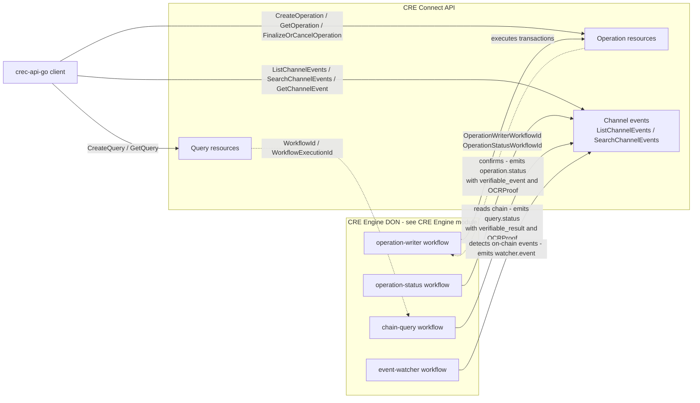

# Generated API Client (`crec-api-go/client`)

This module documents the **auto-generated Go HTTP client** for the **CRE Connect API**, located at `crec-api-go/client/client.gen.go`. The file is produced by [oapi-codegen v2.5.0](https://github.com/oapi-codegen/oapi-codegen) from the OpenAPI specification in `crec-api-go/api/openapi.yaml` and carries the standard generated-file banner:

```
// Code generated by github.com/oapi-codegen/oapi-codegen/v2 version v2.5.0 DO NOT EDIT.
```

It gives Go consumers a fully typed, dependency-light way to drive the entire CRE Connect surface — wallets, channels, channel events, signed operations, verifiable chain queries, and event watchers — without hand-writing request plumbing or JSON models.

> **Never edit `client.gen.go` by hand.** Every change must flow through the OpenAPI specification and be regenerated (see [Regeneration and maintenance](#regeneration-and-maintenance)).

## Overview

| Aspect | Value |
|---|---|
| Source artifact | `crec-api-go/client/client.gen.go` (package `client`) |
| Generated by | `github.com/oapi-codegen/oapi-codegen/v2` **v2.5.0**, pinned as a Go *tool dependency* in `crec-api-go/go.mod` |
| Source of truth | `crec-api-go/api/openapi.yaml` — OpenAPI **3.0.4**, *CRE Connect API* **v0.8.0-rc** |
| Generation config | `crec-api-go/client/oapi-cfg.yaml` (`models: true`, `client: true`, `skip-prune: true`) |
| Runtime dependency | `github.com/oapi-codegen/runtime v1.1.2` (parameter styling, JSON merge, OpenAPI types) |
| Transport | Standard `net/http` — no framework coupling |
| Authentication | `ApiKeyAuth` API-key scheme, `Authorization: Apikey <api-key>` header |
| Primary API surface | `ClientWithResponsesInterface` (typed responses) and its raw counterpart `ClientInterface` |

The client is **self-contained**: because the generation config enables `models: true`, all schema types (`Channel`, `Wallet`, `Operation`, `Query`, `Watcher`, `Event`, `Network`, `ApplicationError`, …) are emitted into the same `client` package alongside the HTTP plumbing. A separate `crec-api-go/models` package is generated in parallel from `crec-api-go/models/models.yaml` for shared/server-side use — this is described on the parent [crec-api-go-openapi](../crec-api-go-openapi.md) page.

## Where this module fits

The generated client is one of three artifacts produced from the same specification (see [generate.go](#generation-pipeline)):

- **`client/client.gen.go`** (this page) — outbound Go client for API consumers and integrators.
- **`ginserver/ginserver.gen.go`** and **`stdserver/stdserver.gen.go`** — server-side interface bindings; documented in [Generated Servers](crec-api-go-openapi_generated-servers.md).
- **`api/openapi.yaml`** — the single source of truth; documented in [API Specification](crec-api-go-openapi_api-specification.md).

CRE Connect itself is the customer-facing orchestration layer on top of the [Workflow & Capability Runtime (CRE Engine)](<../../Workflow___Capability_Runtime_(CRE_Engine).md>): watchers, operation confirmations, and chain queries are backed by CRE workflow runs, and the API resources expose the corresponding `WorkflowId` / `WorkflowExecutionId` provenance fields.

## Generation pipeline

All three generation outputs are driven by `crec-api-go/generate.go` (a `package generate` file holding `//go:generate` directives) and executed with `task generate` (defined in `crec-api-go/Taskfile.yaml`, which simply runs `go generate ./`). The generator is pinned through the modern Go *tool directive* (`tool github.com/oapi-codegen/oapi-codegen/v2/cmd/oapi-codegen` in `crec-api-go/go.mod`), so the exact generator version travels with the module.



Key consequences of the configuration in `crec-api-go/client/oapi-cfg.yaml`:

- **`models: true`** — schema types are emitted into the `client` package, keeping the client importable with zero local codegen artifacts.
- **`client: true`** — emits the two-layer client (`Client` / `ClientWithResponses`), request builders, response parsers, and union accessors.
- **`skip-prune: true`** — no dead-code pruning; every component in the spec has a corresponding Go type, even if only referenced by a single endpoint.

Before generation, the spec is linted with [vacuum](https://github.com/daveshanley/vacuum) (pinned at v0.20.5 via `task tools`):

```
task validate-openapi   # vacuum lint --ruleset .vacuum.yaml ./api/openapi.yaml
```

The ruleset `crec-api-go/.vacuum.yaml` extends `spectral:oas` recommended rules and explicitly **keeps snake_case JSON property names** (`camel-case-properties: false`) — this is the intentional wire format, which is why generated Go structs use JSON tags like `wallet_owner_address` rather than camelCase.

## Architecture: the two-layer client

oapi-codegen emits a classic two-layer design: a raw layer that returns `*http.Response`, and a typed layer that parses responses into operation-specific envelopes.



### Layer 1 — raw client (`Client`, `ClientInterface`)

- `Client` holds the `Server` URL (trailing slash normalized by `NewClient`), an `HttpRequestDoer`, and a list of `RequestEditorFn` callbacks.
- Each operation has a dedicated request builder (`NewCreateOperationRequest`, `NewListWalletsRequest`, …) that resolves the server URL, formats path parameters (simple style) and query parameters (form/explode style via `runtime.StyleParamWithLocation`), and serializes JSON bodies.
- Every operation also has a `...WithBody` variant accepting an arbitrary `contentType` + `io.Reader` for non-standard payloads.
- `applyEditors` runs the client-level editors first, then per-call editors supplied as `reqEditors ...RequestEditorFn` variadic arguments.

### Layer 2 — typed client (`ClientWithResponses`, `ClientWithResponsesInterface`)

`ClientWithResponses` embeds `ClientInterface` (so the raw methods are promoted) and adds the `...WithResponse` method family. Each call:

1. delegates to the embedded raw method,
2. reads and closes the response body,
3. dispatches through the matching `Parse<Operation>Response` function.

### Response envelopes

Each operation gets a generated envelope struct, e.g.:

```go
type CreateOperationResponse struct {
    Body         []byte
    HTTPResponse *http.Response
    JSON201      *OperationResponse
    JSON400      *ApplicationError
    JSON401      *OrganizationNotFound
    JSON404      *ApplicationError
    JSON409      *ApplicationError
    JSON500      *ApplicationError
}
func (r CreateOperationResponse) Status() string  // HTTPResponse.Status
func (r CreateOperationResponse) StatusCode() int
```

Conventions:

- **Only the fields matching the actual status code and a JSON content type are populated**; everything else stays `nil`. `Body` and `HTTPResponse` are always available for custom or non-JSON handling.
- Envelope fields mirror exactly the responses declared in the spec — for example, `FinalizeOrCancelOperationResponse` has no `JSON500` field because that endpoint declares no 500 response, and `CreateQueryResponse` uniquely carries `JSON202` (accepted) and `JSON429` (rate limit).
- `401` responses are typed as `OrganizationNotFound`, an alias of `ApplicationError` — "credentials are valid, but the organization is not onboarded in CRE Connect."

### Extensibility points

| Hook | Purpose |
|---|---|
| `WithHTTPClient(doer HttpRequestDoer)` | Replace the transport — inject retries, timeouts, tracing, or an `httptest` mock. |
| `WithRequestEditorFn(fn)` | Mutate every request before sending — the canonical place to attach authentication. |
| `WithBaseURL(url)` | Override the server URL after construction. |
| Per-call `reqEditors` | One-off request mutation for a single call. |

Authentication is injected by the caller (the generator emits no credential logic). The spec declares a global `security: [ApiKeyAuth: []]` requirement — an `apiKey` scheme in the `Authorization` header (`Authorization: Apikey <api-key>`) — and the client exposes the matching `ApiKeyAuthScopes` constant:

```go
c, err := client.NewClientWithResponses("https://cre-connect.api.chain.link/v1",
    client.WithRequestEditorFn(func(ctx context.Context, req *http.Request) error {
        req.Header.Set("Authorization", "Apikey "+apiKey)
        return nil
    }),
)
```

## API surface

The operations mirror the spec's tags exactly. Paths, parameter filters, and response semantics are owned by the [API Specification](crec-api-go-openapi_api-specification.md) page; the table below maps each endpoint to its generated method pair.

| Tag | Endpoint | Raw method (`ClientInterface`) | Typed method (`ClientWithResponsesInterface`) |
|---|---|---|---|
| Health | `GET /health-check` | `GetHealthCheck` | `GetHealthCheckWithResponse` |
| Networks | `GET /networks` | `ListNetworks` | `ListNetworksWithResponse` |
| Wallets | `GET /wallets` | `ListWallets` | `ListWalletsWithResponse` |
| Wallets | `POST /wallets` | `CreateWallet` | `CreateWalletWithResponse` |
| Wallets | `GET /wallets/{wallet_id}` | `GetWallet` | `GetWalletWithResponse` |
| Wallets | `PATCH /wallets/{wallet_id}` | `UpdateWallet` | `UpdateWalletWithResponse` |
| Channels | `GET /channels` | `ListChannels` | `ListChannelsWithResponse` |
| Channels | `POST /channels` | `CreateChannel` | `CreateChannelWithResponse` |
| Channels | `GET /channels/{channel_id}` | `GetChannel` | `GetChannelWithResponse` |
| Channels | `PATCH /channels/{channel_id}` | `UpdateChannel` | `UpdateChannelWithResponse` |
| Events | `GET /channels/{channel_id}/events` | `ListChannelEvents` | `ListChannelEventsWithResponse` |
| Events | `GET /channels/{channel_id}/events/search` | `SearchChannelEvents` | `SearchChannelEventsWithResponse` |
| Events | `GET /channels/{channel_id}/events/search/{event_id}` | `GetChannelEvent` | `GetChannelEventWithResponse` |
| Operations | `GET /channels/{channel_id}/operations` | `ListOperations` | `ListOperationsWithResponse` |
| Operations | `POST /channels/{channel_id}/operations` | `CreateOperation` | `CreateOperationWithResponse` |
| Operations | `GET /channels/{channel_id}/operations/{operation_id}` | `GetOperation` | `GetOperationWithResponse` |
| Operations | `PATCH /channels/{channel_id}/operations/{operation_id}` | `FinalizeOrCancelOperation` | `FinalizeOrCancelOperationWithResponse` |
| Queries | `GET /channels/{channel_id}/queries` | `ListQueries` | `ListQueriesWithResponse` |
| Queries | `POST /channels/{channel_id}/queries` | `CreateQuery` | `CreateQueryWithResponse` |
| Queries | `GET /channels/{channel_id}/queries/{query_id}` | `GetQuery` | `GetQueryWithResponse` |
| Watchers | `GET /channels/{channel_id}/watchers` | `ListWatchers` | `ListWatchersWithResponse` |
| Watchers | `POST /channels/{channel_id}/watchers` | `CreateWatcher` | `CreateWatcherWithResponse` |
| Watchers | `GET /channels/{channel_id}/watchers/{watcher_id}` | `GetWatcher` | `GetWatcherWithResponse` |
| Watchers | `PATCH /channels/{channel_id}/watchers/{watcher_id}` | `UpdateWatcher` | `UpdateWatcherWithResponse` |

Pagination follows a uniform pattern: `List*Params` structs carry `limit` / `offset` (plus resource-specific filters such as `status`, `chain_selector`, `chain_environment`, `address`, subject filters on operations, and rich time/range filters on `SearchChannelEventsParams`), and every list response ends with `data` / `has_more`. For channel events, `offset` is a *message offset*: omitting it returns the latest `limit` events in descending offset order.

## Domain model



The **Channel is the aggregate root**: watchers, operations, queries, and events are all channel-scoped, and creating any of them on an archived channel is rejected (`CHANNEL_ARCHIVED` validation errors). A wallet optionally designates a `status_channel_id`, so its lifecycle events (`wallet.status`) are published to that channel.

### Union and discriminated types

The spec makes heavy use of OpenAPI `oneOf` / `anyOf`, which oapi-codegen renders as **union structs** wrapping `json.RawMessage` with `As*` / `From*` / `Merge*` accessors:

| Union type | Variants | Discriminator |
|---|---|---|
| `CreateWatcher` | `CreateWatcherWithABI` (inline `abi` + `events`) · `CreateWatcherWithService` (`service` + optional `service_config`) | none (`anyOf`) |
| `Event_Payload` | `OperationStatusPayload` · `QueryStatusPayload` · `WatcherStatusPayload` · `WatcherEventPayload` · `WalletStatusPayload` | implied by `EventHeaders.Type` |
| `EventHeaders_Proofs_Item` | `OCRProof` · `GenericProofObject` (open map with `alg`) | none |
| `PatchOperation` | `FinalizeOperation` (`status: accepted` + `digest` + `signature`) · `CancelOperation` (`status: cancelled`) | `status` field |
| `QueryBlockSelection` | `LatestBlockSelection` · `FinalizedBlockSelection` · `BlockNumberBlockSelection` | `type` field |

#### Deep dive: `CreateWatcher`

`CreateWatcher` is the canonical non-discriminated union. The raw JSON is stored internally, and callers construct it through the variant helpers:

```go
var body client.CreateWatcher
err := body.FromCreateWatcherWithABI(client.CreateWatcherWithABI{
    Name:          "my-watcher",
    ChainSelector: "16015286601757825753",
    Address:       "0x742d35Cc6634C0532925a3b844Bc454e4438f44e",
    Abi:           []client.EventABI{ /* ... */ },
    Events:        []string{"Transfer"},
})

resp, err := c.CreateWatcherWithResponse(ctx, channelID, body)
// on the read side:
variant, err := resp.JSON201 // *Watcher, with Abi or Service populated per variant
```

- `From<Variant>` **overwrites** the union with the marshaled variant; `Merge<Variant>` performs a JSON merge (`runtime.JSONMerge`, backed by `go-jsonmerge`) with any existing union data.
- `As<Variant>` decodes the stored union back into the concrete struct.
- Custom `MarshalJSON` / `UnmarshalJSON` delegate to the raw union, so `CreateWatcher` serializes exactly as the wire format.

#### Deep dive: discriminated unions (`PatchOperation`, `QueryBlockSelection`)

Unions with a discriminator property additionally expose `Discriminator()` and `ValueByDiscriminator()`:

```go
var patch client.PatchOperation
// finalize: FromFinalizeOperation automatically stamps Status = "accepted"
_ = patch.FromFinalizeOperation(client.FinalizeOperation{
    Digest: "0x…", Signature: "0x…",
})

switch d, _ := patch.Discriminator(); d {   // reads the "status" field
case "accepted":
    op, _ := patch.AsFinalizeOperation()
    _ = op
case "cancelled":
    op, _ := patch.AsCancelOperation()
    _ = op
}
```

The same pattern drives `QueryBlockSelection` (discriminated on `type`: `latest`, `finalized`, `block_number`), letting integrators pick how an `evm_call` query is anchored to chain state. `Event_Payload` relies on the sibling `headers.type` field to select between its five payload variants.

## Request lifecycle



Error decoding follows the [error model](#error-model): `ApplicationError` carries a `type` (`VALIDATION_ERROR`, `CONFLICT`, `NOT_FOUND`, `ORGANIZATION_NOT_FOUND`, `INTERNAL_ERROR`) and an optional machine-readable `code` (e.g. `WALLET_NOT_READY`, `IDEMPOTENCY_KEY_MISMATCH`, `OPERATION_NOT_FINALIZABLE`) that callers can switch on.

## Domain state machines

The status vocabularies are emitted as string enums; the lifecycle edges below are inferred from the endpoint semantics documented in the spec (`CreateOperation` draft/finalize flow, `FinalizeOrCancelOperation`, deadlines).

### Operation lifecycle



Notes on the confirmed statuses: `confirmed`, `confirmed_latest`, and `confirmed_safe` represent increasing confirmation depth. `Operation` and `OperationStatusPayload` expose `OperationWriterWorkflowId` / `OperationStatusWorkflowId` (plus execution IDs) linking the operation to the CRE workflows that executed and confirmed it, and `TransactionHash` is attested by the `operation.status` events' `verifiable_event`.

### Other status vocabularies

| Resource | Statuses (generated enum) |
|---|---|
| `Wallet` | `pending` → `deploying` → `deployed`; also `failed`, `archived` |
| `Watcher` | `pending` → `active`; `active` → `archiving` → `archived`; also `failed` |
| `Channel` | `active`, `archived` |
| `Query` | `accepted` → `sending` → `sent` → `completed`; also `failed`, `expired` |
| `WalletType` | `ecdsa`, `rsa`, `protected_ecdsa`, `protected_rsa` |

Wallet signer allow-listing has migrated to the open `WalletConfiguration` map (validated server-side at creation time to stay forward-compatible with third-party wallet types); the `allowed_ecdsa_signers` / `allowed_rsa_signers` fields are marked **DEPRECATED** in both the spec and the generated structs.

## Events, proofs and verifiability

Channel events are the verifiable nervous system of the API. Every `Event` carries `headers` (`type`, ordering `offset`, and a `proofs` list) plus a typed `payload`. Proofs are either `OCRProof` objects (algorithm, OCR report/context, signature set) or open `GenericProofObject`s. The producers are CRE workflows running on a DON:



This is why watcher records expose `DonFamily` (identifying which DON nodes signed the events) and `WorkflowId`, and why `WatcherEventPayload` / `QueryStatusPayload` include `EventHash` and `VerifiableEvent` fields for downstream verification.

## Error model

| Element | Values |
|---|---|
| `ApplicationErrorType` | `VALIDATION_ERROR`, `CONFLICT`, `NOT_FOUND`, `ORGANIZATION_NOT_FOUND`, `INTERNAL_ERROR` |
| `ApplicationErrorCode` | `CHAIN_UNAVAILABLE`, `CHANNEL_ALREADY_EXISTS`, `CHANNEL_ARCHIVED`, `CHANNEL_NOT_FOUND`, `IDEMPOTENCY_KEY_MISMATCH`, `OPERATION_DEADLINE_ELAPSED`, `OPERATION_NOT_CANCELLABLE`, `OPERATION_NOT_FINALIZABLE`, `OPERATION_NOT_FOUND`, `QUERY_NOT_FOUND`, `RESOURCE_VERSION_CONFLICT`, `WALLET_ALREADY_ARCHIVED`, `WALLET_ALREADY_EXISTS`, `WALLET_NOT_FOUND`, `WALLET_NOT_READY`, `WATCHER_ALREADY_EXISTS`, `WATCHER_NOT_FOUND` |
| `401` envelope | `OrganizationNotFound` (alias of `ApplicationError`) — valid key, unknown organization |

Query creation additionally surfaces `429` (query quota / workflow admission rate limit) and `409 IDEMPOTENCY_KEY_MISMATCH` when a customer-supplied idempotency key is reused with a different canonical request.

## Regeneration and maintenance

1. **Change the spec**, not the code — edit `crec-api-go/api/openapi.yaml` (see [API Specification](crec-api-go-openapi_api-specification.md) for the spec's conventions and lint rules).
2. **Validate**: `task validate-openapi` (vacuum, ruleset `crec-api-go/.vacuum.yaml`).
3. **Regenerate**: `task generate` — runs `go generate ./`, executing the directives in `crec-api-go/generate.go`, which includes `go tool oapi-codegen -config client/oapi-cfg.yaml ./api/openapi.yaml`.
4. **Review the diff** of `crec-api-go/client/client.gen.go`; because `skip-prune: true` is set, all spec components map to Go types deterministically, keeping generated diffs reviewable.

The generator version is double-pinned: as an indirect requirement (`github.com/oapi-codegen/oapi-codegen/v2 v2.5.0`) and as the `tool` directive in `crec-api-go/go.mod`, so upgrades are an explicit, reviewable dependency bump. The only direct runtime dependency of the generated code is `github.com/oapi-codegen/runtime` (plus the indirect `go-jsonmerge` used by union `Merge*` helpers).

## Related documentation

- Parent module overview: [crec-api-go-openapi](../crec-api-go-openapi.md)
- The contract this client implements: [API Specification](crec-api-go-openapi_api-specification.md)
- Server-side counterpart generated from the same spec: [Generated Servers](crec-api-go-openapi_generated-servers.md)
- Toolchain category overview: [Developer Toolchain (CLI, SDKs & API Clients)](<../../Developer_Toolchain_(CLI,_SDKs___API_Clients).md>)
- Runtime that executes the workflows referenced by watchers, operations and queries: [Workflow & Capability Runtime (CRE Engine)](<../../Workflow___Capability_Runtime_(CRE_Engine).md>)
