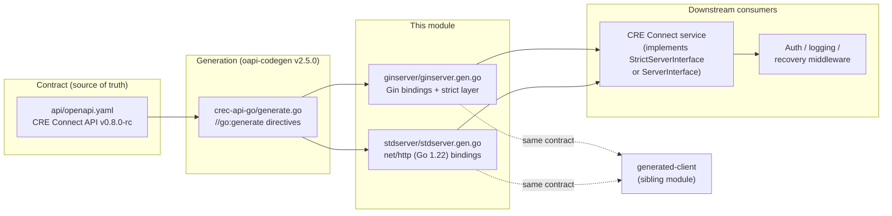
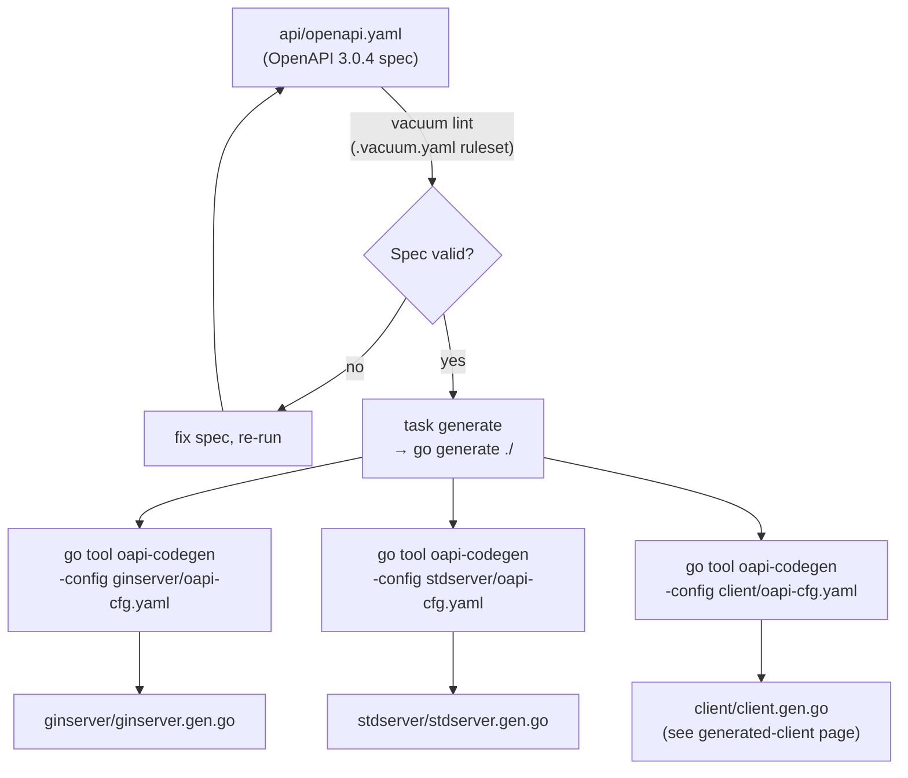
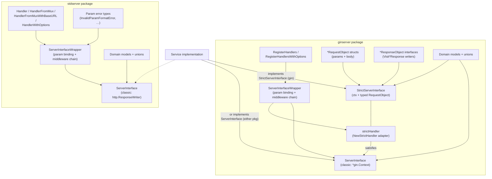
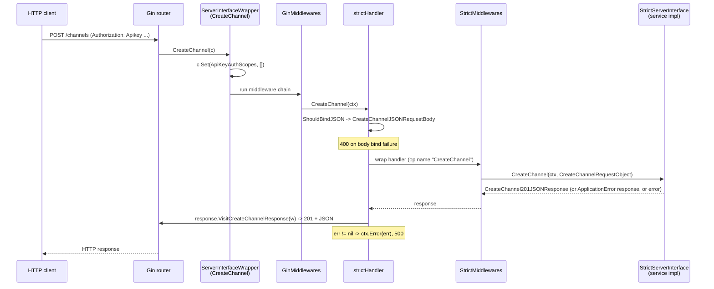
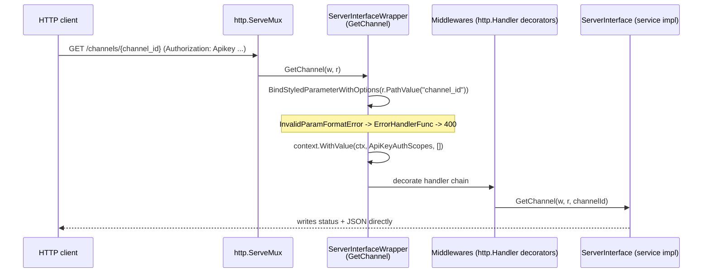
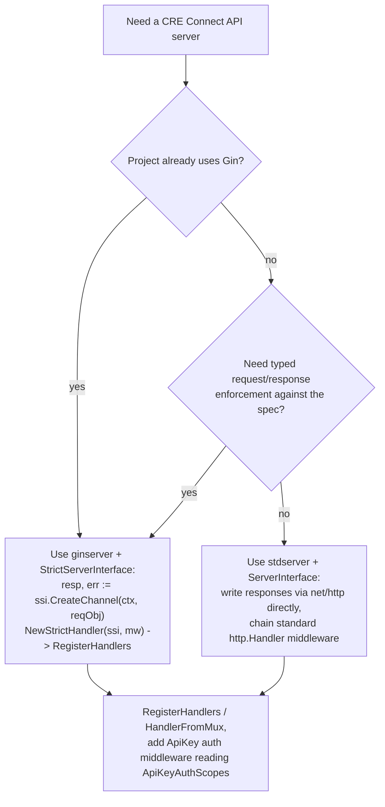

# crec-api-go-openapi / Generated Servers

## Overview

The **generated-servers** module provides the HTTP **server-side bindings** for the [CRE Connect API](crec-api-go-openapi_api-specification.md). It contains two packages, both fully machine-generated by [`oapi-codegen v2.5.0`](https://github.com/oapi-codegen/oapi-codegen) from the single source of truth `crec-api-go/api/openapi.yaml`:

| Package | File | HTTP framework | Interface style |
|---|---|---|---|
| `ginserver` | `crec-api-go/ginserver/ginserver.gen.go` | [Gin](https://github.com/gin-gonic/gin) (`gin.IRouter`) | Classic `*gin.Context` handlers **and** a "strict" typed request/response layer |
| `stdserver` | `crec-api-go/stdserver/stdserver.gen.go` | Go standard library `net/http` (Go 1.22+ `ServeMux` with `r.PathValue`) | Classic `http.ResponseWriter` / `*http.Request` handlers only |

Neither file contains hand-written logic. Both files are marked `DO NOT EDIT` and must be regenerated whenever the OpenAPI specification changes — see [Regeneration workflow](#regeneration-workflow). Together with the sibling [generated client](crec-api-go-openapi_generated-client.md), they guarantee that client and server stay in lockstep with the contract, so drift between the published spec and the implementation is impossible by construction.

---

## Where this module fits

The module sits at the boundary between the CRE Connect service implementation and the outside world. The parent module [crec-api-go-openapi](../crec-api-go-openapi.md) groups the whole contract-to-Go toolchain; this page covers the two server bindings only.



The REST surface itself (wallets, channels, watchers, operations, queries, events) is documented once in the [API specification](crec-api-go-openapi_api-specification.md) page and is not repeated here.

---

## Generation pipeline

Everything in this module is derived from three checked-in inputs. The chain is:



The relevant artifacts that drive this pipeline:

- **`crec-api-go/generate.go`** — three `//go:generate go tool oapi-codegen ...` directives (ginserver, stdserver, client) plus a models generation pass. The code generator is pinned as a Go *tool* via the `tool github.com/oapi-codegen/oapi-codegen/v2/cmd/oapi-codegen` directive in `crec-api-go/go.mod`, so every developer and CI run uses the exact same generator version (v2.5.0).
- **`crec-api-go/Taskfile.yaml`** — `task generate` runs `go generate ./`; `task validate-openapi` lints the spec with `vacuum lint --ruleset .vacuum.yaml ./api/openapi.yaml`.
- **`crec-api-go/ginserver/oapi-cfg.yaml`**:

  ```yaml
  package: ginserver
  output: ginserver/ginserver.gen.go
  generate:
    models: true
    gin-server: true
    strict-server: true
  output-options:
    skip-prune: true
  ```

- **`crec-api-go/stdserver/oapi-cfg.yaml`**:

  ```yaml
  package: stdserver
  output: stdserver/stdserver.gen.go
  generate:
    models: true
    std-http-server: true
  output-options:
    skip-prune: true
  ```

Two configuration choices have visible consequences in the generated code:

1. **`models: true` in both configs** — each package carries its **own copy** of every request/response domain type (`Channel`, `Wallet`, `Operation`, …). The packages are intentionally independent so that a service can adopt either (or both) without cross-importing.
2. **`skip-prune: true`** — oapi-codegen does not prune unused components. All schema types remain in the output even if no current endpoint references them, which makes the files a stable, complete mirror of the spec's component library.

The only meaningful strictness difference between the two configs is `strict-server: true`, which exists **only** in the ginserver config — hence the strict request/response layer described below is Gin-only.

---

## Package architecture



### Route registration surface

Both packages register the identical set of routes (path-for-path with the spec). The only difference is the registration mechanism: Gin's `router.GET/POST/PATCH(...)` with `:param` wildcards vs. Go 1.22 method-pattern `ServeMux.HandleFunc("GET /path/{param}", ...)`.

| Route | Methods |
|---|---|
| `/channels` | `GET`, `POST` |
| `/channels/{channel_id}` | `GET`, `PATCH` |
| `/channels/{channel_id}/events` | `GET` |
| `/channels/{channel_id}/events/search` | `GET` |
| `/channels/{channel_id}/events/search/{event_id}` | `GET` |
| `/channels/{channel_id}/operations` | `GET`, `POST` |
| `/channels/{channel_id}/operations/{operation_id}` | `GET`, `PATCH` |
| `/channels/{channel_id}/queries` | `GET`, `POST` |
| `/channels/{channel_id}/queries/{query_id}` | `GET` |
| `/channels/{channel_id}/watchers` | `GET`, `POST` |
| `/channels/{channel_id}/watchers/{watcher_id}` | `GET`, `PATCH` |
| `/health-check` | `GET` |
| `/networks` | `GET` |
| `/wallets` | `GET`, `POST` |
| `/wallets/{wallet_id}` | `GET`, `PATCH` |

---

## ginserver package

### The three handler layers

**1. `ServerInterface` (classic Gin).** The lowest-level contract: 24 methods taking `*gin.Context` plus pre-parsed path parameters and query-parameter structs (e.g. `ListChannels(c *gin.Context, params ListChannelsParams)`). Handlers write the HTTP response themselves.

**2. `StrictServerInterface` (strict).** A framework-neutral contract: each method takes a `context.Context` and a fully-typed `*RequestObject` struct, and returns a typed `ResponseObject` or an `error`:

```go
CreateChannel(ctx context.Context, request CreateChannelRequestObject) (CreateChannelResponseObject, error)
```

Request objects bundle path params, bound query params, and the decoded JSON body (`CreateChannelRequestObject{ChannelId, Body}`). Response objects are one concrete type per documented status code (`CreateChannel201JSONResponse`, `CreateChannel401JSONResponse`, `CreateChannel409JSONResponse`, …), each embedding the appropriate payload (`Channel`, `ApplicationError`, `OrganizationNotFoundJSONResponse`) and implementing a `VisitCreateChannelResponse(w http.ResponseWriter) error` method that sets the status code and encodes JSON. Because every spec-documented status code has a corresponding response type, an implementation returning only the declared response types cannot accidentally produce an undocumented response shape.

**3. `strictHandler` (the adapter).** `NewStrictHandler(ssi StrictServerInterface, middlewares []StrictMiddlewareFunc) ServerInterface` returns an adapter that:

1. Binds the JSON body via `ctx.ShouldBindJSON` (returning `400` on failure),
2. Wraps the strict call in the supplied `StrictMiddlewareFunc` chain (each middleware receives the operation name, e.g. `"CreateChannel"`),
3. Writes the returned `ResponseObject` through its `Visit...Response` method, or maps an `error` to `500`.

This means a service implements **only** the strict interface and gets Gin routing, binding, and status-code enforcement for free.

### Routing and the wrapper layer

`RegisterHandlers(router gin.IRouter, si ServerInterface)` and `RegisterHandlersWithOptions(router, si, GinServerOptions)` wire all 24 routes. `GinServerOptions` accepts:

- `BaseURL` — mount the API under a prefix,
- `Middlewares []MiddlewareFunc` — Gin request middlewares run *before* each handler (chain aborts if `c.IsAborted()`),
- `ErrorHandler` — custom handler for parameter-binding failures (default: `c.JSON(statusCode, gin.H{"msg": err.Error()})`).

Every route is served through a per-operation method on `ServerInterfaceWrapper`, which:

1. Binds path parameters via `runtime.BindStyledParameterWithOptions` (e.g. `channel_id` as `openapi_types.UUID`) and query parameters via `runtime.BindQueryParameter` into the typed `Params` structs,
2. On binding failure, invokes the `ErrorHandler` with `400`,
3. **Sets the auth-scope hook** in the Gin context:
   ```go
   c.Set(ApiKeyAuthScopes, []string{})
   ```
   The spec's single global security scheme is `ApiKeyAuth` (header `Authorization`, format `Authorization: Apikey <api-key>`, see the [API specification](crec-api-go-openapi_api-specification.md)); since it declares no scopes, the slice is empty. Authentication middleware reads this well-known key to discover per-endpoint scope requirements — a deployment that adds scoped security to the spec will automatically surface those scopes here after regeneration.
4. Runs the middleware chain and dispatches to the handler.

### Request lifecycle (Gin, strict mode)



---

## stdserver package

The `stdserver` package targets teams that want zero framework dependencies. It is guarded by the build tag `//go:build go1.22` because it relies on the enhanced `http.ServeMux` method-and-path routing (`r.PathValue("channel_id")`).

### Handler interface

`ServerInterface` declares the same 24 operations as ginserver, but with standard signatures:

```go
ListChannels(w http.ResponseWriter, r *http.Request, params ListChannelsParams)
GetChannel(w http.ResponseWriter, r *http.Request, channelId openapi_types.UUID)
```

There is **no strict layer** in this package — the `std-http-server` generator does not produce one. Implementations handle body decoding and response writing directly.

### Routing options

| Function | Behavior |
|---|---|
| `Handler(si ServerInterface) http.Handler` | Fresh `http.ServeMux` with all routes |
| `HandlerFromMux(si, m ServeMux)` | Register routes onto a caller-provided mux (the `ServeMux` interface allows any compatible router) |
| `HandlerFromMuxWithBaseURL(si, m, baseURL)` | Same, mounted under a base URL prefix |
| `HandlerWithOptions(si, StdHTTPServerOptions)` | Full control: `BaseURL`, `BaseRouter`, `Middlewares`, `ErrorHandlerFunc` |

`MiddlewareFunc` here follows the idiomatic `func(http.Handler) http.Handler` decorator pattern (not Gin's context-mutating style), and `ErrorHandlerFunc` replaces the default `http.Error(w, err.Error(), 400)` for binding failures.

### Typed parameter errors

Unlike the Gin binding path (which formats errors inline), stdserver returns structured, unwrap-able error values to the `ErrorHandlerFunc`, enabling programmatic classification:

| Type | Meaning |
|---|---|
| `InvalidParamFormatError` | Parameter present but failed format parsing (most common) |
| `RequiredParamError` | Required query argument missing |
| `RequiredHeaderError` | Required header missing |
| `TooManyValuesForParamError` | Single-value parameter received multiple values |
| `UnescapedCookieParamError` | Cookie parameter failed unescaping |
| `UnmarshalingParamError` | Parameter failed JSON unmarshaling |

Each carries the offending `ParamName` and wraps the underlying `Err` for `errors.Unwrap` / `errors.As` handling.

### Request lifecycle (std http)



---

## Shared domain model

Because both configs enable `models: true`, both packages expose a complete, structurally identical model library generated from the spec's `components.schemas`. Highlights relevant to server implementations:

### Error model — `ApplicationError`

The uniform error envelope for every non-2xx response:

```go
type ApplicationError struct {
    Code    *ApplicationErrorCode // optional machine-readable classification
    Message string
    Type    ApplicationErrorType  // CONFLICT | INTERNAL_ERROR | NOT_FOUND | ORGANIZATION_NOT_FOUND | VALIDATION_ERROR
}
```

`ApplicationErrorCode` enumerates the tenant-level classifications the API guarantees (e.g. `CHANNEL_NOT_FOUND`, `WALLET_ALREADY_EXISTS`, `WATCHER_ALREADY_EXISTS`, `IDEMPOTENCY_KEY_MISMATCH`, `OPERATION_NOT_FINALIZABLE`, `QUERY_NOT_FOUND`, `CHAIN_UNAVAILABLE`, `RESOURCE_VERSION_CONFLICT`). The reusable `OrganizationNotFound` response component aliases `ApplicationError` and is emitted as the `401` body on every protected endpoint (both packages generate the corresponding `401JSONResponse` wrappers).

Discriminated unions generated with full `As*` / `From*` / `Merge*` accessors (and, where the spec defines a discriminator property, `Discriminator()` / `ValueByDiscriminator()` dispatch):

| Union type | Variants | Discriminator |
|---|---|---|
| `PatchOperation` | `FinalizeOperation` (`accepted`), `CancelOperation` (`cancelled`) | `status` |
| `QueryBlockSelection` | `LatestBlockSelection` (`latest`), `FinalizedBlockSelection` (`finalized`), `BlockNumberBlockSelection` (`block_number`) | `type` |
| `CreateWatcher` | `CreateWatcherWithService`, `CreateWatcherWithABI` | none (inline anyOf) |
| `Event_Payload` | `OperationStatusPayload`, `QueryStatusPayload`, `WatcherStatusPayload`, `WatcherEventPayload`, `WalletStatusPayload` | none (selected via `headers.type`) |
| `EventHeaders_Proofs_Item` | `OCRProof`, `GenericProofObject` | none (inline anyOf) |

Other notable types: the aggregate roots `Wallet`, `Channel`, `Watcher`, `Operation`, `Query`, `Event`, `Network`, the lifecycle status enums (`OperationStatus` with 12 states from `pending_signature` through `confirmed`/`reverted`, `QueryStatus`, `WalletStatus`, `WatcherStatus`, `ChannelStatus`), CRE workflow linkage fields (`OperationStatusWorkflowId`, `WorkflowExecutionId` — CRE workflow/execution identifiers that appear when an OCR proof backs a confirmed operation or completed query), and `HexCalldata`, `DecimalString`, `WalletOperationId`, `ChainSelector` aliases preserving the spec's wire format.

> Note on JSON naming: the generated structs use `snake_case` JSON tags (`chain_selector`, `wallet_operation_id`). This is intentional — the wire format is snake_case, and the [vacuum ruleset](#regeneration-workflow) explicitly disables the `camel-case-properties` lint rule to protect it.

---

## Implementing a server: decision guide



**Gin (strict) — recommended for service implementations.** Implement `StrictServerInterface`; every handler returns a spec-typed response or error; body binding, status codes, and JSON encoding are generated. Wrap with `NewStrictHandler` and register:

```go
// illustrative wiring (ginserver)
svc := myServiceImpl{}
handler := ginserver.NewStrictHandler(svc, []ginserver.StrictMiddlewareFunc{logging})
ginserver.RegisterHandlersWithOptions(router, handler, ginserver.GinServerOptions{
    BaseURL:     "/v1",
    Middlewares: []ginserver.MiddlewareFunc{apiKeyAuth}, // reads ApiKeyAuthScopes if needed
})
```

**Standard library.** Implement `stdserver.ServerInterface` and either `stdserver.Handler(svc)` for a standalone mux or `stdserver.HandlerFromMuxWithBaseURL(svc, mux, "/v1")` to embed the API into an existing `http.ServeMux`. Classify binding failures with `errors.As` on the typed param errors.

---

## Regeneration workflow

Because both files are fully generated, the maintenance workflow is:

1. **Edit the spec** (`crec-api-go/api/openapi.yaml`) — never the `.gen.go` files.
2. **Validate** — `task validate-openapi` runs the [vacuum](https://github.com/daveshanley/vacuum) linter with the checked-in ruleset `crec-api-go/.vacuum.yaml` (Spectral OAS *recommended* rules plus project-specific relaxations: `camel-case-properties: false` to preserve the snake_case wire format and `description-duplication: false` for repeated error descriptions).
3. **Regenerate** — `task generate` (which runs `go generate ./` over the directives in `crec-api-go/generate.go`). The generator version is pinned by the `tool` directive in `crec-api-go/go.mod`, guaranteeing reproducible output.
4. **Build and update the service implementation** — add cases for new endpoints/operations; update `switch` statements over the generated enums.

Version bumps to `oapi-codegen` must be made in `crec-api-go/go.mod` so that all generated artifacts (client, both servers) change in the same commit.

---

## Related documentation

- [crec-api-go-openapi](../crec-api-go-openapi.md) — parent module: the contract-to-Go toolchain overview.
- [crec-api-go-openapi_api-specification](crec-api-go-openapi_api-specification.md) — the OpenAPI source of truth, the vacuum validation ruleset, and the full REST surface these servers implement.
- [crec-api-go-openapi_generated-client](crec-api-go-openapi_generated-client.md) — the type-safe Go client (`ClientWithResponsesInterface`) generated from the same contract; use it to build test doubles and integration tests against a server built from this module.
