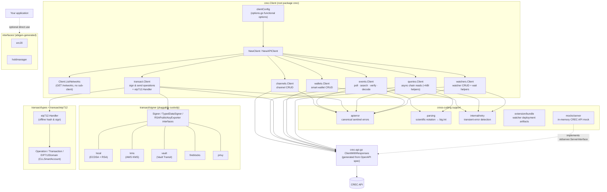
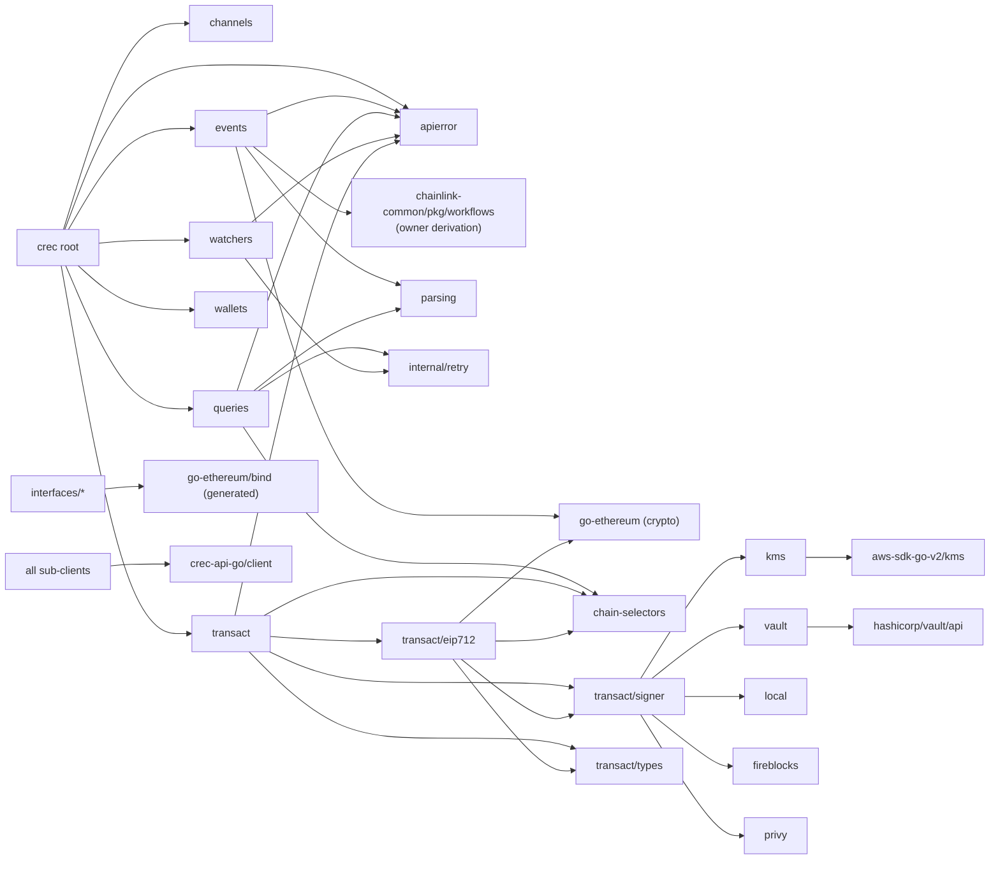
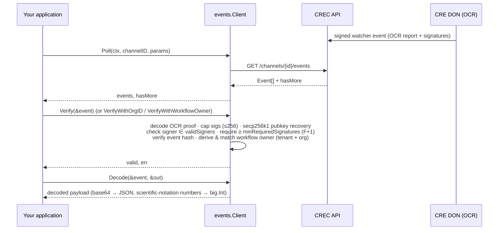
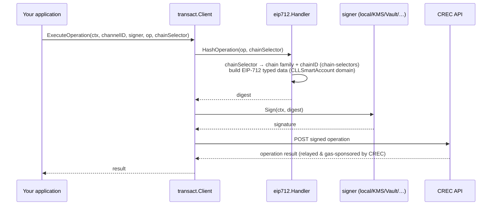
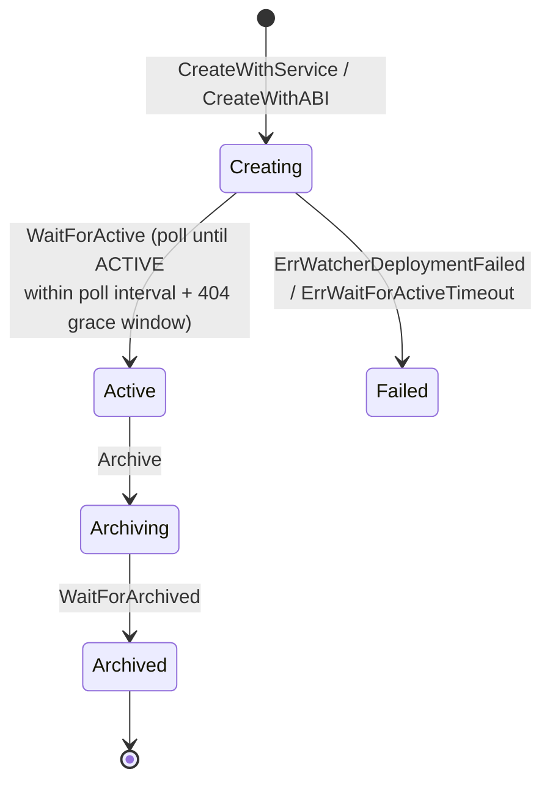

# crec-go-sdk — CRE Connect Go SDK

## 1. Overview

`crec-go-sdk` (repository path [`crec-sdk/`](../../repo/crec-sdk/README.md), Go module `github.com/smartcontractkit/crec-sdk`) is the official **Go client SDK for CRE Connect (CREC)** — the Chainlink service that delivers **verifiable blockchain events** and executes **gas-sponsored, account-abstraction transactions** on behalf of applications, powered by the [Chainlink Runtime Environment (CRE)](../Workflow___Capability_Runtime_(CRE_Engine).md).

The SDK solves two problems for application developers:

| Problem | SDK answer |
|---|---|
| **Trusting blockchain events** — are they authentic and untampered? | The `events` sub-client polls events delivered by a Chainlink Decentralized Oracle Network (DON) and cryptographically verifies the bundled OCR proof (multi-signature secp256k1 recovery against a configured signer set and F+1 threshold). |
| **Executing transactions safely** — atomic batching, gas, key custody | The `transact` sub-client builds, EIP-712 hashes, and signs `Operation` bundles (executed atomically by a CREC Smart Account), delegating gas payment and relaying to the CREC platform. Key custody is pluggable: local ECDSA/RSA keys, AWS KMS, HashiCorp Vault Transit, Fireblocks, or Privy. |

Around these two core flows, the SDK offers the supporting domain clients needed to operate a verifiable application end-to-end: **channels** (logical groupings), **watchers** (on-chain event subscriptions), **wallets** (smart-account management), and **queries** (asynchronous, channel-scoped EVM contract reads with verifiable results).

It is one of three developer-facing surfaces in this toolchain family — see [cre-cli](cre-cli-workflow-commands.md) (workflow lifecycle CLI) and the [TypeScript CRE SDK](cre-sdk-core.md).

> **License note:** the SDK is distributed under BUSL (see `crec-sdk/LICENSE`).

---

## 2. Position in the overall system

```
 Your Go application
        │
        ▼
┌────────────────────────────────────────────────────────────┐
│ crec-go-sdk (this module)                                  │
│  crec.Client ── sub-clients ──► shared APIClient           │
└───────────────────────────────┬────────────────────────────┘
                                │  wraps
                                ▼
        crec-api-go — OpenAPI-generated client & server types
        (spec: api/openapi.yaml — see crec-api-go-openapi.md)
                                │  HTTPS (Apikey header)
                                ▼
                      CREC / CRE Connect API
                                ▲
        ┌───────────────────────┴────────────────────────┐
        │  CRE DONs (Chainlink nodes run OCR3 workflows) │
        │  produce signed events & execute operations    │
        └────────────────────────────────────────────────┘
```

* **Upstream dependency:** `github.com/smartcontractkit/crec-api-go` — the SDK never hand-rolls HTTP calls; every request goes through the client generated from the CREC OpenAPI specification, and responses are decoded into the generated `client`/`models`/`stdserver` types. The specification, generated client, and server interfaces are documented in [crec-api-go-openapi](crec-api-go-openapi.md).
* **Chain integrations:** `github.com/smartcontractkit/chain-selectors` maps CRE chain selectors to chain IDs / families (EVM-only signing today); `github.com/smartcontractkit/chainlink-common` provides the canonical workflow-owner address derivation (`workflows.GenerateWorkflowOwnerAddress`) used to bind events to a CRE tenant. These are the same selector/derivation concepts used by the [CRE workflow runtime](../Workflow___Capability_Runtime_(CRE_Engine).md) and the [shared foundation types](../Shared_Foundation_Libraries___Domain_Types.md).
* **Ethereum stack:** `go-ethereum` supplies ABI encoding, typed-data (`apitypes`), secp256k1 crypto, and the `bind` framework used by the generated contract bindings in `interfaces/`.
* **Key custody backends:** `hashicorp/vault/api` and `aws-sdk-go-v2/service/kms` power the Vault Transit and AWS KMS signer implementations; `testcontainers-go` (with the Vault module) runs real-container integration tests.

---

## 3. Architecture

### 3.1 Component composition

`crec.NewClient(baseURL, apiKey, opts...)` (in `crec.go`) is the single entry point. It validates configuration, applies defaults, builds one authenticated `APIClient` (oapi-codegen `ClientWithResponses` with an `Authorization: Apikey …` request editor), and wires up six resource-oriented sub-clients that share it:



Key structural decisions:

* **Resource-oriented design** — one top-level `Client`, one sub-client per API resource; each sub-client can also be constructed **stand-alone** via `crec.NewAPIClient(...)` + its own `NewClient(&pkg.Options{APIClient: api})`, so a service that only needs, say, watchers does not pull in the rest ([usage in `doc.go`](../../repo/crec-sdk/doc.go)).
* **Single generated transport** — every sub-client embeds the same `*apiClient.ClientWithResponses`; authentication (static API key) is applied once in `NewAPIClient`.
* **Offline crypto** — hashing and signing (`transact/eip712.Handler`) require no network; only sending results touches the API.
* **Shared sentinel errors** — `apierror` owns canonical errors (`ErrChannelNotFound`, `ErrWalletNotFound`, conflict/validation sentinels) that every sub-client re-exports, so `errors.Is` works uniformly across packages.

### 3.2 Package dependency map



---

## 4. Core flows

### 4.1 Receiving and verifying events

The DON runs CRE workflows ([Workflow & Capability Runtime](../Workflow___Capability_Runtime_(CRE_Engine).md)); each report is an OCR-signed payload delivered through the CREC API. The SDK verifies them offline:



* **Default verification** is production-ready out of the box: `DefaultValidSigners` holds the 10 Ethereum-mainnet Zone-A workflow-node public keys and `DefaultMinRequiredSignatures = 4` (F+1 — at least one honest signer, since the DON transmits at exactly the threshold).
* **Tenant binding:** `WithDONConfig(creTenantID, threshold, signers)` configures tenant, threshold and signer set **as one atomic unit** — `NewClient` rejects incomplete units with `ErrIncompleteDONConfig`. `WithCRETenantID`/`WithEventVerification` remain as deprecated granular alternatives; `WithoutEventVerification` suppresses default backfilling.
* **Owner resolution:** verification can accept an org ID and derive the workflow owner via the CRE CREATE2-style derivation (`WorkflowOwnerFromOrgID`, using `chainlink-common` and the configured tenant ID, default `"1"` = mainline).

### 4.2 Signing and sending operations



Alternative lifecycles exposed by the client:

* **Manual split** — `SignOperation` (hash + sign) then `SendSignedOperation` (POST).
* **Draft + finalize** — `CreateUnsignedDraftOperation` (server-side draft, with per-transaction previews) then `ExecuteDraftOperation` with a digest + signer, or cancel it; 404/409 map to `ErrDraftNotFound` / `ErrDraftNotFinalizable` / `ErrDraftNotCancellable`.
* `types.Operation` enforces the platform invariants client-side (positive `ID`/`Deadline`, ≥1 transaction with non-negative `Value`, parseable chain ID) via the sentinel errors in `transact/types`.

### 4.3 Watcher lifecycle (with eventual-consistency handling)

Watchers subscribe a channel to smart-contract events (by predefined **service**, e.g. `dvp`/`dta`, or by raw **ABI**). The client wraps CRUD with polling state machines built on `internal/retry.IsTransient` (429/5xx/network indicators, never context cancellation):



Polling knobs (`WithWatcherPolling(pollInterval, eventualConsistencyWindow)`) tolerate 404s right after creation.

### 4.4 Asynchronous chain queries

`queries.Client.CallContract` submits an idempotency-keyed EVM read (`channelID` + `chainSelector` + contract + calldata + block selection) and waits (default poll 2s, bounded by `MaxWaitTime`) for a terminal status, then decodes the `verifiable_result` (base64 → JSON) and can decode return values against an ABI fragment (`queries/abi.go`). Numbers embedded in results go through the `parsing` package, which safely converts scientific notation / decimals into `big.Int` (exponent capped at ±100 000 to prevent DoS).

---

## 5. Sub-module documentation

The module decomposes into four sub-modules, each documented in detail (component responsibilities, diagrams, and usage). These pages live under [`crec-go-sdk/`](crec-go-sdk/):

| Sub-module | Scope | Documentation |
|---|---|---|
| **Client configuration** | `options.go` functional options, `clientConfig`, DON/event-verification defaults (`DefaultValidSigners`, `DefaultMinRequiredSignatures`), validation & error semantics in `NewClient`/`NewAPIClient` | [crec-go-sdk_client-config](crec-go-sdk/crec-go-sdk_client-config.md) |
| **Transaction engine** | `transact/signer` custody interfaces (`Signer`, `TypedDataSigner`, `RSAPublicKeyExporter`) with local / AWS KMS / Vault Transit / Fireblocks / Privy backends, and the EIP-712 `Operation` model in `transact/types` | [crec-go-sdk_transact-engine](crec-go-sdk/crec-go-sdk_transact-engine.md) |
| **Contract interfaces** | abigen-generated Go bindings for `IERC20` and `IHoldManager` (caller/transactor/session/raw/filterer surfaces) plus their ABI sources and generation workflow | [crec-go-sdk_contract-interfaces](crec-go-sdk/crec-go-sdk_contract-interfaces.md) |
| **Build & test tooling** | `Makefile`, `Taskfile.yaml` (codegen, tests, coverage, vendoring, lint, local pkgsite docs), `go.mod` dependency baseline, Vault-Transit test script and CI workflow | [crec-go-sdk_build-tooling](crec-go-sdk/crec-go-sdk_build-tooling.md) |

Reading order tip: start with [crec-go-sdk_client-config](crec-go-sdk/crec-go-sdk_client-config.md) (how every client is configured), then [crec-go-sdk_transact-engine](crec-go-sdk/crec-go-sdk_transact-engine.md) (signing model), and use [crec-go-sdk_contract-interfaces](crec-go-sdk/crec-go-sdk_contract-interfaces.md) when integrating directly with ERC-20 / HoldManager contracts; [crec-go-sdk_build-tooling](crec-go-sdk/crec-go-sdk_build-tooling.md) covers regenerating mocks/bindings and running the test suite.

The remaining in-repo packages (`channels`, `events`, `queries`, `wallets`, `watchers`, `apierror`, `parsing`, `internal/retry`, `extension/bundle`, `mocks/server`) are covered by the architecture and flow sections above; their API reference is served locally via the `docs` target (`pkgsite`, port 8080).

---

## 6. Related documentation

* [crec-api-go-openapi](crec-api-go-openapi.md) — the OpenAPI specification and generated client/server types this SDK is built on.
* [cre-cli workflow commands](cre-cli-workflow-commands.md) and [cre-cli backend clients](cre-cli-backend-clients.md) — the CRE CLI used to deploy/activate/pause/delete the workflows and private-registry records whose events this SDK consumes; its secrets commands talk to the same Vault gateway the SDK's Vault signer integrates with.
* [cre-sdk-core](cre-sdk-core.md) — the TypeScript SDK for authoring the workflow Wasm that runs inside CRE DONs.
* [Workflow & Capability Runtime (CRE Engine)](<../Workflow___Capability_Runtime_(CRE_Engine).md>) — where the verified events originate (OCR3 consensus, triggers, capabilities).
* [Shared Foundation Libraries & Domain Types](../Shared_Foundation_Libraries___Domain_Types.md) — chain types, chain-selectors, and the workflow-owner derivation primitives the SDK reuses.
* [Plugin Process Framework (Loop)](<../Plugin_Process_Framework_(Loop).md>) — how chain services like the relayer behind CREC plug into nodes.
