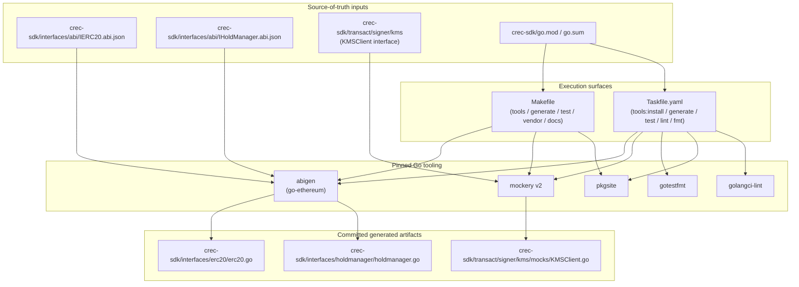
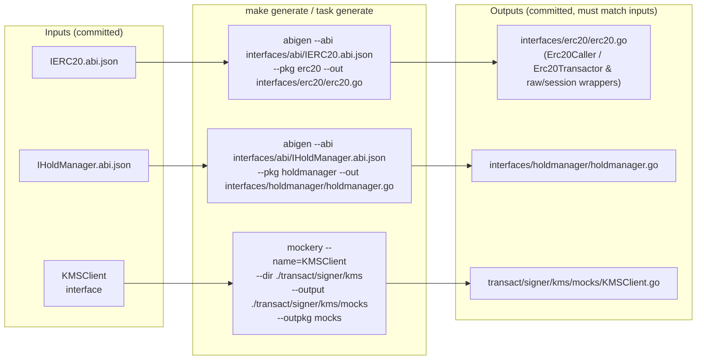
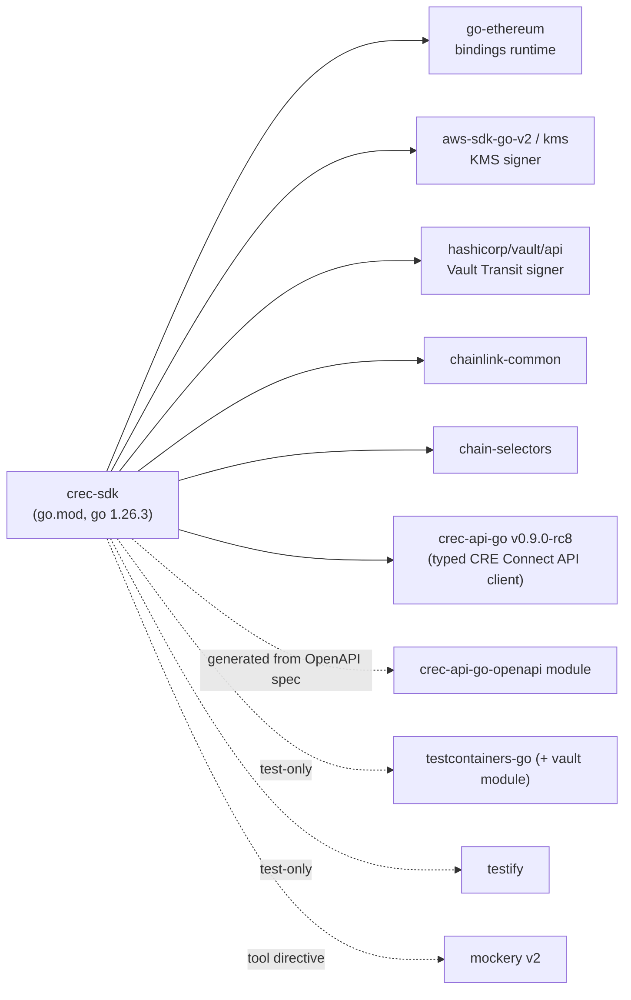
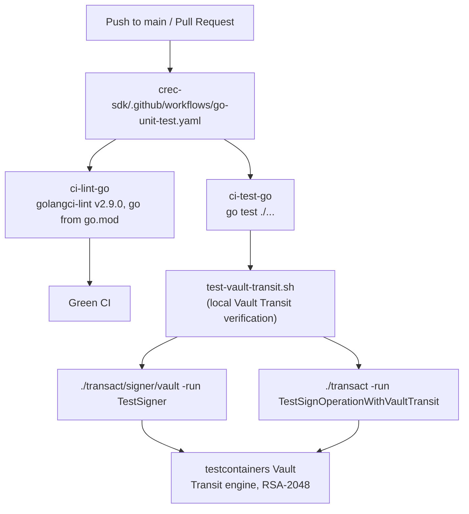

# crec-go-sdk Build Tooling

## Overview

The **build tooling** module is the developer- and CI-facing surface that keeps the [crec-go-sdk](../crec-go-sdk.md) (`github.com/smartcontractkit/crec-sdk`, the CRE Connect Go SDK) buildable, testable, documented, and internally consistent. It owns no runtime behavior of its own; instead, it defines **how the SDK's generated artifacts are produced and verified**:

- **Contract bindings** (`interfaces/erc20`, `interfaces/holdmanager`) are regenerated from committed ABI JSON files using `abigen` (go-ethereum).
- **Interface mocks** (`transact/signer/kms/mocks`) are regenerated from Go interfaces using `mockery`.
- **Tests, coverage, linting, and local docs** are driven through two parallel task runners: a classic `Makefile` and a richer `Taskfile.yaml`.
- **Dependency management** is centralized in `go.mod`, which also pins code-generation tooling via a Go `tool` directive.

For a top-level view of the SDK and how its sub-modules fit together, see [crec-go-sdk](../crec-go-sdk.md).

## Component Inventory

| Artifact | Core Component(s) | Role |
|---|---|---|
| `crec-sdk/Makefile` | `Makefile`, `generate`, `test` | Canonical, minimal entry points: tool bootstrap, code generation, testing, coverage, vendoring, docs |
| `crec-sdk/Taskfile.yaml` | `Taskfile.yaml` | Enhanced Task v3 runner: idempotent tool installation, pretty test output, lint & format tasks |
| `crec-sdk/go.mod` | `go.mod` | Module definition (`go 1.26.3`), dependency graph, and the `tool github.com/vektra/mockery/v2` pin |
| `crec-sdk/test-vault-transit.sh` | `test-vault-transit.sh` | Focused test harness for the Vault Transit signer (unit + testcontainers integration tests) |

## Architecture

The build tooling sits between **source-of-truth inputs** (ABI JSON, Go interfaces, `go.mod`) and the **committed generated artifacts** that the SDK's runtime modules consume. Everything is orchestrated through the Go toolchain plus a small set of pinned external generators.



### How this fits into the SDK

The generated artifacts feed the SDK's runtime sub-modules, documented separately:

- `interfaces/erc20/erc20.go` and `interfaces/holdmanager/holdmanager.go` — covered in detail in [crec-go-sdk Contract Interfaces](crec-go-sdk_contract-interfaces.md).
- `transact/signer/kms` (the interface and its mock) — part of the signing stack described in [crec-go-sdk Transact Engine](crec-go-sdk_transact-engine.md).
- Client construction options (`crec-sdk/options.go`) are orthogonal to the build tooling and documented in [crec-go-sdk Client Config](crec-go-sdk_client-config.md).

## Code Generation Pipeline

The `generate` target is identical in both the Makefile and Taskfile (the Taskfile additionally declares the required generators as task dependencies, so tools are installed on demand). It runs three deterministic commands:

1. **Mock generation (mockery)** — mocks the `KMSClient` interface (the AWS KMS surface of the KMS signer: `GetPublicKey` and `Sign`) so the KMS signer can be unit-tested without real AWS access.
2. **ERC20 binding generation (abigen)** — `interfaces/abi/IERC20.abi.json` → `interfaces/erc20/erc20.go` (package `erc20`).
3. **HoldManager binding generation (abigen)** — `interfaces/abi/IHoldManager.abi.json` → `interfaces/holdmanager/holdmanager.go` (package `holdmanager`).



**Maintenance contract:** generated files are committed to the repository. Any change to an ABI JSON file or to the `KMSClient` interface must be followed by running `make generate` (or `task generate`) and committing the regenerated output, keeping the checked-in bindings and mocks in lock-step with their sources.

## Task Surfaces: Makefile vs. Taskfile

Both runners implement the same core pipeline; the Taskfile is a superset aimed at developer ergonomics.

| Concern | Makefile target | Taskfile task | Notes |
|---|---|---|---|
| List tasks/tasks | — | `default` | `task --list` |
| Tool bootstrap | `tools` (unconditional `go install` of abigen, mockery, pkgsite) | `tools:install` (+ internal `tools:abigen`, `tools:mockery`, `tools:pkgsite`, `tools:gotestfmt`) | Taskfile installs **conditionally** — only if the binary is missing |
| Code generation | `generate` | `generate` (with tool deps) | Identical commands (mockery + 2× abigen) |
| Tests | `test` | `test` | `go test -v ./...` |
| Pretty test output | — | `test:pretty` | `go test -json` piped through `jq` → `gotestfmt`; has a `preconditions` check requiring `jq` |
| Coverage (summary) | `coverage` | `test:cover` | `go test -v ./... -cover` |
| Coverage (profile + report) | `coverage-report` | `test:cover-report` | `-coverprofile=... -covermode=atomic` + `go tool cover -func` (Taskfile writes into the `coverage/` dir) |
| Lint | — | `lint` | `golangci-lint run ./...` |
| Format | — | `fmt` | `gofmt -w .` |
| Vendoring | `vendor` | `vendor` | `go mod tidy` → `download` → `vendor` |
| Local docs server | `docs` | `docs` | `pkgsite -http :8080`, serving `http://localhost:8080/github.com/smartcontractkit/crec-sdk` |

> **Guidance:** use the Makefile for the minimal, canonical flows (CI-style) and the Taskfile for interactive development (pretty test output, lint/fmt, auto tool installation).

## Module & Dependency Management

`crec-sdk/go.mod` declares:

- **Module path:** `github.com/smartcontractkit/crec-sdk`, **Go version:** `1.26.3`.
- **Direct dependencies** grouped by domain:
  - *Ethereum runtime & bindings:* `github.com/ethereum/go-ethereum` (executes the ABI bindings generated by `abigen`).
  - *Signer backends:* `github.com/aws/aws-sdk-go-v2` (+ `service/kms`) for the KMS signer; `github.com/hashicorp/vault/api` for the Vault Transit signer.
  - *Platform libraries:* `github.com/smartcontractkit/chainlink-common`, `github.com/smartcontractkit/chain-selectors`.
  - *CRE Connect API client:* `github.com/smartcontractkit/crec-api-go v0.9.0-rc8` — the published Go artifact of the sibling [crec-api-go OpenAPI module](../crec-api-go-openapi.md), whose API schema (`api/openapi.yaml`) is the source of truth.
  - *Testing:* `github.com/stretchr/testify`, `github.com/testcontainers/testcontainers-go` (+ its `modules/vault` package, used by the Vault Transit integration tests).
- **Tool dependency:** `tool github.com/vektra/mockery/v2` — mockery is pinned inside the module graph via the Go tool directive (available as `go tool mockery`), in addition to the `@latest` installs performed by the `tools` targets.
- The `vendor` target exists so consumers of a vendored build can refresh `go mod vendor` after dependency changes.



## Testing Infrastructure

### Standard test flow

- `test` / `test:cover` / `coverage-report` run the full suite via `go test ./...` with verbose and coverage variants (`-covermode=atomic` for the profile).
- `test:pretty` (Taskfile only) streams `go test -json` output through `jq` into `gotestfmt` for human-friendly rendering; it fails fast with a message if `jq` is missing. Raw JSON is preserved in `coverage/test.json`.

### Vault Transit test harness

`crec-sdk/test-vault-transit.sh` is a focused harness for the Vault Transit signing path:

1. Runs the Vault signer unit tests: `go test ./transact/signer/vault -v -run TestSigner -timeout=60s`.
2. Runs the integration test against the transact client: `go test ./transact -v -run TestSignOperationWithVaultTransit -timeout=60s`.

Both use **testcontainers** to boot a real Vault instance with the **Transit secrets engine and RSA-2048 keys**, exercising the end-to-end signing flow without mocks. This is the recommended verification step when changing anything under `transact/signer/vault` or the KMS/Vault signer contract.

### Continuous integration

`crec-sdk/.github/workflows/go-unit-test.yaml` runs on pushes to `main` and all pull requests, with two jobs:

- **`ci-lint-go`** — the shared `smartcontractkit/.github/actions/ci-lint-go` action, pinned to golangci-lint **v2.9.0** with `--timeout=5m` and the Go version resolved from `go.mod`. The local `task lint` target mirrors this check.
- **`ci-test-go`** — the shared `ci-test-go` action executing `go test ./...`.



## Local Documentation

The `docs` target starts a **pkgsite** server at `http://localhost:8080`, exposing the SDK's rendered Go documentation at `http://localhost:8080/github.com/smartcontractkit/crec-sdk`. This complements the quick-start and workflow documentation in the SDK README and the `go doc` commands documented there.

## Typical Development Workflows

**Fresh checkout bootstrap**
```bash
task tools:install   # or: make tools
make vendor          # tidy + download + vendor
task test            # or: make test
```

**Changing a contract ABI**
1. Edit `crec-sdk/interfaces/abi/IERC20.abi.json` (or `IHoldManager.abi.json`).
2. Run `make generate` (or `task generate`).
3. Commit the regenerated `interfaces/erc20/erc20.go` / `interfaces/holdmanager/holdmanager.go` together with the ABI change. See [crec-go-sdk Contract Interfaces](crec-go-sdk_contract-interfaces.md) for what the generated bindings contain.

**Changing the KMS signer interface**
1. Update the `KMSClient` interface in `crec-sdk/transact/signer/kms/signer.go`.
2. Run `task generate` to refresh `transact/signer/kms/mocks/KMSClient.go`.
3. Run `task test` and, for Vault/KMS signing changes, `./test-vault-transit.sh`. Context in [crec-go-sdk Transact Engine](crec-go-sdk_transact-engine.md).

**Pre-submit checks**
```bash
task lint        # matches CI's golangci-lint gate
task fmt         # gofmt
task test:pretty # readable full-suite output
```

## Maintenance Notes

- **Two tool-installation mechanisms coexist:** the Makefile/Taskfile install generators with `go install ...@latest` (unpinned), while `go.mod` pins mockery through the `tool` directive. Prefer module-pinned tooling for reproducibility when possible; `@latest` installs trade reproducibility for simplicity.
- **Generated code is source-controlled.** The generate targets write directly into package directories (`interfaces/erc20`, `interfaces/holdmanager`, `transact/signer/kms/mocks`); reviewers should verify that a PR changing an ABI or interface also updates the committed artifacts.
- **Taskfile extras are not in CI:** `lint` and `fmt` exist only in the Taskfile; CI's lint gate (`ci-lint-go`) is the authoritative enforcement point.
- The top-level `crec-sdk/mocks/` directory (hand-maintained test server mocks) is **not** managed by the `generate` targets, which only regenerate the KMS client mock and the two contract bindings.

## Related Documentation

- [crec-go-sdk](../crec-go-sdk.md) — module overview and component map.
- [crec-go-sdk Client Config](crec-go-sdk_client-config.md) — `clientConfig` and functional options.
- [crec-go-sdk Contract Interfaces](crec-go-sdk_contract-interfaces.md) — the generated ERC20 / HoldManager bindings.
- [crec-go-sdk Transact Engine](crec-go-sdk_transact-engine.md) — `Signer`, `TypedDataSigner`, and `Operation` types exercised by the Vault Transit harness.
- [crec-api-go OpenAPI](../crec-api-go-openapi.md) — the OpenAPI-driven module that publishes the `crec-api-go` client dependency consumed by this SDK.
- [Developer Toolchain overview](../../Developer_Toolchain_(CLI,_SDKs___API_Clients).md) — CLI, SDKs, and API clients in the broader toolchain (e.g., [cre-cli build & release tooling](../../Developer_Toolchain_(CLI,_SDKs___API_Clients)/cre-cli-build-and-release/cre-cli-build-and-release_build-tooling.md) for the CRE CLI's release automation).
- [Chainlink build & tooling](../../Build,_CI___Release_Infrastructure/chainlink_build_and_tooling.md) — repository-wide build conventions and shared CI actions used by this module's workflow.
