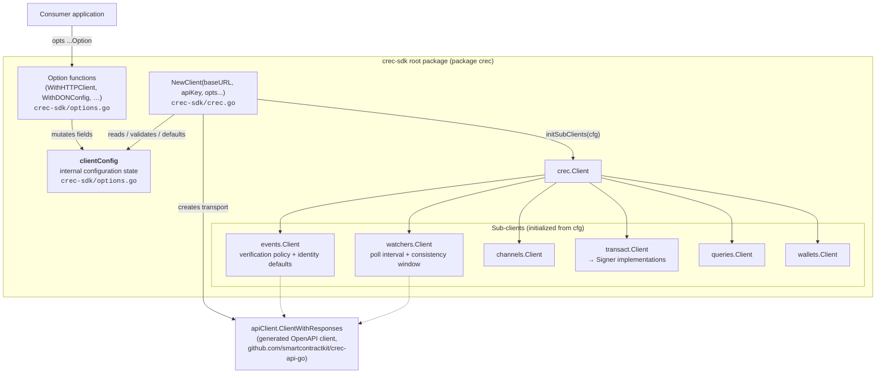
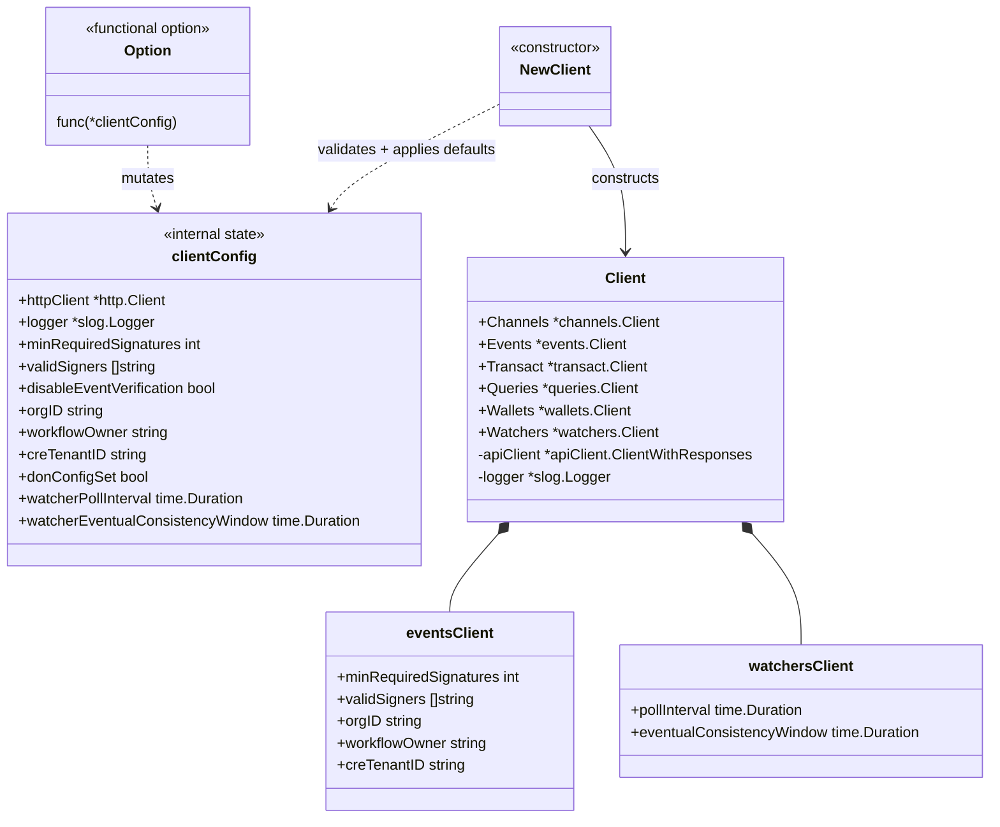
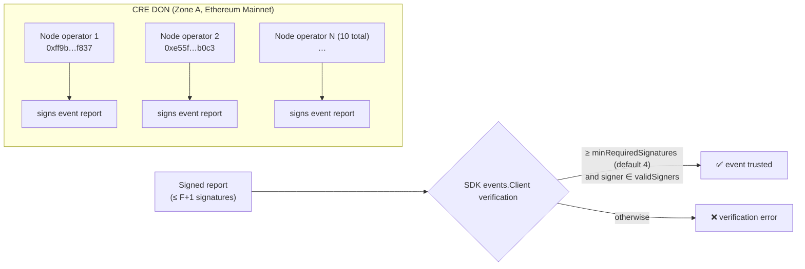
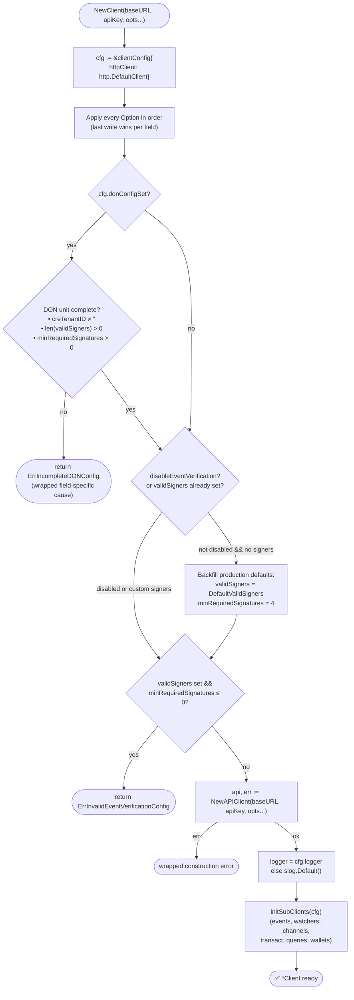
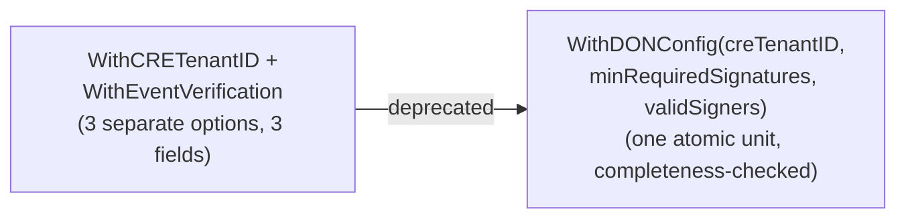

# crec-go-sdk — Client Configuration (`options.go`)

## Introduction

The **client-config** module is the configuration nucleus of the `crec` Go SDK (`github.com/smartcontractkit/crec-sdk`). It defines the internal `clientConfig` state object and the exported, functional-options API (`Option`) through which consumers tailor every behavior of the top-level `crec.Client` — HTTP transport, structured logging, DON (Decentralized Operator Network) event-verification policy, tenant/workflow-owner identity defaults, and Watcher polling semantics.

Its single core component is [`crec-sdk/options.go::clientConfig`](#the-clientconfig-struct). The struct is deliberately unexported: it is never touched directly by consumers. Instead, callers pass variadic `Option` functions to `crec.NewClient(baseURL, apiKey, opts...)`, which applies them in order, enforces validation gates (notably the atomic **DON configuration** rule), backfills secure defaults, and fans the resolved values out to the SDK's sub-clients.

> **Module placement.** This page documents the client-configuration slice of the [crec-go-sdk module](../crec-go-sdk.md). Companion pages cover [build & code-gen tooling](crec-go-sdk_build-tooling.md), the [transact engine](crec-go-sdk_transact-engine.md), and [generated contract interfaces](crec-go-sdk_contract-interfaces.md). The generated OpenAPI client this configuration wires into is documented in [crec-api-go OpenAPI](../crec-api-go-openapi.md).

---

## Architecture

### Component relationships

`clientConfig` sits between the consumer's option list and the client construction pipeline in `crec-sdk/crec.go`. It is a pure data holder — no I/O — whose fields are later *read* by `NewClient` and *copied* into the sub-clients that own the corresponding feature surfaces.



### The `clientConfig` struct

Defined in `crec-sdk/options.go`. Each field maps 1:1 to an option function:

| Field | Type | Purpose | Configured by |
|---|---|---|---|
| `httpClient` | `*http.Client` | Custom transport for CREC API requests | `WithHTTPClient` (default: `http.DefaultClient`) |
| `logger` | `*slog.Logger` | Structured logging across the SDK | `WithLogger` (default: `slog.Default()`) |
| `minRequiredSignatures` | `int` | F+1 signature threshold for event verification | `WithDONConfig`, `WithEventVerification` (deprecated), or default backfill |
| `validSigners` | `[]string` | Allow-list of signer addresses (hex) | `WithDONConfig`, `WithEventVerification` (deprecated), or default backfill |
| `disableEventVerification` | `bool` | Skips default signer-set backfill | `WithoutEventVerification` |
| `orgID` | `string` | Default organization ID for events verification calls | `WithOrgID` |
| `workflowOwner` | `string` | Default workflow owner address for events verification | `WithWorkflowOwner` |
| `creTenantID` | `string` | CRE tenant ID used for workflow-owner derivation | `WithDONConfig`, `WithCRETenantID` (deprecated) |
| `donConfigSet` | `bool` | Marker that `WithDONConfig` was used; enables the atomic completeness gate | set internally by `WithDONConfig` |
| `watcherPollInterval` | `time.Duration` | Delay between Watcher state polls | `WithWatcherPolling` |
| `watcherEventualConsistencyWindow` | `time.Duration` | Grace period tolerating 404s right after Watcher creation | `WithWatcherPolling` |

The `Option` type itself is a plain function type:

```go
// Option is a functional option for configuring the Client.
type Option func(*clientConfig)
```

### Class view



---

## Security defaults: DON verification policy

The configuration module embeds the production trust anchor for **event signature verification** (see [events sub-client], configured via `WithDONConfig`/`WithEventVerification`):

- **`DefaultMinRequiredSignatures = 4`** — an *F+1* threshold, where `F` is the maximum number of faulty nodes the DON tolerates. Because at least one of `F+1` signatures must originate from an honest node, verified data is guaranteed to have passed DON consensus. The DON transmits as soon as this minimum is reached, so reports never carry more than `F+1` signatures — **raising this value causes verification to fail**.
- **`DefaultValidSigners`** — the public keys of the production *Zone A* workflow node operators (Chainlayer, CLP, Dextrac, Fiews, iNotel, LinkForest, LinkPool, LinkRiver, PierTwo, SimplyVC). The canonical, up-to-date set lives in the `chainlink-deployments` repository; keys change rarely, and SDK releases pick up new defaults when they do.



---

## Configuration resolution flow in `NewClient`

`crec-sdk/crec.go::NewClient` owns the canonical resolution algorithm. The order matters and encodes the module's key safety rules:



Key invariants implemented by this flow:

1. **Atomic DON configuration.** When `WithDONConfig` is used, `donConfigSet` flips on, and `NewClient` rejects *incomplete* DON units with `ErrIncompleteDONConfig` *before* any default backfill could silently mask the mistake. Threshold-vs-signer consistency is left to `events.NewClient`, which owns that invariant for direct constructors.
2. **Safe defaulting.** Without explicit verification settings, the SDK backfills the production Zone A signer set and the F+1 threshold — so a naïve client is secure by default.
3. **Explicit opt-out.** `WithoutEventVerification` suppresses the backfill, leaving the client with **no** signers; subsequent verification calls fail at runtime with `events.ErrVerificationNotConfigured`. It does *not* override signers configured via `WithEventVerification` or `WithDONConfig`.
4. **Option composition.** If deprecated granular options are mixed with `WithDONConfig`, the *last applied option wins per field*; however, once `WithDONConfig` has been applied, the completeness gate applies regardless of option order.

---

## Option catalog

All options live in `crec-sdk/options.go` and are exported from package `crec`.

| Option | Signature | Effect | Status |
|---|---|---|---|
| `WithHTTPClient` | `(client *http.Client) Option` | Replaces the default transport for API requests. Useful for proxies, retries, OTel instrumentation. | stable |
| `WithLogger` | `(logger *slog.Logger) Option` | Injects a structured `slog` logger used by the root client and sub-clients. | stable |
| `WithDONConfig` | `(creTenantID string, minRequiredSignatures int, validSigners []string) Option` | Configures event verification **atomically**: CRE tenant ID (workflow-owner derivation), F+1 threshold, and signer set. Values come from onboarding — they are *not* SDK constants. Sets `donConfigSet`, enabling the completeness gate. | **preferred** |
| `WithEventVerification` | `(minRequiredSignatures int, validSigners []string) Option` | Granular threshold + signer override. | ⚠️ **deprecated** → use `WithDONConfig` |
| `WithCRETenantID` | `(creTenantID string) Option` | Sets the CRE tenant ID for workflow-owner derivation. Defaults to `events.CreMainlineTenantID` (`"1"`) when unset. | ⚠️ **deprecated** → use `WithDONConfig` |
| `WithoutEventVerification` | `() Option` | Skips default signer backfill (client ends up with no signers; verification calls fail with `events.ErrVerificationNotConfigured`). Does not remove explicitly configured signers. | stable (explicit opt-out) |
| `WithOrgID` | `(orgID string) Option` | Default org ID; enables `Events.Verify` / `Events.VerifyOperationStatus` without an explicit org. For multi-org usage, omit and pass an org per call (`VerifyWithOrgID`, …). | stable |
| `WithWorkflowOwner` | `(workflowOwner string) Option` | Default workflow-owner address; enables `Events.VerifyWithWorkflowOwner` / `Events.VerifyOperationStatusWithWorkflowOwner` without an explicit owner. | stable |
| `WithWatcherPolling` | `(pollInterval, eventualConsistencyWindow time.Duration) Option` | Tune Watcher polling cadence and the post-creation 404 tolerance window (eventual consistency). | stable |

### Migration path away from deprecated options



---

## How configuration reaches the sub-clients

`initSubClients(cfg)` (in `crec-sdk/crec.go`) copies only the fields each sub-client owns:

| Sub-client | Fields consumed from `clientConfig` | Feature surface |
|---|---|---|
| `events.Client` | `minRequiredSignatures`, `validSigners`, `orgID`, `workflowOwner`, `creTenantID`, `logger` | Event polling + signature verification |
| `watchers.Client` | `watcherPollInterval`, `watcherEventualConsistencyWindow`, `logger`, API client | Watcher lifecycle with polling waits |
| `channels.Client`, `queries.Client`, `wallets.Client` | `logger`, API client | Channel/query/wallet management |
| `transact.Client` | `logger`, API client; signing keys come from the [transact engine](crec-go-sdk_transact-engine.md) (`transact/signer.Signer`) | Operation signing & submission |

The underlying HTTP transport is created via `NewAPIClient(baseURL, apiKey, opts...)` from the generated `crec-api-go` client (`apiClient.ClientWithResponses`) — see [crec-api-go OpenAPI](../crec-api-go-openapi.md).

---

## Data flow summary

```mermaid
sequenceDiagram
    participant App as Application
    participant Opt as Options (options.go)
    participant Cfg as clientConfig
    participant New as NewClient (crec.go)
    participant API as apiClient (crec-api-go)
    participant Sub as Sub-clients

    App->>Opt: WithDONConfig(tenantID, 4, signers)
    Opt->>Cfg: set creTenantID, threshold, signers, donConfigSet=true
    App->>New: NewClient(baseURL, apiKey, opts...)
    New->>Cfg: initialize (http.DefaultClient)
    New->>New: apply opts (last-wins per field)
    New->>New: DON completeness gate (donConfigSet)
    New->>New: default backfill / verification validation
    New->>API: NewAPIClient(baseURL, apiKey)
    New->>Sub: initSubClients(cfg)
    Sub-->>App: *crec.Client ready
```

---

## Development & build context

- **Module & deps** — `crec-sdk/go.mod` declares `module github.com/smartcontractkit/crec-sdk` (Go 1.26.3) and pulls in the generated client `github.com/smartcontractkit/crec-api-go`, `go-ethereum` (signing/address types), AWS KMS + HashiCorp Vault (key sources for the transact engine), and `chainlink-common`. See [build & code-gen tooling](crec-go-sdk_build-tooling.md).
- **Code generation** — `crec-sdk/Makefile` and `crec-sdk/Taskfile.yaml` generate mocks (`mockery`, e.g. `KMSClient`) and ABI bindings (`abigen` for `IERC20` / `IHoldManager`); these generated artifacts are the other surfaces the configured client exposes. Run `make test` / `task test` to validate configuration behavior.
- **Testing** — `crec-sdk/test-vault-transit.sh` exercises the Vault Transit signer integration via testcontainers, demonstrating how `transact`-related configuration (keys) composes with the client built here.

---

## Related documentation

- [crec-go-sdk overview](../crec-go-sdk.md) — SDK purpose, install, and module map
- [crec-go-sdk build tooling](crec-go-sdk_build-tooling.md) — Makefile/Taskfile targets, code generation
- [crec-go-sdk transact engine](crec-go-sdk_transact-engine.md) — `Signer`, `Operation`, KMS/Vault key sources
- [crec-go-sdk contract interfaces](crec-go-sdk_contract-interfaces.md) — generated ERC-20 / Hold-Manager bindings
- [crec-api-go OpenAPI](../crec-api-go-openapi.md) — generated HTTP client consumed by the configured `Client`
